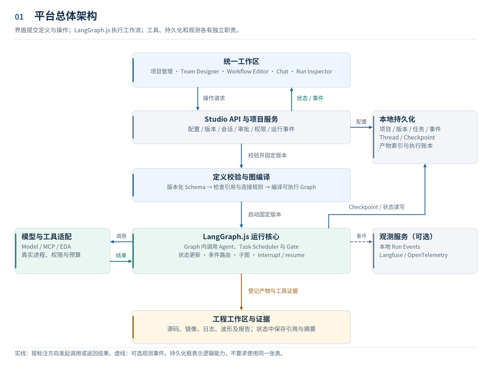
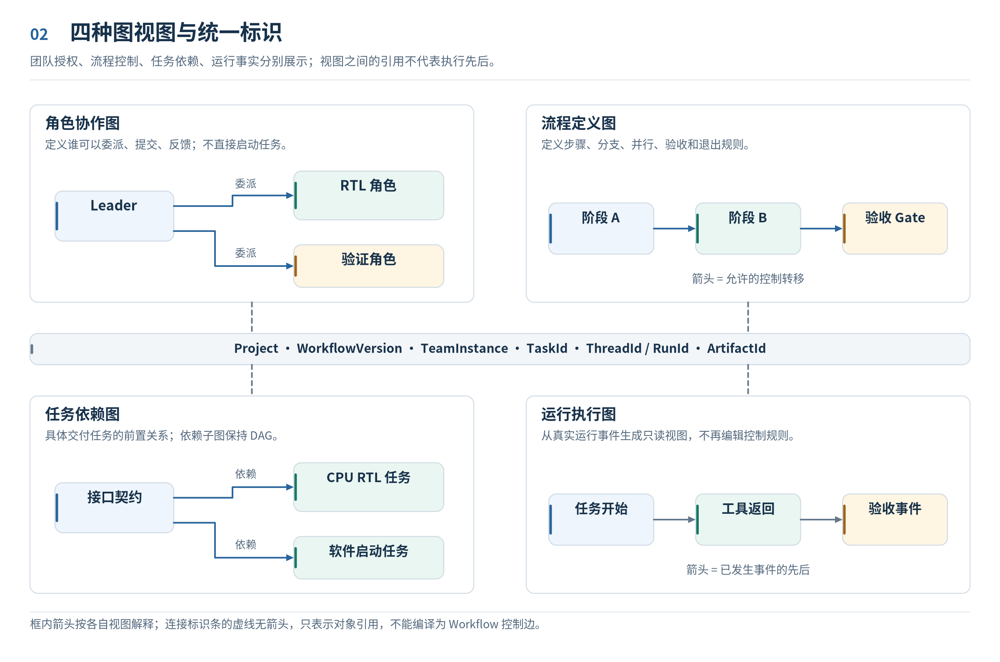
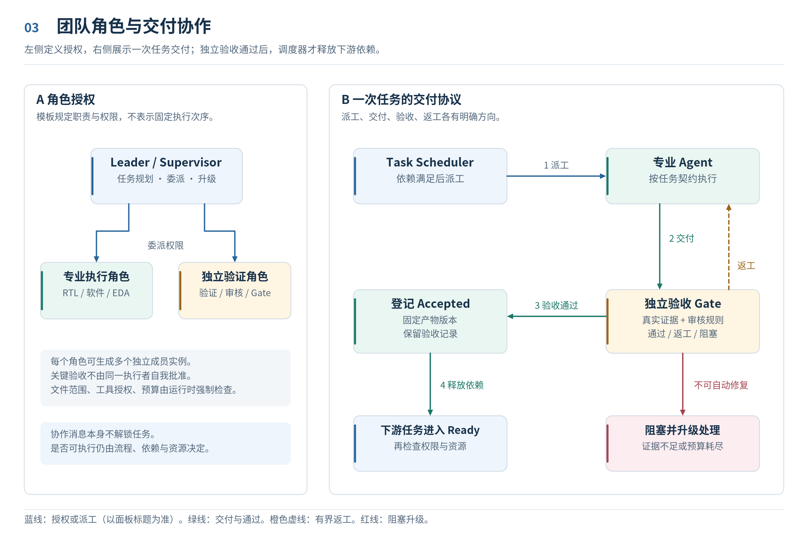
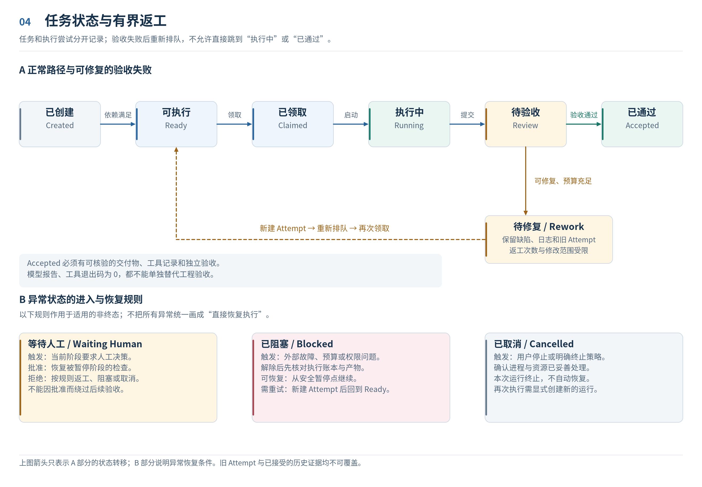
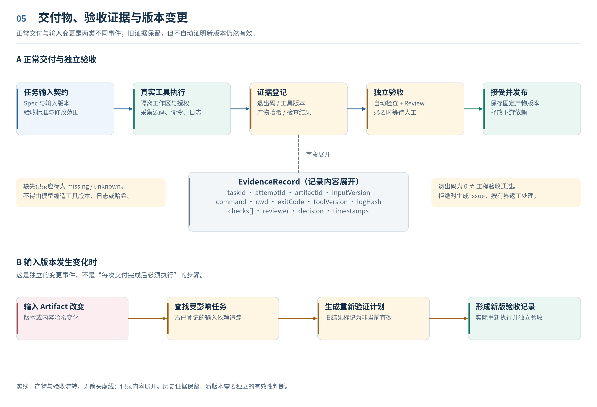
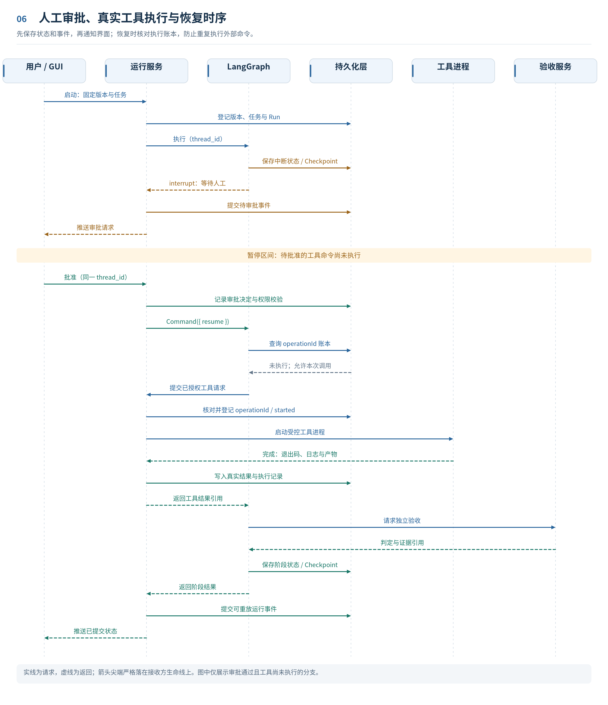
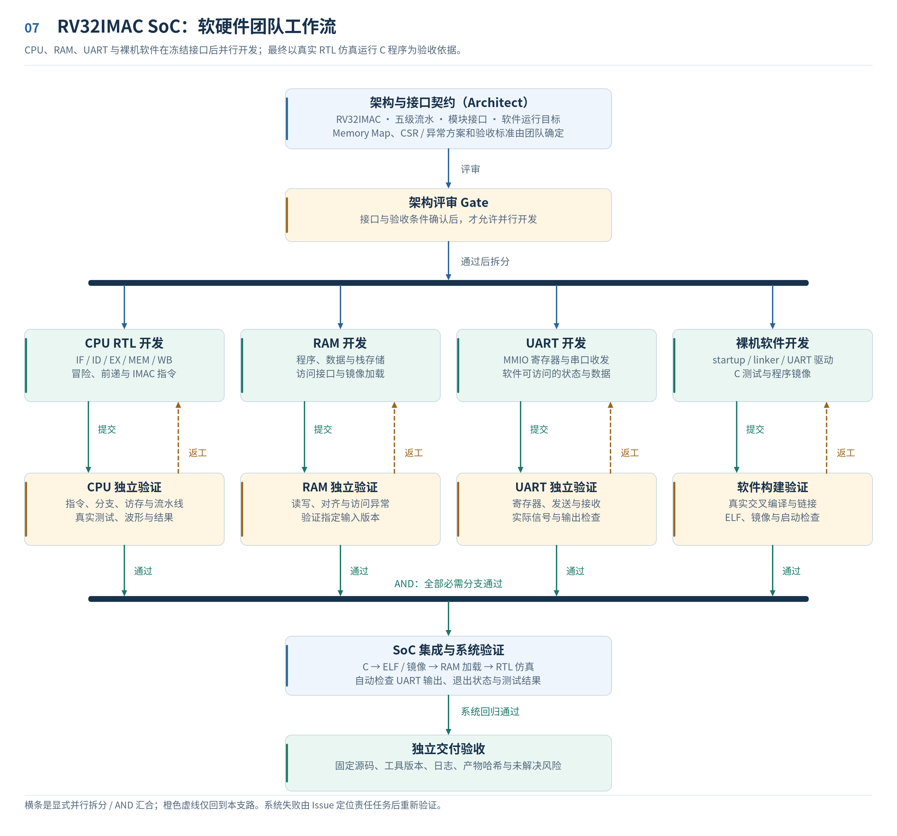
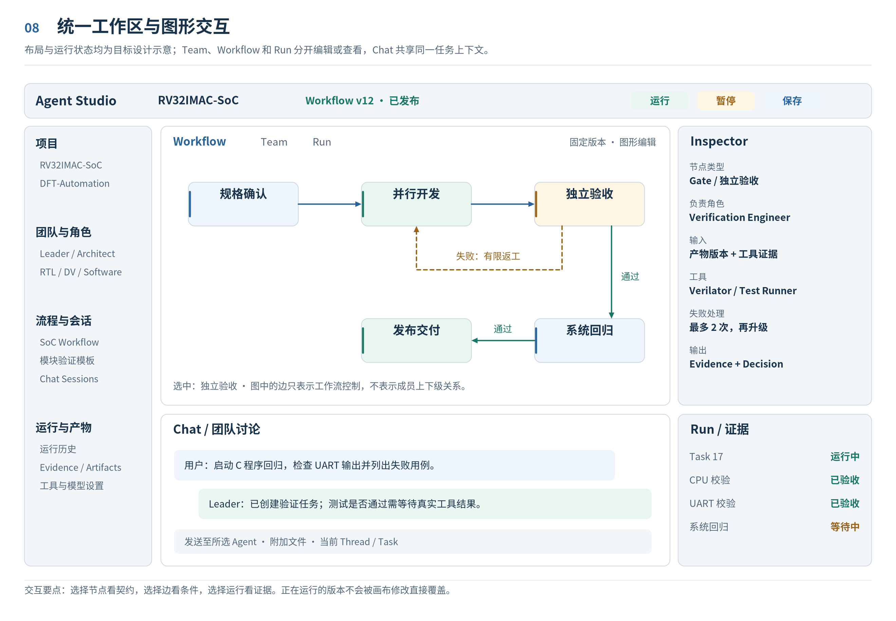

# Agent Studio：面向图形化 Workflow 与多智能体团队的设计目标与架构构想

> 设计类型：目标架构与产品设计文档  
> 版本：1.1（2026-11-02，插图与图示规则重绘修订）  
> 适用范围：通用工程自动化，重点面向数字 IC、RISC-V SoC、RTL 验证、综合和 DFT 等任务  
> 设计基础：所提供 Agent Studio 源码所采用的 TypeScript / React / LangGraph.js 技术方向，以及此前讨论的 Agent Chat UI、React Flow、LangConfig、Langfuse 和多 Agent 协作方案。  
> **说明：本文只规定期望达到的系统形态、运行规则与设计构想，不按当前代码完成度编排，不构成现有功能验收报告。**

## 摘要

Agent Studio 应成为一个**通过图形界面定义协作规则，并由真实 Agent 团队执行工程任务**的本地优先开发平台。用户既能在画布中编辑固定的 Workflow，也能为复杂工程建立团队，指定 Leader、架构、RTL、验证、软件、EDA 等角色，再由团队在流程允许的范围内把宏观任务拆分为可执行任务。平台不仅展示“谁与谁相连”，还必须能决定**谁有权领取任务、什么时候可以开始、需要提交什么证据、失败后退回哪里、谁能够批准继续运行**。

核心设计主张是 **“一个统一领域模型，四种图形视图”**：

1. **角色协作图（Team Graph）**：描述角色、成员、权限与通信关系。
2. **流程定义图（Workflow Graph）**：描述阶段、条件、并行、审批和子流程；是主要的控制规则来源。
3. **任务依赖图（Task Graph）**：描述具体任务、模块、前置条件、责任人和交付物；可根据项目需求在运行时生成。
4. **运行执行图（Execution Graph）**：将真实运行事件投影到图上，显示状态、工具调用、证据、失败与恢复。

四种图通过稳定的 Project、WorkflowVersion、TeamInstance、Task、Thread、Run、Artifact 等标识相互关联，**不允许用一类边同时暗示协作、数据依赖和执行顺序**。LangGraph.js 负责状态图执行与 Checkpoint；TypeScript 调度服务在 Graph 的授权节点中实施任务领取、资源配额和验收决策；真实工具通过 Tool/MCP 执行。Agent 的自然语言判断只是决策输入，不替代可检验的流程规则。

---

### 插图阅读约定

本文的图示表达设计约束，不表示软件当前已经实现这些能力。每张图都独立说明连接含义，不使用一条边同时表达组织授权、执行控制和数据依赖。

| 图形元素 | 解释方式 |
| --- | --- |
| 单向实线箭头 | 按当前图的标题和边标注解释为调用、执行、提交或依赖；尖端指向明确接收节点 |
| 有箭头虚线 | 在协作图与工作流中表示有限返工；在时序图中表示返回消息，以本图图例为准 |
| 无箭头虚线 | 对象引用或数据记录展开，不参与工作流执行 |
| 粗横条 | 仅在并行流程图中使用，表示明确的拆分或 AND 汇合节点 |
| 分区边框 | 区分视图或规则类别，本身不是执行节点，不隐含跨区连线 |

方向、边文字和图例共同定义含义，不能只靠颜色判断。所有图使用固定节点端口、独立反馈通道和明确的箭头尖端；时序图的接收点位于对应生命线。

---

## 1. 产品定位、使用方式与设计原则

### 1.1 产品定位

Agent Studio 定位为**面向工程任务的可视化 Agent IDE 与团队执行平台**，而不是普通聊天工具，也不是仅用于展示流程图的编辑器。

用户通过一个统一的 GUI 完成以下完整操作：创建或导入工程 → 选择工作流模板 → 配置团队角色 → 绘制协作关系与阶段流程 → 指定工具和模型 → 运行 → 查看成员对话及实时状态 → 审核工程产物 → 处理失败与返工 → 形成可追溯的交付结果。

例如，用户输入“设计一个含五级流水 RV32IMAC CPU、RAM、UART 的 SoC，并能运行 C 程序”，系统应该允许：

- Architect 将目标细化为指令集、模块接口、软件启动、验证和验收条件；
- Leader 规划模块、人员和依赖，必要时请求用户确认；
- 多名 RTL Agent、Software Agent 在互不冲突的工作区并行开发；
- Verification Agent 独立执行编译、仿真和比对，不接受只包含“测试通过”的文本声明；
- 上游规格变更自动提示受影响的下游任务需要重新验证；
- 用户在同一页面观察 Flow、团队成员、Chat、日志和任务证据，并可中断、批准、退回或停止任务。

### 1.2 目标与非目标

**目标**：图形化构建真实可运行的工作流；可复用角色与团队；动态任务拆分；显式任务依赖；多角色协作和独立审核；本地模型或远程模型可选；MCP/EDA 工具接入；可恢复执行；本地工程资产管理；运行过程可重放和评估。

**非目标**：

- 不重新开发 LLM 推理引擎、数字 IC 仿真器、综合工具或 ATPG 算法引擎；
- 不将任意 TypeScript 源码自动、无损地转换为可编辑的流程图；
- 不承诺仅通过 Prompt 即可保障权限、安全或工程正确性；
- 不将“Agent 自称成功”视为工程验收通过；
- 不强制引入 LangSmith 云服务，也不强制部署 Langfuse 才能运行 Agent；
- 不要求所有任务必须多 Agent：单 Agent 和确定性工具流程仍应是一等使用方式。

### 1.3 六条基本原则

1. **以图定义约束，以事件还原事实**：设计图是规范；执行图由运行事件生成，不允许 GUI 虚构状态。
2. **角色、任务、流程分离**：角色是能力模板，任务是待交付的工作单元，流程是允许的状态转移与依赖关系。
3. **先定义交付契约，再开始执行**：任务至少包含输入、负责人、目标、输出、验收规则和资源权限。
4. **Agent 提建议，系统执行规则**：动态规划可以由 LLM 完成，任务解锁和审批决策最终由确定性程序校验。
5. **证据优先**：所有“已通过”的工程结果必须能追溯到真实文件、命令、工具和日志。
6. **本地优先、可扩展**：前后端统一 TypeScript；在本地运行不依赖商业托管，外部模型和可观测服务按需配置。

---

## 2. 系统总体架构



**图 1 的连接含义。** 用户操作由统一工作区发往 Studio API，状态事件沿另一条明确的返回线传回界面；图编译结果交给 LangGraph.js 运行核心。Agent、Task Scheduler 和 Gate 是受该运行核心控制的能力，不再画成互相并列、各自决定流程的多套 Runtime。运行核心分别连接工具适配、持久化、工程证据与可选观测服务；图中未将这些不同功能串接成同一执行流程。

### 2.1 技术分层

| 层次 | 建议技术 | 设计职责 |
| --- | --- | --- |
| 统一前端 | React + TypeScript + Next.js；React Flow | 项目工作区、团队/流程可视化编辑、Chat、运行状态及审查界面 |
| 后端应用 | Node.js + TypeScript + Fastify | 项目与版本 API、事件流、任务/会话服务、工具策略和凭据管理 |
| 流程定义 | 版本化 JSON Schema + Zod | 校验节点、边、状态变量、角色引用、输入输出及动态扩展规则 |
| Agent 执行 | LangGraph.js + LangChain.js | `StateGraph`、Subgraph、状态更新、条件路由、`interrupt`、Checkpoint |
| 团队执行 | TypeScript Team/Task Scheduler | 角色实例化、依赖解锁、资源分配、工作领取、独立验收与返工调度 |
| 工具 | 内置工具 + TypeScript MCP Client / Server | 文件、终端、Git、编译、仿真、综合、DFT、报告解析等真实工具能力 |
| 持久化 | SQLite 起步；可升级 PostgreSQL | 项目、图版本、任务、事件、会话、Checkpoint、证据索引与权限 |
| 观测 | 结构化本地 Run Events；可选 Langfuse / OpenTelemetry | 节点耗时、模型调用、工具运行、成本、错误、评测和 Trace |

建议保留**一套可执行 Agent Runtime**：LangGraph.js 是控制流和可恢复状态的基石。Team Scheduler 不再另造一套隐藏的流程引擎，而是作为 Graph 节点与运行服务协作，通过经校验的任务状态与事件决定下一步。前端只能发出用户操作或配置修改，不能直接改写运行结果。

### 2.2 核心逻辑模块

- `Project Workspace`：工程目录、项目配置、模板、文件、模型及工具环境。
- `Agent Registry`：角色模板、模型配置、System Prompt、Skills、工具白名单与上下文策略。
- `Team Designer`：团队层级、成员数量、调度与审核关系、通信策略。
- `Workflow Editor`：流程节点、条件、并行、子图、审批、输入输出与图版本。
- `Workflow Compiler`：将经过校验的图定义转换为 LangGraph.js 可执行图。
- `Team Planner`：将项目需求和模板转化为任务计划、模块清单及任务依赖图。
- `Task Scheduler`：检查前置条件与资源，派发准备就绪的任务，管理并发与等待队列。
- `Artifact & Evidence Registry`：登记交付文件、内容哈希、测试命令、报告及版本关系。
- `Review/Gate Service`：执行自动校验、独立复审和人工确认，形成验收决策。
- `Run Inspector`：对事件、状态、Token、工具、错误和任务进度进行统一可视化。

前端、后端与执行器均使用统一的对象 ID 和类型定义，避免图形画布、聊天会话、持久化记录各自生成一套不兼容的数据结构。

---

## 3. 四层图模型：必须区分协作与控制



**图 2 的连接含义。** 四个面板是同一项目的不同视图，并非必须顺序执行的四个阶段。面板内的箭头按各自标题解释：团队授权、流程控制、任务依赖或运行事件先后。四个面板与中央标识条之间使用**无箭头虚线**，只表示通过稳定标识引用同一对象，不能被编译成执行边。

### 3.1 Role / Team Graph：角色关系图

团队图的节点是**角色模板或运行时成员实例**，边的含义是组织和通信关系，例如分配、协助、提交、反馈、升级、委派和汇报。

示例：`Leader → RTL Engineer` 表示 Leader 可以委派工作；`Verification → RTL Engineer` 表示验证人员可以退回问题。**这些关系不表示每一次执行都必须按图连线流转**；是否执行，仍取决于 Task Graph 的任务依赖与 Workflow Graph 的控制规则。

角色模板可复用，团队实例按某次项目运行动态生成。一个 `RTL Engineer` 角色可以有三个成员实例，三人共享能力定义但拥有独立的会话、任务、工作区权限和 Token 预算。

### 3.2 Workflow Graph：流程控制图

流程定义图是用户在 Flow Editor 中编辑并发布的控制规则，包括 `Start/End`、任务阶段、Agent、Tool、Condition、Parallel、Join、Gate、Subgraph 和有界回流。

Workflow Graph 需明确：

- 哪个阶段允许启动下一个阶段；
- 什么时候并行、什么时候必须汇合；
- 哪个条件分支被选中；
- 哪些节点可以中断等待人工审批；
- 拒绝或工具失败时返回哪个节点，最多允许几次；
- 动态新增的任务可落在哪个受控区域，不能越过哪些固定 Gate。

保存的 Workflow 是**声明式定义**；运行时必须以已发布的不可变版本为准。画布布局坐标仅用于展示，不参与执行。

### 3.3 Task Graph：任务依赖图

Task Graph 由人工编辑或 Leader 根据项目要求生成，节点是**具体交付任务**，例如“实现 decoder.sv”“完成 UART 自检”“验证 RV32M 指令”。每项任务都指定角色、输入产物、交付文件、独立验收规则和资源需求。

任务依赖边是明确的前置约束，而不是聊天消息：

- `architecture_spec → rtl_decoder`：必须先冻结 decoder 设计契约；
- `rtl_decoder → dv_decoder`：验证必须以指定 RTL 版本为输入；
- `dv_decoder → soc_integration`：只有模块验收通过才允许释放依赖。

常规**依赖子图应保持 DAG**，便于计算可运行任务集合。返工通过带预算的失败/反馈状态机处理，而不是把依赖 DAG 随意变为不可判断的循环图。

### 3.4 Execution Graph：运行事件图

运行图不是另一份可编辑的工作流，而是以**固定 WorkflowVersion 与 TaskPlanVersion 为基础的运行视图**。它对每个实例标识等待、可运行、运行中、审核中、已通过、被拒绝、已阻塞、已取消，并能下钻到工具、日志、任务消息、Checkpoint 和 Artifact。

运行过程中动态展开的模块、子 Agent、子图必须有稳定实例 ID，并与来源定义节点关联。编辑器按实例聚合或展开，不能用“角色名相同”误认为同一次任务。

### 3.5 推荐标识体系

| 标识 | 含义 | 关键约束 |
| --- | --- | --- |
| `projectId` | 本地工程与资源范围 | 跨项目默认不可互相读写 |
| `workflowId` + `workflowVersion` | 流程模板及固定版本 | 运行开始后不随画布保存而变化 |
| `teamTemplateId` + `teamInstanceId` | 团队定义和本次实例 | 角色模板与成员实例分离 |
| `taskPlanId` + `taskId` | 具体任务计划和任务 | 任务属于一次明确的计划版本 |
| `roleId` + `agentInstanceId` | 角色能力和成员执行体 | 不同成员有独立上下文与权限 |
| `threadId` + `runId` | 长期会话与一次运行尝试 | Resume 使用同一 Thread，保留历史尝试 |
| `nodeId` + `nodeInstanceId` | 流程定义节点与实际调用 | 动态扇出实例可精确定位 |
| `artifactId` + `evidenceId` | 交付物及其校验证据 | 内容版本与接受状态可追溯 |
| `traceId` + `eventSeq` | 观测追踪及顺序事件 | 事件可重放、可去重 |

---

## 4. Agent 角色、团队结构与协作契约



**图 3 的连接含义。** 左侧是组织授权，右侧是一项任务的交付协议，二者不能互相替代。右侧按“调度器派工 → 成员提交 → 独立验收 → 登记接受状态 → 释放下游依赖”推进。橙色虚线由验收方返回专业 Agent，表示受预算约束的返工；它是协议层的简写，具体重试必须经过图 4 的重新排队和领取规则。不可自动处理的问题沿红线进入阻塞与升级，不得从缺少证据的状态直接进入 Accepted。

### 4.1 角色是能力配置，不是固定节点名称

一个 Agent Role 至少包括以下配置：

| 类别 | 建议字段 | 说明 |
| --- | --- | --- |
| 身份 | `id`、`name`、`description`、`tags` | 清楚定义专业领域和责任范围 |
| 模型 | `providerRef`、`modelRef`、模型参数 | 允许不同角色使用不同模型；支持本地模型 |
| 指令 | `systemPrompt`、`goal`、`rules` | 明确角色目标、边界与失败处理 |
| 能力 | `skills[]`、`tools[]`、`mcpServers[]` | 工具需要在运行时再次授权 |
| 上下文 | `contextPolicy`、`memoryScope`、`readScopes[]` | 限制跨任务消息量及可读取文件 |
| 文件权限 | `writeScopes[]`、`approvalPolicy` | 控制可写目录与敏感操作审批 |
| 接口 | `inputSchema`、`outputSchema` | 定义结构化任务接收和报告格式 |
| 预算 | `maxIterations`、`maxToolCalls`、`tokenBudget`、`timeout` | 对循环、费用和运行时长设置上限 |
| 协作 | `delegateTo[]`、`reportTo`、`reviewerPolicy` | 指定可委派对象和独立审核人 |

`System Prompt` 只说明预期行为；真正的权限由工具网关、工作区文件访问控制和审批服务强制检查。未经授权的 Tool 即使被模型生成了调用，也必须被拒绝。

### 4.2 团队模板与团队实例

团队模板应规定：Leader 角色、可用专业角色、人数范围、成员上下级与对等关系、任务分配策略、协作协议、默认审核人、并行资源限制。团队实例则保存某次运行实际创建的成员及分配结果。

团队人数与任务数量应解耦。例如，一个设计有 12 个 RTL 模块，可以只有 3 个 RTL Agent：调度器最多让 3 个符合依赖的任务同时运行，完成并验收一个模块后再安排下一个模块。一个角色也可以拥有受限制的子代理，但子代理不能自动继承全部工具权限。

推荐支持三种团队组织模式：

1. **Supervisor 型**：Leader 负责任务分解和协调，专业 Agent 独立完成任务；适合数字 IC 项目主团队。
2. **流水阶段型**：架构、设计、验证、集成、EDA 等按 Gate 交接；适合严格工程流程。
3. **并行协作型**：同类 Agent 处理不同模块或测试集合，最终汇总；适合大型回归与模块开发。

上述模式可以在一个项目中组合。建议允许一层 Leader → 专业成员 → 受控子代理的层级，并由项目配置最大层数、最大成员数和资源预算，不建议无约束递归创建 Agent。

### 4.3 五类主要交互协议

| 协议 | 发送方 → 接收方 | 消息最小字段 | 对运行的影响 |
| --- | --- | --- | --- |
| `assign` 分配 | Leader → Member | `taskId`、输入、要求、预算 | 只有符合依赖与资源规则时才允许领取 |
| `deliver` 提交 | Executor → Gate / Reviewer | `artifactIds`、`evidenceIds`、版本 | 触发独立验收，但不直接解锁下游 |
| `feedback` 反馈 | Reviewer → Executor | `issueIds`、严重程度、可复现步骤 | 进入有界返工，保留原失败证据 |
| `handoff` 交接 | Stage A → Stage B | 冻结输入版本、输出契约 | 通过 Gate 后释放后续阶段 |
| `escalate` 升级 | 任意成员 → Leader / 人工 | 阻塞原因、尝试记录、影响范围 | 暂停、改派或申请人工决策 |

每条协作边可附带配对策略：全部成员、按模块、轮询、按能力或指定成员。但**配对只决定消息和候选责任人，不自动满足任务依赖**。验收和资源约束始终由 Scheduler 执行。

### 4.4 消息可见性与团队记忆

建议区分四种上下文：

- **Project Context**：项目目标、冻结 Spec、共享代码和资源约束；按权限可检索。
- **Team Context**：任务计划、状态摘要、关键决策及角色报告；Leader 与相关成员可见。
- **Agent Private Context**：该成员的思考历史、工具过程、短期局部记忆；默认不广播。
- **Task Context**：当前任务的输入契约、相关文件、上游证据和问题记录；以任务为单位裁剪。

成员之间优先传递结构化 `TaskMessage` 与 Artifact 引用，而不是完整对话转发或大量工具日志。Leader 使用事件驱动的 Inbox/Mailbox：有新报告、状态变化或阻塞才被唤醒；不能依靠持续向 LLM 发起轮询。

---

## 5. 可视化 Workflow 编辑语言

### 5.1 编辑器的中心对象

画布中的每个节点必须是**带类型与配置 Schema 的节点**，每条边必须有明确的控制或协作含义。节点的展示组件、业务定义和 LangGraph 执行器分别建模，不能把 React Flow Node 直接当成运行时节点配置。

建议节点目录如下：

| 分类 | 节点类型 | 主要作用 |
| --- | --- | --- |
| 入口与出口 | `Start`、`End` | 初始化输入与产生最终输出 |
| 智能体 | `Agent`、`Team`、`Supervisor` | 调用单角色、实例化子团队、规划与调度 |
| 模型和工具 | `LLM`、`Tool`、`MCP Tool` | 模型推理与实际系统/EDA 工具执行 |
| 流程控制 | `Condition`、`Switch`、`Parallel`、`Join` | 条件、分支、并行与同步 |
| 任务控制 | `Task Planner`、`Task Queue`、`Task Gate` | 动态任务拆分、依赖领取、证据验收 |
| 协同与审批 | `Human Approval`、`Review`、`Escalation` | 独立审核、人工决定、异常升级 |
| 组织与复用 | `Subgraph`、`Team Subgraph` | 可复用局部任务/团队流程 |
| 数据处理 | `State Transform`、`Artifact`、`Parser` | 类型化状态读写、文件归档、工具输出解析 |
| 容错 | `Retry`、`Timeout`、`Error Handler` | 在设定预算内修复、终止或人工介入 |

节点目录可由插件扩展，但每种新增节点需要声明：输入输出类型、运行行为、是否有副作用、支持的出入端口、错误类别和安全策略。仅新增一个漂亮的方框，不算支持新节点。

### 5.2 边类型与规则

建议将可编辑边分成三组，以不同颜色、端口和图例展示：

- **控制边（Control）**：`next`、`conditional`、`error`、`retry`、`approval`，决定 Graph 的下一执行位置。
- **任务依赖边（Dependency）**：指定哪项任务需要哪些 Artifact 或 Gate 状态，可形成可调度 DAG。
- **协作消息边（Collaboration）**：`assign`、`deliver`、`feedback`、`handoff`、`escalate`，定义消息权限和交付关系。

此外可有 **Artifact/Data 引用关系**，它负责说明“哪个 Task 消费哪个版本的文件或结果”，但不会自然产生控制跳转。

不同类别的边不允许随意互连。例如 `Review` 的 `approved` 和 `rejected` 输出必须连接到合法的条件目标；`Task Dependency` 不能连接普通 Chat 消息端口；`Parallel` 与 `Join` 必须声明聚合规则。

### 5.3 并行、循环与汇合

**并行**：由 Graph 在明确的并行阶段或任务队列中发出多个任务实例（可参考 LangGraph 的 `Send`）；任务通过 Task Scheduler 按可用资源与许可额度实际领取。

**汇合**：`Join` 的默认条件是所有指定前置任务的**已验收状态**，不是所有 Agent 返回过一段文本。也可配置 `any`、`quorum` 或特定条件，但必须显式显示。并行状态更新需定义 Reducer，禁止多个成员对同一个标量键无序覆盖。

**循环**：返工必须使用有界的 `Retry/Rework`，包含最大尝试次数、失败类别、升级目标及预算。Workflow 不允许出现没有退出条件或资源上限的隐式循环；Task 的纯依赖图不应含环。

**动态展开**：允许在授权的 `Task Planner` / `Team` 区域增补具体任务，但需验证角色、输入/输出、依赖关系、预算和人工 Gate。动态 Task Graph 是运行实例的组成部分，不能悄悄改写已发布的 Workflow 模板。

在实现上，**动态任务不等于运行中修改已编译的 StateGraph 拓扑**：固定的调度/工作节点可根据持久化 TaskPlan 创建带独立任务标识的动态调用实例（例如通过 `Send` 扇出），可视化的任务节点由运行实例投影生成；需要改变流程控制规则时，应另行发布新 WorkflowVersion。这样避免已暂停的 Thread 因拓扑被随意改写而无法安全恢复。

### 5.4 Workflow 图到 LangGraph.js 的编译原则

建议采用单一编译流水：

```text
编辑器图（React Flow UI 数据）
    ↓ 仅提取逻辑定义，去除坐标/样式
WorkflowDefinition（版本化 JSON）
    ↓ 结构校验 + 角色引用校验 + 类型校验 + 控制流校验
合法的规范图（Canonical Graph）
    ↓ 按节点类型查找受信任的 Executor Registry
LangGraph.js StateGraph / Subgraph
    ↓ compile（持久化 Checkpointer、Store 和 Runtime 配置）
可执行 WorkflowVersion
    ↓ stream / invoke / interrupt / resume
事件、状态快照、任务与产物
```

关键对应关系：顺序边使用 `addEdge`；条件分支使用 `addConditionalEdges`；节点内动态转移按需要使用 `Command({ goto, update })`；任务扇出可使用 `Send`；人工交互使用 `interrupt()` 与 `Command({ resume })`；可复用流程使用 Subgraph。

**不得同时为同一控制节点设置互相冲突的静态出边和动态 `Command.goto`，否则可能意外执行多个分支。** 本设计在编译器中实施单一的路由权威规则：每个控制节点只能选择一种有效的路由形式。

对于从现有 TypeScript LangGraph 项目导入的工作流，支持**结构可视化和调试**，但不假定任意代码都能自动变为可逆向编辑的 JSON 图。外部代码节点可作为受控插件引用或只读图展示。

---

## 6. 团队任务规划与执行调度

### 6.1 将项目需求转为可执行计划

Leader 应先得到用户目标和工程约束，再生成可审核的 `TeamPlan`，至少包含：模块列表、每项任务的目标、所需角色、输入文件或上游 Artifact、产出、可验证的验收条件、任务依赖、可并行范围和预算。

建议采用以下过程：

1. **需求理解**：读取项目规格、可访问源码、约束与工具清单，记录缺失信息与假设。
2. **架构分解**：Architect 给出模块边界、接口契约、软件依赖和验证策略。
3. **计划生成**：Leader 生成任务实例草案及 Task Graph。
4. **计划检查**：系统检查依赖 DAG、文件冲突、角色权限、工具可用性和验收定义。
5. **计划发布**：必要时由用户确认；冻结本次 TaskPlanVersion。
6. **事件驱动派工**：Scheduler 根据依赖、资源和状态领取任务并执行。
7. **独立验收**：审核不通过则返工、改派或升级；通过才释放下游任务。

未冻结接口的情况下可允许原型探索，但不能让依赖该接口的正式任务在没有明确契约的前提下宣称已完成。

### 6.2 任务定义的最小契约

每项任务至少应有：

| 字段 | 描述 |
| --- | --- |
| `id` / `title` | 稳定任务标识与清晰目标 |
| `ownerRole` / `reviewerRole` | 主负责人角色和独立审核角色 |
| `inputs[]` | 上游 Artifact 及其版本/哈希 |
| `dependsOn[]` | 必须已通过的前置任务 |
| `deliverables[]` | 目标文件、报告与数据格式 |
| `acceptance[]` | 可由工具或审核人判定的检查项 |
| `allowedTools[]` | 该任务允许调用的工具 |
| `writeScopes[]` | 允许修改的文件与目录 |
| `resources` | CPU/内存/许可证/模型预算/并行限制 |
| `maxAttempts` | 最大自动返工次数 |
| `failurePolicy` | 阻塞、改派、人工审批、终止及退回规则 |

### 6.3 Scheduler 的责任边界

Scheduler 应是**有事件和持久状态的任务调度服务**，主要负责：

- 判断依赖是否通过、上游 Artifact 是否仍有效；
- 为准备就绪的任务选择合适的 Agent 成员；
- 申请模型、CPU、内存、EDA License Token、工作目录等资源；
- 确认成员是否已有进行中的任务，避免过量并发；
- 创建执行实例与 TaskLease，超时后按安全规则重新安排；
- 在任务提交时触发 Review/Gate，处理结果后再解锁下游；
- 汇总团队消息并在需要时唤醒 Leader。

Leader 可以提出改派、拆分、停止或重试建议，但不能跳过依赖检查直接把任务状态改成 `Accepted`。任务调度应由事件驱动，不通过模型轮询来检查“有无新任务”。

### 6.4 并行文件编辑与资源冲突

多个 Agent 写入同一个源码目录会引发版本覆盖与不可重现结果。建议默认采用**任务级隔离工作目录或 Git Worktree**：

- 每个任务在冻结的基线版本开始，独立修改自己负责的文件；
- 模块责任范围在派发前被明确，跨模块共享文件需要预约/协调；
- 提交时记录修改清单、补丁、基线提交和工具运行环境；
- Reviewer 在隔离环境验证，再由 Integrator 合并；
- 冲突提交不得自动覆盖，必须通过协调任务解决；
- EDA 商业工具许可证和大型仿真资源纳入调度配额。

对需要操作同一个物理工程数据库或共享输出目录的工具应使用串行资源锁；允许并行的计算步骤由资源调度器有序释放。

---

## 7. 状态机、验收 Gate 与失败返工



**图 4 的连接含义。** A 区只画正常状态推进以及可修复的验收失败。返工线从 Rework 返回 Ready，表示建立新的 Attempt、重新校验前置条件并再次领取；不直接回到 Running。B 区单独列出人工等待、外部阻塞与取消的恢复规则，避免把性质不同的异常错误地画成一个公共回流箭头。

### 7.1 任务与执行尝试分开

建议区分 `Task`（逻辑工作项）和 `TaskAttempt`（一次执行尝试）。一个任务可能经历多次失败、修复和重新审核，但其验收历史不能被覆盖。典型状态如下：

`created → ready → claimed → running → review → accepted`

在 `review` 阶段还可进入 `rework`、`blocked`、`waiting-human` 或 `cancelled`；运行中的权限、环境和人工决策事件也可以按明确规则引起暂停或阻塞。重试时创建新的 Attempt；旧的日志、文件哈希、审核意见继续保留。

**有界返工**使用 `review → rework → ready → claimed → running` 的路径。进入 Ready 前重新检查输入版本、任务依赖、剩余预算和文件权限；不得将失败的 Attempt 直接改写成正在运行的新尝试，也不得省略领取与资源检查。

**暂停恢复与失败重试必须区分。** 人工批准恢复被暂停阶段的检查，不直接判定工程通过；外部阻塞解除后先检查执行账本，能够安全续行时恢复暂停点，否则创建新 Attempt 并重新排队。取消确认后，本次运行终止，再次执行必须是显式的新运行。

`accepted` 的必要条件：所有必需产物存在且为正确版本；自动检查项目完成并可验证；独立审核满足规定条件；人工 Gate（如有）已经通过。

### 7.2 三层审核结构

1. **基础校验**：文件存在、非空、格式正确、路径合法、哈希可计算、所需工具完成。
2. **工程校验**：例如 SystemVerilog lint、Icarus/Verilator/VCS 仿真、单元测试、综合、Formal、ATPG、STA；按任务定义检查实际结果与阈值。
3. **独立 Review**：另一个角色审查设计合理性、缺失测试、异常日志和未解决问题；高风险情况下由人审批。

**Reviewer 与主要执行者应保持独立**。同一 Agent 的“我已经验证成功”不能代替另一项明确的验收动作；模型结构化 Review 也不能覆盖失败的工具退出码或缺少的日志。

### 7.3 失败分类与恢复策略

| 失败类别 | 示例 | 推荐处理 |
| --- | --- | --- |
| 设计错误 | RTL 功能不符、测试断言失败 | 生成可复现 Issue，返给原设计角色并限制尝试次数 |
| 环境或工具不可用 | EDA license 耗尽、可执行程序不存在 | 标记外部阻塞，保留日志；不把环境错误归咎于 RTL |
| 规格矛盾 | 接口定义冲突、指令行为不明确 | 升级给 Architect/Leader，冻结受影响任务 |
| 权限或安全风险 | 非授权目录写入、危险命令 | 拒绝执行，按权限和人工审批处理 |
| 资源耗尽 | Token、运行时间、存储或并发超限 | 取消/排队/缩小任务范围，不允许无限重试 |
| 审核不通过 | 证据不全、覆盖不足、报告矛盾 | 退回补充并重新产生独立验收记录 |
| 用户停止或修改目标 | Cancel、Spec 变更 | 终止安全可取消动作并启动变更影响分析 |

自动修复不得无条件改变验收标准，更不能通过删除失败用例、降低覆盖阈值、跳过指令类别来把结果变成“通过”。任何标准变更都必须新建版本并记录批准者。

### 7.4 上游变更的影响传播

如果上游 Spec、接口、RTL 或其他输入 Artifact 的哈希变化，系统必须找到依赖该版本的下游任务：

- 旧的 `Accepted` 结果保留作为历史证据；
- 对新版输入判定是否需要重新执行/重新审核；
- 影响到的任务进入 `stale` / `revalidation-required`，不能继续把旧结果当作当前有效结果；
- 由 Scheduler 生成重新验证计划，必要时请求用户确认。

此机制比简单把一条“反馈边”连接回 RTL 节点更加严格，可以避免旧验证证据在修改后的设计中继续被引用。

---

## 8. Artifact、工具运行与可信证据体系



**图 5 的连接含义。** 上半部分描述正常的工具执行、证据登记与独立验收；EvidenceRecord 下方展开框是数据字段说明，不是额外执行步骤。下半部分描述输入 Artifact 改变时触发的独立影响分析，因此不从“接受并发布”画一条无条件连线进入重新验证。只有版本或内容变化且影响相关任务时，才产生重新验证计划。

### 8.1 工程产物是一等对象

Artifact 不应只是一段聊天附件文字，而应是可查询的工程对象：路径/URI、项目 ID、任务 ID、产生者、工具及运行版本、SHA-256、生成时间、输入来源、审查状态与有效性。RTL、C 文件、链接脚本、网表、波形、日志、覆盖报告、ATPG 报告等均按此模型记录。

推荐把**大文件保留在工程目录或对象存储**，状态与聊天只保留 Artifact 引用及小型结构化摘要。不能把数百 MB 的仿真波形复制进 Graph State 或 LLM 上下文。

### 8.2 EvidenceRecord 最小内容

```json
{
  "schemaVersion": "1.0",
  "taskId": "cpu-rv32m-test",
  "attemptId": "attempt-3",
  "command": ["verilator", "--binary", "..."],
  "cwd": "workspace/verification",
  "tool": "verilator",
  "toolVersion": "recorded-at-runtime",
  "exitCode": 0,
  "logPath": "reports/cpu-rv32m-test.log",
  "logSha256": "<sha256-of-real-log>",
  "artifactIds": ["artifact:test-result"],
  "checks": [
    { "name": "exit-code", "status": "passed", "evidenceRef": "reports/cpu-rv32m-test.log" }
  ],
  "review": { "status": "pending", "reviewerRole": "verification" }
}
```

这是**目标数据格式示例**，不是声称已经执行过命令。`exitCode`、`toolVersion`、哈希和报告内容只能从真实运行环境采集，不由 LLM 虚构。缺少某项证据时必须显示 `unknown`/`missing`，不得默认视为成功。

### 8.3 Tool/MCP 执行模型

Tool Registry 应描述工具名称、版本、输入 Schema、输出 Schema、副作用级别、授权范围、超时、资源消耗和日志保留方式。调用过程需要按步骤记录：准备执行 → 权限与审批 → 申请资源 → 启动进程 → 收集退出码/日志/产物 → 解析与验证 → 发布事件。

对 EDA 工具，可扩展为 `compile_rtl`、`run_simulation`、`run_lint`、`run_synthesis`、`run_scan_drc`、`run_atpg`、`parse_reports` 等统一工具接口，由各工具适配器调用 Verilator、Yosys、Synopsys 或 Tessent。MCP 是工具访问协议，不是另一套任务调度器；工具执行和验收之间必须保持明确界面。

### 8.4 正确性边界

系统应区分：

- **执行成功**：工具进程运行完成、退出码和日志可信；
- **测试通过**：测试程序和检查脚本满足明确条件；
- **工程验收**：所有必需条件及独立审核通过；
- **用户接受**：存在需要人工确认的里程碑时，获得相应批准。

这些概念不能只用一个布尔值 `success` 替代。特别是某工具退出码为 0，并不自动表示完整芯片功能或时序目标已满足。

---

## 9. LangGraph.js Runtime、Checkpoint 与可恢复执行



**图 6 的连接含义。** 箭头起点和终点对应消息发送方、接收方的生命线；跨越中间生命线不表示向该参与者投递消息。该图展示“审批通过，且目标工具尚未执行”的典型分支：先保存中断状态及审批事件，再通知界面；记录审批决定后恢复同一 Thread；核对执行账本，由运行服务统一启动工具、保存真实结果并返回 Graph；独立验收后，再发布已提交的运行事件。工具调用的请求与返回通过同一运行服务衔接，不把工具结果画成返回给未发起调用的参与者。

### 9.1 状态的范围与数据更新规则

推荐将运行时数据分为：

| 数据类别 | 示例 | 保存和合并策略 |
| --- | --- | --- |
| Graph State | 当前阶段、路由结果、待审批事件 | Checkpointer 中持久化；定义明确的状态通道 |
| Task State | 负责人、Attempt、前置状态、锁 | 数据库事务维护；由运行服务生成可信状态事件 |
| Chat State | 用户消息、角色消息、对话索引 | 按 Thread 和 AgentInstance 隔离；可关联 Run |
| Artifact State | 文件 URI、版本、哈希、来源 | 产物仓库/数据库；不可因 Prompt 修改而伪造 |
| Team Memory | 决策摘要、任务报告、协作信箱 | 持久化；基于权限和上下文策略读取 |
| Observability | EventSeq、Span、Token、成本、错误 | 先记录本地事件，再异步发送观测后端 |

跨并行分支写入同一状态字段时，必须有定义好的 Reducer 或独立命名空间。对于 `messages[]` 可以使用追加型聚合；对于 `taskResults` 使用以任务 ID 为键的合并规则；对于 `approved` 等单值状态仅由指定权威节点写入。

### 9.2 暂停、恢复与人工审批

涉及人工确认的 Graph 节点使用 LangGraph 的 `interrupt()`，通过 Checkpoint 保存 Thread 状态。人审批后使用**同一个 `thread_id`**和 `Command({ resume })` 恢复；恢复操作可以形成新的 RunAttempt 记录，但仍属于相同的逻辑线程和固定版本。

需要特别注意 LangGraph 的一个运行语义：**从 interrupt 恢复时，中断所在节点会从节点开头重新执行。** 因此有副作用的工具命令必须放在审批完成之后，或使用持久化执行记录与幂等键保护，避免批准操作导致上一条命令重复运行。

### 9.3 Checkpoint 与外部副作用并非同一事务

LangGraph Checkpoint 可以恢复图的状态，但不能天然保证外部 EDA 命令、文件写入或商业工具数据库操作“恰好执行一次”。设计上应采用：

- `operationId` / `idempotencyKey`：由 `taskId + nodeInstanceId + attemptId + operationSeq` 生成；
- 工具执行账本：`planned → started → completed/failed/unknown`；
- 对可幂等的工作区任务允许检测结果后复用；
- 对不可安全重放的工具步骤，在状态为 `unknown` 时人工确认或执行专门的状态核查；
- 每次恢复先查询账本与 Artifact，再决定是否重新执行。

若某个外部动作是否执行成功无法判断，系统必须显示“待核查”，不能自动再次调用并宣称恢复成功。

### 9.4 运行版本与事件一致性

一次任务运行开始时固定：WorkflowVersion、TeamTemplateVersion、TaskPlanVersion、Role/Tool 配置快照与必要的模型参数。新的编辑保存可以生成新版本，但不会改变正在进行的运行。

运行事件应包含 `eventSeq`、`runId`、`threadId`、`taskId`、`agentInstanceId`、`nodeInstanceId`、`timestamp`、`payloadType`。事件先写入数据库，再向 GUI 发布；断线后客户端通过 `after=lastEventSeq` 补拉，避免任务在后台继续执行时前端丢失状态。

运行恢复需要区分 `resume interrupted task`、`retry failed attempt`、`replay from checkpoint` 和 `start new run from new version`。它们在 GUI 中必须是不同的操作，不应都标成“重试”。

---

## 10. 数字 IC 工作流模板：RV32IMAC SoC



**图 7 的连接含义。** 上方横条为显式并行拆分，下方横条为 AND 汇合，均作为正式的流程节点连接，不使用末端悬空的公共横线。CPU、RAM、UART、软件四条支路分别提交到对应验证步骤；橙色虚线仅返回本支路开发阶段，并受返工预算限制。只有所有必需支路通过，才允许进入 SoC 集成与系统验证。系统级失败先形成可定位的 Issue，再由调度器安排责任任务的修复和重新验证。

### 10.1 项目目标

用户任务示例：**设计一个采用五级流水线的 RV32IMAC RISC-V SoC，只集成 CPU、RAM、UART；软件使用 C 语言，能在 RTL 仿真中运行编译后的程序并通过 UART 输出结果。** 具体 Memory Map、RAM 组织、UART 寄存器、启动地址、异常处理细节等，由架构团队在设计阶段确定并形成可审查的契约。

### 10.2 团队角色

| 角色 | 主要工作 | 关键交付 |
| --- | --- | --- |
| Leader / Project Coordinator | 分解需求、派工、协调、追踪证据与风险 | TeamPlan、任务依赖与里程碑报告 |
| Architect | 定义五级流水微架构、存储访问协议、软件接口 | 架构 Spec、模块端口、异常/CSR 方案 |
| CPU RTL Engineer | 实现 IF/ID/EX/MEM/WB、冒险、前递、IMAC 指令 | CPU RTL、接口文档、单元测试 |
| Memory/UART Engineer | 实现片上 RAM、UART MMIO 与顶层连接 | RAM/UART RTL、外设行为与测试 |
| Software Engineer | 实现裸机启动、链接脚本、UART 驱动、C 示例 | startup、linker、驱动、ELF/镜像 |
| Verification Engineer | 编写指令、流水线、外设与系统测试 | Testbench、测试脚本、波形、报告 |
| Integration/Reviewer | 执行系统级集成、问题定位、独立验收 | 实际仿真证据、最终交付记录 |

角色可按模块复制为多个成员；小型工程也可由少量成员兼任，但**关键 Gate 仍须有独立的验收行为**。

### 10.3 阶段与依赖构想

**阶段 A：需求与架构。** Architect 形成模块接口、指令集支持范围、MMIO/内存访问策略、流水线冲突处理、CSR/异常与程序启动方案，并获得设计评审通过。

**阶段 B：并行开发。** 在冻结的接口契约下，CPU、RAM、UART、裸机软件分别推进。CPU 任务可继续拆分为取指、译码、执行、访存、控制与流水线控制；任务之间按接口依赖组织，不强制一个 Agent 负责一个流水级。

**阶段 C：模块验收。** Verification 独立检查 RV32I、M、A、C 指令语义、加载/存储、访存对齐、分支与流水线冒险、原子操作行为、异常/CSR；并验证 RAM/UART 的真实信号交互。软件需完成编译、链接、启动和 ELF 加载检查。

**阶段 D：系统验证。** 生成 C 测试程序 → 交叉编译 → 转换/加载程序镜像 → 运行 RTL 仿真 → 捕获 UART 输出、退出状态和自检结果，生成结构化结果。至少覆盖 Hello World、函数调用、数组和栈、算术/乘除、循环分支以及代表性的原子/压缩指令测试。

**阶段 E：独立交付验收。** 在固定源码和配置上完成回归；保存命令、工具版本、日志、程序镜像与产物哈希。只有实际测试通过且重大风险已处理，才能形成最终交付记录。

本流程不要求 FPGA 实物运行或完整物理设计。若用户另行要求 DFT、综合、形式验证或后端实现，应以 **可选 Subgraph** 增加这些阶段，不能默认把工具不可用解释为测试通过。

### 10.4 验收 Gate 的配置实例

| Gate | 解锁后续的必要条件 | 失败时的处理 |
| --- | --- | --- |
| Architecture Gate | Spec、模块接口与必要约束已确认 | 退回 Architect，通知受影响成员 |
| CPU/RTL Gate | 可编译/可综合的 RTL、单元测试证据 | 退回相应 RTL Task |
| Module DV Gate | 对应版本的测试检查项通过 | 形成 Issue 并进入有界返工 |
| Software Build Gate | C 工具链真实编译、链接与镜像检查通过 | 退回 Software Task 或环境阻塞 |
| SoC Simulation Gate | RTL 执行 C 程序并通过自动比对 | 指向 CPU、外设或软件相关任务重新定位 |
| Delivery Gate | 完整回归、产物哈希和独立审核 | 阻塞交付并明确缺失证据 |

### 10.5 DFT 与完整数字 IC 流程的扩展

除 SoC 教学示例，还应提供可配置的数字 IC 模板，例如：

`Spec → RTL → Lint / Module DV → SoC DV → Synthesis → DFT Insertion → Scan DRC → ATPG → Timing / Physical Checks → Report`。

其中 DC、TestMAX、Tessent、VCS、Verilator、Formal、STA、MBIST 等应作为不同工具插件或子流程组合；具体执行顺序依工艺库、工具支持、项目目标和人员确认而变化。ATPG 与 Scan 结果需归档测试覆盖率、故障/向量报告与相应日志，不能把抽象阶段状态视为工具结果。MBIST 还可用子流程描述 Memory 分组、March 算法选择、并发调度与功耗约束。

项目模板与领域插件解耦，确保同一平台也能支持 C++、软件测试或一般科研任务，而不会把数字 IC 的角色硬编码成全局唯一团队结构。

---

## 11. GUI：从绘图到协作式执行的统一体验



**图 8 的连接含义。** 画布当前显示 Workflow，不把 Leader 与专业成员的组织关系混入执行图。主路径为“规格确认 → 并行开发 → 独立验收 → 系统回归 → 发布交付”，验收失败沿独立橙色回流通道返回开发阶段。Team 标签用于配置角色关系，Run 标签用于只读查看实际执行。所有任务编号和状态均为界面设计示意，不代表当前工程的真实开发进度。

### 11.1 主工作区

建议采用类似 OpenCode / IDE 的多面板布局：

- **顶部**：项目切换、流程版本、启动/暂停/停止、发布与导出。
- **左侧**：Project、Agent Library、Teams、Flows、Sessions、Runs 和 Artifacts。
- **中央**：Workflow Editor 与 Team Graph 编辑器，可在图的不同层次间切换。
- **Chat 面板**：与 Leader 或某个 AgentInstance 对话、接收输出、查看 Tool Call。
- **右侧 Inspector**：选中节点、关系边或任务后，编辑契约、查看输入输出、工具授权和状态。
- **底部运行区**：事件时间线、日志、错误、任务表、证据以及模型 Token/成本。

支持图与 Chat 同屏、节点单独对话、分屏及多标签页，保存项目级和用户级画布视角。不要通过 iframe 粘合多个独立应用，而应共享 ID、事件 Store 与设计系统。

### 11.2 图编辑交互

建议区分两个编辑模式和一个只读观测模式：

1. **Team Designer**：拖入角色、设置人数、模型、工具、提示词与协作关系。
2. **Workflow Editor**：配置阶段节点、条件、并行、审批和子流程；为 Task Stage 绑定负责角色、交付与验收。
3. **Run Inspector**：以固定版本显示真实任务实例和状态，可展开子图和子代理，不能直接拖拽修改已经发生的历史。

连线颜色应表达其真实含义；同一条边的方向、触发条件、传递数据和错误处理都能在 Inspector 检查。Graph 复杂时默认显示汇总节点，可按 Team、Stage、Module 展开，避免数十个 Agent 和全部消息边同时显示造成视觉拥挤。

### 11.3 运行控制与多人审查

每个 Agent 节点可打开独立 Chat，但成员对话必须显示当前 Task ID 和 Workspace，避免把普通聊天误认为正式任务执行。用户在运行中可以：

- 查看模型请求、Tool 输入、真实 stdout/stderr、最终产物和证据；
- 对审批节点执行通过、拒绝、要求修改、取消；
- 暂停或停止调度，在安全点后恢复；
- 查看上游变更对下游任务的影响；
- 从 Run 时间线定位到对应 Graph 节点与 Agent 对话；
- 导出包含任务版本、命令、报告和人工决策的项目报告。

运行中编辑 Flow 必须提示“新版本仅对后续运行生效”；如果确实需要替换正在执行的流程，应采用显式的中止/迁移操作，而不是热替换隐含执行规则。

---

## 12. 面向前后端的概念数据模型

以下 TypeScript 类型仅表达**目标领域模型及关系**，并非当前仓库的接口签名。实际工程可根据存储和 Graph 编译器约束拆分为更细的 Schema。

```typescript
export type ReviewMode = 'automatic' | 'independent-agent' | 'human';
export type EdgeKind =
  | 'next' | 'condition' | 'approval' | 'error' | 'retry'
  | 'depends-on' | 'artifact-input'
  | 'assign' | 'deliver' | 'feedback' | 'handoff' | 'escalate';

export interface AgentRole {
  id: string;
  name: string;
  systemPrompt: string;
  modelRef: string;
  skills: string[];
  allowedToolIds: string[];
  readScopes: string[];
  writeScopes: string[];
  inputSchemaRef: string;
  outputSchemaRef: string;
  maxIterations: number;
  tokenBudget: number;
}

export interface TeamTemplate {
  id: string;
  version: number;
  leaderRoleId: string;
  members: Array<{
    roleId: string;
    count: number;
    maxSubagents: number;
  }>;
  relations: Array<{
    fromRoleId: string;
    toRoleId: string;
    kind: Extract<EdgeKind,
      'assign' | 'deliver' | 'feedback' | 'handoff' | 'escalate'>;
    condition?: string; // 受限的表达式/规则 ID，禁止 eval
    pairing: 'all' | 'by-module' | 'round-robin' | 'explicit';
  }>;
}

export interface TaskSpec {
  id: string;
  title: string;
  ownerRoleId: string;
  reviewerRoleId: string;
  dependsOn: string[];
  inputArtifactRefs: string[];
  deliverables: Array<{ path: string; format?: string; required: boolean }>;
  acceptanceRuleIds: string[];
  writeScopes: string[];
  maxAttempts: number;
  resourcePolicyRef?: string;
}

export interface WorkflowDefinition {
  id: string;
  version: number;
  teamTemplateRef?: string;
  nodes: Array<{
    id: string;
    type: string;
    config: Record<string, unknown>;
  }>;
  edges: Array<{
    id: string;
    source: string;
    target: string;
    kind: EdgeKind;
    sourcePort?: string;
    conditionRef?: string;
  }>;
  settings: {
    maxGraphSteps: number;
    maxParallelTasks: number;
    failurePolicyRef: string;
  };
}

export interface RunContext {
  projectId: string;
  workflowId: string;
  workflowVersion: number;
  teamInstanceId: string;
  taskPlanId: string;
  threadId: string;
  runId: string;
}
```

设计时还需要独立的 `TaskAttempt`、`TaskLease`、`ApprovalRequest`、`ArtifactRecord`、`EvidenceRecord`、`RunEvent`、`TeamMessage` 和 `CheckpointRef`。不建议将所有信息压入单一 Graph State JSON：数据库的索引与事务、文件系统产物和 Checkpointer 保存的是不同种类的事实。

### 12.1 运行事件概念格式

```json
{
  "eventSeq": 1042,
  "type": "task.review.completed",
  "projectId": "project-1",
  "workflowVersion": 7,
  "runId": "run-32",
  "threadId": "thread-8",
  "taskId": "rtl-uart",
  "agentInstanceId": "verification-2",
  "nodeInstanceId": "review-rtl-uart-3",
  "timestamp": "2026-11-02T00:00:00Z",
  "payload": {
    "decision": "rejected",
    "evidenceIds": ["evidence-17"],
    "issueIds": ["issue-4"]
  }
}
```

同一个事件必须能同时驱动任务列表、流程节点高亮、成员通知和 Chat 中的状态消息。GUI 不应靠解析 Agent 的自然语言回答推断是否“通过”。

### 12.2 API 设计的基本形式

采用项目级资源路径并提供版本化 API。可包括：

| API（示意） | 用途 |
| --- | --- |
| `POST /api/projects` | GUI 创建项目或导入工程 |
| `GET/PUT /api/projects/:id/agents` | 角色与模型配置 |
| `GET/PUT /api/projects/:id/teams/:teamId` | 团队模板与关系配置 |
| `POST /api/projects/:id/workflows/:id/publish` | 校验并发布不可变 WorkflowVersion |
| `POST /api/projects/:id/plans` | 生成/校验/确认 TaskPlan |
| `POST /api/projects/:id/runs` | 从固定版本启动 Graph |
| `GET /api/runs/:id/events?after=SEQ` | 重放历史事件并订阅实时变更 |
| `POST /api/runs/:id/commands` | 停止、继续、批准、拒绝、重试、改派 |
| `GET /api/tasks/:id/artifacts` | 读取交付物版本与证据索引 |

真正实现时需让认证、权限、请求 Schema、审计与错误码贯穿所有路由；Web UI 所用事件 API 不应成为绕过执行状态机的后门。

---

## 13. 模型、工具、Skills 与运行安全

### 13.1 模型选型由角色与任务决定

系统应允许在 Project/Agent/Task 三个层次指定模型与参数，并按照明确的覆盖优先级选择最终配置。可通过 OpenAI-compatible API、Ollama、vLLM 或其他模型网关接入模型，不让 Graph 与特定模型厂家耦合。

Leader、Architect 可以选更强的规划模型；重复的模块修改和日志解析可以选择成本更低的模型；形式化校验、编译与报告解析应优先使用确定性工具。小模型场景应采用结构化输入/输出、有限历史摘要、强工具 Schema、短任务粒度和严格的最大迭代限制。

### 13.2 Skills、工具与 Agent 的关系

- Skill 提供任务知识、模板或操作说明；
- Tool/MCP 提供实际可调用动作；
- Agent Role 指定可使用哪些 Skill 和 Tool；
- Task 对工具的范围进一步收窄；
- Runtime 根据用户批准、文件目录及工具策略决定能否执行。

Skill 不能默认升级工具权限。插件的输入输出类型、版本和错误处理应可检查；对不受信任的脚本与网络请求建立审计与沙箱隔离。

### 13.3 权限与安全策略

建议从以下方面建立可执行限制：

1. 项目级工作区隔离，路径真实地址校验，拒绝目录穿越和符号链接逃逸；
2. 命令白名单及参数校验，避免未经审查的 shell 拼接；
3. 敏感操作（删除、覆盖、外部网络、商业工具命令）分级审批；
4. 环境变量和模型密钥在服务端加密保存，不进入 Prompt、日志和导出 JSON；
5. 本地 HTTP API 绑定可信接口，跨设备访问时启用身份认证与权限控制；
6. 对 MCP Server、插件、角色配置与 Workflow 的导入建立信任与签名/来源审查策略；
7. 项目任务停机、超时、取消后，正确释放子进程、许可证和工作目录锁。

不能仅靠“你不允许执行危险命令”这类 System Prompt 保护宿主机。

---

## 14. 可观测性、评测与工程质量

平台即使不连接 Langfuse，也需要完整的本地运行事件、日志、耗时、错误和产物检索能力。Langfuse / OpenTelemetry 作为可选外部观测组件，用于查看跨 Agent、跨工具的 Trace、Token 使用、模型成本和评测数据。

### 14.1 主要指标

| 维度 | 建议指标 |
| --- | --- |
| 流程正确性 | 无效 Graph 拒绝率、依赖违规次数、Gate 绕过次数（目标为 0） |
| 执行可靠性 | 工具成功率、任务最终通过率、取消与恢复成功率、无界循环次数（目标为 0） |
| 协作效率 | 并发任务吞吐、平均等待时间、重复返工比例、Team 消息数量与唤醒次数 |
| 交付质量 | 验收证据完整率、Artifact 可追溯率、回归通过率、错误定位与再现比例 |
| 模型效率 | 每项验收通过任务的 Token/费用、无效工具调用比例、上下文长度 |
| 用户体验 | GUI 任务创建时间、图编辑错误、Run 状态同步延迟、人工审批处理时间 |

指标应按任务类型分组统计。不同数字 IC 阶段的“成功”含义不同，不能把通过仿真的次数与 ATPG 覆盖率相加为一个通用质量数值。

### 14.2 验证平台本身的用例

建议建立覆盖产品设计目标的端到端测试：

1. 通过 GUI 创建单 Agent Flow，实际调用模型并保存会话。
2. 构建“Spec → RTL → Test → Review”流程，验证真实工具结果影响下游任务解锁。
3. 两个 RTL Agent 并行修改不同模块，验证隔离工作区和合并冲突处理。
4. 故意注入编译错误，确认错误报告进入 Review，明确退回原设计任务，超过预算转人工。
5. 在人工审批处重启程序，确认用同一 Thread 恢复而不重复执行危险命令。
6. 修改上游接口后，确认对应下游产物被标记需要重新验证。
7. 断开 Web UI，再连接后按事件序号恢复真实运行进度。
8. 同时运行两个 Project，确认工作区、凭据、任务、Agent 会话和产物相互隔离。
9. 禁用 Langfuse 后核心工作流仍可完成，启用后可按 Run ID 关联 Trace。
10. 使用真实 Verilator 和 C 交叉编译工具链完成 RV32IMAC SoC 的软件加载与 UART 输出检查。

这些是最终目标应满足的**验收场景**，并不代表任何场景已在现有代码中完成。

---

## 15. 关键设计取舍与约束

### 15.1 为什么以 LangGraph.js 为执行核心

数字 IC 任务的阶段依赖、外部工具调用、人工 Gate 和失败恢复，比开放式聊天更需要显式控制流和可恢复状态。LangGraph.js 能提供状态图、条件路由、子图、人工中断和 Checkpoint，适合作为最底层可执行结构。平台的团队定义、Task Contract、资源调度和图形交互可独立演进，而不必重写 Graph 执行引擎。

### 15.2 为什么不直接把团队图当成 Workflow 图

团队中的 `RTL → Verification` 可以表示“提交”，`Verification → RTL` 可以表示“反馈”，它们甚至天然形成双向关系；但 Task Graph 的依赖不能因此被解释为“执行完成后无限往返”。把协作边混入控制边会造成不确定的触发顺序、无法解释的循环和错误的 Run 状态。四层模型分离能解决这个根本歧义。

### 15.3 为什么 Agent 需要独立 Reviewer 和工程 Gate

模型输出不可直接等价于真实验证。尤其在硬件设计中，RTL 语法正确并不意味着指令集行为正确；仿真没有报错也可能只是没有覆盖相关错误。独立 Gate 强制记录输入版本、实际工具运行、可复验检查和是否可以进入下一阶段的依据，才能实现可靠的团队协作。

### 15.4 为什么应保留受控动态规划

固定 Workflow 适合表达阶段和验收，复杂工程的实际模块数量、任务数量和依赖关系却可能运行时才确定。因此应允许 Leader **在已发布的流程约束范围内**创建具体任务计划，由系统校验后执行。这样既保留自由度，也避免模型动态生成无法恢复、无法解释的任意流程。

### 15.5 交互模型与运行模型的权威分工

| 对象 | 有权定义 | 无权擅自做的事 |
| --- | --- | --- |
| 用户 / 管理员 | 需求、流程版本、权限、审批 | 不能用 UI 假造真实工具结果 |
| Team Leader | 建议计划、分工、改派与协作 | 不能绕过验收和安全约束 |
| 专业 Agent | 在授权范围内修改工程、提交结果 | 不能自设更宽的文件/工具权限 |
| Reviewer | 审核证据、提出缺陷和审核建议 | 不能伪造未执行的测试 |
| Workflow Runtime | 按定义图迁移状态、记录检查点 | 不能以随机聊天内容代替条件判断 |
| Task Scheduler / Gate | 依赖、资源、状态与验收规则 | 不能静默变更已发布的规则版本 |
| Tool Gateway | 真正执行命令、收集日志与产物 | 不能自动推断“整个项目通过验收” |

---

## 16. 设计总结

Agent Studio 的最终形态应是：**用图描述任务和团队如何协作，用结构化契约描述完成的条件，用 LangGraph.js 执行受控的工作流，用独立工具和证据证明完成情况，用 Chat 和 Runtime 图解释团队正在做什么。**

对于数字 IC 项目，最重要的不是 Agent 的数量，而是能否做到：**接口与责任清晰、工作可以并行、结果可独立验证、失败可定位并返工、任务可以停止与恢复、每个交付有明确的版本和证据。**

只要角色图、Workflow 图、Task Graph、执行图四个视角都由统一的数据模型驱动，平台就能从简单的 RTL 计数器设计扩展到多模块 RISC-V SoC、DFT 插入、ATPG、MBIST、UVM、综合及后端实现等复杂工程，而不会退化成多个互不关联的聊天 Agent。

---

## 参考资料（用于机制与接口核对）

1. LangGraph.js 源码与示例：<https://github.com/langchain-ai/langgraphjs>
2. LangGraph 持久化与 Checkpoint：<https://langchain-ai.github.io/langgraphjs/concepts/persistence/>
3. LangGraph 人工中断与恢复：<https://docs.langchain.com/oss/javascript/langgraph/interrupts>
4. LangGraph 图 API、多 Agent 与 Command：<https://docs.langchain.com/oss/javascript/langgraph/graph-api>
5. React Flow 节点、端口与连线：<https://reactflow.dev/learn/customization/handles>
6. React Flow 保存与恢复：<https://reactflow.dev/examples/interaction/save-and-restore>
7. Langfuse JS/TS SDK：<https://js.reference.langfuse.com/>
8. Agent Chat UI：<https://github.com/langchain-ai/agent-chat-ui>
9. LangConfig：<https://github.com/LangConfig/langconfig>

---

### 附图说明

本文的八幅插图均位于 `assets/`，包括**可编辑的 SVG 矢量图**和同名 PNG 预览。图号按正文出现顺序排列；`插图预览.html` 可在浏览器中离线查看并放大。

`diagrams/generate_svg.py` 保存全部绘图定义。每条连接声明源节点、源端口、目标节点、目标端口和必要的折点；箭头采用固定尺寸的矢量三角形，尖端与目标端口重合，避免 SVG marker 随线宽缩放或参考点设置造成的偏移。文本保持为 SVG 文本对象，不嵌入字体文件。

`diagrams/geometry.json` 保存图形几何信息；`diagrams/validate_geometry.py` 检查端点、方向、正交路径、节点穿越、文字相交、文字范围及非预期连线交叉；检查结果保存在 `diagrams/geometry_check.json`。这些检查验证绘图几何关系，不替代运行规则和业务逻辑的人工评审。

全部图示仅表达目标架构与交互构想，不表示真实运行结果或当前开发进度。
