# Agent 框架设计调研：Flow、图工作流与智能体团队

**设计思路、核心机制、图执行语义、优势与趋势｜调研截至 2026 年 11 月 1 日**

> 研究范围：面向应用开发的 Agent SDK、图与事件工作流、智能体团队、可视化编排产品及可靠执行设施。主要证据来自官方文档、官方仓库、厂商工程文章和原始论文。框架功能按本次访问时的文档核对；发布日期与访问日期分别记录。本文的推荐架构、数据结构、预算示例和 DFT 用例属于工程设计建议，不是已完成的性能实测。

## 摘要

面向 Flow 和智能体团队的设计，正在从两条相对独立的路线走向组合：**明确的工作流负责整体执行规则，单个 Agent 或小型团队处理局部需要判断的任务，持久状态、工具执行、结果验证与运行追踪构成支撑。** CrewAI 的 Flow-first 指南、Microsoft Agent Framework 的工作流与团队统一、Google ADK 2.0 的图工作流，以及 2026 年围绕长任务运行设施的更新，都支持这一方向判断。[R09]、[R13]、[R18]、[R37]

补充 Graph 调研后，一个更具体的判断是：图正成为多家框架表达可控执行的重要方式，但共同采用有向图不等于存在统一执行协议。普通触发边、数据依赖、固定 AND 等待与本次已选集合汇合，需要在模型、编辑器和运行时中分别定义。[R47]、[R59]、[R52]

需要区分三种结论：

- **设计方向正在趋同：证据较强。** 多个独立项目都在增加显式控制流、局部协作和恢复能力。
- **已成为所有 Agent 应用的主导架构：证据不足。** 产品发布与开发者调查不能直接给出全行业架构份额。
- **团队一定优于单 Agent：不成立。** 原始研究显示，多 Agent 的收益高度依赖任务可拆分性、协调方式和计算预算；顺序依赖强的任务可能明显退步。[R39]

对 DFT Agent 这类需要操作工程文件、执行长时间工具任务、读取报告并反复修复的系统，建议采用：

**版本化 Flow + 有界 Agent 子任务/团队 + 独立作业服务 + 基于制品的程序验收。**

结合既定的 TypeScript 后端、Qt 前端和 C++ EDA 算法工具，LangGraph.js 适合作为优先验证的编排核心；Mastra 是值得并行评估的 TS 一体化方案；ADK TypeScript 2.0 已有正式图工作流，也应列入候选。这个顺序依据项目适配与已有投入，不代表未经测试的性能排名。

## 目录

1. [概念与系统层次](#chapter-1)

2. [Flow 和团队的组合方式](#chapter-2)

3. [典型协作模式及控制转移](#chapter-3)

4. [推荐的混合执行架构](#chapter-4)

5. [设计实体、状态与上下文](#chapter-5)

6. [执行引擎的核心机制](#chapter-6)

7. [检查点、外部作业与失败恢复](#chapter-7)

8. [代表性代码框架比较](#chapter-8)

9. [专题：使用 Graph 表达与执行工作流](#chapter-9)

10. [可视化产品与编辑器设计](#chapter-10)

11. [优势、成本与适用条件](#chapter-11)

12. [趋势证据与研究结果](#chapter-12)

13. [DFT Agent 的参考设计](#chapter-13)

14. [选型验证与实施顺序](#chapter-14)

15. [常见设计误区](#chapter-15)

16. [结论与后续研究方向](#chapter-16)

17. [图稿与参考文献](#chapter-17)

---

<a id="chapter-1"></a>

## 1. 概念与系统层次

### 1.1 Flow 的核心是执行规则

Flow 是对工作如何推进的明确描述，通常包括步骤、条件、数据依赖、并发、等待、失败处理与停止条件。节点可以运行普通函数、调用工具、执行一个 Agent，或者启动一个团队。Flow 可以有循环，因此不能把所有 Flow 都称作 DAG；DAG 只适用于无环的依赖结构。

这里还要区分“路径受约束”和“结果完全确定”。即使外层顺序固定，某个节点调用模型后仍可能得到不同文本、不同候选方案或不同工具参数。Flow 的作用是规定这些结果如何被检查、如何进入后续步骤，并不自动消除模型的不确定性。LangGraph 的图抽象和 ADK 的 graph workflows 都允许程序逻辑与模型调用混合。[R02]、[R19]

### 1.2 Agent 的核心是局部决策

本文将 Agent 定义为：在目标、上下文和工具集合的约束下，由模型选择下一步动作，并根据工具反馈继续处理的执行单元。一个 Agent 通常有自己的提示词、模型配置、工具范围、输入输出格式和预算。

单次 LLM 调用不一定需要完整 Agent 循环。数据解析、路径存在性检查、覆盖率计算等能够可靠编码的工作，可以直接作为程序节点。Anthropic 对预定义工作流和模型动态控制的区分，是理解这两种职责的有用起点。[R01]

### 1.3 团队的核心是任务分工与结果交接

智能体团队由多个执行单元组成，但数量本身不能定义其价值。一个可用的团队至少要回答：

1. 谁分配任务，任务如何拆分。
2. 每个成员可以看哪些输入、使用哪些工具。
3. 成员之间是调用、交接、发布事件，还是共同讨论。
4. 谁整合结果，谁判断是否完成。
5. 成员失败、超时或结果矛盾时如何处理。

“同一模型换几个角色名”可以构成多实例系统，却不必然带来独立知识、独立证据或更高正确率。团队的实际作用来自任务划分、上下文隔离、工具差异、并行探索和验证机制。

### 1.4 六个层次应分别设计

| 层次 | 核心职责 | 典型对象或工具 |
| --- | --- | --- |
| 用户交互 | 创建项目、配置角色、编辑流程、查看结果 | Qt/Web 界面、聊天页、流程画布 |
| 应用定义 | 规定角色、团队、流程、工具与验收条件 | AgentSpec、TeamSpec、FlowSpec |
| 编排执行 | 按规则运行、分支、并发、暂停、恢复 | LangGraph、Mastra、ADK graph 等 |
| Agent 运行循环 | 组织模型输入、工具调用、上下文与停止条件 | Agent SDK、harness |
| 工具与作业执行 | 启动外部程序、管理资源、记录作业、收集文件 | EDA runner、C++ 算法服务、MCP 服务 |
| 持久数据与观测 | 保存运行状态、事件、文件版本和评测结果 | 检查点存储、作业登记、制品存储、trace |

这张分层表是设计归纳。一个具体产品可能覆盖多层，但不能据此省略层与层之间的契约。例如，聊天 UI 能显示工具结果，不等于已经提供作业恢复；有图形画布，也不等于已经定义了并行汇合的执行规则。

<a id="chapter-2"></a>

## 2. Flow 和团队的组合方式

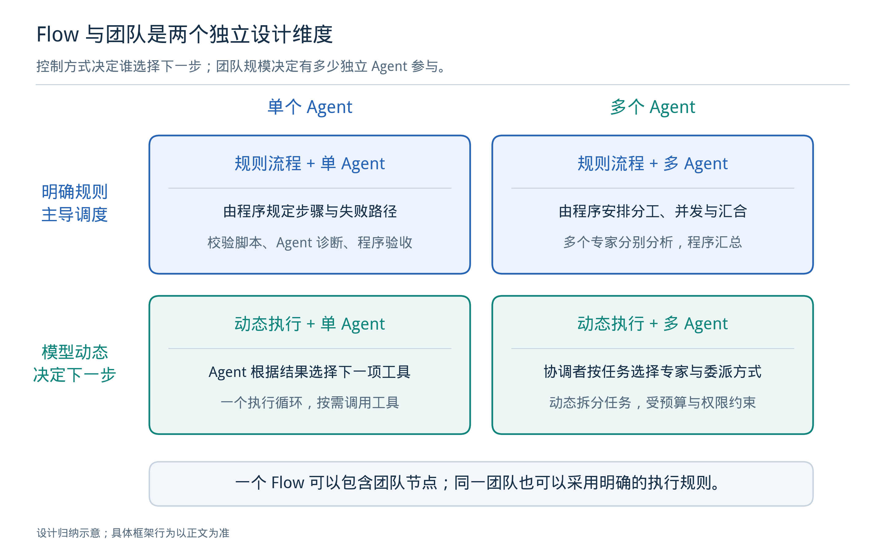

*图1：原创概念示意。Flow 的控制方式与 Agent 数量可以独立选择。[可编辑 SVG](figures/01_flow_team.svg)*

### 2.1 两个独立的设计维度

第一个维度是“下一步由什么决定”：可以主要由程序规则决定，也可以由模型根据当前情况动态决定。

第二个维度是“有几个独立执行单元”：可以只有一个 Agent，也可以有多个具有独立上下文、职责或工具集合的 Agent。

因此，以下四种设计都成立：

| 组合 | 示例 | 主要问题 |
| --- | --- | --- |
| 明确流程 + 单 Agent | 固定执行检查、调用一次诊断 Agent、再运行验证 | Agent 所需输入是否充分 |
| 明确流程 + 多 Agent | 并行读取不同报告，汇总后按固定规则决定是否修复 | 并行状态如何合并 |
| 动态调度 + 单 Agent | 一个 Agent 自主选择查询、编辑和验证步骤 | 循环能否停止、工具使用是否受控 |
| 动态调度 + 多 Agent | 主管按问题类型临时创建专家子任务 | 分工质量、通信开销和完成责任 |

实际工程中经常需要混合：外层保留稳定的步骤关系，进入诊断阶段后才允许动态分配专家。CrewAI 将 Crew 放入 Flow 的做法，是这种组合的直接例子。[R09]、[R12]

### 2.2 设计图、团队图和运行图表达不同事实

- **设计图**描述允许出现的节点、路径、循环与汇合条件。
- **团队图**描述谁可以委派谁、谁可以交接给谁，以及谁负责汇总。
- **运行图**记录某次执行实际走过的路径，包括重复调用、重试和动态子任务。

例如，一个“检查—修复—复查”的设计图只有三个节点，但一次运行可能经历十多个节点实例。用户需要在运行图中看到第几次修复、当时使用的文件版本和验证结果。Langfuse 的聚合图与展开图也明确区分“同名步骤合并”和“每次调用展开”。[R36]

在编辑器里，这三个视图宜共享对象标识，但分别展示；不能把一次运行中临时创建的专家直接写回正式流程定义。

<a id="chapter-3"></a>

## 3. 典型协作模式及控制转移

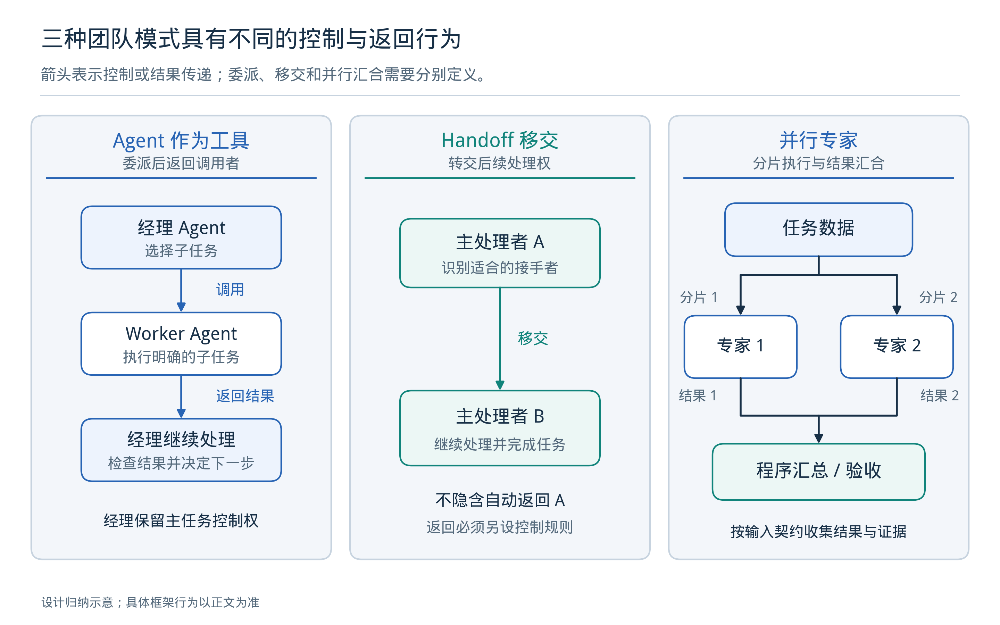

*图2：调用后返回、控制交接和并行汇总具有不同含义；箭头不能混用。[可编辑 SVG](figures/02_team_patterns.svg)*

### 3.1 顺序处理

上一步的结构化结果成为下一步输入。例如，需求分析产出约束清单，脚本生成读取清单，验证程序读取脚本和执行结果。

这种方式适合依赖清楚的工作。缺点是前一步遗漏或误判可能持续向后传播。应明确每步的必要字段和验收规则，避免将上一名 Agent 的整段回答直接追加给下一名成员。

### 3.2 主管调用专家：Agent-as-tool

主管保留主任务控制权，将一个局部问题交给专家，等待专家返回，再继续处理。专家通常不直接改变用户正在交互的主角色。

这种模式适合“统一交付、分头分析”：例如主管分别请求时钟约束分析和覆盖率报告分析，收回证据后形成一份修改方案。OpenAI Agents SDK 的 `agent.asTool()` 明确采用这一控制关系。[R06]

主管的任务应当是分配、检查与整合，不宜把每位专家已经完成的全部工作再做一遍。否则并行节省的时间会被重复推理消耗。

### 3.3 控制交接：Handoff

Handoff 将当前活动 Agent 转交给另一名 Agent。接手者负责后续处理；它并不天然等价于一个“调用后返回”的子函数。

OpenAI Agents SDK 的文档明确区分这两种模式。其 Python handoff 默认可以传递此前历史，并允许通过过滤器调整输入，因此“换角色”本身也不构成上下文隔离。[R06]、[R07]

Handoff 适合用户进入某个专业助手持续对话，例如从工程总助手切换到约束诊断助手。若只是希望专家回答一个子问题并返回结果，Agent-as-tool 往往更容易表达责任。

### 3.4 并行专家与集中验收

将可独立处理的子问题分给多个专家，完成后由程序或主管集中收集结果。需要提前定义：

- 等待所有分支，还是满足某个完成条件即可继续。
- 某个分支失败时，是整体失败、接受部分结果，还是只重试该分支。
- 结果按什么键保存，如何去重。
- 分支是否可以写入同一文件或同一工具会话。

“所有专家同意”不是充分的验收条件。多个 Agent 可能复制相同错误，也可能受同一错误报告影响。DFT、RTL、UVM 场景中，程序检查和工具输出应作为最终判断的主要依据。

### 3.5 生成与评审循环

一个 Agent 提出候选，另一个 Agent 或程序指出问题，再进行修改。这适合具有可验证目标的任务，但必须限定修复次数、时间、费用和最小进展。

如果评审只是再次询问模型“是否正确”，独立性仍然较弱。更有价值的评审输入是测试结果、反例、报告差异、文件摘要和明确的验收条款。

### 3.6 共享任务板与事件驱动协作

成员从结构化任务板领取工作，产出结果事件，再触发后续处理。这适合动态任务数量和长任务回调。其复杂性集中在任务认领、重复事件、超时、状态竞争和依赖满足条件。

可以允许多个 Agent 读取同一证据库，但应区分“提出建议”和“提交最终状态”。一个字段由多个成员任意覆盖，会让系统难以重放和定位问题。事件式设计可以借鉴 LlamaIndex Workflows，但业务上的任务认领和文件写入规则仍要自行规定。[R29]

### 3.7 自由群聊的适用范围

自由群聊可以用于探索思路、提出反例或讨论设计分歧，但不宜直接承担工程作业的最终推进责任。长工具任务通常需要明确的状态转移、提交记录和停止条件，这些职责不能仅靠成员在对话中达成共识。

在允许任意两名成员直接通信的设计里，潜在有向通信关系数为 `n(n−1)`。这是拓扑关系的计数，并不等于实际消息数量，却说明增加成员后需要更严格地筛选交流对象和传递内容。

<a id="chapter-4"></a>

## 4. 推荐的混合执行架构

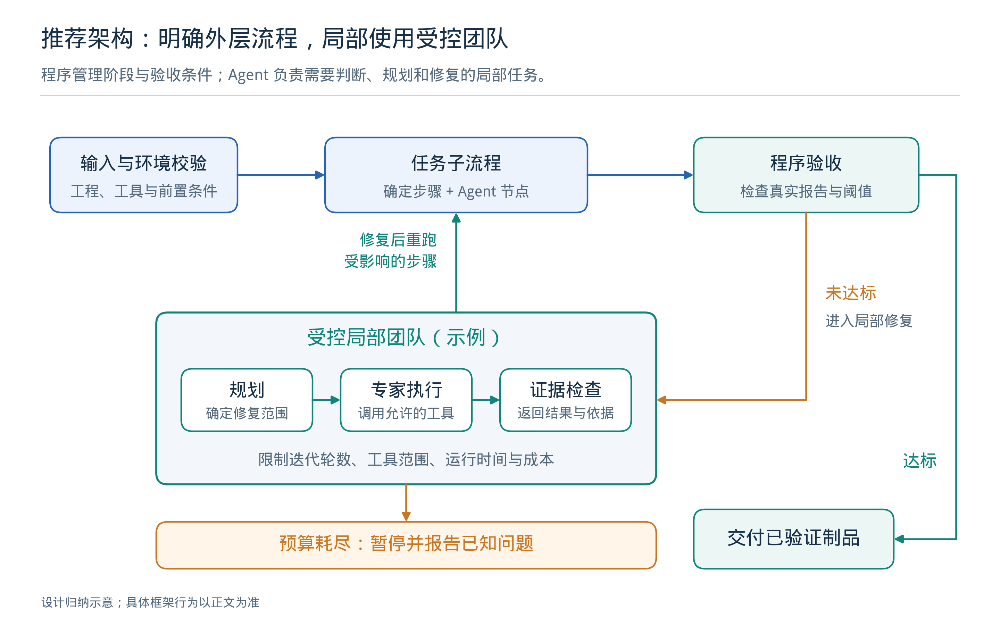

*图3：本文建议的执行组织。流程固定必要次序，局部子任务允许动态协作。[可编辑 SVG](figures/03_hybrid_execution.svg)*

### 4.1 外层 Flow 管理可以明确规定的事项

外层负责输入检查、工具前置条件、作业提交、结果收集、验收、重试范围和终止。能够由程序判断的条件，直接交给程序。例如：

- 必需文件是否存在，输入版本是否一致。
- 工具退出状态是否有效，报告是否完整生成。
- 结果字段能否解析，是否满足预先给定的目标。
- 当前尝试是否超过预算，是否反复出现相同错误。
- 某个操作是否已获得当前任务范围内的授权。

这些检查应当成为可执行规则，而不是仅写在系统提示词中。

### 4.2 局部 Agent 管理需要推断的事项

Agent 更适合解释异常、定位需要进一步检查的证据、提出候选修改、检索手册以及在几个可行方案之间做判断。

“有界”应体现为运行时可检查的条件：限定输入范围、工具集合、输出格式、最大子任务数、共享预算和允许修改的文件。只在提示词里写“不要死循环”，无法形成可靠的终止机制。

### 4.3 团队作为一个有输入输出的子流程

外层 Flow 不需要了解专家之间每条消息，但需要获得以下结果：

- 当前任务完成、失败、等待输入或预算耗尽的状态。
- 可验证的结论及对应证据。
- 生成的文件、补丁或候选方案标识。
- 尚未解决的问题和下一步所需条件。
- 实际消耗与发生的异常。

团队内部可以演进，但其输入输出契约应尽量稳定。这样可以替换模型或团队模式，而不必重写整个工程流程。

### 4.4 顶层运行状态由一个系统负责

一个项目中可以同时使用编排框架、Agent SDK、作业队列和外部持久执行引擎，但要明确谁负责顶层任务的生命周期。

例如，可以让 LangGraph 管理 Agent 子流程，让独立作业服务管理 EDA 进程；也可以让 Temporal 管理跨服务的长期任务，再把 Agent 运行作为一个子操作。应避免两个运行引擎都独立决定同一作业的重试、取消和最终状态。Temporal 的 Activity 机制适合承载外部工作，但仍需要正确设计副作用与重试行为。[R46]

<a id="chapter-5"></a>

## 5. 设计实体、状态与上下文

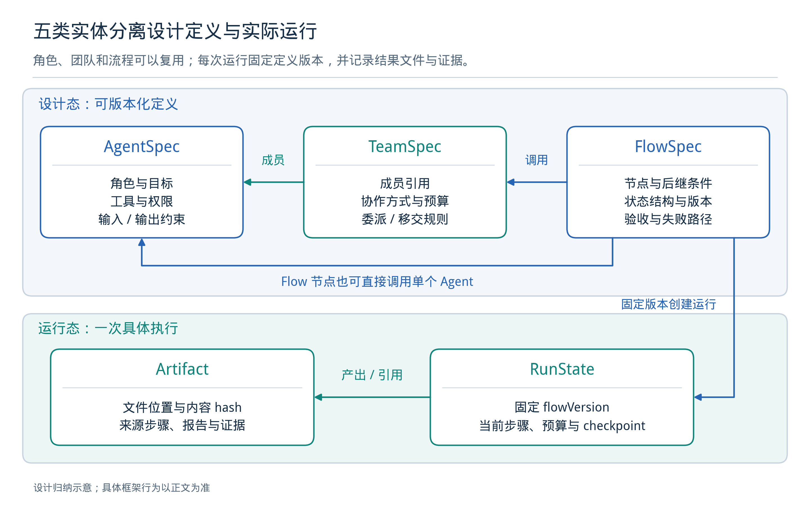

*图4：五类核心实体的建议关系。运行绑定定义版本，结果绑定实际输入与输出制品。[可编辑 SVG](figures/04_data_model.svg)*

### 5.1 五类核心实体

| 实体 | 需要保存的内容 | 主要作用 |
| --- | --- | --- |
| AgentSpec | 角色、目标、模型配置、工具范围、输入输出 schema、版本 | 定义可复用能力 |
| TeamSpec | 成员引用、协作方式、并发上限、汇总方式、团队预算、版本 | 定义协作规则 |
| FlowSpec | 节点、连接类型、条件、重试规则、循环退出条件、版本 | 定义允许的执行路径 |
| RunState | 运行标识、所用版本、当前步骤、预算、等待原因、作业引用 | 描述本次执行进度 |
| Artifact | 文件或报告标识、版本/摘要、来源运行、输入关联、验收结果 | 保存可核对的工作成果 |

这里的 Artifact 指代码、脚本、日志、报告、网表等实际成果及其引用。不能只保存“工具已执行成功”这一自然语言陈述。

项目层还需要 Project、ToolSpec、Job、Approval/Decision 和 Evaluation 等对象，但可以围绕上述五类核心实体逐步补齐，不必先引入庞大的抽象体系。

固定 FlowSpec 版本时，还应固定它间接引用的 AgentSpec、TeamSpec、工具定义和提示词版本。否则即使流程编号没有改变，成员配置更新也可能改变旧运行的行为。

### 5.2 角色定义应转化为执行契约

一个“覆盖率分析专家”的定义，至少应说明：

- 输入：固定版本的报告、目标指标、工具类型、已尝试的修改。
- 工具：读取报告、查询手册、运行指定分析器。
- 输出：问题分类、证据位置、候选修改、验证方法。
- 修改范围：只读分析，或可生成补丁但不能直接覆盖主工作区。
- 完成条件：每个建议都能关联到具体证据，无法确认时返回未知项。
- 预算：最多调用多少次模型和工具，是否可创建子任务。

“经验丰富”“认真负责”等描述可以辅助模型理解，但无法代替这些契约。也不需要为了模拟公司组织而设置大量没有独立输入输出的角色。

### 5.3 五种状态不应混在聊天历史里

| 状态类别 | 示例 | 保存策略 |
| --- | --- | --- |
| 工作流状态 | 当前阶段、分支结果、剩余预算 | 持久存储，可恢复 |
| 模型上下文 | 当前任务说明、必要消息、证据片段 | 按角色选择与压缩 |
| 项目知识 | 工具规则、工程约束、历史有效结论 | 有来源与适用版本 |
| 外部作业状态 | job_id、进程状态、资源占用、结束结果 | 作业服务负责 |
| 文件制品状态 | Tcl、SDC、报告、补丁、网表版本 | 工程目录与制品索引 |

LangGraph 将 thread 检查点和跨 thread Store 分开；Anthropic 的 Managed Agents 也将持久会话记录与模型当前上下文分离。两者都提示：能恢复的系统记录应当独立于模型一次能看到多少内容。[R03]、[R37]

### 5.4 并发状态更新需要明确合并规则

共享状态中，计数可以按规则累加，独立专家的结果可以按任务标识保存；但“当前正确方案”“主约束文件”这类对象不能简单采用最后写入者覆盖。

建议让并行成员写入独立结果槽：

`findings[task_id]`、`candidate_patches[proposal_id]`、`evidence[artifact_id]`。

汇合节点再校验完整性、重复项和冲突，生成一次明确的状态更新。若合并不满足交换律，应记录排序依据；若重复事件可能到达，应使用稳定标识去重，而不是依赖消息顺序。

### 5.5 上下文选择优先于全量共享

给每个成员完整聊天记录，会同时增加成本、无关信息和错误传播。更合适的输入包由任务目标、相关文件版本、必要证据、已知限制和返回格式组成。

压缩也会丢信息，因此应保留原始报告和事件记录，允许成员按需重新读取。摘要用于导航，原始证据用于核对。长期记忆应记录来源和适用条件；一次失败中的模型猜测，不应自动成为以后所有项目的事实。

<a id="chapter-6"></a>

## 6. 执行引擎的核心机制

### 6.1 节点与连接必须有明确含义

建议至少区分以下节点：

| 节点类型 | 执行内容 | 关键检查 |
| --- | --- | --- |
| 程序节点 | 解析、校验、转换、计算 | 输入格式与异常类型 |
| Agent 节点 | 有范围的模型推断与工具循环 | 输出契约、预算、工具范围 |
| Team 节点 | 启动一个团队或子流程 | 成员结果、汇总规则、停止条件 |
| 工具节点 | 一次受控外部操作 | 参数、操作键、权限与结果 |
| 作业节点 | 提交、等待或收集长任务 | job_id、超时、取消与未知状态 |
| 控制节点 | 分支、并行、汇合、循环 | 分支互斥性、汇合条件、循环上限 |
| 等待节点 | 外部事件或必要的人工输入 | 唤醒条件、有效期限、恢复信息 |

连接也至少应区分：执行转移、数据依赖、子任务调用及返回、活动 Agent 交接。画布上的箭头应带有明确类型；不能把“提供一个工具”误画成“接下来一定执行这个工具”。

### 6.2 分支与汇合的规则应显式配置

同样叫“branch”的 API 可能有不同规则。Mastra 文档中，默认会执行所有条件为真的分支；这与只选第一条匹配路径的 if/else 不同。[R25]

自定义编辑器应明确提供：

- 单选分支：只允许一个结果进入后继。
- 多选分支：允许多个条件同时成立。
- 全部分支汇合：等待本次实际启动的全部分支结束。
- 部分结果汇合：明确最低完成条件以及未完成分支如何取消。

动态并发尤其需要保存“本次实际创建了哪些子任务”。否则恢复后，汇合节点可能永远等待一个实际上没有被创建的成员。

### 6.3 错误应分类处理

| 错误类型 | 例子 | 合适的处理 |
| --- | --- | --- |
| 短暂环境错误 | 网络超时、临时服务不可用 | 有上限的重试与退避 |
| 资源等待 | 工具许可证不足、并发额度不足 | 进入等待状态并保留队列信息 |
| 输入或契约错误 | JSON 不符合 schema、必要文件缺失 | 修正具体输入或返回明确缺项 |
| 工程验证失败 | 编译失败、检查未通过 | 诊断与受限修复 |
| 执行结果未知 | 提交响应丢失、外部进程状态不明 | 查询和核对，禁止盲目重复启动 |
| 无进展循环 | 同一错误、同一修改反复出现 | 停止当前策略，保留证据并升级处理 |

重新发送相同工具请求，不等于完成了有效修复。系统应记录失败类别、使用的输入版本、采取的修复和结果变化，帮助后续策略避免重复尝试。

### 6.4 预算必须跨父子任务共享

预算至少包含模型调用、工具调用、经过时间、费用、并发数和修复次数。子 Agent 的预算应从同一运行预算中分配，不能每创建一个成员就重新获得一套不受约束的额度。

并行调度时需要先预留预算，再按实际消耗结算，防止多个分支同时读取相同余额后超额运行。模型只能提出请求，最终额度由运行时执行。

下列数值只作为配置示例：一个诊断团队最多三个并行分析任务，每轮只接受一个修复提案，最多三轮修复。具体上限应由任务集实验决定，不能作为所有工程的默认最优值。

### 6.5 观测应记录事实，不依赖完整思维文本

有用的运行记录包括：

- 输入版本、节点实例、模型和提示词版本。
- 工具名称、参数、返回状态、报告路径。
- 分支选择及其结构化依据。
- 子任务创建、开始、结束、取消与汇合。
- 实际费用、耗时、检查点与恢复来源。
- 验收结果和失败证据。

不应把“能够获取模型的完整内部推理”当作系统调试的前提。模型输出的解释也不能替代工具执行事实。Trace 用于定位发生了什么；检查点用于恢复；业务制品用于证明结果，三者职责不同。

### 6.6 工具范围、执行隔离与授权状态

框架应把工具权限与角色契约绑定，并在执行入口再次校验。文档、网页、日志和模型生成的文件属于输入数据，其中的文字不能自动修改工具授权或系统规则。

对已获授权的常规操作，可以按规则继续执行；确实超出范围的操作才等待决策。授权记录应绑定具体操作、输入版本和范围，避免界面刷新或恢复后重复询问，也避免旧批准被套用到已改变的修改方案。

多个 Agent 修改同一工程时，可采用隔离工作目录生成候选，再由一个明确的提交步骤合入并验证。执行环境、工具凭据与模型上下文分离，是长任务系统值得借鉴的基础设计。[R37]

<a id="chapter-7"></a>

## 7. 检查点、外部作业与失败恢复

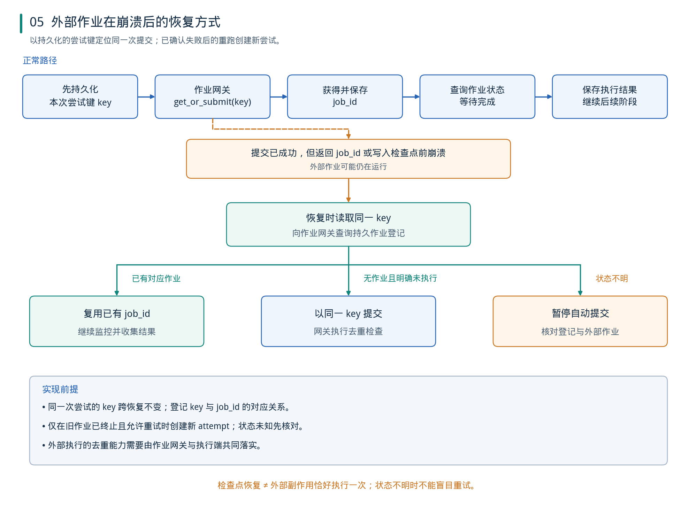

*图5：建议的作业恢复协议。操作键和外部登记共同用于核对，检查点不自动提供外部操作“恰好一次”的保证。[可编辑 SVG](figures/05_recovery.svg)*

### 7.1 检查点保存逻辑进度

检查点可以保存当前节点、状态、已完成结果和待处理事件。它通常不是任意 CPU 指令位置的快照。

LangGraph 的中断恢复可能重新执行所在节点；LlamaIndex 的 durable workflow 文档明确指出，正在执行的步骤可能从头重跑；ADK Resume 也提示工具可能执行多次。[R04]、[R28]、[R21]

因此，恢复设计要回答的不是“是否有 checkpoint”这一项，而是：

1. 在什么位置保存。
2. 保存失败后是否继续运行。
3. 恢复会重跑哪些步骤。
4. 外部操作已成功、结果尚未保存时怎么办。
5. 暂停期间定义和输入文件是否允许改变。

### 7.2 EDA 作业需要独立生命周期

建议将一个长工具任务分为“准备输入—登记与提交—等待状态—收集结果—验证”几个操作。作业服务持续管理实际进程，Agent 编排服务可以暂停、断开或重启。

作业记录至少包含：逻辑操作键、job_id、输入文件摘要、工具及版本、脚本摘要、工作目录、提交时间、状态、资源、日志位置和输出制品。仅保存进程号不足以长期定位作业，因为进程号可能失效或被复用。

在等待工具运行时，应使用事件、可恢复的等待或受限轮询，无须持续让模型发出“继续等待”的调用。

### 7.3 最容易发生重复提交的位置

危险窗口是：外部工具已经接收了作业，但编排进程还没有保存返回结果就崩溃。

如果恢复后只检查“当前节点未完成”，并直接再次执行提交，就可能启动第二个相同作业。仅在返回后记录 job_id，也不能覆盖“提交响应丢失”的情况。

建议区分三个标识：逻辑操作 ID、执行尝试 ID，以及本次提交的去重键。先持久化尝试记录，再由作业网关提供按键查询和去重提交。网络超时后的重发与恢复沿用同一尝试键；只有确认旧作业已终止、重试策略允许继续时，才创建新尝试和新键。改变脚本或主动发起新一轮实验，还应记录新的输入或操作版本。结果未知时不能仅因超时而创建新尝试。

### 7.4 操作键不是自动的分布式事务

以下是**本文提出的接口伪代码**，不是某个框架已有的 SDK API：

```typescript
const attempt = await operations.loadOrCreateAttempt({
  logicalOperationId,
  runId,
  nodeInstanceId,
  attemptNumber: persistedAttemptNumber,
  inputDigest,
  scriptDigest
});

// createOrGet 必须由作业网关实现持久登记、并发控制和去重。
// 仅在应用内先查一次数据库、再调用无去重的命令，并不能保证不重复。
const job = await jobs.createOrGet({
  submissionKey: attempt.submissionKey,
  commandSpec,
  workspaceRef
});

await operations.attachJob(attempt.id, job.id);
const status = await jobs.status(job.id);

if (status.kind === "unknown") {
  return { kind: "reconcile_required", attemptId: attempt.id };
}
if (status.kind === "running" || status.kind === "queued") {
  return { kind: "waiting", jobId: job.id };
}
return await collectAndValidate(job.id);
```

其中 `persistedAttemptNumber` 来自持久运行记录，不在网络重试时递增。确认旧尝试失败后的新执行由单独的重试决策创建；同一个提交键不能同时表示“查询已有失败作业”和“重新启动一个新作业”。

对于直接启动 CLI 进程的网关，持久登记与进程创建之间仍可能存在中断窗口。应设计可查询的调度器或持久 launcher、唯一工作目录和状态核对；如果仍不能确认是否已经执行，应进入“结果未知、等待核对”，而不是承诺不可能重复。

### 7.5 恢复、重试、重跑和分叉应分开

| 操作 | 含义 | 输入与版本要求 |
| --- | --- | --- |
| 恢复 | 继续原逻辑运行 | 绑定原定义与兼容状态 |
| 同次提交重发 | 响应丢失后重复请求或查询 | 同一尝试沿用原去重键 |
| 失败后新尝试 | 旧作业已终止且允许再执行 | 新 attempt 与新提交键，关联原逻辑操作 |
| 新一轮重跑 | 对修订后的输入重新执行 | 新操作版本与输入摘要 |
| 分叉 | 从旧检查点创建新实验 | 保留父运行引用，不覆盖原结果 |

修改 Flow 后能否直接恢复旧运行，必须由版本迁移规则决定。ADK 官方明确限制暂停后任意修改工作流再恢复；自定义系统同样需要固定运行所依赖的定义版本。[R21]

取消也应有独立状态：收到取消请求、外部作业正在停止、进程已退出、资源已释放。界面显示“已取消”之前，要明确是否仍有外部工具在运行。

<a id="chapter-8"></a>

## 8. 代表性代码框架比较

### 8.1 主要框架的设计取向

下表比较执行抽象与集成责任，不给未经实测的性能或成熟度分数。列出的语言以本次核对的相关功能为准，不能推导为所有功能跨语言等同。

| 框架 | 代表性抽象 | Flow 与团队结合方式 | 恢复与选型重点 |
| --- | --- | --- | --- |
| LangGraph / LangGraph.js | 状态、节点、边、reducer、子图 | Agent 或团队嵌入图；条件与动态分支 | 配置持久 checkpointer；恢复重跑与副作用另行处理 |
| OpenAI Agents SDK | Agent、Runner、工具、handoff | 代码或模型控制；专家调用与交接分开 | 暂停状态、追踪与外部 durable 集成分层 |
| CrewAI | Flow、Crew、任务、Process | Flow 管整体；Crew 处理聚焦任务 | 状态持久化和完整 checkpoint 分开核对 |
| Microsoft Agent Framework | Agent、typed executor、workflow | 显式工作流组合多种团队模式 | 普通 checkpoint 与 Durable Extension 分层 |
| Google ADK 2.0 | 图节点、Workflow、动态流程、协作模式 | 工具、函数与 Agent 统一进入流程 | TS 图已可用，恢复与协作模式逐语言核对 |
| Pydantic AI / graph | 类型化 Agent、依赖、GraphBuilder | 代码委派、图、并行与汇合 | 当前图 API 本身不做状态快照 |
| Mastra | 有 schema 的 Step、Workflow、Agent | TS 工作流与子 Agent 结合 | 配置 storage；核对暂停与分支规则 |
| LlamaIndex Workflows | 类型化事件、handler、step | 事件触发流程及 Agent 委派 | Python 默认临时状态，需快照或 durable runtime |

表中事实来源：[R02]—[R11]、[R13]—[R15]、[R19]—[R29]。

### 8.2 LangGraph / LangGraph.js

LangGraph 的优势在于将运行过程明确表达为状态更新和图上的转移。节点可以是普通函数；条件边决定后继；reducer 合并并发状态；`Send` 可按运行时任务清单创建分支；子图用于复用局部过程。Python 和 JS/TS 都有实现。[R02]

持久化需要选用适当的 checkpointer；内存实现不等于进程重启后仍能恢复。图状态、跨会话存储和文件制品分别管理。[R03]

**设计建议：**适合希望掌握工程执行状态和编辑器定义的团队。需要自行补齐项目管理、领域工具服务、作业资源和产品界面。LangSmith Studio 提供图查看、运行、状态调试等能力，不能直接视为任意业务流程的双向拖拽编辑器。[R05]

### 8.3 OpenAI Agents SDK

OpenAI Agents SDK 提供 Python 和 JS/TS 路线，强调较少的 Agent 组合概念：主管调用专家工具、活动 Agent 交接，以及程序代码直接控制执行。它适合将专门助手组合进已有应用，不要求所有流程先转成图。[R06]

其运行状态和人工输入机制可支持暂停与继续；官方同时介绍 Temporal、Restate、DBOS 等持久执行集成。使用 SDK 不等于已经部署了分布式作业平台，tracing 也不是业务恢复记录。[R08]

**设计建议：**当团队互动和工具循环是主要需求时可作为 Agent 层；若产品还要求可编辑的工程 Flow、步骤版本与长期作业管理，需要另行提供这些层。

### 8.4 CrewAI

CrewAI 的生产架构指南明确建议先建立 Flow，以结构化状态组织整体过程，将 Crew 用于单个聚焦的复杂任务。Flow 提供事件与条件组织方式；Crew 表达成员、任务和协作过程。[R09]、[R10]

`@persist` 的状态保存与完整 checkpoint 是不同功能。当前 checkpoint 文档注明，自动写入属于 best-effort，写失败会记日志并继续；手动 checkpoint 失败会抛错。这会影响故障恢复承诺，不能只根据“支持持久化”四个字做判断。[R11]

**设计建议：**适合借鉴角色、任务和团队产品模型。当前代码 SDK 主体是 Python；JSONC/YAML 配置不意味着存在同等的原生 TS 运行内核。Crew Studio 的可视化能力属于产品层，应与开源核心分别评估。[R12]

### 8.5 Microsoft Agent Framework

Microsoft Agent Framework 将 AutoGen 与 Semantic Kernel 的经验汇合，官方将其称为二者的直接继任。其 .NET/Python 1.0 于 2026 年 4 月发布；Go 仍需按公开预览状态及功能页检查。[R13]、[R16]

工作流提供明确的执行关系，支持顺序、并发、handoff、group-chat 等协作形式。Durable Extension 则进一步提供跨执行环境的持久运行设施，当前功能页列 C#/Python；它与普通工作流 checkpoint 不应混为一谈。[R14]、[R15]

**维护状态说明：**AutoGen 官方 README 已声明归档并停止维护，并建议迁移到 MAF。这里依据的是维护方的支持声明，不将其等同于 GitHub 平台是否已设置只读归档；也不把 Semantic Kernel 一并说成已归档。[R17]

### 8.6 Google ADK 2.0

ADK 2.0 的图节点可以组合 Agent、函数、工具和子工作流。官方记录的 GA 日期为 Python 2026-05-19、Go 2026-06-30、TypeScript 2026-08-21；TS 图工作流包含节点输入输出契约。[R18]、[R19]

协作模式与恢复能力要逐项核对。当前协作模式页列 Python/Go；dynamic workflows 功能页已经提供 TS 子调用恢复及已完成结果复用的示例。通用 Resume 页的语言标记与 graph 页不同，并提醒工具可能重复执行，因此应以具体功能页及部署验证为准，不能推导所有语言能力完全相同。[R20]、[R21]、[R61]

Visual Builder 当前功能页仍标注 Python 实验性能力，不能直接作为 TS 工程的通用可视化编辑解决方案。[R22]

### 8.7 Pydantic AI 与 pydantic-graph

Pydantic 的特点是将类型、依赖和结构化结果放在核心位置。当前 GraphBuilder 支持条件、并行 spread/broadcast、join 和 reducer，因此不能沿用“只有单 Agent，没有工作流”的旧印象。[R23]

一个重要版本变化是：当前文档明确 V2 已移除 `pydantic_graph.persistence`，图 API 本身不保存快照；Agent 状态可使用 Harness 的 `StepPersistence`，完整故障恢复可集成 durable engine。[R23]、[R24]

**设计建议：**强类型契约值得借鉴。已有 TS 后端时，可将必要的 Python 能力做成服务；没有充分收益时，不必为了某个 Agent 库重建整套技术栈。

### 8.8 Mastra

Mastra 以 TypeScript 应用为中心，step 有输入输出 schema，可以组织顺序、并行、分支、遍历、循环和嵌套流程。它提供暂停/恢复，快照保存在配置的 storage provider 中。[R25]、[R26]

子 Agent 可以由父 Agent 委派，委派开始和结束时的控制接口有助于检查预算、输入和返回结果。[R27]

**设计建议：**如果希望减少 Agent、工作流和开发工具的集成工作，值得与 LangGraph.js 使用同一任务集比较。仍需自建 EDA 作业管理、文件版本和领域验收，而非把这些责任放进聊天循环。

### 8.9 LlamaIndex Workflows

LlamaIndex Workflows 采用事件与 handler 的组合。事件类型决定哪些步骤处理输入，适合动态任务和外部回调。TS 也有独立的 workflow 包，但不同语言的功能应分开核对。[R29]

Python durable 文档明确默认执行状态是临时的；需要在执行过程中持续保存快照，或使用相应持久运行设施。恢复可能重跑未完成步骤，副作用需要能够安全重复或去重。[R28]

**设计建议：**当知识检索、工具手册和报告分析占主要工作量时，其数据处理能力值得使用；若已经选定一个顶层编排器，可将检索能力封装成节点服务。

<a id="chapter-9"></a>

## 9. 专题：使用 Graph 表达与执行工作流

本节补充回答“工作流为什么用图表达、图怎样变成执行、不同框架的图是否等价”。**Flow 是要完成的过程及其规则，Graph 是表达这些关系的一种方式。** 能画出节点和箭头，只说明存在图形结构；可执行图还必须定义触发、数据、汇合、循环、错误和恢复规则。本节的分类、Graph IR 与 DFT 示例是设计建议，框架行为另附官方来源。

### 9.1 先明确节点和边表示什么

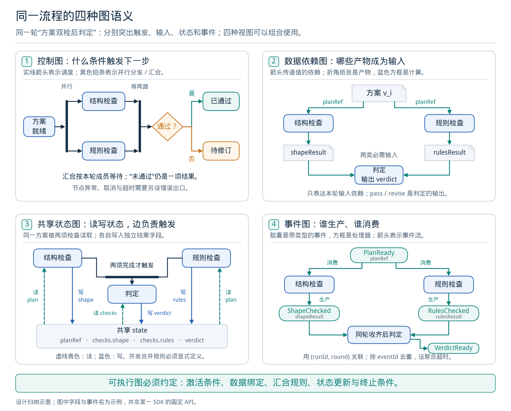

*图6：四种投影用于解释不同关系，不是四套可直接互换的执行定义。节点旁的标签和连线类型共同决定含义。[可编辑 SVG](figures/06_graph_models.svg)*

| 图的类型 | 节点表示什么 | 边表示什么 | 执行时要补充的问题 |
| --- | --- | --- | --- |
| 控制流图 | 程序、工具、Agent、子流程或控制步骤 | 何种结果或条件会触发后继 | 任一入边即可触发，还是需要等待多个分支 |
| 数据依赖图 | 消费输入、产出结果的计算 | 某个输出端口供给另一个输入端口 | 输入是否齐备、属于哪一版本、缺失时如何处理 |
| 共享状态驱动图 | 读取状态并提交更新的动作 | 后继动作的触发关系 | 哪个状态版本可见、并发写入如何合并 |
| 事件驱动图 | 事件生产者和处理者 | 发布、订阅或消费某类事件 | 如何关联同一次运行、去重、等待和处理超时 |

这些类型可以在同一系统中组合。例如，ADK 将节点输出、用户可见消息、路由和会话状态分别处理；LangGraph 节点通过共享状态通信，控制边并不同时携带所有业务数据。[R60]、[R02]

还需区分三个容易混用的“图”：

- **传统状态机图**的节点往往是“等待、运行、完成”等状态；共享状态执行图的节点则可能是“分析、调用工具、验证”等动作。二者可以转换或结合，命名相似不代表节点语义相同。
- **团队关系图**描述可委派、可交接或可调用的成员关系。一条“Agent 可以使用 Tool”的边，不表示 Tool 一定是下一执行步骤。
- **资产或知识图谱**描述文件来源、实体关系或检索关联。它们能为工作流提供输入，但不直接定义工作流如何推进；GraphRAG 也不等同于工作流编排。

对编辑器而言，应当先定义连线协议，再决定画线形式。一个通用的箭头样式不应默默承担控制、输入绑定、工具授权和消息广播四种职责。

### 9.2 DAG、有环图与“动态图”分别解决什么问题

**DAG 的条件是不存在有向环。** 它适合一次计算中的依赖调度：前置输入齐备后启动节点，可以分析拓扑次序和关键路径。诊断多个独立报告，再汇总结果，就是典型场景。

**有环控制图**适合“生成—检查—修订—再次检查”。循环要携带新的状态或产物版本，并由成功条件、预算和超时共同限制。不能仅因为系统叫 workflow 就假定它是 DAG，也不能把一个有回边的图交给只支持 DAG 的调度器。ADK 静态图允许回边；其文档同时提醒循环需要自行限制。[R59]

**动态性至少有四个层次：**

| 动态层次 | 实际改变的内容 | 示例 | 是否必须修改正式图定义 |
| --- | --- | --- | --- |
| 动态路由 | 本次选择哪条既有路径 | 检查通过走交付，失败走诊断 | 否 |
| 动态实例展开 | 某个模板产生多少个调用实例 | 对 N 个报告运行相同分析节点 | 否 |
| 程序动态编排 | 根据中间结果继续调用哪些子步骤 | 代码中的条件、循环、递归 | 不必；可固定编排函数版本 |
| 动态生成或修订结构 | 为当前请求生成新的节点、边或子流程 | 规划器提出工具调用 DAG | 需要独立的计划版本、校验及记录 |

Airflow 的 Dynamic Task Mapping 和 Dagster 的动态 `map/collect` 都说明：任务数量可以运行时决定，而依赖结构仍可保持 DAG。ADK dynamic workflows 则用程序控制流组织子节点。“支持 dynamic”本身不足以证明允许任意改图。[R58]、[R63]、[R61]

推荐首版编辑器支持：**固定版本的模板、条件路由、有界循环、有界 Map、显式汇合与子图。** 这已覆盖大量工程需求。由模型生成整张图可以作为后续能力；其产物仍走同一套校验与执行规则。

### 9.3 图工作流需要的核心操作

| 操作 | 应表达的执行规则 | 常见缺项 |
| --- | --- | --- |
| 顺序连接 | 上一步达到指定结果后触发下一步 | 把“工具已提交”误当作“工具已完成” |
| 条件路由 | 单选、多选、默认出口以及条件求值时机 | 多个条件同时为真时行为不明 |
| 并行分叉 | 本次激活哪些分支、分支输入及并发上限 | 各分支写入同一可变工作目录 |
| 汇合 | 等待范围、成功要求、失败和取消策略 | 根据画面上的入边数猜测等待范围 |
| Map / scatter | 每个输入项派生实例，并分配稳定 key | 空集合、重复 key 和数量上限未定义 |
| Reduce / gather | 按批次收集结果并明确合并顺序 | 将先返回的结果误当作全部结果 |
| Loop | 每轮输入输出、退出条件、预算、无进展检测 | 旧轮次结果被新轮次误用 |
| 子图调用 | 输入投影、输出映射、私有状态、完成责任 | 并行子调用共用一个可写会话 |
| 事件等待 | 关联键、超时、去重、唤醒与取消 | 重复回调触发两次后继 |
| 异常出口 | 可重试错误、业务失败、未知状态分别处理 | 所有失败都重新执行整张图 |

#### 分支与汇合不能只画一个菱形

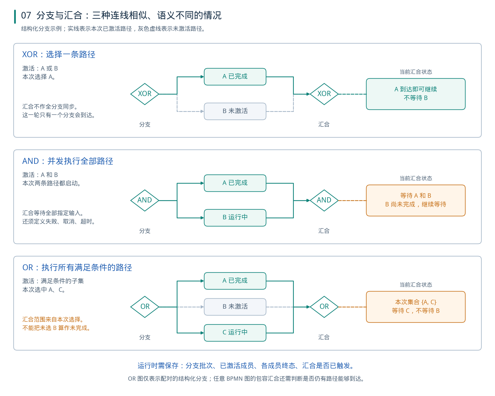

*图7：结构化分支中的三种汇合规则。OR 示例只等待本次激活的 A、C；不等待未选 B。任意非结构化图的包容汇合需要更完整的活跃路径判定。[可编辑 SVG](figures/07_graph_joins.svg)*

- **XOR：选择一条。** 分支末端汇入同一后继；合并处不等待未选择路径。若上游并非互斥分支，XOR 合并本身也不会替应用完成并发同步。
- **AND：执行全部。** 分叉启动全部指定支路；汇合等待所要求的每条支路到达。
- **OR：选择多条。** 执行所有满足条件的支路；对配对的结构化分支，汇合应等待本次选中的集合。

这些区别在 BPMN 中已有明确表达。Camunda 对 XOR 的说明是单路选择与直通合并；AND 等待各输入；包容汇合还检查是否仍有活跃路径可能到达。[R55]、[R56]、[R57]

对自定义 Graph IR，建议优先实现配对的结构化 `fork/join`，持久化 `forkInstanceId`、`expectedTaskIds`、终态结果和是否已触发汇合。这里要分别定义：

1. **成员齐备**：预期任务是否都产生了终态。
2. **成功条件**：是否要求全部成功，还是接受部分失败。
3. **后续动作**：继续、重试失败成员、报告不完整，还是终止。
4. **剩余任务处置**：提前得到答案后是否取消其他分支，取消是否已经确认。

“第一项结果回来就继续”与“收到全部结果后选最佳”是两种不同执行策略。零任务集合也需要明确路径，例如返回空集合或跳过该阶段，不能指望一个从未被触发的 worker 自动唤醒汇总。

### 9.4 调度模型：同一张图可能有不同执行时序

图的拓扑不能单独决定调度。下面三种组织方式值得区分：

| 调度方式 | 何时启动工作 | 数据何时可见 | 适合关注的工程问题 |
| --- | --- | --- | --- |
| 依赖就绪队列 | 必需前置结果齐备，且资源许可 | 上游结果完成并提交后供下游读取 | 关键路径、资源占用、局部并行 |
| 消息或事件驱动 | 收到匹配事件并满足激活条件 | 按处理器与状态存储协议决定 | 关联、重复投递、顺序和聚合 |
| 分阶段同步执行 | 由上一阶段更新选择本阶段节点 | 本阶段更新在下一阶段可见 | 阶段屏障、并发写合并、较慢分支 |

这是执行模型的归纳，并不意味着每个框架严格只采用一种。图中的“同时”通常是逻辑并发，也不保证底层一定启动多条操作系统线程。

#### LangGraph 的 Pregel / super-step

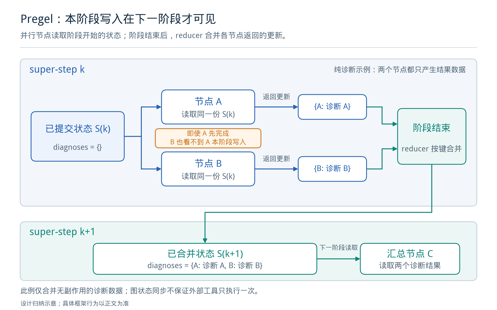

*图8：依据官方 Pregel 语义绘制。A、B 读取同一阶段的已提交状态，各自提交更新；下一阶段的 C 才读取合并结果。[可编辑 SVG](figures/08_graph_supersteps.svg)*

LangGraph 编译图后由 Pregel 运行。每个阶段依次进行：确定可运行节点、并发执行这些节点、更新通道。在执行阶段，写入不会立刻成为同阶段其他节点可见的输入。[R47]

例如，阶段开始时 `diagnoses = {}`，A 与 B 分别分析两个只读报告。A 先返回并不意味着 B 能在本阶段读到 A 的结果；合并后的结果由下一阶段读取。若 B 确实依赖 A，应通过后继阶段或子流程内的明确顺序表达。

两个并行节点写入同一普通状态字段时，也不能期待“最后完成者覆盖”。官方对不支持并发写的字段会报 `INVALID_CONCURRENT_GRAPH_UPDATE`；需要 reducer 或独立字段。[R49]

设计上应优先按稳定的任务 key 收集结果，再显式排序。Reducer 不应执行外部操作；需要结果与调度顺序无关时，应选择相应的合并规则并检测冲突。状态阶段的一致性不构成外部文件、数据库和 EDA 进程的分布式事务，仍需第 7 节的外部作业恢复机制。

#### LangGraph 中两种入边写法不能混用

`A -> collect` 与 `B -> collect` 是两条触发关系；它们不自动表达“递归等待 collect 的所有祖先”。当 A、B 恰好在同一个阶段完成，下一阶段可以一起汇总；当一条支路更深时，普通触发规则可能让 collect 在另一条支路尚未完成时运行。

固定集合的等待应使用对应的集合汇合表达，例如以下结构片段；它不是完整可运行项目：

```ts
// 固定 AND 汇合：B2 和 C 都是本轮必定执行的支路末端。
builder.addEdge(["B2", "C"], "collect");

// 不等价：这两条边分别提供触发。
builder.addEdge("B2", "collect");
builder.addEdge("C", "collect");
```

两种方案在实际代码中择一使用。数组形式由 JS API 支持；并行示例与 Pregel 执行规则解释了为何相似画面可能产生不同调用时序。[R51]、[R48]、[R47]

如果 B2、C 来自互斥分支，等待双方的 AND 条件就不成立。结果不一定是进程永远挂起，也可能是图已无可运行任务、汇合节点没有执行而调用返回。因此需要独立检查“业务结果已完整”，不能把“图停止了”当作“目标完成了”。

另一个应在编译器中检查的细节是：LangGraph 的 `Command.goto` 不会取消已有静态出边。若一个验证节点既保留通向交付的静态边，又在失败时用 `goto` 指向修复，两条路径仍可能被调度。条件分支应统一采用清晰的路由机制。[R02]

### 9.5 设计图、运行实例与尝试记录

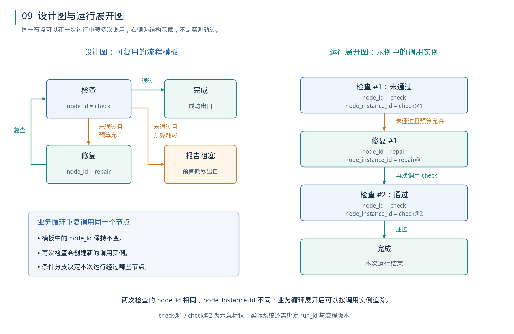

*图9：左侧节点定义可复用，右侧按本次调用展开。检查两次使用同一 node_id，但拥有不同 node_instance_id；示例不是实测轨迹。[可编辑 SVG](figures/09_graph_instances.svg)*

建议至少保留三份互相关联的数据：

| 数据 | 应记录什么 | 主要用途 |
| --- | --- | --- |
| 版本化模板 | 允许的节点、连接、路由、子图及引用版本 | 编辑、发布、结构比较 |
| 本次运行的实例关系 | 被选路径、动态分片、子调用、循环轮次及输入版本 | 调度、汇合、运行图展示 |
| 执行事件与尝试 | 开始、返回、失败、重试、等待、恢复和外部作业句柄 | 定位问题、恢复与审计 |

2026 年 10 月发表的工作流优化综述也明确区分可复用模板、单次运行采用的图和执行轨迹。这里将其用于编辑器与运行数据分层，是本报告的工程推导。[R69]

实例身份建议包含 `runId`、`nodeId`、`invocationId` 以及子图、轮次、分片的作用域。**业务循环产生新调用实例；执行重试属于该逻辑调用的另一尝试；网络重发则可能仍是同一次外部提交尝试。** 这三者不宜共用一个递增计数器。

有环设计图按实际调用展开后，可以按因果先后记录。界面除了给静态节点着色，还应让用户展开“第几轮、哪一个分片、哪次尝试、使用哪些文件”。不能用一个绿色节点掩盖它之前失败过三次，也不能让上轮的结果满足本轮汇合。

子图还应具有明确的状态边界。LangGraph 支持共享字段的组合，也支持包装函数进行父子输入输出转换；后者适合保留专家私有消息，仅返回结论与证据。共享一个子图定义，不等于并行调用必须共享同一可写会话。[R50]

### 9.6 代表性实现：共同有图，执行协议并不相同

| 框架 | 节点与边的主要表达 | 动态、并行与汇合 | 对框架设计的启发 |
| --- | --- | --- | --- |
| LangGraph / JS | 节点读取 state、返回更新；边控制后继 | 条件边、Send 实例展开、子图与循环；reducer 合并 | 明确区分状态更新、触发和等待集合 |
| ADK 2 graph | 函数、工具、Agent、子工作流；输出与路由分开 | 条件、并行、JoinNode、回边；dynamic 函数编排 | 消息、输入值、路由、session state 不混装 |
| Pydantic GraphBuilder | 类型化 step 输入输出，可附共享 state | map/broadcast、显式 join/reducer、decision | 把类型契约及 fork 范围写进执行协议 |
| Microsoft Agent Framework | 类型化 executor、消息与工作流边 | 显式工作流承载多种协作模式 | 团队模式可以编译或构造为工作流关系 |
| Mastra | 有 schema 的 step 与组合式控制结构 | parallel、foreach、branch、循环和嵌套 | 图不必直接暴露底层通道，组合 API 也能表达 |
| LlamaIndex Workflows | 事件类型与处理步骤 | 事件派发、等待、并发和 Agent 委派 | 事件关联及完成条件需要成为一等对象 |

来源：[R02]、[R14]、[R25]、[R29]、[R59]、[R60]、[R61]、[R52]。

三个具体差异尤其影响后端适配：

1. **ADK JoinNode 要求前驱产出。** 它按前驱组织结果；不能因为叫 JoinNode，就假定会自动解决任意条件跳过。ADK dynamic 的 TS 文档已说明子调用恢复与已完成结果复用，不能笼统称“TS 没有恢复”；完整持久部署仍需按版本和后端核对。[R59]、[R61]
2. **Pydantic join 跟踪 fork 范围。** 官方说明 reducer 按任务完成顺序接收结果，需要输入顺序时应携带索引并排序；decision 按添加顺序选择第一个匹配分支。这与 Mastra 默认执行所有为真的 branch 不同。[R52]、[R53]、[R54]、[R25]
3. **图与恢复设施仍是不同层。** 类型化输入、结构检查和可视化本身不提供跨进程恢复；Pydantic V2 的图快照变化、LangGraph checkpointer 配置，以及 ADK 工具重执行规则都需要单独核对。[R03]、[R21]、[R23]

#### 与传统编排系统的边界

| 系统 | 图或程序模型 | 与 Agent 图设计的关系 |
| --- | --- | --- |
| Airflow | DAG；运行时可动态映射任务实例 | 适合批任务依赖，动态数量不表示任意回边 |
| Dagster | op GraphDefinition 是 DAG；动态 map/collect | 输出输入依赖和分片 key 值得借鉴；资产图与单次执行图分开 |
| Prefect | Python 函数、条件、循环与运行时任务依赖 | 可观察依赖图不要求先画一张固定 DAG |
| Temporal | 工作流程序、事件历史与可重放的编排 | 可作为持久执行基础；不要求业务必须以静态图文件定义 |

以上取自各自官方说明。[R58]、[R62]、[R63]、[R64]、[R65]

因此，选型不能仅问“是否支持 graph”。更有区分度的问题是：**谁决定节点就绪、哪个版本的数据可见、join 等待谁、循环怎样退出、外部动作怎样恢复，以及编辑器能忠实表达多大范围的执行规则。**

### 9.7 让图成为可执行定义：Graph IR 与编译过程

建议在 Qt/Web 编辑器和具体框架之间保留应用自己的 **Graph IR（图中间表示）**。它是 FlowSpec 的可执行结构部分，不是另建一套无关的流程数据。

发布过程分成：保存草稿、结构与类型校验、固定全部间接引用、生成运行时对象、记录不可变发布版本。图布局单独保存；移动节点位置不应改变执行版本。

下面是**本报告提出的概念接口**，用于说明需要保存的关系，不是某个 SDK 的现成 API，也不是完整生产 schema：

```ts
type LockedRef = { id: string; version: string; digest: string };

interface GraphIR {
  id: string;
  revision: string;
  entry: string;
  terminals: string[];

  nodes: Array<{
    id: string;
    kind: "invoke" | "branch" | "fork" | "join" | "map" | "loop" | "wait" | "terminal";
    contract: LockedRef;
    config: Record<string, unknown>; // 还需按 kind 校验
  }>;

  controlEdges: Array<{ from: string; outcome: string; to: string }>;
  dataBindings: Array<{
    to: { node: string; port: string };
    from:
      | { kind: "runInput"; pointer: string }
      | { kind: "nodeOutput"; node: string; port: string; frame: "current" };
  }>;

  joins: Array<{
    node: string;
    fork: string;
    mode: "all_activated_success";
    onChildFailure: "fail_group";
    onEmpty: "continue" | "error";
  }>;
  limits: { maxActivations: number; maxWallTimeMs: number };
  registryLock: LockedRef[];
}
```

这一最小版本只选择一种汇合策略，便于正确实现；以后再添加“部分结果可接受”“首个成功”等策略。`frame: "current"` 指当前子图、轮次或分片作用域，不能被解释为随意读取同名节点的“最近输出”。多生产者输入应经过明确合并，条件分支造成的缺失值需要类型或运行时规则处理。

后端适配器还应发布能力表：是否支持有界循环、已选集合汇合、动态 Map、子图私有状态、事件恢复等。缺少能力时应在发布前报错，不能悄悄改写为行为不同的 API。Graph IR 可以降低耦合，但不能保证任意框架无损互换。

#### 一个 DFT 诊断子图的声明示例

以下 YAML 是**建议的作者 DSL 摘要**，经规范化后转换为上述 IR，不是其直接序列化。它展示顺序、只读并行、汇合和有界修复的组合；仓库实现仍需注册执行器、真实版本摘要、schema 和错误出口。示例值不是性能实验结论。

```yaml
schema: proposed-flow-dsl/v1
id: dft-diagnose-and-repair
revision: "example-1"
entry: inspect
maxRepairRounds: 3

nodes:
  inspect: { kind: invoke, executor: inspect-artifacts }
  select:  { kind: branch, predicate: classify-check-result }
  analyze:
    kind: fork
    branches:
      clocks:  { subflow: analyze-clock-report, access: read-only }
      coverage: { subflow: analyze-coverage-report, access: read-only }
    join: merge
  merge:
    kind: join
    fork: analyze
    mode: all_activated_success
    onChildFailure: fail_group
    onEmpty: error
  propose: { kind: invoke, executor: propose-one-patch }
  apply:   { kind: invoke, executor: apply-patch-to-isolated-workspace }
  verify:  { kind: invoke, executor: wait-and-verify-eda-job }
  deliver: { kind: terminal, status: succeeded }
  blocked: { kind: terminal, status: unresolved }

control:
  - { from: inspect, outcome: success, to: select }
  - { from: select, outcome: passed, to: deliver }
  - { from: select, outcome: failed_with_budget, to: analyze }
  - { from: select, outcome: failed_without_budget, to: blocked }
  - { from: merge, outcome: success, to: propose }
  - { from: propose, outcome: success, to: apply }
  - { from: apply, outcome: success, to: verify }
  - { from: verify, outcome: completed, to: select }

loopContract:
  cycle: [select, analyze, merge, propose, apply, verify]
  incrementRepairRoundAt: first_activation_of_apply_in_round
  roundCounterDedupKey: [run_id, loop_instance_id, repair_round_id]
  bindSelectInput:
    firstVisit: inspect.result
    laterVisits: previous_round.verify.result
  bindReportRefs:
    firstVisit: inspect.report_refs
    laterVisits: previous_round.verify.report_refs
  bindAnalysisInput: current_iteration.bound_report_refs
  freezeReportVersionPerIteration: true
  onNoProgress: blocked
```

这段摘要用循环作用域标注表达关系；若首版只接受结构化 Loop，编译器应把该作用域转换为 Loop 节点与其 body 子图，拒绝其余裸回边。后继触发仍需配套完整输入绑定，尤其不能让修复后继续读取修复前的报告。修复轮次按逻辑轮次计数，并与轮次实例身份持久保存；同一轮的 apply 重试、恢复或重复事件不增加业务轮次，但实际工具重试仍计入全局工具调用和费用预算。

接口与声明的独立文件见 [Graph IR 概念接口](examples/graph_ir.concept.ts) 和 [DFT 诊断 DSL 摘要](examples/dft_diagnosis.proposed.yaml)。

该示例的关键设计是：两个专家读取同一轮冻结的证据；只有一个合并后的补丁进入写操作；验证节点等待外部作业终态；未通过时消耗同一修复预算。它没有要求模型自行决定是否跳过最终工具验收。

### 9.8 图编译器能检查什么，不能证明什么

| 检查层 | 应当做的检查 | 能力边界 |
| --- | --- | --- |
| 结构 | ID 唯一、引用存在、入口和终点合法、无悬空连线 | 结构合法不代表步骤符合业务 |
| 类型与输入 | 端口 schema、必要输入、显式转换、分支路径上的数据可用性 | 任意复杂 schema 的包含关系未必能自动证明 |
| 可达性 | 从入口可达、存在终点路径、识别孤立节点 | 有终点路径不保证每次运行都走到终点 |
| 分支与汇合 | 单选/多选、默认出口、fork/join 配对、成员作用域 | 任意程序条件的互斥性不一定可判定 |
| 循环 | 检测强连通分量；要求结构化或显式限定的循环 | 图可终止不等于外部工具一定返回 |
| 并发与状态 | 写入范围、reducer、分片 key、资源上限 | 图中无数据边不代表外部写操作无冲突 |
| 版本与能力 | 固定工具/Agent/Team/Prompt/子图版本；运行时能力匹配 | 锁定引用不能替代环境与兼容性验证 |

因此，循环仍需运行时预算和工具超时；Agent 输出仍需程序验收；作业提交仍需去重。编译成功不能证明任意模型选择都正确。

编辑器至少要能显示六类实际信息：本次激活路径、未选分支、join 等待成员、当前轮次或分片、输入制品版本、检查点与外部作业状态。等待节点应解释“正在等什么”，而不是只显示一个持续转动的图标。

测试也应围绕执行语义，优先验证：不等长并行分支、条件跳过后的汇合、空 Map、部分失败、重复事件、循环无进展、恢复时的旧产物和作业重复提交。只测试所有节点顺利走一遍，无法验证图引擎的主要风险。

### 9.9 图工作流研究：三条不同路线

| 研究 | 图中的节点和边 | 主要设计贡献 | 不能直接推出的能力 |
| --- | --- | --- | --- |
| Graph of Thoughts，AAAI 2024 | 显式生成的候选信息及依赖、聚合关系 | 允许多个分支的中间结果合并与改进 | 自动生成任意生产流程、外部作业恢复 |
| LLMCompiler，ICML 2024 | 工具调用任务及参数依赖 DAG | 规划后由程序按依赖派发可并行任务 | 任意工具可安全并发、自动处理事务 |
| AFlow，ICLR 2025 | 被优化的完整工作流；另有候选搜索树 | 用执行反馈搜索流程结构和提示词 | 每次请求都要执行完整搜索、在线改图天然可靠 |

Graph of Thoughts 的原始实现还区分静态的 Graph of Operations 和执行中变化的 Graph Reasoning State。前者由用户在执行前构造；“thought”在这里指程序可处理的显式候选信息，不是对模型内部隐藏计算的观测。[R66]

LLMCompiler 的单轮计划是 DAG，但可以根据结果进行外层重规划。因此“工具计划无环”与“整个应用存在反馈循环”可以同时成立。[R67]

AFlow 中，MCTS 搜索树的一个节点是一份候选工作流；这份工作流内部才包含 LLM 调用节点。设计优化过程与应用执行过程是两张不同层次的图，不能混画。[R68]

这些研究支持“图结构及其优化是明确的研究方向”。2026 年 10 月的综述又将固定模板、按请求选择结构、执行时调整结构放在同一框架下分析，说明讨论已从“是否使用图”深入到“何时决定结构、优化什么、如何评价”。它仍不构成市场占有率证据。[R69]

EDA 方面，VFlow 的 2025 年预印本、ASP-DAC 2026 会议条目把工作流结构搜索用于 Verilog 生成，并使用语法、仿真与综合反馈。但它没有证明 DFT 插入、ATPG 优化或长作业恢复的效果，本文不将其数字移植为 DFT 预期收益。[R70]、[R71]

### 9.10 这类图设计的优势、代价与采用顺序

图设计的主要优势，是把原本隐含在提示词和函数嵌套中的关系变成可检查对象：依赖可以分析，分支可以比较，循环可以限制，子流程可以复用，失败位置可以关联到具体调用实例。**恢复、并发正确性和可复现性则取决于图之外的执行协议及持久设施是否完整。**

代价包括：要维护图 schema 与编译器；复杂分支容易造成画布拥挤；共享状态和并行写入需要严格管理；动态图需要同时保存计划与实际轨迹；版本升级必须处理正在运行的任务。简单的一次工具调用不必为此引入完整图平台。

对当前工程，建议依次实施：

1. 定义一种明确的执行模型：类型化输入输出、控制路由、结构化 fork/join、Map、Loop 与子图。
2. 用同一组小流程核对 LangGraph.js、Mastra、ADK TS 的实际语义，尤其是跳过分支、并行汇合和恢复。
3. 先把报告解析、验证和只读诊断纳入图；工程写入和长作业经过独立工具/作业服务。
4. 完成版本化模板、运行实例、执行尝试三层记录，再提供图编辑、展开运行图和局部重跑。
5. 积累客观工程评测后，离线探索团队结构与子流程自动优化；每次发布保留可比较的流程版本。

<a id="chapter-10"></a>

## 10. 可视化产品与编辑器设计

### 10.1 四类可视化编排产品

| 产品 | 与本题相关的已核对能力 | 设计上值得借鉴的部分 |
| --- | --- | --- |
| Dify | Workflow/Chatflow 中有 Agent 节点，Agent 可作为流程步骤 | 将自主处理放进可配置流程，分别管理 Agent 能力和步骤输入 |
| Flowise Agentflow V2 | 显式节点路径、Flow State、条件、循环及人工输入 | 画布连接对应执行规则，状态字段有明确声明 |
| Langflow | Agent 组件可将其他 Agent 接成工具 | 图形界面表达“专家工具”组合 |
| n8n | AI Agent Tool 允许主 Agent 调用子 Agent，可嵌套 | 传统自动化与局部 Agent 协作结合 |

来源：[R30]、[R31]、[R32]、[R33]。这些产品的存在证明可视化和 Agent 协作正在组合，但不证明各产品有相同的恢复、隔离、部署或授权条件。将其用于自研产品前，应基于选定版本核对具体能力。

### 10.2 画布、聊天和观测应分别选择组件

React Flow 解决节点、连接和交互画布问题；它可以帮助构建编辑器，但业务 schema、执行引擎、持久化与验证仍属于应用设计。[R34]

Agent Chat UI 主要提供对话交互；LangSmith Studio 主要面向开发与调试；Langfuse 的 Agent Graphs 主要可视化实际 trace。这些组件可以配合使用，但不会自动拼成一个具有项目管理、流程编辑和长期任务恢复的完整产品。[R35]、[R36]

### 10.3 自定义编辑器需要稳定的中间定义

建议把 FlowSpec 作为界面与运行时之间的稳定描述：

1. 界面编辑节点、连接、属性和布局。
2. 后端校验输入输出类型、连接合法性、循环退出条件和工具引用。
3. 发布一个不可变的定义版本，并固定间接引用的角色、团队、工具契约与提示词版本。
4. 编译或转换为所选框架的执行对象。
5. 运行事件回传界面，呈现本次实际路径。

布局信息与执行定义可以分别保存。移动节点位置不应改变执行结果；修改一个节点的提示词、工具集或分支条件，则应形成可追踪的定义变更。

从任意程序代码反向还原可编辑画布通常很困难。更稳妥的做法是支持明确的声明子集，复杂代码作为有输入输出契约的自定义节点，而不承诺任意代码与任意画布都能无损互转。

### 10.4 建议的界面结构

| 界面 | 用户需要完成的工作 |
| --- | --- |
| 项目页 | 选择工程、输入文件、工具环境与运行目标 |
| Flow 页 | 编辑步骤、条件、并行、循环、等待与验收 |
| 团队页 | 定义角色、工具范围、委派关系和汇总规则 |
| 对话页 | 发起任务、补充信息、查看解释与必要决策 |
| 运行页 | 查看节点实例、日志、预算、作业状态与恢复位置 |
| 成果页 | 对照脚本、补丁、报告和验收结果的版本 |

Qt 前端和 Web 前端都可以使用同一套后端 API。前端技术不会直接决定团队执行模式；关键是后端定义和事件是否完整、稳定。

<a id="chapter-11"></a>

## 11. 优势、成本与适用条件

### 11.1 主要优势及实现条件

| 可能获得的优势 | 起作用的机制 | 必要条件 |
| --- | --- | --- |
| 更容易控制过程 | 明确步骤、验收和停止条件 | 运行时实际执行规则 |
| 更容易定位失败 | 节点实例、事件、工具结果可关联 | 记录输入与定义版本 |
| 降低单个 Agent 的上下文压力 | 每个子任务只看到必要内容 | 输入包充分，原始证据可回查 |
| 加快可拆分任务 | 独立分支并行执行 | 子任务没有强顺序依赖 |
| 复用专业能力 | 角色与工具契约稳定 | 版本、输入输出和适用范围明确 |
| 支持长任务恢复 | 持久状态与外部作业分离 | 正确处理重复操作与未知状态 |
| 改善模型搭配 | 不同任务选择不同模型 | 使用同一验收规则比较收益 |

这些是设计机制能够带来的潜在收益，不是所有框架默认保证的结果。

### 11.2 并行速度受关键路径限制

若几个任务彼此独立，串行耗时近似为各子任务耗时之和；并行耗时近似为最慢子任务耗时，再加上分配与汇总时间。

例如，三个独立检查各耗时约 60 秒，理想并行部分可以从约 180 秒降到约 60 秒，但还要计入等待资源、上下文构建、结果汇合和重试。这只是说明机制的假设例子，不是框架实测。

对必须先生成网表才能分析后续报告的任务，依赖关系本身不会因增加 Agent 而消失。如果所有成员竞争同一许可证、同一 GPU 或同一外部进程，并发还可能拉长总时间。

### 11.3 协调开销可能抵消分工收益

总成本可以分解为任务执行、任务分配、成员通信、结果整合和失败返工。增加团队成员通常会增加后四项中的至少一部分。

值得采用团队的情况是：子问题足够独立，专门输入或工具能改善判断，或者单个上下文容纳不下全部材料。只需读取一个小报告并回答一个明确问题时，新增主管、执行者、审阅者和总结者未必划算。

### 11.4 小模型场景尤其需要外部规则

角色拆分可以缩小每次调用的任务范围，但不能自动修复工具调用错误、长上下文遗漏或对错误的误解。对已有的小模型 Agent 问题，更应优先实现：

- 可检查的工具参数与输出 schema。
- 原始日志和已知错误类别的结构化输入。
- 重复失败识别与有限修复。
- 程序控制的步骤依赖和验收。
- 只在需要复杂判断的节点升级模型。

这属于针对当前项目的设计建议。是否比单个更强模型更有效，应由相同预算下的实验回答。

<a id="chapter-12"></a>

## 12. 趋势证据与研究结果

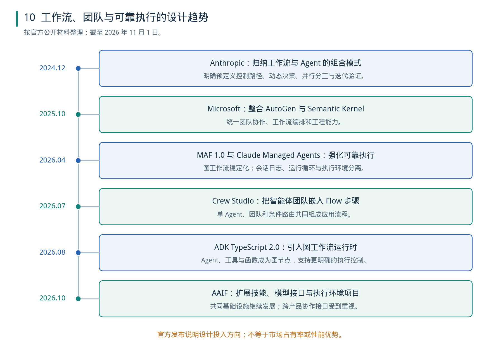

*图10：官方发布记录支持设计方向判断，不代表市场份额或性能增长曲线。[可编辑 SVG](figures/10_trends.svg)*

### 12.1 2024—2026 年的官方设计动向

| 时间 | 一手证据 | 支持的判断 |
| --- | --- | --- |
| 2024-12-19 | Anthropic 梳理工作流、并行、主管—专家和评审循环 | 可组合模式已被明确提炼 |
| 2025-10-01 | Microsoft 发布 Agent Framework，将 AutoGen 与 Semantic Kernel 经验结合 | 团队协作与工程运行基础合并 |
| 2026 年 4 月 | MAF 1.0；Anthropic Managed Agents 工程设计 | 关注稳定接口、持久会话和执行恢复 |
| 2026-07-28 | Crew Studio 包含 Single-agent、Crew 和 Router 节点 | 团队嵌入 Flow 成为直接产品形式 |
| 2026-08-21 | ADK TypeScript 2.0 GA，支持显式图工作流 | 图编排扩展到原生 TS 开发路线 |
| 2026-10-22 | AAIF 新增 Agent Skills、Open Responses、OpenEnv、OpenSandbox | 共同建设技能、模型接口与执行设施 |

来源：[R01]、[R45]、[R16]、[R37]、[R12]、[R18]、[R38]。

这组材料跨越多个独立维护方，足以说明相关设计获得持续投入。它没有提供安装量、生产任务量或市场份额，不能据此写成“某一模式已经占据大多数应用”。

### 12.2 正面案例与反面结果应同时保留

| 证据 | 已报告结果 | 适用范围与限制 |
| --- | --- | --- |
| Anthropic 多智能体研究系统，2025-06 | Opus 4 主管与 Sonnet 4 子 Agent，在内部研究评测中相对单 Opus 4 提升 90.2% | 内部研究任务、不同角色模型及额外计算；不能直接外推到 EDA 或代码任务 |
| Scaling Agent Systems，v3，2026-04 | 260 种配置、6 个基准；相对单 Agent 的变化从可拆分金融推理的 +80.8% 到顺序规划的 −70.0% | 在论文规定的模型、工具和预算下；部分代码/终端基准仅使用 20 题子集 |
| MAST，NeurIPS 2025 正式版本 | 1600 余条标注轨迹、7 个框架，归纳 14 类失败 | 说明协作中的系统设计、成员不一致与任务验证问题，不能据此给出所有框架的统一失败率 |

来源：[R41]、[R39]、[R40]。

Anthropic 同文报告，多 Agent 的 token 消耗约为普通聊天的 15 倍，普通 Agent 约为聊天的 4 倍；“15 倍”的分母是聊天，并不是单 Agent。[R41]

Scaling Agent Systems 本文采用 2026-04-08 的 v3。较早博客介绍的是旧版实验，不能将其配置数量、基准数量和提升比例混入 v3。表中的百分数是相对表现变化，不是增加了相同数值的百分点；也不表示每个模型都呈现完全一致的结果。[R39]

### 12.3 调查提供的是受访群体信息

LangChain 的公开调查实际采集于 2025-11-18 至 12-02，共 1340 份回答。报告称，89% 的受访组织具有某种观测能力，52.4% 运行离线评测。[R42]

这些数字支持“受访开发者群体正在重视运行观测与评测”。但样本来自公开自愿参与，63% 属于技术行业，49% 来自少于 100 人的组织，不能当作全行业随机样本，也不能由此推算多 Agent 的生产占比。[R42]

### 12.4 趋势判断的证据强度

| 命题 | 本报告判断 | 理由 |
| --- | --- | --- |
| Flow 与 Agent/团队正在组合 | 较强支持 | 多个官方框架与产品有直接设计证据 |
| 持久执行、上下文与评测越来越受重视 | 较强支持 | 新运行设施与受访生态共同指向这一方向 |
| 可视化编辑是唯一入口 | 不支持 | 代码、声明配置、画布并存 |
| 多 Agent 普遍更准确或更便宜 | 不支持 | 实验收益随任务与预算明显变化 |
| MCP/A2A 自动带来可靠协作 | 不支持 | 协议解决接口问题，业务正确性仍需实现 |
| 已能确认某框架占据行业主导份额 | 证据不足 | 本次来源不能建立统一可比的份额统计 |

### 12.5 趋势背后的具体变化

综合上述材料，正在形成的方向可概括为：

1. **控制可以逐层分配。** 程序掌握必要规则，模型获得局部判断空间。
2. **团队成为可组合的执行单元。** 它可以作为流程节点，也可以由另一个 Agent 调用。
3. **运行设施成为框架核心竞争部分。** 长任务需要保存状态、恢复、取消、版本和事件。
4. **上下文成为显式管理对象。** 完整记录和当前模型输入分别维护。
5. **可视化覆盖设计与调试，但两者不是同一件事。**
6. **评测决定是否需要多 Agent。** 团队数量不应成为产品能力的替代指标。

以上属于本报告基于多项一手资料形成的综合推断。

<a id="chapter-13"></a>

## 13. DFT Agent 的参考设计

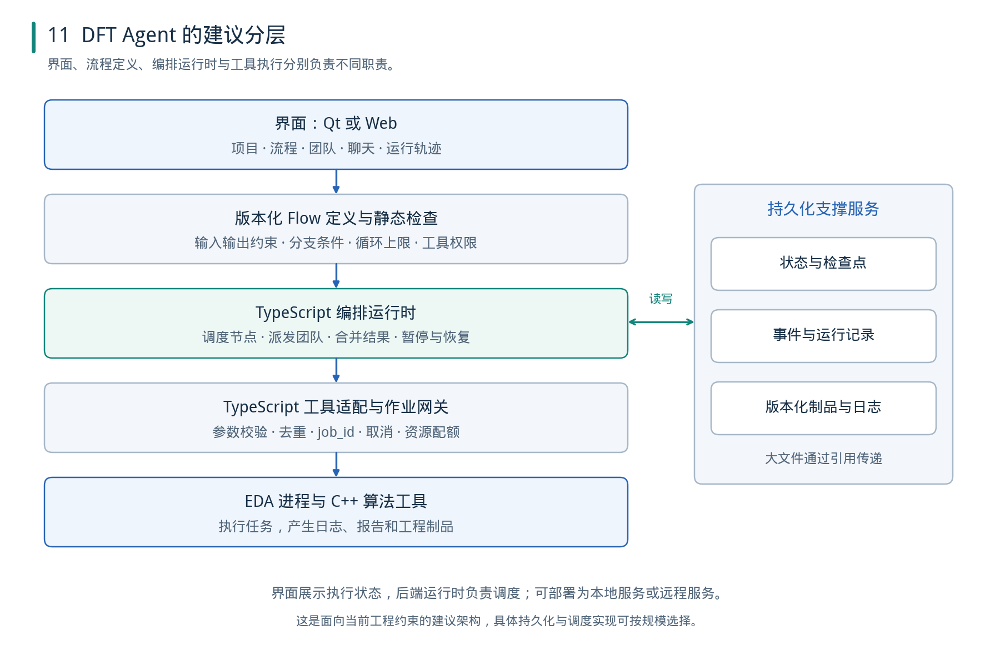

*图11：针对当前技术栈的建议分层。图中存储职责用于新设计，不表示当前 Studio 已完成这些组件。[可编辑 SVG](figures/11_dft_architecture.svg)*

### 13.1 技术栈与职责分配

| 组件 | 建议职责 |
| --- | --- |
| Qt 前端 | 工程、流程、团队、对话、运行与成果界面 |
| TypeScript 应用后端 | 用户任务、版本化定义、运行 API、事件订阅与授权范围 |
| 编排适配层 | 将 FlowSpec 转为 LangGraph.js/Mastra/ADK 等执行对象 |
| Agent 层 | 分析、检索、生成候选、解释失败和提出修复 |
| TypeScript 工具与作业网关 | 统一工具契约、许可证和并发控制、job 登记、取消与结果收集 |
| C++ EDA 算法工具 | 分组、图算法、优化、解析等明确计算任务 |
| EDA 执行环境 | 根据已选工具流程运行真实命令，产生原始日志和制品 |
| 持久状态与制品服务 | 保存运行记录、输入摘要、定义版本、报告与补丁关联 |

这延续 TS 负责应用与 MCP、C++ 负责 EDA 扩展算法的分工。前端既可以用 Qt 原生图形组件，也可以在明确选择 Web 编辑区域后采用相应画布库；两种方式都应服从同一 FlowSpec，而非让 UI 库决定执行模型。

### 13.2 一个完整的外围执行过程

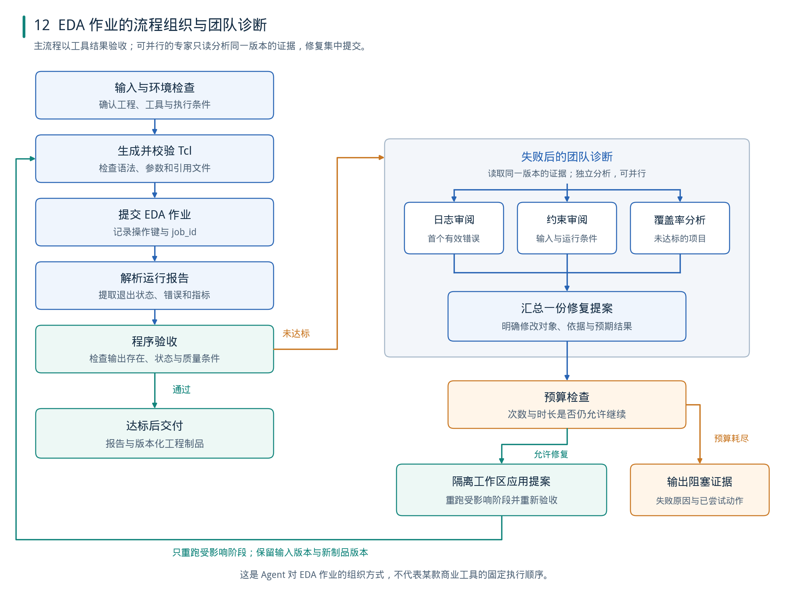

*图12：Agent 在 EDA 工具外侧的组织示例。实际 DFT、UVM 或后端步骤由相应工具流程模板决定，不将本图当作通用商业工具命令顺序。[可编辑 SVG](figures/12_dft_flow.svg)*

1. **固定输入。** 保存工程文件清单、目标、工具环境和输入版本。
2. **进行确定性检查。** 缺失文件、无效工具路径、明显参数错误先由程序检出。
3. **生成或选择脚本。** Agent 可以提出 Tcl/SDC 候选，程序检查格式、引用与允许范围。
4. **启动工具作业。** 经作业服务提交，记录操作键和 job_id。
5. **收集并解析。** 保存原始日志，同时提取结构化状态和指标。
6. **执行验收。** 使用预定义的检查，而非依赖 Agent 宣告完成。
7. **针对失败启动诊断。** 只在需要时使用单专家或小团队。
8. **应用一份可核对的修复。** 在隔离工作区保存修改及来源，重跑受影响阶段。
9. **交付或明确停止。** 达标交付；预算耗尽或缺少必要条件时，返回已完成内容与阻塞证据。

### 13.3 适合并行与应当串行的工作

| 工作 | 建议方式 | 原因 |
| --- | --- | --- |
| 阅读不同日志、检索不同手册章节 | 并行 | 输入独立，通常无共享写操作 |
| 约束检查、覆盖率分析、脚本审阅 | 固定输入版本下并行 | 专家可分别形成建议 |
| 多个候选方案试验 | 隔离目录并行，受资源额度限制 | 避免文件、报告和进程互相干扰 |
| 修改同一 Tcl/SDC/RTL 文件 | 合并为一个受控提交步骤 | 防止修改覆盖及版本混乱 |
| 操作同一有状态 EDA 会话 | 明确串行或独占 | 多个命令可能依赖共享工具状态 |
| 最终报告和验收 | 汇总后集中完成 | 对应同一实际输入和结果版本 |

### 13.4 建议的最小团队

不必从很多角色开始。可先设置一个流程控制者和按需调用的三个能力：

- **日志诊断**：提取失败位置和可验证的错误类别。
- **约束与脚本审阅**：核对命令输入、时钟/复位等必要条件。
- **报告与目标分析**：解释指标变化，判断还有哪些问题需要处理。

它们先以只读方式提供候选结论；程序统一收集证据，再由一次修复步骤生成并应用修改。只有当任务集显示明显收益时，再增加专门角色或动态团队。

### 13.5 工具返回结构应面向运行控制

下面是本文建议的工具契约示例，不对应某个商业 EDA 工具的固定输出：

```json
{
  "logical_operation_id": "run-17.stage-3.op-2",
  "attempt_id": "run-17.stage-3.op-2.a1",
  "submission_key": "run-17.stage-3.op-2.a1",
  "job_id": "job-418",
  "status": "completed",
  "input_digest": "sha256:...",
  "tool_version": "recorded-from-environment",
  "exit_code": 0,
  "artifacts": [
    {"kind": "log", "ref": "artifact-91"},
    {"kind": "report", "ref": "artifact-92"}
  ],
  "validation": {
    "parsed": true,
    "passed": false,
    "failure_category": "engineering_check_failed",
    "evidence_refs": ["artifact-92:section-4"]
  }
}
```

进程完成、退出码为零、报告解析成功和工程验收通过是不同事实，不能合并成一个 `success=true`。当某个字段无法确定时，应返回未知或缺失原因，不让模型补造数值。

### 13.6 与现有项目数据的关系

本节描述的是框架设计建议，不要求把全部数据迁入同一个数据库。现有 DFT Agent Studio 的脚本配置组织可以继续作为产品配置来源；新增的运行状态、job 登记和制品索引应独立定义职责。

对于实际运行，仍应在工程工作区生成 Tcl/SDC，并保存此次执行所使用的版本或摘要。配置中的脚本被修改后，不能使历史运行的脚本内容也随之改变。

### 13.7 MCP 与 A2A 的位置

MCP 主要标准化应用访问工具和外部资源的接口；A2A 主要支持不同系统之间的 Agent 通信与任务交互。[R43]、[R44]

对当前单产品内部的 TS 后端和 C++ 工具，优先做好稳定工具契约与作业管理即可。需要让独立部署、不同框架或不同组织的 Agent 协作时，再考虑 A2A。协议不会自动定义覆盖率验收、资源调度、冲突处理或失败恢复，这些仍属于应用设计。

<a id="chapter-14"></a>

## 14. 选型验证与实施顺序

### 14.1 TS 方案的比较重点

| 维度 | LangGraph.js | Mastra | ADK TypeScript 2.0 |
| --- | --- | --- | --- |
| 适配出发点 | 掌握图状态与细粒度执行 | 减少 TS Agent 应用集成工作 | 使用 ADK 图与模型工具体系 |
| 应重点验证 | reducer、动态分支、子图和恢复范围 | schema、分支规则、snapshot 与暂停 | 所需功能在 TS 的具体覆盖 |
| 自定义编辑器 | 由 FlowSpec 转换并回传运行事件 | 同样需要业务定义与编辑规则 | 同样需要业务定义，不能直接套用 Python Builder |
| 领域服务 | 三者都需要外置 EDA job、资源与制品管理 | 三者都需要外置 EDA job、资源与制品管理 | 三者都需要外置 EDA job、资源与制品管理 |
| 本项目建议 | 优先完成一条最小工程流程 | 使用同一案例做对照 | 加入候选，先核对 TS 恢复与协作能力 |

来源与依据：[R02]、[R04]、[R25]、[R26]、[R18]—[R22]。最后一行是项目建议，不是框架普遍优劣结论。

### 14.2 使用同一组任务进行对照

建议建立四个架构对照，固定模型、工具版本、输入工程和验收方式：

- A：单 Agent 工具循环。
- B：明确 Flow + 单 Agent 诊断。
- C：明确 Flow + 固定小团队。
- D：明确 Flow + 动态团队。

先在同等调用/费用上限下比较，再观察放宽预算后的收益曲线。团队跑更多调用之后得到更高成功率，不足以证明架构在相同预算下更有效。

### 14.3 需要测量的指标

| 指标 | 建议定义 |
| --- | --- |
| 工程完成率 | 满足全部预定工具检查和成果要求的任务比例 |
| 首轮验收通过率 | 第一次候选与工具执行即通过验收、未进入诊断修复的任务比例 |
| 总费用 | 包含失败尝试、所有子 Agent 和重复调用 |
| 总耗时 | 从任务接受到验收结束，另报等待资源的时间 |
| 重复工具作业率 | 同一执行尝试意外创建多个外部作业的比例 |
| 恢复成功率 | 注入故障后可继续完成且不重复副作用的比例 |
| 无效修复率 | 未改变目标错误或引入新问题的修改比例 |
| 人工介入量 | 必要澄清、授权和故障处理次数 |
| 成果可复查性 | 是否可从报告追到原始输入、脚本、工具结果与版本 |

不要将“生成的对话更长”“角色更多”“工具调用更多”当成任务效果指标。

### 14.4 故障验证比正常演示更有区分度

最小验证集应包含：

1. 外部作业已经启动，返回响应丢失。
2. 节点执行中编排服务重启。
3. 一个并行专家超时，其余分支正常。
4. 人工输入到达时，运行已取消或定义已改变。
5. 报告存在但无法解析，不能生成可信指标。
6. 同一错误连续出现，系统应停止无效修复。
7. 取消后外部进程仍运行，系统应继续核对和清理。
8. 新版本脚本触发新运行，旧检查点不可误用于新输入。

上述是建议的实验设计；本次调研没有在用户工程上运行这些对照。

### 14.5 分阶段实施

**阶段一：完成可恢复的单流程。** 先实现 FlowSpec、程序节点、一个 Agent 节点、作业登记、报告解析和结果交付。

**阶段二：补齐界面与定义版本。** 加入项目管理、画布、运行轨迹、版本发布和输入缺项提示。

**阶段三：引入固定小团队。** 从只读并行分析开始，对比完成率、费用和耗时，保留有实际收益的分工。

**阶段四：按需求增加动态协作。** 只有在任务数量或角色类型需要运行时决定时，才增加动态子任务、跨服务委派和更复杂的协调模式。

这个顺序使运行正确性和团队收益可以分别检验，避免在最初阶段同时调试界面、模型、团队调度和长任务恢复。

<a id="chapter-15"></a>

## 15. 常见设计误区

| 误区 | 更准确的设计处理 |
| --- | --- |
| 所有节点都必须是 Agent | 程序、工具、等待、验收同样是重要节点 |
| Flow 一定是固定无环图 | 可以有条件、循环、动态分支与子流程 |
| 给模型几个角色就形成可靠团队 | 还需要输入输出、控制关系、预算和结果验证 |
| Handoff 等于函数调用 | 交接改变活动处理者，返回需要明确规则 |
| 保存聊天记录就能恢复任务 | 还需运行状态、外部作业和文件版本 |
| Checkpoint 保证外部工具只执行一次 | 恢复可能重跑，必须处理去重和未知状态 |
| 有可视化图就有可视化编辑器 | 运行图、设计图和编辑功能分别实现 |
| 提高并发必然降低耗时 | 依赖、许可证、资源竞争和汇总会限制收益 |
| 所有 Agent 都应看到全部历史 | 按任务提供必要上下文，原始证据可回查 |
| 多个评审同意就证明正确 | 使用独立证据和客观工具检查 |
| 某语言 SDK 有一个功能，所有语言都一样 | 按具体功能页与锁定版本核对 |
| 协议标准化等于业务正确性 | 接口、执行规则与工程验收分别设计 |

<a id="chapter-16"></a>

## 16. 结论与后续研究方向

截至 2026 年 11 月，能够得到较强支持的趋势是：**工作流、智能体团队与可靠执行设施正在组合，框架从组织模型调用逐步扩展到管理完整任务的执行过程。**

这种设计的价值，在于把不同性质的工作交给适合的机制：必要次序和可计算检查由程序承担；开放问题交给 Agent；能够独立展开的分析交给团队；长期外部工作交给作业服务；完成与否依据实际制品和验证结果。

对 DFT Agent，优先级应放在“执行过程可控、成果可核对、故障后可恢复”，再根据同预算实验决定在哪里增加团队。值得继续研究的方向包括：

- 根据任务依赖与预算自动选择单 Agent、固定团队或动态团队。
- 对 Agent 计划和 Flow 定义进行静态检查。
- 将文件版本、工具证据与运行状态统一关联。
- 识别重复失败并调整策略，而非单纯增加修复轮数。
- 在多模型、多语言和多个执行环境之间保持一致的工具契约。
- 对流程修改、检查点迁移和运行分叉提供可验证规则。

<a id="chapter-17"></a>

## 17. 图稿与参考文献

### 17.1 图稿说明

报告包含 12 幅原创示意图，均附 PNG、可编辑 SVG 和 Python 绘图源码。正文使用 PNG，便于在不同 Markdown 阅读器中显示；SVG 保留矢量线条与文字，适合后续排版修改。图稿是对文中设计关系的归纳，不是厂商界面截图或某个框架内部实现的逐行还原。

解压完整资料包后，保持报告、`figures/` 和 `source/` 的相对位置，即可在 Obsidian、VS Code 或其他支持本地图片的 Markdown 阅读器中查看。

| 图号 | 内容 | SVG |
| --- | --- | --- |
| 1 | Flow 与团队的两个维度 | [01_flow_team.svg](figures/01_flow_team.svg) |
| 2 | 团队协作与控制转移 | [02_team_patterns.svg](figures/02_team_patterns.svg) |
| 3 | 混合执行架构 | [03_hybrid_execution.svg](figures/03_hybrid_execution.svg) |
| 4 | 设计实体与运行数据 | [04_data_model.svg](figures/04_data_model.svg) |
| 5 | 外部作业恢复 | [05_recovery.svg](figures/05_recovery.svg) |
| 6 | 控制、数据、共享状态与事件四种图语义 | [06_graph_models.svg](figures/06_graph_models.svg) |
| 7 | XOR、AND、OR 分支与汇合 | [07_graph_joins.svg](figures/07_graph_joins.svg) |
| 8 | Pregel 分阶段执行与状态可见性 | [08_graph_supersteps.svg](figures/08_graph_supersteps.svg) |
| 9 | 有环设计图与调用实例展开 | [09_graph_instances.svg](figures/09_graph_instances.svg) |
| 10 | 官方设计动向时间线 | [10_trends.svg](figures/10_trends.svg) |
| 11 | DFT Agent 分层架构 | [11_dft_architecture.svg](figures/11_dft_architecture.svg) |
| 12 | 执行、诊断与局部修复 | [12_dft_flow.svg](figures/12_dft_flow.svg) |

### 17.2 来源使用说明

所有网页访问日期均为 **2026-11-01**。标为“动态文档”的页面没有在本报告中推定功能首发日期；版本与状态依本次官方说明记录。仅使用厂商与项目官方页面、官方仓库和原始论文作为技术事实来源。报告没有复制厂商图示，没有使用 GitHub 星数或厂商宣传的收益承诺作为趋势结论的依据。

论文中的相对提升、子集大小和调查样本限制，在正文相邻位置说明。当前框架存在快速更新与跨语言差异，落地时应固定依赖版本，并对本项目所需行为做最小验证。

### 17.3 参考文献

- **R01**　ANTHROPIC. [Building effective agents](https://www.anthropic.com/research/building-effective-agents)[EB/OL]. 2024-12-19. [访问日期：2026-11-01].

- **R02**　LANGCHAIN. [LangGraph JavaScript: Graph API](https://docs.langchain.com/oss/javascript/langgraph/graph-api)[EB/OL]. 动态文档. [访问日期：2026-11-01].

- **R03**　LANGCHAIN. [LangGraph JavaScript: Persistence](https://docs.langchain.com/oss/javascript/langgraph/persistence)[EB/OL]. 动态文档. [访问日期：2026-11-01].

- **R04**　LANGCHAIN. [LangGraph JavaScript: Interrupts](https://docs.langchain.com/oss/javascript/langgraph/interrupts)[EB/OL]. 动态文档. [访问日期：2026-11-01].

- **R05**　LANGCHAIN. [LangSmith Studio](https://docs.langchain.com/langsmith/studio)[EB/OL]. 动态文档. [访问日期：2026-11-01].

- **R06**　OPENAI. [Agents SDK JavaScript: Agent Orchestration](https://openai.github.io/openai-agents-js/guides/multi-agent/)[EB/OL]. 动态文档. [访问日期：2026-11-01].

- **R07**　OPENAI. [Agents SDK Python: Handoffs](https://openai.github.io/openai-agents-python/handoffs/)[EB/OL]. 动态文档. [访问日期：2026-11-01].

- **R08**　OPENAI. [Agents SDK Python: Running agents](https://openai.github.io/openai-agents-python/running_agents/)[EB/OL]. 动态文档. [访问日期：2026-11-01].

- **R09**　CREWAI. [Production Architecture](https://docs.crewai.com/v1.15.33/en/concepts/production-architecture)[EB/OL]. 本次页面版本 v1.15.33. [访问日期：2026-11-01].

- **R10**　CREWAI. [Flows](https://docs.crewai.com/v1.15.33/en/concepts/flows)[EB/OL]. 本次页面版本 v1.15.33. [访问日期：2026-11-01].

- **R11**　CREWAI. [Checkpointing](https://docs.crewai.com/v1.15.33/en/concepts/checkpointing)[EB/OL]. 本次页面版本 v1.15.33. [访问日期：2026-11-01].

- **R12**　MILLER J / CREWAI. [Crew Studio: The Automated Agent Builder](https://crewai.com/blog/crew-studio-automated-agent-builder)[EB/OL]. 2026-07-28. [访问日期：2026-11-01].

- **R13**　MICROSOFT. [Microsoft Agent Framework Overview](https://learn.microsoft.com/en-us/agent-framework/overview/)[EB/OL]. 动态文档. [访问日期：2026-11-01].

- **R14**　MICROSOFT. [Workflow capabilities](https://learn.microsoft.com/en-us/agent-framework/workflows/)[EB/OL]. 动态文档. [访问日期：2026-11-01].

- **R15**　MICROSOFT. [Durable Extension](https://learn.microsoft.com/en-us/agent-framework/hosting/durable-extension)[EB/OL]. 动态文档. [访问日期：2026-11-01].

- **R16**　HENRY S / MICROSOFT. [Microsoft Agent Framework Version 1.0](https://devblogs.microsoft.com/agent-framework/microsoft-agent-framework-version-1-0/)[EB/OL]. 公告日期 2026-04-03. [访问日期：2026-11-01].

- **R17**　MICROSOFT. [AutoGen: official repository README](https://github.com/microsoft/autogen)[EB/OL]. 本次读取的维护声明. [访问日期：2026-11-01].

- **R18**　GOOGLE ADK. [Welcome to ADK 2.0](https://adk.dev/2.0/)[EB/OL]. 含各语言 GA 日期. [访问日期：2026-11-01].

- **R19**　GOOGLE ADK. [Graph-based agent workflows](https://adk.dev/graphs/)[EB/OL]. 动态文档. [访问日期：2026-11-01].

- **R20**　GOOGLE ADK. [Build collaborative agent teams](https://adk.dev/workflows/collaboration/)[EB/OL]. 动态文档. [访问日期：2026-11-01].

- **R21**　GOOGLE ADK. [Resume Agents](https://adk.dev/runtime/resume/)[EB/OL]. 动态文档. [访问日期：2026-11-01].

- **R22**　GOOGLE ADK. [Use the Visual Builder](https://adk.dev/visual-builder/)[EB/OL]. 动态文档. [访问日期：2026-11-01].

- **R23**　PYDANTIC. [Graph Builder API](https://pydantic.dev/docs/ai/graph/builder/)[EB/OL]. 动态文档，含 V2 持久化变更. [访问日期：2026-11-01].

- **R24**　PYDANTIC. [Durable Execution](https://pydantic.dev/docs/ai/capabilities/durable_execution/overview/)[EB/OL]. 动态文档. [访问日期：2026-11-01].

- **R25**　MASTRA. [Control flow](https://mastra.ai/docs/workflows/control-flow)[EB/OL]. 动态文档. [访问日期：2026-11-01].

- **R26**　MASTRA. [Suspend and resume](https://mastra.ai/docs/workflows/suspend-and-resume)[EB/OL]. 动态文档. [访问日期：2026-11-01].

- **R27**　MASTRA. [Subagents](https://mastra.ai/docs/subagents)[EB/OL]. 动态文档. [访问日期：2026-11-01].

- **R28**　LLAMAINDEX. [Writing durable workflows](https://developers.llamaindex.ai/python/llamaagents/workflows/durable_workflows/)[EB/OL]. Python 动态文档. [访问日期：2026-11-01].

- **R29**　LLAMAINDEX. [Workflows](https://developers.llamaindex.ai/typescript/framework/tutorials/workflows/)[EB/OL]. TypeScript 动态文档. [访问日期：2026-11-01].

- **R30**　DIFY. [Agent](https://docs.dify.ai/en/cloud/use-dify/nodes/agent)[EB/OL]. 动态文档. [访问日期：2026-11-01].

- **R31**　FLOWISE. [Agentflow V2](https://docs.flowiseai.com/using-flowise/agentflowv2)[EB/OL]. 动态文档. [访问日期：2026-11-01].

- **R32**　LANGFLOW. [Use Langflow agents as tools](https://docs.langflow.org/agents-tools)[EB/OL]. 动态文档. [访问日期：2026-11-01].

- **R33**　N8N. [AI Agent Tool](https://docs.n8n.io/integrations/builtin/cluster-nodes/sub-nodes/n8n-nodes-langchain.toolaiagent)[EB/OL]. 动态文档. [访问日期：2026-11-01].

- **R34**　XYFLOW. [React Flow: Quick Start](https://reactflow.dev/learn)[EB/OL]. 动态文档. [访问日期：2026-11-01].

- **R35**　LANGCHAIN. [LangSmith Studio vs Agent Chat UI: When to Use What](https://kb.langchain.com/articles/1353449293-langsmith-studio-vs-agent-chat-ui)[EB/OL]. 知识库动态页面. [访问日期：2026-11-01].

- **R36**　LANGFUSE. [Agent Graphs](https://langfuse.com/docs/observability/features/agent-graphs)[EB/OL]. 动态文档. [访问日期：2026-11-01].

- **R37**　MARTIN L, CEMAJ G, COHEN M / ANTHROPIC. [Scaling Managed Agents: Decoupling the brain from the hands](https://www.anthropic.com/research/managed-agents)[EB/OL]. 2026-04-08. [访问日期：2026-11-01].

- **R38**　THE LINUX FOUNDATION. [Agentic AI Foundation Announces Four New Projects: Agent Skills, Open Responses, OpenEnv, and OpenSandbox](https://www.linuxfoundation.org/press/agentic-ai-foundation-announces-four-new-projects-agent-skills-open-responses-openenv-and-opensandbox)[EB/OL]. 2026-10-22. [访问日期：2026-11-01].

- **R39**　KIM Y, GU K, PARK C, et al. [Towards a Science of Scaling Agent Systems](https://arxiv.org/abs/2512.08296v3)[EB/OL]. arXiv:2512.08296v3，2026-04-08. [访问日期：2026-11-01].

- **R40**　CEMRI M, PAN M Z, YANG S, et al. [Why Do Multi-Agent LLM Systems Fail?](https://proceedings.neurips.cc/paper_files/paper/2025/hash/b1041e52d3be19f0a9bc491657488e4a-Abstract-Datasets_and_Benchmarks_Track.html)[C/OL]. NeurIPS 2025, Datasets and Benchmarks；DOI:10.52202/085713-4082. [访问日期：2026-11-01].

- **R41**　ANTHROPIC. [How we built our multi-agent research system](https://www.anthropic.com/research/multi-agent-research-system)[EB/OL]. 2025-06-13. [访问日期：2026-11-01].

- **R42**　LANGCHAIN. [State of Agent Engineering](https://www.langchain.com/state-of-agent-engineering)[EB/OL]. 调查期 2025-11-18—2025-12-02；网页标注 2026-06-12. [访问日期：2026-11-01].

- **R43**　MODEL CONTEXT PROTOCOL. [What is the Model Context Protocol (MCP)?](https://modelcontextprotocol.io/docs/2026-07-28/getting-started/intro)[EB/OL]. 本次页面版本 2026-07-28. [访问日期：2026-11-01].

- **R44**　A2A PROJECT. [What is A2A?](https://a2a-protocol.org/latest/topics/what-is-a2a/)[EB/OL]. 动态文档. [访问日期：2026-11-01].

- **R45**　MICROSOFT. [Introducing Microsoft Agent Framework: The Open-Source Engine for Agentic AI Apps](https://devblogs.microsoft.com/foundry/introducing-microsoft-agent-framework-the-open-source-engine-for-agentic-ai-apps/)[EB/OL]. 2025-10-01. [访问日期：2026-11-01].

- **R46**　TEMPORAL. [Activity basics — TypeScript SDK](https://docs.temporal.io/develop/typescript/activities/basics)[EB/OL]. 动态文档. [访问日期：2026-11-01].

论文补充全文：[Scaling Agent Systems v3 HTML](https://arxiv.org/html/2512.08296v3)，用于核对实验子集和限制。

- **R47**　LANGCHAIN. [LangGraph runtime](https://docs.langchain.com/oss/javascript/langgraph/pregel)[EB/OL]. 动态文档. [访问日期：2026-11-01].

- **R48**　LANGCHAIN. [Use the graph API](https://docs.langchain.com/oss/javascript/langgraph/use-graph-api)[EB/OL]. 动态文档. [访问日期：2026-11-01].

- **R49**　LANGCHAIN. [INVALID_CONCURRENT_GRAPH_UPDATE](https://docs.langchain.com/oss/javascript/langgraph/errors/INVALID_CONCURRENT_GRAPH_UPDATE)[EB/OL]. 动态文档. [访问日期：2026-11-01].

- **R50**　LANGCHAIN. [Subgraphs](https://docs.langchain.com/oss/javascript/langgraph/use-subgraphs)[EB/OL]. 动态文档. [访问日期：2026-11-01].

- **R51**　LANGCHAIN. [StateGraph — LangGraph.js API Reference](https://langchain-ai.github.io/langgraphjs/reference/classes/langgraph.StateGraph.html)[EB/OL]. 动态 API 参考. [访问日期：2026-11-01].

- **R52**　PYDANTIC. [Joins and Reducers](https://pydantic.dev/docs/ai/graph/builder/joins/)[EB/OL]. 动态文档. [访问日期：2026-11-01].

- **R53**　PYDANTIC. [Parallel Execution](https://pydantic.dev/docs/ai/graph/builder/parallel/)[EB/OL]. 动态文档. [访问日期：2026-11-01].

- **R54**　PYDANTIC. [Decision Nodes](https://pydantic.dev/docs/ai/graph/builder/decisions/)[EB/OL]. 动态文档. [访问日期：2026-11-01].

- **R55**　CAMUNDA. [Exclusive gateway](https://docs.camunda.io/docs/8.9/components/modeler/bpmn/exclusive-gateways/)[EB/OL]. 版本 8.9 文档. [访问日期：2026-11-01].

- **R56**　CAMUNDA. [Parallel gateway](https://docs.camunda.io/docs/8.8/components/modeler/bpmn/parallel-gateways/)[EB/OL]. 版本 8.8 文档. [访问日期：2026-11-01].

- **R57**　CAMUNDA. [Inclusive gateway](https://docs.camunda.io/docs/8.9/components/modeler/bpmn/inclusive-gateways/)[EB/OL]. 版本 8.9 文档. [访问日期：2026-11-01].

- **R58**　APACHE AIRFLOW. [Dynamic Task Mapping](https://airflow.apache.org/docs/apache-airflow/stable/authoring-and-scheduling/dynamic-task-mapping.html)[EB/OL]. 动态文档. [访问日期：2026-11-01].

- **R59**　GOOGLE ADK. [Graph routes](https://adk.dev/graphs/routes/)[EB/OL]. 动态文档. [访问日期：2026-11-01].

- **R60**　GOOGLE ADK. [Data handling](https://adk.dev/graphs/data-handling/)[EB/OL]. 动态文档. [访问日期：2026-11-01].

- **R61**　GOOGLE ADK. [Dynamic workflows](https://adk.dev/graphs/dynamic/)[EB/OL]. 动态文档. [访问日期：2026-11-01].

- **R62**　DAGSTER. [Concepts — Ops, graphs and jobs](https://dagster.io/docs/getting-started/concepts)[EB/OL]. 动态文档. [访问日期：2026-11-01].

- **R63**　DAGSTER. [Dynamic graphs](https://dagster.io/docs/guides/build/ops/dynamic-graphs)[EB/OL]. 动态文档. [访问日期：2026-11-01].

- **R64**　PREFECT. [Introduction — Prefect 3](https://www.prefect.io/docs/v3/get-started)[EB/OL]. 动态文档. [访问日期：2026-11-01].

- **R65**　TEMPORAL. [Temporal Workflow Definition](https://docs.temporal.io/workflow-definition)[EB/OL]. 动态文档. [访问日期：2026-11-01].

- **R66**　BESTA M, et al.. [Graph of Thoughts: Solving Elaborate Problems with Large Language Models](https://arxiv.org/html/2308.09687v4)[EB/OL]. 2024-02-06，arXiv v4；AAAI 2024 工作. [访问日期：2026-11-01].

- **R67**　KIM S, et al.. [An LLM Compiler for Parallel Function Calling](https://arxiv.org/html/2312.04511v3)[EB/OL]. 2024-06-05，arXiv v3；ICML 2024 工作. [访问日期：2026-11-01].

- **R68**　ZHANG J, et al.. [AFlow: Automating Agentic Workflow Generation](https://arxiv.org/html/2410.10762v4)[EB/OL]. 2025-04-15，arXiv v4；ICLR 2025 工作. [访问日期：2026-11-01].

- **R69**　YUE L, et al.. [From Static Templates to Dynamic Runtime Graphs: A Survey of Workflow Optimization for LLM Agents](https://aclanthology.org/2026.findings-emnlp.1393/)[C/OL]. 2026-10，Findings of EMNLP 2026. [访问日期：2026-11-01].

- **R70**　WEI Y, et al.. [VFlow: Discovering Optimal Agentic Workflows for Verilog Generation](https://arxiv.org/abs/2504.03723v2)[EB/OL]. 2025-07-13，arXiv v2. [访问日期：2026-11-01].

- **R71**　ASP-DAC. [Conference Program — ASP-DAC 2026](https://www.aspdac.com/aspdac2026/program/program-abstract.html)[EB/OL]. 2026-01-19 至 2026-01-22，正式议程. [访问日期：2026-11-01].

[R01]: https://www.anthropic.com/research/building-effective-agents "Building effective agents"
[R02]: https://docs.langchain.com/oss/javascript/langgraph/graph-api "LangGraph JavaScript: Graph API"
[R03]: https://docs.langchain.com/oss/javascript/langgraph/persistence "LangGraph JavaScript: Persistence"
[R04]: https://docs.langchain.com/oss/javascript/langgraph/interrupts "LangGraph JavaScript: Interrupts"
[R05]: https://docs.langchain.com/langsmith/studio "LangSmith Studio"
[R06]: https://openai.github.io/openai-agents-js/guides/multi-agent/ "Agents SDK JavaScript: Agent Orchestration"
[R07]: https://openai.github.io/openai-agents-python/handoffs/ "Agents SDK Python: Handoffs"
[R08]: https://openai.github.io/openai-agents-python/running_agents/ "Agents SDK Python: Running agents"
[R09]: https://docs.crewai.com/v1.15.33/en/concepts/production-architecture "Production Architecture"
[R10]: https://docs.crewai.com/v1.15.33/en/concepts/flows "Flows"
[R11]: https://docs.crewai.com/v1.15.33/en/concepts/checkpointing "Checkpointing"
[R12]: https://crewai.com/blog/crew-studio-automated-agent-builder "Crew Studio: The Automated Agent Builder"
[R13]: https://learn.microsoft.com/en-us/agent-framework/overview/ "Microsoft Agent Framework Overview"
[R14]: https://learn.microsoft.com/en-us/agent-framework/workflows/ "Workflow capabilities"
[R15]: https://learn.microsoft.com/en-us/agent-framework/hosting/durable-extension "Durable Extension"
[R16]: https://devblogs.microsoft.com/agent-framework/microsoft-agent-framework-version-1-0/ "Microsoft Agent Framework Version 1.0"
[R17]: https://github.com/microsoft/autogen "AutoGen: official repository README"
[R18]: https://adk.dev/2.0/ "Welcome to ADK 2.0"
[R19]: https://adk.dev/graphs/ "Graph-based agent workflows"
[R20]: https://adk.dev/workflows/collaboration/ "Build collaborative agent teams"
[R21]: https://adk.dev/runtime/resume/ "Resume Agents"
[R22]: https://adk.dev/visual-builder/ "Use the Visual Builder"
[R23]: https://pydantic.dev/docs/ai/graph/builder/ "Graph Builder API"
[R24]: https://pydantic.dev/docs/ai/capabilities/durable_execution/overview/ "Durable Execution"
[R25]: https://mastra.ai/docs/workflows/control-flow "Control flow"
[R26]: https://mastra.ai/docs/workflows/suspend-and-resume "Suspend and resume"
[R27]: https://mastra.ai/docs/subagents "Subagents"
[R28]: https://developers.llamaindex.ai/python/llamaagents/workflows/durable_workflows/ "Writing durable workflows"
[R29]: https://developers.llamaindex.ai/typescript/framework/tutorials/workflows/ "Workflows"
[R30]: https://docs.dify.ai/en/cloud/use-dify/nodes/agent "Agent"
[R31]: https://docs.flowiseai.com/using-flowise/agentflowv2 "Agentflow V2"
[R32]: https://docs.langflow.org/agents-tools "Use Langflow agents as tools"
[R33]: https://docs.n8n.io/integrations/builtin/cluster-nodes/sub-nodes/n8n-nodes-langchain.toolaiagent "AI Agent Tool"
[R34]: https://reactflow.dev/learn "React Flow: Quick Start"
[R35]: https://kb.langchain.com/articles/1353449293-langsmith-studio-vs-agent-chat-ui "LangSmith Studio vs Agent Chat UI: When to Use What"
[R36]: https://langfuse.com/docs/observability/features/agent-graphs "Agent Graphs"
[R37]: https://www.anthropic.com/research/managed-agents "Scaling Managed Agents: Decoupling the brain from the hands"
[R38]: https://www.linuxfoundation.org/press/agentic-ai-foundation-announces-four-new-projects-agent-skills-open-responses-openenv-and-opensandbox "Agentic AI Foundation Announces Four New Projects: Agent Skills, Open Responses, OpenEnv, and OpenSandbox"
[R39]: https://arxiv.org/abs/2512.08296v3 "Towards a Science of Scaling Agent Systems"
[R40]: https://proceedings.neurips.cc/paper_files/paper/2025/hash/b1041e52d3be19f0a9bc491657488e4a-Abstract-Datasets_and_Benchmarks_Track.html "Why Do Multi-Agent LLM Systems Fail?"
[R41]: https://www.anthropic.com/research/multi-agent-research-system "How we built our multi-agent research system"
[R42]: https://www.langchain.com/state-of-agent-engineering "State of Agent Engineering"
[R43]: https://modelcontextprotocol.io/docs/2026-07-28/getting-started/intro "What is the Model Context Protocol (MCP)?"
[R44]: https://a2a-protocol.org/latest/topics/what-is-a2a/ "What is A2A?"
[R45]: https://devblogs.microsoft.com/foundry/introducing-microsoft-agent-framework-the-open-source-engine-for-agentic-ai-apps/ "Introducing Microsoft Agent Framework: The Open-Source Engine for Agentic AI Apps"
[R46]: https://docs.temporal.io/develop/typescript/activities/basics "Activity basics — TypeScript SDK"
[R47]: https://docs.langchain.com/oss/javascript/langgraph/pregel "LangGraph runtime"
[R48]: https://docs.langchain.com/oss/javascript/langgraph/use-graph-api "Use the graph API"
[R49]: https://docs.langchain.com/oss/javascript/langgraph/errors/INVALID_CONCURRENT_GRAPH_UPDATE "INVALID_CONCURRENT_GRAPH_UPDATE"
[R50]: https://docs.langchain.com/oss/javascript/langgraph/use-subgraphs "Subgraphs"
[R51]: https://langchain-ai.github.io/langgraphjs/reference/classes/langgraph.StateGraph.html "StateGraph — LangGraph.js API Reference"
[R52]: https://pydantic.dev/docs/ai/graph/builder/joins/ "Joins and Reducers"
[R53]: https://pydantic.dev/docs/ai/graph/builder/parallel/ "Parallel Execution"
[R54]: https://pydantic.dev/docs/ai/graph/builder/decisions/ "Decision Nodes"
[R55]: https://docs.camunda.io/docs/8.9/components/modeler/bpmn/exclusive-gateways/ "Exclusive gateway"
[R56]: https://docs.camunda.io/docs/8.8/components/modeler/bpmn/parallel-gateways/ "Parallel gateway"
[R57]: https://docs.camunda.io/docs/8.9/components/modeler/bpmn/inclusive-gateways/ "Inclusive gateway"
[R58]: https://airflow.apache.org/docs/apache-airflow/stable/authoring-and-scheduling/dynamic-task-mapping.html "Dynamic Task Mapping"
[R59]: https://adk.dev/graphs/routes/ "Graph routes"
[R60]: https://adk.dev/graphs/data-handling/ "Data handling"
[R61]: https://adk.dev/graphs/dynamic/ "Dynamic workflows"
[R62]: https://dagster.io/docs/getting-started/concepts "Concepts — Ops, graphs and jobs"
[R63]: https://dagster.io/docs/guides/build/ops/dynamic-graphs "Dynamic graphs"
[R64]: https://www.prefect.io/docs/v3/get-started "Introduction — Prefect 3"
[R65]: https://docs.temporal.io/workflow-definition "Temporal Workflow Definition"
[R66]: https://arxiv.org/html/2308.09687v4 "Graph of Thoughts: Solving Elaborate Problems with Large Language Models"
[R67]: https://arxiv.org/html/2312.04511v3 "An LLM Compiler for Parallel Function Calling"
[R68]: https://arxiv.org/html/2410.10762v4 "AFlow: Automating Agentic Workflow Generation"
[R69]: https://aclanthology.org/2026.findings-emnlp.1393/ "From Static Templates to Dynamic Runtime Graphs: A Survey of Workflow Optimization for LLM Agents"
[R70]: https://arxiv.org/abs/2504.03723v2 "VFlow: Discovering Optimal Agentic Workflows for Verilog Generation"
[R71]: https://www.aspdac.com/aspdac2026/program/program-abstract.html "Conference Program — ASP-DAC 2026"
