# Agent 在 EDA 与数字 IC 中的研究现状

## 面向验证、DFT 与后端优化的工作流、智能体团队及交叉检验

**研究截止日期：2026 年 11 月 3 日**  
**材料：用户上传的 9 篇原始论文，以及补充检索的一手论文、会议资料、作者项目和工具官方文档。**

> 本报告的核心判断：以显式工作流组织智能体团队，是 EDA 自动化的一个有根据的研究方向。可靠性应通过“受约束的候选生成、真实工具反馈、独立验收、版本一致的证据与有限预算恢复”实现。增加角色、使用图形编辑器或让多个模型相互认可，本身都不能保证设计正确。

本报告区分三类内容：**文献事实**说明原文方法、实验与公开实现；**综合分析**比较研究路线和证据强弱；**设计建议**提出适合当前项目的架构与实验。文中的建议工作流、数据结构与研究假设是本报告提出的方案，未声称已经在你的项目中实现或完成实验。论文结果均为作者报告，本次没有重新运行商业 EDA 实验。

### 阅读导航

1. 研究结论与证据范围
2. Agent、workflow 与智能体团队的技术区别
3. 上传 9 篇文献的逐篇解读
4. 功能验证与 RTL 研究进展
5. DFT、可测性优化与测试分析研究进展
6. RTL 与后端优化研究进展
7. 评测体系和工业发展趋势
8. 当前研究存在的主要问题
9. 面向当前项目的总体架构
10. 功能验证工作流设计
11. DFT 与 MBIST 工作流设计
12. 后端优化工作流设计
13. 经验、上下文与长任务恢复
14. 可发表的研究问题与公平实验
15. 项目实施次序与优先阅读清单
16. 参考文献、原图来源及材料核验说明

---

## 1　研究结论与证据范围

### 1.1　目前已经成立的判断

**研究对象已超出单次 RTL 代码生成。** 早期代表工作关注自然语言到脚本或 RTL；较新的研究开始组织测试平台生成、波形诊断、可测性修复、RTL 改写、物理参数搜索和跨任务经验复用。ChatEDA、EDAid、UVM²、DFT VeriRAG、ORFS-agent 与 ChipMEM 分别代表其中不同部分，不能用一个“Agent 成功率”将它们直接排序。[R01](#r01)–[R07](#r07)，[R14](#r14)，[R19](#r19)，[R24](#r24)

**图工作流正在承担工程控制职责。** 依赖顺序、分支、并行、停止条件、上下文选择和失败恢复，越来越多地从长提示词移入可执行结构。AgentSPEX 给出了显式语言和图文同步编辑；UVM² 把 UVM 组件依赖用于生成顺序；IEA-Plugin 使用 LangGraph 组织测试数据分析需求。这些工作为你的方向提供了直接参照，但它们各自验证的任务范围并不相同。[R06](#r06)，[R14](#r14)，[R21](#r21)

**最值得采纳的可靠性机制，是让工程检查决定候选是否可以继续。** ChipMEM 的经验写入依赖领域验收；DFT VeriRAG 要求修复后通过功能等价检查；Dr. RTL 将工具评价纳入候选选择。这里的关键不是模型说了多少次“检查”，而是检查对象、约束、结果和候选版本能否对应。[R05](#r05)，[R19](#r19)，[R26](#r26)

**多智能体的证据有明显条件。** EDAid 展示多候选选择在两个小型脚本基准上的收益；这支持候选多样性，尚不足以证明任意团队结构都更可靠。通用多 Agent 失败研究还表明，任务分工、角色不一致和验收缺失本身会产生新错误。[R03](#r03)，[R33](#r33)

**DFT 的公开研究仍较分散。** 已有工具编排、RTL 可测性修复、部分扫描选择、测试点插入和测试数据分析等方向；本次检索未找到充分公开、统一复现的证据，能够证明一个 LLM 团队已可靠覆盖复杂工业 SoC 的扫描、压缩、OCC、MBIST、访问接口、ATPG 与全部后续检查。这是本次公开材料的观察范围，不能理解为整个行业绝无相关内部能力。[R01](#r01)，[R19](#r19)–[R23](#r23)，[R34](#r34)–[R35](#r35)

### 1.2　对你当前方向的具体判断

你提出的“面向验证、DFT、后端优化，搭建带反馈和交叉检验的工作流”，与现有研究的发展方向一致。适合进一步提炼为如下研究目标：

> 在固定模型、工具、设计与计算预算下，利用显式任务图、工程契约、证据依赖和独立验收，提高长流程任务的正确完成率，并降低错误接纳与无效重试的比例。

这个目标比“构建一个多智能体 EDA 平台”更容易检验，也更容易形成研究贡献。图编辑器是操作入口，角色团队是组织方式；研究贡献应落到可测的错误减少、成本控制、失败恢复和跨工程迁移上。

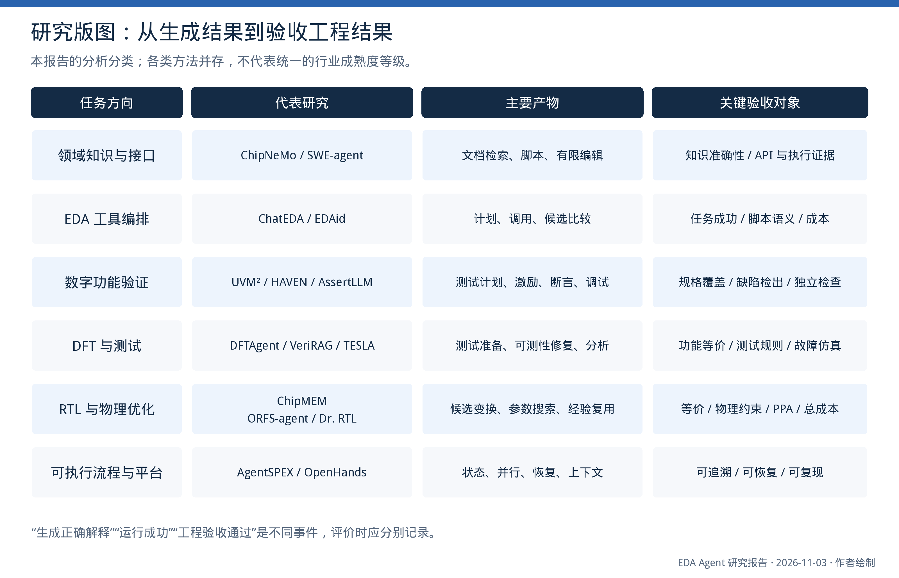

*图 1　本报告的任务分类。可编辑版本见同名 SVG。各类别并存，不表示统一的行业成熟度等级，也不构成严格的技术替代关系。*

### 1.3　证据如何使用

本报告将材料按以下方式使用，而不把这些类别看成绝对质量排名。

| 材料类型 | 可以支持的判断 | 需要保留的限制 |
|---|---|---|
| 已读原始论文，方法与实验较完整 | 机制、作者结果、实验范围和限制 | 作者结果不等于独立复现；同行评审也不保证普适性 |
| 有正式会议记录，但只取得摘要或海报 | 研究方向、任务对象、主要机制 | 不补造数据，不称全文精读 |
| 预印本与公开项目 | 最新方法、实现协议、待验证的方向 | 版本可能变化，代码与论文可能不同步 |
| 厂商正式公告 | 产品投入方向、公开的功能定位 | 提效倍数不能当作统一公开基准的结果 |
| 本报告的架构与实验建议 | 可以实施和验证的设计方案 | 不当作已有实验结论 |

用户压缩包中已有的精读笔记被用作检索线索；关键结论重新核对了原始 PDF。下文页码均指上传 PDF 的阅读器页序。网络资料以文末注明版本为准；未充分核实的性能数字不进入结论。

## 2　Agent、workflow 与智能体团队的技术区别

### 2.1　需要区分的四个层次

**领域模型或助手**解决知识与表达问题。例如 ChipNeMo 针对文档问答、脚本生成与缺陷摘要做领域适配。它能成为 Agent 的模型组件，但领域知识增强不等于已经具备长期自主执行能力。[R04](#r04)

**工具使用型 Agent**根据目标和已有观测选择动作，运行工具，再利用结果调整下一步。一个模型配若干 EDA 适配器，也可以是完整的单 Agent 系统。DFTAgent 属于这一类。[R01](#r01)

**工作流**规定哪些动作可以发生、依赖什么结果、失败后转到哪里。它可以包含脚本、模型、仿真、形式检查、人工决策和异步作业。官方 LangGraph 文档将预定执行路径与由模型动态选择过程的 Agent 区分开，同时允许在同一个系统中组合二者。[R38](#r38)

**智能体团队**为不同任务分配上下文、工具和职责。团队可能是多候选生成器，也可能是计划、实现、验证的专业分工。Agent 数量不是检验强度；如果所有成员都依据同一错误摘要，团队仍可能一致地做错。[R03](#r03)，[R33](#r33)

对 EDA 更合适的组合是：**外层工作流明确工程规则，内层 Agent 在授权范围内处理不确定性**。例如，是否需要先读取标准单元库是确定依赖；一个时序失败应优先尝试哪类 ECO，则可能需要根据证据选择。

### 2.2　“图”至少表达四种不同关系

| 图的类型 | 节点与边表达什么 | 在项目中的用途 |
|---|---|---|
| 执行控制图 | 节点是动作或判断，边是执行转移 | 定义分支、循环、并行、失败和停止 |
| 工件依赖图 | 节点是 RTL、网表、约束、报告；边是生成或使用关系 | 修改上游文件时，确定哪些结果失效 |
| 电路关系图 | 节点是信号、模块、状态或路径；边是电路依赖 | 定位波形错误、关键路径、时钟复位关系 |
| 团队通信图 | 节点是角色，边是任务与信息传递 | 限制谁能看到什么、谁能提出或批准变更 |

这些图可以相互引用，但不能混成一张没有类型的“所有节点相互连接”大图。VerilogCoder 的电路关系图与 AgentSPEX 的流程图解决的是不同问题；EDAid 的角色连接也不自动包含工件失效规则。[R03](#r03)，[R06](#r06)，[R12](#r12)

一个包含反馈的完整流程通常有环；单轮候选的构建与验收依赖可以展开成 DAG。界面可展示逻辑循环，而运行记录必须保存具体的迭代编号与候选身份，避免把第 2 轮的 RTL 和第 1 轮的报告混用。

### 2.3　AI for EDA 与 LLM Agent for EDA 的关系

强化学习的布局、测试点插入，图神经网络的可测性预测，以及贝叶斯参数优化，都可以提供 EDA 专用算法能力。它们中的“Agent”有时指强化学习的决策主体，并不等于语言模型组织的工程团队。DeepTPI 使用图神经网络与深度强化学习选择测试点，适合被 EDA 工作流调用为专用优化器，而不应被归为 LLM 多角色协作。[R44](#r44)

因此，项目不需要将已有 C++ 算法改写成语言模型推理。更合理的组织是：Agent 解释任务和失败证据，专用算法计算候选，EDA 工具测量工程结果，独立检查器判断候选是否合法。

## 3　9 篇文献的逐篇解读

### 3.1　DFTAgent：证明了工具编排，但实验覆盖范围较窄

**文献定位。** Li 等发表于 Applied Sciences 2025 的论文，提出利用 LLM 调度 DFT 工具的框架。上传文件共 18 页。它是单 Agent 工具编排研究，不是多智能体团队实验。[R01](#r01)

**主要机制。** 第 5–7 页将系统分为入口、工具、外部数据与工具、输出四层。核心模型使用 DeepSeek；五个 Python 适配器分别负责测试向量生成、网表分析、电路可视化、故障报告解析与汇总，外部引擎主要是 Atalanta 和 Graphviz。执行器将工具异常作为下一轮观测，模型据此调整调用。

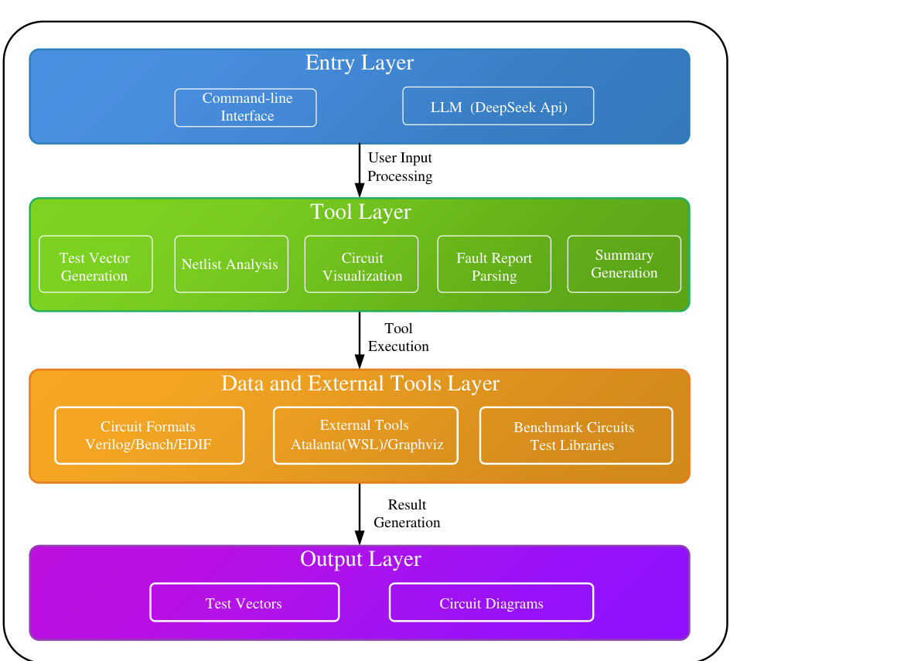

*原图 S1　DFTAgent 原论文 Figure 1，上传 PDF 第 6 页。保留原英文与结构；其工具调用层次不等同于本报告建议的独立验收流程。[R01](#r01)*

**实验究竟说明了什么。** Table 3 报告 16 个基准电路的 ATPG 指标；Table 5 的标准输入下，Agent 与确定性执行器均为 11/11，扰动输入下分别为 10/11 与 0/11。它表明该系统对论文设置的输入变化比那个特定脚本更灵活，但不说明 Agent 改进了 ATPG 算法，也不能将 10/11 转述为工业 DFT 全流程成功率。案例中的 c499 文件恢复，主要是找到可处理的 BENCH 文件；没有建立“任意 RTL 自动转换为等价 ATPG 模型”的证据。[R01，PDF 第 8–13 页]

**需要认真讨论的归因问题。** 第 13 页 Fig.5 中，固定行号脚本对原始与修改后的报告都失败，因而是较弱基线。同页 Fig.6 写明使用正则解析；本次核查的作者公开 `tool_parse_fault_report.py` 也使用正则搜索并返回 `regex_based_robust`，该解析函数没有 LLM 调用。这与论文部分文字将格式适应性归因于 LLM 理解的叙述并不一致。严谨结论应是：需要固定代码版本，并以相同解析器、相同文件定位和异常处理做消融；不能直接将收益全部归给语言推理，也不能据此推断整篇研究无效。[R01](#r01)，[R41](#r41)

**尚未覆盖的能力。** 工业 TestMAX/Tessent 接入、异步作业和检查点在论文中主要属于未来工作。扫描插入、EDT、OCC、MBIST、IJTAG、测试模式切换和功能等价验收没有形成完整实验。报告还需要明确故障模型、折叠规则、中止规则和顺序电路处理假设，才能判断覆盖率的意义。

**对项目的价值。** 可以借鉴专用工具适配、结构化调用和异常反馈。下一步应补齐工件身份、强脚本基线、原始计数复核、模式检查和独立验收。仅将 Atalanta 替换为商业 ATPG，仍不足以解决这些问题。

### 3.2　ChatEDA：任务分解、脚本生成与执行的早期系统化尝试

**文献定位。** 上传的是 IEEE TCAD 2024 版本，共 14 页；其早期预印本发表于 2023 年。ChatEDA 使用领域模型 AutoMage，将用户需求组织成 EDA 阶段和可执行脚本。[R02](#r02)

**主要机制。** 三步分别为任务分解、脚本生成、任务执行。模型读取工具 API 文档，生成调用 Python 包装接口的代码，再由包装接口操作 OpenROAD。它降低了模型直接面对大量原生命令的难度，贡献主要在语言任务到工具流程的连接，而不是新的综合或布线算法。

训练中包含约 1,500 条 EDA 指令，并通过运行检查与人工修订过滤；后续 AutoMage2 又混入代码指令。因此，与其他模型的差异同时包含领域数据、基础能力和提示组织，不能全部视为流程结构的贡献。[R02，PDF 第 6–8 页]

**结果如何理解。** ChatEDA-Bench 包含 50 项任务，覆盖简单流程、复杂流程和参数调整。评测先观察脚本执行，再由评审判断是否满足要求。AutoMage2 的 Grade A 为 82%，GPT-4 为 62%。Grade A 同时要求合理分解与正确脚本；它不是复杂工业芯片从规格到 GDS 的 82% 成功率。[R02，PDF 第 8–9 页]

**局限。** API 包装较专门，跨工具版本、商业环境、长任务恢复和严格独立验收的证据有限。人工评分和小规模任务集也限制了外推。对你的项目，它适合作为工具契约和计划执行分离的参照，而非完整可靠性架构的终点。

### 3.3　EDAid：多样候选加选择器，与独立工程验收存在区别

**文献定位。** 《Divergent Thoughts toward One Goal》发表于 NAACL 2025，系统名 EDAid，模型名 ChipLlama，上传 PDF 共 12 页。[R03](#r03)

**主要机制。** 系统检索相关“任务—计划—脚本”示例，为多个候选生成者分配不同示例组合，促使它们提出不同计划与脚本。决策 Agent 对候选进行 yes/no 判断，比较 yes 的生成概率并选择候选。其核心是提示多样性与学习型选择，而不是多个验证专家分别运行仿真、形式和 ATPG。

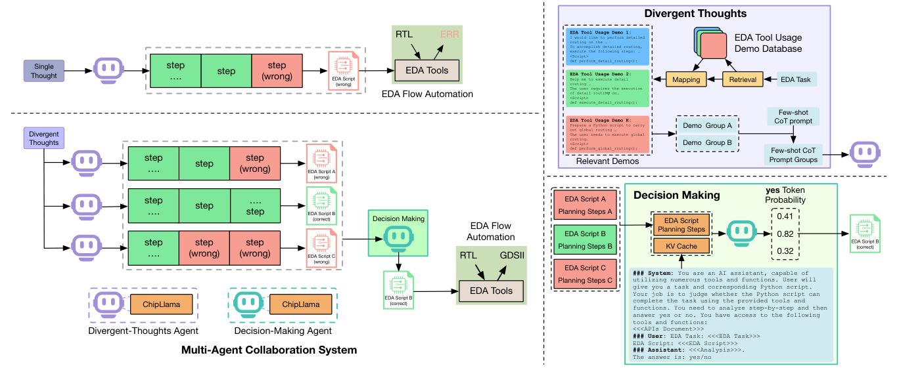

*原图 S2　EDAid 原论文 Figure 4，上传 PDF 第 4 页。这里的选择器主要根据模型评价选择候选，不能与独立工具验收混同。[R03](#r03)*

**最有意义的对照。** 两套基准 ChatEDA-Bench 与 iEDA-Bench 各 50 题。Table 4 在相同 ChipLlama 下比较：8B 的单 Agent 为 78%/76%，多 Agent 为 88%/84%；70B 为 94%/96% 到 100%/100%。这对应 8B 新增 5/4 个任务通过，70B 新增 3/2 个任务通过。应保留绝对任务数，避免“100%”带来超出实验规模的印象。[R03，PDF 第 6–7 页]

**需要补充的控制实验。** 团队是否优于同预算单 Agent 多次采样？语言选择器是否优于静态检查后执行所有合法候选？不同提示产生的错误是否高度相关？yes 概率能否预测实际执行成功？原论文不足以回答所有这些问题。

**对项目的价值。** 在约束解释、修复策略或优化参数存在真实歧义时，生成少量候选有价值。候选选择应进一步结合实际工具结果、工程约束和成本。多个成员一致认可，只能作为安排检查的线索。

### 3.4　ChipNeMo：领域知识适配是基础设施，不等于自主流程

**文献定位。** NVIDIA 的领域适配研究，上传版本为 arXiv:2311.00176v5，2024 年 4 月，共 23 页。[R04](#r04)

**主要机制。** 研究包括领域词表、持续预训练、领域指令对齐与检索模型适配。任务为工程问答、EDA 脚本生成和缺陷摘要，反映了通用模型对专有 API、内部设计文档与术语缺乏知识的问题。

**实验细节。** 工程问答使用 88 个问题，检索材料约 1,800 份文档；脚本任务区分易、中、难：Python 任务分别为 146、28、25，Tcl 为 708、27、25。易中任务通过参考结果或实际输出评价，难题由工程师打分。脚本自动评测图使用 Pass@5，难题则为单次生成的人工部分正确性评分，二者不能合并解释为统一执行成功率。[R04，PDF 第 6–7 页]

**结果与限制。** 作者报告领域适配在所测内部任务上优于基础模型，并展示 RAG 带来的收益。这说明领域数据和合适检索很重要；但内部工具和资料难以公开复现，旧模型间的相对成绩也不能当作当前模型排名。该研究没有验证一个团队完成长 EDA 流程的能力。

**对项目的价值。** 工具文档应按工具、版本、命令、错误编号组织；检索结果应包含出处与适用条件。即使检索到了正确命令，也仍需确认当前工具版本和设计状态。早期系统可先优化检索与接口，不必为了做 Agent 就先投入大规模领域预训练。

### 3.5　ChipMEM：经过工具验收的经验与重试统计

**文献定位。** 《ChipMEM: Verification-Grounded Memory for EDA Agents》，arXiv:2609.27067v1，2026 年 9 月预印本，共 22 页。[R05](#r05)

**两个记忆层。** 程序经验从最终通过领域检查的任务中提炼，可跨任务检索；工具统计记录所有已完成调用，包括失败，估计某类错误继续重试或采取恢复动作的效果。统计层使用分层 Beta 估计进行平滑，而不是依靠模型直接宣称“这次应该能成功”。原文明确，领域验收器是确定的评测程序，不是 LLM judge。[R05，PDF 第 4–6 页]

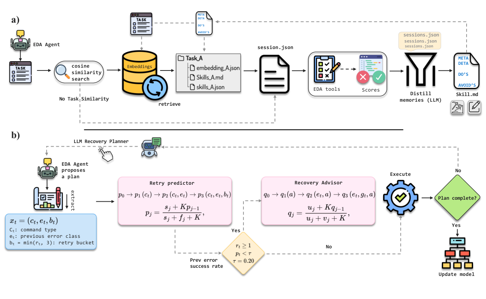

*原图 S3　ChipMEM 原论文 Figure 2，上传 PDF 第 3 页。成功程序经验与包含失败的工具统计承担不同职责。[R05](#r05)*

**结果必须保留分母与采样方式。** RTLRewriter 的等价通过数从 35/54 到 39/54；摘要中的 49 项短任务平均面积改善从 5.66% 到 8.69%。RTL-OPT 使用跨 3 组的最佳有效候选，OpenTitan 的设计级结果使用 best-of-five。冻结经验在 CVDP 的迁移从 18/20 到 20/20，每设置仅一次评估。上述结果支持进一步研究，不能写成所有任务的一次成功率或全面 PPA 改善。[R05，PDF 第 1、7–9 页]

**消融和成本值得重点阅读。** 五设计组合记忆实验包含 loaded-state replay，起始经验与其他设置并非完全一致。OpenTitan 成本表中，平均工具时间下降 12%，但累计会话墙钟时间增加 14.9%，输出 token 增加 55%。相关设计聚类置信区间除输出 token 外均跨 0。因此不能概括为“显著降低整体耗时”。[R05，PDF 第 8、19 页，Tables 1、10、11]

**对项目的价值。** 记忆可以保存版本适配、错误恢复和有效阶段做法，并抑制死循环。不过，“源任务通过后提炼的经验”仍不是对未来所有任务有效的证明。应记录前提、工具版本、支持与反例；新任务仍必须重新验收。评测应将冷启动、冻结经验迁移和同题反复积累分开。

### 3.6　AgentSPEX：与你的图工作流目标最直接相关

**文献定位。** 2026 年 4 月预印本，上传 18 页。研究对象是通用 Agent 工作流语言与执行环境，并非 EDA 专用系统。[R06](#r06)

**主要机制。** 使用 YAML 描述类型化步骤、条件、循环、并行、子模块与显式状态。`task` 开始新的会话，`step` 保留多轮历史；变量与 `save_as` 决定传递哪些结果。图形编辑器与文本同步，执行环境提供工具访问、检查点、日志与选择性重放。它把流程的执行职责从模型临场解释转移给解释器。

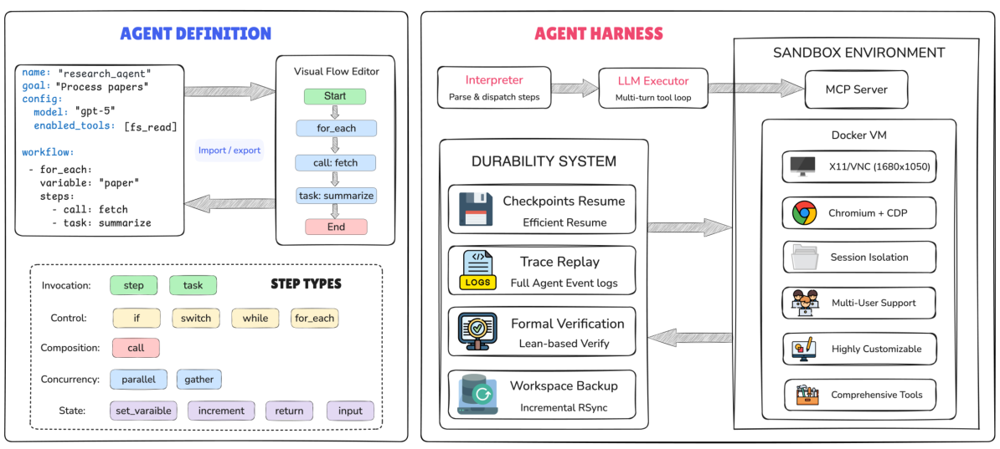

*原图 S4　AgentSPEX 原论文 Figure 1，上传 PDF 第 2 页。图中列有形式验证，但正文与结论仍将进一步的形式保证作为潜力和后续方向；不能据此认定任意流程已获完整形式证明。[R06](#r06)*

**证据如何评价。** 论文在 7 类通用基准上评测，并进行 23 人用户研究。它支持显式执行结构与可读性研究，但用户研究中，复杂流程仍有不少参与者偏好 LangGraph。通用任务得分不是 EDA 可靠性验证；不同 benchmark 的任务与成本也需分别比较。[R06，PDF 第 6–9 页]

**对项目的关键启发。** 图不能只是展示模型计划的图片。节点类型、输入输出、分支条件、循环上限、恢复位置和上下文选择，必须有可执行含义。图与文本应对应同一份规范；人工修改图后，运行器要能验证结构并执行该版本。

**需要纠正的技术概括。** 论文对其他框架的比较是作者特定时间和定义下的视角，不能据此认定 LangGraph 只能用 Python。官方提供 JavaScript/TypeScript 路线。对当前项目，可以保留 TS 编排与 MCP 接口、C++ 专用算法和适合工程师的前端，重点验证执行规则，而非为采用某篇论文整体更换技术栈。[R38](#r38)

### 3.7　RTLLM：三层评价有价值，功能成功不是 Pass@1

**文献定位。** 上传 arXiv:2308.05345v3，2023 年 11 月，共 6 页。它主要是 RTL 生成基准与提示方法，不是智能体团队框架。[R07](#r07)

**主要贡献。** 将评价分为语法、功能和设计质量。30 个设计的 RTL 行数中位数 52、均值 86、最大 518，属于模块级任务为主。实验使用综合与仿真工具，避免只用文本相似度判断生成质量。

**容易误读的实验定义。** 每个设计独立生成五次。Table III 的功能成功，只要求五个候选中至少一个通过测试：GPT-4 为 15/30，加入 self-planning 为 19/30。这不是一次生成成功率，也不是 Agent 在反馈后修复成功的统计。论文明确指出，有限测试通过不能保证全部功能正确。[R07，PDF 第 1、4–5 页]

**对项目的价值。** 可以沿用其分层思想：文件合法、工具可执行、功能正确性证据和工程质量分别记录。功能错误但面积更小的候选，不能成为优化成果。此原则应一致地应用到 DFT 覆盖率和后端 PPA。

### 3.8　SWE-agent：接口和反馈设计会改变 Agent 能力

**文献定位。** NeurIPS 2024 的软件工程 Agent 研究，上传完整文件含大量附录，共 125 页。[R08](#r08)

**主要机制。** 研究 Agent–Computer Interface：为模型提供简明的搜索、局部文件查看、受控编辑、运行与反馈。无效编辑可以被语法检查拦截；历史观测经过裁剪，当前状态保持清楚。它的核心不是增加角色，而是固定模型下改进动作与观测。

**实验与范围。** 原论文报告 SWE-bench Pass@1 12.5%、HumanEvalFix 87.7%，并做接口消融。这些是当时软件任务上的结果，不能迁移成 EDA 成功率；但“工具接口也影响可靠性”的实验思想非常适合当前项目。[R08，PDF 第 3–8 页]

**EDA 对应做法。** 让 Agent 查询“最早失败的几个编译错误”“某条关键路径的结构摘要”“某个故障类别对应的控制信号”，比返回几万行日志更有用。工具同时保留完整原始记录，摘要提供跳转位置。接口层校验参数范围和产物身份，减少模型靠试错发现基础调用错误的次数。

### 3.9　OpenHands：可复用的执行环境与事件模型

**文献定位。** ICLR 2025 平台论文，上传 38 页。提供通用软件 Agent 的运行与评价基础设施。[R09](#r09)

**主要机制。** Agent 产生动作，执行环境返回观测，事件流保留交互过程；沙箱运行终端、代码与浏览器操作，支持不同 Agent、协调方式和评测任务。论文比较多个 Agent 与模型在 15 类任务中的表现，平台能力与特定 Agent 算法应分开理解。

**对 EDA 的启发与限制。** 事件流、隔离目录和可重放执行很值得复用。但商业 EDA 的许可证、长时作业、大型数据库、固定工具安装与计算集群，使“通用 Docker 沙箱”不能直接覆盖所有部署。应把实际执行交给受控本机或集群适配器，保留作业编号、输入版本和产物，而不是假设通用软件 Agent 的成功就能自然转化为 EDA 成功。

### 3.10　九篇文献放在一起的意义

| 文献 | 最值得借鉴的部分 | 不能据此推出的结论 |
|---|---|---|
| DFTAgent | 专用工具封装、异常反馈 | 已实现工业 DFT 全流程或提升 ATPG 核心算法 |
| ChatEDA | 任务分解与稳定 API | 脚本 Grade A 等于完整芯片验收通过 |
| EDAid | 多样候选与选择 | 模型选择器等于独立工程验证 |
| ChipNeMo | 领域知识、RAG、API 适配 | 领域模型天然具备长期执行可靠性 |
| ChipMEM | 验收后经验写入、失败统计 | 经验永久有效，或整体时间必然下降 |
| AgentSPEX | 可执行规范、状态、上下文、恢复 | 图形工作流已自动获得全面形式保证 |
| RTLLM | 语法、功能、质量分层 | 多次采样成功率等于 Pass@1 |
| SWE-agent | 面向模型的动作与观测设计 | 软件成绩可直接外推到硬件 |
| OpenHands | 事件、隔离环境、统一评价 | 通用执行环境已处理商业 EDA 全部要求 |

## 4　功能验证与 RTL 研究进展

### 4.1　从编译反馈到电路与波形反馈

**RTLFixer（DAC 2024）**利用检索与工具反馈修复 RTL 语法错误，在 212 个错误实现上报告约 98.5% 编译修复。它适合作为构建前检查与语法恢复子流程的参照；编译通过只能排除一类错误，不能替代功能验证。[R10](#r10)

**AutoChip（TODAES 版本）**迭代利用编译、仿真反馈，并研究模型选择与成本。其重要结论是：在被评测模型中，只有 GPT-4o 的反馈方案持续优于零样本。反馈能否被正确利用存在模型和任务条件。项目应允许停止、回退或升级，避免假设增加修复轮数必然有益。[R11](#r11)

**VerilogCoder（AAAI 2025）**将任务与电路关系用于规划，通过 AST 与波形工具定位失败。156 个 VerilogEval-Human v2 任务上，作者报告 94.2%，对应单模型基线为 60.3%，差 33.9 个百分点；平均 token 约为基线的 13 倍。它提供了领域图和结构化反馈的实证，但 golden testbench 已给，不能据此推断系统能自主构建完整独立验证环境。[R12](#r12)

**综合分析。** “工具反馈”不应被当作一种单一能力。编译错误指向语言与接口问题；波形定位提供时序和信号证据；覆盖报告说明尚未观察的行为；形式反例对应特定属性的违反。有效工作流应根据反馈类型选择诊断方式，而不是将所有输出拼进同一提示后要求模型重写 RTL。

### 4.2　从生成 testbench 到生成受约束的验证意图

**UVM²（ICCAD 2025，本文读 2026 年 v4）**采用分析、生成、优化三类 Agent，按组件依赖生成 UVM，并利用编译、仿真和覆盖反馈迭代，失败时恢复有效版本。表列 9 个设计，贡献文字写 10 个；组件评价使用生成件替换人工环境中的对应组件。因此组件成功率与完整环境一次成功率不同。它为依赖驱动的验证工作流提供直接参照。[R14](#r14)

**HAVEN（2026 年 4 月预印本）**让模型输出 Blueprint 和 DSL，模板生成 UVM 与协议代码。19 个 IP 上报告全部编译成功，平均代码覆盖 90.6%、功能覆盖 87.9%。功能覆盖目标由系统自身生成，不能视为独立规格覆盖；3 个设计受 DSL 表达能力限制。其价值在于缩小模型输出空间，同时提醒系统应显式处理表达范围之外的任务。[R15](#r15)

**UVMarvel（DAC 2026）**扩展到子系统，使用 IR、协议库和跨信号依赖支持刺激生成。6 个设计的平均代码覆盖为 95.65%；约 4.5 小时的自动执行比较排除了规划与 IR 编写阶段。模型还可以提出疑似不可达覆盖项作为 waiver 候选。工程采用时，应让独立可达性证据或审核决定是否接受 waiver，并保存修改前后的覆盖统计。[R16](#r16)

**综合分析。** 这条路线尤其适合当前项目：模型输出“要测什么、要尝试什么”，程序生成稳定结构。以验证为例，接口实例、文件顺序、基础 UVM 组件和标准协议握手可以由模板约束；事务组合、异常场景和参考行为仍需规格推理。DSL 的合法性检查提高可运行性，但不能证明测试意图充分。

### 4.3　断言、形式检查与验证资产自身的正确性

**AssertLLM（ASP-DAC 2025）**将规格分析、波形分析与断言生成分工，使用参考 RTL 和形式工具评价。正式版本涉及 I2C、ECG、Pairing；其早期版本的统计不能混用。属性在参考 RTL 上成立，说明与参考实现兼容，仍需检查属性是否过弱、前提是否可达以及能否检出缺陷。[R13](#r13)

**VeriThoughts（NeurIPS 2025）**把形式等价用于生成数据的一致性筛选，适合启发经验与训练样本的验收。等价结果相对于给定参考成立；参考设计本身是否满足外部需求，仍是另一项问题。它主要是数据与训练研究，不宜归类为完整 EDA 团队平台。[R18](#r18)

**Open-Source LLM-Driven Formal Verification（2026 年 7 月预印本）**研究 Property IR、多 Agent 与反例反馈，六例中仅一例可靠修复，指出空真、规格歧义、时序逻辑和多属性问题。它是小规模可行性研究，但其负面结果很有参考价值：接入形式工具后，属性与建模仍可能是薄弱环节。[R17](#r17)

形式证明的解释必须带上**属性、环境假设、时钟复位模型和证明方式**。官方 YosysHQ 文档指出，assumption 可隐藏反例，部分过约束检查即使通过也不能排除空真。项目应保留假设清单、关键行为 cover 检查和必要的缺陷注入；有界范围内无反例，也必须与完整证明区分。[R40](#r40)

### 4.4　验证方向的现实机会

当前工作的共同进展是：越来越多地使用真实工具和结构化中间表示。仍有价值的研究问题包括：

1. 测试计划、参考模型、SVA 与 coverage bins 能否追溯到稳定的需求编号。
2. 能否识别 DUT 与 checker 同方向误解的共同错误。
3. 反馈发生后，应修改 RTL、验证环境、约束还是运行配置。
4. 如何在同样仿真预算下提高缺陷检出，而不仅提高被执行代码的比例。
5. 如何让语法稳定的 DSL 在表达不足时明确拒绝或升级，而不悄悄简化测试目标。

这些是本报告归纳的研究问题。它们可以在已有生成器外部建立，不要求首先训练一个新大模型。

## 5　DFT、可测性优化与测试分析研究进展

### 5.1　DFT VeriRAG：修复违规与保持功能同时验收

Qi 等的 **VeriRAG（ISQED 2026）**通过结构检索选择已验证修复样例，结合编译与 DFT 诊断有限迭代，最终使用 Conformal LEC 检查。317 个测试 RTL 中，GPT-o1 成功率从 6.96% 到 53.76%；倍率为 7.72 倍。任务仅覆盖四类规则，并保留仅含一种违规类型的 RTL；部分缺失模块采用空模块抽象。该结果支持受工具约束的 RTL 可测性修复，不能扩大为工业 DFT 全流程成功率。[R19](#r19)

同名的《VeriRAG: A Knowledge Graph-Augmented RAG for Verilog and Assertion Generation》属于另一项工作。本报告的 DFT 讨论使用 Qi 等论文，避免混用作者、方法和实验。

**综合分析。** 这项工作已经把功能保持纳入验收，所以新的项目不能将“加一个验证器”声称为首次创新。更有价值的是研究跨阶段、多错误、不同测试模式下的证据一致性，以及如何在修复过程中安排等价与诊断的成本。

### 5.2　TESLA：从流程调用走向 DFT 决策

**TESLA（ITC 2025）**的官方会议摘要确认，多 LLM 协作面向 RTL 级部分扫描选择 PSS 与测试点插入 TPI，并利用商业 EDA 反馈进行偏好优化。本次取得官方摘要和作者海报，未取得可完整核对的正文实验，因此不引用未经核实的提升数字。[R20](#r20)

作者机构的 **TESLA-Pro-PSS/TPI** 模型卡进一步描述 Qwen2.5-Coder-7B、结构约束、训练奖励和 DC/TMAX 反馈。合法寄存器位、测试点禁选集合、预算和工具验收被写成具体条件。这些是适合关注的小模型方向；模型卡标为 manuscript，本文按作者公开实现说明使用，不视为已核实的正式论文结果。[R22](#r22)，[R23](#r23)

**综合分析。** DFT 决策应同时比较覆盖收益、面积、时序、测试时间与功耗。LLM 可以安排候选与解释失败，但 PSS/TPI 的合法性和实际收益需要专用算法与工具验证。相同目标下，还必须与已有启发式、随机/贝叶斯搜索或专业测试点方法比较。

### 5.3　IEA-Plugin：测试分析中的图流程与停止条件

**IEA-Plugin（ITC 2025）**基于 LangGraph，将测试数据分析需求组织为工作流和 API 规格，并检索相近案例。80 个查询产生 588 个步骤是结构统计，不是 588 次 EDA 成功执行。其相邻生成内容相似度达到阈值的停止规则，反映输出稳定，不能证明计算或测试结论正确。[R21](#r21)

这对你的图编辑器和工具接口抽象很有启发，同时说明停止条件要分层：计划稳定可以结束规划；实际任务完成仍需独立的工程条件。

### 5.4　DFT 研究中的关键缺口

从本次材料看，公开证据在以下方面仍不充分。

| 问题 | 为什么影响可靠性 | 可研究的补充机制 |
|---|---|---|
| 工具版本与报告格式变化 | 同名指标、错误编号和命令可能变化 | 版本适配器、证据定位、拒绝不明定义 |
| 多个错误共同出现 | 修复一个约束可能掩盖另一个错误 | 分层诊断、最小变更、跨阶段回归 |
| 功能与测试模式不同 | 功能 LEC 无法代替扫描行为检查 | 模式契约、专用检查组合 |
| 覆盖率集合变化 | 百分比上升可能源于排除故障 | 原始计数、集合变化、可比性审计 |
| 完整工业结构集成 | OCC、压缩、MBIST、访问网络有依赖 | 可配置子图、工具确认的前后条件 |
| 经验跨工程失效 | 旧复位或时钟修复可能不适用于新模式 | 条件化经验与重新验证 |

这并不要求一开始覆盖完整 SoC。以真实 DFT 失败包、报告误读与功能保持为切入点，更容易构造可复现结果，也能直接解决你此前关注的 filelist、复位极性和错误修复位置问题。

## 6　RTL 与后端优化研究进展

### 6.1　ORFS-agent：语言模型调度数值优化器

**ORFS-agent（MLCAD 2025，更新至 2026 年 v3）**调度 OpenROAD-flow-scripts 与数值优化器。在 6 个设计/工艺实例、12 参数设置下，相对 OR-AutoTuner 的几何均值目标改善最高为线长 1.0%、有效周期 1.3%、联合目标 2.7%；预算为 600 对 1,000 次配置运行尝试，不能将 600 再乘并行数。旧版约 13% 对应默认 ORFS 基线。v3 的检索只在较早预算有收益，最终结果不改善；这些比较也不是等墙钟成本或每项设计都胜出。[R24](#r24)

### 6.2　Retrieve, Schedule, Reflect：安排优化动作的顺序

**Retrieve, Schedule, Reflect（MLCAD 2026）**用 scheduler、executor、reflector 分工，检索专家搜索树，并利用 Pareto 结果指导后续选择。8 个 ASAP7 设计上的约 4.3 倍时间比较来自 10 轮 Agent 与 50 轮 RL 训练，不能理解为同次数工具运行加速。其研究重点是长期优化动作的安排，而非替代时序或物理计算引擎。[R25](#r25)

### 6.3　Dr. RTL：关键路径、并行候选与等价筛选

**Dr. RTL（2026 年预印本，作者列 ICCAD 2026）**组合关键路径分析、并行 RTL 改写、DC 与 Jasper SEC 评价，并保存优化经验。20 个设计报告 WNS/TNS 改善约 21.3%/16.9%、面积下降 5.8%。实验采用统一 0.1 ns 的激进目标，slack 改善不能解释为时序全部达标；只有通过 SEC 的候选进入选择。它适合借鉴候选隔离和工具验收机制。[R26](#r26)

### 6.4　优化工作流应区分三件事

**第一，探索动作是否合理。** 例如尝试门尺寸调整、缓冲器插入、RTL 算术重写或不同布局参数。Agent 可以根据局部瓶颈提出假设，但语言解释不是收益证据。

**第二，候选是否满足约束。** 功能等价、接口与周期行为、时钟与模式、电气和物理规则共同决定可行性。若一个优化把关键路径移到未检查模式，或者通过放宽约束得到更好数值，就改变了问题。

**第三，合格候选中谁更好。** 功耗、性能、面积和工具成本之间可能存在取舍。应保留多个满足约束的候选，而不是只展示某一个加权分数。在所有候选都不满足时序时，可以用违反程度指导探索，但报告状态仍应为未完成。

由此形成的研究方向，是把 Agent 作为受约束搜索与诊断的组织者，并研究它何时优于传统优化器、何时应该调用传统优化器。其收益需要在相同资源预算和固定验收条件下验证。

## 7　评测体系和工业发展趋势

### 7.1　从模块题扩展到真实工程与完整流程

| 基准 | 主要测量对象 | 本报告采用的范围与限制 |
|---|---|---|
| RTLLM | 30 个模块的 RTL 生成 | 上传 v3；多次候选、功能与质量分层。[R07](#r07) |
| VerilogEval-Human v2 | 模块生成与调试 | VerilogCoder 使用 156 题；已有参考测试。[R12](#r12) |
| AssertionBench | 断言生成 | 100 个 OpenCores 设计；属性正确不等于需求完备。[R31](#r31) |
| CVDP | 生成、理解、调试、验证等任务 | 2025 论文 783 题、13 类；区分 agentic 与 non-agentic。[R29](#r29) |
| HWE-Bench | 真实仓库中的硬件缺陷修复 | 417 个历史修复任务、6 个工程；原生回归与跨文件修改。[R30](#r30) |
| PDAGENT-BENCH | 后端知识、脚本与物理任务 | 论文摘要 353 题，当前仓库 343 题；不同公开版本须分开。[R27](#r27) |
| Build-A-Chip-Bench | 工作负载规格到 GDS | 研究方公开的完整任务评测；隐藏验证与独立最终评价。[R28](#r28) |

**PDAGENT-BENCH 的一个重要例子：**当前仓库将 routed 定义为完成细布线且 DRC 少于 1,000，并另列 DRC-clean。因此 routed 比例不能翻译为无物理违规比例。其常规知识/脚本题还是单轮基础模型评价，与另设的完整宏布局任务也要区分。[R27](#r27)

**Build-A-Chip-Bench 的协议更贴近你的目标：**候选生成、隐藏 VIP、最终 grader 分处隔离环境；先过功能与物理硬检查，再计工程质量。它仍是研究方自报的近期页面，本次未确认同行评审；本文提取其评测设计，不拼接不同日期排行榜的成绩。[R28](#r28)

**综合分析。** 评测应从“产生一个能运行的文件”转向“在工程约束下完成任务”。真实仓库公开历史也带来训练污染风险；隐藏测试同样可能被反复查询而间接过拟合。项目需要固定最终评价集，并记录 Agent 可看到哪些反馈。

### 7.2　工业界的方向已经较为明确

| 官方公开信息 | 可以确认的发展方向 | 本报告的解释限制 |
|---|---|---|
| Siemens，2026-03 Fuse EDA AI Agent | 多工具、多 Agent 编排，涉及 Tessent 等领域。[R34](#r34) | 产品覆盖范围不等于每个流程的公开完成率 |
| Siemens，2026-07 更新 | 强调用确定性 EDA 引擎验证 Agent 决策。[R35](#r35) | 仍需区分官方定位与独立复现实验 |
| Synopsys，2026-09 Autopilot / AgentEngineer | 长任务领域 Agent、任务 Agent、经验与工具协作。[R36](#r36) | 公告中的提效上限不能直接横比论文 |
| Cadence，2026-06 ChipStack / AgentStack | 设计验证及多领域编排、工具执行与结果反馈。[R37](#r37) | 自主等级属于其产品表述；公告还给出早期访问安排 |

这些一手信息支持一个有限但清楚的结论：Agent 正在成为 EDA 工具之上的工程组织层，验证与实现工具继续提供核心计算和检查能力。它们尚不足以证明无需工程师判断的通用芯片自主设计已经成熟。

### 7.3　未来一至数年的方向判断

以下是依据研究组合做出的趋势推断，并非已经测得的行业事实。

**从单次代码生成转向长期任务控制。** 状态恢复、作业管理、跨文件依赖和预算选择，会比一次提示的漂亮输出更影响最终成果。

**从开放文本操作转向结构化意图和专用接口。** 模型负责表达目标和候选，模板、类型检查与专用算法负责稳定部分。对 UVM、SDC、DFT 模式配置尤其适合。

**从模型评价转向可执行证据。** 工具原始数据、候选身份、假设范围和独立重跑将更重要。语言审查仍有价值，但主要用于发现需要增加的检查。

**从单题反复尝试转向有条件的经验迁移。** 成功案例需要记录适用环境和失败条件；经验是否能跨设计与工具版本复用，会成为比“同一题越做越好”更有区分度的指标。

**从只看成功率转向成功率、错误接纳与总成本共同评价。** 对 EDA，昂贵的仿真、形式求解和布局布线往往决定总成本；仅统计模型 token 会遗漏主要开销。

**团队规模趋向按任务动态使用。** 有确定答案的解析和规则检查适合程序执行；多 Agent 应集中在歧义大、候选差异有意义或需要独立推理的步骤。研究需要证明增加协作成本之后仍有收益。

## 8　当前研究存在的主要问题

### 8.1　任务名称相似，评价对象不同

“成功”可能表示脚本无异常、RTL 编译、测试通过、形式等价、完成路由、面积变小或完整规格满足。文献综述若只汇总百分比，容易形成虚假的进步曲线。至少应同时写明任务单位、样本数、尝试预算、检查器与成功定义。

### 8.2　同源生成导致共同错误

模型可能同时错误理解 DUT 和期望行为，生成彼此吻合的实现与 checker。增加一个读取相同摘要的审查角色，并没有增加独立信息。需要规格到检查项的追溯、独立参考行为、保留测试以及缺陷注入。

### 8.3　形式检查的模型和假设不完整

过约束可能隐藏真实行为，过弱属性可能没有约束关键输出，错误的复位建模可能让正常执行永远不可达。工具的证明结果有明确适用范围；流程必须记录这些范围并检查它们，而不能只解析一个 PASS 字样。[R40](#r40)

### 8.4　指标可以通过改变问题而改善

减少覆盖 bins、增加故障排除、错误固定控制信号、删除分析角点、放宽时钟周期，都可能让数字变好。应将验收资产和工程约束单独管理。合法的需求变更可以存在，但必须形成新任务版本，并重新建立可比基线。

### 8.5　工具接口与模型推理贡献混杂

如果新系统拥有更好的解析器、文件搜索和异常处理，却与固定行号脚本比较，无法判断增益来自模型还是接口。实验应共享同一工具适配层，替换决策策略；强确定性脚本是必要基线。[R01](#r01)，[R08](#r08)

### 8.6　更多角色通常也意味着更多计算

多候选系统用更多调用和更长上下文提高通过率，并不自动证明协作机制更有效。要同时比较同工具预算、同 token 或总费用预算，以及相同延迟上限；每种约束代表不同的部署问题。[R03](#r03)，[R12](#r12)

### 8.7　长任务中的旧结果与工件混用

即使每次工具计算都正确，执行器仍可能取错 top、错文件列表或旧报告。修改 RTL 后沿用旧 LEC、换库后沿用旧时序、并行候选写入同一数据库，都会产生错误接纳。这个问题需要工件与证据依赖，不是更长的聊天记忆。

### 8.8　故障类型没有分流

工具许可失败、缺文件、语法错误、功能 mismatch、形式超时和覆盖未命中，适合不同恢复动作。把所有失败都送入“修改 RTL”循环，会破坏已正确部分，并增加无效尝试。

### 8.9　经验库可能传播过时或错误做法

一个修复在某版本、某模式通过，不代表对另一个版本和模式有效。若把摘要中的建议当成永久规则，经验库可能固化错误。经验应有适用条件、证据来源、失效与撤回机制。[R05](#r05)

### 8.10　公开复现与工业环境存在差距

商业工具、PDK、设计文件、许可证和专有运行环境限制复现。开源实验应明确所用库与检查范围；商业实验应保留可以公开的任务协议、失效分类、输入摘要与统计方法，而不是用工具名称替代实验细节。

### 8.11　失误有时被隐藏在平均指标里

只对成功案例平均面积或覆盖率，会忽略失败任务；只报告 best-of-k，会掩盖单次稳定性；只报告工具时间，会遗漏模型等待和恢复时间。应给出所有任务的结果、失败原因和完整资源账单。[R05](#r05)

### 8.12　系统复杂性本身成为新的错误来源

团队成员越多，信息传递、职责冲突、并发编辑与状态同步越复杂。通用多 Agent 失败研究提出 14 类失效模式，涵盖系统设计、协作与任务验证。[R33](#r33) 对 EDA 的直接启发是：控制图应尽可能清楚，职责应与不同证据或不同权限相对应，避免仅按人格名称增加节点。

## 9　面向当前项目的总体架构

本章到第 15 章为本报告的设计建议。它综合前述研究，但不声称任何一篇论文已经实现全部机制，也不假设你的当前代码已经具备这些能力。

### 9.1　推荐的职责结构

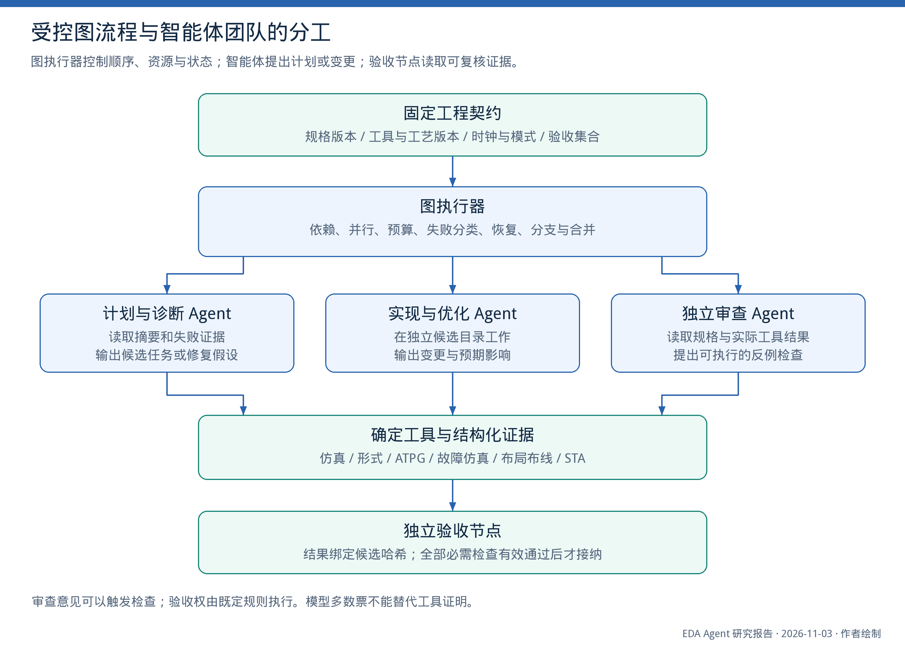

*图 2　建议的总体分工。实线表示任务与结果推进。底层工具提供可复核结果；独立验收节点按照固定契约决定是否接纳。审查 Agent 可以要求增加检查，不能以语言意见覆盖失败结果。*

| 组成 | 主要职责 | 推荐实现 |
|---|---|---|
| 工程契约 | 规格、接口、模式、允许改动、目标与验收集合 | 版本化结构化文件，需明确变更记录 |
| 图执行器 | 依赖、分支、并行、预算、重试、恢复 | 确定程序与状态存储 |
| 计划与诊断 | 阅读证据，提出待检验原因和候选动作 | 有范围约束的 LLM Agent |
| 实现与优化 | 生成 RTL、脚本、配置或候选补丁 | LLM 与模板、专用算法组合 |
| 工具适配层 | 校验参数，运行 EDA，收集原始产物和结构化结果 | 版本适配的 TS/MCP 服务或受控执行接口 |
| 独立验收 | 核实工件身份、检查有效性与全部必需条件 | 程序为主，必要时调用独立工具和人工审查 |
| 审查与解释 | 发现遗漏、提出补充测试、解释结果和取舍 | 只读证据的 Agent |
| 经验管理 | 保存已验证操作、失败统计及适用范围 | 结构化记录与检索 |

“独立验收”不一定需要第二个大模型。很多高价值检查由几十行明确的程序、已有仿真或形式工具完成。只有需要提出新假设、理解不完整规格或判断复杂取舍时，才值得增加模型角色。

### 9.2　图编辑器必须表达可执行规则

每个节点至少需要以下定义。

- **输入和输出类型：**例如 `RTLRevision`、`NetlistSnapshot`、`TimingReport`、`FaultSummary`。端口类型不兼容时，编辑器拒绝连线。
- **前置条件：**工具和文件可用，输入已冻结，所需模式已定义，上游检查已通过。
- **允许修改范围：**RTL 修复节点可以改候选代码，但不能顺手改参考模型或覆盖排除清单。
- **完成条件：**产物存在与任务通过分别判断；进程退出码为零并不是最终通过条件。
- **失败出口：**环境错误、设计错误、约束错误、检查未判定各有转移规则。
- **资源与预算：**时间、EDA 调用数、计算资源、许可证和模型调用预算。
- **上下文选择：**显式指定需求、接口、局部代码、当前证据和相关经验，而非默认继承所有历史。
- **恢复规则：**哪些步骤可复用，哪些必须重跑，恢复时如何连接既有作业。

节点可以调用子流程，也可以在预算内动态产生候选子任务。动态部分仍需经过结构与权限检查。Agent 不能通过修改图定义，为自己的候选增加一条绕过验收的路径。

### 9.3　状态模型必须区分“生成”与“验收”

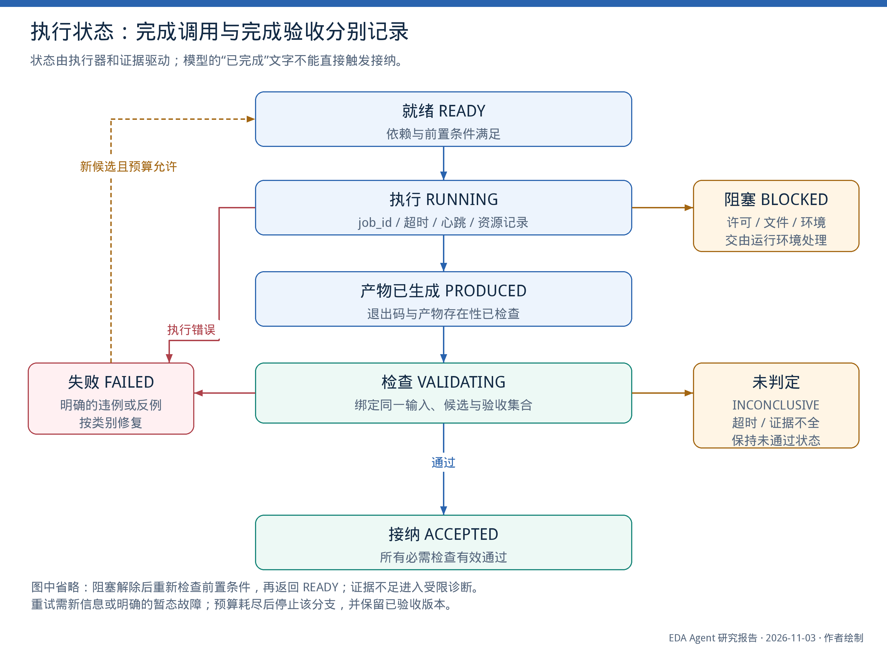

*图 7　简化状态图。未画出的所有恢复边都须重新检查输入与前置条件。FAILED 表示确定的执行或工程失败；INCONCLUSIVE 表示尚无足够证据；二者都不能直接进入 ACCEPTED。*

建议将作业状态和工程结论作为不同字段。例如，进程正常完成了一个有界形式检查，但尚未得到所需的完整证明，此时作业可以是 `FINISHED`，工程结论仍为 `INCONCLUSIVE`。许可证失败、工具崩溃和缺报告，也不应被包装成普通的设计不通过。

设候选为 $c$，工程契约为 $C$，契约指定的必需检查集合为 $J(C)$。建议接纳条件为：

$$
\operatorname{Accept}(c,C)=
\operatorname{IdentityValid}(c,C)
\land \operatorname{EvidenceComplete}(c,C)
\land \bigwedge_{j\in J(C)}[r_j(c,C)=\mathrm{PASS}].
$$

这里的 PASS 只代表在声明的检查和假设范围内通过，并非对所有未建模行为的绝对保证。`UNKNOWN`、`TIMEOUT`、不适用但未说明的检查，以及旧候选的 PASS，均不能满足这个条件。

### 9.4　工程契约、候选与证据如何绑定

建议将以下对象分别保存并相互引用：

| 对象 | 关键内容 |
|---|---|
| TaskContract | 需求版本、top、接口、时钟复位、工作/测试模式、允许改动与最终检查 |
| Candidate | 基准版本、补丁、源文件哈希、配置哈希、提出原因 |
| ToolRun | 工具版本、脚本与输入身份、作业编号、种子、资源、退出状态 |
| Evidence | 原始报告路径与哈希、解析器版本、字段出处、检查结论 |
| Decision | 哪些证据满足哪些条件，接纳/拒绝/未判定，以及理由 |
| Experience | 来源任务与证据、适用条件、建议操作、已知不适用范围 |

修改 RTL 使受影响的综合、仿真、等价和物理结果失效；修改 SDC 使对应时序与优化比较失效；修改测试模式使相关 DFT 与 ATPG 结论失效。应沿工件依赖图传播失效，而不是靠模型在摘要里记住“最好再跑一次”。

下面是**结构示例，不是某个框架可直接执行的现成 API，也不是实际实验结果**：

```yaml
candidate:
  id: example-candidate-03
  base_revision: example-baseline
  source_digest: "<actual SHA-256>"
  contract_digest: "<actual SHA-256>"
  allowed_change: rtl_patch

tool_run:
  id: example-lec-run-03
  tool: "<configured equivalence checker>"
  tool_version: "<actual version>"
  script_digest: "<actual SHA-256>"
  process_state: FINISHED
  engineering_verdict: INCONCLUSIVE
  reason: solver_timeout

acceptance:
  required_checks: [elaboration, functional_equivalence, regression]
  accept_only_if_all: PASS
  allow_missing_evidence: false
  allow_contract_change_in_repair: false
```

### 9.5　MCP 与工具层的合理范围

MCP 提供工具发现、参数与结果传输的协议能力。其结构化返回和输出模式可以帮助程序读取结果，但协议本身不会判断一个 ATPG 配置是否正确，也不会保证 Tcl 运行满足工程目标。[R39](#r39)

建议向 Agent 暴露较小且明确的工具接口，例如按候选运行规定阶段、查询失败摘要、提取指定路径、读取某类故障统计。工具内部完成路径验证、参数检查、作业提交和报告采集。保留必要的原生工具能力，但不要把任意 shell 执行作为所有任务的唯一抽象。

与你讨论过的分工相容的方案是：TS 负责服务与流程组织，C++ 负责专用 EDA 算法，前端负责图编辑和证据查看。具体 UI 技术不会替代这里的执行与验收规则。LangGraph 的持久化还需选择实际持久存储；内存型 checkpointer 不能支持进程重启后的恢复。[R38](#r38)

## 10　功能验证工作流设计

### 10.1　主流程与两条独立路径

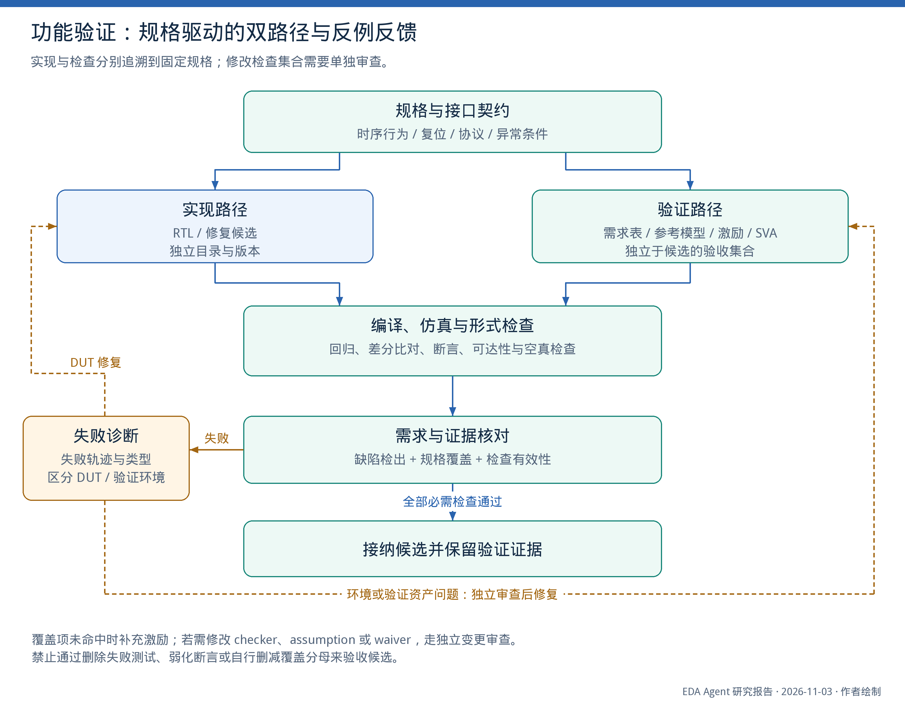

*图 3　规格分别约束实现与验证资产。确认的 DUT 缺陷返回实现路径；环境、检查项或验证资产问题经过独立审查后修复。形式超时和证据缺失进入未完成状态，而不自动归为 RTL 错误。*

**步骤一：建立需求清单。** 每条需求包括编号、输入条件、预期输出、时序关系和异常行为。例如 FIFO 不只是“能读写”，还包括同时读写、满空状态、复位、深度参数、输出有效时机以及非法操作的定义。规格缺失要作为显式问题保留。

**步骤二：独立建立验证资产。** 验证分支主要依据规格、接口和协议建立 test plan、参考模型、scoreboard、SVA 意图与覆盖计划。可以读取 DUT 接口和结构解决绑定问题，但不能把当前 DUT 的行为直接当作期望行为。

**步骤三：按依赖构造环境。** 先共享类型与 interface，再 driver/monitor，再 UVM agent/env/scoreboard/test。这里 UVM 的 `agent` 是验证组件，和语言模型 Agent 是两个概念。稳定的协议与连接由模板生成，模型负责事务与功能意图。

**步骤四：运行多类检查。** 先构建与基础 smoke test，再定向和随机回归、差分比对、覆盖收集、适用的形式检查。每项输出明确记录编译失败、运行异常、mismatch、超时或通过。

**步骤五：失败分流。** 若固定参考模型与候选不一致，调查 DUT；若之前通过的设计也在新环境失败，优先调查环境；若规格解释冲突，更新需求版本后重新建立基线。覆盖未命中不直接说明 DUT 有错误，它可能需要更好的刺激，也可能对应不可达行为。

**步骤六：独立验收。** 最终候选需要通过保留回归，并检查修改是否削弱了 checker、属性、假设或覆盖目标。修复任务同时要求原失败用例转为通过，以及原本通过的用例继续通过。

### 10.2　交叉检验具体检查什么

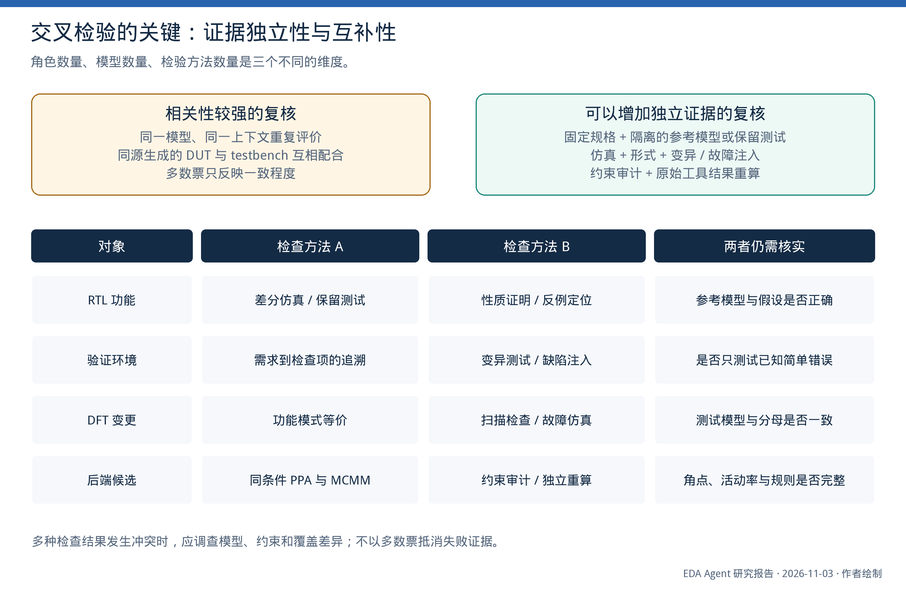

*图 6　不同检查机制提供互补证据。形式证明仍受属性与建模条件约束；逻辑变更需相应等价检查，完整物理结果还需所要求的物理规则检查。结果冲突时调查原因，不以多数票消除失败。*

**验证环境自身也需要检查。** 可以在隔离的 DUT 副本或输入刺激中注入明确错误，例如翻转 DUT 中的比较条件、破坏复位行为、制造握手违例或改变输出延迟；保持验收 checker 不变，观察其能否检出错误。变异测试只能说明对这些变异的检出能力，不能自动推出对真实缺陷的完整覆盖。

**形式检查需要有效性审计。** 保存 assumption 来源，检查复位能否退出、事务能否开始和结束、关键状态是否可达、断言前提是否触发。若某属性在有限深度没有反例，应按其证明模式解释。已知错误变体仍能通过时，应调查建模或属性，而不是奖励 Agent “验证成功”。

**差分检查需要真正不同的参考。** 一个独立的软件模型、已有规范实现或人工确认的协议模型比“从 DUT 反向翻译出的模型”更有价值。参考和 DUT 可能对未定义行为采用不同约定，比较前要固定这些条件。

### 10.3　建议输出的验收表

| 需求 ID | 规格出处 | 激励/测试 | checker/属性 | 覆盖对象 | 实际证据 | 状态 |
|---|---|---|---|---|---|---|
| REQ-RESET | 固定规格中的复位条款 | 复位中、释放后、事务中复位 | 输出初值与状态约束 | 复位退出行为 | 当前候选的仿真/形式记录 | PASS / FAIL / UNKNOWN |
| REQ-HANDSHAKE | 协议条款 | 背压与连续事务 | 数据稳定、接受与响应关系 | 握手组合 | 对应测试与断言结果 | 同上 |
| REQ-ERROR | 异常输入条款 | 非法操作、异常返回 | 错误码与副作用限制 | 异常类别 | 指定测试记录 | 同上 |

表格中的示例仅说明组织方式；实际工程应由规格确定需求。覆盖率总数是摘要，需求与检查的对应关系才便于审查遗漏。

## 11　DFT 与 MBIST 工作流设计

### 11.1　DFT 的主流程

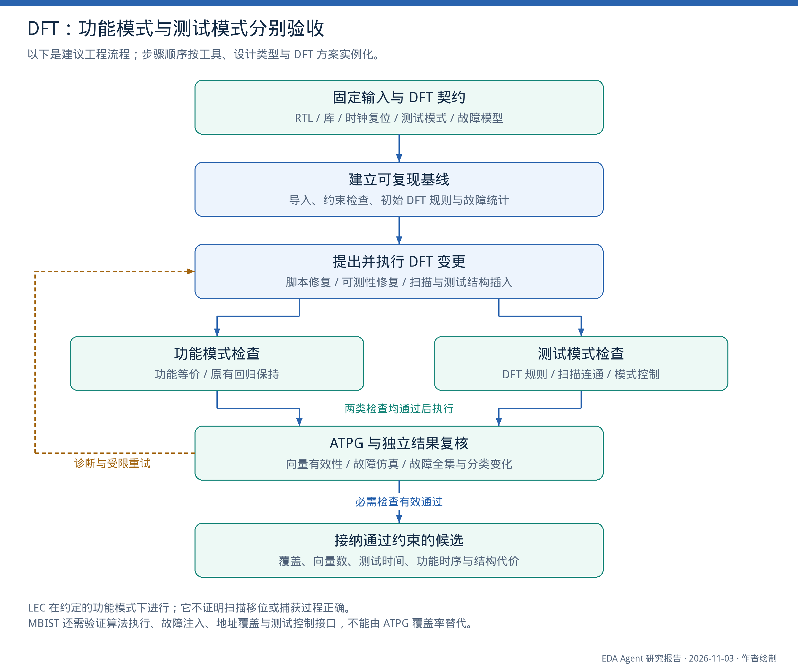

*图 4　建议的阶段结构。功能与测试模式检查均有效通过后，才进入后续候选评价。失败或证据不足分别进入诊断、重试或停止；具体插入顺序由设计与工具流程确定。*

**输入契约。** 包含 RTL/综合网表、库与 DFT 模型、filelist、top、时钟复位、黑盒与存储宏、功能/测试模式、扫描与压缩要求、目标故障模型和测试协议。文件名相同不表示同一输入，必须依据实际路径与内容身份。

**前置诊断。** 优先检查导入、层次、未解析模块、时钟复位可控性和模式设置。测试规则错误按库/模型、约束、时钟复位、结构与工具环境分类，避免尚未正确读入设计就开始优化覆盖率。

**候选变更。** 按问题选择修改脚本、约束、RTL 或测试结构。OCC、扫描压缩、IJTAG、MBIST 与扫描插入之间存在工具和设计依赖，不能规定所有工程永远使用同一个线性次序。子图应明确前置条件与所产生工件。

**两个模式分别验收。** 功能模式 LEC 验证改动是否保持规定的正常行为；测试模式检查扫描连通、移位捕获控制、模式切换和相关规则。不能因功能 LEC 通过就跳过测试行为检查，也不能把测试模式下预期的结构差异粗暴认定为功能错误。

**ATPG 与复核。** 保存向量、故障报告、模式和工具配置；必要时用故障仿真、向量仿真或独立的检查实现复核。若只能获得一种工具的结果，应明确证据范围，不能把同一报告让两个 Agent 阅读称作双工具验证。

### 11.2　建议的 DFT 团队分工

| 角色 | 关注对象 | 允许提出的变更 | 必需的外部检查 |
|---|---|---|---|
| 输入与环境诊断 | filelist、top、库、工具版本、路径 | 文件和运行配置修复 | 设计导入、层次与工件核对 |
| 时钟复位与模式分析 | test_mode、scan_enable、OCC、复位控制 | 有依据的测试模式或控制方案 | 模式规则、行为仿真、相关时序 |
| 结构可测性分析 | 不可控不可观测结构、PSS/TPI 候选 | 受预算约束的结构修改 | 合法性、功能 LEC、DFT DRC |
| ATPG 策略分析 | 未检出类别、中止、搜索与压缩设置 | 允许范围内的参数候选 | 相同条件的 ATPG 与故障统计 |
| 独立验收 | 当前工件、原始计数与测试协议 | 接纳、拒绝、要求补证据 | 规则驱动，不修改标准来迎合候选 |

这些是职责类别，不要求五个模型常驻。简单输入错误可由检查器直接处理；只有出现需要判断的原因与候选时才调用相应角色。

### 11.3　覆盖率的正确统计方式

**首先绑定故障模型与统计对象。** 明确 stuck-at、transition、cell-aware 等模型，网表版本、故障折叠、目标范围和排除项。功能覆盖、代码覆盖、故障覆盖和测试覆盖衡量不同对象，不能混写为统一 coverage。

**其次保留工具原始类别。** 保存 detected、possibly detected、untestable、aborted 等原生分类及其定义。不同工具和版本的分类、权重与分母处理可能不同；不要套用未经核实的通用 Test coverage 公式。当前搜索未成功，也不必然表示逻辑上不可测。

**同网表参数优化要保持可比集合。** 若结构没有改变，应以一致的故障集合、模式与限制比较。若插入测试点或修改网表，故障全集可能改变，应分别报告新增、移除和重新分类的故障，说明可比较范围，不能机械沿用旧分母。

**用原始计数发现假改善。** 覆盖上升可能来自真正增加检测，也可能来自增加排除、扩大黑盒、模式设置错误或读取旧报告。工具结果至少应绑定运行编号、候选、库、脚本、测试协议和时间状态。工具超时后残留的报告文件不构成成功证据。

**联合评价工程代价。** 向量更少不一定更好，可能伴随检测能力下降或其他测试约束变化。需要同时报告向量数、移位与捕获周期、测试数据量、运行时间、结构面积、功能时序和测试功耗。

### 11.4　一个适合先实施的 DFT 诊断例子

假设工具报告某复位相关 DFT 规则不满足。工作流可以采取如下顺序：

1. 解析报告中的具体对象、层次与错误类别，定位它是否确实对应当前候选。
2. 从 RTL 和约束读取复位敏感边沿、有效值、测试模式行为；信号名称只作线索，不能仅凭 `resetn` 推断全部行为。
3. 检查问题来自 RTL 结构、测试模式固定值、工具导入或库模型。
4. 在独立候选中应用最小修改，记录预期影响；不得随意改变正常功能以消除工具报错。
5. 重新检查该规则，同时执行相关功能 LEC 和必要的模式仿真。
6. 只有规则实质消除且功能保持时接纳；否则保存反例并进入下一种假设。

这个例子体现反馈的作用：逐步缩小原因，而不是重复要求同一个模型“认真检查复位”。

### 11.5　MBIST 的适合扩展方式

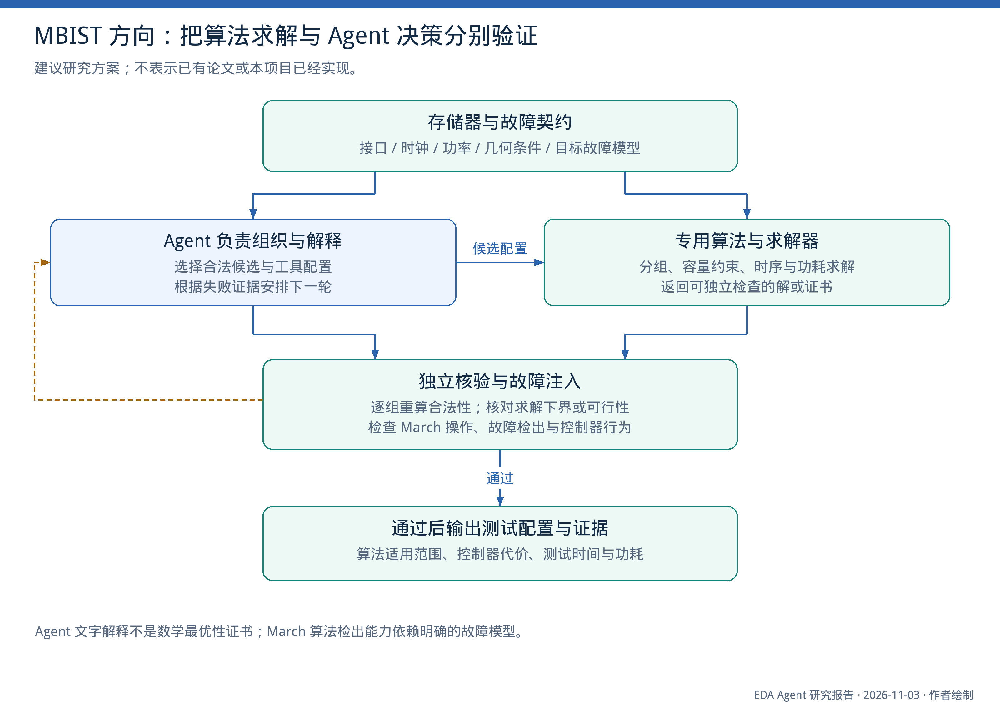

*图 10　建议的 MBIST 扩展。Agent 组织候选与工具配置，专用求解器计算，独立程序检查合法性与故障检出证据。功耗结论还依赖所采用的活动与器件模型。*

建议将 MBIST 拆成三类任务：

**测试算法与故障模型。** 选用或组合有明确适用范围的 March 操作，检查操作序列、地址遍历、期望数据和目标故障检出。生成一段看似合理的算法说明，不代表控制器实现和故障覆盖正确。

**分组与并发。** 将存储器类型、时钟、功耗、距离和容量约束交给已有专用算法，Agent 负责选择配置、安排计算和解释结果。若沿用你已有的几何分组方法，独立检查器应核对成员覆盖、每组合法性、容量和下界证书；不能用模型解释替代数学证书。

**实现与访问。** 检查控制器、存储接口、复位、诊断寄存器、JTAG/IJTAG 访问及系统模式。测试算法在抽象模型上有效，不等于集成后的控制器能正确执行。

本次检索没有足够证据支撑“LLM 团队已可靠完成通用工业 MBIST 算法到控制器的全自动设计验证”。适合将其作为分阶段研究方向，并优先保留已有可验证算法与工具。

## 12　后端优化工作流设计

### 12.1　固定比较条件与候选范围

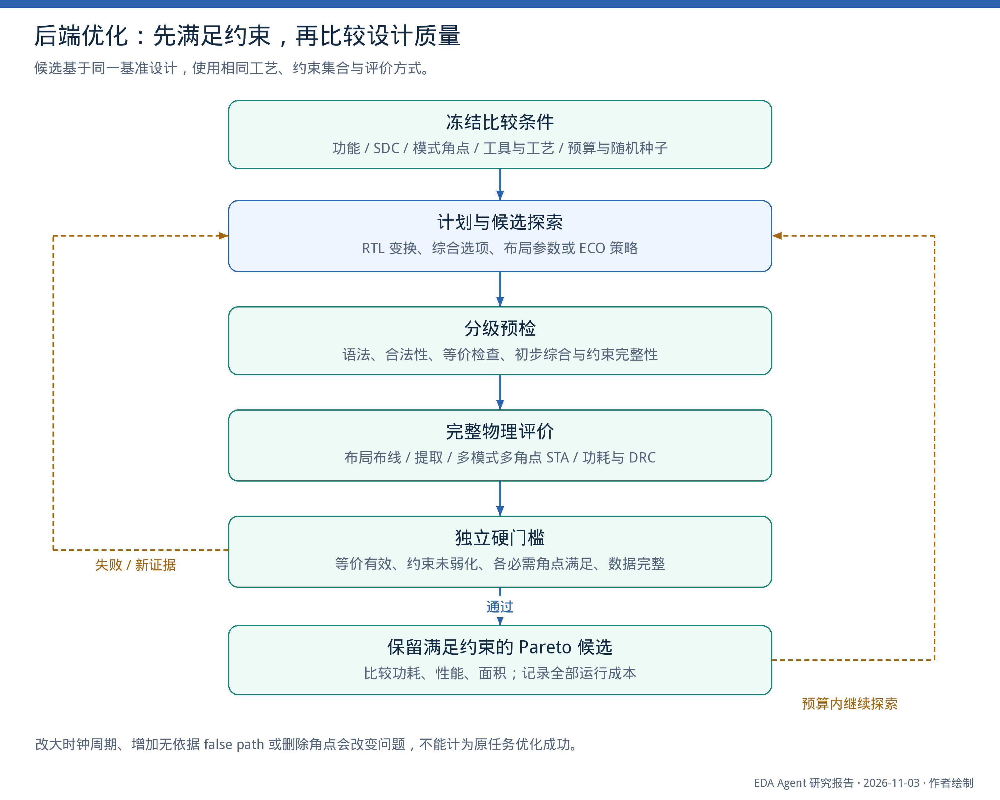

*图 5　建议的优化流程。分级预检用于减少无效完整运行；最终比较必须使用所要求的真实物理和功能检查。图中的并行与恢复均受预算约束。*

任务契约应固定基准 RTL/网表、SDC、工艺库、宏单元、必要的功耗意图、RC 角、工作模式和检查集合。候选可以具有不同代码版本，但必须追溯到同一比较基准，并使用规定的评价条件。

需要事先决定允许的动作范围：仅工具参数调整、允许局部 RTL 等价改写、允许 ECO，或允许微架构变化。如果任务允许增加流水和改变延迟，必须同步改变接口与功能规格，并采用适当的验证方法；不能在固定周期接口任务里悄悄改变延迟。

### 12.2　优化目标采用“可行性优先”

设 $g_j(c)$ 表示候选在第 $j$ 项硬检查下的结论。可行候选集合为：

$$
\mathcal{F} = \{c \mid \forall j,\ g_j(c)=\mathrm{PASS}\}.
$$

在 $\mathcal{F}$ 中，比较功耗、面积、延迟或吞吐率等目标，并保留 Pareto 候选。若 $\mathcal{F}$ 为空，可以用时序违反、拥塞和其他距离可行性的指标指导下一轮，但此时没有可交付的合格结果。

对不同候选比较功耗时，要核对活动率、工作负载、频率、电压与分析模型。比较时序时，要核对 setup/hold、模式、角点及必要的电气限制。不同设置下的数值不宜直接混入同一排行榜。

### 12.3　反馈分级与工具预算

**第一级：结构与配置预检。** 检查语法、接口、约束完整性、明显无效参数和必要的局部性质。完整等价求解不一定便宜，可根据变更范围安排。

**第二级：早期质量估计。** 综合、粗放置、早期拥塞和时序用于淘汰明显劣质候选。代理指标只用于搜索，不替代最终布线后评价。

**第三级：完整物理运行。** 对保留候选执行所要求的布局布线、提取、MCMM STA、功耗和物理检查。最终结果以实际工具报告为准。

**第四级：独立复核与比较。** 核实 LEC/SEC、SDC 未被改弱、全部要求角点有效、物理检查完整，并复算关键指标。具体是否需要 LVS、IR/EM 等由任务与可用工具确定；未运行的检查应明确列出，而不是概括为“全部完成”。

搜索预算同时记录模型消耗、工具核时或许可证小时、墙钟时间。批量并行运行 25 个候选仍是 25 次工具运行，不能只记一轮。

### 12.4　候选隔离、合并与回退

每个候选使用独立目录和独立可写设计数据库，避免两个 Agent 同时修改同一设计状态。候选合并后必须重新验收，因为分别通过的两个变更组合起来可能改变功能或时序。

始终保存“最佳已验收版本”和“当前探索版本”。预算耗尽时，交付最佳已验收版本及未解决问题；若没有合格候选，就明确报告任务尚未完成。失败不应被隐藏成漂亮的结果摘要。

### 12.5　必须防止的约束弱化

放宽时钟周期、增加无依据的 false path、移除角点或改变 top，可能使报告变好，但已经改变任务。若这些确实是授权的设计空间变量，应在契约中定义范围，并在固定使用条件下重新评价。

建议将时钟、I/O 延迟、例外路径、模式、角点和功耗活动模型做成独立审计对象。优化 Agent 可以提出修改理由；接受修改需要形成明确的新契约版本，旧结果不得继续用来证明原任务已完成。

## 13　经验、上下文与长任务恢复

### 13.1　成功经验和失败记录分别保存

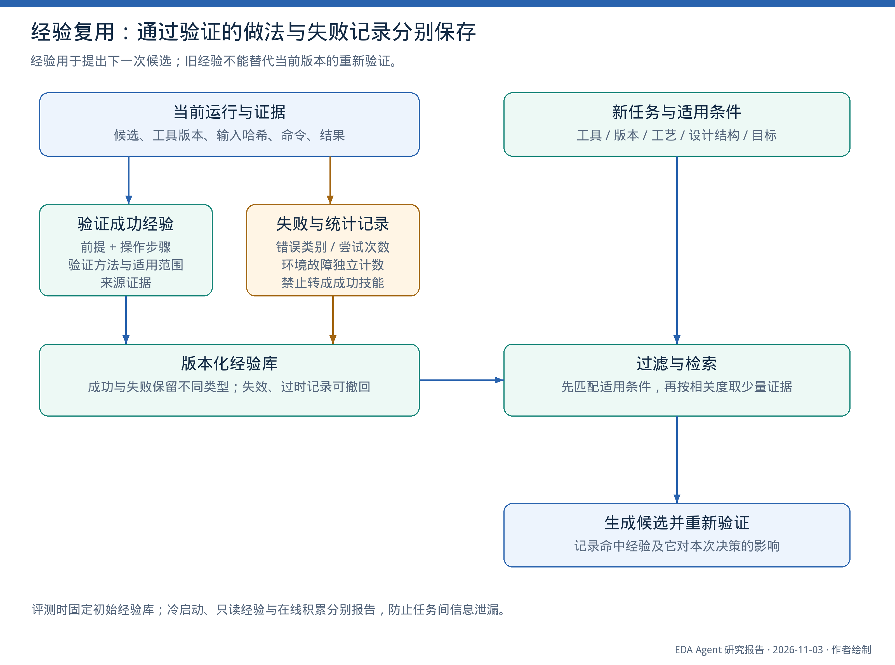

*图 8　建议的经验流程。源任务通过后提炼的操作仍需在新任务中重新验证；失败记录用于诊断与成本估计，不应混入已验证做法。*

每条经验至少说明：原始问题、适用工具和版本、设计/模式条件、操作步骤、所需检查、原始证据和已知失败范围。只保存“某错误改某参数即可”会丢失决定其适用性的条件。

检索可分两级：先按确定的环境与接口条件筛选，再按结构或文本相关度选择。相似但条件不匹配的记录可以启发假设，但不能直接当作已经验证的操作。

在线经验需要撤回机制：同一经验在新版本多次失败时，标记待复核；经确认不适用后记录条件。失败统计还应区分设计原因和基础设施原因，避免许可证不足被学成某个 RTL 变换无效。

### 13.2　上下文按节点组织

建议提供给模型的是：当前任务目标、固定需求、允许动作、必要接口或电路切片、最新有效证据、已尝试且失败的方法、少量适用经验。大型波形、网表和日志保留为外部文件，通过查询工具返回局部视图。

摘要应保留数值、单位、对象、运行身份和出处；无法确认的内容保留不确定状态。下游审查者可以读取原始证据，不能只被迫相信上游 Agent 的总结。

对小模型，这种设计可能比增加角色更有效：减少同时处理的工具、缩小输出结构、提供局部错误和有限动作。是否产生收益仍需实验验证，不能仅因上下文更短就认定更可靠。

### 13.3　恢复需要同时处理对话与真实作业

检查点至少包括图版本、节点状态、候选身份、作业编号和已完成的产物。恢复后首先判断原作业仍在运行、已结束还是状态丢失，不能直接再次提交同一昂贵任务。

聊天状态保存不等于 EDA 数据库保存；一个中断的数据库也不等于可继续的工具检查点。工具适配器应区分可恢复的数据库、完整结果和临时文件。只有输入、脚本、工具与相关配置满足缓存条件，旧结果才可复用。

### 13.4　停止与升级必须写入图

至少设置总预算、单节点预算、相同失败重复阈值和无进展条件。相同输入、相同动作、相同错误的重复，通常需要新的诊断或停止；网络等明确暂态故障则可以有限重试。

升级可以是调用更强模型、扩大局部工具分析、交给专用算法或请求工程师处理规格歧义。升级不是掩盖失败，而是系统明确承认当前路径证据不足。

### 13.5　把 EDA 产物当作数据，而非新的控制指令

RTL 注释、第三方脚本和日志可能包含自然语言。运行器应区分工程数据与授权指令：文档中的示例命令、测试输出或任意注释，不能直接改变任务权限、删除验收项或要求发送设计文件。这个规则可由输入类型、只读检索和工具权限落实，与日常工程的输入隔离相结合。

## 14　可发表的研究问题与公平实验

### 14.1　贡献应落到可证伪的机制

“图工作流 + 多 Agent + 工具反馈”已有多项先例。适合将当前项目定位为**面向 EDA 的可靠任务完成机制**，选择一个主问题深入验证，其余作为系统支撑。下面三项假设都允许实验给出否定结果。

#### 假设一：独立验收与版本绑定能降低错误接纳

**主张。** 在相同模型与资源预算下，将候选生成和验收资产维护分离，并将结果绑定到设计、约束和工具配置的确定版本，可以在保持有效完成率的同时减少错误接纳。

**实验。** 保留同一候选生成器，替换验收机制。任务包含正常缺陷与表面通过情形：旧报告、错误 top、DUT/checker 共同误解、空真属性、覆盖分母缩减、DFT 排除项变化和 SDC 弱化。固定最终独立评价器，记录系统接受了什么，以及实际是否正确。

**必要基线。** 除单 Agent 和团队外，必须包含“确定性脚本 + 同样验收规则”。若收益主要来自版本校验和检查规则，应将贡献归于执行与验收机制，不应归于多 Agent 智能。

**风险与反证。** 系统拒绝所有候选也能获得零错误接纳，因此必须同时看有效完成率。若只在人工构造的旧报告扰动上改善，真实任务没有改善，结论应限定为证据管理能力。

#### 假设二：差分复放与失败分流能减少无效修复

**主张。** 对已有有效历史版本的工程，利用差分复放区分设计、验证资产、约束和运行环境问题，再进入对应修复子图，能以较少工具成本达到相同的正确完成率。

**实验。** 在接口与版本兼容时，比较“当前候选 + 旧有效环境”和“旧有效设计 + 当前环境”，并按证据选择下一项诊断。Agent 可见的历史有效版本不能是当前任务的隐藏正确答案。

**必要基线。** 完整日志直接修复、相同团队但无复放、固定顺序诊断脚本、成本最低检查优先。所有组获得相同工具和历史信息，最终仍运行全部规定检查。

**风险与反证。** 设计与环境可能真实耦合；历史版本可能不满足新规格；诊断运行可能比直接修复更贵。因此先在有历史有效版本的维护任务验证，不能直接外推到全新 SoC 生成。

#### 假设三：带适用条件的经验能降低错误迁移

**主张。** 在未见设计、工具版本或工艺上，先检查经验适用条件，再按相关度检索，并对不确定经验重新验证，可以降低错误经验迁移。

**实验。** 所有组使用相同经验来源，比较无经验、普通语义 RAG、结构 RAG、无条件程序经验、确定性条件过滤，以及条件过滤加再验证。按设计族和环境版本留出测试集，禁止目标任务成功轨迹提前进入冻结经验库。

**风险与反证。** 条件过严会阻止所有迁移，过宽又会传播错误；再验证成本可能抵消收益。如果普通 RAG 在同样预算下已经等效，应承认条件化机制没有增量价值。该方向需要与 ChipMEM 和 VeriRAG 明确比较，而不是将“增加记忆”视为新贡献。[R05](#r05)，[R19](#r19)

### 14.2　统一的对照矩阵

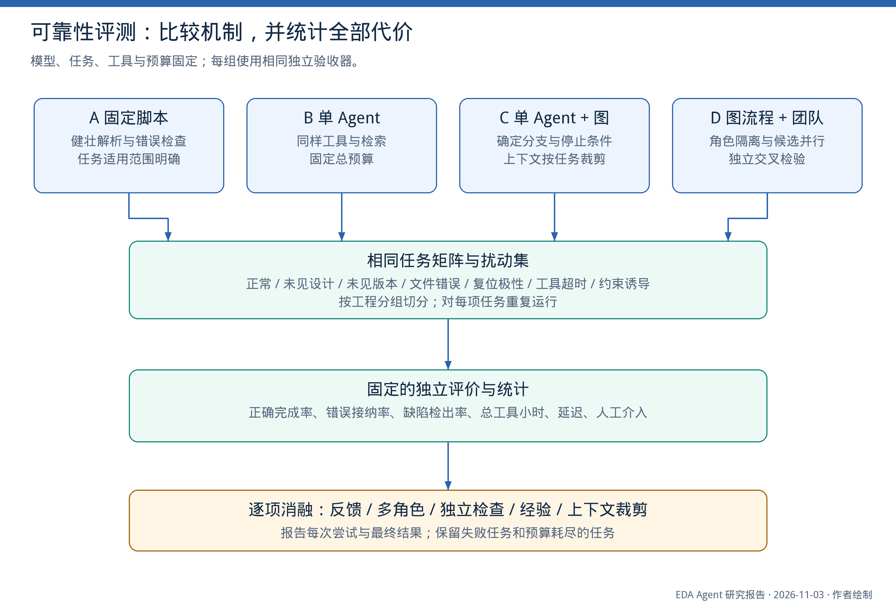

*图 9　实验设计概览。最终独立评价器在所有组固定；被消融的是系统运行过程中的独立检查和决策机制，不能通过取消最终评价来提高成绩。*

| 组别 | 配置 | 主要隔离的因素 |
|---|---|---|
| S | 健壮专家脚本、相同工具与解析器 | 已有确定自动化的强基线 |
| A | 单 Agent、相同工具与检索 | 模型动态决策 |
| A-k | 同一 Agent 多候选、相同总预算 | 更多采样的贡献 |
| B | 单 Agent + 显式工作流 | 控制结构的贡献 |
| C | 工作流 + 专业分工团队 | 角色、上下文与协作的贡献 |
| D | C + 独立过程验收与版本绑定 | 工程证据和错误接纳控制 |
| E | D + 条件化经验 | 经验迁移与恢复贡献 |

若团队同时换了更强模型、增加工具、更大预算和更好文档，最终可以评价整个产品，但不能将收益单独归给团队。工程报告与机制研究应采用不同的结论强度。

### 14.3　任务矩阵与预算

建议先选一个主领域做深入实验，再用其他领域验证通用性。

| 任务类 | 正常任务 | 有代表性的扰动 | 最终评价 |
|---|---|---|---|
| 功能验证 | 规格到环境、真实 bug 修复 | checker 错误、协议歧义、复位变化、构建失败 | 保留回归、缺陷检出、需求证据 |
| DFT | 规则修复、ATPG 配置优化 | filelist、测试模式、库模型、旧报告、故障排除 | 功能保持、DFT 规则、可比故障统计 |
| 后端 | 约束内参数或 RTL 优化 | 角点缺失、SDC 弱化、工具超时、并行产物污染 | 等价、MCMM、物理规则、PPA |
| 跨阶段 | 中断恢复、版本迁移 | 失效缓存、旧工具经验、部分作业完成 | 重现结果、恢复成本与证据完整性 |

不同组应同时受总工具运行量与墙钟上限约束；另报 token 和费用。不同工具一次运行成本差别很大，单独限制“最多五轮”通常不充分。随机性来自模型、并行调度和 EDA 过程，应记录并重复运行。

任务划分按工程或设计族进行，避免同一模块的近重复版本分别进入训练和测试。经验迁移分别评估冷启动、固定只读经验和在线积累，不把三者混为同一种学习能力。

### 14.4　核心指标与统计方式

建议至少报告以下两个指标，并明确分母：

$$
R_{\mathrm{valid}}=
\frac{\text{被系统接纳且通过最终独立评价的任务数}}
{\text{全部任务数}},
$$

$$
R_{\mathrm{false\ accept}}=
\frac{\text{被系统接纳但最终独立评价失败的任务数}}
{\text{被系统接纳的任务数}}.
$$

当没有接纳任何任务时，第二个比例应标为“不适用”，同时展示接纳数量；不能记成 0% 后宣称系统可靠。错误拒绝和未完成任务也应保留。

配套指标包括：第一次完整成功、预算内成功、真实缺陷检出与误报、已正确行为破坏次数、无效重复动作、恢复成功、人工介入分钟数、总工具时间、许可证小时、墙钟时间和模型成本。后端质量可同时报告合格候选的 PPA 与全部任务的成功比例，避免只统计成功子集。

建议按任务配对比较；置信区间按工程聚类或采用合适的分层统计。几十个候选来自同一个设计时，不能假装它们是几十个独立工程。报告每项任务结果和失败类别，比只给一个均值更有信息。

### 14.5　最适合当前项目的三个起步实验

**第一优先：DFT 真实问题包与受约束修复。** 从已经可运行的工程建立基线，保存 filelist、top、复位极性、测试模式、库模型等真实失败的最小复现。比较 S/A/B/C/D，先证明工作流是否减少错改和错误宣告成功。这与现有项目经验最接近。

**第二优先：覆盖报告与证据一致性。** 加入旧报告、并发日志混杂、覆盖定义混排、故障集合变化和超时残留。大部分可以离线构造并审计，实验成本较低，适合先验证独立验收的效果。

**第三优先：同预算优化。** 固定 DFT 结构后先做 ATPG 合法参数搜索，或选择一个受控后端参数子任务；比较随机、贝叶斯和 Agent 策略。通过硬检查后才比较收益。等基线稳定后，再扩展 PSS/TPI、RTL 改写和跨阶段优化。

## 15　项目实施次序与优先阅读清单

### 15.1　按验收条件推进，而非先扩大团队

| 阶段 | 主要产物 | 进入下一阶段的条件 |
|---|---|---|
| 1：稳定工具执行 | 工具适配器、运行记录、原始报告与结构化指标 | 同一配置可复现；错误分类和工件身份可靠 |
| 2：单 Agent 有限流程 | 显式状态、预算、重试、停止与恢复 | 可区分生成完成和验收通过；无无限重复 |
| 3：独立验收 | 需求/约束固定、证据绑定、保留测试 | 能发现旧结果、弱化检查和错误接受 |
| 4：选择性团队 | 分工、局部上下文、候选隔离 | 相同预算下优于单 Agent 或多采样基线 |
| 5：经验迁移 | 条件化经验、失败统计与撤回 | 未见设计/环境上有净收益 |
| 6：跨领域子图 | 验证、DFT、后端可组合流程 | 上游变更能使相关证据失效并正确重跑 |

“先做单 Agent 流程”是为了建立可归因基线；最终系统仍可支持团队与动态分工。工程师应能看到每次决策依赖的证据、当前候选和验收状态，而不仅是成员间的聊天记录。

### 15.2　与你的目标最相关的阅读次序

| 阅读目标 | 优先材料 | 应关注的部分 |
|---|---|---|
| 图流程与运行器 | AgentSPEX、SWE-agent、OpenHands | 执行含义、上下文、工具接口、事件与恢复 |
| 验证工作流 | UVM²、HAVEN、AssertLLM | 依赖、结构化生成、属性与覆盖目标的来源 |
| DFT 反馈与检查 | VeriRAG、TESLA、DFTAgent | 合法修复、功能保持、工具反馈与基线公平性 |
| 后端组织策略 | ORFS-agent、Retrieve–Schedule–Reflect、Dr. RTL | 工具预算、候选筛选、优化顺序与等价检查 |
| 经验复用 | ChipMEM | 何时写入、统计恢复、迁移隔离与真实成本 |
| 工程级评测 | CVDP、HWE-Bench、Build-A-Chip-Bench | 任务完整性、隐藏验收、工件与结果隔离 |

### 15.3　建议形成的最终系统目标

> 构建一个以可执行图为核心的 EDA 工作平台。工程师定义任务契约、工具能力和验收条件；智能体在受控范围内分工提出计划、诊断与候选；工具产生版本一致的证据；独立验收决定接纳、拒绝或补充检查；工作流管理预算、恢复与经验复用。

这个目标可以兼容验证、DFT 和后端优化，又保留每类任务不同的正确性要求。最有价值的系统能力，是让“当前为什么可以接纳这个结果”有明确、可复核的答案。

## 16　参考文献、原图来源及材料核验说明

### 16.1　引用与检索说明

参考条目采用接近 GB/T 7714 的组织方式。已核实的会议、期刊、DOI 和版本予以列出；未核实的页码或出版信息不补造。所有网页检索日期为 **2026-11-03**。预印本版本与正式出版身份分别说明。厂商公告、作者模型卡和论文不混作同等级实验。

补充检索以论文官网、arXiv、ACL/AAAI/NeurIPS 等出版页面、作者仓库、会议日程和工具官方资料为主。一般新闻报道与聚合索引只作发现线索。本报告是围绕当前项目的重点综述，不声称穷尽全部 AI4EDA 或模拟电路文献；没有充分核对的最新性能数字未纳入比较。

本次没有运行上传包内的脚本，也没有重新执行商业工具实验。原论文图由上传 PDF 直接裁切渲染；裁切坐标、原始页码和文件哈希保存在 `sources/figure_provenance.json`。

### 16.2　上传的九篇原始文献

<a id="r01"></a>
**[R01](#r01)** LI H, WANG Y, LIU J, et al. LLM Agents as Catalysts for Resilient DFT: An Orchestration-Based Framework Beyond Brittle Scripts[J]. Applied Sciences, 2025, 15(21): 11390. DOI: [10.3390/app152111390](https://doi.org/10.3390/app152111390). 本次核读上传 18 页全文；方法见第 5–7 页，主要实验与局限见第 8–15 页。[出版页](https://www.mdpi.com/2076-3417/15/21/11390)。

<a id="r02"></a>
**[R02](#r02)** WU H, HE Z, ZHANG X, et al. ChatEDA: A Large Language Model Powered Autonomous Agent for EDA[J]. IEEE Transactions on Computer-Aided Design of Integrated Circuits and Systems, 2024, 43(10): 3184–3197. DOI: [10.1109/TCAD.2024.3383347](https://doi.org/10.1109/TCAD.2024.3383347). [预印本](https://arxiv.org/abs/2308.10204)。本次核读上传 TCAD 版；任务定义与分级见 PDF 第 8–9 页。

<a id="r03"></a>
**[R03](#r03)** WU H, ZHENG H, HE Z, et al. Divergent Thoughts toward One Goal: LLM-based Multi-Agent Collaboration System for Electronic Design Automation[C]//NAACL 2025. 2025: 1710–1721. DOI: [10.18653/v1/2025.naacl-long.83](https://doi.org/10.18653/v1/2025.naacl-long.83). [全文与书目](https://aclanthology.org/2025.naacl-long.83/)。本次核读上传 12 页；Figure 4、Table 4 为关键位置。

<a id="r04"></a>
**[R04](#r04)** LIU M, ENE T D, KIRBY R, et al. ChipNeMo: Domain-Adapted LLMs for Chip Design[EB/OL]. arXiv:2311.00176v5, 2024. [版本页](https://arxiv.org/abs/2311.00176v5)。本次核读上传 23 页；第 6–7 页区分问答、脚本任务与评价方式。

<a id="r05"></a>
**[R05](#r05)** ALRABAH A, MABRY J, HAKKANI-TÜR D, et al. ChipMEM: Verification-Grounded Memory for EDA Agents[EB/OL]. arXiv:2609.27067v1, 2026. [预印本地址](https://arxiv.org/abs/2609.27067)。关键分析依据上传 22 页原文；第 7–9 页实验协议与结果，第 19 页 Tables 10–11 成本与置信区间。网页本次部分访问受限，未将摘要代替上传正文。

<a id="r06"></a>
**[R06](#r06)** WANG P, HUANG J, YAO J, et al. AgentSPEX: An Agent SPecification and EXecution Language[EB/OL]. arXiv:2604.13346v1, 2026. [预印本](https://arxiv.org/abs/2604.13346)。本次核读上传 18 页；第 3–6 页语言与执行，第 8–9 页用户研究、讨论与未来工作。[作者项目](https://github.com/ScaleML/AgentSPEX)。

<a id="r07"></a>
**[R07](#r07)** LU Y, LIU S, ZHANG Q, et al. RTLLM: An Open-Source Benchmark for Design RTL Generation with Large Language Model[EB/OL]. arXiv:2308.05345v3, 2023. [版本页](https://arxiv.org/abs/2308.05345v3)。本次核读上传 6 页；Table I 规模、Table III 功能判定、Table IV 质量评价。

<a id="r08"></a>
**[R08](#r08)** YANG J, JIMENEZ C E, WETTIG A, et al. SWE-agent: Agent-Computer Interfaces Enable Automated Software Engineering[C]//Advances in Neural Information Processing Systems 37. 2024. [会议页](https://proceedings.neurips.cc/paper_files/paper/2024/hash/5a7c947568c1b1328ccc5230172e1e7c-Abstract-Conference.html). [预印本](https://arxiv.org/abs/2405.15793)。本次核读上传正文与相关附录，重点为接口与反馈消融。

<a id="r09"></a>
**[R09](#r09)** WANG X, LI B, SONG Y, et al. OpenHands: An Open Platform for AI Software Developers as Generalist Agents[C/OL]//ICLR 2025. 2025. [预印本与出版状态](https://arxiv.org/abs/2407.16741)。本次核读上传 38 页，重点为事件、执行环境与多任务评价。

### 16.3　验证、DFT、优化与评测补充文献

<a id="r10"></a>
**[R10](#r10)** TSAI Y D, LIU M, REN H. RTLFixer: Automatically Fixing RTL Syntax Errors with Large Language Models[C/OL]//DAC 2024. 2024. [论文](https://arxiv.org/abs/2311.16543). [作者代码](https://github.com/NVlabs/RTLFixer)。

<a id="r11"></a>
**[R11](#r11)** BLOCKLOVE J, et al. Automatically Improving LLM-based Verilog Generation using EDA Tool Feedback[J/OL]. TODAES 接收版本，arXiv:2411.11856v3, 2025. [全文](https://arxiv.org/html/2411.11856v3)。

<a id="r12"></a>
**[R12](#r12)** HO C T, REN H, KHAILANY B. VerilogCoder: Autonomous Verilog Coding Agents with Graph-based Planning and Abstract Syntax Tree (AST)-based Waveform Tracing Tool[C]//AAAI 2025. 2025, 39(1): 300–307. DOI: [10.1609/aaai.v39i1.32007](https://doi.org/10.1609/aaai.v39i1.32007). [全文](https://arxiv.org/html/2408.08927v2)。

<a id="r13"></a>
**[R13](#r13)** YAN Z, et al. AssertLLM: Generating Hardware Verification Assertions from Design Specifications via Multi-LLMs[C]//ASP-DAC 2025. 2025: 614–621. DOI: [10.1145/3658617.3697756](https://doi.org/10.1145/3658617.3697756). [对应全文](https://arxiv.org/html/2411.14436v1)。本文未混用另一早期版本的实验数字。

<a id="r14"></a>
**[R14](#r14)** YE J, HU Y, XU K, et al. From Concept to Practice: an Automated LLM-aided UVM Machine for RTL Verification[C/OL]//ICCAD 2025. DOI: [10.1109/ICCAD66269.2025.11240679](https://doi.org/10.1109/ICCAD66269.2025.11240679). 本文读 arXiv:2504.19959v4，2026-04-07。[全文](https://arxiv.org/html/2504.19959v4)。

<a id="r15"></a>
**[R15](#r15)** MENG C C, LU Y R, LIN G Y, et al. HAVEN: Hybrid Automated Verification ENgine for UVM Testbench Synthesis with LLMs[EB/OL]. arXiv:2604.27643v1, 2026. [全文](https://arxiv.org/html/2604.27643v1)。功能覆盖定义见 V-B。

<a id="r16"></a>
**[R16](#r16)** YE J, et al. UVMarvel: an Automated LLM-aided UVM Machine for Subsystem-level RTL Verification[C/OL]//DAC 2026. [全文 v2](https://arxiv.org/html/2605.04704v2). [会议记录](https://63dac.conference-program.com/presentation/?id=RESEARCH2880&sess=sess164)。

<a id="r17"></a>
**[R17](#r17)** TRAN H T. Open-Source LLM-Driven Formal Verification: A Multi-Agent Pipeline for RTL Repair[EB/OL]. arXiv:2607.28877v1, 2026. [全文](https://arxiv.org/html/2607.28877v1)。小规模可行性研究。

<a id="r18"></a>
**[R18](#r18)** YUBEATON P, et al. VeriThoughts: Enabling Automated Verilog Code Generation using Reasoning and Formal Verification[C/OL]//NeurIPS 2025 Datasets and Benchmarks. [全文 v3](https://arxiv.org/html/2505.20302v3). [会议页](https://papers.neurips.cc/paper_files/paper/2025/hash/0c946accd3ccc88c09dfae7e1cd40ffe-Abstract-Datasets_and_Benchmarks_Track.html)。

<a id="r19"></a>
**[R19](#r19)** QI H, DU Y, ZHANG L, et al. VeriRAG: A Retrieval-Augmented Framework for Automated RTL Testability Repair[C/OL]//ISQED 2026. 本文读 arXiv:2507.15664v3。[全文](https://arxiv.org/html/2507.15664v3). [机构出版记录](https://research.cuhk.edu.hk/en/publications/verirag-a-retrieval-augmented-framework-for-automated-rtl-testabi/)。

<a id="r20"></a>
**[R20](#r20)** CHAO Z, ZHANG R, GU F, et al. TESLA: Testability Enhancement for Shift-Left Automation via Multi-LLM Collaboration[C]//IEEE International Test Conference. 2025: 45–52. DOI: [10.1109/ITC58126.2025.00010](https://doi.org/10.1109/ITC58126.2025.00010). [官方摘要](https://easychair.org/smart-program/ITC2025/2025-09-24.html). [作者海报](https://past.date-conference.com/proceedings-archive/2026/DATA/phdf-posters/4005_poster.pdf)。本次非全文核读。

<a id="r21"></a>
**[R21](#r21)** KIM S, SU Y, WANG L C. IEA-Plugin: An AI Agent Reasoner for Test Data Analytics[C/OL]//IEEE International Test Conference. 2025: 1–10. DOI: [10.1109/ITC58126.2025.00005](https://doi.org/10.1109/ITC58126.2025.00005). [全文](https://arxiv.org/html/2504.11496v1)。

<a id="r22"></a>
**[R22](#r22)** SKLP-EDA-LAB. Tesla-Pro-PSS[EB/OL]. [作者模型卡](https://huggingface.co/SKLP-EDA-LAB/Tesla-Pro-PSS)。模型卡/稿件级材料，非本次核实的正式出版论文。

<a id="r23"></a>
**[R23](#r23)** SKLP-EDA-LAB. Tesla-Pro-TPI[EB/OL]. [作者模型卡](https://huggingface.co/SKLP-EDA-LAB/Tesla-Pro-TPI)。材料级别同上。

<a id="r24"></a>
**[R24](#r24)** GHOSE A, KAHNG A B, KUNDU S, et al. ORFS-agent: Tool-Using Agents for Chip Design Optimization[C/OL]//MLCAD 2025. DOI: [10.1109/MLCAD65511.2025.11189204](https://doi.org/10.1109/MLCAD65511.2025.11189204). 本文同时核对 2025 v2 和更新的 2026-04-30 v3，正文按版本说明。[v3 全文](https://arxiv.org/html/2506.08332v3). [v2 全文](https://arxiv.org/html/2506.08332v2). [作者项目](https://github.com/ABKGroup/ORFS-Agent)。

<a id="r25"></a>
**[R25](#r25)** OUYANG Y, LUO Y, ZUO D, et al. Retrieve, Schedule, Reflect: LLM Agents for Chip QoR Optimization[C/OL]//MLCAD 2026. arXiv:2603.13767v2, 2026. [全文](https://arxiv.org/pdf/2603.13767). [会议日程](https://mlcad.org/symposium/2026/program/). [v2 指向的代码](https://github.com/YiKangOY/LLM-PO)。

<a id="r26"></a>
**[R26](#r26)** FANG W, LU Y, LIU S, et al. Dr. RTL: Autonomous Agentic RTL Optimization through Tool-Grounded Self-Improvement[EB/OL]. arXiv:2604.14989v2, 2026. [论文](https://arxiv.org/abs/2604.14989). [作者出版页](https://fangwenji.github.io/publication/)，作者列 ICCAD 2026；本文数值依据可读预印本。

<a id="r27"></a>
**[R27](#r27)** LI Q, CHEN R, CHENG Q, et al. PDAGENT-BENCH: Characterizing, Grounding, and Architecting LLM/VLM Agents for VLSI Physical Design[EB/OL]. arXiv:2606.17253, 2026. [论文入口](https://arxiv.org/abs/2606.17253). [作者页面](https://chenrongqian.com/publication/pdagent-bench/). [官方仓库与 R2 协议](https://github.com/fenggev56/PDAGENT-BENCH)。题数和 routed 定义按具体版本区分。

<a id="r28"></a>
**[R28](#r28)** GUNUKULA S, WANG J Y, ZHANG K. Introducing Build-A-Chip-Bench: from workload specification to GDS[EB/OL]. ChipAgents Research, 2026-10. [研究页面](https://chipagents.ai/research/build-a-chip-bench). [2026-10-28 发布说明](https://chipagents.ai/blogs/build-a-chip-bench-joins-fireworks-specialized-intelligence-index)。本次未确认同行评审。

<a id="r29"></a>
**[R29](#r29)** PINCKNEY N, DENG C, HO C T, et al. Comprehensive Verilog Design Problems: A Next-Generation Benchmark Dataset for Evaluating Large Language Models and Agents on RTL Design and Verification[EB/OL]. arXiv:2506.14074, 2025. [论文](https://arxiv.org/abs/2506.14074). [官方数据与执行框架](https://github.com/NVlabs/cvdp_benchmark)。

<a id="r30"></a>
**[R30](#r30)** CUI F, HOU H, LUO Z, et al. HWE-Bench: Benchmarking LLM Agents on Real-World Hardware Bug Repair Tasks[EB/OL]. arXiv:2604.14709v3, 2026. [全文](https://arxiv.org/html/2604.14709v3). [官方项目](https://github.com/pku-liang/hwe-bench)。此处指 RTL/硬件仓库缺陷修复基准。

<a id="r31"></a>
**[R31](#r31)** PULAVARTHI V, NANDAL D, DAN S, et al. AssertionBench: A Benchmark to Evaluate Large-Language Models for Assertion Generation[C]//Findings of NAACL 2025. 2025: 8073–8080. DOI: [10.18653/v1/2025.findings-naacl.449](https://doi.org/10.18653/v1/2025.findings-naacl.449). [论文](https://aclanthology.org/2025.findings-naacl.449/)。

<a id="r32"></a>
**[R32](#r32)** HE Z, PU Y, WU H, et al. Large Language Models for EDA: Future or Mirage?[J]. ACM Transactions on Design Automation of Electronic Systems, 2025, 30(6): Article 90, 1–53. DOI: [10.1145/3736167](https://doi.org/10.1145/3736167)。作为领域分类与拓展阅读；本文具体结果优先引用原始研究。

### 16.4　框架、工业与工具一手资料

<a id="r33"></a>
**[R33](#r33)** CEMRI M, PAN M Z, YANG S, et al. Why Do Multi-Agent LLM Systems Fail?[C/OL]//NeurIPS 2025 Datasets and Benchmarks. [会议页](https://proceedings.neurips.cc/paper_files/paper/2025/hash/b1041e52d3be19f0a9bc491657488e4a-Abstract-Datasets_and_Benchmarks_Track.html). [预印本](https://arxiv.org/abs/2503.13657)。正文采用正式会议材料的失效分类，不将早期与后期样本数混用。

<a id="r34"></a>
**[R34](#r34)** SIEMENS. Siemens launches Fuse EDA AI Agent for automation across semiconductor, 3D IC and PCB system workflows[EB/OL]. 2026-03-16. [官方公告](https://news.siemens.com/en-gb/siemens-fuse-eda-ai-agent/)。

<a id="r35"></a>
**[R35](#r35)** SIEMENS. Siemens advances self-verifying agentic AI workflows for semiconductor and PCB design[EB/OL]. 2026-07-26. [官方公告](https://news.siemens.com/en-us/siemens-nvidia-dac-2026/)。

<a id="r36"></a>
**[R36](#r36)** SYNOPSYS. Synopsys Powers Autonomous Engineering with a Broad Portfolio of Long-Horizon Agents and Autopilot Platform[EB/OL]. 2026-09-28. [官方公告](https://investor.synopsys.com/news/news-details/2026/Synopsys-Powers-Autonomous-Engineering-with-a-Broad-Portfolio-of-Long-Horizon-Agents-and-Autopilot-Platform/default.aspx)。

<a id="r37"></a>
**[R37](#r37)** CADENCE. Cadence Unveils Industry’s First Fully Autonomous Virtual Engineer for Chip Design[EB/OL]. 2026-06-01. [官方公告](https://newsroom.cadence.com/press-releases/press-release-details/2026/Cadence-Unveils-Industrys-First-Fully-Autonomous-Virtual-Engineer-for-Chip-Design-06-01-2026/default.aspx)。标题保留原产品宣传用语，本文不将其自主等级视为通用标准。

<a id="r38"></a>
**[R38](#r38)** LANGCHAIN. Workflows and agents; Persistence[EB/OL]. [JavaScript/TypeScript 工作流文档](https://docs.langchain.com/oss/javascript/langgraph/workflows-agents). [持久化文档](https://docs.langchain.com/oss/javascript/langgraph/persistence)。按检索日在线版本核对。

<a id="r39"></a>
**[R39](#r39)** MODEL CONTEXT PROTOCOL. Tools: Specification 2025-11-25[EB/OL]. [规范](https://modelcontextprotocol.io/specification/2025-11-25/server/tools)。本文使用结构化结果与错误报告概念，不假定协议提供工程正确性保证。

<a id="r40"></a>
**[R40](#r40)** YOSYSHQ. Interpreting formal verification results[EB/OL]. [官方应用文档](https://yosyshq.readthedocs.io/projects/ap011/en/latest/interpret.html)。重点为假设、空真与过约束的解释。

<a id="r41"></a>
**[R41](#r41)** AME-SHIRO. DFTAgent: tool_parse_fault_report.py[CP/OL]. [作者公开实现](https://github.com/ame-shiro/DFTAgent/blob/main/tool_parse_fault_report.py)。记录检索日 main 分支行为，不假定其与论文实验版本完全一致。

<a id="r42"></a>
**[R42](#r42)** ANTHROPIC. Building effective agents[EB/OL]. 2024-12. [原始工程文章](https://www.anthropic.com/research/building-effective-agents)。用于 workflow 与动态 Agent 的概念拓展，当前具体框架能力以官方现行文档为准。

<a id="r43"></a>
**[R43](#r43)** SYNOPSYS. TestMAX ATPG; TestMAX Advisor[EB/OL]. [ATPG 官方页](https://www.synopsys.com/implementation-and-signoff/test-automation/testmax-atpg.html). [RTL 可测性分析官方页](https://www.synopsys.com/implementation-and-signoff/test-automation/testmax-advisor.html)。用于识别 Agent 可调用的现有工具能力，具体命令需核对安装版本手册。

<a id="r44"></a>
**[R44](#r44)** SHI Z, LI M, KHAN S, et al. DeepTPI: Test Point Insertion with Deep Reinforcement Learning[C/OL]//IEEE International Test Conference. 2022: 194–203. [论文](https://arxiv.org/abs/2206.06975)。用于区分专用强化学习优化器与 LLM 团队。

### 16.5　插图清单与复用说明

| 编号 | 内容 | 类型与来源 |
|---|---|---|
| 图 1 | 研究版图 | 本报告原创，SVG + PNG |
| 图 2 | 受控图流程与团队 | 本报告原创，SVG + PNG |
| 图 3 | 功能验证工作流 | 本报告原创，SVG + PNG |
| 图 4 | DFT 工作流 | 本报告原创，SVG + PNG |
| 图 5 | 后端优化工作流 | 本报告原创，SVG + PNG |
| 图 6 | 交叉检验的独立性 | 本报告原创，SVG + PNG |
| 图 7 | 执行状态 | 本报告原创，SVG + PNG |
| 图 8 | 经验写入与迁移 | 本报告原创，SVG + PNG |
| 图 9 | 评测与消融设计 | 本报告原创，SVG + PNG |
| 图 10 | MBIST 扩展 | 本报告原创，SVG + PNG |
| 原图 S1 | DFTAgent 分层架构 | [R01](#r01) Figure 1，PDF 第 6 页 |
| 原图 S2 | EDAid 多候选与选择 | [R03](#r03) Figure 4，PDF 第 4 页 |
| 原图 S3 | ChipMEM 记忆结构 | [R05](#r05) Figure 2，PDF 第 3 页 |
| 原图 S4 | AgentSPEX 总体架构 | [R06](#r06) Figure 1，PDF 第 2 页 |

原创图采用明确坐标与折线路径，SVG 保留可编辑文字；PNG 用于稳定显示。生成程序位于 `figure_source/draw_figures.py`。原图保留论文内容和标签，其著作权属于原作者；报告中的中文分析和建议另行标识。MD 使用相对图片路径，移动时请保留 `figures` 与 `sources` 两个目录。
