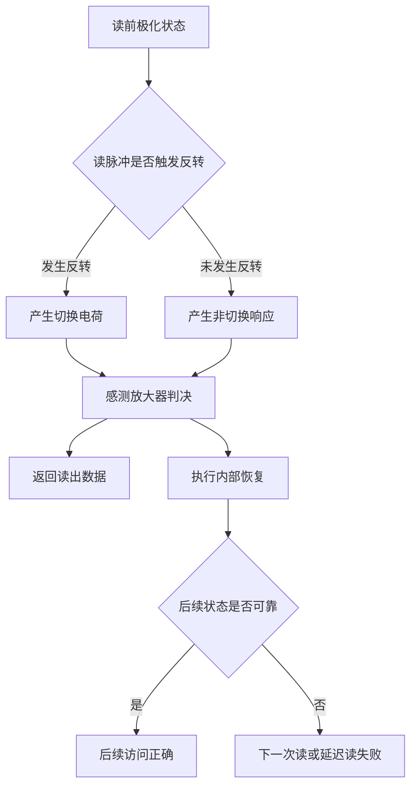
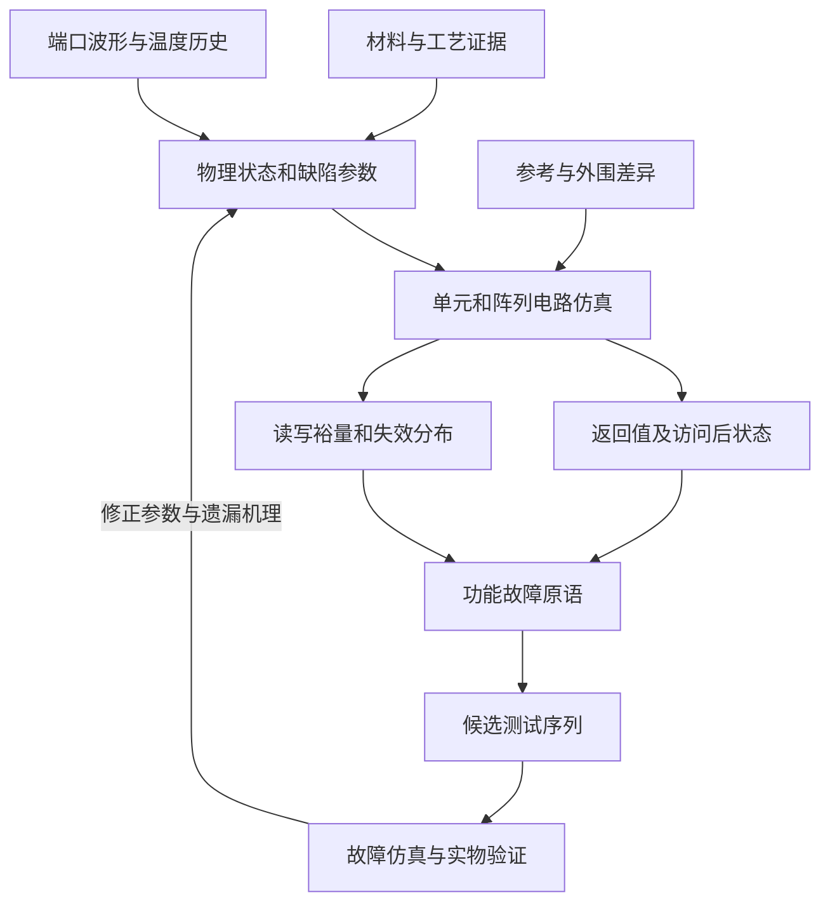

# 铁电存储器的特殊故障、故障建模与 FRAM 测试算法研究

**调研日期：2026年11月1日**  
**重点对象：电容型 FeRAM／FRAM；独立讨论 FeFET，并补充非破坏性读电容结构与非易失 SRAM。**  
**用途：器件与电路故障分析、存储器测试算法研究、MBIST／DFT 方案设计。**

> 文中将三类内容分开：有来源支持的器件现象与实验结果、能够核验操作序列的测试算法、根据这些证据提出的工程建模和测试方案。后者均标明为本文建议。公式使用 Markdown 的 $...$ 与 $$...$$ 格式，示意图保留 Mermaid 源码。

## 内容导航

1. 研究结论与技术范围
2. 电容型 FRAM 的读写机理与故障可观察性
3. 特殊失效机理与逻辑表现
4. 从物理缺陷到可执行故障模型
5. 已发表的 FRAM 测试方法与算法
6. 面向电容型 FRAM 的组合测试方案
7. FeFET 故障模型与专用测试研究
8. MBIST、DFT 和自动化测试平台设计
9. 实验设计、覆盖评价与寿命外推
10. 研究不足、可研究方向与验证路线
11. 适用限制与结论
12. 参考文献与阅读证据

---

## 1　研究结论与技术范围

### 1.1　主要结论

**FRAM 的特殊性主要来自极化状态的演化、读操作中的恢复过程，以及操作历史对后续可读性的影响。** 因而，固定故障、转换故障和一般耦合故障仍需测试，但仅以 SRAM 的二值状态机描述 FRAM，会遗漏读后恢复、印记、延迟相关退化、循环后的保持变化和弱读裕量等问题。[1] [3] [4] [13] [15]

对电容型 FRAM，测试设计至少应考虑五组变量：

- **状态与极性**：原态、反态、最近一次极化方向、部分翻转状态。
- **时间**：写脉宽、读与恢复时序、写前等待、写后等待、相邻访问间隔。
- **应力历史**：制造后初态、预循环、循环耐久、长期同态保存、疲劳后保持。
- **电路条件**：实际电容端电压、位线电容、参考电平、感测放大器偏移、供电与温度。
- **物理作用范围**：目标单元、共享恢复行、共享板线以及半选单元。

这是一套由文献综合得到的建模要求，不是一篇论文给出的统一标准。已有研究分别证明了其中不同维度的重要性：早期 Ramtron 研究强调整行疲劳后保持，2025 年 HZO 研究分析 RAD，2026 年实验进一步关联共享板线半选干扰、唤醒历史与测试。[4] [15] [17]

**不存在可以仅凭名称就认定“覆盖全部 FRAM 特殊故障”的 March 算法。** 在本次取得的证据范围内，成熟做法是将数字功能测试、特定历史序列、裕量测试和可靠性表征组合使用；每部分的覆盖范围应由目标工艺、单元结构和缺陷模型验证。[6] [8] [9] [16] [17]

### 1.2　必须区分的存储结构

| 类别 | 信息保存方式与正常读法 | 本报告中的测试重点 |
| --- | --- | --- |
| 1T1C 电容型 FeRAM | 一个访问晶体管和一个铁电电容；常见结构以切换／非切换电荷判别，并执行恢复 | 读后恢复、参考裕量、极化不足、共享线路干扰 |
| 2T2C 电容型 FeRAM | 两个电容以互补状态存储一个逻辑位，差分读出；常见结构仍有恢复 | 两支路失配、差分裕量、共同退化、半选应力 |
| FeFET 存储器 | 铁电栅层改变晶体管阈值，通常通过沟道电流读取 | 固定极化畴、俘获电荷、阈值漂移、读写扰动、多值状态重叠 |
| 铁电非易失 SRAM，例如 6T4C | SRAM 节点承担普通读写，铁电部分用于保存与恢复 | store／recall、掉电保存、恢复裕量；不能只测试 SRAM 读写 |
| 非破坏性读 FeCAP／铁电电容存储 | 利用状态相关电容等特征，在不主动翻转极化的条件下读出 | 小信号读裕量、寄生电容、状态差异、累积读应力 |
| 铁电隧穿结等其他结构 | 极化调制隧穿或其他输运特性 | 需另建电流／电阻模型，不直接沿用 1T1C 算法覆盖结论 |

前三类之外的结构用于澄清适用范围，不是本文的主要综述对象。1T1C／2T2C 的电路与读测试可参考原始测试电路文献；6T4C 与非破坏性读电容结构分别有独立研究。[7] [29] [37] [38]

特别需要避免“所有铁电电容存储器都只能破坏性读出”的绝对表述。2026 年已有采用非破坏性电容读出的 3D FeRAM 电路研究；但它使用的感测方式和模型与普通电荷翻转式 FRAM 不同。[38]

### 1.3　材料体系不能只按 FRAM 名称合并

**PZT、SBT 和 HfO₂／HZO 不能共用一套未经标定的故障参数。**

PZT 和 SBT 属于较早用于铁电存储的材料体系；HZO 是铪锆氧化物的简称，组分可以变化，本文重点讨论常见的 $Hf_{0.5}Zr_{0.5}O_2$。某些 SBT 电容在规定应力条件下表现出很强的耐疲劳性，但这不等于任意结构、环境与测试条件下都不存在疲劳。[40]

对 PZT 与 HZO 的直接比较已经观察到不同的脉冲历史依赖：所研究 HZO 电容的部分极化写入对写前延迟更敏感，而 PZT 样本表现不同。因此，脉冲序列、初始状态和等待时间应作为材料比较的一部分。[10]

HZO 的循环行为还涉及缺陷分布和相组成变化。不同研究分别强调缺陷迁移、畴钉扎或极性／反极性相变，不能把某一机理当成所有堆栈的唯一解释。[25] [26]

---

## 2　电容型 FRAM 的读写机理与故障可观察性

### 2.1　存储变量是极化，数字接口看到的是电路判决

铁电层在外加场撤去后仍可保持剩余极化。写操作通过电容两端波形改变极化状态；读操作利用两种初始极化状态在相同读激励下产生不同电荷响应，并由外围电路转换为数字输出。[1] [7]

用于电路分析的一种简化表达为：

$$
Q(t)=A P(t)+C_{\mathrm{lin}}V_{\mathrm{FE}}(t)
$$

$$
I(t)=A\frac{dP}{dt}
+C_{\mathrm{lin}}\frac{dV_{\mathrm{FE}}}{dt}
+I_{\mathrm{leak}}(t)
$$

其中，$A$ 为铁电有效面积，$P$ 表示可切换的铁电极化分量，$C_{\mathrm{lin}}$ 表示另外计入的线性介电电容，二者不应重复计数；$V_{\mathrm{FE}}$ 为铁电端实际电压。该式用于说明信号组成；完整模型还需要访问管、寄生、串联介质层和电压分配。

若一次操作充分反转有效极化，切换电荷的量级可近似写作：

$$
Q_{\mathrm{sw}}\approx 2A P_{r,\mathrm{eff}}
$$

读出信号差在简化电荷共享条件下与 $\Delta Q/C_{\mathrm{BL,eff}}$ 成比例。实际值取决于读波形、访问管、板线耦合及位线建立过程，不能直接把电容测试得到的 $2P_r$ 当成宏的读裕量。[7] [20] [24]

### 2.2　正常物理破坏性读不等于逻辑读破坏故障

典型电容型 FRAM 的一次外部读，内部包含感测和恢复。两种逻辑值中，某一极性可能在感测时发生翻转；随后电路按判决恢复数据。具体哪一极性对应“0”或“1”由电路定义，不能跨产品固定。[1] [7]



因此，应分开记录三个结果：

1. 这一次读操作返回了什么；
2. 恢复完成后单元实际处于什么状态；
3. 该状态静置一段时间后是否仍具有足够读裕量。

第一次读正确而恢复不足，可能直到第二次读或读后保持测试才暴露。相反，若感测已经错误，并按错误判决执行恢复，后续读可能稳定地返回错误数据。上述两种路径不能在模型中合并为“读出随机翻转一次”。

### 2.3　读裕量应包含参考与失配

以一种 1T1C 电压感测模型为例，约定：

$$
\text{判为 1}\iff
V_{\mathrm{BL}}-V_{\mathrm{REF}}-V_{\mathrm{OS}}>0
$$

则两个方向的静态裕量可定义为：

$$
M_1=V_{\mathrm{BL},1}-V_{\mathrm{REF}}-V_{\mathrm{OS}}
$$

$$
M_0=V_{\mathrm{REF}}+V_{\mathrm{OS}}-V_{\mathrm{BL},0}
$$

$V_{\mathrm{OS}}$ 是按上述判决方向定义的感放输入偏移。实际通过条件还应考虑噪声与规定采样时刻，不能只检查名义条件下 $M_0,M_1>0$。

对 2T2C，主要判决量是两个存储支路的差分电压或电荷，不能机械套用固定参考单元公式。两支路都退化时，平均信号可能仍较大，而差分裕量已经不足。[7] [17]

**工程含义：** 参数建模至少需要分别保留两极性的切换能力和读出分布；仅记录平均剩余极化会掩盖弱单元、偏移和分布尾部。

### 2.4　一次软件访问不等于一次极化翻转

至少有五种计数需要区分：

| 计数层次 | 含义 |
| --- | --- |
| CPU 或软件访问数 | 程序执行的 load／store，可能命中缓存 |
| 外部接口事务数 | SPI、并行总线或片上总线完成的命令／数据事务 |
| 阵列与物理行访问数 | 内部实际激活的字线、板线、恢复行次数 |
| 电压脉冲与恢复次数 | 电容经历的感测、写入、恢复或半选脉冲数 |
| 实际极化反转数 | 极化确实改变方向的次数，取决于初态与波形 |

Infineon 的 CY15B116QI／CY15V116QI 手册明确说明，其耐久按 64-bit 行的内部访问计算；一次访问单字节或该行全部字节都会涉及整行。Ramtron 更早的试验也因此采用完整行构建疲劳组和对照组。[2] [4]

外部读可能包含感测与恢复两个内部阶段，但不能统一写成“每次读必定等于一次”或“必定等于两次”极化反转。2T2C 中逻辑全 0 也不代表所有物理铁电电容都处于同一极性。

---

## 3　特殊失效机理与逻辑表现

### 3.1　总体分类

| 机理或电路问题 | 主要变化量 | 可能的接口表现 | 优先增加的测试维度 |
| --- | --- | --- | --- |
| 极化疲劳 | 可切换极化、畴活动性、切换时间 | 错读、弱写、间歇失败 | 循环历史、裕量、循环后保持 |
| 印记 | 滞回环偏移、正负矫顽电压不对称 | 单方向写入失败、反态保持失败 | 两极性预老化与反态测试 |
| 去极化／回切 | 写后极化随时间变化 | 延迟相关读错 | 独立等待时间组、首次读 |
| 未充分翻转 | 未完成切换的畴比例 | 转换故障或随机写错误 | 电压、脉宽、写前历史 |
| 读后恢复不足 | 恢复脉冲后的极化和裕量 | 首次读对、随后读错 | 连读、读后等待、恢复时序 |
| RAD | 访问间隔相关的印记／裕量变化 | 一定访问节奏下加速退化 | 间隔、次数与总时长分别控制 |
| 半选／共享板线扰动 | 未选单元的累积应力 | 受害单元错读或弱保持 | 物理板线分组、攻击／受害序列 |
| 唤醒与状态漂移 | 相组成、缺陷分布、可切换比例 | 初态与预循环后表现不一致 | 初态、唤醒后、疲劳后分别测 |
| 参考或感放问题 | 参考偏移、失配、建立时间 | 成组读错误、极性偏好 | 参考扫描、互补背景、模拟观测 |
| 漏电、击穿、接触缺陷 | 泄放电流、串联电阻、短路 | 保持失败、永久失败 | 电流、读写、应力前后比较 |
| 电源与恢复控制问题 | 操作中断、脉冲缩短、错误判决 | 读写中断后数据错误 | 掉电相位与规格内电源时序 |
| FeFET 特有问题 | 局部畴、阈值及陷阱电荷 | 中间态、阈值漂移、多值混淆 | 专用器件模型与读参考测试 |

该表是跨文献的分类整理；每行不是与某个逻辑故障一一对应的标准定义。主要依据见 [3] [10]–[18] [25] [26] [29]–[31]。

### 3.2　极化疲劳：循环后可读性变化

疲劳通常指反复电场循环后可切换极化或有效存储裕量下降。它可能关联畴钉扎、界面变化、带电缺陷迁移与生成，也可能与相变有关；不同材料、电极和应力协议下不能只使用一种解释。[25] [26]

其测试难点在于：退化初期数字读写仍可能正确。随着可切换电荷减少或切换速度变慢，失败可能先出现在低电压、短脉宽或不利参考条件下，而不是立即变成永久固定值。[16] [24]

**疲劳与保持不能独立假设。** 1998 年对当时产品的研究观察到保持随循环退化；2025 年 TI 开发经验总结则报告其所述 PZT 产品循环后保持可保持稳定，某些裕量还会改善。两者对应不同产品和工艺，并非应当用一句普遍单调规律消除的“矛盾”。[4] [9]

建模时，应把“循环后的实测变化”作为待标定行为。用一个随循环数始终递减的 $P_r(N)$ 可以构成局部经验模型，但只有数据支持的阶段才有效。

### 3.3　印记：偏好原态，削弱反态

印记可表现为极化回线沿电场／电压轴偏移，或两种极性的切换难度不对称。直观表现是：长时间保持的原态容易保留，而改写到相反状态时更难获得足够裕量。[1] [5] [13]

因此，“写入 0—烘烤—读取仍为 0”不能单独证明器件通过印记测试。还应检查同样历史之后写 1、读 1，以及 1 的后续保持，并交换两种极性。

可用如下量刻画偏移，前提是正负矫顽电压按同一测量条件提取：

$$
V_{\mathrm{bias}}=\frac{V_c^++V_c^-}{2},
\qquad
V_{\mathrm{halfwidth}}=\frac{V_c^+-V_c^-}{2}
$$

其中 $V_c^-$ 为带符号的负向矫顽电压，$V_{\mathrm{halfwidth}}$ 为正负矫顽电压间距的一半。偏移与矫顽电压半宽是不同维度；两者应分别进入模型。[27] [28]

印记也不宜一律称为“绝对不可恢复”。某一厂商文档所说的冷却后不消失，与通过改变脉冲历史能否部分恢复是不同问题。测试报告应说明所观察到的恢复操作和条件，不用恢复现象推断缺陷已经永久消除。

### 3.4　保持损失、短时回切与读出困难

保持失效可以来自保存状态本身发生变化，也可以来自给定读波形无法再充分读出该状态。

- **极化回切或去极化**：内部场、屏蔽不充分等因素使部分极化在写后返回。
- **读出受阻**：保存期间形成的内部偏置，使既定读脉冲下的切换电荷不足。
- **长期退化**：电荷注入、材料变化或其他过程改变后续写入与读出能力。

这些情况可能都表现为“等一段时间后读错”，但模型和诊断手段不同。HZO 保持模型和切换动力学研究已经明确关联印记、内部场与读出失败；2026 年 IRPS 研究进一步在所研究平面／沟槽器件中区分了可逆热辅助变化和长期电荷注入退化。[14] [18] [24]

短时保持不能由长期烘烤直接替代。改进 PUND 研究专门观察写后较短时间内的极化损失，说明写后立即、短延迟和长期保持属于需要分辨的测量区间。[11]

### 3.5　未充分翻转与历史相关写入

一个固定脉宽不一定使所有畴完全翻转。电容端实际场强、访问管压降、分布尾部、温度以及已有内部场都可能改变切换完成程度。[10] [21] [23]

数字层面可能出现三种不同结果：

1. 写后立即失败；
2. 写后立即通过，但裕量较小；
3. 写后立即通过，等待后失败。

后两种情况说明不能只用二值“写成功／失败”描述。更合适的中间状态是保留极化比例、切换电荷或等效读裕量，再由读电路决定是否形成逻辑错误。

提高电压或加长脉冲可能改善某一写入问题，也可能改变注入电荷和其他应力，因此它们是需要研究的控制变量，不是对所有故障都有效的通用修复。

### 3.6　读后恢复不足与错误恢复

读后恢复相关问题至少应分为：

| 类型 | 当前读输出 | 恢复后的状态 | 适合的观察方式 |
| --- | --- | --- | --- |
| 判决正确、恢复逻辑错误 | 可能正确 | 错误逻辑态 | 紧接着再读 |
| 判决正确、恢复幅度不足 | 正确 | 逻辑态暂时正确但裕量偏小 | 延迟读、裕量读 |
| 感测判决错误并错误恢复 | 错误 | 可能被固定成错误态 | 保存首次读与后续结果 |
| 恢复时序受电源／控制影响 | 依发生相位而定 | 部分或错误极化 | 相位扫描与内部波形观测 |

这是依据读恢复电路过程作出的工程分解。数字故障注入至少要支持“返回值”与“访问后的持久状态”分开指定，否则无法复现第一种故障。

### 3.7　RAD：访问间隔相关的加速裕量损失

2025 年《Root cause of read after delay in ferroelectric memories》研究 HfO₂ 电容型 FeRAM 的 RAD：退化与相邻“读—回写”周期之间的空闲间隔有关，其变化不能只用总循环数概括；这里并非指人为延迟一次读内部的回写。作者结合电测与 SPICE 电荷迁移模型，将其与读后恢复重新建立的去极化场、体电荷迁移及印记联系起来。[15]

**对测试的直接启示是同时保留操作次数和时间轴。** 只做最高频率的连续循环，或者只做一次很长的静态保持，均不能据此推定中间访问节奏的结果。

本文建议在研究阶段设计两组互补比较：

- 固定总时长，改变访问间隔，观察不同访问次数下的裕量变化；
- 固定访问次数，改变访问间隔，并用独立静置对照辨认额外时间造成的影响。

这是从论文机理推导的实验设计，不是声称论文公开了一条通用 RAD March 算法。

这里的电容型 FeRAM RAD，不应与 FeFET 文献中的 read-after-write delay 等现象只因名称相近而合并。后者还涉及晶体管阈值和陷阱电荷的瞬态。

### 3.8　半选与共享板线扰动

未被数字地址选中的单元，仍可能通过共享板线和寄生耦合承受电压。特别是浮置节点的电容分压，可能使小于充分翻转条件的重复脉冲累积改变受害单元状态。

2026 年 ISSET 研究对 2T2C 阵列进行了实验，关联了浮置位线、共享 PL、累积亚矫顽应力与唤醒阶段。严重应力下出现的特定 0x55 读出特征，被作者用于提出初步 March-PL 筛选方法。[17]

**0x55 不是所有 FRAM 半选故障的固定输出。** 它与该实验中的差分失配和位排列有关。实际测试必须包含数据极性、物理位置与板线共享关系，不能把“地址加一”自动等同为物理最近邻。

### 3.9　唤醒、非单调变化与测试前处理

唤醒通常表现为初始循环后可切换极化增加或回线形状改变。它不等于逻辑故障，但会改变检测灵敏度和后续应力响应。[25] [26]

测试前先执行大量读写，可能已经改变本来希望检查的制造后状态。因此建议分别保留：

- 制造后或规定初始化后的原始状态；
- 明确循环次数与波形后的状态；
- 较长循环应力后的状态。

预循环能否使用、次数多少，应由工艺和产品定义决定。不能为了让数据更整齐而把不稳定初态从结果中删除。

### 3.10　外围、工艺与环境问题仍然重要

接触开路、桥接、访问管异常、字线／板线驱动问题、感放偏移与参考退化并非铁电材料独有，但会通过铁电读写过程产生特定表现。例如访问管电阻增加可能表现为脉宽不足，而参考漂移可能使整列或多个行组同时错读。[6] [7]

早期 PZT 工艺还特别关注含氢环境对铁电与电极界面的影响；NASA 的商用器件实验也说明，铁电材料本身的环境耐受能力不能代表外围 CMOS 或整颗产品的耐受能力。[3]

电源中断应依据具体器件约束研究。TI 的特定 MSP430 FRAM 实现明确设计了完成在途恢复的供电保护；这一事实不能反推任意新宏在任意掉电波形下都安全，也不能先验认定商业 FRAM 一掉电就丢数据。[1]

---

## 4　从物理缺陷到可执行故障模型

### 4.1　三层模型应相互连接



推荐分层如下：

| 层次 | 主要对象 | 合理用途 | 不宜直接推出的结论 |
| --- | --- | --- | --- |
| 器件／材料层 | 畴、极化、陷阱电荷、内部场、相比例 | 解释脉冲与历史依赖 | 整个存储宏的数字覆盖率 |
| 电路／阵列层 | 访问管、BL／PL、参考、恢复、寄生 | 得到实际读写及弱裕量行为 | 未模拟缺陷的必然可测性 |
| 功能／测试层 | 操作序列、读结果、访问后状态 | 算法生成、故障注入、MBIST验证 | 无校准依据的材料寿命 |

FeFET 的 Device-Aware Test（DAT，考虑器件特性的测试）工作采用了类似思路：先将特殊缺陷引入器件模型，再提取功能故障并设计测试。对电容型 FRAM 也可采用这条方法路线，但必须替换为其自身的电容与恢复模型。[29] [30] [31]

### 4.2　带历史的状态表达

以下是本文建议的统一接口，不是标准化的 FRAM 物理方程：

$$
\mathbf{x}_{k+1}
=
F\!\left(
\mathbf{x}_k,\,
V_{\mathrm{FE}}(t),\,
T(t),\,
\Delta t_k,\,
\mathbf{d}
\right)
$$

$$
y_k=
G\!\left(
\mathbf{x}_k,\,
u_k,\,
\theta_{\mathrm{sense}},\,
\theta_{\mathrm{array}}
\right)
$$

其中：

- $\mathbf{x}$：畴状态、俘获电荷、印记偏置、可切换比例、循环阶段等内部状态；
- $\mathbf{d}$：制造缺陷或退化强度；
- $u_k$：读、写、等待、恢复等操作及其波形；
- $\theta_{\mathrm{sense}}$：参考、感放偏移与噪声；
- $\theta_{\mathrm{array}}$：寄生、共享线路与邻单元状态；
- $y_k$：本次读返回值，也可以扩展为电流、电压与裕量观测。

对破坏性读结构，$G$ 的输出与读后 $F$ 的状态更新都必须执行。两者在代码中不宜压缩为单一“read 返回当前 bit”函数。

### 4.3　常用物理与紧凑模型的分工

#### 4.3.1　Landau–Khalatnikov 模型

一种统一系数约定下的自由能密度为：

$$
f(P)=
\frac{\alpha}{2}P^2+
\frac{\beta}{4}P^4+
\frac{\gamma}{6}P^6-
E_{\mathrm{eff}}P
$$

相应动力学可写为：

$$
\rho\frac{dP}{dt}
=
E_{\mathrm{eff}}-\alpha P-\beta P^3-\gamma P^5
$$

它适合连接自由能、迟滞和动态电路。实际拟合需说明系数约定、有效场定义及适用范围；单一均匀极化变量不会自然包含真实多晶粒分布、随机切换和长期缺陷迁移。[22]

#### 4.3.2　Preisach 模型

Preisach 方法把总响应表示为具有不同正负切换阈值的基本迟滞单元的加权叠加。它适合描述主回线、局部回线和电压历史。经典准静态版本缺少显式切换时间，不能单靠阈值分布准确判断纳秒脉冲是否完成写入。[20]

2026 年的非对称模型进一步处理分支斜率、矫顽电压不对称、印记偏移与低压局部回线，并提供 Verilog-A 实现；它改善电路读写裕量预测，但并未因此自动形成完整寿命模型。[28]

#### 4.3.3　NLS 与切换时间分布

Nucleation-Limited Switching（成核受限切换，NLS）以不同区域的切换动力学分布表示宏观极化变化。[21]

用于说明这一类模型的归一化形式为：

$$
f_{\mathrm{sw}}(t)
=
\int
\left[
1-\exp\left(-\left(\frac{t}{\tau}\right)^n\right)
\right]
g(\ln\tau)\,d\ln\tau,
\qquad
\int g(\ln\tau)\,d\ln\tau=1
$$

其中 $\tau$ 为局部特征时间，$n$ 为所选模型参数，$g$ 为时间分布。此式适用于指定初态和激励条件下的单向切换描述；任意双极历史需要额外状态更新规则。

常见 Merz 关系的形式为：

$$
\tau=\tau_0\exp\left(\frac{E_A}{E_{\mathrm{app}}}\right)
$$

这里取 $E_{\mathrm{app}}>0$，表示沿目标翻转方向的驱动场幅值，不能直接代入带符号的负场。$E_A$ 的量纲是**电场**，应称为激活场，不能因符号 $E$ 而误写为能量。实际内部场、温度与缺陷会改变拟合关系，不能把该式当成跨工艺通式。[23]

#### 4.3.4　随机模型与可靠性外层

2026 年的随机 Preisach 研究把迟滞单元与 NLS 型时间动力学结合，并用 HZO 实验及 1T1C 集总电路说明其用途。这为任意波形和历史依赖建模提供了更合适的方向。[27]

然而，切换模型仍需外加经标定的可靠性状态，例如：

$$
\frac{dq_t}{dt}
=
R_{\mathrm{capture}}-R_{\mathrm{emission}},
\qquad
E_{\mathrm{imp}}=H(q_t,n_{\mathrm{defect}},\ldots)
$$

这些只是待确定的模型接口。捕获／释放速率、缺陷生成和相变规则必须依据数据选取；没有数据时，应称为**参数化缺陷注入模型**，不输出确定的十年寿命或失效率。

### 4.4　功能故障原语及其含义

本文采用：

$$
\mathrm{FP}=\langle S/F/R\rangle
$$

其中 $S$ 表示初态与使故障出现的操作序列，$F$ 表示该序列后的实际状态，$R$ 表示最后一次读的返回值；无读时用“—”。令 $b\in\{0,1\}$，$\bar b=1-b$，$r_b$ 表示期望读到 $b$。[19]

| 功能模型 | 示例 | 含义 |
| --- | --- | --- |
| 转换故障 TF | $\langle 0\,w_1/0/\text{—}\rangle$ | 写 1 后仍为 0 |
| 同值写破坏 WDF | $\langle b\,w_b/\bar b/\text{—}\rangle$ | 重写相同值反而改变状态 |
| 错误读 IRF | $\langle b\,r_b/b/\bar b\rangle$ | 返回值错误，但最终状态仍为原值 |
| 读破坏 RDF | $\langle b\,r_b/\bar b/\bar b\rangle$ | 返回值错误，最终状态也错误 |
| 欺骗性读破坏 DRDF | $\langle b\,r_b/\bar b/b\rangle$ | 返回值正确，最终状态已经错误 |
| 动态读破坏 | $\langle b\,r_b^k/\bar b/R\rangle$ | 经指定连续读历史后才产生异常 |
| 耦合故障 | 攻击单元操作；受害单元状态变化 | 需要明确两个单元的状态与操作关系 |

这些是功能描述，不是铁电机理名称。一个极化疲劳问题可能表现为 TF、IRF、DRDF 或只表现为弱裕量；同一功能原语也可能由不同物理缺陷导致。

**原语适用条件必须附在模型之外或作为扩展字段保存。** 建议至少记录：

$$
\mathcal{F}=
\bigl(
\mathrm{FP},\,
T,\,
V,\,
t_p,\,
t_{\mathrm{gap}},\,
N_{\mathrm{history}},\,
\text{physical scope}
\bigr)
$$

否则，只有在特定等待或重复次数下发生的故障会被误认为普通静态故障。

### 4.5　一个说明 March C− 漏检的最小例子

下面为**本文构造并用简单状态仿真核验的教学模型**，不代表某颗实测芯片：

- 显式写 0、写 1 都正常；
- 读 0 正常；
- 读 1 返回正确的 1，但内部恢复失败，使持久状态变为 0。

这对应 $\langle 1\,r_1/0/1\rangle$。March C− 中的 `r1,w0` 会出现：

| 步骤 | 操作 | 返回值 | 操作后状态 | 是否立即报错 |
| --- | --- | --- | --- | --- |
| 1 | 初态已写为 1 | — | 1 | 否 |
| 2 | r1 | 1 | 0 | 否 |
| 3 | w0 | — | 0 | 否 |

算法随后按 0 检查时仍然通过。对该模型完整执行 10 个单地址 March C− 操作也不会报错。

若改为 `w1,r1,r1`，第一次 r1 返回 1 后将状态破坏，第二次 r1 返回 0，错误即可观察。**这说明“本次读后立即写另一值”可能覆盖掉恢复故障证据。**

该例只证明某个故障可以逃过某个序列，不表示连续读能覆盖所有 FRAM 故障。若第 $k$ 次读才破坏状态且仍返回旧值，通常还需第 $k+1$ 次读才可观察。

### 4.6　模型标定和验证的必要步骤

本文建议采用以下顺序：

1. 用无缺陷器件数据标定基本回线、短脉冲切换、电流与读电路。
2. 分别注入接触／互连缺陷和铁电特有参数变化，避免用一个电阻代替所有材料问题。
3. 对初态、极性、等待、脉宽与电压做受控扫描，记录首次异常及访问后状态。
4. 抽取功能故障与弱裕量条件，形成可重复的故障实例。
5. 对候选算法做故障仿真，并在未参与拟合的数据和器件上验证。
6. 记录未解释样本与模型不适用区域，保留参数版本和原始测量。

若只能取得数字接口，应将结果定位为功能行为模型；若可访问内部参考或模拟节点，才可以进一步校准物理与电路参数。


---

## 5　已发表的 FRAM 测试方法与算法

### 5.1　March 表达与复杂度约定

本报告统一使用以下符号：

| 符号 | 含义 |
| --- | --- |
| $\uparrow$ | 地址递增 |
| $\downarrow$ | 地址递减 |
| $\Updownarrow$ | 任一预先确定的遍历方向 |
| $w_0,w_1$ | 写入逻辑背景 0 或 1 |
| $r_0,r_1$ | 读取并与期望背景比较 |
| 分号 | 一个 March 元素完成全地址遍历后，再执行下一元素 |
| $r_b^n$ | 在当前地址连续执行 $n$ 次期望值为 $b$ 的读 |
| $N$ | 被测的可寻址字数；按位建模时可取单元数 |

括号内操作在**同一地址**按顺序执行，完成后再改变地址。字组织存储器中，$w_0$ 和 $w_1$ 通常表示全 0 与全 1 字背景；它们不能自动覆盖字内全部位对关系。

操作复杂度只计算接口读写次数。内部恢复、总线开销、等待、温度切换及电源过程另行计算。

### 5.2　March C−、March C+ 与 March RAW

常见 March C− 为：

$$
\begin{aligned}
\{&
\Updownarrow(w_0);\\
&\uparrow(r_0,w_1);\\
&\uparrow(r_1,w_0);\\
&\downarrow(r_0,w_1);\\
&\downarrow(r_1,w_0);\\
&\Updownarrow(r_0)
\}
\end{aligned}
$$

操作数为：

$$
(1+2+2+2+2+1)N=10N
$$

March C+ 在中间元素增加写后读取：

$$
\begin{aligned}
\{&
\Updownarrow(w_0);\\
&\uparrow(r_0,w_1,r_1);\\
&\uparrow(r_1,w_0,r_0);\\
&\downarrow(r_0,w_1,r_1);\\
&\downarrow(r_1,w_0,r_0);\\
&\Updownarrow(r_0)
\}
\end{aligned}
$$

其操作数为 $14N$。March RAW 进一步包含同值重写和连续读，常见形式为 $26N$。[19]

| 算法 | 在 FRAM 流程中的合理用途 | 需要另外补充的条件 |
| --- | --- | --- |
| March C− | 基础地址、固定、转换及相应耦合故障筛查的起点 | 恢复、等待、模拟裕量、长期历史 |
| March C+ | 增加写后读，改善部分功能故障的可观察性 | 动态重复次数与器件条件 |
| March RAW | 检查更丰富的读写连续操作关系 | 长间隔、半选拓扑、印记与疲劳 |
| 专用重复读段 | 针对某类读后状态变化或累计读故障 | 两种极性、阈值次数、额外观察读 |

覆盖声明应始终附带所采用的功能故障集合。例如第4.5节已经给出一个 March C− 漏检的具体恢复故障；不能因为某个算法在一般 SRAM 故障集合上表现良好，就将其覆盖结果直接用于 FRAM。

### 5.3　Dynamic-RAWC：可配置动态测试的借鉴

蔡志匡等在2023年提出 Dynamic-RAWC，结合 March RAW、重复操作和其他测试元素，允许在测试时间与动态故障检测之间调整。原文提供 RAWC1／RAWC2 等模式；该论文属于一般存储器动态测试研究，本身不是所有铁电失效机理的实物覆盖证明。[19]

可核验的 RAWC1 完整模式为：

$$
\begin{aligned}
\{&
\Updownarrow(w_0);\\
&\uparrow(r_0,w_0,r_0^n,r_0,w_1,r_1);\\
&\uparrow(r_1,w_1,r_1^n,r_1,w_0,r_0);\\
&\downarrow(r_0,w_0,r_0,r_0,w_1,r_1);\\
&\downarrow(r_1,w_1,r_1,r_1,w_0,r_0);\\
&\Updownarrow(r_0)
\}
\end{aligned}
$$

按元素求和：

$$
C_{\mathrm{RAWC1}}
=
[1+(5+n)+(5+n)+6+6+1]N
=(24+2n)N
$$

原文表中还列出切换到 March C+ 的 $14N$ 模式。**$14N$ 与 $(24+2n)N$ 是不同配置，不应合并为同一序列的两个“等价复杂度”。** 连续读指数 $n$ 也不是该元素总读数，因为元素中还有其他读取。[19]

原刊表3给出的参数范围为 $0<n<10$，对应整数1—9；超出该范围的配置属于进一步推广，需要单独验证控制器和故障覆盖。[19]

2025 年的 FeRAM FPGA 平台研究采用了可配置 MBIST，并展示 Dynamic-RAWC 对注入的 $dRDF^n$、$n=4$ 的检测。需要分开看待两项证据：RTL 故障注入验证控制器能执行并观察该模型；实物实验用于研究 FeRAM 疲劳。前者不能等同于实物全部动态故障覆盖。[16]

### 5.4　同态／反态诊断与印记测试

Ramtron 的1997年专利提出了同态与反态诊断思路，TI 的官方可靠性资料也描述了含两种极性和热应力的保持流程。[1] [5]

其共同思想可概括为：

1. 写入背景 $B$；
2. 在规定条件下保持或加速老化；
3. 读 $B$，评价同态可读性；
4. 写入互补背景 $\bar B$；
5. 经过规定等待或热应力；
6. 读 $\bar B$，评价反态写入和保持；
7. 交换初始极性，重复评估。

不同原文的具体步骤与应力参数并不完全相同。这里是方法归纳，不是逐字复刻某项专利的全部权利要求。

该方法的优势是能揭示原态仍稳定时隐藏的反态弱点；局限是等待和热应力占用时间，而且一次同态读取也会执行恢复，因此必须严格定义后续历史。

### 5.5　疲劳后保持测试

Dalton 与 Hadnagy 的1998年工作针对当时产品，在共享底电极的整行上反复写互补数据，再比较疲劳与未疲劳区域的保持结果。选择整行，是为了避免一次局部访问引发全行 read／restore，使所谓“未疲劳字节”也实际受到了应力。[4]

可迁移的实验原则是：

- 以真实内部作用范围划分应力组；
- 保留独立对照；
- 循环后测保持和反向改写能力；
- 保存失败位置，辨认成组与局部问题。

循环数、温度、电压和合格阈值仍须按目标工艺定义。某个旧器件的疲劳后保持曲线不能作为新 HZO 宏的寿命模型。

### 5.6　裕量测试与弱单元筛选

直接数字读写只有通过／失败两个结果，无法完整区分“裕量充分”和“刚好通过”。

早期 FRAM 测试专利已经提出减小写／读电压、缩短脉冲、改变参考或感放条件等方式，用较严格条件筛出潜在弱单元。另有测试电路将内部读信号转换为可测量输出；TI 后续专利则将参考扫描与已知老化退化相结合，进行可靠性筛选。[6] [7] [8]

这些方法的共同要求是：**必须用目标工艺数据校准筛选条件。** 过宽会漏检，过严会误剔除正常单元；未经标定的“低电压还能读”不能直接证明长期保持。

对数字接口封装器件，能调整的可能只有外部电源、访问节奏与温度。内部板线、恢复脉冲和参考未必对用户开放，不能把宏级 DFT 方法写成普通 SPI 命令。

### 5.7　PUND 与改进 PUND：为故障建模提供测量基础

PUND 是器件级脉冲测量方法。一个常见序列在预置极化后施加：

| 脉冲 | 方向 | 主要作用 |
| --- | --- | --- |
| P | 正向 | 由预置反态切换到正态 |
| U | 正向 | 在同向状态下获得非切换响应 |
| N | 负向 | 切换到负态 |
| D | 负向 | 在同向状态下获得非切换响应 |

通过同极性两次电流的差分估计切换电荷，例如：

$$
Q_{\mathrm{sw},+}
\approx
\int \left[I_P(t)-I_U(t)\right]dt
$$

这个差分成立需要脉冲和非切换分量具有可比性。漏电、RC 延迟、陷阱动态及未充分翻转会破坏理想抵消，必须进行校准。[11] [12]

改进 PUND 可在脉冲组之间插入零电压等待，测量回切部分，帮助把写入不足与写后极化损失分开。[11]

**PUND 与 March 处于不同层次。** 前者为物理模型提供输入，后者遍历存储地址并检查功能行为；普通数字 MBIST 不具备直接施加任意 PUND 波形的能力。

### 5.8　TRPP：从封装阵列间接观察退化

Liao 等在2025年提出 Time-Resolved Polarization Probing（TRPP），用 FPGA 平台和可调时序间接刻画 FeRAM 切换动力学退化。论文摘要报告了约53 ps的时序调节分辨率，并展示了应力至 $10^9$ 次过程中的变化和低电压敏感性。[16]

需要保留三点限定：

- 时序发生器的分辨率不等于 FRAM 的实际访问时间或材料测量精度；
- 端口时序代理量受到外围控制、寄生和接口的共同影响；
- 从该量推断内部极化，需要所述模型与校准，不能当作直接测得每个电容的 $P_r$。

其研究价值在于将数字测试平台与可靠性参数表征联系起来，适合启发 FPGA／ATE 的测试架构。

### 5.9　RAD 与 March-PL 的证据范围

| 方法／研究 | 已核验的贡献 | 本次未核验的内容 |
| --- | --- | --- |
| RAD机理研究，2025 | 访问间隔相关裕量退化、体电荷迁移与印记解释 | 可直接复用的统一 March 元素与全故障覆盖 |
| March-PL，2026 | 共享PL半选干扰实验、唤醒依赖、初步筛选思路 | 完整算法串、重复次数、复杂度与全面覆盖证明 |
| 快速保持模型，2022 | 特定HZO样本的物理保持模型和约1 h快速表征研究 | 对任意FRAM的免标定长期寿命认证 |

因此，第6章给出的 RAD 和板线测试是**本文提出的工程序列框架**，不会冠为上述论文的原始算法。[14] [15] [17]

---

## 6　面向电容型 FRAM 的组合测试方案

> 本章为基于前述证据的工程设计。T0—T8 是本文为了组织方案使用的编号，不是文献中的标准算法名。实际参数应由宏规格、模型标定与硅验证确定。

### 6.1　测试模块与作用

| 模块 | 目标 | 关键控制项 | 主要输出 |
| --- | --- | --- | --- |
| T0 基础功能 | 地址、固定、转换、部分耦合故障 | 遍历方向、字内外背景 | 失败地址和位 |
| T1 读与恢复 | 隐藏读破坏、恢复不足、累计读异常 | 连读数、间隔、两极性 | 首次失败次数、延迟敏感性 |
| T2 静态保持 | 无访问期间的状态可读性 | 实际保持时长、温度、供电状态 | 首次读结果、位图 |
| T3 印记 | 原态预老化后的反态能力 | 原态、老化、反态写与保持 | 同态／反态差异 |
| T4 RAD | 访问节奏相关退化 | 次数、周期、空闲间隔 | 裕量对时间和访问节奏的变化 |
| T5 板线与半选 | 共享结构造成的受害单元异常 | 物理群组、攻击图案、应力次数 | 受害单元首次失败与空间分布 |
| T6 裕量 | 数字仍正确的弱单元 | 参考、脉宽、电压、温度 | 通过区域及分布尾部 |
| T7 循环与后保持 | 历史引起的可靠性变化 | 循环阶段、对照组、后保持 | 退化轨迹、寿命样本 |
| T8 电源与控制 | 在途读写／恢复的完整性 | 电源相位、斜率、恢复完成条件 | 操作相位相关错误 |

T0／部分T1／经校准的T6适合成为较短的生产筛选；较长T2／T3／T7主要用于工艺表征与资格验证；T4／T5用于验证访问历史和阵列结构相关风险。不能让每颗出厂器件都耗尽标称耐久来“验证寿命”。

### 6.2　T0：基础功能与数据背景

以 March C− 或经过目标缺陷仿真选定的其他 March 序列作为基础。建议同时考虑：

- 全 0、全 1；
- 棋盘图案及互补图案；
- 行条纹、列条纹；
- 地址相关图案；
- 字内 walking-1／walking-0 或经覆盖分析选取的字内背景。

背景应由**逻辑字、物理位排列与2T2C互补关系**共同解释。仅按字节写 0xAA／0x55，不必然得到物理阵列的棋盘分布。

基线测试还应确认测试确实到达目标数组：缓存、镜像、行缓冲、写合并和编译器优化都可能改变实际访问。可采用宏测试端口、规定的非缓存访问或可观测总线事务确认。

### 6.3　T1：连续读与恢复后保持

最小的双极性连续读测试框架为：

```text
for b in {0, 1}:
    for each tested address a:
        write(a, b)
        repeat k + 1 times:
            read_and_compare(a, b)
            record first failure without replacing its evidence
```

这里把最多 $k$ 次读作为可能的故障形成历史，第 $k+1$ 次读用于观察最后一次操作后隐藏的状态变化。实际每次读都比较输出。

按上述伪代码，单一配置的操作数为：

$$
C_{\mathrm{T1}}=2(k+2)N
$$

其中每个极性包含一次写和 $k+1$ 次读。该计数不包括附加背景、间隔扫描和诊断。

恢复幅度不足还可能需要：

$$
w_b\ ;\ r_b\ ;\ \mathrm{WAIT}(\Delta)\ ;\ r_b
$$

第一次读执行正常恢复，等待后的读检查该恢复状态是否能继续保持。应采用独立初始化比较不同 $\Delta$；不能把同一单元反复读得到的多个点解释成完全未受干预的一条保持曲线。这里的逻辑初始化不能自动消除已有疲劳、印记或陷阱状态，比较组还需匹配预循环和老化历史。

### 6.4　T2：静态保持与首次读

基本框架为：

```text
select a cohort with no unintended shared-row accesses
program the chosen background
define the start time after the last programming/restoring event
hold at the specified temperature and power state
capture the first read result at the target age
only after that, perform optional rewrite or diagnostic reads
```

实际每个地址的保持时间为：

$$
t_{\mathrm{ret},i}
=
t_{\mathrm{first\ read},i}
-
t_{\mathrm{last\ program/restore},i}
$$

批量写完、统一等待、再批量读取时，各地址不一定具有相同 $t_{\mathrm{ret},i}$。若测试时间与目标等待量级相近，应记录逐地址或逐行时间，或者安排受控的写读次序。

用于不同等待点的样本最好按独立物理恢复组划分。读取同一恢复行中的另一地址，也可能改变目标单元历史，不能只检查软件有没有读取目标字节。分组还需排除或单独控制共享板线带来的半选应力；物理组隔离不自动意味着统计独立。若映射或内部行为不可核验，可采用独立器件终点对照，并说明首读结论依赖的假设，具体见第10.5节。

若一次访问会恢复整行，而接口每次只返回一个字节，后续字节又需要重新激活该行，则后续结果已受到第一次访问影响，不能都计为“未受干预的保持首读”。若宏在首激活时已锁存整行原始结果，并能继续导出同一次锁存的数据，则应按实际宏行为保留这些原始结果。其他情况下，可采用每轮独立保持实验只观测恢复组中的一个地址并逐轮轮换，或明确将结论限定于真正首读可观察的地址集合。此限制同样适用于 T3、T5。

### 6.5　T3：印记与反态测试

推荐实验结构为：

```text
for initial_background B and its complement:
    initialize an independent cohort
    program B
    age in B under the selected conditions
    capture same-state first-read result
    program complement(B) with the specified normal write
    hold for the selected opposite-state interval
    capture opposite-state first-read result
    then perform diagnostic margin or rewrite experiments
```

应分别报告：

- 同态是否仍可读；
- 反态能否立即写入；
- 反态等待后是否可读；
- 同态与反态的参考／电压裕量差异。

若需要把“反态写入不足”与“反态保持损失”分开，立即读和等待后读宜使用独立组，或明确记录立即读带来的恢复影响。该设计继承同态／反态诊断思想，但不直接采用某篇文献的温度时间作为通用规格。[1] [5]

### 6.6　T4：RAD访问间隔扫描

一组基本试验可定义为：

```text
initialize a selected physical group with background B
for j in 1..K:
    idle for gap[j]
    perform a normal completed read, including internal restore
    capture output and timing
at the scheduled endpoint:
    idle for the specified endpoint gap
    capture the chosen margin indicator during the first read
```

关键是保持每次正常读内部的恢复过程符合宏要求，扫描的是**相邻完整访问之间的空闲间隔**。

至少需要保存以下独立量：

$$
K,\quad
t_{\mathrm{gap}},\quad
t_{\mathrm{cycle}},\quad
t_{\mathrm{total}},\quad
T,\quad
V,\quad
B
$$

总时长固定时，操作次数随间隔变化；次数固定时，总时长随间隔变化。两类实验解决不同问题，不能将其中一种曲线直接解释为“纯频率效应”。此外，采样裕量的额外读也属于应力历史。

终点裕量应在目标间隔后的首次读中采集。若测量一个裕量点就会恢复状态，则每个扫描点必须重建匹配历史，或改用独立且历史匹配的样本；不能将刚完成恢复后的连续参考扫描当成目标 RAD 间隔下的首读裕量。

### 6.7　T5：共享板线与半选干扰

以下为本文提出的拓扑驱动框架，不是复原的 March-PL 原文：

```text
for each physical plate-line group G:
    choose aggressor A and victim set V
    initialize victims to pattern B
    initialize the remaining cells to a controlled background

    repeat K times:
        write A with pattern C
        write A with complement(C)
        do not read the victim set during this exposure

    capture first-read results of V
    repeat with complementary victim data and exchanged roles
```

还应比较相同板线／不同板线、不同位线关系与不同预循环阶段。若硬件写入本身会访问或恢复整行，则需按实际电路重新定义攻击与受害集合，不能继续假定受害单元完全未被访问。

初始化其他单元也可能经共享板线影响已写好的受害单元。因此，初始化次序属于规定历史；无额外攻击的对照组应执行相同初始化，以分离初始化应力与正式 $K$ 轮攻击的作用。

覆盖范围取决于选取的攻击／受害关系。抽样若只包含部分位置，结论就限于这些位置，不能按固定 $O(N)$ 名义复杂度声称覆盖全部可能的单元对。

### 6.8　T6：读写裕量扫描

先定义目标：

- 写裕量：在指定初态和写条件下能否形成稳定状态；
- 读裕量：已知状态在参考、读电压和采样条件变化时是否能可靠判别；
- 恢复裕量：读后恢复的状态是否仍足够稳定。

参考扫描得到的失败点不能只作为一个平均值。应保留不同极性、行列、循环阶段与温度下的分布尾部。

扫描本身可能通过读恢复改变状态。因此，宜在每个测量点重新建立规定历史，或使用独立样本。不能把连续多次扫描后更好的数据当成同一初态的真实表现。

“重新建立历史”包括相关的预循环、同态老化与等待条件，不能简化成一次逻辑重写。

### 6.9　T7：循环、保持与顺序交互

建议至少保留四类试验组：

| 组别 | 历史 | 作用 |
| --- | --- | --- |
| A | 初始状态→保持 | 建立基准 |
| B | 规定循环→保持 | 检查循环后的保持变化 |
| C | 同态老化→反向改写→循环／保持 | 检查印记后的可写性 |
| D | 相同温度与总时间、不同访问次数 | 分辨时间与循环因素 |

循环点应根据目标器件选择，记录物理脉冲和实际完成的访问。若测到某一上限仍没有失败，结果应写成“在所测样本和条件下通过至该上限”，不能将上限当成实测平均寿命。

### 6.10　T8：电源与操作完整性

测试应围绕器件定义的完成时刻和电源要求进行，分别检查：

- 无访问期间的断电保持；
- 写入前后、感测和恢复阶段附近的电源变化；
- 上电后的首次访问；
- 复位或低压检测是否使读写时序提前终止；
- 应用层多字数据是否需要额外一致性设计。

最后一项与铁电单元失效不同：单个字节写入可靠，并不自动保证多个字节的应用事务具有原子性。

对已明确提供恢复供电保护的产品，应验证其规格承诺；对自研宏，应将“在途操作能否完成”和“失败后如何报告”作为接口设计内容。[1] [2]

### 6.11　测试时间的正确表达

FRAM 测试总时间宜写为：

$$
T_{\mathrm{test}}
=
N_r t_r + N_w t_w
+\sum_j t_{\mathrm{wait},j}
+T_{\mathrm{thermal}}
+T_{\mathrm{power}}
+T_{\mathrm{interface}}
$$

其中 $N_r,N_w$ 为实际读写次数，$t_r,t_w$ 为相应平均完成时间。对有流水、突发或并行访问的实现，应改用实测服务时间，避免将可重叠阶段重复相加。

各项必须采用互不重叠的计时定义：若 $t_r,t_w$ 已包含接口传输或规定访问间隔，则不能再计入接口项或等待项；同一段温度保持时间也不能同时计入等待项和温控项。

单纯比较 $10N$ 与 $14N$ 只能说明逻辑操作数；一条有长保持等待的“短序列”可能占用更多测试时间。测试优化还必须考虑额外应力和样本历史。

---

## 7　FeFET 故障模型与专用测试研究

### 7.1　为什么需要独立建模

FeFET 通过铁电栅堆叠影响阈值电压，并以沟道电流读出。其正常读操作通常不需要电容型 FRAM 那样的“翻转—恢复”过程，但长期或不适当的读偏置仍可能产生扰动。因此，不能把电容型 FRAM 的恢复故障原样搬入 FeFET，也不能把“非破坏性读”解释为任意条件下完全没有读扰动。[29] [36]

一种便于分类的概念式是：

$$
V_{\mathrm{th}}
=
V_{\mathrm{th},0}
+\Delta V_{\mathrm{pol}}(P)
+\Delta V_{\mathrm{trap}}(Q_t)
+\Delta V_{\mathrm{var}}
$$

$$
I_{\mathrm{read}}
=
f(V_{\mathrm{read}},V_{\mathrm{th}},
V_{\mathrm{DS}},T,\text{device parameters})
$$

第一式仅用于区分极化、俘获与变异的贡献，不能代替栅堆叠电荷自洽计算。实际紧凑模型应结合铁电模型与 MOS 模型，并校准读写波形、电流和阈值分布。

定义两态窗口时也要同时保存其绝对位置：

$$
MW=V_{\mathrm{th,H}}-V_{\mathrm{th,L}},
\qquad
V_{\mathrm{center}}
=\frac{V_{\mathrm{th,H}}+V_{\mathrm{th,L}}}{2}
$$

相同的 $MW$ 并不保证相同的读可靠性：两态一起偏离固定读参考，仍可能导致错误。反过来，只检查窗口中心，也可能漏掉窗口缩小。[30] [31]

### 7.2　主要缺陷模型

| 缺陷或退化 | 建模位置 | 主要观测 | 与数字固定故障的区别 |
| --- | --- | --- | --- |
| SAP，固定极化／不能翻转的局部畴 | 铁电层局部畴或可翻转比例 | 两态阈值、窗口、读电流和裕量 | 少量局部畴异常可能只产生弱裕量，不一定直接表现为 SA0／SA1 |
| ACT，异常电荷俘获 | 陷阱状态及其与极化的耦合 | 两态向窗口内部移动、参考敏感性 | 部分俘获时可能仍能写读；强缺陷可使两态不可区分 |
| TVS，阈值共向漂移 | 晶体管阈值及相关缺陷参数 | 窗口中心和固定参考之间的关系 | 两态间距可以基本不变，数字读取仍出错 |
| 接触／BEOL 开短路 | 互连、电阻和寄生网络 | 地址、读写、耦合与阵列响应 | 可用相应电路缺陷模型，不能用它替代全部铁电层缺陷 |
| 多值分布重叠 | 每个状态的分布与参考 | 状态混淆矩阵、尾部和转换历史 | 不能压缩为单一二值固定故障集合 |

前三项在2024—2025年的器件感知测试研究中已有针对性讨论；多值器件和阵列模型也在继续发展。[29] [30] [31] [33] [41]

SAP 文献中的 $SAP_0$、$SAP_+$、$SAP_-$ 描述局部畴状态，符号应沿用各原文定义，不应自行等同于数字存储位的 0、1。[41]

### 7.3　EtD、HtD 与模拟未定义区间

相关论文把缺陷导致的故障区分为较容易检测的 EtD（easy-to-detect）与较难检测的 HtD（hard-to-detect）。关键区别在于：有些缺陷已产生确定的错误数字输出；另一些缺陷把读电流或等效状态推到模拟中间区间 $U$，正常参考下仍可能读成期望值。[29] [30] [31]

这里的 $U$：

- 是论文给定读判决模型中的模拟未定义区域；
- 不是直接等同于 SystemVerilog 的 `X`；
- 不必意味着极化已完全翻转；
- 也不必意味着每次独立、等概率地产生 0 或 1。

重复执行数字 March 可能提高某些条件下的检出机会，但如果没有说明 $U$ 态输出分布和时间相关性，就不能据此宣称有限次重复必然检出。

可调参考的作用是增加模拟可观察性。它应有明确的测试阈值、正常分布和误判预算，不能通过随意移动参考把正常芯片全部判为故障，或把缺陷芯片重新定义为合格。

### 7.4　三条能够核验的专用序列

下表的操作数是根据原序列直接计算，$N$ 表示相应测试单元数，$\Updownarrow$ 表示不限定单调地址方向。

| 研究 | 原文序列 | 操作数 | 应限定的覆盖对象 |
| --- | --- | ---: | --- |
| March-SAP，Wang 等，ITC 2024 | $\{\Updownarrow(w_1);\Updownarrow(w_0,r_0)\}$ | $3N$ | 原文 SAP 模型和电路中的对应可检测故障；部分 $U$ 态需要参考测试 |
| ACT，Yuan 等，ASP-DAC 2025 | $\{\Updownarrow(w_1);\Updownarrow(r_1)\}$ | $2N$ | 原文特定 ACT 故障；不能据此替代完整地址和耦合测试 |
| March-TVS，Wang 等，ITC 2025 | $\{\Updownarrow(w_1);\Updownarrow(w_0,r_0)\}$ | $3N$ | 原文重点研究的负向 TVS 条件；部分 $U$ 态需要参考测试 |

三条序列分别来自独立工作。[29] [30] [31]

需要特别解释两个问题：

**第一，序列相同不表示缺陷机理相同。** SAP 与 TVS 可以在某个电路中由同样的写读序列形成可见错误，但前者改变局部极化响应，后者改变阈值位置。诊断还需要模拟观测或其他区分条件。

**第二，ACT 中的原语 $\langle 1r_1/U/?\rangle$ 不应被直接解释成“读操作破坏了正确极化”。** 缺陷可能已经导致弱模拟状态；读操作负责观测，而其数字结果不确定。原语必须结合原文缺陷注入和状态定义理解。[30]

相应 DfT 的参考边界也不同：ACT 工作重点使用 $U/1$ 分界，TVS 工作使用 $U/0$ 分界；SAP 工作讨论按相关未定义状态选择参考比较。[29] [30] [31]

论文中的逻辑极性取决于器件类型和读取约定。针对其他结构、正向漂移或相反极性，可设计反向候选序列，但需要重新验证，不能称为上述论文已证明的覆盖。

### 7.5　多值 FeFET 与2026年进展

**FeTest，ITC 2025。** 该工作研究多值 FeFET 的缺陷分析与 March 测试，在工艺差异及极化缺陷存在条件下检测和诊断 BEOL 缺陷。本次取得的是正式摘要和书目信息，未取得足以复核完整算法的正文，因此不补写操作序列、复杂度或覆盖百分比。[32]

**多值器件与交叉阵列模型，TCAD 2026。** 研究把 Preisach 与晶体管紧凑模型结合，讨论 SAP、互连缺陷、耦合及工艺变异。它说明测试对象正从孤立二值单元扩展到多状态和阵列；摘要中的应用准确率指标不能当作存储器测试覆盖率。[33]

**WARP，ASP-DAC 2026。** 该方法根据访问／写入转换历史预测退化，并调整编程和读取参考，属于运行期可靠性管理。它可以与制造测试共享状态和参考模型，但不能等同于出厂 March 测试。[34]

**RTN 与读扰动研究。** 2026年的随机电报噪声研究强调极化预历史与陷阱观测的关系；KIOXIA 的3D FeFET实验介绍区分了先由去俘获导致的阈值变化和后续极化变化。这些证据支持同时跟踪极化与电荷状态，但并没有提供统一的阵列故障覆盖算法。[35] [36]

### 7.6　对 FRAM 研究的可迁移思想

可以迁移的是研究方法：

1. 把缺陷放入实际器件或电路模型；
2. 扫描缺陷强度、波形和工况；
3. 分析逻辑输出与模拟裕量；
4. 将可稳定复现的行为抽象成故障原语；
5. 为数字不可观察区间增加有校准依据的 DfT；
6. 用独立数据检查模型预测和测试误判。

不能直接迁移的是未经转换的阈值、电压、参考边界或覆盖百分比。电容型 FRAM 的主要观测量通常是切换电荷与感测信号，FeFET 的主要观测量通常是阈值与沟道电流；二者共享极化历史，却具有不同的读出通道。

---

## 8　MBIST、DFT 和自动化测试平台设计

本章是根据前述证据提出的工程方案，不代表某一商用器件已经开放全部接口。

### 8.1　先区分三类测试任务

| 阶段 | 首要目标 | 合适内容 | 主要约束 |
| --- | --- | --- | --- |
| 工艺／设计表征与资格验证 | 理解失效机理、建立模型和加速关系 | 波形、温度、循环、保持、裕量、失效分析 | 时间长，允许使用专用样本和模拟接口 |
| 量产筛查 | 在可接受时间与良率代价下排除弱器件 | 基础 March、短时序列、经相关性验证的裕量筛查 | 测试成本、误杀、测试自身应力 |
| 运行期诊断 | 监测退化并维持系统可用性 | 可恢复数据的局部测试、错误计数、有限裕量监测 | 用户数据、实时性、额外循环与断电一致性 |

在实验室有效的长烘烤或疲劳序列，不宜直接塞入每次上电自检。相反，量产中很短的代理筛查，也不能单独替代长期可靠性验证。

### 8.2　建议的可配置执行能力

| 控制能力 | 需要表达的参数 | 对应研究问题 |
| --- | --- | --- |
| 地址与数据发生器 | 顺序、逆序、固定地址、物理分组、背景和互补背景 | 基础 March、板线／行关系、两种极性 |
| 微操作序列器 | `WRITE`、`READ_COMPARE`、`REPEAT`、`WAIT`、分支 | 动态故障、读恢复、延迟 |
| 时间控制器 | 写读间隔、访问间隔、外部触发、完成握手 | 脉冲宽度与外部等待的区分 |
| 电压／参考控制 | 可用的电源、参考档位或测试偏置 | 裕量和弱状态检测 |
| 温度与电源协同 | 实测温度、稳定判据、断电／上电标记 | 保持、印记、供电完整性 |
| 历史与计数器 | 访问、恢复组激活、脉冲、翻转估计、等待时间 | 应力预算和可复现性 |
| 结果捕获器 | 首次失效地址、期望／实际值、阶段、时间与条件 | 保存原始证据、区分故障来源 |

“可编程等待”和“可调内部恢复时序”是两个不同能力。封装 FRAM 只开放普通总线访问时，控制器通常只能控制外部间隔；不能把外部等待解释成直接控制铁电电容的内部脉宽。

### 8.3　宏内 DfT 的优先级

若参与自研 FRAM 宏设计，建议依次评估以下接口的价值和代价：

1. **真实访问观测**：确认访问是否经过缓存，以及哪个物理恢复组被激活。
2. **首读结果捕获**：在恢复之前或同一首次感测中锁存原始行数据和失败信息。
3. **参考可调与读裕量扫描**：覆盖数字接口正常、模拟裕量已不足的区域。
4. **写／恢复激励独立配置**：用于区分显式写入、正常恢复和恢复幅度不足。
5. **受控模拟观测**：在可接受寄生影响下观测位线、电荷或等效读信号。
6. **板线／半选测试模式**：在明确偏置条件下构造攻击与受害关系。

实际设计需要评估测试开关和观测负载是否改变被测路径。对参考扫描，还应评估参考分辨率、失配、温漂和校准误差，而不只报告一个可调位数。

已有专利讨论模拟观测、应力筛查和参考相关测试；它们支持这些接口的研究价值，但并不保证某个现成芯片支持相应模式。[6] [7] [8]

### 8.4　故障注入应分两层

**控制器验证层**可以使用 RTL 行为模型，注入固定、转换、动态读破坏、读后状态错误等，验证序列器、比较器、地址发生器和失败日志。第4.5节的反例就适合这一层。

**器件／电路验证层**则要注入有物理含义的参数变化，例如可翻转极化比例、内偏置、漏电、位线寄生、参考偏移或半选电压。其作用是检查某个缺陷是否真的生成 RTL 原语假设的行为。

二者之间应建立可追溯映射：

| 映射字段 | 示例含义 |
| --- | --- |
| 缺陷编号和参数 | 某一范围内的恢复驱动减弱 |
| 初始状态与历史 | 正极性、规定预循环、指定等待 |
| 波形与环境 | 完整读时序、实际电压、温度 |
| 模拟响应 | 首读电荷、感测结果、恢复后极化 |
| 抽象行为 | 返回正确值，但后续保持或读取失败 |
| 候选测试 | 连续观察读、读后等待、恢复裕量扫描 |
| 适用边界 | 仅在标定参数和指定电路范围内 |

不能只注入一个预先设计为可被算法检测的数字故障，再以检测成功证明全部器件缺陷覆盖。

### 8.5　建议的实验记录格式

以下为记录规范示例，不是任何厂商命令或可直接执行的测试配置：

```yaml
experiment:
  id: "user-defined"
  device_structure: "1T1C / 2T2C / FeFET / other"
  process_and_lot: "record actual identifiers"
  mapping:
    logical_to_physical: "known / partial / unknown"
    restore_group_definition: "record actual granularity"
    plate_line_group_definition: "record when available"

history:
  initial_state: "record"
  precycling_protocol: "record waveform and completed counts"
  prior_temperature_and_storage: "record"
  last_program_or_restore_time: "record per relevant group"

stimulus:
  algorithm_and_version: "record exact operation sequence"
  data_background: "record"
  pulse_or_interface_timing: "record what is actually controlled"
  idle_gap_schedule: "record"
  temperature_and_voltage: "record measured conditions"

observation:
  first_read_capture_scope: "bit / word / entire restore group"
  normal_and_test_reference: "record separately"
  first_failure_trace: "retain before diagnostic intervention"
  diagnostic_operations: "record all additional reads and writes"

counts:
  host_accesses: "record"
  array_activations: "record if observable"
  restore_events: "record or label estimate"
  applied_pulses: "record or label estimate"
  polarization_reversals: "record or label estimate"
```

对于自动化研究平台，最有价值的输出不是一个 `PASS/FAIL` 位，而是“明确条件下可复现的首次失败轨迹”，并能反向定位到模型参数与测试历史。

---

## 9　实验设计、覆盖评价与寿命外推

### 9.1　测量不能悄悄改变研究对象

对有恢复读的 FRAM，诊断本身是一种干预。建议采用以下顺序：

1. 冻结被测组及相关共享线路的正常业务访问；
2. 执行规定历史，记录最后一次写入／恢复；
3. 在目标时间捕获首次读结果；
4. 保存原始数字结果、时间和可获得的模拟量；
5. 再进行重复读、重写、温度变化或参考扫描；
6. 将诊断前后数据分开报告。

如果系统不能禁止相关访问，也不能观测实际恢复组，则应把该试验称为规定工作负载下的保持／访问联合试验，并说明实际历史不完全可控。

应同时检查预取、缓存装填、ECC 巡检、自动重试和后台校验等隐式访问。如果无法确认最早物理感测时刻，只能报告“首次可观察接口读”。有 ECC 或重试时，应尽可能保留原始错误信息、syndrome 和重试标记，不能把最终纠正后的软件返回值直接当作原始单元错误率。

失败后的重写恢复可帮助分析可逆性，但“重写后正常”不证明原始故障不存在；它只能说明该干预改变了后续表现。

### 9.2　对照组应回答具体混杂因素

| 待区分因素 | 建议对照 | 可回答的问题 |
| --- | --- | --- |
| 循环次数与总时间 | 相同温度和时长，改变访问次数 | 主要随时间还是操作累积 |
| 同态与反态 | 匹配老化历史、交换极性 | 是否存在印记不对称 |
| 读返回值与恢复后状态 | 首读结果加独立后续观察 | 正常输出是否掩盖状态破坏 |
| 目标地址与共享组影响 | 同行／异行、同板线／异板线 | 是否存在更大粒度的干扰 |
| 正常参考与测试参考 | 匹配历史下的独立测量 | 是否存在数字可通过的弱裕量 |
| 原始器件与预循环器件 | 明确预循环和样本分组 | 唤醒历史是否改变敏感性 |
| 首读与重复读 | 独立首读组、重复观测组 | 后续恢复是否掩盖首次异常 |

随机化测试次序有助于减少漂移影响，但不能代替历史匹配。对不可逆或慢恢复的退化，交叉测试同一器件还可能产生顺序效应。

### 9.3　覆盖率至少需要三种口径

**功能模型覆盖率：**

$$
FC_{\mathrm{model}}
=
\frac{\text{被检测的已注入故障实例数}}
{\text{纳入评价的有效故障实例数}}
$$

这里的“实例”应包含缺陷类型、参数、位置、初态和工况；如果把连续缺陷强度只离散成少量强故障，覆盖率可能很好，但弱缺陷区间仍未评价。

**缺陷空间加权覆盖率：**

$$
FC_{\mathrm{weighted}}
=
\frac{\sum_j w_j D_j}{\sum_j w_j}
$$

其中 $D_j$ 表示规定测试条件下是否检测，$w_j$ 是有依据的出现权重。没有真实分布时，应报告参数扫描覆盖图，而不要随意赋权形成看似精确的量产逃逸估计。

**统计检出概率：**

$$
P_{\mathrm{det}}
=
P(\text{test reports failure}\mid
\text{specified defect and conditions})
$$

对随机读出或噪声影响的弱状态，检出概率比单次“通过／失败”更合适。还应同时报告无缺陷样本的误判概率。

这三种口径不能相互替代，也不能直接与器件寿命、应用准确率或出厂良率混用。

### 9.4　筛查存在漏检与误杀之间的取舍

6T4C FeRAM 的一项恢复裕量测试研究提供了一个有用案例：在所列的16,000次仿真样本、指定偏移设置和50 mV故障判据下，表中包含623个真阳性、1,608个假阳性、0个假阴性和13,769个真阴性。[37]

| 实际／测试判定 | 判故障 | 判正常 |
| --- | ---: | ---: |
| 实际为目标弱裕量样本 | 623 | 0 |
| 实际不属于目标弱裕量样本 | 1,608 | 13,769 |

由表中计数计算：

$$
\text{样本内检出率}
=\frac{623}{623+0}=100\%
$$

$$
\text{全部样本中的假阳性占比}
=\frac{1608}{16000}\approx 10.1\%
$$

$$
\text{假阳性率}
=\frac{1608}{1608+13769}\approx 10.46\%
$$

最后两个指标分母不同。该结果说明某个设置可以在给定样本中消除漏检，同时引入误杀；它不是所有实物 FRAM 的100%覆盖证明，也不能据此推断相同面积或筛查代价适用于其他结构。[37]

### 9.5　零失败结果的统计解释

假设有 $n$ 个独立、同分布且条件固定的伯努利试验，观察到零失败时，失败概率的单侧 $1-\alpha$ 置信上界为：

$$
p_U=1-\alpha^{1/n}
$$

在95%置信度、$n$ 足够大时：

$$
p_U\approx\frac{-\ln(0.05)}{n}\approx\frac{3}{n}
$$

例如，3,000个真正独立且同条件的试验均无失败，所得上界约为 $10^{-3}$，并不是失败概率为零。

FRAM 中尤其要检查独立性：同一器件反复读、同一恢复行中的多个位、同一晶圆上相关的结构以及经历不同老化阶段的样本，都不能不加说明地视为独立同分布试验。重复读还可能改变状态，因此试验次数不自动等于有效统计样本量。

上述公式是一般统计推导，不是器件专属可靠性模型。

### 9.6　保持寿命外推的条件

若证据支持同一热激活机制，可使用 Arrhenius 型加速关系：

$$
AF
=
\frac{t_{\mathrm{use}}}{t_{\mathrm{stress}}}
=
\exp\left[
\frac{E_a}{k_B}
\left(
\frac{1}{T_{\mathrm{use}}}
-
\frac{1}{T_{\mathrm{stress}}}
\right)
\right]
$$

其中温度必须用开尔文，$E_a$ 为该失效过程的有效激活能；这里的能量参数不要与第4章 Merz 关系中的激活电场混淆。

使用时至少需要：

- 各温度下相同的失效判据与寿命分位数；
- 足够的温度点，以及模型拟合和外推不确定度；
- 相同的预循环、极性、参考和首读定义；
- 排除高温下新机制主导、材料相变或外围电路变化；
- 区分未到失效终点的删失样本与已测到的失效时间。

2026年已有 HZO FeRAM 保持与加速模型研究，但它的模型系数和结论仍属于相应结构与数据范围。[18] 表征数小时或数天能够支持什么外推，应由模型有效性决定，不能只因采用了某个指数公式就推导多年可靠性。

另一个容易混淆的例子是2026年的 HZO 电容耐久研究：文献区分约 $10^{12}$ 次实测循环与约 $1.32\times10^{17}$ 次电场加速模型外推。报告引用此类数字时必须明确“实测”与“预测”，不能把预测值写成实际完成的测试次数。[39]

### 9.7　测试优化应同时约束时间、应力和误判

如果已有候选测试集合 $A_k$，可将优化目标概念化为：

$$
\min_{\{x_k\}}
\sum_k x_k
\left(
\lambda_t T_k+
\lambda_s S_k+
\lambda_c C_k
\right)
$$

约束包括：

$$
P_{\mathrm{det},j}(\{x_k\})\ge p_j^{\mathrm{target}},
\qquad
P_{\mathrm{FP}}(\{x_k\})\le p_{\mathrm{FP}}^{\mathrm{max}}
$$

其中 $T_k$ 是测试时间，$S_k$ 是额外应力代价，$C_k$ 可表示硬件或资源开销。这只是问题定义；多个测试共享历史时，检出概率与应力不能简单线性相加。

上述加和式只用于独立执行或已校准可加成本的近似选集问题，其中 $x_k\in\{0,1\}$。一般情况下，应以有序测试方案 $\sigma$ 为变量，直接评价 $T(\sigma)$、$S(\sigma)$、$P_{\mathrm{det},j}(\sigma)$ 与 $P_{\mathrm{FP}}(\sigma)$，并保留顺序效应。

因此，算法优化不能只追求最少的 $N$ 倍操作数。对 FRAM，等待时间、首次读可观察性、已施加的循环和测试之间的顺序，同样属于优化变量。

---

## 10　研究不足、可研究方向与验证路线

### 10.1　从可靠性现象到可执行测试的研究脉络

| 时期与文献 | 对象 | 已公开的主要贡献 | 对测试研究的意义 |
| --- | --- | --- | --- |
| 1997—2004，诊断与测试专利 [5] [6] [7] | 传统电容 FRAM | 同态／反态、应力与裕量、内部信号观测 | 说明特殊测试不局限于数字 March |
| 1998，Dalton／Hadnagy [4] | 商用早期 FRAM | 循环后保持与共同板线／恢复范围 | 需要把可靠性历史和物理组纳入实验 |
| 2003，NASA [3] | 早期2T2C产品 | 环境应力、印记与保持实测 | 区分重写可恢复变化和长期退化 |
| 2012／2014，TI [1] | MSP430嵌入式FRAM | 读恢复、同反态验证、访问计数 | 解释功能接口与内部应力之间的差别 |
| 2020，Pandey 等 [10] | PZT与HZO电容 | 部分极化与脉冲历史比较 | 不同材料需要不同的时间模型 |
| 2022，保持与脉冲研究 [11] [12] [14] | HZO及相关电容 | 俘获／回切、测量误差、快速保持建模 | 为时间相关故障参数提供表征基础 |
| 2023，Dynamic-RAWC [19] | 一般存储器MBIST | 可配置重复操作与动态故障测试 | 可借鉴执行机制，需另做FRAM映射 |
| 2024—2025，SAP／ACT／TVS [29] [30] [31] | FeFET | 缺陷感知模型、短March、参考DfT | 给出物理缺陷到可检测行为的具体范例 |
| 2025，RAD [15] | HZO电容型存储 | 访问延迟与极化／电荷历史的关系 | 要扫描访问节奏，而不只扫循环数 |
| 2025，TRPP [16] | FPGA与FeRAM | 可调时序的退化探测及MBIST验证 | 联接端口测试与器件退化代理量 |
| 2026，半选与唤醒 [17] | 3D 2T2C FeRAM | 共享板线扰动与初步March-PL | 需要物理拓扑与历史驱动测试 |
| 2026，保持研究 [18] | 平面／沟槽HZO FeRAM | 不同循环状态下的保持与预测 | 加速关系不能脱离器件历史 |
| 2026，紧凑模型 [27] [28] | 铁电器件／电路 | 随机动力学、非对称迟滞建模 | 支持更真实的序列故障仿真 |
| 2026，自动提参 [42] | FeCAP／FeFET | 物理约束与非对称参数提取 | 正常特性拟合与历史退化预测需分别验证 |
| 2025—2026，多值与在线方法 [32] [33] [34] | 多值FeFET | 阵列缺陷、状态分布、参考预测 | 制造测试与运行管理需共享模型但分别评价 |

此表表达技术关联，不表示所有行都具有相同证据强度。第12章逐项标注本次取得全文、关键段或仅摘要的情况。

### 10.2　现有研究的具体不足与证据缺口

这里的“不足”指**现有证据尚不能支持的结论，或在明确实验设置之外仍需补充验证的问题**，不等同于“这一方向从来没有人研究”。为了便于选题，以下采用三种标记：

- **A：作者明示的范围或局限。** 可以定位到论文正文、表格或官方演示。
- **B：根据已核验结果提出的待验证问题。** 属于本报告的分析；既有工作未证明某项外推，并不能反过来证明外推一定失败。
- **C：本次资料访问范围有限。** 仅取得摘要或关键段时，只列出需要继续查证的事项，不据此认定论文缺失。

| 问题层面 | 已有结果与具体边界 | 对测试研究还缺少什么证据 | 适合推进的方向 |
| --- | --- | --- | --- |
| 动态算法的覆盖范围 | **A**：Dynamic-RAWC 原文表2仍列出未完整覆盖的动态故障，例如动态耦合转换故障 dCFtr；该文面向一般存储器。[19] | **B**：更长操作串、等待和恢复状态加入后，原算法的覆盖结论能否继续成立 | 带时间与历史的故障原语、有限范围的自动测试生成 |
| 模型拟合与故障预测 | **A**：2026年自动提参框架明确未验证循环／保持退化，跨工艺需重新锚定，阶段间不确定性传播仍待推进。[42] | **B**：拟合正常回线的参数能否预测弱窗口、失败边界和未见操作历史 | 多观测量标定、缺陷样本保留、故障尾部验证 |
| 详细模型与仿真成本 | **A**：随机Preisach工作已验证动力学框架，并将降阶实现列为后续工程方向。[27] | **B**：加速后是否仍保留首次失败、裕量尾部与序列触发条件 | 面向故障保持性的快速动态模型 |
| 单一机理与混合历史 | 已有RAD、循环后保持和多状态保持研究，不能称其为未研究问题。[4] [15] [18] | **B**：总次数和总时间相同，但操作顺序、突发访问和停留极性不同，是否产生不同失效 | 路径依赖实验、联合状态变量及独立历史验证 |
| 首次读与物理作用组 | 共享恢复行、共享PL半选效应已有依据；March-PL正式摘要将其定位为初步筛查。[2] [4] [17] | **B/C**：对指定宏，如何取得未经提前恢复的首读结果，并核验物理组映射与跨拓扑适用性 | 拓扑感知调度、首次失败保留、可追溯的访问日志 |
| 单缺陷与联合异常 | **A**：TVS电路实验采用3×3阵列，每次仿真仅在中心单元注入一个给定强度的缺陷，并跨仿真扫描强度参数γ；ACT已考虑部分工艺变异。[30] [31] | **B**：多种机理、外围失配和空间相关缺陷共同存在时，检测是否被强化、掩盖或混淆 | 有物理依据的联合注入、可辨识性与诊断分析 |
| 中间态与参考筛选 | 既有专用DfT利用校准参考增强U态可观察性。[29] [30] [31] | **B**：正常尾部与缺陷分布重叠、参考漂移和时间相关时，逃逸与误剔除如何共同受控 | 相关读出统计、参考校准与误判成本优化 |
| 制造测试与在线管理 | **A**：WARP已研究分区和访问差异；其官方结果显示较大阵列内访问差异下仍有剩余错误。[34] | **B**：在线参考适应、缺陷筛查和附加应力能否共同优化；平均改善能否覆盖最差分区 | 双模式参考、异常复测、空间非均匀退化管理 |
| 仿真结果与跨器件推广 | 已有器件测量校准、阵列仿真及晶圆级保持研究，不能概括为“只有仿真”。[18] [29] [30] [31] | **B/C**：某一模型的算法覆盖能否在独立器件、工况和批次上重现 | 分层验证、独立留出数据、公开可重放基准 |

上表第三列主要是**本报告提出的验证任务**。其中 dCFtr 是原文表1所定义的动态耦合转换故障：在攻击单元处于指定状态的条件下，受害单元经指定的多操作序列后无法完成目标写转换，例如先写入 $z$ 再写入 $\neg z$，最终仍保持 $z$。它属于该文采用的一般存储器故障集合，不能直接当成已在某种FRAM上证实的独有物理失效。引用该例的目的是说明：动态算法即使增加重复次数，也仍需依据具体故障集合检查覆盖。[19]

还有两项容易误判的边界。第一，RAD原文为了简化和提高效率采用KAI模型，并作定性比较，也说明了更精细切换模型的价值；这支持进一步研究定量失败边界，不否定其机理贡献。[15] 第二，自动提参研究已采用分组阻断的数据划分；不能批评为完全没有防止数据泄漏。[42] 面向故障测试时，仍应另外保留经确认的弱窗口、塌缩和异常器件，而不是直接沿用正常器件提参的数据筛选标准。后一项是本文的任务迁移建议。

对March-PL、FeTest及部分2026年工作，本次仍未取得足够正文细节。其完整算法、全部样本设置或某类联合缺陷是否已经研究，应继续查证原文；**“未能核验”不作为新颖性的依据**。[17] [18] [32] [33]

### 10.3　方向一：带时间与历史的故障原语及自动测试生成

**研究问题。** 在同一存储逻辑值下，隐藏极化、陷阱状态和恢复裕量可能不同。能否用规模可控的状态抽象，描述“本次读正确、恢复后不足、等待后再读失败”等行为，并自动找到比盲目增加重复次数更有效的测试？

这项工作的基础是第4章的扩展故障模型，研究增量应落在**抽象是否保留目标失败、序列生成是否可证明、执行是否可观察**三个方面。建议使用如下状态更新式：

$$
x_{k+1}=F(x_k,u_k,\Delta t_k,\Theta),\qquad
y_k=G(x_k,u_k,\Delta t_k,\Theta).
$$

其中 $x_k$ 是操作前的物理或抽象状态，$u_k$ 是读、写、恢复或受允许的应力操作，$\Delta t_k$ 是规定位置的等待，$\Theta$ 包含温度、电源、参考与模型参数。$y_k$ 应区分返回值和可用的模拟观测；正常恢复造成的状态变化由 $F$ 记录。时间标签不能只写“延时”，必须说明位于写前、写后、两次完整访问之间，还是感测与恢复之间。对只有封装数字接口的器件，完整读及其内部正常恢复应作为一个可执行访问；单独恢复、改变恢复波形或在感测与恢复之间插入等待，只有在目标宏测试接口确实支持时，才能进入自动生成器的可选操作集合，否则仅作为模型内部状态演化。

**最小可实施方案。** 先选一个明确的1T1C或2T2C接口，建立正常模型、恢复不足、极化不足、参考偏移和一种延迟相关弱状态。将连续裕量分成少量区间，对等待时间采用已校准的离散集合。在声明的状态抽象、初始化条件及离散操作／等待集合内，用状态图搜索或SAT／SMT寻找区分正常与缺陷输出的序列；若声称最短，须说明最小化的是操作数还是墙钟时间，并完成相应范围内的最优性检查；随后在连续电路模型中重放，剔除由抽象产生的伪反例。若用于概率故障，则生成目标由“必然区分”改为规定条件下的检出概率约束，不混用两类证明。

**对照。** 在同一目标集合上比较March C−、C+、RAW、规定参数的Dynamic-RAWC，以及“基准算法＋固定重复读／固定等待”的简单扩展。不要将一般存储器原文中的覆盖率当作FRAM实验结果。自动生成与手工基线应使用相同初始化、物理映射和总时间上限。

**评价与交付。** 至少给出：新增检出的实例、当前搜索边界内未被区分的实例、首次失败轨迹、序列操作数、等待时间、RTL执行开销，以及独立电路验证的通过率。每个实例应可追溯到“缺陷参数—前史—激励—首次错误—读后状态”。

**可证伪条件与结论边界。** 如果新增序列的优势只来自更多时间或更多应力，而在等预算比较中消失，就不能宣称算法结构更优。有界搜索未找到区分序列时，只能报告“在给定范围内未找到”；只有对所声明模型及全部允许序列证明输出等价时，才可在该模型与接口范围内报告不可观察性，并据此评估DfT需求。有限参数网格、有限序列长度和给定状态抽象上的完备性，不能写成对连续物理空间的完全覆盖证明。

**资源要求。** RTL与可执行电路／行为模型即可开始；没有实物时，结论应限定为给定模型验证。最适合形成的成果是：带时间的故障库、自动序列生成器、可执行MBIST微指令和失败轨迹库。

### 10.4　方向二：联合状态、参数可辨识性与快速故障模型

**研究问题。** 一条迟滞回线或一个存储窗口，能否唯一确定造成弱读裕量的缺陷？在循环、等待与偏置共同作用时，哪些状态变量对测试预测必不可少，哪些可以合并？

建议将这项工作拆成相互连接的两部分。第一部分研究**参数可辨识性**：由PUND切换电荷、非切换电流、脉冲宽度响应、首读裕量和等待后的读出共同约束模型。两个参数组合若在已测数据上等价，但对待执行测试给出不同预测，应设计区分它们的下一组激励，而不是只追求更高的回线拟合分数。必要时报告等价参数区间，不强行为每个器件贴唯一物理原因。

第二部分研究**历史能否被少量状态变量表达**。建议在总循环数、累计高场时间和总等待时间受控的条件下，比较以下历史：

| 对照组 | 受控量 | 改变量 | 要检验的假设 |
| --- | --- | --- | --- |
| 均匀访问与突发访问 | 总访问次数与总时长 | 空闲时间在序列中的分配 | 单一平均访问频率可能不足以预测弱裕量 |
| 先同态静置／规定热应力后循环，与相反次序 | 两阶段各自的温度、偏置、时长与脉冲预算 | 阶段先后顺序 | 退化更新可能具有次序依赖 |
| 长期同态与交替状态 | 总时间与规定的脉冲预算 | 极性停留分布 | 仅记录总循环数可能遗漏偏置历史 |
| 单一机理与受控联合机理 | 一个参数保持原标定 | 第二个物理状态变量 | 独立拟合结果能否组合预测 |

上述差异是否显著需要实验回答，不能预设“顺序一定影响所有材料”。若结果在误差范围内相同，反而可以支持更简洁的模型。对同态／交替实验，必须记录实际产生的切换次数，不能以接口调用数冒充相同物理应力。

**快速模型的目标。** 在详细动力学模型基础上，可以研究查表、分段近似或降阶状态更新，但精度指标应增加“首次失败所在操作”“失效触发参数边界”“读裕量尾部”及整条测试串的运行时间。仅证明平均回线误差小，不足以说明适合故障测试。应分别改变数值步长、迟滞单元数或抽样种子，区分数值离散产生的波动与已标定的物理随机性。

**对照与验证。** 静态或仅循环计数模型、原始详细模型和降阶模型，应在同一批未参与拟合的完整波形与历史上比较。按器件、整条历史或批次留出数据；避免同一条退化轨迹的相邻点分散到训练集与验证集。

**指标与交付。** 参数置信区间、不可辨识参数集合、未见历史预测误差、首次失败偏差、模型运行时间和尾部漏检率。需要器件表征或可信测量合作；若只有文献曲线，应明确原始时间信息与失败样本不足，先定位为方法演示。适合交付带状态的紧凑模型、多观测量数据集，以及“何种简化会漏掉何种故障”的对照报告。

### 10.5　方向三：首次读可观察性与拓扑感知半选测试

**研究问题。** 如何保证读到的是等待或应力结束后的原始状态，而不是已经被前一次访问恢复后的状态？如何将共享板线、恢复行和半选作用组真正纳入地址调度？

已有资料说明物理作用范围可能大于外部访问字节；共享PL问题也已有专门实验。[2] [4] [17] 可研究的增量是把这些结构约束变成**可执行、可核查的测试调度与观测机制**。

**方法设计。**

1. 建立“逻辑地址—物理行／板线—恢复组—半选组”的映射，并为每种映射记录来源。由版图或宏文档确认的映射，与通过黑盒实验推测的映射，必须分开标注。
2. 保持测试为不同等待终点分配已确认互不恢复的物理组，并排除或单独控制共享板线半选等应力；这种隔离不自动保证样本在统计上独立。结合外部访问日志、控制器／宏的已知行为及可取得的内部事件记录，核查目标组是否在终点读出前受到访问或恢复。后台巡检、维护性重写、自动重试、ECC或预取应按实际实现记录；若内部动作不可观察，应明确首读有效性仍依赖哪些结构或行为假设。物理组条件无法核验时，可用等待期间没有其他外部访问的独立器件作终点对照，并保留内部行为未知这一限制。
3. 若宏能输出首次激活时锁存的整行结果，则保存该快照；若端口只能输出其中一个字而后续访问会重新激活，就只对可观察的首次数据作结论，不能拼出未经干预的整行保持结果。
4. 半选测试依据真实共享关系选择攻击者和受害者，再扫描初态、极性、唤醒历史及攻击节奏。两个逻辑相邻地址未必共享PL，同一PL的单元也未必在地址上相邻。
5. 研究多攻击者与参考／供电共享时，先分别测单攻击者，再检验叠加关系；“多攻击者一定更严重”属于待验证假设。

**对照。** 普通地址顺序、随机地址调度、几何邻近假设调度，以及已知物理组调度；保持实验比较“每次读后继续等待”和“独立组终点首读”，但不能把二者当成对同一未被干预状态的重复测量。

**指标。** 首读有效样本比例、组内相关性、错误空间定位、同等测试时间下的弱故障检出、额外激活次数，以及每个物理组实际承受的切换／半选应力。并行测试还应满足瞬态电流和共享资源限制，不能仅通过增加并发量声称算法提速。

**资源与边界。** FPGA和可记录时序的商用接口可以先完成观察协议与黑盒对照；精确的共享PL覆盖声明需要宏结构依据或内部测量。若测试接口无法保留首读证据，应把该限制转化为明确的宏内DfT需求：首激活锁存、原始失败状态记录、恢复事件标记等。

### 10.6　方向四：联合缺陷、相关读出与参考校准

**研究问题。** 单项缺陷可检出时，多个异常共同存在是否仍可检出？U态的逃逸概率应如何描述？可调参考增加灵敏度后，会不会同时剔除更多合格器件？

对于FeFET，建议从SAP、ACT、TVS与外围失配的受控组合入手；但应避免将同一组陷阱造成的效果在ACT和TVS模型中重复计入。对于电容型FRAM，应重新使用极化、切换电荷、恢复和感测偏移定义模型，不能直接移植FeFET的3N／2N／3N覆盖结论。

**联合缺陷实验。** 先重现各原模型的单缺陷设置，再加入有物理或失效分析依据的双缺陷，最后研究空间相关分布。比较原专用测试、各测试的简单拼接、联合生成序列和多参考筛选。重点观察哪些组合相互强化、哪些抵消了数字表征、哪些能检测但不能诊断。缺陷先验未知时，报告分层覆盖和最差参数区间，不把均匀采样平均值称为实际出货逃逸率。

**U态统计实验。** U表示缺少可靠二值分离，不能默认每次都是独立、等概率的随机硬币。应保存同器件的时间序列、初态、参考、写后等待和重复读间隔，将器件间差异、慢漂移、时间相关噪声及读操作本身改变状态的影响分开。

只有在单次检出概率 $p$ 恒定且各次检测独立时，连续 $k$ 次未检出的概率才是：

$$
P_{\mathrm{escape}}(k)=(1-p)^k.
$$

有共同隐藏状态、时间相关或测试干预时，应依据条件概率或完整轨迹估计逃逸，而不是套用此式。将多个器件混合得到的平均 $p$ 也不能直接代表最弱器件。统计区间应保留器件与时间聚类关系；有限样本没有观察到逃逸，不证明物理上零逃逸。

**参考校准实验。** 将正常功能参考、生产筛选参考和运行自适应参考分开保存；比较固定参考、逐片校准、分区校准和多档复测。加入参考离散步进、温度／电源漂移和感测偏移，并保留接近规格边界的正常样本，防止只比较典型正常与严重缺陷而高估性能。

**共同指标。** 缺陷逃逸率、正常样本误拒率、诊断混淆矩阵、各工况误判、每片校准时间、参考档数、硬件面积、能耗和测试应力。应先给出逃逸—误拒权衡，再依据项目的成本或约束选择工作点；没有依据的权重不能产生所谓普适最优方案。

**资源与边界。** 紧凑模型可用于验证联合序列和统计策略；硅上参考优化还需要可调参考与独立合格标签。若商用端口没有参考控制，研究应定位为模型或DfT设计，不假设存在任意可调的内部旋钮。可交付成果包括联合缺陷库、相关性模型、校准策略，以及在等时间预算下的逃逸—误拒曲线。

### 10.7　方向五：测试时间、附加应力与运行可靠性共同优化

**研究问题。** 怎样减少生产或启动测试时间，又不牺牲弱故障检出？在线参考适应改善了读出后，何时应继续使用，何时应触发重新诊断？

第9章已给出测试代价的基本定义。进一步研究应以**有序方案**为优化对象：两个测试段交换顺序，可能改变后续状态和检出率，因而不能默认各段覆盖与应力独立可加。可分别研究固定时间预算、固定附加应力预算以及固定误拒上限下的最优序列；结果以可比较的折中方案呈现，不强求一个覆盖所有场景的单一分数。

对MLC FeFET，制造测试、上电校准、运行监测和异常复测应作为不同模式。WARP已分析工作负载、参考分区与开销；可在此基础上继续研究未知访问分布、热点迁移、工艺梯度和缺陷聚簇，而不是把这些主题写成完全空白。[34]

**候选方案。** 保存出厂参考与初始裕量；运行阶段使用独立的适应参数；当漂移超过标定范围、错误聚簇或状态分离不足时，触发受控诊断。对采用单一有序读出量判决的 $q$ 级单元，覆盖已实现编程协议中的状态与有向转换，以及 $q-1$ 个读分界；若宏通过先擦除再编程实现转换，应记录实际脉冲路径。

对参考共享范围，可比较全阵列、固定分区、按访问热度分区与按状态分布分区。逐单元参考可以作为放宽硬件限制后的比较上界，但不能假设实际宏能够实现。分布严重重叠时，移动参考不能凭空恢复分离度；是否重编程、降低位数、使用ECC／冗余或隔离，取决于具体系统能力。

**对照。** 固定参考、仅制造测试、仅运行适应、制造测试加在线监测；若未取得可运行的原算法，应将实现标为独立复现或同类基线。各方案使用相同器件模型、实际写脉冲、数据编码和工作负载，训练用代表模式与评估模式分开。

**指标。** 原始状态错误率、编码后BER、制造筛选逃逸、诊断延迟、不可恢复错误、平均与最差分区错误、额外写入／激活次数、参考更新次数、墙钟时间和控制器开销。应用准确率可以单列，但不能替代存储器故障覆盖。在线适应是否掩盖某些筛选征兆，应作为实验问题，不能先写成既定事实。

**数据与应力边界。** 在线测试须按应用一致性粒度处理数据保存、恢复及中断点；对电容型FRAM，还须考虑实际物理恢复组及首次读的恢复干预；对FeFET，则依据实际编程与擦除组织管理状态变化。测试本身造成的写入与极化翻转需计入。研究若以耐久改善为目标，还必须区分实际测得的耐久变化与模型预测，不能只用减少接口调用数证明寿命延长。

### 10.8　方向六：独立验证与可重放的FRAM测试基准

**研究问题。** 如何让不同论文中的“覆盖率”“测试代价”和“模型精度”真正可以比较？本报告没有证据证明整个领域不存在公开基准；建议是建立一个**范围明确、输入完整、可重放且能暴露未覆盖实例的基准**。

建议基准至少保存下列内容：

| 数据层 | 必须保存的项目 | 可以核查的结论 |
| --- | --- | --- |
| 器件与结构 | 材料／堆栈、单元类型、读法、参考、恢复粒度、物理映射及其依据 | 算法是否用于相同结构 |
| 模型与参数 | 版本、标定数据、参数区间、随机种子与数值精度 | 是否重现同一缺陷实例 |
| 历史与激励 | 预处理、脉冲、等待位置、极性停留、循环／激活计数、环境 | 故障触发条件是否一致 |
| 观测与干预 | 原始读结果、模拟裕量、首次失败、恢复／重试／ECC事件 | 错误是否在观察前被改变 |
| 标签与统计 | 缺陷标签来源、正常边界、器件／芯片／批次标识、删失原因 | 误判与置信区间是否可信 |
| 执行成本 | 完整序列、实际时间、应力、硬件与校准开销 | 比较是否处于同一预算 |

**验证分级。** 分别报告器件特征拟合、单元时序预测、阵列故障仿真、RTL执行正确性和独立硅上检出。前一层通过不自动证明后一层通过。有限资源下也可以形成有价值的公开模型与算法结果，但标题和结论应明确验证层级。

**数据划分。** 校准与评估优先按器件、完整操作历史和批次分开。对于保持寿命，分别记录初始、唤醒与疲劳状态，并检查不同温度区间是否仍由同一失效机理主导。现有IRPS工作已在其研究对象与实验设置中报告晶圆级Arrhenius验证；跨状态、跨工艺及不同失效端点的适用范围和预测不确定性仍应分别核查，不能把这一研究概括为整个领域缺乏寿命预测工作。[18]

**比较要求。** 固定目标缺陷集合和正常样本边界，至少同时提供等时间或等应力比较。若缺陷先验未知，给出逐类、逐强度与最差工况结果；如果有可靠生产分布，再另报加权指标。未检出实例和正常误拒实例都应保留，不能只公开成功案例。

**可交付成果。** 一套可执行配置格式、带版本的缺陷库、测试日志与失败轨迹、基线实现、统一统计脚本及复现实验说明。公开资料不足以确定某个参数时，应保留为未知项或假设，不能用任意默认值补成“实测基准”。

### 10.9　课题选择、资源条件与最小交付

以下优先级依据**验证链条能否闭合和可获得资源**，不是对论文创新性、发表机会或产业价值的保证。真正立项前，还需要围绕选定器件与故障继续查找相关论文、学位论文和专利，确认相邻工作。

| 可获得资源 | 建议优先课题 | 最小可交付成果 | 暂不应作出的结论 |
| --- | --- | --- | --- |
| 商用FRAM、FPGA／控制器、温控或可控等待 | 首次读与历史可追溯测试；访问节奏对照 | 可重放日志；已知物理组下的终点首读协议，或独立器件终点对照；历史、错误及时间统计 | 无内部依据时，不声称已定位唯一物理机理、覆盖全部PL邻居，或证明不同地址组彼此无干预 |
| RTL环境及可信电路／紧凑模型 | 带时间故障原语＋自动测试生成 | 模型库、漏检反例、生成序列、MBIST实现与等预算比较 | 仿真覆盖不等于目标工艺的硅上检出率 |
| 器件表征设备及样本合作 | 多观测量标定＋混合历史／降阶模型 | 独立波形数据、可辨识区间、首次失败预测与仿真加速结果 | 少量器件拟合不等于跨批次寿命保证 |
| 宏内DfT、可调参考和测试芯片 | 联合缺陷／参考校准／拓扑测试 | 逃逸—误拒曲线、参考策略、物理组失败定位、面积时间代价 | 一个标定点上的全覆盖不等于所有温压与老化状态下全覆盖 |
| 多批次样本、长期可靠性与失效分析资源 | 跨工艺与多状态寿命、生产筛选优化 | 留出批次验证、置信区间、加速模型与真实失效对照 | 未验证的高温机制不能直接外推到使用条件 |

**若目标是完成一项边界清楚的MBIST课题，建议优先选择：**

> 面向电容型FRAM读后恢复与延迟相关弱故障的带时间测试生成及首次失败记录。

它可以先以一种明确结构、少数可辨识参数和一个基准测试集合开始。最小研究闭环是：物理或校准模型给出弱状态 → 基础算法出现可解释漏检 → 新序列保留首读证据并检出 → 等时间／等应力比较 → 未见参数与历史验证 → RTL执行核验。有实物条件后，再将关键预测迁移到样本测试。

相比之下，“覆盖所有FRAM特殊故障”“统一所有铁电材料的寿命模型”“同时解决制造测试与在线容错”等题目，作为首次工作通常难以形成可验证边界。可以把它们作为长期目标，但应拆成上述可独立交付的课题。

**建议的验收标准由项目预先设定。** 至少包括目标故障与正常样本范围、允许误拒、时间或应力预算、独立验证方式，以及必须公开的失败案例。没有器件与样本依据时，不预设检出率、寿命提升比例或硬件开销的漂亮数字。

### 10.10　一条可执行的研究路线

**阶段一：确定结构与接口。** 明确材料、1T1C或2T2C、读法、恢复粒度、物理映射与可调测试端口。缺少这些条件时，模型只能保持较高抽象层次。

**阶段二：建立基准模型。** 用目标样本的迟滞、脉冲切换和读波形校准正常器件，并保留尚未参与拟合的数据验证模型；经核实的异常样本单独标注并保存。

**阶段三：注入有物理含义的变化。** 选择少量可辨识参数，如极化可翻转比例、内偏置、恢复幅度、参考偏移或半选耦合；避免一次加入大量无法独立标定的自由参数。

**阶段四：生成故障字典。** 扫描数据极性、等待、循环阶段和参考，记录正常输出、模拟裕量及最终状态，形成缺陷—原语—条件映射；明确哪些条件只有假设依据。

**阶段五：推导与筛选序列。** 以March C−／C+／RAW等作为对照，加入有明确用途的重复读、等待和拓扑段。分别记录新检出实例、未检出实例、另行证明的不可观察实例，以及附加应力。

**阶段六：实现并验证控制器。** 用RTL故障注入验证执行正确性，用电路模型验证故障关联，再用实物样本验证关键预测。三个层次分别报告结果，校准数据与最终评估数据分开。

**阶段七：比较完整代价。** 同时评价逻辑操作数、墙钟时间、等待占比、误拒、接口／硬件开销和额外应力；在验证过的范围内解释结果。

每一个候选算法至少应交付：完整序列、数据与地址约定、目标故障集合、初始化与历史条件、操作计数、首次失败轨迹、未覆盖范围，以及与基准算法的可复现实验。

### 10.11　建议的阅读顺序

- **先理解商用电容FRAM：** [1]、[2]，建立读恢复和计数概念。
- **再理解特殊故障：** [3]、[4]、[10]、[13]、[15]、[17]。
- **再进入模型：** [20]、[21]、[22]、[24]、[27]、[28]、[42]。
- **做MBIST／DFT：** [6]、[7]、[8]、[16]、[19]，同时核对覆盖条件和未覆盖项。
- **研究FeFET：** [29]、[30]、[31]，随后看 [32]—[36]、[41]。
- **评价测试统计与误拒：** [37]，结合第9章的分母、相关性和预算分析。
- **准备选题：** 将本章每项建议与最新原文逐一对照，先确认资源、可观察量和独立验证条件。

---

## 11　适用限制与结论

### 11.1　本报告能够支持什么

本报告提供：

- 电容型 FRAM 特殊机理与功能故障表现之间的对应关系；
- 物理、紧凑电路与功能原语三层建模方法；
- 已核验 March 序列、动态测试思路和特殊可靠性试验的区分；
- 面向恢复、保持、印记、RAD、半选和裕量的组合测试框架；
- FeFET 专用缺陷模型与测试研究的独立综述；
- 可配置 MBIST／DFT、实验记录和覆盖评价的实现建议；
- 九类证据缺口、六个可执行研究方向，以及按资源条件选择课题的验证路线。

其中推导、反例、T0—T8、研究方向和验证路线是本文工程综合，不能当成已有标准或已经完成硅验证的成果。

### 11.2　本报告没有建立的结论

**没有证明某个 March 算法覆盖所有 FRAM 故障。** 覆盖必须依赖明确的故障集合、参数、历史和观测接口。

**没有为未知器件给出通用电压、温度、循环数或寿命。** 文献中的数字属于特定材料、结构和测试条件。

**没有将摘要补写成完整算法。** March-PL、FeTest 等工作在本次证据范围内只按已确认内容讨论；缺少原文细节时不推定其序列与复杂度。

**没有把仿真、实测与外推合并。** 例如 RTL 动态故障注入、6T4C Monte Carlo结果、HZO循环实测与寿命预测，均分别标注。

**没有开展新的器件实验。** 第4.5节是为了说明故障可观察性的简化状态机反例，其验证不构成物理真实性或量产覆盖证明。

文献检索截至2026年11月1日；这是一份围绕建模和测试问题的主题调研，并非对所有数据库、专利族和非公开行业方法的穷尽性系统综述。

### 11.3　最终判断

对电容型 FRAM，较可靠的研究路径是：

$$
\text{物理失效与操作历史}
\ \longrightarrow\
\text{电路可观察量}
\ \longrightarrow\
\text{条件明确的故障原语}
\ \longrightarrow\
\text{序列与DFT联合测试}
$$

一个有价值的 FRAM 测试算法，不只是比传统 March 增加几次读取。它必须解释：**缺陷怎样形成、什么操作使其显现、哪一次观测能够保留证据、哪些条件下仍会漏检，以及检测所付出的时间和应力代价。**

---

## 12　参考文献与阅读证据

### 12.1　证据标记说明

- **全文／官方完整资料**：取得原论文全文、作者接受稿、官方手册、专利正文或完整会议演示；会议演示不等于论文全文。
- **关键段**：取得原始来源可核验的关键正文、表格、公式或搜索收录段落，但未稳定取得全部正文。
- **摘要**：仅依据原始出版平台或作者机构的正式摘要与书目信息；不据此恢复算法细节。
- 参考文献中的年份优先采用正式卷期／会议年份，必要时注明网络发表时间。
- 专利用于说明已公开方法，不据此评价当前法律状态，也不将其示例当作行业测试标准。

### 12.2　电容 FRAM、可靠性与测试

**1.** THANIGAI P, GOH W. *MSP430 FRAM Quality and Reliability*. Texas Instruments, SLAA526A, 2012，2014年5月修订。[官方PDF][1]。阅读证据：全文；重点为读恢复、同态／反态测试、访问与耐久计数。产品专属保护与参数不作跨器件推广。

**2.** INFINEON TECHNOLOGIES. *CY15B116QI, CY15V116QI: 16-Mbit EXCELON LP Ferroelectric RAM (F-RAM)*. Document 002-30283 Rev. *C, 2022-05-25。[官方数据手册][2]。阅读证据：全文；§6.1.8.3明确说明64-bit物理行的读写恢复与耐久计数。

**3.** SHARMA A K, TEVEROVSKY A, DOWDY T W, HAMILTON B. *Evaluation of Data Retention and Imprint Characteristics of FRAMs Under Environmental Stresses for NASA Applications*. NASA, 2003. NTRS 20030036989。[原始报告][3]。阅读证据：全文；对象是早期256 Kb、2T2C产品，不能代表所有现代FRAM。

**4.** DALTON D I, HADNAGY T D. An accelerated reliability test for retention after fatigue in ferroelectric memory devices. *Integrated Ferroelectrics*, 1998, 22(1–4):195–204. DOI: 10.1080/10584589808208041。[出版记录与摘要][4]。阅读证据：原始摘要；正式出版年份为1998，后续网络上线日期不替代该年份。

**5.** MITRA S, HACKBARTH H. *Same state and opposite state diagnostic test for ferroelectric memories*. US5661730A, 1997-08-26。[专利全文][5]。阅读证据：全文；采用同态／反态思路，文中示例参数和示意结果不当作普遍实测结论。

**6.** KAMP D A, DERBENWICK G F. *Apparatus and method for testing ferroelectric memories*. US6658608B1, 2003-12-02。[专利全文][6]。阅读证据：全文；包括应力、部分写入和裕量相关测试方法。

**7.** MCCLURE D C. *Circuit and method for testing a ferroelectric memory device*. US6754094B2, 2004-06-22。[专利全文][7]。阅读证据：全文；涉及内部读信号和测试电路。

**8.** BAILEY R, RODRIGUEZ J A. *Reliability screening of ferroelectric memories in integrated circuits*. US9607717B2, 2017-03-28。[专利全文][8]。阅读证据：全文；可靠性代理筛查需要与目标工艺退化建立相关性。

**9.** MOISE T, SUMMERFELT S, RODRIGUEZ J. A Framework for Embedded Non-Volatile Memory Development: Examples from Pb(ZrₓTi₁₋ₓ)O₃ Ferroelectric Memory Development at Texas Instruments. *Electronics*, 2025, 14(4):818. DOI: 10.3390/electronics14040818。[出版原文][9]。阅读证据：原始摘要与关键正文；作者总结自身工艺开发和资格验证经验，本报告只使用其明确限定的技术结果。

**10.** PANDEY P, HWANG W S, UDAYAKUMAR K R, MOISE T S, SEABAUGH A C. Programming-Pulse Dependence of Ferroelectric Partial Polarization: Insights From a Comparative Study of PZT and HZO Capacitors. *IEEE Transactions on Electron Devices*, 2020, 67(10):4482–4487. DOI: 10.1109/TED.2020.3015794。[作者论文集中的全文，Appendix F][10]。阅读证据：全文；承载该文的学位论文为2021年版本，所收期刊论文发表于2020年。

**11.** LANCASTER S, LOMENZO P D, ENGL M, et al. Investigating charge trapping in ferroelectric thin films through transient measurements. *Frontiers in Nanotechnology*, 2022, 4:939822. DOI: 10.3389/fnano.2022.939822。[开放原文][11]。阅读证据：全文；重点为改进PUND、回切、等待与陷阱影响。

**12.** GAO Z, LYU S, LYU H. Frequency dependence on polarization switching measurement in ferroelectric capacitors. *Journal of Semiconductors*, 2022, 43(1):014102. DOI: 10.1088/1674-4926/43/1/014102。[期刊原文入口][12]。阅读证据：摘要及图表说明；用于提示漏电、RC与高频测量误差，不替代具体仪器校准。

**13.** YUAN P, CHEN Y, CHAI L, et al. On the relationship between imprint and reliability in Hf₀.₅Zr₀.₅O₂ based ferroelectric random access memory. *Journal of Semiconductors*, 2024, 45(4):042301. DOI: 10.1088/1674-4926/45/4/042301。[期刊原文入口][13]。阅读证据：摘要及图表说明；讨论印记与读裕量的关系。

**14.** MIKHEEV V, KONDRATYUK E, CHOUPRIK A. Retention Model and Express Retention Test of Ferroelectric HfO₂-Based Memory. *Physical Review Applied*, 2022, 18:064084. DOI: 10.1103/PhysRevApplied.18.064084。[出版摘要][14]。阅读证据：摘要；快速保持预测限于相应物理模型和校准条件。

**15.** SU D, LI S, WANG X, et al. Root cause of read after delay in ferroelectric memories. *Chip*, 2025, 4(3):100139. DOI: 10.1016/j.chip.2025.100139。[出版原文入口][15]。阅读证据：出版社原始摘要及索引正文关键段，补充核验模型与方法部分；RAD间隔、定性建模与前处理均按已核验内容讨论。

**16.** LIAO Y, HE Z, CHEN X, XU Z. An FPGA-based architecture for time-resolved polarization probing of FeRAM fatigue. *Microelectronics Reliability*, 2025, 175:115920. DOI: 10.1016/j.microrel.2025.115920。[出版原文入口][16]。阅读证据：摘要和关键收录段；区分TRPP实物表征与Dynamic-RAWC的RTL故障注入。

**17.** LIU Z, XU J, CHEN X, ZHU C, XU Z. Experimental Study on Half-Select Disturb and Wake-Up Effects in 3D 2T2C FeRAM Arrays. *2026 International Symposium on Semiconductor and Electronic Technology (ISSET)*, 2026:52–57. DOI: 10.1109/ISSET70600.2026.11682330。[IEEE正式摘要][17]。阅读证据：摘要；未核验March-PL完整序列和复杂度。

**18.** ZHANG W, LIU W, JIN X, et al. Retention Characteristics in HfO₂-Based FeRAM: Degradation Mechanisms and Lifetime Prediction. *2026 IEEE International Reliability Physics Symposium (IRPS)*, 2026. DOI: 10.1109/IRPS61424.2026.11499235。[IEEE正式记录][18]。阅读证据：摘要和书目；只采用明确公布的研究对象与机制范围。

**19.** 蔡志匡, 余昊杰, 杨航, 王子轩, 郭宇锋. 一种基于存储器内建自测试的新型动态March算法设计. *电子与信息学报*, 2023, 45(9):3420–3429. DOI: 10.11999/JEIT221032。[期刊原文][19]；[PDF](https://jeit.ac.cn/cn/article/pdf/preview/10.11999/JEIT221032.pdf)。阅读证据：正文关键段、算法表和公式；已核验本文使用的C−、C+与RAWC1序列，以及表2中未完整覆盖的动态故障。该研究属于一般存储器动态测试。

### 12.3　物理模型与紧凑建模

**20.** BARTIC A T, WOUTERS D J, MAES H E, RICKES J T, WASER R M. Preisach model for the simulation of ferroelectric capacitors. *Journal of Applied Physics*, 2001, 89(6):3420–3425. DOI: 10.1063/1.1335639。[作者机构全文][20]。阅读证据：全文。

**21.** TAGANTSEV A K, STOLICHNOV I, SETTER N, CROSS J S, TSUKADA M. Non-Kolmogorov-Avrami switching kinetics in ferroelectric thin films. *Physical Review B*, 2002, 66:214109. DOI: 10.1103/PhysRevB.66.214109。[出版摘要][21]。阅读证据：摘要；用于说明分布式成核／切换思想。

**22.** SIVASUBRAMANIAN S, WIDOM A, SRIVASTAVA Y. Equivalent circuit and simulations for the Landau-Khalatnikov model of ferroelectric hysteresis. *IEEE Transactions on Ultrasonics, Ferroelectrics, and Frequency Control*, 2003, 50(8):950–957. DOI: 10.1109/TUFFC.2003.1226538。[作者摘要与索引][22]。阅读证据：作者摘要；本报告中的基础LK方程按一般形式说明。

**23.** CÜPPERS F, HIRAI K, FUNAKUBO H. On the switching dynamics of epitaxial ferroelectric CeO₂–HfO₂ thin film capacitors. *Nano Convergence*, 2022, 9:56. DOI: 10.1186/s40580-022-00344-4。[开放原文][23]。阅读证据：全文；含NLS与Merz型关系的具体使用。

**24.** KONDRATYUK E, CHOUPRIK A. Polarization Switching Kinetics in Thin Ferroelectric HZO Films. *Nanomaterials*, 2022, 12(23):4126. DOI: 10.3390/nano12234126。[出版原文][24]。阅读证据：原始摘要及关键正文；讨论内部电场、空间不均匀和切换延迟。

**25.** PEŠIĆ M, FENGLER F P G, LARCHER L, et al. Physical Mechanisms behind the Field-Cycling Behavior of HfO₂-Based Ferroelectric Capacitors. *Advanced Functional Materials*, 2016, 26(25):4601–4612. DOI: 10.1002/adfm.201600590。[出版原文入口][25]。阅读证据：原始摘要；用于说明缺陷分布与循环行为的联系。

**26.** CHENG Y, et al. Reversible transition between the polar and antipolar phases and its implications for wake-up and fatigue in HfO₂-based ferroelectric thin film. *Nature Communications*, 2022, 13:645. DOI: 10.1038/s41467-022-28236-5。[开放原文][26]。阅读证据：原始正文；用于说明某些体系的相变相关循环行为与可逆性。

**27.** BYUN S R, CHOI S, PARK H S, et al. Stochastic Preisach Modeling of Ferroelectric Switching Kinetics. *ACS Applied Electronic Materials*, 2026, 8(16):6899–6913. DOI: 10.1021/acsaelm.6c00889。[出版原文][27]。阅读证据：原始关键正文与结论；2026年8月发表，讨论随机动力学与Preisach建模结合，以及后续降阶实现方向。

**28.** LEE J, KIM J, KIM M, et al. Asymmetry-Aware Compact Modeling of Ferroelectric Devices for Circuit-Level Simulation. *ACS Applied Electronic Materials*, 2026, 8(4):1614–1625. DOI: 10.1021/acsaelm.5c02300。[出版原文入口][28]。阅读证据：原始摘要与书目；没有据摘要宣称其包含全部可靠性状态变量。

### 12.4　FeFET 专用故障与测试

**29.** WANG C, YUAN S, XUN H, et al. Defects, Fault Modeling, and Test Development Framework for FeFETs. *2024 IEEE International Test Conference (ITC)*, 2024:91–95. DOI: 10.1109/ITC51657.2024.00026。[作者机构记录][29]；[作者稿](https://iris.polito.it/retrieve/handle/11583/2993967/760448)。阅读证据：作者稿及关键算法正文；已核验March-SAP和参考DfT的适用范围。

**30.** YUAN S, WANG C, FIEBACK M, et al. Device-Aware Test for Anomalous Charge Trapping in FeFETs. *30th Asia and South Pacific Design Automation Conference (ASP-DAC)*, 2025:635–641. DOI: 10.1145/3658617.3697755。[作者机构记录][30]；[会议官方演示](https://www.aspdac.com/aspdac2025/archive/pdf/4D-4.pdf)。阅读证据：原文关键段与完整官方演示；已核验ACT测试序列及U/1参考边界。

**31.** WANG C, et al. Device-Aware Test for Threshold Voltage Shifting in FeFET. *2025 IEEE International Test Conference (ITC)*, 2025:410–413. DOI: 10.1109/ITC58126.2025.00052。[作者接受稿][31]。阅读证据：作者稿关键正文与算法；重点为原文所分析的负向TVS和U/0参考边界。

**32.** THAPAR D, CHAUDHURI A, NI K, CHAKRABARTY K. FeTest: Defect Analysis and March Test Solution for FeFETs. *2025 IEEE International Test Conference (ITC)*, 2025:518–521. DOI: 10.1109/ITC58126.2025.00079。[作者机构正式记录][32]。阅读证据：摘要和书目；未取得可复核的完整March序列。

**33.** THAPAR D, CHAUDHURI A, NI K, CHAKRABARTY K. Modeling and Analysis of Defects and Variations in Multibit FeFET Devices and Crossbar Architectures. *IEEE Transactions on Computer-Aided Design of Integrated Circuits and Systems*, 2026, 45(2):818–831. DOI: 10.1109/TCAD.2025.3587516。[作者机构正式记录][33]。阅读证据：摘要和书目；2025年网络发表、2026年卷期。

**34.** THAPAR D, BOMMANA A R, CHAUDHURI A, NI K, CHAKRABARTY K. WARP: Workload-Aware Reference Prediction for Reliable Multi-Bit FeFET Readout under Charge-Trapping Degradation. *31st Asia and South Pacific Design Automation Conference (ASP-DAC)*, 2026:583–589. DOI: 10.1109/ASP-DAC66049.2026.11420286。[会议官方演示][34]。阅读证据：完整演示与正式书目；归类为运行期可靠性管理。

**35.** ZILBERMAN G, DAHAN M M, BER E, et al. Ferroelectric Polarization Effect on Charge Trapping in HfO₂ FeFETs Examined via Random Telegraph Noise. *IEEE Transactions on Electron Devices*, 2026, 73(6):3572–3579. DOI: 10.1109/TED.2026.3687171。[作者机构记录][35]。阅读证据：摘要和书目；未将器件机理研究扩大为全阵列测试方案。

**36.** KIOXIA. *Improved disturb-free memory window, retention and endurance in low-voltage 3D-FeFETs by controlling strain and trap properties in interfacial layers*. 官方研究介绍，2026-10-27；对应 K. Suzuki 等在2026 IEEE/JSAP Symposium on VLSI Technology and Circuits的T9-2报告。[团队官方介绍][36]。阅读证据：官方介绍全文；会议论文DOI未核验，故不补写。

### 12.5　相关结构与补充证据

**37.** UNEKI Y, IZUMI S, KITAHARA H, et al. A novel test scheme for detecting faulty recall margin cells for 6T-4C FeRAM. *Memoirs of the Graduate Schools of Engineering and System Informatics, Kobe University*, 2016, 8:1–4；网络公开于2017年。DOI: 10.5047/gseku.e.2016.002。[机构全文][37]。阅读证据：全文；第9章使用原表计数分析检出率与误判分母，结果属于所述仿真条件。

**38.** WANG C, HUSSEIN W, XIANG Y, et al. A Current-Mode Nondestructive Circuit Readout Scheme for High-Density 3-D Ferroelectric Memory. *IEEE Journal on Exploratory Solid-State Computational Devices and Circuits*, 2026, 12:199–204. DOI: 10.1109/JXCDC.2026.3727137。[作者机构全文][38]。阅读证据：全文；采用经校准的器件模型开展电路仿真，不是已量产3D阵列的实测覆盖证明。

**39.** WU H, ZHANG G, ZHENG J, et al. Low read/write voltage and high endurance of the ferroelectric memory with Hf₀.₅Zr₀.₅O₂ film. *Journal of Materiomics*, 2026, 12(3):101175. DOI: 10.1016/j.jmat.2026.101175。[出版摘要][39]。阅读证据：摘要；用于强调实测循环数和加速模型预测值的区分。

**40.** DE ARAUJO C A P, et al. Fatigue-free ferroelectric capacitors with platinum electrodes. *Nature*, 1995, 374:627–629. DOI: 10.1038/374627a0。[出版摘要][40]。阅读证据：摘要；强耐疲劳表现属于相应层状钙钛矿材料、电极和测试条件。

**41.** THAPAR D, CHAUDHURI A, NI K, CHAKRABARTY K. Defect Analysis for FeFETs using a Compact Model. *2024 IEEE International Test Conference (ITC)*, 2024:96–100. DOI: 10.1109/ITC51657.2024.00027。[作者机构记录][41]。阅读证据：摘要和书目；与参考文献29是同届会议上的不同论文，March-SAP不归于本条。

**42.** KIM J, LEE J, PARK J, et al. Automated, physics-guided AI framework for asymmetry-aware ferroelectric compact models. *Scientific Reports*, 2026, 16:17660. DOI: 10.1038/s41598-026-48536-w。[开放原文][42]。阅读证据：出版社索引正文与讨论；重点核验模型范围、分组数据划分、跨工艺锚定及循环／保持退化的验证边界。

[1]: https://www.ti.com/lit/an/slaa526a/slaa526a.pdf
[2]: https://www.infineon.com/dgdl/Infineon-CY15B116QI_CY15V116QI_16Mb_EXCELON_TM_LP_Ferroelectric_RAM_F-RAM-DataSheet-v04_00-EN.pdf?fileId=8ac78c8c80f4d32901813822bd4908c6
[3]: https://ntrs.nasa.gov/api/citations/20030036989/downloads/20030036989.pdf
[4]: https://doi.org/10.1080/10584589808208041
[5]: https://patents.google.com/patent/US5661730A/en
[6]: https://patents.google.com/patent/US6658608B1/en
[7]: https://patents.google.com/patent/US6754094B2/en
[8]: https://patents.google.com/patent/US9607717B2/en
[9]: https://www.mdpi.com/2079-9292/14/4/818
[10]: https://seabaugh.nd.edu/assets/430472/d17pratyushpandeyphddissertation2020.pdf
[11]: https://www.frontiersin.org/journals/nanotechnology/articles/10.3389/fnano.2022.939822/full
[12]: https://www.jos.ac.cn/article/doi/10.1088/1674-4926/43/1/014102
[13]: https://www.jos.ac.cn/article/doi/10.1088/1674-4926/45/4/042301
[14]: https://journals.aps.org/prapplied/abstract/10.1103/PhysRevApplied.18.064084
[15]: https://www.sciencedirect.com/science/article/pii/S2709472325000139
[16]: https://www.sciencedirect.com/science/article/pii/S0026271425003336
[17]: https://ieeexplore.ieee.org/abstract/document/11682330/
[18]: https://ieeexplore.ieee.org/abstract/document/11499235/
[19]: https://jeit.ac.cn/cn/article/doi/10.11999/JEIT221032
[20]: https://juser.fz-juelich.de/record/36264/files/4398.pdf
[21]: https://journals.aps.org/prb/abstract/10.1103/PhysRevB.66.214109
[22]: https://pubmed.ncbi.nlm.nih.gov/12952085/
[23]: https://link.springer.com/article/10.1186/s40580-022-00344-4
[24]: https://www.mdpi.com/2079-4991/12/23/4126
[25]: https://doi.org/10.1002/adfm.201600590
[26]: https://www.nature.com/articles/s41467-022-28236-5
[27]: https://doi.org/10.1021/acsaelm.6c00889
[28]: https://doi.org/10.1021/acsaelm.5c02300
[29]: https://research.tudelft.nl/en/publications/defects-fault-modeling-and-test-development-framework-for-fefets/
[30]: https://research.tudelft.nl/en/publications/device-aware-test-for-anomalous-charge-trapping-in-fefets/
[31]: https://iris.polito.it/retrieve/d5183fc0-2a4b-4519-9698-9b3453ea5c95/2025_ITC__Device_Aware_Test_for_voltage_shifting_in_FeFET__4_pages_.pdf
[32]: https://asu.elsevierpure.com/en/publications/fetest-defect-analysis-and-march-test-solution-for-fefets-supsup/
[33]: https://asu.elsevierpure.com/en/publications/modeling-and-analysis-of-defects-and-variations-in-multibit-fefet/
[34]: https://www.aspdac.com/aspdac2026/archive/pdf/4C-2.pdf
[35]: https://cris.technion.ac.il/en/publications/ferroelectric-polarization-effect-on-charge-trapping-in-hfosub2su/
[36]: https://www.kioxia.com/en-jp/rd/technology/topics/topics-97.html
[37]: https://da.lib.kobe-u.ac.jp/da/kernel/81009697/81009697.pdf
[38]: https://imec-publications.be/bitstreams/c6fc0f40-0432-486b-bbdc-fb85f4e470e8/download
[39]: https://www.sciopen.com/article/10.1016/j.jmat.2026.101175?issn=2352-8478
[40]: https://www.nature.com/articles/374627a0
[41]: https://asu.elsevierpure.com/en/publications/defect-analysis-for-fefets-using-a-compact-model/
[42]: https://www.nature.com/articles/s41598-026-48536-w
