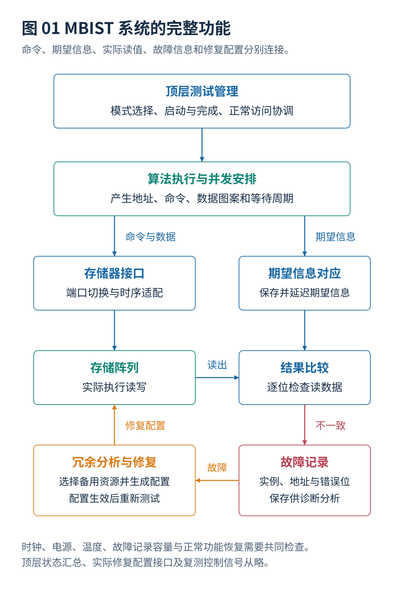

# 00 · MBIST总体架构与阅读导航

[文档入口](README.md) · [下一篇：存储器接口与测试控制器](01_存储器接口与测试控制器.md)

---

**本资料以 MBIST 的设计架构为主线。** March 算法规定读写与比较操作；完整系统还需确定执行主体、访问正确性、并行范围、功率约束、故障信息保存方式，以及备用资源能否恢复可用容量。各模块之间的关系构成后续专题的共同基础。

资料主要面向片上静态随机存取存储器（Static Random-Access Memory，SRAM），并扩展至多端口存储器、高带宽存储器、三维集成与新型存储技术。文献检索截止日期为 **2026 年 10 月 17 日**，论文结果与证据范围在各专题中分别标注。

## 目录

- [[#1. MBIST 是完整测试系统，March 仅为其算法层|1. MBIST 是完整测试系统，March 仅为其算法层]]
- [[#2. 命令与结果驱动的硬件架构|2. 命令与结果驱动的硬件架构]]
- [[#3. 五个相互依赖的设计层次|3. 五个相互依赖的设计层次]]
- [[#4. 测试执行流程|4. 测试执行流程]]
- [[#5. 四组易混淆的设计结论|5. 四组易混淆的设计结论]]
- [[#6. 设计流程与交付内容|6. 设计流程与交付内容]]
- [[#7. 专题目录|7. 专题目录]]
- [[#8. 阅读路径|8. 阅读路径]]
- [[#9. 文件格式与证据范围|9. 文件格式与证据范围]]

## 1. MBIST 是完整测试系统，March 仅为其算法层

存储器内建自测试（Memory Built-In Self-Test，MBIST）是在芯片内部设置测试控制、访问和结果检查能力，对指定存储器执行规定操作。March 是其中一类按规律遍历地址并检查读写结果的算法，并不是 MBIST 的全部硬件，也不是“所有缺陷都能检测”的保证。[^R02][^R25][^R26]

必须把三个功能分开：**MBIST 检测故障；内建冗余分析（Built-In Redundancy Analysis，BIRA）决定如何使用备用资源；内建自修复（Built-In Self-Repair，BISR）把修复决定落实到访问电路并进行复测。** 纠错码保护正常运行中的数据错误，但不能替代上述全部工作。[^R25][^R26]

## 2. 命令与结果驱动的硬件架构

| 模块 | 接收什么 | 完成什么工作 | 交出什么 |
|---|---|---|---|
| 顶层测试管理 | 启动请求、模式、时钟电源状态 | 决定哪些任务允许运行、何时结束 | 合法启动、状态汇总、故障响应 |
| 算法执行单元 | 算法与数据图案配置 | 产生地址、读写命令和等待 | 满足算法要求的命令序列 |
| 存储器接口适配 | 测试命令与宏接口条件 | 切换正常和测试访问，处理使能和延迟 | 被存储器正确接受的访问 |
| 期望结果与比较 | 读数据、对应的期望值与请求信息 | 检查有效读响应的错误位 | 不一致标志及准确的地址、位和阶段 |
| 故障记录与诊断 | 比较结果和运行条件 | 保存、压缩或进一步区分故障现象 | 可用于定位和修复的故障信息 |
| 冗余分析 | 故障集合与备用资源规则 | 求出合法的行列替换等方案 | 修复配置或无法修复结论 |
| 修复执行与复测 | 允许装载的修复配置 | 让访问使用备用资源并检查效果 | 修复后可用性及可靠状态 |
| 测试访问与调试接口 | 外部或片上配置请求 | 配置模式、读取状态与故障信息 | 可追踪的测试结果；配置时钟与测试执行时钟分开处理 |

上述功能划分为通用架构概括；具体产品可能合并其中某些单元，也可能将其分散到多个接口附近。共享功能总线的测试方案还需计入总线仲裁与带宽，不能仅以控制器数量衡量。[^R25][^R26][^R46]

读请求与读响应之间存在时间关系。比较器不能把“刚返回的数据”与“现在正在产生的地址”直接组合，而应使用发出原读请求时保存的信息。这个问题串联起控制器、故障定位和修复，完整例子见[存储器接口与测试控制器](01_存储器接口与测试控制器.md)。

## 3. 五个相互依赖的设计层次

| 层次 | 设计问题 | 对应专题 |
|---|---|---|
| 测试目标 | 故障触发与观测条件、覆盖定义 | [故障模型与检测原理](02_故障模型与检测原理.md) |
| 操作算法 | 地址遍历、读写排列与专用图案 | [March基础与经典算法](03_March基础与经典算法.md)、[增强March与复杂故障测试](04_增强March与复杂故障测试.md)、[测试算法生成与选择](05_测试算法生成与选择.md) |
| 硬件执行 | 宏接口适配与控制器表达能力 | [存储器接口与测试控制器](01_存储器接口与测试控制器.md)、[多端口与新型存储器扩展](11_多端口与新型存储器扩展.md) |
| 芯片级组织 | 硬件共享、启动时刻与电气条件 | [存储器分组与功耗分析](06_存储器分组与功耗分析.md)、[并发调度与联合优化](07_并发调度与联合优化.md)、[自适应与运行期间测试](08_自适应与运行期间测试.md) |
| 结果与验证 | 失败信息正确性、可修复性与工具实现 | [故障诊断与结果记录](09_故障诊断与结果记录.md)、[冗余分析自修复与纠错码](10_冗余分析自修复与纠错码.md)、[设计验证与工具接入](12_设计验证与工具接入.md) |

这五层不是互相独立的优化题。例如，增加动态故障测试的连续读取次数，会改变测试时间和功率曲线；把多个存储器放进广播式控制器，会限制独立启动；增加诊断记录能力会改变面积与输出带宽。优化任一层，都需要说明其他层是否保持不变。

## 4. 测试执行流程

首先确认目标存储器的时钟、电源、复位、测试权限和正常访问状态，再装载算法与实例配置。进入测试后，控制器产生合法命令，比较器处理读结果，记录单元收集需要的信息。停止发命令不等于测试已经完成：仍需等最后的读结果返回并处理完毕。

如果只进行筛选，结束条件可能是完成规定测试并汇总状态；如果还要修复，就需要收集足够的故障信息、执行冗余分析、暂时装载修复配置，再运行修复后的检查。永久保存修复信息必须遵循产品授权条件，不能当作普通调试参数写入。[^R25][^R26]

运行期间测试还要保护应用数据、阻止冲突访问并正确恢复系统状态。透明算法只保证在相应条件下恢复数据，不表示测试过程中没有占用存储器，也不表示可以让其他模块随时读写。[^R03][^R16][^R35]

### 4.1 生命周期各阶段的目标

**制造测试**用来查找制造过程形成的缺陷，是否允许破坏数据、使用何种电压和测试多久，应由产品测试计划规定。**启动测试**需要在软件使用目标存储器前完成初始化与检查。**运行期间测试**必须同时保护数据、处理正常访问和实时性要求。**硅后表征**通常扫描电压、频率与温度，以分析工作裕量，而不只给出通过或失败。

这些用途可以共享硬件，但不能自动共用停止条件。已确定不合格的生产筛选可以按计划提前结束；故障诊断可能需要继续收集其他故障；运行期间发现故障后，应先按系统策略隔离受影响的区域。用途的区别不构成满足任一特定安全标准的证明。

## 5. 四组易混淆的设计结论

**组数不等于完成时间。** 分组决定共享硬件的方式，调度决定真正的执行时刻；同样三个控制器组，也可能得到不同完成时间。六存储器算例在[并发调度与联合优化](07_并发调度与联合优化.md)，程序在[算例与源码说明](13_算例与源码说明.md)。

**操作计数不等于时钟周期。** $10N$ 表示按约定粒度计算的读写操作数；读延迟、流水执行、端口切换、等待和结果排空会改变真实时间。详见[存储器接口与测试控制器](01_存储器接口与测试控制器.md)与[March基础与经典算法](03_March基础与经典算法.md)。

**全局功率合法不等于局部电压与温度合法。** 必须区分功率、能量、电流、空间位置和时间历史；组内依次执行也不能机械使用组内功率之和。详见[存储器分组与功耗分析](06_存储器分组与功耗分析.md)与[并发调度与联合优化](07_并发调度与联合优化.md)。

**报失败不等于定位正确，更不等于修复完成。** 故障记录器满不一定证明不可修复；纠错后的数据正确不一定证明阵列没有缺陷。详见[故障诊断与结果记录](09_故障诊断与结果记录.md)与[冗余分析自修复与纠错码](10_冗余分析自修复与纠错码.md)。

## 6. 设计流程与交付内容

| 设计阶段 | 至少应形成的结果 | 进入下一阶段前应检查 |
|---|---|---|
| 建立需求和实例清单 | 宏接口、位置、工作条件、测试用途 | 未知字段不能默认为零或相容 |
| 定义故障与选择算法 | 完整序列、图案、等待及覆盖要求 | 名称、操作计数和状态一致性 |
| 确定控制器与候选分组 | 硬件共享能力、候选组及代价 | 独立启动和同步操作是否真的受支持 |
| 建立功率模型并安排时间 | 时间表、功率曲线、区域与带宽限制 | 运行全过程是否满足资源要求 |
| 设计结果处理与修复 | 记录格式、溢出处理、备用规则 | 地址对应、资源预算和复测条件 |
| 工具生成与独立验证 | 实际结构、执行周期、故障及物理结果 | 预测方案与实际生成结构是否一致 |

上述组织方式不代表某一家工具的固定命令顺序。工具的版本、许可证与宏能力以目标环境为准；配置示例见[设计验证与工具接入](12_设计验证与工具接入.md)，示例 JSON 不是厂商原生命令。

## 7. 专题目录

| 编号 | 独立文档 | 要解决的核心问题 |
|---|---|---|
| 01 | [存储器接口与测试控制器](01_存储器接口与测试控制器.md) | 测试操作到合法存储器访问的转换与读结果回收。 |
| 02 | [故障模型与检测原理](02_故障模型与检测原理.md) | 故障的触发、传播与观测条件，以及覆盖率的统计范围。 |
| 03 | [March基础与经典算法](03_March基础与经典算法.md) | March 符号、地址遍历与经典算法的发展。 |
| 04 | [增强March与复杂故障测试](04_增强March与复杂故障测试.md) | 读写干扰、关联故障、动态故障与邻近图案条件的序列映射。 |
| 05 | [测试算法生成与选择](05_测试算法生成与选择.md) | 必要覆盖约束下的测试选择与生成。 |
| 06 | [存储器分组与功耗分析](06_存储器分组与功耗分析.md) | 分组、功率、局部电源与温度约束的统一分析。 |
| 07 | [并发调度与联合优化](07_并发调度与联合优化.md) | 测试任务的时间安排与资源、功率的联合检查。 |
| 08 | [自适应与运行期间测试](08_自适应与运行期间测试.md) | 顺序调整、提前停止、透明测试、数据保存恢复与老化预测的区分。 |
| 09 | [故障诊断与结果记录](09_故障诊断与结果记录.md) | 由检测失败生成定位与修复记录，以及记录资源对并发的约束。 |
| 10 | [冗余分析自修复与纠错码](10_冗余分析自修复与纠错码.md) | 备用行列选择、修复配置装载、复测与纠错码协同。 |
| 11 | [多端口与新型存储器扩展](11_多端口与新型存储器扩展.md) | 多端口、堆叠、磁性与存储器内部计算结构的测试扩展。 |
| 12 | [设计验证与工具接入](12_设计验证与工具接入.md) | 各层决定到实际硬件的转换，以及算法、执行、定位与电气条件的分别验证。 |
| 13 | [算例与源码说明](13_算例与源码说明.md) | 算例、程序运行、图片生成与文档检查的组织方式。 |
| 90 | [参考文献与研究进展索引](90_参考文献与研究进展索引.md) | 研究在设计层中的归属与文献证据范围。 |

## 8. 阅读路径

**基础路径：** 本总览 → 存储器接口 → 故障模型 → March 基础 → 增强算法 → 算法选择 → 分组功耗 → 并发调度 → 自适应测试 → 诊断 → 修复 → 技术扩展 → 工具验证。

**分组与调度研究路径：** 本总览 → [存储器接口与测试控制器](01_存储器接口与测试控制器.md) → [存储器分组与功耗分析](06_存储器分组与功耗分析.md) → [并发调度与联合优化](07_并发调度与联合优化.md) → [故障诊断与结果记录](09_故障诊断与结果记录.md) → [设计验证与工具接入](12_设计验证与工具接入.md)。这条路线保留硬件结构和诊断带宽，避免只优化抽象组数。

**March 与故障检测研究路径：** 本总览 → [故障模型与检测原理](02_故障模型与检测原理.md) → [March基础与经典算法](03_March基础与经典算法.md) → [增强March与复杂故障测试](04_增强March与复杂故障测试.md) → [测试算法生成与选择](05_测试算法生成与选择.md) → [存储器接口与测试控制器](01_存储器接口与测试控制器.md) → [设计验证与工具接入](12_设计验证与工具接入.md)。特殊存储技术再进入[多端口与新型存储器扩展](11_多端口与新型存储器扩展.md)，运行期间用途再进入[自适应与运行期间测试](08_自适应与运行期间测试.md)。

## 9. 文件格式与证据范围

各专题均含目录、前后篇导航、相关专题链接与引用文献，既可顺序阅读，也可单独查阅。数学表达采用 Obsidian 的 `$...$` 与 `$$...$$`；插图为原生 SVG，并提供 PNG 与绘图源码。

“全文”“摘要”“记录”分别表示材料的可得程度，不代表重新进行了联网核查。论文结果、算例、工具执行与芯片测量分别标注；文件与程序检查结果见 `checks/`。这些检查不能代替实际存储器故障覆盖、电源网络、温度或商业工具验证。

## 参考文献

文献编号与完整条目见[参考文献与研究进展索引](90_参考文献与研究进展索引.md)。

[^R02]: **R02** — **ASP-DAC 2025 Tutorial T3-1.** 存储器测试、功能故障模型与 March 方法教程。[官方教程 PDF](https://www.aspdac.com/aspdac2025/archive/pdf/T3-1.pdf)。用于经典测试表达、故障模型与测试控制器背景。

[^R03]: **R03** — **Mrozek, I.; Yarmolik, V.（2021）.** *Transparent Memory Testing with a Double Address Sequence.* **Entropy**, 23(7), 894. [DOI: 10.3390/e23070894](https://doi.org/10.3390/e23070894)。透明测试、`8N` 和 `14N` 地址重复序列。

[^R16]: **R16** — **Microchip Technology.** *Periodic SRAM Test: Diagnostic Coverage and Address Range Considerations.* [官方说明](https://onlinedocs.microchip.com/oxy/GUID-1BC922B5-0BDE-4D42-AC92-68359BB22BEC-en-US-1/GUID-DF313197-EBE8-4890-9306-7D638E485E61.html)。在线部分区域测试与整个存储器耦合故障覆盖的限制。

[^R25]: **R25** — Synopsys，**Synopsys IP for Embedded Memory Test and Repair（SMS）** 官方数据表。资料文件：`star-bist-ds.pdf`。用于核实测试、诊断、修复、可编程算法及不同存储技术支持的功能类别；不将数据表年份视为当前最新软件版本。<https://www.synopsys.com/content/dam/synopsys/implementation%26signoff/datasheets/star-bist-ds.pdf>

[^R26]: **R26** — Siemens，**Tessent MemoryBIST** 官方产品页。用于核实产品功能类别，不推断当前用户许可证或具体脚本接口。<https://www.siemens.com/en-us/products/ic/tessent/test/memorybist/>

[^R35]: **R35** — Texas Instruments，**PBIST: Memory Built-In Self-Test**，Jacinto 7 Safety Diagnostic Library 官方文档。具体设备有其电源、复位和执行条件，不推广为全部芯片的统一调用方式。<https://software-dl.ti.com/jacinto7/esd/processor-sdk-rtos-jacinto7/latest/exports/docs/sdl/sdl_docs/userguide/j721e/modules/pbist.html>

[^R46]: **R46** — Siemens，**Automation of Shared-Bus Memory Test With Tessent MemoryBIST**，官方白皮书页面。用于讨论共享功能总线的测试组织，不推断任意设计具有相同并发能力。<https://resources.sw.siemens.com/en-US/white-paper-automation-of-shared-bus-memory-test-with-tessent-memorybist/>

---

[文档入口](README.md) · [下一篇：存储器接口与测试控制器](01_存储器接口与测试控制器.md)
