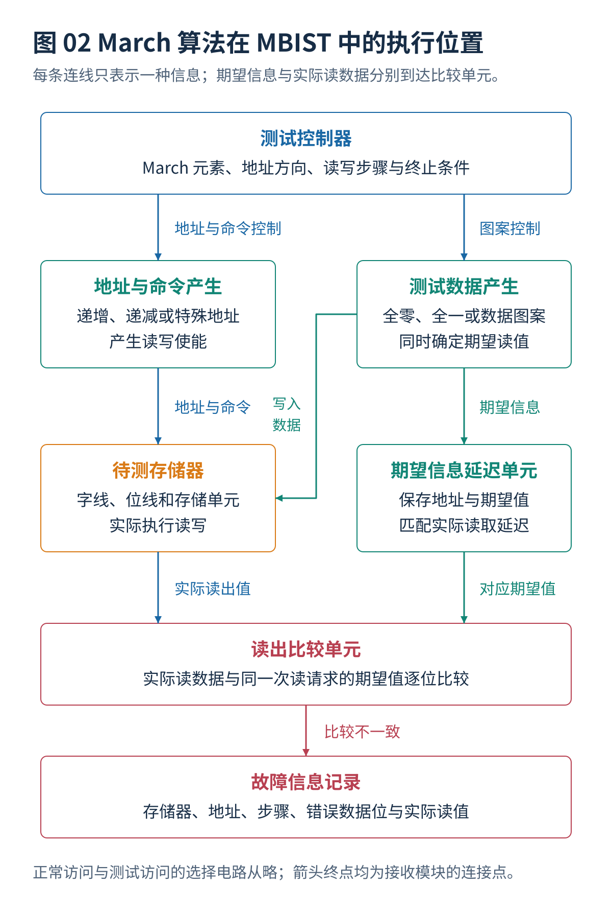
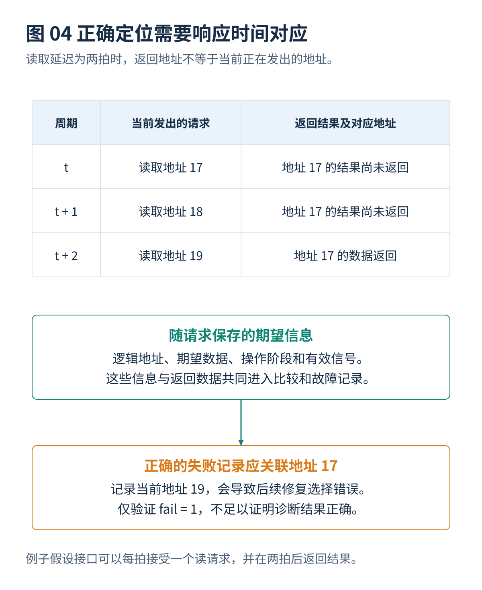

# 01 存储器接口与测试控制器

[总览](00_MBIST总体架构与阅读导航.md) · [上一篇：MBIST总体架构与阅读导航](00_MBIST总体架构与阅读导航.md) · [下一篇：故障模型与检测原理](02_故障模型与检测原理.md)

---

> **架构位置：执行与接口层。** 测试操作到合法存储器访问的转换与读结果回收。

| 专题定位 | 范围约定 |
|---|---|
| 输入 | 宏型号、实例清单、端口与时钟电源条件、测试操作要求。 |
| 输出 | 接口适配规则、控制器结构、读取结果对应规则和真实周期模型。 |
| 前置专题 | [MBIST总体架构与阅读导航](00_MBIST总体架构与阅读导航.md) |




## 目录

- [[#1. 存储器清单与接口要求|1. 存储器清单与接口要求]]
- [[#2. 算法执行与控制器共享|2. 算法执行与控制器共享]]
- [[#3. 读写时序与结果对应|3. 读写时序与结果对应]]
- [[#4. 操作次数与测试时间|4. 操作次数与测试时间]]
- [[#5. 实现比较与计数误读|5. 实现比较与计数误读]]
- [[#6. 研究进展与证据范围|6. 研究进展与证据范围]]
- [[#与其他设计层的衔接|与其他设计层的衔接]]

## 1. 存储器清单与接口要求
### 1.1 清单信息项
分组算法的输入应当是一个经过检查的存储器实例数据库。需要区分**实例**和**型号**：同一个存储器宏型号可以在芯片上出现很多次，但不同实例可能位于不同电源域、时钟域或物理位置，因此仍然不能随意归为一组。

| 属性类别 | 应记录的字段 | 对 MBIST 的影响 |
|---|---|---|
| 身份与层次 | 实例路径、宏型号、所属模块、版本 | 用于将优化结果准确应用到电路 |
| 逻辑容量 | 字深度、数据宽度、地址宽度 | 决定操作次数、期望数据宽度 |
| 端口行为 | 单端口、简单双端口、真正双端口、独立时钟、读写冲突规则 | 决定可执行的算法与测试时序 |
| 接口时序 | 读延迟、写接受条件、输出寄存器、使能极性 | 决定比较单元和命令产生单元能否共享 |
| 写入粒度 | 按位、按字节或按整个字写入 | 决定数据图案和掩码测试方式 |
| 物理组织 | 实际行数、列选择地址数、子阵列、备用资源所属区域 | 决定物理邻近故障测试与地址循环 |
| 时钟和电源 | 测试时钟、允许频率、供电域、隔离控制、保持模式 | 决定哪些实例可以同时处于测试状态 |
| 电气信息 | 读写能量或功率模型、静态功率、适用电压温度、模型来源 | 用于功率与温度评估 |
| 错误处理 | 纠错码位置、是否能观察原始读结果、故障记录格式 | 决定故障是否会被纠正后隐藏 |
| 修复 | 备用行列数量、区域限制、配置存储方式 | 决定 BIRA 问题，而不是仅决定测试算法 |
| 物理信息 | 位置、外形、障碍区域、预计控制器位置 | 用于布线长度、时序和局部电流评估 |

对于上述字段，**未知、默认值和实测值必须分开**。把没有功率数据的存储器填成零，得到的不是低功率方案，而是错误的输入。

### 1.2 容量与测试对象
两个宏都具有 1024 个 32 位字，并不意味着它们可以同步测试。它们可能分别具有一拍和两拍读延迟；一个采用按字节写入，另一个只能整字写入；一个内部地址按行优先排列，另一个具有不同列选择方式。即使数据接口恰好兼容，备用行也可能只允许修复各自子阵列中的故障。

因此，正确判断不是“容量相同就放在一起”，而是“所选择的控制器架构能否精确执行两者要求的命令和比较时序”。ASPDAC 2025 的 MBIST 教程专门讨论了时序、物理地址组织及测试模式差异对共享测试硬件的影响。[^R02]

### 1.3 分组与物理实现
不必。可以先根据逻辑属性和电源时钟规则形成候选组；在早期平面布局给出宏位置之后，再加入距离约束；插入 MBIST 后，再根据实际综合和物理实现结果进行修正。

需要避免两个极端：一是认为没有最终布线就完全不能设计 MBIST；二是认为早期坐标给出的短距离一定代表最终布线短。合理流程是逐步提高模型精度，而不是把全部决策拖到最后，也不是把早期估计当作最终验证。分组、测试时间和控制逻辑位置的联合优化至少在 DATE 2014 已经被直接研究，并不是 2026 年才出现的概念。[^R27]

## 2. 算法执行与控制器共享
### 2.1 March 序列到控制器
实际工程中，不能把 `↑(r0,w1)` 简单理解为“两个相邻时钟周期分别向 SRAM 发送读和写”。应根据存储器宏的端口协议、时钟周期、读出延迟和写入允许条件，编译成可以正确执行的控制信号。

一个比较可靠的实现方式是把 **March 元素** 和 **存储器微操作** 分开描述：

```text
测试算法描述
    │  例如 {↑(w0); ↑(r0,w1); ...}
    ▼
March 元素选择器
    │  当前元素、地址方向、需要执行的操作
    ▼
地址计数器 + 读写操作控制器 + 数据图案发生器
    │  memory_address, memory_write_enable, memory_write_data
    ▼
存储器宏
    │  返回数据及其实际有效时间
    ▼
期望值延迟对齐 + 比较器
    │
    ├── 数据相同：前往下一个微操作
    └── 数据不同：记录失败地址、数据位和测试步骤
```

**有限状态机控制器：**对 March C− 等固定且较短的序列，使用有限状态机可获得简单的控制逻辑，状态通常包括初始化、请求访问、等待读取、比较、下一微操作、地址变化、阶段结束和报告结果。2026 年的 March AZ2 控制器研究采用这一方式，并在特定硬件对照下取得较低的电路面积与功耗。[^R08]

**微指令式控制器：**如果同一个 MBIST 控制器需要执行 March C−、SS、AB、RAW 或不同的地址图案，可以考虑使用可编程的 March 微指令，让每条指令至少记录：地址方向、数据图案、读写动作、期望值、每地址重复次数、是否遍历完整地址空间。这样可以减少为每种算法分别增加完全独立控制逻辑的需求，但要额外实现指令存储和译码。

两种方案的实际面积和功耗不能只按算法名称判断，应在同一技术库、同一存储器宏接口、同一时钟频率和同一比较方法下综合比较。

### 2.2 控制器结构与时间模型
**结构一：组内依次执行。** 一个控制器先完整测试 A，再测试 B。忽略配置开销时：

$$
T_G=\sum_{i\in G}T_i.
$$

同组实例不能并行启动。这种结构可以降低算法控制逻辑的数量，但测试时间可能增加。

**结构二：组内同步执行。** 地址和操作流广播给多个实例，全部按照相同进度执行。只有在地址、时序和数据图案能够兼容，并正确屏蔽已完成或者不存在的地址时，才可能得到：

$$
T_G\approx\max_{i\in G}T_i.
$$

这里的近似有条件：不同的物理地址循环、测试模式、读延迟对齐和额外等待，都可能使时间大于最大单存储器时间。

**结构三：共享管理，但局部独立执行。** 每个接口单元保留独立进度，顶层控制器负责配置和完成汇总。A、B 可以在不同时刻开始或结束，但独立地址状态、计数器和比较逻辑会消耗额外面积。


一个调度器把同组两个存储器安排在不同时间启动，隐含着硬件具有独立启动和独立进度能力。若实际硬件只有广播地址产生单元，该计划就不能直接执行。**数学上可行，不代表硬件上可实现。**

## 3. 读写时序与结果对应
### 3.1 时序与数据处理
**第一，正确处理同步读取延迟。** 如果存储器的读取结果在请求发出后的一个或多个周期才有效，比较器必须延迟相同周期保存期望值、目标地址和数据位选择。如果错误地用下一次写入操作对应的期望值去比较上一笔读取，可能导致全部地址都错误失败，或者某些真正的故障被错误忽略。

**第二，处理同一地址紧邻读写的限制。** 一些存储器宏支持每周期一次访问，但并不允许任意顺序的连续读写。控制器应按照宏的时序模型增加必要的等待或改变命令发送时刻，不能假设任意 `r0,w1` 都可在两个无等待周期内正确执行。

**第三，处理数据宽度。** $N$ 是一次完整 March 遍历中的地址数量。如果存储器为 `65536×32`，一次 `w0` 是对 32 位同时写 0，$10N$ 通常表示 `655360` 次**字操作**，不是 `655360×32` 次位操作。若要检查同一字内位之间的耦合，就需要额外的数据图案、逐位写掩码或专用测试模式；单纯对整字执行全零与全一不足以覆盖这些位间关系。

**第四，区分读写结果与纠错结果。** 如果存储器输出通过错误纠正码处理，读出的错误可能被自动修复，导致 MBIST 无法直接观察内部位错误。需要按芯片结构决定测试是在原始存储器宏输出处比较，还是对带纠错的数据通路另设独立测试。不要直接把“最终软件读取正确”当成物理存储器没有故障。

**第五，检查写入掩码和字节使能。** 对具有字节写使能的 SRAM，整个字一次性写 0 和写 1 不能检查所有部分写入条件；如果这些控制信号属于目标故障范围，应构造启用单个字节、启用若干字节以及交替使能的数据测试。

**第六，检查端口与内部地址对应关系。** 如果一个 MBIST 控制器复用到多个深度、位宽、读写端口不同的存储器，需要对每个宏分别核实有效地址范围、数据掩码和读取延迟，而不能只复用同一段计数逻辑。

### 3.2 读结果与期望对齐


假设周期 $t$ 发出地址 17 的读请求，两个周期后得到读结果。到 $t+2$ 时，地址产生单元可能已经走到地址 19。此时必须用先前随读请求保存的“地址 17、期望数据、操作阶段”进行比较和记录。

如果把返回数据与当前地址 19 关联，测试可能仍然正确报失败，但故障位置已经错误，后续备用行列选择也会错误。因此，诊断正确性需要单独验证，不能只通过最终 `fail=1` 来证明。

## 4. 操作次数与测试时间
### 4.1 操作次数到真实周期
一个可用的时间分解为：

$$
T_i=T_{\mathrm{config},i}+T_{\mathrm{entry},i}
+\frac{C_{\mathrm{op},i}+C_{\mathrm{wait},i}+C_{\mathrm{drain},i}}{f_i}
+T_{\mathrm{result},i}+T_{\mathrm{exit},i}.
$$

$C_{\mathrm{op},i}$ 是命令执行周期，$C_{\mathrm{wait},i}$ 包含保持测试或接口协议要求的等待，$C_{\mathrm{drain},i}$ 是停止发命令后等待最后读结果返回的周期。读延迟为两拍，并不必然意味着每次读都需要单独占用两拍；若接口允许流水执行，可以每拍发出一个读请求，只在开始和结束处承担填充和排空开销。

相反，如果测试需要“读出后决定下一次写入”，或者同一端口读写之间存在必需间隔，就不能用满流水吞吐率计算。应当根据实际控制器支持的操作依赖计算周期。

### 4.2 物理地址循环的影响
算例：两个存储器逻辑上都只有 512 个字。M1 的物理遍历组织为 128 行、每行 4 个列选择地址；M2 为 32 行、每行 16 个列选择地址。

如果共享控制器使用“最大行数 × 最大列选择数”的嵌套循环，就需要：

$$
128\times16=2048
$$

个地址步骤。分别测试则只需要：

$$
128\times4+32\times16=1024
$$

个地址步骤。在这个特定结构下，同步测试反而多一倍地址步骤。这里的“列选择地址数”不是数据字宽；将其误解成位宽会得到错误结论。ASPDAC 2025 教程给出了同类物理组织导致共享测试时间放大的现象；本例改用更小数字演示。[^R02]

该结论并不意味着不同物理结构永远不能共享，而是说明必须明确控制器的地址产生方式。支持独立地址进度的接口单元，可能消除这种填充代价，但会增加硬件。

### 4.3 三类时间结果
**无故障筛选时间**：没有任何故障、只读出最终状态需要多久。**完整诊断时间**：大量失败记录需要读出或重复测试时需要多久。**修复后完成时间**：包含冗余分析、修复配置装载和修复后的再次测试。

一个“测试时间缩短 30%”的结果，如果只包括第一类时间，就不应该直接用于估计整个生产测试流程。完整流程还可能包含多个电压温度条件、等待稳定、其他芯片测试以及测试设备的切换时间。

### 4.4 测试时间算例
假设待测单端口同步 SRAM 深度为 `65536` 个字，位宽为 `32` 位。假设每周期能够完成一项 March 读或写操作，测试时钟为 `100 MHz`，不计额外启动时间、等待时间和失败信息写入时间。

| 测试算法 | 按字地址计算的操作总数 | 理想时钟周期数 | 理想测试时间 |
|---|---:|---:|---:|
| March C−，10N | 655,360 | 655,360 | 6.5536 毫秒 |
| March AZ，13N | 851,968 | 851,968 | 8.51968 毫秒 |
| March MSS，18N | 1,179,648 | 1,179,648 | 11.79648 毫秒 |
| March SS / AB，22N | 1,441,792 | 1,441,792 | 14.41792 毫秒 |
| March RAW，26N | 1,703,936 | 1,703,936 | 17.03936 毫秒 |
| 2025 年五单元邻近图案，81N | 5,308,416 | 5,308,416 | 53.08416 毫秒 |

这些数字是根据读写操作数计算的**理论下限示例**，并不代表任何特定存储器宏的测量结果。如果每次读取都需要再等待一个周期，真实测试时间就可能显著增加。多次运行 March 还可能在图案切换、初始化和最后读取之外增加其他周期，必须依据原始算法计数方式核算，不能重复计数。

对于包括 20 个存储器宏的大型芯片，还需要计算：各宏是否并行执行、是否有共享的测试控制资源、同时测试的峰值电流是否超过电源设计允许值，以及能否把不同宏的测试开始时间错开。**优化芯片整体测试时间，并不等于选择单个 SRAM 上操作次数最少的算法。**

## 5. 实现比较与计数误读
### 5.1 操作计数与时钟周期
它们通常是**存储器操作次数**。真实测试周期还可能包含访问延迟、比较器等待、端口切换、时钟启动和保持时间。不同研究把某个操作视为“一次读写操作”时，也不一定对应相同硬件成本。

### 5.2 面积优化与故障覆盖
2026 年的 March AZ2 有限状态机论文报告在其 FPGA 对照条件下控制器面积和功耗下降，但算法故障覆盖能力与另一实现方式相近。实验测得面积下降，不意味着故障模型变了，也不能外推到所有晶圆厂工艺和综合设置。[^R08]

## 6. 研究进展与证据范围
| 发表时间 | 工作及出处 | 对 March / MBIST 的主要贡献 | 可核实的研究结果 | 使用时必须注意的限制 |
|---|---|---|---|---|
| **2025** | *Power, delay Optimized MBIST Controller Architecture using March Algorithms*，IEEE 会议 | 比较多个 March 算法的控制电路功耗与时序实现 | 研究重点是控制器实现代价 | “实现电路更优”不等于“算法本身覆盖更好”。[^R24] |
| **2026 年 1 月** | *FSM-Based MBIST Controller Implementation using the March AZ2 Test Algorithm*，IIUM Engineering Journal | 使用手工设计的有限状态机实现 $14N$ 的 March AZ2 | 作者报告与其 Siemens Tessent 对照实现相比，面积降低 **84%**、功耗降低约 **32%**，覆盖结果相近 | 这是特定硬件平台与实施方法的比较，不能直接推导所有工艺中的普遍优势。[^R08] |

## 与其他设计层的衔接
本专题输出需要继续交给[故障模型与检测原理](02_故障模型与检测原理.md)、[March基础与经典算法](03_March基础与经典算法.md)、[存储器分组与功耗分析](06_存储器分组与功耗分析.md)、[故障诊断与结果记录](09_故障诊断与结果记录.md)。改变某一层的条件以后，应重新检查受到影响的接口和验证要求。


## 参考文献
文献编号与完整条目见[参考文献与研究进展索引](90_参考文献与研究进展索引.md)。

[^R02]: **R02** — **ASP-DAC 2025 Tutorial T3-1.** 存储器测试、功能故障模型与 March 方法教程。[官方教程 PDF](https://www.aspdac.com/aspdac2025/archive/pdf/T3-1.pdf)。用于经典测试表达、故障模型与测试控制器背景。

[^R08]: **R08** — **Jidin, A. Z. 等（2026）.** *FSM-Based MBIST Controller Implementation using the March AZ2 Test Algorithm.* **IIUM Engineering Journal**, 27(1), 292–303. [DOI: 10.31436/iiumej.v27i1.3749](https://doi.org/10.31436/iiumej.v27i1.3749)。`14N` 的 March AZ2、有限状态机与 EDA 自动生成对照。

[^R24]: **R24** — **（2025）.** *Power, delay Optimized MBIST Controller Architecture using March Algorithms.* IEEE 会议论文. [DOI: 10.1109/ICRTEECT67512.2025.11448959](https://doi.org/10.1109/ICRTEECT67512.2025.11448959)。硬件实现的功耗和时序代价，而不是增加故障覆盖的另一固定 March 序列。

[^R27]: **R27** — Andrew B. Kahng, Ilgweon Kang. **Co-Optimization of Memory BIST Grouping, Test Scheduling, and Logic Placement**. DATE, 2014. DOI: 10.7873/DATE.2014.209。会议官方全文：<https://past.date-conference.com/proceedings-archive/2014/PDFFILES/07.7_4.PDF>

---

[总览](00_MBIST总体架构与阅读导航.md) · [上一篇：MBIST总体架构与阅读导航](00_MBIST总体架构与阅读导航.md) · [下一篇：故障模型与检测原理](02_故障模型与检测原理.md)
