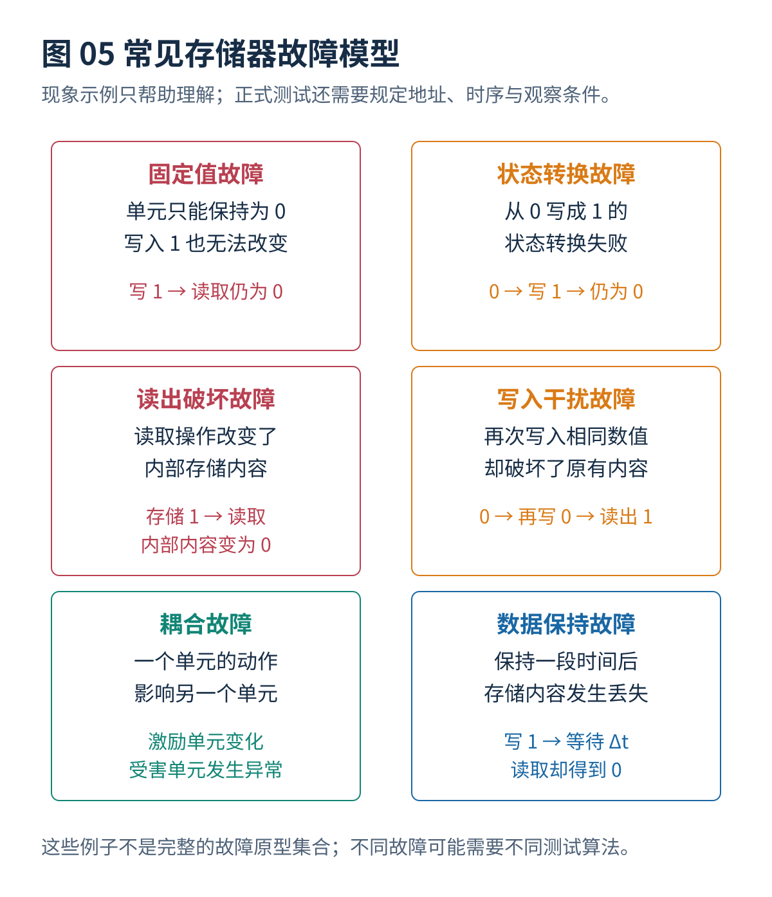
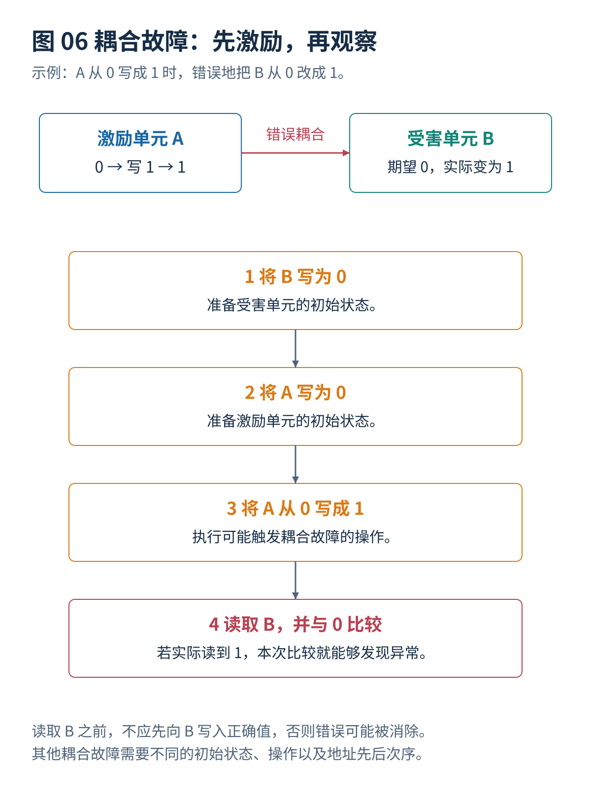

# 02 · 故障模型与检测原理

[总览](00_MBIST总体架构与阅读导航.md) · [上一篇：存储器接口与测试控制器](01_存储器接口与测试控制器.md) · [下一篇：March基础与经典算法](03_March基础与经典算法.md)

---

> **架构位置：测试目标与故障模型层。** 故障的触发、传播与观测条件，以及覆盖率的统计范围。

| 专题定位 | 范围约定 |
|---|---|
| 输入 | 存储器物理组织、器件行为、目标缺陷与工作条件。 |
| 输出 | 可检验的故障原型、激励与观测条件、覆盖率统计范围。 |
| 前置专题 | [MBIST总体架构与阅读导航](00_MBIST总体架构与阅读导航.md) |

## 目录

- [[#1. 检测条件分析的前提作用|1. 检测条件分析的前提作用]]
- [[#2. 单存储单元与耦合故障|2. 单存储单元与耦合故障]]
- [[#3. 物理位置与故障模型精度|3. 物理位置与故障模型精度]]
- [[#4. 操作历史相关故障的建模|4. 操作历史相关故障的建模]]
- [[#5. 覆盖率的分母与适用条件|5. 覆盖率的分母与适用条件]]
- [[#6. 研究进展与证据范围|6. 研究进展与证据范围]]
- [[#与其他设计层的衔接|与其他设计层的衔接]]

## 1. 检测条件分析的前提作用

### 1.1 写回读检的局限性

假设一个存储单元总是读出 0。依次写入全零、再读回全零时，不会发现异常；必须写入 1 并尝试读回 1，才有可能发现。

再假设两个存储单元 A、B 存在异常电气耦合：A 从 0 写成 1 时，B 的内容可能由 0 意外翻转成 1。如果只测试 A，而没有在这一动作之后读取 B，故障也可能被遗漏。因此，检测效果取决于：

1. 是否安排了能够**触发**该故障的初始化状态与操作；
2. 是否在错误被后续操作覆盖之前**观察**到错误；
3. 是否考虑了存储器不同物理位置之间的相互影响；
4. 是否在实际可能出现的时间间隔、读写频率、供电电压和温度下测试。

这就是 March 算法不仅规定“写什么”，还规定“先做什么、后做什么、从哪个方向访问”的原因。

### 1.2 故障的激活、传播和观测

对某个故障 $f$，可以把它的检测要求抽象为三个部分：

1. **激活条件：**哪些地址、初始数据、操作序列会造成物理异常。
2. **传播条件：**异常能否影响到某个可读取的存储值，或者读出路径。
3. **观测条件：**在后续写入、读取修复或其他故障掩盖该异常前，能否读取并发现差异。

用故障原型（Fault Primitive）描述上述条件时，测试序列的优化便可以转化为“用尽量短的合法读写序列覆盖要求的故障原型集合”。这正是近年自动生成 March 算法研究的主要理论基础。

## 2. 单存储单元与耦合故障

### 2.1 单个存储单元故障

| 故障模型 | 真实现象 | 一个用于理解的触发与检查方法 | 基础 March C− 的典型局限 |
|---|---|---|---|
| 固定值故障（Stuck-At Fault） | 单元不能正确表示 0 或 1 | 写 0、读 0；写 1、读 1 | 通常可以覆盖经典模型中的两种故障 |
| 状态转换故障（Transition Fault） | 0→1 或 1→0 的写入转换失败 | 确认原状态后写入相反值并读取 | 通常可以覆盖经典模型 |
| 读出破坏故障（Read Destructive Fault） | 读操作改变存储内容，常伴随当次读出异常 | 写入已知值后读出并检查，再确认状态 | 覆盖取决于故障的具体定义与操作序列 |
| 伪装性读出破坏故障（Deceptive Read Destructive Fault） | 当次读取可能正确，但内部存储内容已被破坏 | 连续读取同一个地址，检查后续结果 | 常规 C− 不一定覆盖全部故障原型 |
| 读取值错误故障（Incorrect Read Fault） | 单元内容未变化，但读取结果错误 | 设定已知值并读出 | 对所设置的状态通常容易触发 |
| 写入干扰故障（Write Disturb Fault） | 再次写入原有数值，却破坏存储内容 | 先使单元为 0，再执行 `w0` 并读取 | 需要有意识地安排“非状态转换写入” |
| 数据保持故障（Data Retention Fault） | 一定时间之后内容丢失 | 写已知值、等待、再读取 | 没有专用等待时，不保证检测较慢的泄漏 |
| 动态故障（Dynamic Fault） | 只有按顺序进行两次或多次相关操作时才异常 | 连续读、连续写、读后写等特定组合 | 单次操作触发的故障测试条件不足 |

**静态故障与动态故障的区分：**在经典存储器功能故障分类中，静态故障通常指最多一个存储器操作即可触发的故障；动态故障指必须按顺序执行至少两个相关操作才能触发的故障。**状态转换故障虽然包含数据变化，依然可以属于静态故障模型。**“静态”和“动态”不是简单地按数据是否发生变化区分。[^R09][^R11]

### 2.2 多个存储单元之间的耦合故障

发生耦合故障时，一个存储单元的操作会影响另一个存储单元。为了描述这种故障，通常称前者为**激励单元**（aggressor），后者为**受害单元**（victim）。主要类别包括：

- **状态耦合故障（State Coupling Fault）：**激励单元保持特定 0/1 状态时，受害单元操作表现异常。
- **反转耦合故障（Inversion Coupling Fault）：**激励单元发生指定状态转换时，受害单元错误翻转。
- **幂等耦合故障（Idempotent Coupling Fault）：**激励动作把受害单元强制设置成某一个确定数值。
- **状态转换耦合故障（Transition Coupling Fault）：**激励单元处于某状态或执行某操作时，受害单元不能完成某方向的转换。
- **读出破坏耦合故障、写入干扰耦合故障：**某单元的读取或非状态转换写入会破坏其他单元。
- **关联故障（Linked Fault）：**一个故障造成的效果可能影响或掩盖另一个故障，两个故障不能视为相互独立。
- **三单元、四单元及五单元邻近图案敏感故障：**某单元的错误取决于它周围多个物理单元共同形成的状态组合。

检测一类耦合故障通常需要同时满足两个条件：**先让激励单元和受害单元处于合适的数据状态，再执行激励操作；必须在异常被后续写入消除之前读取受害单元。** 这比测试单个固定值故障困难，因为还要覆盖两种地址先后次序与不同初始状态。

## 3. 物理位置与故障模型精度

### 3.1 地址顺序不等于物理位置

March 测试默认的地址排列可能是逻辑地址排列。真正的存储器宏内部可能有：行列地址重新编码、位交织、列复用、数据位交错排列、冗余行列和地址扰乱。某些邻近单元故障测试必须知道**逻辑地址对应的物理行列位置**，否则按逻辑地址产生的棋盘图案可能无法让真正相邻的晶体管处于预期状态。

### 3.2 故障模型的精度层次

行为级模型适合快速验证算法、地址行为与系统响应。带有历史状态的故障模型可以表示特定读写序列触发条件。晶体管级或缺陷注入模型更接近实际电路，但计算成本高，也受参数、工艺和缺陷集合影响。

门级逻辑故障覆盖报告常常把存储器宏当作黑盒。因此，扫描测试达到高覆盖，并不直接意味着宏内部位单元已经被测试；反过来，MBIST 阵列测试通过，也不能取代控制逻辑、测试接口和其他电路的结构测试。

## 4. 操作历史相关故障的建模

### 4.1 操作历史建模的研究方向

2026 年的硬件上下文监测（Hardware Context Monitoring，HCM）工作并不要求每个动态故障必须被简化成“前后两次操作”的模型。它用数字硬件描述模块记录测试过程中相关信号随时间的变化，根据完整的事件历史检查故障是否被激励、是否传播到可观察位置、是否被其他操作掩盖。[^R12]

其意义在于：当测试优化器只看简单故障原型时，很难知道某些动态故障为何没有被检测；加入上下文监测后，优化器可以获得更准确的“这段读写序列是否真正满足故障条件”的反馈。这将支持未来使用自动测试生成器寻找更复杂但更短的动态故障测试序列。

## 5. 覆盖率的分母与适用条件

### 5.1 覆盖率数字的解读

以下几个数字**不允许直接相互排序**：

| 研究中的比例 | 它所对应的故障集合 | 正确解读 |
|---|---|---|
| Dynamic-RAWC：80.9% | 2023 年研究选定的 282 个动态故障原型 | 同一论文中比 March RAW 的 49.6% 更高 |
| March AZ：83.3% | 2025 年研究选定的静态故障原型 | 该静态故障集合上的覆盖比例，不是动态故障覆盖 |
| March CC：79.8% | 2025/2026 年研究选定的存储器内部计算相关单存储单元与双单元故障模型 | 与计算模式和存储模式联合测试相关 |
| MT-NPSF-81N：100% | 规定的五单元经典邻近图案敏感模型 | 并未保证全部两单元耦合故障 |
| 2026 年地址译码器研究“更高覆盖” | 工业 SRAM 宏上指定译码器缺陷注入集合 | 公开摘要没有统一百分比，不应编造 |

故障覆盖率通常计算为：

$$
\mathrm{Coverage}=\frac{\text{检测到的指定故障数量}}{\text{评估的指定故障总数量}}.
$$

实际项目还需要明确每种故障是否按发生概率、面积、制造缺陷统计或安全影响程度赋予不同权重。未经统一故障集合、仿真条件和统计方法，**不同论文的百分比不能构成公平排名**。

### 5.2 指定故障模型覆盖与全部缺陷覆盖的界限

这是 March 研究中的主要误解。某论文检测了全部 36 个指定静态故障原型，其结论也只适用于这 36 个模型。制造缺陷可能涉及开路电阻值分布、温度、供电条件、内部晶体管结构、读出放大器、地址译码器及存储器外围电路。**功能故障模型覆盖率与真实制造缺陷覆盖率不能自动画等号。**

### 5.3 逻辑地址相邻与物理单元相邻的区别

对于五单元邻近故障，一旦地址经过位交织、行列复用或重新编码，逻辑上的行列图案就可能不再对应实际的物理棋盘图案。这会让所谓“完整遍历全部邻近状态”失去依据。行列地址的实际排列应从存储器编译器接口、版图信息或厂商测试说明中确定。

## 6. 研究进展与证据范围

| 发表时间 | 工作及出处 | 对 March / MBIST 的主要贡献 | 可核实的研究结果 | 使用时必须注意的限制 |
|---|---|---|---|---|
| **2026 年 10 月** | *A hardware context monitoring for testing complex dynamic SRAM faults in digital test environment*，Microprocessors and Microsystems | 在数字故障仿真及自动测试生成环境中追踪多操作历史、数据图案和电路相互影响 | 示范了动态读出破坏故障与电阻性地址译码器开路故障分析 | 属于**故障建模和仿真框架**，不能将其结果误称为新提出的固定长度 March 算法。[^R12] |

## 与其他设计层的衔接

本专题输出需要继续交给[March基础与经典算法](03_March基础与经典算法.md)、[增强March与复杂故障测试](04_增强March与复杂故障测试.md)、[测试算法生成与选择](05_测试算法生成与选择.md)、[设计验证与工具接入](12_设计验证与工具接入.md)。改变某一层的条件以后，应重新检查受到影响的接口和验证要求。

## 参考文献

文献编号与完整条目见[参考文献与研究进展索引](90_参考文献与研究进展索引.md)。

[^R09]: **R09** — **Cașcaval, P.; Cașcaval, E.（2024）.** *Near-optimal March Tests for Three-Cell and Four-Cell Coupling Fault Models in Random-Access Memories.* **Romanian Journal of Information Science and Technology**. [论文全文 PDF](https://www.romjist.ro/full-texts/paper782.pdf)；[DOI: 10.59277/ROMJIST.2024.3-4.06](https://doi.org/10.59277/ROMJIST.2024.3-4.06)。`21N / 37N / 73N` 的特定三单元和四单元邻近故障算法。

[^R11]: **R11** — **Hsu, H. J. 等（2026）.** *Defect-based Testing for SRAM Address Decoders.* **2026 IEEE 44th VLSI Test Symposium**. [DOI: 10.1109/VTS69484.2026.11563364](https://doi.org/10.1109/VTS69484.2026.11563364)；[国立阳明交通大学论文信息](https://scholar.nycu.edu.tw/zh/publications/defect-based-testing-for-sram-address-decoders/)。SPICE 缺陷仿真驱动的地址译码器 March 生成。

[^R12]: **R12** — **Ronga, D.; Faehn, E.; Girard, P.; Virazel, A.（2026）.** *A hardware context monitoring for testing complex dynamic SRAM faults in digital test environment.* **Microprocessors and Microsystems**, 124（Part B）, 105305. [DOI: 10.1016/j.micpro.2026.105305](https://doi.org/10.1016/j.micpro.2026.105305)；[期刊页面](https://www.sciencedirect.com/science/article/pii/S0141933126000621)。动态故障数字仿真的操作历史建模。

---

[总览](00_MBIST总体架构与阅读导航.md) · [上一篇：存储器接口与测试控制器](01_存储器接口与测试控制器.md) · [下一篇：March基础与经典算法](03_March基础与经典算法.md)
