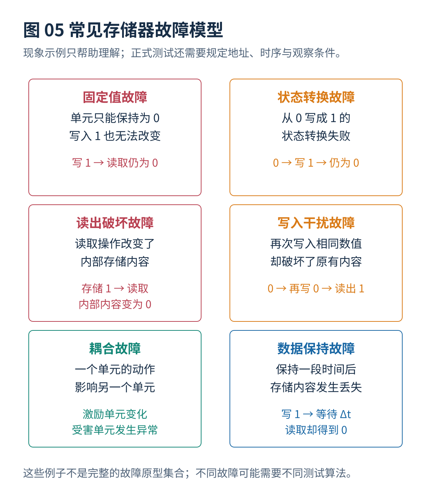
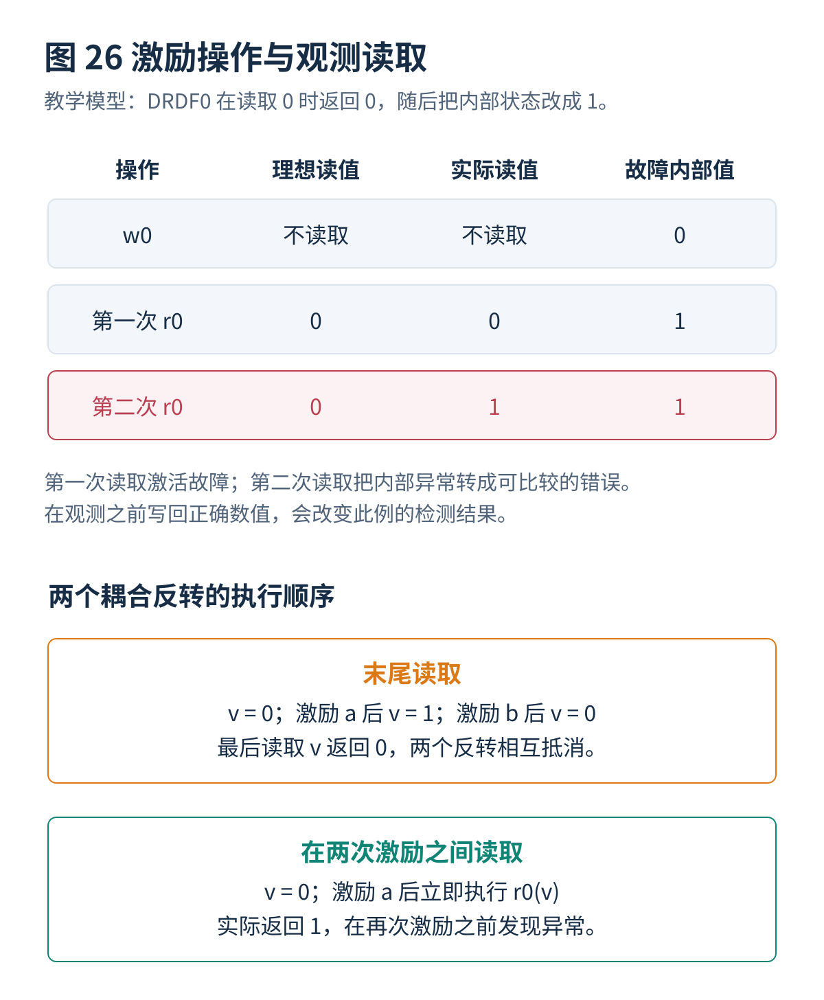
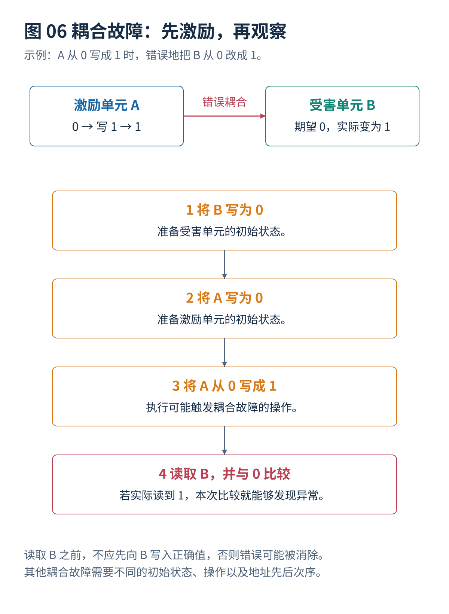

# 02 故障模型与检测原理

[总览](00_MBIST总体架构与阅读导航.md) · [上一篇：存储器接口与测试控制器](01_存储器接口与测试控制器.md) · [下一篇：March基础与经典算法](03_March基础与经典算法.md)

> **专题位置：确定测试对象、激励条件和读出检查条件。** 本章给出故障模型分类、可执行的局部序列、逐操作检测过程，以及截至 2026 年 11 月 18 日可核实的研究进展。完整 March 算法及其跨地址安排见第 03、04 章。

| 输入 | 输出 |
|---|---|
| 存储器物理组织、操作定义、目标缺陷、工作条件 | 故障原型、初始化方法、激励操作、观测操作、覆盖率统计范围 |

## 目录

- [[#1. 从物理缺陷到可执行故障模型|1. 从物理缺陷到可执行故障模型]]
- [[#2. 单单元故障及检测序列|2. 单单元故障及检测序列]]
- [[#3. 双单元耦合故障及检测序列|3. 双单元耦合故障及检测序列]]
- [[#4. 相互影响的故障与动态故障|4. 相互影响的故障与动态故障]]
- [[#5. 多单元与邻近图案敏感故障|5. 多单元与邻近图案敏感故障]]
- [[#6. 地址译码器、保持时间和工作条件|6. 地址译码器、保持时间和工作条件]]
- [[#7. 近期故障模型与研究进展|7. 近期故障模型与研究进展]]
- [[#8. 如何建立可比较的故障集合|8. 如何建立可比较的故障集合]]
- [[#9. 算例运行与章节衔接|9. 算例运行与章节衔接]]

## 1. 从物理缺陷到可执行故障模型

### 1.1 三个需要分别描述的层次

**物理缺陷**描述晶体管、导线、接触或存储材料发生了什么变化，例如电阻性开路、桥接、磁性隧道结异常和铁电极化退化。**功能故障模型**描述这些变化在给定工作条件下怎样改变操作结果。**测试序列**安排初始化、激励和读出检查，使故障影响出现在比较器能够观察的位置。相同物理缺陷在不同电阻值、电压、温度或操作历史下，可能表现为不同功能故障。[⁽FM01⁾](#fm01)[⁽FM02⁾](#fm02)

因此，一个完整检测过程至少要回答四个问题：目标单元在测试开始时是什么状态；哪些操作激活故障；错误出现在哪里；哪次读取会在错误被覆盖之前发现差异。例如，`w1(a)` 使另一个地址 `v` 的内容翻转，随后立刻执行 `w0(v)`，可能把故障影响覆盖。应当在这次写入之前安排 `r0(v)`。

### 1.2 统一操作记法

| 记号 | 本章含义 |
|---|---|
| `w0(x)`、`w1(x)` | 对地址 `x` 写入 0、1 |
| `r0(x)`、`r1(x)` | 读取地址 `x`，并分别与期望值 0、1 比较 |
| `r(x)` | 读取并与理想模型维护的期望值比较；期望值必须已经确定 |
| `0w1`、`1w0` | 从已知初态执行状态转换写入 |
| `0w0`、`1w1` | 对当前状态执行非状态转换写入 |
| `wait(t)` | 保持规定的工作条件，等待时间 `t` |
| `op1 ‖ op2` | 两项操作按接口定义同时执行 |
| `a`、`v` | 激励单元（aggressor）、受害单元（victim） |
| `↑(...)`、`↓(...)` | 对规定地址集合递增、递减遍历；完成当前地址括号内全部操作后再访问下一个地址 |

`r0` 中的 0 表示比较器的期望值。发生故障时，这次读取可以实际返回 1；随后仍应根据理想执行状态计算后续期望值。

### 1.3 故障原型中的状态与读出

单单元故障常用 $\langle S/F/R\rangle$ 表示，$S$ 包括初始状态和激励操作，$F$ 表示激励后的错误存储状态，$R$ 表示该次读操作的实际输出；没有读操作时写为 $-$。双单元模型可写作 $\langle S_a;S_v/F/R\rangle$。[⁽FM01⁾](#fm01)

例如 $\langle 0r0/1/0\rangle$ 表示：单元原先为 0，执行一次读取后内部变成 1，当次仍输出 0。单次比较通过，后续 `r0` 才能发现错误。必须分别记录**内部状态**和**对外读出值**，才能正确模拟这类故障。

### 1.4 分类维度应当同时保留

| 分类维度 | 常见取值 | 对序列的直接影响 |
|---|---|---|
| 激励操作数量 | 静态；动态 | 需要单次操作，或具有顺序要求的操作历史 |
| 涉及单元数量 | 单单元、双单元、多单元 | 需要哪些初态、背景和地址组合 |
| 故障间关系 | 相互独立；相互影响（linked） | 是否存在错误抵消、覆盖或提前阻止激励 |
| 空间范围 | 任意地址对；物理邻近；同行；同列；同子阵列 | 地址产生器需要了解哪些物理关系 |
| 输出形式 | 确定性错误；间歇错误；参数偏移 | 比较一次、重复统计，或测量电流/时序裕量 |
| 时间与环境 | 操作间隔、等待时间、频率、电压、温度、老化状态 | 测试控制器需要哪些可调参数 |

在经典功能故障分类中，静态模型的激励需要至多一次存储器操作；动态模型需要至少两次具有特定顺序的操作。初始化状态不计入激励操作数量。因此，`0w1` 触发的转换故障属于静态模型，名称中的“转换”不会使它自动成为动态故障。[⁽FM02⁾](#fm02)

## 2. 单单元故障及检测序列

### 2.1 模型、局部序列和观察点

下表针对每一行明确写出的一个故障方向。将 0、1 互换可得到互补方向；整片测试还要对全部目标地址应用相应操作。表中的局部序列用于说明检测原理，其组合成为完整 March 算法时还需要检查跨地址影响。[⁽FM01⁾](#fm01)

| 模型 | 一个精确定义 | 局部序列 | 哪个操作发现什么错误 |
|---|---|---|---|
| 固定值故障 SAF0 | 对该单元的写入无法改变其固定值 0 | `w1(x), r1(x)` | `r1` 返回 0，发现无法存储 1 |
| 上升转换故障 TF↑ | 初态为 0 时，`w1` 后仍为 0 | `w0(x), r0(x), w1(x), r1(x)` | 最后 `r1` 发现 0→1 转换失败 |
| 写入干扰故障 WDF0 | `0w0` 使内部状态变成 1 | `w1(x), w0(x), w0(x), r0(x)` | 第二次 `w0` 是激励，末尾 `r0` 读取错误的 1 |
| 读出破坏故障 RDF0 | `0r0` 使内部变成 1，当次也返回 1 | `w0(x), r0(x)` | 第一次 `r0` 即发现读出错误 |
| 伪装性读出破坏故障 DRDF0 | `0r0` 使内部变成 1，当次返回 0 | `w0(x), r0(x), r0(x)` | 第二次 `r0` 观察前一次读取造成的内部破坏 |
| 读取值错误故障 IRF0 | 内部保持 0，读取时输出 1 | `w0(x), r0(x)` | 第一次 `r0` 比较失败；内部状态仍为 0 |
| 保持故障 DRF0 | 在指定条件下保持 0 超过 $t_f$ 后变成 1 | `w0(x), wait(t), r0(x)`，$t\ge t_f$ | 等待后的读取发现状态丢失 |

RDF 和 IRF 都可能在第一次读取时被检测，随后内部状态的差异会影响故障诊断。DRDF 必须给下一次读取留下机会。WDF 需要对已经为 0 的单元再次写 0；仅轮流写 0 和写 1 不会提供这一激励。



### 2.2 DRDF：为什么两次读取作用不同

取故障定义 $\langle0r0/1/0\rangle$，初始内容未知。

| 步骤 | 操作 | 理想内部状态 | 故障内部状态 | 实际读出与检查 |
|---:|---|---:|---:|---|
| 1 | `w0(x)` | 0 | 0 | 建立初态 |
| 2 | `r0(x)` | 0 | 读取后变成 1 | 返回 0，比较通过；本次操作激活故障 |
| 3 | `r0(x)` | 0 | 1 | 返回 1，比较失败；观察步骤 2 产生的错误 |

如果把步骤 3 改成 `w1(x)`，理想状态和故障状态都会成为 1，步骤 2 产生的差异随之消失。由此可见，连续两次读取具有明确的故障检测作用。March SS 等算法中的重复读取可按这种方式解释，完整序列见第 04 章。



### 2.3 WDF：为什么需要非状态转换写入

本例仅注入 `0w0` 破坏状态这一故障，普通转换写入正常。

| 步骤 | 操作 | 理想状态 | 故障状态 | 作用 |
|---:|---|---:|---:|---|
| 1 | `w1(x)` | 1 | 1 | 建立统一初态 |
| 2 | `w0(x)` | 0 | 0 | 正常的 1→0 转换 |
| 3 | `w0(x)` | 0 | 1 | 非状态转换写入激活 WDF0 |
| 4 | `r0(x)` | 0 | 1 | 返回 1，发现错误 |

使用 `w1` 建立初态，可以清楚地区分步骤 2 的转换写入与步骤 3 的重复写入。互补例子为 `w0,w1,w1,r1`。

### 2.4 从局部操作扩展到 March 元素

一个便于理解的单地址操作段为：

$$
(r0,r0,w0,r0,w1).
$$

前两个 `r0` 提供连续读取检查；`w0,r0` 检查非状态转换写入；末尾 `w1` 建立下一阶段的 1 状态。它怎样检测双单元故障，还取决于其他地址在这一时刻处于 0 还是 1，以及后面是否再次读取受害单元。第 04 章给出这些元素的完整排列。

## 3. 双单元耦合故障及检测序列

### 3.1 先区分操作作用在哪个单元

耦合模型的关键是**激励条件与错误位置分离**。例如，`r(a)` 破坏 `v`，与 `a` 保持 1 时 `r(v)` 破坏 `v`，对应不同的激励要求。为便于生成器实现，建议显式保存 `aggressor_operation`、`aggressor_state`、`victim_operation`、`victim_state` 和 `fault_effect`。[⁽FM01⁾](#fm01)

| 模型类别 | 本表的一个具体实例 | 检测片段 | 直接观察点 |
|---|---|---|---|
| 状态耦合 CFst | `a=1` 时，`v` 无法保持 0 | `w0(a),w0(v),w1(a),r0(v)` | `a=1` 建立后读取 `v` |
| 反转耦合 CFin | `a:0→1` 使 `v` 翻转 | `w0(a),w0(v),w1(a),r0(v)` | 激励后的 `r0(v)` |
| 幂等耦合 CFid | `a:0→1` 把 `v` 强制设为 0 | `w0(a),w1(v),w1(a),r1(v)` | 以 1 初始化 `v`，再检查它是否被强制为 0 |
| 转换耦合 CFtr | `a=1` 阻止 `v:0→1` | `w1(a),w0(v),w1(v),r1(v)` | 检查 `v` 的转换结果 |
| 干扰耦合 CFds | 读取 `a` 会翻转 `v` | `w0(a),w0(v),r0(a),r0(v)` | 读取 `v`，观察 `r0(a)` 的副作用 |
| 写入干扰耦合 CFwd | `a=1` 时，`0w0(v)` 破坏 `v` | `w1(a),w1(v),w0(v),w0(v),r0(v)` | 重复写入后的读取 |
| 读出破坏耦合 CFrd | `a=1` 时，`r0(v)` 使 `v` 变为 1 且输出 1 | `w1(a),w0(v),r0(v)` | 对 `v` 的第一次读取 |
| 伪装性读出破坏耦合 CFdrd | `a=1` 时，`r0(v)` 使内部变为 1、当次输出 0 | `w1(a),w0(v),r0(v),r0(v)` | 对 `v` 的第二次读取 |
| 读取值错误耦合 CFir | `a=1` 时，`r0(v)` 输出 1，内部仍为 0 | `w1(a),w0(v),r0(v)` | 对 `v` 的第一次读取 |

这些类别在不同论文中可能使用不同下标。比较模型时，应核对初态、操作归属和故障效果，直接使用模型名称不足以确定检测要求。

### 3.2 CFin 的逐操作过程

设 `a:0→1` 会把 `v` 从 0 翻转为 1。

| 步骤 | 操作 | 理想 `(a,v)` | 故障 `(a,v)` | 检测作用 |
|---:|---|---|---|---|
| 1 | `w0(a)` | `(0,?)` | `(0,?)` | 初始化激励单元 |
| 2 | `w0(v)` | `(0,0)` | `(0,0)` | 初始化受害单元 |
| 3 | `w1(a)` | `(1,0)` | `(1,1)` | 发生激励转换，并产生差异 |
| 4 | `r0(v)` | `(1,0)` | `(1,1)` | 读取 1，与期望 0 不符 |



### 3.3 地址方向为什么影响覆盖

对 `↑(r0,w1)`，若 `a<v`，访问 `v` 时 `a` 已经被写成 1；若 `a>v`，访问 `v` 时 `a` 尚保持 0。因此，同一 March 元素会向两种地址关系提供不同状态组合。增加递减遍历后，先后关系交换，能够提供另一组激励和观测机会。

完整覆盖分析需要列出 `a<v`、`a>v`、激励状态、受害状态、激励方向和首次观察位置。例如，某次激励发生在 `v` 已经访问完毕之后，必须证明后续元素会先读取 `v`，再对其写入。仅说明“有递增和递减”仍不足以完成这种分析。

## 4. 相互影响的故障与动态故障

### 4.1 Linked：两次错误可能相互抵消

构造三个地址 `a,b,v`：`a:0→1` 和 `b:0→1` 都会反转 `v`。初始化为 `(a,b,v)=(0,0,0)`。

| 操作 | 理想 `v` | 故障 `v` | 说明 |
|---|---:|---:|---|
| `w1(a)` | 0 | 1 | 第一次翻转产生可观察差异 |
| `w1(b)` | 0 | 0 | 第二次翻转抵消第一次差异 |
| `r0(v)` | 0 | 0 | 末尾读取通过 |

将读取放在两次激励之间即可检测本例：

```text
w0(a), w0(b), w0(v), w1(a), r0(v), w1(b), r0(v)
```

第一次 `r0(v)` 返回 1。这个例子说明，故障模拟器需要支持同一受害单元上的多个故障同时存在，并使用统一时间顺序更新状态。分别检测到两个单独故障的序列，在同时注入时可能得到不同结果。March AB 等算法针对特定 linked 故障集合设计，参见第 04 章。[⁽FM03⁾](#fm03)

### 4.2 动态故障需要保存操作历史

定义一个便于仿真的两读动态模型：在同一地址上连续执行第二次读取 0 时，内部状态才变成 1，当次仍返回 0；写操作或对其他地址的访问清除连续读计数。其激励片段可写为 $\langle0r0r0/1/0\rangle$。本章明确采用上述计数和清除规则。

| 步骤 | 操作 | 连续读计数 | 故障内部状态 | 实际读出 |
|---:|---|---:|---:|---|
| 1 | `w0(x)` | 0 | 0 | 无 |
| 2 | `r0(x)` | 1 | 0 | 0，通过 |
| 3 | `r0(x)` | 2 | 1 | 0，通过；此时激活故障 |
| 4 | `r0(x)` | 3 | 1 | 返回 1，比较失败，检出故障 |

因此，本例需要 `w0,r0,r0,r0`。前三项中的两个读负责激励，最后一个读负责观察。若动态模型要求 `w1,r1`、`r0,w1` 或更长历史，应相应更改历史识别条件。[⁽FM02⁾](#fm02)

### 4.3 同样的操作数量不一定形成相同激励

| 历史要求 | 应保存的附加信息 | 测试实现需要检查的内容 |
|---|---|---|
| 同一地址连续两次读取 | 上一次地址与操作 | 中间不能插入其他地址访问 |
| 两次写入间隔小于 $\Delta t$ | 时间戳 | 控制器暂停和总线仲裁是否使间隔过长 |
| 最近 $k$ 次操作符合模式 | 长度为 $k$ 的历史，或等价状态机 | 其他操作是否使状态机复位 |
| 两个端口同时访问 | 端口、地址、开始与结束时间 | 同周期发出请求是否实际形成电路重叠 |
| 某个背景持续足够长时间 | 背景开始时间、期间改写情况 | 局部写入是否破坏了保持条件 |

2026 年的 HCM 工作在数字测试环境中使用硬件描述的上下文监测模块处理复杂动态 SRAM 故障，给出了 dRDF 和电阻性地址译码器开路故障 r-ADOF 的应用。它使故障检查能够依赖更完整的操作上下文。[⁽FM04⁾](#fm04)

## 5. 多单元与邻近图案敏感故障

### 5.1 明确几何形状与受害单元

三单元模型可以规定一个中心和两个相邻单元，也可以允许三个单元中的任意一个成为受害单元；四单元模型可以限定为一个 $2\times2$ 正方形；经典五单元 NPSF 常使用中心单元及其上、下、左、右四个物理邻居。不同几何形状对应不同故障集合。2024 年三、四单元研究以及 2025 年五单元研究都把物理组织和数据背景列为测试构造的重要条件。[⁽FM05⁾](#fm05)[⁽FM06⁾](#fm06)

### 5.2 一个可手工展开的五单元例子

令中心为 `v`，四邻居按上、右、下、左排列为 `n0,n1,n2,n3`。定义邻域背景 $P=(1,0,1,0)$。下列三个模型分别说明不同测试动作。

| 模型 | 本例的激励条件 | 明确序列 | 检测操作 |
|---|---|---|---|
| 静态图案敏感 SNPSF | `P=1010` 时中心 0 被强制为 1 | 先令邻居为 `0000`；`w0(v)`；依次把邻居设置为 `1010`；`r0(v)` | 背景全部建立后的 `r0(v)` |
| 被动图案敏感 PNPSF | `P=1010` 阻止中心 `0→1` | 设置 `P`；`w0(v),r0(v),w1(v),r1(v)` | 末尾 `r1(v)` 发现转换失败 |
| 主动图案敏感 ANPSF | 其他邻居为 `010`、中心为 0 时，`n0:0→1` 使中心翻转 | 设置 `(n0,n1,n2,n3)=(0,0,1,0)`；`w0(v),w1(n0),r0(v)` | `r0(v)` 观察邻居转换的影响 |

这是对三个具体模型的直接检测方案。实际全阵列算法要让每一个物理中心及所有所需邻域状态获得相同机会。

### 5.3 为什么一个棋盘图案不足以检查全部邻域条件

四个邻居共有 $2^4=16$ 种状态。如果要求每个邻域状态下检查中心的两个保持值，就有 $16\times2=32$ 个状态条件；检查两个方向的中心转换，又有 32 个定向转换条件。对经典主动模型，选择发生转换的邻居有 4 种，选择其转换前的四邻居状态有 16 种，选择中心状态有 2 种，共 $4\times16\times2=128$ 个定向激励条件。

这些计数由本章明确的四邻居二进制模型得到。它们说明为何需要多个背景与有方向的转换安排。欧拉回路适合组织需要遍历的定向转换边，完整过程见第 05 章。若还要检测读取或非状态转换写入触发的扩展模型，应加入相应自环操作和读取检查；只有状态转换图仍会遗漏这些操作。[⁽FM06⁾](#fm06)

### 5.4 扩展多单元故障不能只增加背景数量

假设邻居保持 `1010` 时，中心发生 `0w0` 才被破坏。即使测试已经遍历全部 16 种邻域背景，如果每个背景下只做中心 `0→1→0` 转换，仍没有执行目标操作。适当的局部段应包括：

```text
设置邻域 P=1010
w1(v), w0(v), w0(v), r0(v)
```

对读取触发的扩展模型，可采用 `w0(v),r0(v),r0(v)`；对两个邻居操作的动态组合，则要同时记录两个地址和先后顺序。背景覆盖、操作覆盖和读出检查需要分别统计。

## 6. 地址译码器、保持时间和工作条件

### 6.1 地址译码器模型

| 模型 | 可执行的局部例子 | 原理与适用条件 |
|---|---|---|
| 两个逻辑地址访问同一物理单元 | `w0(a),w1(b),r0(a)`，`a≠b` | 第二次写入覆盖第一地址的内容；最后读取发现别名访问 |
| 一个地址错误地选择多个单元 | 预置 `v=0`，写 `a=1`，读取 `v` | `a` 的写入同时改变本不应选中的 `v` |
| 某条字线不能激活 | 分别写 0、写 1，并通过可访问路径读取 | 要求测试环境具有能够观察该物理单元或对应输出的路径 |
| 前一字线释放过慢 | 初始化 `a=0`；紧接着选择 `b` 并写 1；再读 `a` | 在明确的延迟失选模型下，`b` 写入期间 `a` 仍被选中，因而被破坏 |
| 地址转换相关错误 | 对规定地址转换 `a→b` 执行读写并检查受影响地址 | 必须控制地址位变化、操作组合与间隔 |

地址别名例子可直接由行为模型验证。电阻性开路或延迟失选需要从电路模型确定哪些地址转换、时间间隔和操作组合可以激活。2026 年 VTS 工作通过 SPICE 收集有效两周期地址与操作组合的激励、检测条件，再据此构造测试。[⁽FM07⁾](#fm07)

### 6.2 保持故障序列中的等待位置

对两种极性分别执行：

$$
\{\Updownarrow(w0);\operatorname{wait}(t);\Updownarrow(r0);
\Updownarrow(w1);\operatorname{wait}(t);\Updownarrow(r1)\}.
$$

等待期间应保持目标电压、温度和模式。对 SRAM 可设定保持电压；对 DRAM 还要明确刷新是否启用；对非易失性存储器需要区分断电保持与通电等待。上述序列中的两次等待为显式保持时间，整片写入和读取本身也使各地址的实际保持时间不同，分析时应以每个地址最后一次写入到观察读取的间隔为准。

### 6.3 低电压、延迟与老化模型

读写在标称条件下正确，仍可能具有较小的时序或电压裕量。描述这类模型时，可把操作表示为 `w1(x,V,t_write)`、`r1(x,V,t_sample)`，并记录温度和既有应力历史。对一个明确的上升转换慢故障，可使用：

```text
w0(x, Vtest, tw_init)
w1(x, Vtest, tw_short)
r1(x, Vread, tsample)
```

第二次写入使用研究目标规定的脉宽，末尾读取观察是否完成转换。逐步扫描 `tw_short`，能够得到该单元的失败阈值。阈值随应力历史变化可用于分析退化；其与实际寿命的关系需要相应器件模型或测量数据。已有 SRAM 研究同时分析存储单元与读出放大器的老化影响。[⁽FM08⁾](#fm08)

### 6.4 错误纠正与比较位置

若纠错码把原始错误纠正后再输出，软件读取可能得到正确数据。故障测试应明确比较原始数据、纠错后数据、错误综合征还是纠正计数。若选择旁路纠错模式，应检查该模式的授权和接口要求；若在正常运行模式下测试，应把可纠正错误的出现纳入记录。故障覆盖统计也应使用相同的观察位置。

## 7. 近期故障模型与研究进展

### 7.1 SRAM 与新型器件

以下条目按已经核实的公开内容整理。论文中的百分比、长度和缺陷集合见相应章节；本表着重说明新增的建模维度。

| 年份 | 工作 | 需要新增的模型内容 | 资料层次 |
|---|---|---|---|
| 2024 | 三单元、四单元扩展静态耦合研究 | 物理邻近几何、受害单元角色、转换写入、重复写入和读取 | 已核对开放全文 [FM05] |
| 2025 | 五单元 NPSF 与扩展 NPSF | 中心与四邻居的完整状态、定向操作和多背景切换 | 已核对开放全文 [FM06] |
| 2026 | HCM 复杂动态 SRAM 测试 | 操作历史、激励、传播和掩盖条件，示例含 dRDF 与 r-ADOF | 出版方摘要 [FM04] |
| 2026 | SRAM 地址译码器缺陷测试 | 两周期地址转换与操作组合、可激活的译码器内部缺陷 | 作者机构摘要 [FM07] |
| 2026 | STT-MRAM 磁耦合与接触、互连缺陷 | 磁耦合背景、寄生磁场、写入脉宽及缺陷位置 | 作者机构摘要 [FM09] |
| 2026 | RRAM 接触与互连缺陷系统分析 | 数据背景影响、缺陷相关旁路电流路径以及三、四单元故障 | 作者机构摘要；机构全文公开日期为 2026-12-21 [FM10] |
| 2024 | ReRAM 电流观测 DfT | UWF、DeepF、URF、IUSF，以及二进制读出之外的状态测量 | 已核对开放全文 [FM11] |
| 2025 | HfO₂ FeRAM 的 read after delay（RAD） | 读后写回、操作间隔、极化与压印变化 | 出版方摘要 [FM12] |
| 2025 IEDM，2026 入库 | FeRAM fluid imprint | 连续读取条件、脉宽、电压、温度、占空比与快速压印变化 | IEEE 摘要及会议日期 [FM13] |

这些工作对自动序列生成的共同要求是：把时间、背景、空间关系和测量能力作为输入。第 11 章按器件进一步给出参数化序列。

### 7.2 DRAM：从邻近行扩展到共享列电路

| 现象或模型 | 激励维度 | 测试中需要读取的位置 |
|---|---|---|
| 保持失效 | 写入后时间、温度、刷新条件 | 被保持的单元 |
| RowHammer | 激励行重复激活和预充电，规定的时间预算 | 物理邻近受害行 |
| RowPress | 激励行保持打开的时间 | 物理邻近受害行 |
| RowHammer 与 RowPress 组合 | 开关次数和每次打开持续时间的联合分布 | 两种单独模式及组合模式涉及的受害单元 |
| ColumnDisturb | 激励行访问及共享列电路条件 | 同列、可能跨多个子阵列的受害单元 |

RowPress 的原始实验工作发表于 ISCA 2023；2024 年的组合模式研究直接比较两种应力的联合影响；ColumnDisturb 的原始论文发表于 MICRO 2025，并在 2026 年 IEEE Micro 进一步介绍。它使检查范围扩展到共享列电路影响的单元。[⁽FM14⁾](#fm14)[⁽FM15⁾](#fm15)[⁽FM16⁾](#fm16)

2026 年 11 月 13 日公开的预印本 *A Unified Device-Level Physical Framework for DRAM Read Disturbance* 使用器件测量、DIMM 试验与 TCAD 结果，把电子迁移、电容耦合和读出放大器介导的扰动（SAMD）纳入统一解释。对测试建模的启示是，同时保存局部相邻关系、共享列关系、存储极性和激励持续时间。该条目按预印本列出。[⁽FM17⁾](#fm17)

### 7.3 DRAM 的参数化检测序列例子

设激励行为 `A`，受害行集合为 `V`，初始数据分别为 `pA`、`pV`。在可直接控制 DRAM 命令的测试环境中，可使用：

```text
写入 A=pA；写入 V=pV；读回 V 验证初始化
重复 k 次：
    ACT(A)
    保持打开 t_on
    PRE(A)
    等待规定的预充电时间
读取 V，与 pV 比较
```

固定较短 `t_on`、增加 `k` 可以研究重复开关应力；增加 `t_on` 可以研究长时间保持打开的影响。检查 ColumnDisturb 时，把 `V` 扩展为共享列结构涉及的受害区域。每次参数试验都重新初始化，记录刷新设置、温度、数据背景和物理地址组织。该模板是根据上述激励条件给出的测试方法，具体参数需由目标器件及试验目的确定。

## 8. 如何建立可比较的故障集合

### 8.1 每个故障实例至少保存哪些信息

```text
model_name
technology
cells_and_roles
physical_relation
initial_state
sensitizing_operations
history_reset_rule
timing_and_environment
state_effect
read_output_effect
observation_rule
source_reference
```

其中 `source_reference` 指向定义模型的论文、器件说明或明确的教学定义。`history_reset_rule` 尤其重要：`r0(x),r0(y),r0(x)` 是否符合对 `x` 的两读激励，必须由模型直接说明。

### 8.2 覆盖率的分母与统计单位

$$
\mathrm{FC}=\frac{|\{f\in\mathcal F:\text{测试中至少一次观察到 }f\text{ 造成的差异}\}|}{|\mathcal F|}.
$$

$\mathcal F$ 可以是故障原型集合，也可以是带地址、极性、端口和环境参数的实例集合，报告时必须说明。动态 282 个原型、某组静态原型、五单元 NPSF 和器件缺陷注入集合，分别回答不同问题。要比较两个算法，应使用相同的故障定义、实例化规则、比较位置和工作条件。

### 8.3 间歇性故障的重复次数

如果一个试验在故障存在时以概率 $p$ 返回错误，并且重复试验相互独立，则重复 $k$ 次至少观察到一次错误的概率为：

$$
P_{\mathrm{detect}}=1-(1-p)^k.
$$

例如 $p=0.1$ 时，44 次独立试验的检测概率约为 99.03%。实际器件可能有历史相关性，因此应同时保存每轮初态、间隔与环境；确定性行为仿真的一次通过结果不适合直接用于估计这种概率。

### 8.4 分别验证激励和观察

建议为每个实例记录首次激励步骤、错误产生后的状态、首次错误读出步骤，以及被覆盖或被其他故障抵消的过程。若序列只有激励而没有差异读出，覆盖计数保持为 0。对含重复读、非状态转换写入和多个相互影响故障的模型，这项规则能直接避免覆盖率高估。

## 9. 算例运行与章节衔接

本章的确定性教学例子由 [fault_detection_examples.py](src/fault_detection_examples.py) 执行，输出见 [fault_detection_results.json](examples/fault_detection_results.json)。其中分别检查理想存储器是否通过、目标故障是否在预期读取处被检测，以及两次翻转抵消时的结果。器件级电压、温度、模拟电流和磁场效应应在相应电路或器件模型中另行验证。

下一步阅读可按对象选择：基础单元与地址顺序见[第 03 章](03_March基础与经典算法.md)，静态、动态与多单元完整算法见[第 04 章](04_增强March与复杂故障测试.md)，背景和操作序列生成见[第 05 章](05_测试算法生成与选择.md)，多端口及新型存储技术见[第 11 章](11_多端口与新型存储器扩展.md)。

## 参考文献

### FM01

HAMDIOUI S, VAN DE GOOR A J, RODGERS M. March SS: A Test for All Static Simple RAM Faults[C]//IEEE International Workshop on Memory Technology, Design and Testing. 2002: 95–100. DOI: [10.1109/MTDT.2002.1029769](https://doi.org/10.1109/MTDT.2002.1029769). [作者机构记录](https://research.tudelft.nl/en/publications/march-ss-a-test-for-all-static-simple-ram-faults/)，[作者公开稿](https://www.researchgate.net/publication/3965901_March_SS_A_test_for_all_static_simple_RAM_faults)。

### FM02

HAMDIOUI S, AL-ARS Z, VAN DE GOOR A J, et al. Dynamic Faults in Random-Access-Memories: Concept, Fault Models and Tests[J]. Journal of Electronic Testing, 2003, 19(2): 195–205. [作者机构记录](https://research.tudelft.nl/en/publications/dynamic-faults-in-random-access-memories-concept-fault-models-and/)，[作者公开稿](https://www.researchgate.net/publication/220648796_Dynamic_Faults_in_Random-Access-Memories_Concept_Fault_Models_and_Tests)。

### FM03

AL-ARS Z, HAMDIOUI S, VAN DE GOOR A J. A Fault Primitive Based Analysis of Linked Faults in RAMs[C]//IEEE International Workshop on Memory Technology, Design and Testing. 2003. [论文与作者公开摘要](https://www.researchgate.net/publication/2885962_A_Fault_Primitive_Based_Analysis_of_Linked_Faults_in_RAMs)。

### FM04

RONGA D, FAEHN E, GIRARD P, et al. A hardware context monitoring for testing complex dynamic SRAM faults in digital test environment[J]. Microprocessors and Microsystems, 2026, 124, Part B: 105305. DOI: [10.1016/j.micpro.2026.105305](https://doi.org/10.1016/j.micpro.2026.105305). [出版方摘要](https://www.sciencedirect.com/science/article/abs/pii/S0141933126000621)。

### FM05

CAȘCAVAL P, CAȘCAVAL D. Near-optimal March Tests for Three-Cell and Four-Cell Coupling Fault Models in Random-Access Memories[J]. Romanian Journal of Information Science and Technology, 2024, 27(3–4): 323–335. DOI: [10.59277/ROMJIST.2024.3-4.06](https://doi.org/10.59277/ROMJIST.2024.3-4.06). [全文](https://www.romjist.ro/full-texts/paper782.pdf)。

### FM06

CAȘCAVAL P, CAȘCAVAL D. Near-Optimal Multirun March Memory Test Algorithms for Neighborhood Pattern-Sensitive Faults in Random-Access Memories[J]. Mathematics, 2025, 13(16): 2594. DOI: [10.3390/math13162594](https://doi.org/10.3390/math13162594). [全文](https://www.mdpi.com/2227-7390/13/16/2594)。

### FM07

HSU H J, LEE H C, SHEN C Y, et al. Defect-based Testing for SRAM Address Decoders[C]//IEEE VLSI Test Symposium. 2026: 1–7. DOI: [10.1109/VTS69484.2026.11563364](https://doi.org/10.1109/VTS69484.2026.11563364). [作者机构摘要](https://scholar.nycu.edu.tw/zh/publications/defect-based-testing-for-sram-address-decoders/)。

### FM08

AGBO I, TAOUIL M, KRAAK D, et al. Impact and mitigation of SRAM read path aging[J]. Microelectronics Reliability, 2018, 87: 158–167. DOI: [10.1016/j.microrel.2018.05.011](https://doi.org/10.1016/j.microrel.2018.05.011). [出版方页面](https://www.sciencedirect.com/science/article/pii/S0026271418302956)。引用范围：存储单元与感测路径的老化依赖性。

### FM09

YUAN S, XUN H, ZHANG Z, et al. Impact of Magnetic Coupling on Testing Contact and Interconnect Defects in STT-MRAMs[J]. IEEE Transactions on Computer-Aided Design of Integrated Circuits and Systems, 2026, 在线发表. DOI: [10.1109/TCAD.2026.3700944](https://doi.org/10.1109/TCAD.2026.3700944). [作者机构摘要](https://research.tudelft.nl/en/publications/impact-of-magnetic-coupling-on-testing-contact-and-interconnect-d/)。

### FM10

XUN H, FIEBACK M, YUAN S, et al. Systematic Analysis of Interconnect and Contact Defects in RRAMs[J]. IEEE Transactions on Emerging Topics in Computing, 2026, 14(3): 1019–1033. DOI: [10.1109/TETC.2026.3701213](https://doi.org/10.1109/TETC.2026.3701213). [作者机构记录与摘要](https://repository.tudelft.nl/record/uuid:9b03a6d8-2161-4416-9a8f-cfc450fdefd9)。

### FM11

COPETTI T S, FIEBACK M, GEMMEKE T, et al. A DfT Strategy for Guaranteeing ReRAM’s Quality after Manufacturing[J]. Journal of Electronic Testing, 2024, 40: 245–257. DOI: [10.1007/s10836-024-06108-8](https://doi.org/10.1007/s10836-024-06108-8). [全文](https://link.springer.com/article/10.1007/s10836-024-06108-8)。

### FM12

SU D, LI S, WANG X, et al. Root cause of read after delay in ferroelectric memories[J]. Chip, 2025, 4(3): 100139. DOI: [10.1016/j.chip.2025.100139](https://doi.org/10.1016/j.chip.2025.100139). [出版方页面](https://www.sciencedirect.com/science/article/pii/S2709472325000139)。

### FM13

PARK H, SHIN J, QUEZADA E, et al. Fluid Imprint: A Reliability Bottleneck in Ferroelectric RAM Read Operation[C]//IEEE International Electron Devices Meeting. 2025. DOI: [10.1109/IEDM50572.2025.11353476](https://doi.org/10.1109/IEDM50572.2025.11353476). [IEEE 摘要](https://ieeexplore.ieee.org/abstract/document/11353476)。会议日期为 2025-12-06 至 2025-12-10，IEEE Xplore 入库日期为 2026-01-30。

### FM14

LUO H, OLGUN A, YAĞLIKÇI A G, et al. RowPress: Amplifying Read Disturbance in Modern DRAM Chips[C]//ISCA. 2023. DOI: [10.1145/3579371.3589063](https://doi.org/10.1145/3579371.3589063). [作者全文](https://people.inf.ethz.ch/~omutlu/pub/RowPress_isca23.pdf)。

### FM15

An Experimental Characterization of Combined RowHammer and RowPress Read Disturbance in Modern DRAM Chips[C]//IEEE/IFIP DSN Workshops. 2024. DOI: [10.1109/DSN-S60304.2024.00013](https://doi.org/10.1109/DSN-S60304.2024.00013). [作者机构记录](https://www.research-collection.ethz.ch/items/37d194b8-1ef0-41e7-82c6-0f2c8085b6b1)。

### FM16

YÜKSEL İ E, OLGUN A, BOSTANCI F N, et al. ColumnDisturb: Understanding Column-based Read Disturbance in Real DRAM Chips and Implications for Future Systems[C]//MICRO. 2025. [作者扩展稿 arXiv:2510.14750](https://arxiv.org/abs/2510.14750)。相关期刊文章：ColumnDisturb Vulnerability in Modern DRAM Chips[J]. IEEE Micro, 2026，在线日期 2026-07-03. DOI: [10.1109/MM.2026.3708511](https://doi.org/10.1109/MM.2026.3708511)。

### FM17

BAI Z, LUO H, WANG X, et al. A Unified Device-Level Physical Framework for DRAM Read Disturbance[EB/OL]. 2026-11-13. [arXiv:2611.17634](https://arxiv.org/abs/2611.17634)。预印本，引用范围为已公开摘要所述器件机制与建模方向。

---

[总览](00_MBIST总体架构与阅读导航.md) · [下一篇：March基础与经典算法](03_March基础与经典算法.md)
