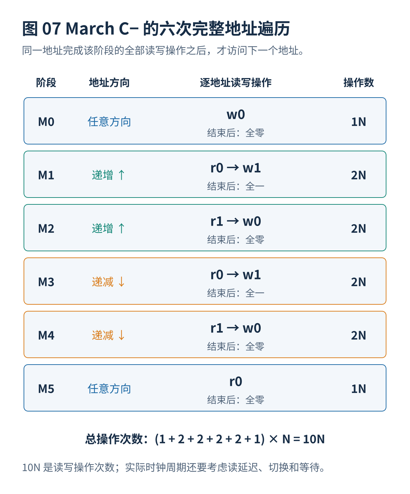
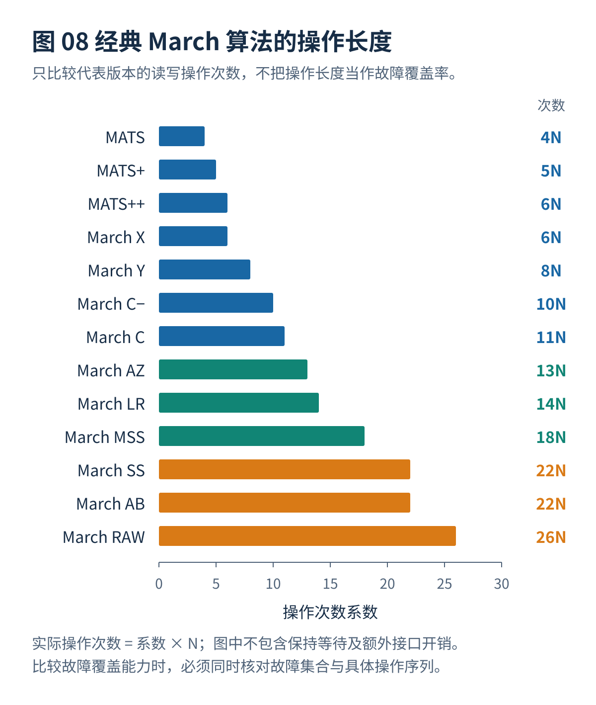

# 03 March 基础与经典算法

[总览](00_MBIST总体架构与阅读导航.md) · [上一篇：故障模型与检测原理](02_故障模型与检测原理.md) · [下一篇：增强March与复杂故障测试](04_增强March与复杂故障测试.md)

---

> **架构位置：规则测试算法层。** 以 March 符号与地址遍历为基础，推导 March C− 并比较经典算法。

| 专题定位 | 内容范围 |
|---|---|
| 输入 | 有效地址范围、数据宽度、目标基础故障模型。 |
| 输出 | 完整操作序列、无故障期望值、操作计数与基本检测解释。 |
| 前置专题 | [故障模型与检测原理](02_故障模型与检测原理.md) |


## 目录

- [[#1. March 操作符号与遍历规则|1. March 操作符号与遍历规则]]
- [[#2. March C− 构成|2. March C− 构成]]
- [[#3. 经典算法与长度|3. 经典算法与长度]]
- [[#4. 从序列定位具体故障的激活与观察|4. 从序列定位具体故障的激活与观察]]
- [[#5. 将经典序列转成控制器可执行步骤|5. 将经典序列转成控制器可执行步骤]]
- [[#与其他设计层的衔接|与其他设计层的衔接]]

## 1. March 操作符号与遍历规则

### 1.1 标准操作符号

| 符号 | 准确含义 | 特别注意 |
|---|---|---|
| `w0` | 向当前存储地址写入逻辑值 0 | 无论以前存储什么，都执行写 0 操作 |
| `w1` | 向当前存储地址写入逻辑值 1 | 不等于从 0 变成 1；是否发生状态转换取决于原内容 |
| `r0` | 读取当前存储地址，检查返回值是否为 0 | 必须真正比较，不能只发送读取命令 |
| `r1` | 读取当前存储地址，检查返回值是否为 1 | 对同步 SRAM，需要处理读取延迟 |
| `↑` | 按给定地址次序从低地址到高地址逐一遍历 | 通常表示逻辑地址顺序，未必是物理相邻次序 |
| `↓` | 按给定地址次序从高地址到低地址逐一遍历 | 可以改变不同单元之间激励与观测的先后关系 |
| `⇕` | 可以选择升序或降序，但一个遍历过程中应保持选定顺序 | 不是在每次访问后随机翻转方向 |
| `;` | 分隔两个 March 元素 | 每个元素都重新遍历全部指定地址 |
| $N$ | 对于一次处理一位的存储器，是需要测试的存储单元数量；对于一次处理整个字的存储器，是需要遍历的字地址数量 | 必须同时注明每次操作的数据宽度 |

### 1.2 March 元素规则

例如：

```text
↑(r0, w1, r1)
```

表示：从最低地址开始，先读取并检查该地址是否为 0，然后在**同一个地址**写入 1，再读取并检查是否为 1；完成上述三项操作之后才前往下一个地址。当前地址的三项操作构成一个不可拆分的执行单元，完成后才更新地址。

如果有 N 个有效地址，那么这个 March 元素执行 $3N$ 次存储器操作。

### 1.3 操作次数与测试时间

对一般 March 测试：

$$
L=N\sum_{i=1}^{m}k_i,
$$

其中 $m$ 表示 March 元素数量，$k_i$ 表示第 $i$ 个 March 元素中对每个地址执行的读写操作数量。例如 `March C−` 的六个元素分别执行 `1,2,2,2,2,1` 次操作，因此总长度为 $10N$。

**重要：$10N$ 是操作计数，不代表必然只有 $10N$ 个时钟周期。** 当读出数据需要多个时钟周期、读写方向切换有额外开销、控制器存在流水线延迟，或者测试含有保持时间等待时，实际测试时间还包括这些开销：

$$
\begin{aligned}
T_{\mathrm{test}} \approx{}& L_r t_r+L_w t_w \\
&+T_{\mathrm{switch}}+T_{\mathrm{pipeline}}+T_{\mathrm{wait}}.
\end{aligned}
$$

如果一个 SRAM 支持每周期执行一次已完整确认的读或写操作，且不存在额外空闲周期，那么才可以近似为 $L\times\text{时钟周期}$。

## 2. March C− 构成

March C− 是工程中非常重要的基准。Microchip 的正式技术文档也给出了相同的六个测试阶段，并将其用于 SRAM 诊断。[^R01]

### 2.1 完整测试序列

```text
March C− = {
  ⇕(w0);
  ↑(r0, w1);
  ↑(r1, w0);
  ↓(r0, w1);
  ↓(r1, w0);
  ⇕(r0)
}

测试长度 = N + 2N + 2N + 2N + 2N + N = 10N
```



### 2.2 March C− 六元素的作用

| 元素 | 地址方向 | 对每个地址执行的操作 | 主要目的 | 完成之后正确存储器的内容 |
|---|---|---|---|---|
| M0 | 任意固定方向 | `w0` | 令初始状态明确 | 全零 |
| M1 | 递增 | `r0, w1` | 先检验初始 0，然后执行 0→1 转换 | 全一 |
| M2 | 递增 | `r1, w0` | 检查 1，然后执行 1→0 转换 | 全零 |
| M3 | 递减 | `r0, w1` | 从相反地址方向测试 0→1 | 全一 |
| M4 | 递减 | `r1, w0` | 从相反地址方向测试 1→0 | 全零 |
| M5 | 任意固定方向 | `r0` | 检查结束时的状态 | 全零 |

M1 与 M3 均执行 `r0,w1`，但地址遍历方向相反。“低地址单元的变化影响高地址单元”与“高地址单元的变化影响低地址单元”需要分别考虑故障的激励与读取时刻；单一方向的遍历可能遗漏部分耦合条件。

M5 用于观测 M4 的最后一次写入。该写入发生在最后访问的地址，若无后续读取，某些写入异常无法被观测；最终读取同时确认测试结束时的全部地址内容。

### 2.3 四地址示例

假设待测地址为 `0、1、2、3`，M1 的执行顺序如下：

```text
地址 0：r0 → w1
地址 1：r0 → w1
地址 2：r0 → w1
地址 3：r0 → w1
```

M3 的执行顺序则是：

```text
地址 3：r0 → w1
地址 2：r0 → w1
地址 1：r0 → w1
地址 0：r0 → w1
```

这两个序列包含同一种读写操作，但它们对不同单元的**先后顺序不同**，因此对于某些耦合故障，其激励与观测能力也不同。

### 2.4 适用范围与局限

**主要优势：**硬件执行过程规则；只要维护 March 元素编号、读写子步骤及地址，就能生成控制指令；测试长度只有 $10N$；对经典固定值故障、状态转换故障和若干主要耦合故障模型具有良好的覆盖能力；易于作为生产测试和后续改进的对照基准。

**主要不足：**不能覆盖所有现代 SRAM 静态故障原型，尤其是某些写入干扰和伪装性读出破坏故障；不能保证检测需要连续多次操作才激活的动态故障；没有明确保持时间等待；无法仅凭逻辑地址顺序覆盖全部地址译码器缺陷与物理相邻图案敏感故障；执行时会破坏原来的存储器内容。

March C− 的执行结构规则，适合用较少控制状态实现。选择它时，应把所需故障集合和附加测试一并列入测试规格。

## 3. 经典算法与长度

### 3.1 算法长度比较



表中的长度统计存储器读写操作数量。比较检测能力时，还应列出同一故障集合中的检测结果。例如，某个 $13N$ 序列通过改变读取位置，可以在指定原型集合上获得比另一个 $14N$ 序列更高的覆盖率；比较 $18N$ 序列时也采用同样的故障集合与执行条件。

### 3.2 代表性算法

以下序列以文献中常见版本为准。`March X/Y` 等名称在不同资料中可能存在操作方向或末尾读取的细微差异，真正进行硬件实现时应以**序列本身**为准。[^R02][^R03][^R04]

#### 3.2.1 MATS 4N

```text
{ ⇕(w0); ↑(r0,w1); ⇕(r1) }
```

这是极为简单的基础测试：首先全部写 0，然后逐地址验证 0 并写 1，最后逐地址验证 1。优点是测试时间很短。缺点是每个地址没有完整地再执行 `1→0` 的检查，不能覆盖所有状态转换与耦合故障，不应作为要求较高的 SRAM 生产测试的唯一方案。

#### 3.2.2 MATS+ 5N

```text
{ ⇕(w0); ↑(r0,w1); ↓(r1,w0) }
```

降序元素先读取 1，再把单元写回 0。由于这次 `w0` 之后没有读取，对永久 `1→0` 转换失败的单元，最后写入失败可以保持不可见。该序列适合说明短 March 测试的基本结构；需要完整检查上下转换时，应补充对下降转换结果的读取。

#### 3.2.3 MATS++ 6N

```text
{ ⇕(w0); ↑(r0,w1); ↓(r1,w0,r0) }
```

相比 MATS+，它在降序元素中增加了 `r0`，使每个地址的最后一次写入立即得到确认。它对部分单存储单元和简单耦合故障有更好的观测能力，但是故障激励图案依然很有限。

#### 3.2.4 March X 6N

```text
{ ⇕(w0); ↑(r0,w1); ↓(r1,w0); ⇕(r0) }
```

March X 与 MATS++ 的总长度相同，不过最后的 `r0` 被放在独立 March 元素中。因此，它的**跨地址操作先后关系**与 MATS++ 不同。它可以作为比较短的基础算法，但不同地址方向对耦合故障的影响仍需分析。

#### 3.2.5 March Y 8N

```text
{ ⇕(w0); ↑(r0,w1,r1); ↓(r1,w0,r0); ⇕(r0) }
```

March Y 在两次状态转换写入之后立即增加读取操作，使得写入结果更快被检查。相对于 March X，能够发现部分需要紧邻写入进行观察的异常，但增加了测试长度。2021 年透明测试研究也采用这一 $8N$ 序列作为标准对照。[^R03]

#### 3.2.6 March C 11N

一种常见的完整形式是：

```text
{ ⇕(w0);
  ↑(r0,w1); ↑(r1,w0); ↑(r0);
  ↓(r0,w1); ↓(r1,w0); ⇕(r0) }
```

相对 March C−，多增加一个完整读取遍历，因此长度从 $10N$ 增加到 $11N$。增加的独立读取阶段在某些故障激励与检查之间形成了额外观察机会，但不意味着所有故障集合的覆盖能力都严格优于 March C−。有些工程实现更愿意采用 $10N$ 的 March C−。

#### 3.2.7 March C− 10N

完整序列、六元素职责及四地址展开见第 2 节；具体故障的检测过程见第 4 节。

#### 3.2.8 March C+ 14N

```text
{ ⇕(w0);
  ↑(r0,w1,r1);
  ↑(r1,w0,r0);
  ↓(r0,w1,r1);
  ↓(r1,w0,r0);
  ⇕(r0) }
```

四个核心遍历元素均为 `读取、写入、读取`，每次写入后立即检验。与 March C− 比较，这四次新增读取增加了 `4N` 操作，即 40%，用于观察转换写入后的状态；需要重复同值写入或更多连续读取的故障，还应加入相应操作。[^R04]

#### 3.2.9 March CL 12N

采用下列明确版本；2025 年 Jidin 等人的算法比较表给出了相同的完整形式。[^MS05]

```text
{ ⇕(w0);
  ↑(r0,w1);
  ↑(r1,r1,w0);
  ↓(r0,w1,r1);
  ↓(r1,w0);
  ⇕(r0) }
```

操作数为 `1+2+3+3+2+1=12N`。第二个升序元素中的两个 `r1` 检查一状态读破坏：若第一次读取返回 1 后将内部状态改为 0，第二次 `r1` 发现错误。降序元素 `r0,w1,r1` 在转换后立即读取，能够检查上升转换结果。两个新增读取的位置决定了增加的检测条件；例如，该形式没有同样完整的零状态双读取组织，因此应分别检查两种极性的 DRDF。

### 3.3 March A 与 March B

March A 和 March B 通过连续的交替写入，在同一单元中形成多次上升、下降转换；升序和降序元素则形成不同的跨地址状态条件。下面采用完整的 15N、17N 定义，March B 的相同形式也见 Microchip 官方技术文档。[^R01][^R02]

**March A（15N）：**

```text
{ ⇕(w0);
  ↑(r0,w1,w0,w1);
  ↑(r1,w0,w1);
  ↓(r1,w0,w1,w0);
  ↓(r0,w1,w0) }
```

长度为 `1+4+3+4+3=15N`，其中读取 `4N` 次、写入 `11N` 次。

**March B（17N）：**

```text
{ ⇕(w0);
  ↑(r0,w1,r1,w0,r0,w1);
  ↑(r1,w0,w1);
  ↓(r1,w0,w1,w0);
  ↓(r0,w1,w0) }
```

长度为 `1+6+3+4+3=17N`，其中读取 `6N` 次、写入 `11N` 次。两个新增读取都位于第一个升序元素，分别紧随第一次上升转换和第一次下降转换。

按 `M0` 至 `M4` 编号，两套序列具有以下共同结构：

| 元素 | 当前地址的无故障状态变化 | 其他地址提供的状态条件 | 读取承担的任务 |
|---|---|---|---|
| `M0` | 写为 0 | 全数组逐步建立零背景 | 为后续操作建立初值 |
| `M1 ↑` | `0→1→0→1` | 访问当前地址时，较低地址已为 1，较高地址仍为 0 | 首次读取检查原来的 0；B 还立即检查中间的 1 和 0 |
| `M2 ↑` | `1→0→1` | 当前地址以外的单元保持 1 | 开头 `r1` 检查前一元素留下的结果 |
| `M3 ↓` | `1→0→1→0` | 访问当前地址时，较高地址已为 0，较低地址仍为 1 | 开头 `r1` 检查旧值，然后形成相反地址方向的转换条件 |
| `M4 ↓` | `0→1→0` | 当前地址以外的单元保持 0 | 开头 `r0` 检查前一元素的下降转换结果 |

例如，单元初始为 0，永久 `1→0` 转换故障只使下降写入失败。March B 的 `M1` 先执行 `r0,w1,r1`，三项均通过；随后 `w0` 失败，内部仍为 1，紧接的 `r0` 立即发现错误。March A 的对应位置为 `w1,w0,w1`，中间值没有读取；在这一独立永久故障模型下，后面的 `M3` 仍会留下错误的 1，由 `M4` 开头的 `r0` 检测。两个算法在该例中均有观察位置，首次检测时刻不同。

对多个故障共同作用的情况，还应检查某次交替写入是否恢复了另一项故障造成的错误。第 04 章的 March AB 示例进一步展示了组成故障的激活和掩盖过程。


## 4. 从序列定位具体故障的激活与观察

以下例子采用独立注入的功能故障。正常期望值由测试程序计算；表中的故障值表示故障模型内部保存的实际值。正式故障分类与 March SS 的逐原型分析见原论文。[^MS01]

### 4.1 March C− 检查固定值与上下转换

| 故障 | 激活前提和操作 | 保留的错误状态 | 观察它的操作 |
|---|---|---|---|
| 固定为 1 | `M0:w0` 尝试建立 0 | 实际仍为 1 | `M1:r0` 读出 1 |
| 固定为 0 | `M1:w1` 尝试建立 1 | 实际仍为 0 | `M2:r1` 读出 0 |
| `0→1` 转换失败 | `M0` 已建立 0，`M1:w1` 请求转换 | 实际保持 0 | `M2:r1` 读出 0 |
| `1→0` 转换失败 | `M1` 已建立 1，`M2:w0` 请求转换 | 实际保持 1 | `M3:r0` 读出 1 |
| 读取 0 错误返回 1 | 对已知为 0 的单元读取 | 内部值可以保持 0 | `M1:r0` 的实际返回值为 1 |
| 读取 1 时破坏数据并返回 0 | 对已知为 1 的单元读取 | 内部值成为 0 | `M2:r1` 的返回值为 0 |

例如，单元地址为 2、存在永久 `0→1` 转换失败时，其局部执行为：

```text
M0: w0       正常值 0，故障值 0
M1: r0       读出 0，通过
M1: w1       正常值 1，故障值 0
M2: r1       期望 1，实际 0，发现错误
```

`M1:w1` 与 `M2:r1` 之间会访问其他地址；对这一单单元静态模型，其他地址操作不改变故障单元，因此错误一直保留到读取时刻。对多单元或时间相关模型，需要另外确认这段期间的操作和等待。

### 4.2 影响单元先被访问时的耦合检测

取 `a=1`、`v=3`，故障原型为：`a` 从 0 写成 1 时，如果 `v=0`，`v` 被错误地置为 1。March C− 的 `M1 ↑(r0,w1)` 执行过程为：

| 事件 | `a` 的值 | `v` 的无故障期望值 | `v` 的故障值 | 检测意义 |
|---|---:|---:|---:|---|
| 完成 `M0` | 0 | 0 | 0 | 建立零背景 |
| 到达 `a=1` 并执行 `r0` | 0 | 0 | 0 | 读取影响单元 |
| 对 `a` 执行 `w1` | 1 | 0 | 1 | 激活写干扰耦合 |
| 继续访问其他地址 | 1 | 0 | 1 | 错误保持在 `v` |
| 到达 `v=3`，先执行 `r0` | 1 | 0 | 读出 1 | 在写 `v` 之前发现错误 |

若把地址次序改为 `a=3`、`v=1`，降序的 `M3` 提供相同的先后关系。这解释了方向选择如何安排影响单元操作和受害单元读取。

### 4.3 受害单元先被访问时怎样保留错误

对于同一 `M1`，如果 `v<a`，`v` 已经执行 `r0,w1`，随后才访问 `a`。此时若 `a` 的操作把应为 1 的 `v` 改为 0，错误会一直保留到 `M2`。`M2` 到达 `v` 时先执行 `r1`，因此会在后续 `w0` 之前检测到错误。

这给出了两种经常出现的观察位置：同一元素中稍后访问 `v` 时的首读，以及下一元素访问 `v` 时的首读。对每个耦合原型，都应明确属于哪一种情况。

### 4.4 状态条件引起的转换耦合

假设 `a=1` 时，`v` 的 `0→1` 转换失败，取 `a<v`。`M1` 升序访问 `v` 时，低地址的 `a` 已写为 1，因此 `v:w1` 无法完成转换。到达下一元素 `M2` 时，`v:r1` 读出实际的 0，检测错误。

这里激活操作发生在 `v`，`a` 提供使转换失败的状态条件。它与第 4.2 节中操作 `a` 直接破坏 `v` 的写干扰耦合具有不同的激活位置，故障模型与仿真器应分别实现。

### 4.5 为什么部分读取必须增加一次

定义 DRDF0：读取存储的 0 时返回 0，读取完成后内部状态成为 1。对于片段 `r0,w1`，第一次读取返回正确值，后续 `w1` 又把正常期望值设成 1，读破坏留下的差异消失。使用 `r0,r0,w1` 时，第二个 `r0` 可以在改写之前看到 1。

定义 WDF0：单元已经为 0 时再次执行 `w0`，内部状态错误地变为 1。测试需要先建立已知的 0，再执行 `w0,r0`。上电时未知状态的一次初始化写入不能单独保证“非转换写 0”的前提，因此应在已知背景下安排这类操作。

这两种需求分别由重复读取和非转换写入提供；第 04 章的 SS、MSS、RAW 等算法给出了它们的系统组织方式。

## 5. 将经典序列转成控制器可执行步骤

### 5.1 每次操作应保存的字段

| 字段 | 含义 | March C− 的例子 |
|---|---|---|
| `element_id` | March 元素编号 | `M1` |
| `direction` | 地址更新方向 | `ascending` |
| `operation_id` | 当前地址内的操作序号 | `0` 表示 `r0`，`1` 表示 `w1` |
| `address` | 本次实际访问地址 | `2` |
| `write_data` | 写操作的数据 | `1` |
| `expected_data` | 读操作用于比较的数据 | `0` |
| `compare_enable` | 返回数据是否参与比较 | 在 `r0` 返回时有效 |

同步 SRAM 的读请求与读返回可能分离。期望值、地址和元素编号应随请求保存，返回时使用同一次请求的信息比较。下一次读写请求的生成不能改变尚未完成读取的期望值。

### 5.2 完整四地址操作数示例

对 `N=4`，March C− 的六元素分别包含 `4、8、8、8、8、4` 项操作，总数为 40。测试程序可以同时统计读取 20 次、写入 20 次。若全部操作一周期完成，理想执行时间为 `40Tclk`；若读请求需要额外等待，则应按实际接口状态机统计周期。

对于 `w=8` 的字导向 SRAM，一个 `w0` 通常表示写入 `8'h00`，一个 `w1` 表示写入 `8'hFF`。读写操作数仍按字地址数 `N` 计算。字内不同位之间的耦合，需要增加棋盘和分组互补背景，或使用宏支持的写掩码，见[增强 March 与复杂故障测试](04_增强March与复杂故障测试.md)。

## 与其他设计层的衔接

本专题输出需要继续交给[存储器接口与测试控制器](01_存储器接口与测试控制器.md)、[增强March与复杂故障测试](04_增强March与复杂故障测试.md)、[测试算法生成与选择](05_测试算法生成与选择.md)。改变某一层的条件以后，应重新检查受到影响的接口和验证要求。


## 参考文献

文献编号与完整条目见[参考文献与研究进展索引](90_参考文献与研究进展索引.md)。

[^R01]: **R01**：**Microchip Technology.** *March C− Test for SRAM*, Microchip Online Documentation. [官方技术说明](https://onlinedocs.microchip.com/oxy/GUID-CA566412-3E3C-467B-98AF-9F1D156615B7-en-US-3/GUID-8D7156E0-ECFE-4055-B0DE-AC9C32162163.html)；[March C− 与 March B 完整序列](https://onlinedocs.microchip.com/oxy/GUID-D1946615-13DB-429F-8835-9FD61AEECC58-en-US-1/GUID-58171B11-CBE8-45BA-9D76-C57C942F4352.html)。用于核实经典算法的完整读写和方向定义。

[^R02]: **R02**：**ASP-DAC 2025 Tutorial T3-1.** 存储器测试、功能故障模型与 March 方法教程。[官方教程 PDF](https://www.aspdac.com/aspdac2025/archive/pdf/T3-1.pdf)。用于经典测试表达、故障模型与测试控制器背景。

[^R03]: **R03**：**Mrozek, I.; Yarmolik, V.（2021）.** *Transparent Memory Tests Based on the Double Address Sequences.* **Entropy**, 23(7), 894. [DOI: 10.3390/e23070894](https://doi.org/10.3390/e23070894)。透明测试、`8N` 和 `14N` 地址重复序列。

[^R04]: **R04**：**蔡志匡等（2023）.** 《一种基于存储器内建自测试的新型动态 March 算法设计》，《电子与信息学报》，45(9): 3420–3429。[DOI: 10.11999/JEIT221032](https://doi.org/10.11999/JEIT221032)。Dynamic-RAWC、282 个动态故障原型与覆盖率对照。

[^R14]: **R14**：**Jidin 等（2026）.** *A comprehensive review of memory BIST algorithms for SRAM static fault detection.* **Indonesian Journal of Electrical Engineering and Computer Science**, 43(2), 400–412. [DOI: 10.11591/ijeecs.v43.i2.pp400-412](https://doi.org/10.11591/ijeecs.v43.i2.pp400-412)。2026 年静态故障算法综述、March MSS 和短序列的覆盖权衡。

[^MS01]: HAMDIOUI S, VAN DE GOOR A J, RODGERS M. March SS: A Test for All Static Simple RAM Faults[C]. MTDT, 2002: 95-100. DOI: [10.1109/MTDT.2002.1029769](https://doi.org/10.1109/MTDT.2002.1029769). [作者论文全文](https://citeseerx.ist.psu.edu/document?doi=077e15535387cef36b362fbb57a1fc45f34abc18&repid=rep1&type=pdf).

[^MS05]: JIDIN A Z, HUSSIN R, MISPAN M S, et al. A New 13N-Complexity Memory Built-in Self-Test Algorithm to Balance Static Random Access Memory Static Fault Coverage and Test Time[J]. International Journal of Electrical and Computer Engineering, 2025, 15(1): 163-173. DOI: [10.11591/ijece.v15i1.pp163-173](https://doi.org/10.11591/ijece.v15i1.pp163-173). [论文全文](https://ijece.iaescore.com/index.php/IJECE/article/download/36168/17952).

---

[总览](00_MBIST总体架构与阅读导航.md) · [上一篇：故障模型与检测原理](02_故障模型与检测原理.md) · [下一篇：增强March与复杂故障测试](04_增强March与复杂故障测试.md)
