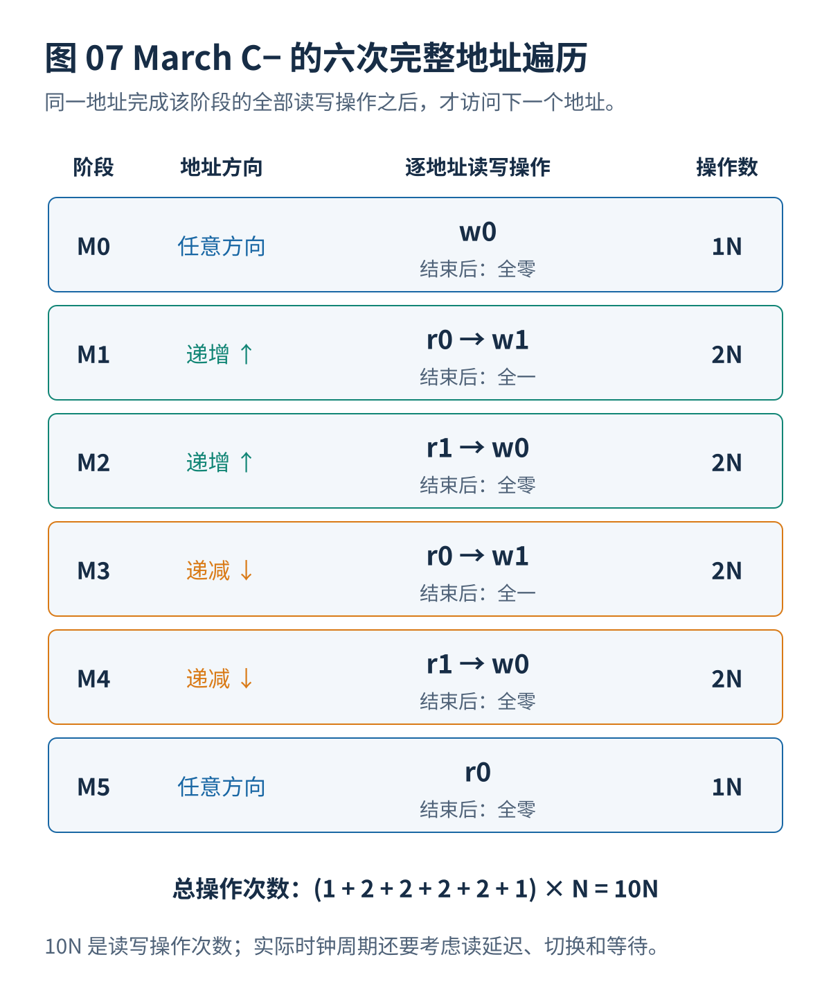
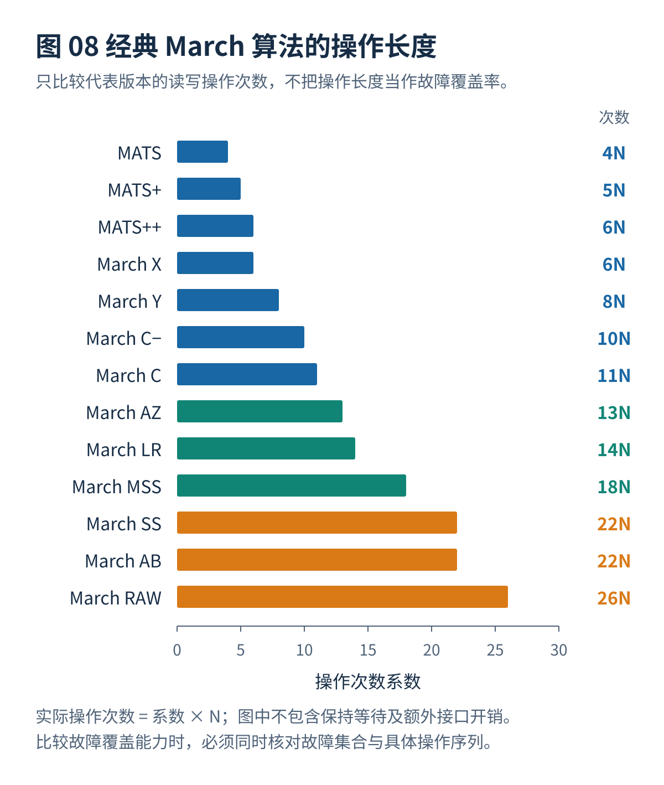

# 03 · March基础与经典算法

[总览](00_MBIST总体架构与阅读导航.md) · [上一篇：故障模型与检测原理](02_故障模型与检测原理.md) · [下一篇：增强March与复杂故障测试](04_增强March与复杂故障测试.md)

---

> **架构位置：规则测试算法层。** 从 March 符号和地址遍历入手，逐步推导 March C−，再比较经典算法。

| 设计入口 | 本专题的约定 |
|---|---|
| 输入 | 有效地址范围、数据宽度、目标基础故障模型。 |
| 输出 | 完整操作序列、无故障期望值、操作计数与基本检测解释。 |
| 建议先读 | [故障模型与检测原理](02_故障模型与检测原理.md) |


## 本篇目录

- [[#1. March 操作符号与遍历规则|1. March 操作符号与遍历规则]]
- [[#2. 逐步理解 March C−|2. 逐步理解 March C−]]
- [[#3. 经典算法家族与长度比较|3. 经典算法家族与长度比较]]
- [[#与其他设计层的衔接|与其他设计层的衔接]]

## 1. March 操作符号与遍历规则

### 1.1 标准操作符号

| 符号 | 准确含义 | 特别注意 |
|---|---|---|
| `w0` | 向当前存储地址写入逻辑值 0 | 无论以前存储什么，都执行写 0 操作 |
| `w1` | 向当前存储地址写入逻辑值 1 | 不等于从 0 变成 1；是否发生状态转换取决于原内容 |
| `r0` | 读取当前存储地址，检查返回值是否为 0 | 必须真正比较，不能只发送读取命令 |
| `r1` | 读取当前存储地址，检查返回值是否为 1 | 对同步 SRAM，需要处理读取延迟 |
| `↑` | 按给定地址次序从低地址到高地址逐一遍历 | 通常表示逻辑地址顺序，未必是物理相邻次序 |
| `↓` | 按给定地址次序从高地址到低地址逐一遍历 | 可以改变不同单元之间激励与观测的先后关系 |
| `⇕` | 可以选择升序或降序，但一个遍历过程中应保持选定顺序 | 不是在每次访问后随机翻转方向 |
| `;` | 分隔两个 March 元素 | 每个元素都重新遍历全部指定地址 |
| $N$ | 对于一次处理一位的存储器，是需要测试的存储单元数量；对于一次处理整个字的存储器，是需要遍历的字地址数量 | 必须同时注明每次操作的数据宽度 |

### 1.2 March 元素的关键规则

例如：

```text
↑(r0, w1, r1)
```

表示：从最低地址开始，先读取并检查该地址是否为 0，然后在**同一个地址**写入 1，再读取并检查是否为 1；完成上述三项操作之后才前往下一个地址。它**不是**先读取整个存储器、再写入整个存储器、最后读取整个存储器。

如果有 N 个有效地址，那么这个 March 元素执行 $3N$ 次存储器操作。

### 1.3 操作次数、复杂度与实际测试时间

对一般 March 测试：

$$
L=N\sum_{i=1}^{m}k_i,
$$

其中 $m$ 表示 March 元素数量，$k_i$ 表示第 $i$ 个 March 元素中对每个地址执行的读写操作数量。例如 `March C−` 的六个元素分别执行 `1,2,2,2,2,1` 次操作，因此总长度为 $10N$。

**重要：$10N$ 是操作计数，不代表必然只有 $10N$ 个时钟周期。** 当读出数据需要多个时钟周期、读写方向切换有额外开销、控制器存在流水线延迟，或者测试含有保持时间等待时，实际测试时间还包括这些开销：

$$
\begin{aligned}
T_{\mathrm{test}} \approx{}& L_r t_r+L_w t_w \\
&+T_{\mathrm{switch}}+T_{\mathrm{pipeline}}+T_{\mathrm{wait}}.
\end{aligned}
$$

如果一个 SRAM 支持每周期执行一次已完整确认的读或写操作，且不存在额外空闲周期，那么才可以近似为 $L\times\text{时钟周期}$。

## 2. 逐步理解 March C−

March C− 是工程中非常重要的基准。Microchip 的正式技术文档也给出了相同的六个测试阶段，并将其用于 SRAM 诊断。[^R01]

### 2.1 完整测试序列

```text
March C− = {
  ⇕(w0);
  ↑(r0, w1);
  ↑(r1, w0);
  ↓(r0, w1);
  ↓(r1, w0);
  ⇕(r0)
}

测试长度 = N + 2N + 2N + 2N + 2N + N = 10N
```



### 2.2 六个元素分别有什么作用

| 元素 | 地址方向 | 对每个地址执行的操作 | 主要目的 | 完成之后正确存储器的内容 |
|---|---|---|---|---|
| M0 | 任意固定方向 | `w0` | 令初始状态明确 | 全零 |
| M1 | 递增 | `r0, w1` | 先检验初始 0，然后执行 0→1 转换 | 全一 |
| M2 | 递增 | `r1, w0` | 检查 1，然后执行 1→0 转换 | 全零 |
| M3 | 递减 | `r0, w1` | 从相反地址方向测试 0→1 | 全一 |
| M4 | 递减 | `r1, w0` | 从相反地址方向测试 1→0 | 全零 |
| M5 | 任意固定方向 | `r0` | 检查结束时的状态 | 全零 |

为什么 M1 和 M3 都要执行 `r0,w1`？因为它们遍历地址的次序相反。对于“低地址单元的变化影响高地址单元”和“高地址单元的变化影响低地址单元”这两种情况，需要分别考虑故障何时被激励、何时被读取；如果只在一个方向遍历，就可能遗漏部分耦合条件。

为什么需要 M5？M4 的最后一次写入发生在最后访问的地址，如果不安排后续读取，某些写入异常就可能得不到观测；最终读取同时确认测试结束时的全部地址内容。

### 2.3 用四个地址解释步骤

假设待测地址为 `0、1、2、3`，M1 的执行顺序如下：

```text
地址 0：r0 → w1
地址 1：r0 → w1
地址 2：r0 → w1
地址 3：r0 → w1
```

M3 的执行顺序则是：

```text
地址 3：r0 → w1
地址 2：r0 → w1
地址 1：r0 → w1
地址 0：r0 → w1
```

这两个序列包含同一种读写操作，但它们对不同单元的**先后顺序不同**，因此对于某些耦合故障，其激励与观测能力也不同。

### 2.4 优势与不足

**主要优势：**硬件执行过程规则；只要维护 March 元素编号、读写子步骤及地址，就能生成控制指令；测试长度只有 $10N$；对经典固定值故障、状态转换故障和若干主要耦合故障模型具有良好的覆盖能力；易于作为生产测试和后续改进的对照基准。

**主要不足：**不能覆盖所有现代 SRAM 静态故障原型，尤其是某些写入干扰和伪装性读出破坏故障；不能保证检测需要连续多次操作才激活的动态故障；没有明确保持时间等待；无法仅凭逻辑地址顺序覆盖全部地址译码器缺陷与物理相邻图案敏感故障；执行时会破坏原来的存储器内容。

> **理解重点：**March C− 之所以经典，不是因为它万能，而是因为它使用较小、规则、容易硬件化的测试序列覆盖了一组非常重要的故障模型。

## 3. 经典算法家族与长度比较

### 3.1 常见算法的测试长度比较



**表中的长度只反映存储器读写操作数量，绝不能把“操作越多”直接理解为“覆盖率必然越高”。** 新算法可能针对特定故障优化，所以 $13N$ 的算法在一个故障集合上优于 $14N$ 的算法，但并不一定优于 $18N$ 算法的全部检测能力。

### 3.2 由简单到复杂的代表性算法

以下序列以文献中常见版本为准。`March X/Y` 等名称在不同资料中可能存在操作方向或末尾读取的细微差异，真正进行硬件实现时应以**序列本身**为准。[^R02][^R03][^R04]

#### 3.2.1 MATS：4N

```text
{ ⇕(w0); ↑(r0,w1); ⇕(r1) }
```

这是极为简单的基础测试：首先全部写 0，然后逐地址验证 0 并写 1，最后逐地址验证 1。优点是测试时间很短。缺点是每个地址没有完整地再执行 `1→0` 的检查，不能覆盖所有状态转换与耦合故障，不应作为要求较高的 SRAM 生产测试的唯一方案。

#### 3.2.2 MATS+：5N

```text
{ ⇕(w0); ↑(r0,w1); ↓(r1,w0) }
```

增加了从 1 写回 0 的过程，改善状态转换相关的测试能力。仍然缺少对结束时写入结果的统一检查，也不能完整覆盖复杂耦合或多操作动态故障。适用于硬件资源和测试时间非常受限的初步筛查，而非完整替代 March C−。

#### 3.2.3 MATS++：6N

```text
{ ⇕(w0); ↑(r0,w1); ↓(r1,w0,r0) }
```

相比 MATS+，它在降序元素中增加了 `r0`，使每个地址的最后一次写入立即得到确认。它对部分单存储单元和简单耦合故障有更好的观测能力，但是故障激励图案依然很有限。

#### 3.2.4 March X：6N

```text
{ ⇕(w0); ↑(r0,w1); ↓(r1,w0); ⇕(r0) }
```

March X 与 MATS++ 的总长度相同，不过最后的 `r0` 被放在独立 March 元素中。因此，它的**跨地址操作先后关系**与 MATS++ 不同。它可以作为比较短的基础算法，但不同地址方向对耦合故障的影响仍需分析。

#### 3.2.5 March Y：8N

```text
{ ⇕(w0); ↑(r0,w1,r1); ↓(r1,w0,r0); ⇕(r0) }
```

March Y 在两次状态转换写入之后立即增加读取操作，使得写入结果更快被检查。相对于 March X，能够发现部分需要紧邻写入进行观察的异常，但增加了测试长度。2021 年透明测试研究也采用这一 $8N$ 序列作为标准对照。[^R03]

#### 3.2.6 March C：11N

一种常见的完整形式是：

```text
{ ⇕(w0);
  ↑(r0,w1); ↑(r1,w0); ↑(r0);
  ↓(r0,w1); ↓(r1,w0); ⇕(r0) }
```

相对 March C−，多增加一个完整读取遍历，因此长度从 $10N$ 增加到 $11N$。增加的独立读取阶段在某些故障激励与检查之间形成了额外观察机会，但不意味着所有故障集合的覆盖能力都严格优于 March C−。有些工程实现更愿意采用 $10N$ 的 March C−。

#### 3.2.7 March C−：10N

完整推导见本专题“逐步理解 March C−”一节。它是**优先推荐的基准算法**，并非唯一值得使用的算法。

#### 3.2.8 March C+：14N

```text
{ ⇕(w0);
  ↑(r0,w1,r1);
  ↑(r1,w0,r0);
  ↓(r0,w1,r1);
  ↓(r1,w0,r0);
  ⇕(r0) }
```

四个核心遍历元素均为 `读—写—读`，每次写入后立即检验，因此有利于提高某些读写异常的可观测性。缺点是相对于 March C−，测试长度增加了 40%，对某些更复杂的静态耦合故障和动态故障仍非完整覆盖。[^R04]

#### 3.2.9 March CL：约 12N

March CL 是 March C− 的一个增强分支，通过将部分单次读取改为重复读取，或者在特定阶段增加写入后的检查，尝试改善读出相关故障的发现能力。常见版本约为 $12N$，但其测试操作在不同论文中并不一致，有的二级资料还出现读操作没有注明预期值的排版错误。因此，本专题不把未经完整原文核对的版本当作“标准序列”。评价它时，应重点检查新增的重复读取是否出现在可能触发读出破坏的时刻，以及最后能否观察到存储单元的异常。[^R04][^R14]

### 3.3 March A 和 March B：15N 与 17N

**March A 和 March B 属于早期扩展算法家族。** 与只在每个地址写入一次相反数值的极简算法不同，它们刻意安排连续的交替写入与读取，以检查一些较复杂的状态转换和耦合条件。下列是公开教程中常见、经过基本无故障状态检查的版本；与其他文献进行对照时，需要同时核验具体元素与遍历方向。[^R02]

**March A（15N）：**

```text
{ ⇕(w0);
  ↑(r0,w1,w0,w1);
  ↑(r1,w0,w1);
  ↓(r1,w0,w1,w0);
  ↓(r0,w1,w0) }
```

长度为 `1+4+3+4+3=15N`。它多次更改同一单元的内容，以扩大单次写入和连续状态变化的测试能力。最后写入 0 后没有再增加单独的完整数组检查，因此具体故障的最终观测条件需要结合序列本身分析。

**March B（17N）：**

```text
{ ⇕(w0);
  ↑(r0,w1,r1,w0,r0,w1);
  ↑(r1,w0,w1);
  ↓(r1,w0,w1,w0);
  ↓(r0,w1,w0) }
```

长度为 `1+6+3+4+3=17N`。它相对 March A 增加部分写入后读取操作，有利于观察某些写入或读取产生的异常，但操作次数增加不等于对任意故障集合都必然优于 March A。

March A 和 March B 在不同教材、工具配置或论文的命名中可能存在操作方向或末尾元素差异，因此**不能仅依算法名称判断覆盖范围**。

它们的共同特点是：

- 优点：比极简算法提供更多读写排列，可作为讨论经典故障检测条件的教学或研究对照。
- 不足：对于需要特殊连续操作的现代动态故障仍然不足；在已有 March C−、MSS、SS、AB 等明确故障原型目标的方案时，其工程优势需要重新评估。
- 实施原则：**必须保存具体算法序列及其检测故障集合，不要只在测试报告中写“March B”。**

## 与其他设计层的衔接

本专题输出需要继续交给[存储器接口与测试控制器](01_存储器接口与测试控制器.md)、[增强March与复杂故障测试](04_增强March与复杂故障测试.md)、[测试算法生成与选择](05_测试算法生成与选择.md)。改变某一层的条件以后，应重新检查受到影响的接口和验证要求。


## 本篇参考资料

完整去重文献与原编号见[参考文献与研究进展索引](90_参考文献与研究进展索引.md)。本篇脚注保留所用来源，便于独立阅读。

[^R01]: **R01** — **Microchip Technology.** *March C− Test for SRAM*, Microchip Online Documentation. [官方技术说明](https://onlinedocs.microchip.com/oxy/GUID-CA566412-3E3C-467B-98AF-9F1D156615B7-en-US-3/GUID-8D7156E0-ECFE-4055-B0DE-AC9C32162163.html)。用于核实经典六阶段算法和工程语境。

[^R02]: **R02** — **ASP-DAC 2025 Tutorial T3-1.** 存储器测试、功能故障模型与 March 方法教程。[官方教程 PDF](https://www.aspdac.com/aspdac2025/archive/pdf/T3-1.pdf)。用于经典测试表达、故障模型与测试控制器背景。 原系统教程补充：官方教程共 57 页；原整理阶段阅读了相关内容并检查物理地址循环示例。

[^R03]: **R03** — **Mrozek, I.; Yarmolik, V.（2021）.** *Transparent Memory Testing with a Double Address Sequence.* **Entropy**, 23(7), 894. [DOI: 10.3390/e23070894](https://doi.org/10.3390/e23070894)。透明测试、`8N` 和 `14N` 地址重复序列。

[^R04]: **R04** — **Liu 等（2023）.** 《一种基于存储器内建自测试的新型动态 March 算法设计》，《电子与信息学报》。[DOI: 10.11999/JEIT221032](https://doi.org/10.11999/JEIT221032)。Dynamic-RAWC、282 个动态故障原型与覆盖率对照。**注意其比较表中 March AB 的操作次数标注问题。**

[^R14]: **R14** — **Jidin 等（2026）.** *A comprehensive review of memory BIST algorithms for SRAM static fault detection.* **Indonesian Journal of Electrical Engineering and Computer Science**, 43(2), 400–412. [DOI: 10.11591/ijeecs.v43.i2.pp400-412](https://doi.org/10.11591/ijeecs.v43.i2.pp400-412)。2026 年静态故障算法综述、March MSS 和短序列的覆盖权衡。

---

[总览](00_MBIST总体架构与阅读导航.md) · [上一篇：故障模型与检测原理](02_故障模型与检测原理.md) · [下一篇：增强March与复杂故障测试](04_增强March与复杂故障测试.md)
