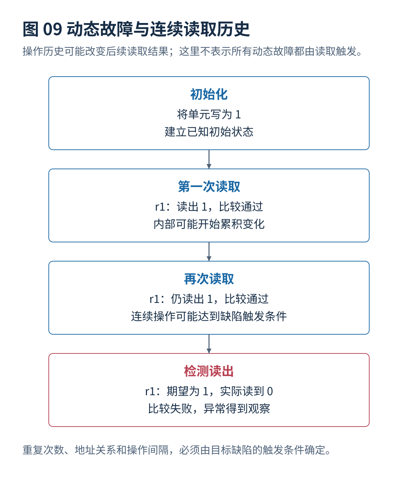
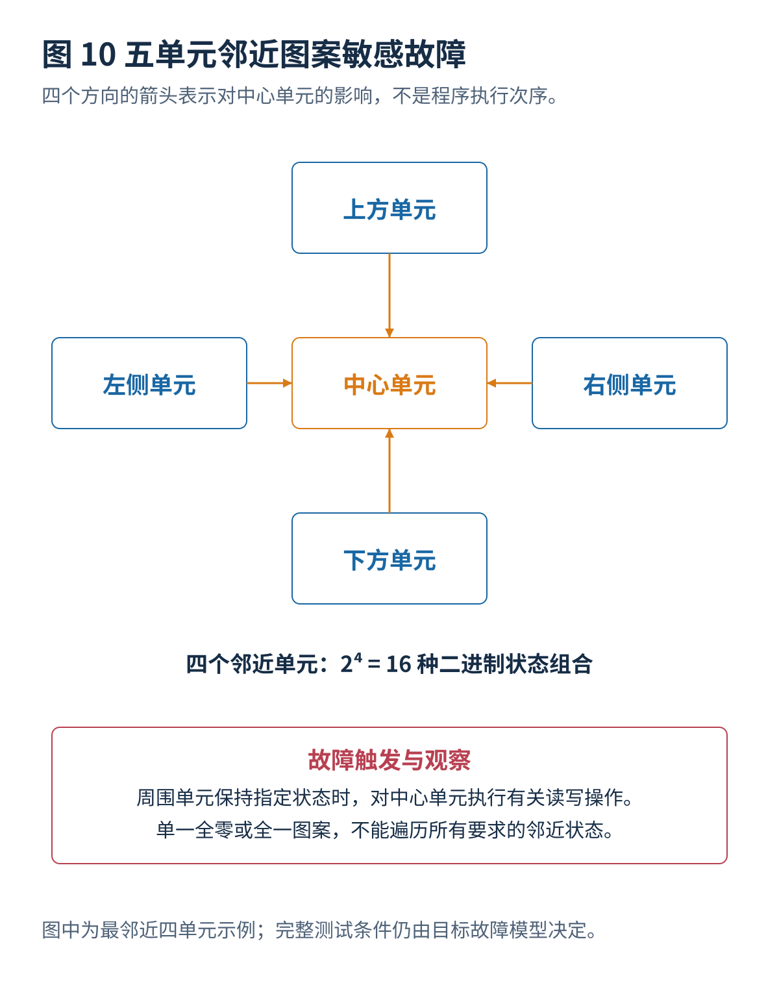
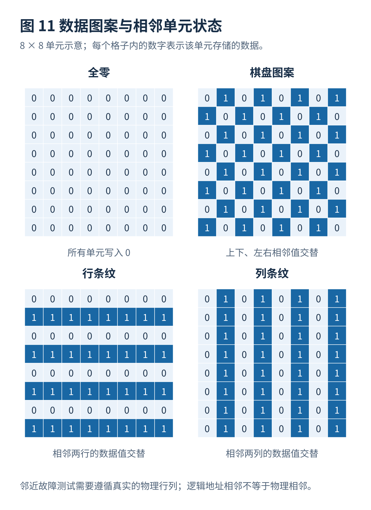
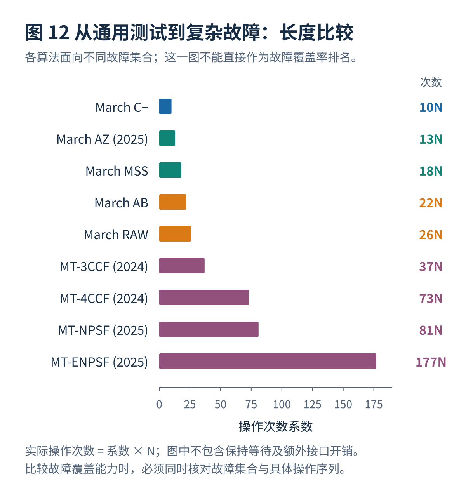

# 04 增强 March 与复杂故障测试

[总览](00_MBIST总体架构与阅读导航.md) · [上一篇：March基础与经典算法](03_March基础与经典算法.md) · [下一篇：测试算法生成与选择](05_测试算法生成与选择.md)

本章按**故障条件、完整序列、逐操作检测过程、操作次数和适用条件**介绍增强算法。`r0/r1` 均包含期望值比较；一个 March 元素内的操作在同一地址完成。`a` 表示影响故障的单元，`v` 表示出现错误的单元，`a<v` 表示二者在选定地址次序中的位置关系。

对普通静态单元故障，状态用当前存储值描述；对动态故障，还应记录连续操作、重复次数和时间间隔。背景相关序列中的 `r(e)` 和 `w(e)` 使用独立计算的无故障期望值 `e`，不能将待测存储器的实际读数直接当作期望值。

## 目录

- [[#1. 复杂静态故障序列|1. 复杂静态故障序列]]
- [[#2. 动态故障与操作历史|2. 动态故障与操作历史]]
- [[#3. 物理邻近关系与背景切换|3. 物理邻近关系与背景切换]]
- [[#4. 三单元和四单元测试的完整展开|4. 三单元和四单元测试的完整展开]]
- [[#5. 五单元邻近图案测试的完整展开|5. 五单元邻近图案测试的完整展开]]
- [[#6. 地址译码与字内测试的补充序列|6. 地址译码与字内测试的补充序列]]
- [[#7. 算法比较与验证方法|7. 算法比较与验证方法]]

## 1. 复杂静态故障序列

### 1.1 增强操作分别增加了什么检测条件

| 操作片段 | 无故障状态 | 直接对应的检测条件 | 观察错误的操作 |
|---|---|---|---|
| 已知为 0 后 `w0,r0` | 0→0→0 | 向 0 再次写 0 导致翻转的 WDF；增加影响单元状态条件后为 CFwd | 紧随写入的 `r0` |
| 已知为 1 后 `w1,r1` | 1→1→1 | 向 1 再次写 1 的 WDF / CFwd | 紧随写入的 `r1` |
| `r0,r0` | 两次都读取 0 | 第一次读取返回 0、随后把存储值破坏成 1 的 DRDF / CFdrd | 第二个 `r0` |
| `w1,r1`，写入前为 0 | 0→1→1 | 0→1 转换失败的 TF / CFtr | `r1` |
| `r(e),w(1−e)` | 先检查旧内容，再改写 | 其他地址此前使当前单元改变的干扰故障 | 写入前的 `r(e)` |
| 发生激活后，在另一项可能恢复数据的操作之前读取 | 错误被保持到比较时刻 | 两个故障相互影响时的掩盖问题 | 两项操作之间的读取 |

这些片段的含义由故障原型决定。例如，DRDF 的第一次读取可以返回正确数据，因此必须安排第二次读取，并在两次读取之间避免改变该单元的值。静态故障原型和读出值的正式定义见 Hamdioui 等人的工作。[^MS01]

### 1.2 March LR：14N

采用下面的明确形式：

```text
M0: ⇕(w0)
M1: ↓(r0,w1)
M2: ↑(r1,w0,r0,w1)
M3: ↑(r1,w0)
M4: ↑(r0,w1,r1,w0)
M5: ↑(r0)
```

长度为 `(1+2+4+2+4+1)N=14N`。LR 的原始研究面向特定相互影响的故障；SS 原论文也列出了这一形式。[^R13][^MS01]

`M2` 的 `w0,r0` 和 `M4` 的 `w1,r1` 是关键检查位置：先在当前单元执行转换写入，再立即读取转换结果。以 `M2` 中的 `1→0` 转换失败为例，`r1` 确认转换前的 1，`w0` 尝试转换，紧接着的 `r0` 会读出实际的 1 并报告错误，最后的 `w1` 尚未执行。因此，异常不会等到单元重新写为 1 后才被检查。

对于跨地址故障，需要再检查影响单元的访问位置。例如，降序 `M1` 在升序 `M2` 之前完成，使高地址和低地址单元在不同阶段分别处于 0 与 1。设计 LR 变体时，应保存所采用的完整六元素定义，并针对目标相互影响的原型逐项仿真。

### 1.3 March SR：14N

```text
M0: ↓(w0)
M1: ↑(r0,w1,r1,w0)
M2: ↑(r0,r0)
M3: ↑(w1)
M4: ↓(r1,w0,r0,w1)
M5: ↓(r1,r1)
```

长度为 `(1+4+2+1+4+2)N=14N`。这一形式取自 March SS 原论文中列出的 SR 序列。[^MS01]

`M1` 与 `M4` 提供转换写入和写后读取；`M2` 与 `M5` 分别提供 0 状态和 1 状态的连续读取。以 DRDF0 为例，`M2` 的第一个 `r0` 返回 0，同时使内部状态成为 1；第二个 `r0` 读取 1，比较失败。DRDF1 在 `M5` 具有互补的执行过程。

SR 中的 `w0` 和 `w1` 主要发生在转换时刻，因此它缺少系统性的非转换写入条件。例如，已知单元为 0 时专门再次执行 `w0` 的 WDF0 激活步骤，应由 SS、MSS 等序列补充。

### 1.4 March SS：22N

```text
M0: ⇕(w0)
M1: ↑(r0,r0,w0,r0,w1)
M2: ↑(r1,r1,w1,r1,w0)
M3: ↓(r0,r0,w0,r0,w1)
M4: ↓(r1,r1,w1,r1,w0)
M5: ⇕(r0)
```

长度为 `(1+5+5+5+5+1)N=22N`。原论文研究的是明确列举的非相互影响静态单单元、双单元故障集合。[^MS01]

#### 1.4.1 M1 的五项操作怎样检测不同故障

下表从无故障值为 0 的单元开始。各行介绍独立注入某一种故障时的行为。

| 子步骤 | 操作 | 该位置的检测作用 | 具体失效过程 |
|---:|---|---|---|
| 1 | `r0` | 检查初始化结果；检测固定值、错误读出和立即可见的读破坏 | 若单元固定为 1，则实际读出 1，立即报告错误 |
| 2 | `r0` | 观察第一项读取引起的延迟可见变化 | DRDF0 在第一次读取后将内部值改成 1，第二次读取发现错误 |
| 3 | `w0` | 在已知为 0 的状态下执行非转换写入 | WDF0 可在这里使单元变成 1 |
| 4 | `r0` | 观察非转换写入的结果 | WDF0 激活后实际读出 1，报告错误 |
| 5 | `w1` | 激活 0→1 转换相关故障，并改变后续地址的相对背景 | TF0→1 使单元保持 0，后续 `M2` 的第一个 `r1` 发现错误 |

`M2` 是互补极性的安排。`M3`、`M4` 改变访问方向，使相同受害单元分别在影响单元已访问和未访问的情况下接受测试。

#### 1.4.2 方向如何形成四种双单元条件

只考虑某次遍历中访问 `v` 的时刻，且此前未发生错误：

| 元素 | `v` 进入元素时的值 | 当 `a<v` 时 `a` 的值 | 当 `a>v` 时 `a` 的值 |
|---|---:|---:|---:|
| `M1 ↑` | 0 | 1 | 0 |
| `M2 ↑` | 1 | 0 | 1 |
| `M3 ↓` | 0 | 0 | 1 |
| `M4 ↓` | 1 | 1 | 0 |

例如，故障条件为 `a=1` 时，向值为 0 的 `v` 再写 0 会把 `v` 破坏成 1。若 `a<v`，`M1` 在访问 `v` 前已经把 `a` 写成 1，因此 `M1` 的第三项 `w0` 激活故障，第四项 `r0` 观测错误；若 `a>v`，相同过程发生在 `M3`。这个例子解释了 CFwd 的数据极性、地址关系与读取位置怎样共同形成检测条件。

### 1.5 March MSS：18N

```text
M0: ⇕(w0)
M1: ↑(r0,r0,w1,w1)
M2: ↑(r1,r1,w0,w0)
M3: ↓(r0,r0,w1,w1)
M4: ↓(r1,r1,w0,w0)
M5: ⇕(r0)
```

长度为 `(1+4+4+4+4+1)N=18N`。Harutyunyan、Vardanian 和 Zorian 提出了这一低操作数的非相互影响静态故障测试。[^MS02]

以 `M1` 为例，前两个 `r0` 检测 DRDF0；第一个 `w1` 产生转换，第二个 `w1` 在正常情况下产生非转换写入，从而激活 WDF1。若第二个 `w1` 把单元破坏成 0，下一元素的第一个 `r1` 读出 0。对永久 TF0→1，连续两次 `w1` 都无法完成转换，下一次 `r1` 同样检测错误。这里的分析要求故障条件在同一地址连续执行的两次写入之间保持成立。

MSS 将部分立即检查移动到后续元素，因此复现时必须保持元素顺序和方向；跨元素的第一次读取承担了前一元素写入结果的检查任务。

### 1.6 March AB：22N

```text
M0: ⇕(w0)
M1: ↓(r0,w1,r1,w1,r1)
M2: ↓(r1,w0,r0,w0,r0)
M3: ↑(r0,w1,r1,w1,r1)
M4: ↑(r1,w0,r0,w0,r0)
M5: ⇕(r0)
```

长度为 `(1+5+5+5+5+1)N=22N`。Benso 等人在 2006 年针对规定的现实静态相互影响故障集合提出该序列；2007 年的扩展论文进一步讨论动态非相互影响故障。[^MS03][^MS04]

`r0,w1,r1,w1,r1` 同时包含状态检查、转换写入及检查、非转换写入及检查。最前面的 `r0` 还可以在其他故障尚未被激活时单独观察某个读故障。

**相互影响故障的操作例子。** 设同一单元含有两项原型：

- `F1`：值为 1 时执行 `w1`，内部值错误地变为 0。
- `F2`：值为 0 时读取，内部值变为 1，并返回 1。

从 0 开始执行 `w1,r1,w1,r1` 时，第一个 `w1,r1` 正常；第二个 `w1` 激活 `F1`，末尾读取激活 `F2` 并返回 1，因而这一片段未看到错误。AB 元素在开头先执行 `r0`：这时 `F1` 尚未激活，`F2` 返回 1，与期望的 0 不符，错误得到检测。

这一例子体现了 AB 的目标：让至少一个组成原型在另一项原型掩盖它之前被观察。其跨地址覆盖还依赖原论文规定的影响单元、受害单元位置与故障组合，使用时应按这些条件生成故障实例。

### 1.7 March AZ1、March AZ 与 March AZ2

#### 1.7.1 三套完整序列

以下 AZ1 与 AZ 按 2025 年论文的逐元素定义及元素移动规则展开；AZ2 采用 2026 年控制器论文的六元素定义。[^MS05][^MS06]

```text
March AZ1（13N）：
{ ⇕(w0);
  ↓(w1);
  ↑(w1,r1,r1,w0);
  ↑(w0,r0);
  ↑(r0,w1,w1,r1);
  ↑(r1) }

March AZ（13N）：
{ ⇕(w0);
  ↓(w1);
  ↑(w1,r1,r1,w0,w0);
  ↑(r0);
  ↑(r0,w1,w1,r1);
  ↑(r1) }

March AZ2（14N）：
{ ↓(w0);
  ↓(w0,r0);
  ↑(r0,w1,w1,r1);
  ↑(r1,w0);
  ↓(r0,w1,w1,r1);
  ↓(r1) }
```

AZ1 的计数为 `1+1+4+2+4+1=13`；AZ 为 `1+1+5+1+4+1=13`；AZ2 为 `1+2+4+2+4+1=14`。

#### 1.7.2 移动一次写入为何改变 CFtr 的检测

考虑四个地址 `0,1,2,3`，`v=0`、`a=2`。故障定义为：**当 `a=1` 时，`v` 的 `1→0` 写入失败；当 `a=0` 时，这次写入可以成功。**[^MS05]

| 执行时刻 | `a` 的状态 | AZ 中 `v` 的无故障值 | AZ 中 `v` 的故障值 | 作用 |
|---|---:|---:|---:|---|
| 初始化并完成 `↓(w1)` | 1 | 1 | 1 | 建立激活条件 |
| 升序第三元素到达 `v=0`，执行第一个 `w0` | 1 | 0 | 1 | 激活 CFtr |
| 紧接着对同一 `v` 执行第二个 `w0` | 1 | 0 | 1 | 条件保持，错误仍然存在 |
| 第三元素继续访问 `a=2` 并把它写为 0 | 0 | 0 | 1 | 结束激活条件，但错误值仍保存在 `v` |
| 第四元素对 `v=0` 执行 `r0` | 0 | 0 | 读出 1 | 检测此前留下的错误 |

AZ1 在第四元素先执行 `w0` 再执行 `r0`。这次写入发生时 `a` 已经为 0，可能把 `v` 恢复成正常值。AZ 将这次写入提前到第三元素中，使第四元素首先读取原有结果。两套序列的操作总数相同，观测时刻不同。

#### 1.7.3 AZ2 的操作职责与统计范围

在 M0 已成功建立零状态的条件下，`M1 ↓(w0,r0)` 提供零状态非转换写入检查；`M2 ↑(r0,w1,w1,r1)` 与 `M4 ↓(r0,w1,w1,r1)` 在两种方向中检查转换写入及一状态非转换写入；`M3 ↑(r1,w0)` 建立零状态；最后的 `r1` 检查末尾状态及部分跨元素读破坏。

论文用六类单单元故障的 12 个原型，加上 CFtr、CFdrd、CFwd 各 8 个原型，共 36 个原型计算覆盖率。这里的 8 个包含两种地址相对位置。AZ 的报告结果为 `30/36=83.3%`，三类耦合故障各检测 `6/8`。这一分母应随结果一起保存。[^MS05][^MS06]

配套的 36 原型程序使用未知初始值，首写为状态相关激活条件建立可比较的初态。上电状态已经确定且故障从第一次写入就生效时，还需单独检查初始化过程。例如 AZ2 遇到初始为 0 的 WDF0：M0 的 `w0` 可将内部值破坏为 1；M1 的 `w0` 随后成为 1→0 转换并成功返回 0，其 `r0` 通过。后续元素缺少再次对已知 0 执行 `w0,r0` 的机会，此实例会遗漏。第 13 章的三地址枚举保留了这一设置；针对该单单元条件，可使用 `w1,w0,w0,r0` 的完整局部检查。由此，算法统计应同时说明原型集合与初始状态处理方式。

## 2. 动态故障与操作历史

### 2.1 先定义连续操作的含义

一个动态原型至少应说明：初始状态、参与地址、操作串、允许的间隔、是否允许插入其他地址访问、故障引起的内部状态、激活读返回的数据。下面采用的教学模型使用**同一地址连续操作，写入重置读取计数**。更复杂的模型可同时跟踪多个地址，见[故障模型与检测原理](02_故障模型与检测原理.md)。



例如，已知单元为 0，第三次连续读取使内部值变为 1，第三次仍返回 0，则检测片段为：

```text
w0, r0, r0, r0, r0
```

前两个 `r0` 累积操作历史；第三个 `r0` 激活故障并返回 0；第四个 `r0` 读出内部的 1。若第三次读取后立即写入，错误可能在比较前消失。

### 2.2 March RAW：26N

```text
M0: ⇕(w0)
M1: ↑(r0,w0,r0,r0,w1,r1)
M2: ↑(r1,w1,r1,r1,w0,r0)
M3: ↓(r0,w0,r0,r0,w1,r1)
M4: ↓(r1,w1,r1,r1,w0,r0)
M5: ⇕(r0)
```

长度为 `(1+6+6+6+6+1)N=26N`。蔡志匡等人的原文给出了用于对照的这一完整形式。[^MS07]

以 `M1` 为例：第一个 `r0` 检查历史影响；`w0` 在正常零状态下执行非转换写入；随后的两个 `r0` 先观察写入结果，再观察前一次读取是否破坏存储值；`w1,r1` 产生并检查上升转换。对于原型 `0w0r0/1/0`，`w0` 与紧随的第一个 `r0` 共同激活故障，该读取仍返回 0，第二个 `r0` 发现内部的 1。

在这一特定动态模型中，`w0,r0` 的连续关系必须保持。控制器若在二者之间插入其他地址操作，需要重新核查故障模型对插入操作的规定。

### 2.3 13N 分离读取示例

下面给出一套便于理解 RAW1 类组织方式的完整 13N 示例。此处固定采用升序，并把每个元素单独列出：

```text
{ ↑(w0);
  ↑(w0,r0); ↑(r0);
  ↑(w1,r1); ↑(r1);
  ↑(w1,r1); ↑(r1);
  ↑(w0,r0); ↑(r0) }
```

长度为 `(1+2+1+2+1+2+1+2+1)N=13N`。第一次 `w0,r0` 检查零状态非转换写入；第二次写 1 的元素检查一状态非转换写入；每个独立读取元素观察前一元素留下的状态。这是一套**跨遍历读取的教学实例**，适合对静态读写故障进行操作解释。

独立读取遍历与同一地址的连续读取在时间上不同。比如地址 0 的前后两次读取之间会插入其他地址访问；若某个动态原型要求严格连续的 `r0,r0`，应使用明确包含该片段的元素。

### 2.4 Dynamic-RAWC1：重复读取参数的完整定义

`(r0)^n` 表示在同一地址连续执行 `n` 次读取，每次均比较期望值 0；`n` 为正整数。原文讨论的范围为 `1≤n≤9`。[^MS07]

```text
M0: ⇕(w0)
M1: ↑(r0,w0,(r0)^n,r0,w1,r1)
M2: ↑(r1,w1,(r1)^n,r1,w0,r0)
M3: ↓(r0,w0,r0,r0,w1,r1)
M4: ↓(r1,w1,r1,r1,w0,r0)
M5: ⇕(r0)
```

$$
L_1=[1+(n+5)+(n+5)+6+6+1]N=(24+2n)N.
$$

`n=1` 时为上述 RAW 的 26N 形式；`n=3` 时长度为 30N，`M1` 明确展开为：

```text
r0, w0, r0, r0, r0, r0, w1, r1
```

`w0` 后有连续四次读取，足以检测第 2.1 节定义的第三次读取后破坏模型。各阶段的状态为：

| 操作 | 正常存储值 | 故障存储值 | 实际读数 | 比较结果 |
|---|---:|---:|---:|---|
| `w0` | 0 | 0 | 无 | 初始化连续读取历史 |
| 第一次 `r0` | 0 | 0 | 0 | 通过 |
| 第二次 `r0` | 0 | 0 | 0 | 通过 |
| 第三次 `r0` | 0 | 1 | 0 | 激活故障，读数暂时正确 |
| 第四次 `r0` | 0 | 1 | 1 | 发现错误 |

若目标模型在第 `q` 次读取后才破坏数据、该次读取仍返回旧值，连续读取数至少应达到 `q+1`。本元素在 `w0` 后的连续读取数是 `n+1`，因此需要 `n≥q`。

### 2.5 Dynamic-RAWC2：重复写入与读取组合

原文给出的较丰富形式如下，参数范围为 `1≤n≤8`。[^MS07]

```text
M0: ⇕(w0)
M1: ↑(r0,w0,w0,(r0)^n,r0,r0,w0,r0,w1,r1)
M2: ↑(r1,w1,w1,(r1)^n,r1,r1,w1,r1,w0,r0)
M3: ↓(r0,w0,w0,r0,r0,r0,w0,r0,w1,r1)
M4: ↓(r1,w1,w1,r1,r1,r1,w1,r1,w0,r0)
M5: ⇕(r0)
```

$$
L_2=[1+(n+9)+(n+9)+10+10+1]N=(40+2n)N.
$$

当 `n=3` 时，每个升序元素含 12 项操作，总长度为 46N。以零状态元素为例，主要片段的作用如下。

| 片段 | 指向的操作历史 | 可观察的故障例子 |
|---|---|---|
| `w0,w0,r0` | 两次连续零写入后读取 | 第二次非转换写入才把 0 改成 1，随后 `r0` 发现错误 |
| `w0,(r0)^n,r0,r0` | 写入后连续读取 | 达到读取阈值后出现的数据破坏 |
| `r0,r0,w0,r0` | 连续读取后再写入同值 | 前序读操作改变内部条件，后续非转换写入使状态失效 |
| `w1,r1` | 最后一次转换写入及读取 | 观察上升转换失败或即时读写错误 |

最后一列是按相应操作串定义的具体故障例子。每个物理宏所需的重复次数和时间间隔，应由其器件模型或缺陷仿真确定。

### 2.6 论文中的动态故障结果如何使用

蔡志匡等人以 282 个动态故障原型作为统计对象，报告 MATS++ 为 `6/282`，March C− 为 `18/282`，C+ 为 `58/282`，AB 为 `112/282`，RAW 为 `140/282`，Dynamic-RAWC 为 `228/282`。这组结果描述论文所选动态模型集合；将它用于新的器件时，应保留每个原型的操作历史、参数和执行条件。[^MS07]

生成器可以把 `n`、元素是否启用、读写之间的等待周期作为可搜索参数，但每个候选都应输出实际展开序列。不同 `n` 的候选具有不同长度，比较时应分别记录实际操作数。

## 3. 物理邻近关系与背景切换

### 3.1 三单元、四单元与五单元分别指什么

本章多背景算法采用位寻址的 `N×1` 存储阵列，行、列地址记为 `Ar`、`Ac`。三个单元模型采用一个 2×2 方块中呈角形分布的三个相邻单元；四个单元模型采用完整 2×2 方块；五个单元模型由中心单元和上、下、左、右四个邻居组成。[^MS08][^MS09]



物理地址与逻辑地址的对应关系、位交织方式和边缘单元的处理应写入测试规格。下面假设采用逐行递增的物理地址次序，且测试的邻域位于阵列内部。对实际阵列边缘，可按存在的邻居单独构建缩减模型；环绕连接仅适用于明确具有这种结构的阵列。

### 3.2 `wt`、`wnt` 与期望值的展开

| 记号 | 以当前期望值 `e` 展开 | 执行后的期望值 |
|---|---|---:|
| `r` | `r(e)` | `e` |
| `wt` | `w(1−e)`，转换写入 | `1−e` |
| `wnt` | `w(e)`，非转换写入 | `e` |

例如从 `e=0` 开始执行 `r,wt,wnt,r`，准确操作为 `r0,w1,w1,r1`。随后从 `e=1` 开始再次执行同一片段，得到 `r1,w0,w0,r0`。这里 `e` 由测试程序计算，故障注入只改变被测阵列，期望值模型独立更新。

### 3.3 背景切换 `BGC` 的完整执行规则

设第 `i−1` 个背景为 `B_old(a)`，第 `i` 个背景为 `B_new(a)`。首次背景写入和后续切换定义为：

```text
BGC1:
    按升序访问每个地址 a，执行 w(B1(a))。

BGCi，i>1:
    按升序访问地址 a。
    如果 B_old(a) != B_new(a)：
        执行 r(B_old(a))；
        执行 w(B_new(a))。
    如果两者相等：不发送存储器读写操作。
```

先读旧值的作用是保留上一轮故障的可见性。假设上一轮使某单元从期望的 0 变成 1，而新背景要求该单元为 1；直接执行 `w1` 后，实际值就与新期望值一致。先执行 `r0` 可以在切换期望值之前发现上一轮产生的错误。

如果每次背景变化恰好影响一半单元，`BGCi` 的读写数为 `(N/2)+(N/2)=N`。这个计数针对实际存储器操作。控制器逐地址计算是否改变背景时，仍可能需要扫描其余地址，因此操作数和执行周期数应分别统计。



## 4. 三单元和四单元测试的完整展开

### 4.1 MT-R3CCF：21N

四个背景依次为：

| 背景 | `B_i(Ar,Ac)` | 2×2 周期图案，各行用 `/` 分隔 |
|---:|---|---|
| 1 | `0` | `00 / 00` |
| 2 | `Ar[0] XOR Ac[0]` | `01 / 10` |
| 3 | `Ar[0]` | `00 / 11` |
| 4 | `Ac[0]` | `01 / 01` |

完整算法采用第 3.3 节定义的 `BGCi`：[^MS08]

```text
对 i=1,2,3,4，依次执行：
    BGCi
    ↑(r(B_i), w(1−B_i))
    ↑(r(1−B_i), w(B_i))
最后：↑(r(B_4))
```

两个升序元素分别把背景变为互补背景、再恢复原背景。此模型考虑转换写入激活的角形三单元耦合。长度为 `4×(N+2N+2N)+N=21N`。

### 4.2 MT-3CCF：37N

沿用相同四背景，每次转换后增加非转换写入和读取：[^MS08]

```text
对 i=1,2,3,4，依次执行：
    BGCi
    ↑(r(B_i), w(1−B_i), w(1−B_i), r(1−B_i))
    ↑(r(1−B_i), w(B_i), w(B_i), r(B_i))
最后：↑(r(B_4))
```

长度为 `4×(N+4N+4N)+N=37N`。`wt,wnt,r` 同时安排转换失败、非转换写入破坏及读取异常的检测条件；元素开头的读取保留了其他单元先前可能造成的干扰结果。

**具体三单元例子。** 令角形三个单元按访问次序为 `(a1,v,a2)`，某轮第一遍历前的背景为 `(0,0,1)`。假设故障为：`a1=1` 且 `a2=1` 时，`v` 执行非转换写 1 会被破坏为 0。第一遍历先使 `a1` 由 0 变为 1，再访问 `v`：

```text
v:r0  → v:w1 → v:w1 → v:r1
```

第一个 `w1` 使 `v` 正常变为 1；第二个 `w1` 是非转换写入，此时两项外部条件都为 1，故障使 `v` 变成 0；随后的 `r1` 读出 0，发现错误。`a2` 在此时尚未被访问，因而保持初始的 1。这个例子也说明了为什么必须在访问 `v` 的准确时刻计算其他单元的状态。

### 4.3 三单元状态转换为什么恰好可以覆盖

三个单元有 `2^3=8` 个状态，每个状态可选择三个单元之一进行转换，因此共有 `3×8=24` 条有向转换边。每个背景下，两次升序遍历在这个局部组内执行 `2×3=6` 次转换；四背景共有 24 次。

对每一种角形朝向及其物理奇偶位置，四背景给出四对互补初态。在给定访问次序下，这些初态产生的转换边互不重复，覆盖全部 24 条边。扩展模型还要求每个状态中的三次读取自环和三次非转换写入自环，总操作类别数为 `3×3×8=72`。本章附带的操作检查按物理位置枚举这些类别；故障检测还需检查读取结果是否在后续写入前保留。

### 4.4 MT-4CCF：73N

四单元采用下表的八个背景：[^MS08]

| 背景 | `B_i(Ar,Ac)` | 2×2 周期图案 |
|---:|---|---|
| 1 | `0` | `00 / 00` |
| 2 | `Ac[0]` | `01 / 01` |
| 3 | `1` | `11 / 11` |
| 4 | `1 XOR Ac[0]` | `10 / 10` |
| 5 | `Ar[0]` | `00 / 11` |
| 6 | `Ar[0] XOR Ac[0]` | `01 / 10` |
| 7 | `1 XOR Ar[0]` | `11 / 00` |
| 8 | `1 XOR Ar[0] XOR Ac[0]` | `10 / 01` |

每个背景下执行一次含八项操作的升序元素：

```text
对 i=1,...,8，依次执行：
    BGCi
    ↑(r(B_i),w(1−B_i),w(1−B_i),r(1−B_i),
      r(1−B_i),w(B_i),w(B_i),r(B_i))
最后：↑(r(B_8))
```

与三单元双遍历的结构不同，这里在同一地址先转换再返回，之后才访问下一个地址。四单元的其余三个单元在当前单元接受八项操作时保持背景值。长度为 `8×(N+8N)+N=73N`。

每个 2×2 组的八种背景给出八个偶数奇偶性的四位状态；从每个这样的状态分别翻转一个单元，再翻转回来，可以覆盖 `4×16=64` 条有向转换边。`wnt` 和读取检查在两个极性中分别执行。

例如，某个状态为 `(1,0,0,1)`，第三个单元执行 `r0,w1,w1,r1,r1,w0,w0,r0`。若其他三个单元处于 `(1,0,1)` 时，该单元的第二次 `w1` 会使内部值错误地变为 0，则第四项 `r1` 发现故障；若一次 `r1` 返回 1 后破坏内部状态，则紧随的另一次 `r1` 可以检查变化。

## 5. 五单元邻近图案测试的完整展开

### 5.1 十六个 4×4 背景的准确生成公式

令 `r0=Ar[0]`、`r1=Ar[1]`、`c0=Ac[0]`、`c1=Ac[1]`，`X=c0 XOR c1`、`Y=r0 XOR r1`。下表给出 2025 年论文的全部背景，覆盖公式与图案均可直接编程实现。[^MS09]

| 背景 | 生成公式 | 4×4 周期图案，各行用 `/` 分隔 |
|---:|---|---|
| 1 | `0` | `0000 / 0000 / 0000 / 0000` |
| 2 | `r0` | `0000 / 1111 / 0000 / 1111` |
| 3 | `c0` | `0101 / 0101 / 0101 / 0101` |
| 4 | `r0 XOR c0` | `0101 / 1010 / 0101 / 1010` |
| 5 | `c1` | `0011 / 0011 / 0011 / 0011` |
| 6 | `X` | `0110 / 0110 / 0110 / 0110` |
| 7 | `r1` | `0000 / 0000 / 1111 / 1111` |
| 8 | `Y` | `0000 / 1111 / 1111 / 0000` |
| 9 | `Y XOR c0` | `0101 / 1010 / 1010 / 0101` |
| 10 | `r1 XOR c0` | `0101 / 0101 / 1010 / 1010` |
| 11 | `r0 XOR c1` | `0011 / 1100 / 0011 / 1100` |
| 12 | `r0 XOR X` | `0110 / 1001 / 0110 / 1001` |
| 13 | `Y XOR X` | `0110 / 1001 / 1001 / 0110` |
| 14 | `r1 XOR X` | `0110 / 0110 / 1001 / 1001` |
| 15 | `1 XOR Y XOR c1` | `1100 / 0011 / 0011 / 1100` |
| 16 | `1 XOR r1 XOR c1` | `1100 / 1100 / 0011 / 0011` |

相邻两背景在完整周期中恰好改变一半单元。若阵列行、列数不能由 4 整除，应按实际改变的地址数重新计算 `BGC` 成本，并对每类有效邻域执行检查。

### 5.2 MT_NPSF_81N：两次升序转换

完整算法如下：[^MS09]

```text
对 i=1,...,16，依次执行：
    BGCi
    ↑(r(B_i),w(1−B_i))
    ↑(r(1−B_i),w(B_i))
最后：↑(r(B_16))
```

$$
L=16(N+2N+2N)+N=81N.
$$

一个背景产生两次互补转换，每次升序遍历按上邻居、左邻居、中心、右邻居、下邻居的次序访问局部五单元组。这个局部次序随物理地址组织而定；在逐行递增地址下，以上顺序成立。

**被动邻域故障。** 假设中心单元为 0，邻居处于特定图案 `P` 时，其 `w1` 不能使状态改变。某轮转换到达中心单元时正好形成 `P`，中心 `w1` 激活故障。下一次对中心的读取期望为 1；只要在此之前没有改写中心，`r1` 将发现实际的 0。

**主动邻域故障。** 假设右邻居从 0 变为 1 时，在其余邻居满足某图案的条件下把中心从 1 变为 0。右邻居的 `wt` 负责激活；下一轮访问中心时的首个读取，或背景切换前对中心的读取，负责观察错误。`BGC` 中先读后写是保留这类错误的必要组成部分。

### 5.3 MT_ENPSF：177N

将每个两操作元素扩展为五操作元素：

```text
对 i=1,...,16，依次执行：
    BGCi
    ↑(r(B_i),w(B_i),r(B_i),r(B_i),w(1−B_i))
    ↑(r(1−B_i),w(1−B_i),r(1−B_i),r(1−B_i),w(B_i))
最后：↑(r(B_16))
```

$$
L=16(N+5N+5N)+N=177N.
$$

这对应 `↑(r,wnt,r,r,wt)` 连续执行两次。对一个当前期望为 0 的中心单元，五项操作明确为：[^MS09]

| 步骤 | 操作 | 检测职责 |
|---:|---|---|
| 1 | `r0` | 检查此前邻居操作是否改变中心值 |
| 2 | `w0` | 在当前完整邻域背景下激活非转换写入故障 |
| 3 | `r0` | 观察第二项写入结果，同时可能激活读破坏 |
| 4 | `r0` | 观察第三项读取之后的内部状态 |
| 5 | `w1` | 激活转换写入相关故障，产生下一组状态条件 |

例如，当邻居图案为 `P` 且中心重复写 0 后变成 1，第二项操作激活故障，第三项读取发现错误。若故障由读取触发并在该次读取中仍返回 0，则第三、第四项读取提供激活与观察组合。中心最后一次 `w1` 的结果由下一遍历或背景切换中的读取检查。

### 5.4 160 条转换边与 480 类操作

五个单元具有 `2^5=32` 个状态，每个状态可在五个单元之一执行转换，因此有 `5×32=160` 条有向转换边。十六个背景，每背景两次遍历，每遍历五次局部转换，总计 `16×2×5=160` 次。独立检查应确认这 160 次各自对应不同的状态与被操作单元。

扩展模型还包含每个状态中的五个读取自环、五个非转换写入自环，加上转换边，共 `3×5×32=480` 类操作。读取自环可以出现多次，连续读取中的额外比较用于观察读操作本身造成的变化。因此，对欧拉结构的分析应明确自己统计的是转换边、操作类别，还是含全部观察读取的执行序列。完整方法见[测试算法生成与选择](05_测试算法生成与选择.md)。

### 5.5 覆盖目标与联合测试

81N 和 177N 分别面向转换写入型邻域模型及扩展邻域模型，假设参与单元具有给定的十字形物理关系。论文还分析了它们在双单元与其他四单元模型上的覆盖情况，并给出了追加测试的方式。[^MS09]

工程上可将一般双单元测试、指定邻域测试、动态历史测试组成联合测试集合。生成器应保存各类故障的检测标志，在保持这些检测标志的条件下删除重复片段。算法长度应包含背景切换、末尾读取及任何必要的保持等待。

## 6. 地址译码与字内测试的补充序列

### 6.1 地址别名的具体检查

假设逻辑地址 `p`、`q` 因译码异常访问同一个物理单元。下面的定点序列可以直接说明检测过程：

```text
w(p,0); w(q,1); r(p,0); r(q,1)
w(p,1); w(q,0); r(p,1); r(q,0)
```

第一行正常时分别读出 0 和 1；如果两个地址共用一个实际单元，第二项写入后这个单元为 1，第三项读取 `p` 得到 1，与期望的 0 不符。第二行交换数据极性。这是地址对的检测例子；若枚举所有地址对，其开销为二次规模。March 通过组织地址遍历和背景，使许多地址关系共享测试操作。

### 6.2 March iC−：地址转换与交替数据的联合安排

March iC− 针对地址译码器开路故障 ADOF 及电阻性开路故障 resistive-ADOF。原文第 2、3 节分析地址转换后旧字线未及时失选所造成的双选，第 4 节图 10 给出六元素算法；方法同时规定地址次序和交替数据，单次执行长度为 `10N`。[^R15]

#### 6.2.1 地址顺序与数据函数

设 `Q=(q0,q1,…,qN−1)` 是包含全部地址且每个地址恰好出现一次的次序。`↑Q` 表示沿 `Q` 访问，`↓Q` 表示沿其逆序访问。相邻地址应满足：

$$
\operatorname{popcount}(q_k\oplus q_{k+1})=1.
$$

把交替数据定义为固定的地址函数：

$$
B(q_k)=b\oplus(k\bmod2),\qquad b\in\{0,1\}.
$$

`B(a)` 始终表示地址 `a` 对应的背景值。遍历方向改变时，仍然查找同一个 `B(a)`；当前元素的访问计数重新从零开始时，不应据此改变地址所对应的数据。对于偶数 `N`，正向第一地址的背景为 `b`，逆向第一地址的背景为 `1−b`。

下面给出一个 16 地址的具体次序，地址按四位二进制解释：

```text
Q = 0,1,3,2,6,4,5,7,15,13,12,14,10,11,9,8
```

这一教学实例的每次地址变化均只翻转一个地址位。投影到由 `A1,A0` 驱动的二位子译码器后，正向次序包含 `00↔01`、`00↔10`、`01↔11`、`10↔11` 的全部八种有向单比特转换。其他子译码器应按照其实际输入位另行检查所需转换集合。原文强调覆盖目标子译码器的全部指定地址转换；检查相邻地址的汉明距离只是其中一个条件。[^R15]

#### 6.2.2 六元素的完整展开

以下使用固定地址函数表达原文图 10 的交替数据，并固定最后一次读取为正向：

```text
M0: ↑Q(w(B(a)))
M1: ↑Q(r(B(a)),   w(1−B(a)))
M2: ↑Q(r(1−B(a)), w(B(a)))
M3: ↓Q(r(B(a)),   w(1−B(a)))
M4: ↓Q(r(1−B(a)), w(B(a)))
M5: ↑Q(r(B(a)))
```

操作次数为 `(1+2+2+2+2+1)N=10N`。正常阵列在 `M0、M2、M4、M5` 结束后保存 `B`，在 `M1、M3` 结束后保存 `1−B`。这些状态也确定了下一元素的首个期望读值。

例如取四地址次序 `Q=(0,1,3,2)`、`b=0`，则 `B(0)=0、B(1)=1、B(3)=0、B(2)=1`。`M2` 结束后，`M3` 的逐地址操作准确展开为：

```text
地址 2：r1,w0
地址 3：r0,w1
地址 1：r1,w0
地址 0：r0,w1
```

#### 6.2.3 双选写入怎样留下可观察错误

定义一个局部教学模型：地址从 `a=0` 转换到 `c=1` 时，字线 `a` 在访问 `c` 期间继续有效；本次写入同时写入两个单元。改为其他地址后，错误选择结束。取上述四地址次序和 `b=0`，执行过程为：

| 时刻 | 操作 | 无故障状态 `(a,c)` | 故障状态 `(a,c)` | 检测作用 |
|---|---|---|---|---|
| `M0` 第一地址 | `w0(a)` | `(0,原值)` | `(0,原值)` | 建立旧地址的数据 |
| `M0` 第二地址 | 地址 `0→1`，执行 `w1(c)` | `(0,1)` | `(1,1)` | 双选把 `a` 的 0 覆盖为 1 |
| `M0` 其余地址 | 写入地址 3、2 的背景 | `(0,1)` | `(1,1)` | 保留 `a` 中的错误 |
| `M1` 第一操作 | `r0(a)` | 读出 0 | 读出 1 | 在改写 `a` 之前检测错误 |

交替数据使连续两地址的目标值相反，双选写入因此会改变先前单元的内容。随后元素首先读取该地址，使错误在下一次写入前得到检查。互补的 `b=1` 可逐项交换上表中的 0 和 1。

双选读取还需要独立定义输出规则。教学程序采用：两个被选单元同值时返回该值；不同值时返回未确定状态 `X`，单独记录该状态，不把它计为已确定的二进制错误。上表的检测读取只选择 `a`，返回确定的 1，因此检测结果不依赖双选冲突时感测放大器输出哪一种逻辑值。电路级实现应使用相应的感测与时序模型。[^R15]

#### 6.2.4 电阻性开路的时间条件

电阻性开路可能使旧字线仅在有限时间内继续有效。原文针对其同步 SRAM 电路讨论了地址转换相对于 `WLEN` 失效边沿的位置，指出靠近该边沿的转换是有利的测试条件。实现时应保存地址变化时刻、字线使能窗口、写入脉宽和错误选择持续时间，确认双选与有效写入重叠。以上数字模型检查操作与数据关系；具体缺陷电阻和时序范围由目标译码器的电路仿真确定。[^R15]

### 6.3 字内背景与选择写入

对于 8 位字，可以先使用互补背景对：

```text
00 / FF
55 / AA
33 / CC
0F / F0
```

这些背景分别检查全部位同值、相邻位交替、每两位交替、每四位交替的状态关系。以两个字内位 `a`、`v` 为例，若硬件支持逐位写使能，可以执行：

```text
初始化整个字为 00；
仅使能位 a，写入 1；
读取整个字，比较期望值 (1 << a)；
保持 a=1，仅使能位 v，写入 1；
读取整个字，比较期望值 (1 << a) | (1 << v)。
```

若 `a` 的 0→1 转换把仍应为 0 的 `v` 变为 1，第一次整字读取即可发现；若 `a=1` 阻止 `v` 上升转换，第二次读取会看到 `v=0`。当宏只允许整字写入时，同时改写其他位会改变激活条件，应以宏允许的掩码和操作粒度重新构造片段。相关字导向扩展可参考 Acharya 等人的研究。[^MS10]

#### 6.3.1 只有整字写入接口时的具体序列

设八位字内的 `a=bit0`、`v=bit1`，故障定义为：`a` 保持 1 时，`v` 的 `0→1` 转换失败，其他位与操作正常。执行：

```text
w(8'h00)
w(8'h01)
r(8'h01)
w(8'h03)
r(8'h03)
```

第二次写入建立 `a=1,v=0`；第三次写入把 `bit0` 继续写为 1，同时请求 `bit1` 上升。无故障字为 `8'h03`，目标故障字为 `8'h01`，末尾整字比较检测错误。对于这个明确原型，其他六位始终保持为 0。写入每一位的操作类型应按写入前的实际状态分别判断。

这一五操作例子在 [read_disturb_and_pause_results.json](examples/read_disturb_and_pause_results.json) 的 `word_coupling` 项中保存逐步状态。

## 7. 算法比较与验证方法

### 7.1 按明确序列比较

| 算法或配置 | 操作数 | 主要增加的条件 | 本章给出的执行定义 |
|---|---:|---|---|
| March LR / SR | 14N | 写后读取、重复读取、地址次序 | 六元素完整序列 |
| March MSS | 18N | 双读取与转换后同值写入 | 六元素完整序列 |
| March SS | 22N | 重复读取、非转换写入及紧接读取 | 六元素及每项检测职责 |
| March AB | 22N | 组成故障的独立激活与观察 | 六元素及相互影响示例 |
| March AZ1 / AZ | 13N | 移动观察前的写入 | 六元素及四地址 CFtr 过程 |
| March AZ2 | 14N | 定向同值写入及多次读取 | 六元素完整序列 |
| March RAW | 26N | 写读组合与相邻读取 | 六元素完整序列 |
| Dynamic-RAWC1 | `(24+2n)N` | 连续读取阈值 | 参数展开及 `n=3` 示例 |
| Dynamic-RAWC2 | `(40+2n)N` | 连续写入和读写历史 | 参数展开及子片段功能 |
| MT-R3CCF / MT-3CCF | 21N / 37N | 角形三单元条件 | 四背景及逐操作模板 |
| MT-4CCF | 73N | 2×2 四单元条件 | 八背景及八操作元素 |
| MT_NPSF_81N / MT_ENPSF | 81N / 177N | 十字形五单元条件 | 十六背景及完整生成规则 |



### 7.2 验证应回答的具体问题

1. **无故障执行是否全部通过。** 初始化后的每个读取都应与独立期望值一致，包括背景切换和最后一次读取。
2. **操作计数是否与实际展开一致。** 对 `n` 取值、背景周期边缘、被跳过的地址分别计数。
3. **故障何时被激活。** 保存该时刻的实际单元状态、影响单元状态和操作历史。
4. **哪次读取发现错误。** 记录期望值和实际读值；检查中间有没有其他写入恢复数据。
5. **地址条件是否完整。** 双单元应包含 `a<v` 与 `a>v`；物理邻域应包含各方向、各周期位置。
6. **时间条件是否满足。** 记录连续访问间隔、读延迟、保持等待和刷新行为。

本章的操作展开检查包括不同规模数组的无故障执行、36 个明确静态故障原型，以及 16×16 阵列上的多背景操作覆盖。对于 3、4、5 单元算法，转换边计数分别为每个局部组 24、64、160；扩展模型的操作类别分别为 72、192、480。

另外，[局部故障注入程序](src/validate_multirun_faults.py)逐个枚举局部状态、被操作单元、操作类型及受害单元。三单元和四单元组选取组内全部受害单元，五单元组固定中心为受害单元。指定操作发生后，模型翻转受害单元的值；若受害单元自身的读取激活故障，该次读取先返回原值，再改变内部状态，由后续读取检测。各实例单独执行，得到以下结果：

| 完整序列 | 检测到的局部故障实例 / 枚举实例 |
|---|---:|
| MT-R3CCF | 1,152 / 1,152 |
| MT-3CCF | 3,456 / 3,456 |
| MT-4CCF | 3,072 / 3,072 |
| MT_NPSF_81N | 2,560 / 2,560 |
| MT_ENPSF | 7,680 / 7,680 |
| 合计 | 17,920 / 17,920 |

这些结果对应程序中明确实现的单个局部静态错误模型；器件时延、随机失效和多个故障同时存在的情况需要各自的模型。原始计算结果保存在[多背景故障结果](examples/multirun_fault_results.json)，运行方法和各类检查的范围见[算例与源码说明](13_算例与源码说明.md)。

## 参考文献

[^MS01]: HAMDIOUI S, VAN DE GOOR A J, RODGERS M. March SS: A Test for All Static Simple RAM Faults[C]. MTDT, 2002: 95-100. DOI: [10.1109/MTDT.2002.1029769](https://doi.org/10.1109/MTDT.2002.1029769). [作者论文全文](https://citeseerx.ist.psu.edu/document?doi=077e15535387cef36b362fbb57a1fc45f34abc18&repid=rep1&type=pdf).

[^MS02]: HARUTYUNYAN G, VARDANIAN V A, ZORIAN Y. Minimal March Tests for Unlinked Static Faults in Random Access Memories[C]. VTS, 2005: 53-59. DOI: [10.1109/VTS.2005.56](https://doi.org/10.1109/VTS.2005.56). [作者上传论文](https://www.researchgate.net/publication/4150908_Minimal_March_tests_for_unlinked_static_faults_in_random_access_memories). [Delft 课程中的序列说明](https://ocw.tudelft.nl/wp-content/uploads/Module_8_Memory_Testing.pdf).

[^MS03]: BENSO A, BOSIO A, DI CARLO S, et al. A 22n March Test for Realistic Static Linked Faults in SRAMs[C]. ETS, 2006: 49-54. DOI: [10.1109/ETS.2006.2](https://doi.org/10.1109/ETS.2006.2). [机构存档](https://iris.polito.it/handle/11583/1499995).

[^MS04]: BOSIO A, DI CARLO S, DI NATALE G, et al. March AB, a State-of-the-Art March Test for Realistic Static Linked Faults and Dynamic Faults in SRAMs[J]. IET Computers & Digital Techniques, 2007, 1(3): 237-245. DOI: [10.1049/iet-cdt:20060137](https://doi.org/10.1049/iet-cdt:20060137). [作者稿](https://iris.polito.it/handle/11583/1499980).

[^MS05]: JIDIN A Z, HUSSIN R, MISPAN M S, et al. A New 13N-Complexity Memory Built-in Self-Test Algorithm to Balance Static Random Access Memory Static Fault Coverage and Test Time[J]. International Journal of Electrical and Computer Engineering, 2025, 15(1): 163-173. DOI: [10.11591/ijece.v15i1.pp163-173](https://doi.org/10.11591/ijece.v15i1.pp163-173). [论文全文](https://ijece.iaescore.com/index.php/IJECE/article/download/36168/17952).

[^MS06]: JIDIN A Z, MISPAN M S, HUSSIN R, et al. FSM-Based MBIST Controller Implementation Using the March AZ2 Test Algorithm[J]. IIUM Engineering Journal, 2026, 27(1): 292-303. DOI: [10.31436/iiumej.v27i1.3749](https://doi.org/10.31436/iiumej.v27i1.3749). [论文全文](https://journals.iium.edu.my/ejournal/index.php/iiumej/article/download/3749/1204).

[^MS07]: 蔡志匡, 余昊杰, 杨航, 等. 一种基于存储器内建自测试的新型动态 March 算法设计[J]. 电子与信息学报, 2023, 45(9): 3420–3429. DOI: [10.11999/JEIT221032](https://doi.org/10.11999/JEIT221032). [出版页面](https://jeit.ac.cn/article/doi/10.11999/JEIT221032?pageType=en). [论文全文](https://jeit.ac.cn/cn/article/pdf/preview/10.11999/JEIT221032.pdf).

[^MS08]: CAȘCAVAL P, CAȘCAVAL D. Near-Optimal March Tests for Three-Cell and Four-Cell Coupling Fault Models in Random-Access Memories[J]. Romanian Journal of Information Science and Technology, 2024, 27(3-4): 323-335. DOI: [10.59277/ROMJIST.2024.3-4.06](https://doi.org/10.59277/ROMJIST.2024.3-4.06). [论文全文](https://www.romjist.ro/full-texts/paper782.pdf).

[^MS09]: CAȘCAVAL P, CAȘCAVAL D. Near-Optimal Multirun March Memory Test Algorithms for Neighborhood Pattern-Sensitive Faults in Random-Access Memories[J]. Mathematics, 2025, 13(16): 2594. DOI: [10.3390/math13162594](https://doi.org/10.3390/math13162594). [开放全文](https://www.mdpi.com/2227-7390/13/16/2594).

[^MS10]: ACHARYA G P, RANI M A, KUMAR G G, et al. Adaptation of March-SS Algorithm to Word-Oriented Memory Built-in Self-Test and Repair[J]. Indonesian Journal of Electrical Engineering and Computer Science, 2022, 26(1): 96-104. DOI: [10.11591/ijeecs.v26.i1.pp96-104](https://doi.org/10.11591/ijeecs.v26.i1.pp96-104). [出版页面](https://ijeecs.iaescore.com/index.php/IJEECS/article/view/27460).

[^R13]: VAN DE GOOR A J, GAYDADJIEV G N. March LR: A Test for Realistic Linked Faults[C]. VTS, 1996. DOI: [10.1109/VTEST.1996.510868](https://doi.org/10.1109/VTEST.1996.510868).

[^R15]: DILILLO L, et al. March iC−: An Improved Version of March C− for ADOFs Detection[C]. VTS, 2004. DOI: [10.1109/VTEST.2004.1299236](https://doi.org/10.1109/VTEST.2004.1299236).

---

[总览](00_MBIST总体架构与阅读导航.md) · [上一篇：March基础与经典算法](03_March基础与经典算法.md) · [下一篇：测试算法生成与选择](05_测试算法生成与选择.md)
