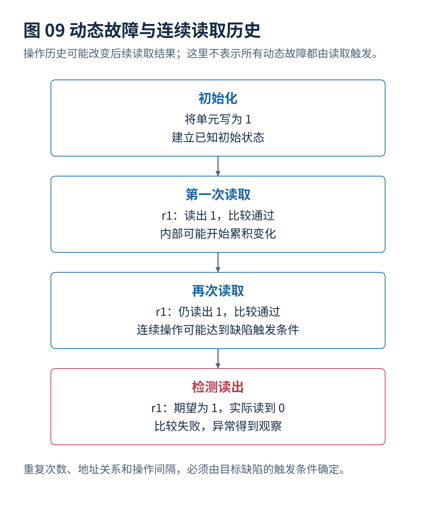
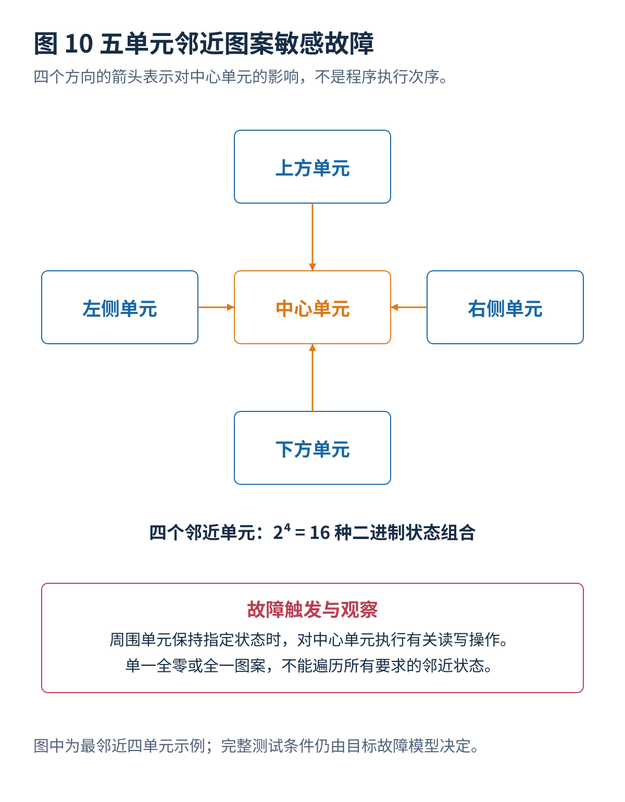
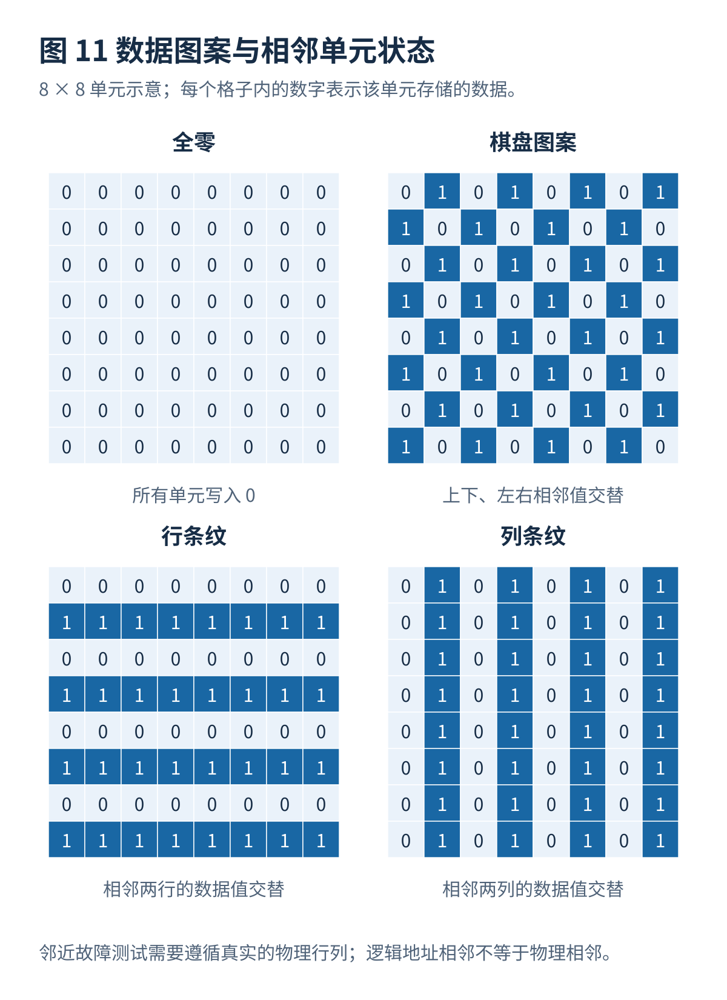
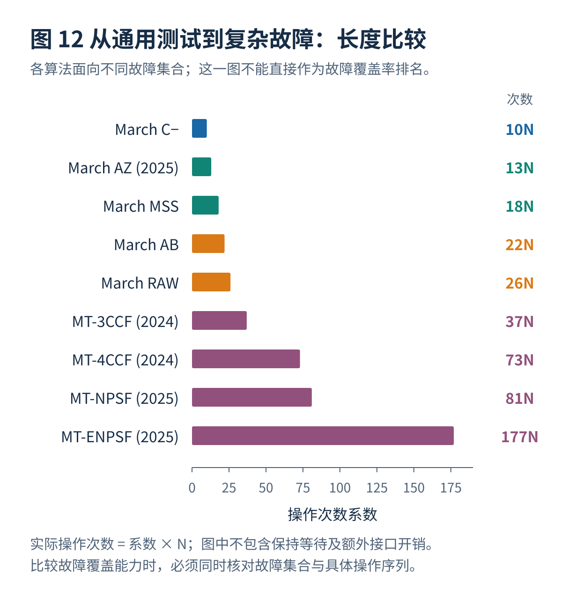

# 04 · 增强March与复杂故障测试

[总览](00_MBIST总体架构与阅读导航.md) · [上一篇：March基础与经典算法](03_March基础与经典算法.md) · [下一篇：测试算法生成与选择](05_测试算法生成与选择.md)

---

> **架构位置：增强故障检测算法层。** 把读写干扰、关联故障、动态故障与邻近图案条件分别对应到测试序列。

| 专题定位 | 范围约定 |
|---|---|
| 输入 | 明确的故障原型、物理邻近关系和允许的连续操作。 |
| 输出 | 增强序列及其长度、覆盖范围、附加硬件与时序前提。 |
| 前置专题 | [故障模型与检测原理](02_故障模型与检测原理.md)、[March基础与经典算法](03_March基础与经典算法.md) |


## 目录

- [[#1. 面向复杂静态故障的增强序列|1. 面向复杂静态故障的增强序列]]
- [[#2. 面向动态故障的重复操作与历史条件|2. 面向动态故障的重复操作与历史条件]]
- [[#3. 地址译码器与物理邻近图案测试|3. 地址译码器与物理邻近图案测试]]
- [[#4. 序列复现与覆盖解释的常见偏误|4. 序列复现与覆盖解释的常见偏误]]
- [[#5. 研究进展与证据范围|5. 研究进展与证据范围]]
- [[#与其他设计层的衔接|与其他设计层的衔接]]

## 1. 面向复杂静态故障的增强序列

### 1.1 增强序列的必要性

较短算法通常存在两类不足。第一类是**同一存储单元的操作种类不足**：例如没有“存储 0 时再次写 0”，就可能无法触发某些写入干扰故障。第二类是**不同单元之间的激励与观测顺序不足**：某个耦合故障发生后，受害单元可能在检查之前被其他写入修复，从而使故障无法被发现。

因此，较先进的静态故障算法不仅增加操作次数，还仔细控制每次读取或写入的**具体位置**。

### 1.2 March LR：14N 与特定关联故障

March LR（Linked-fault-oriented March）系列针对某些相互影响的静态故障条件，通过调整遍历方向和读写顺序改善检测能力。它不是笼统地多执行一次 March C−。

一种常见的 $14N$ 版本可写为：

```text
{ ⇕(w0);
  ↓(r0,w1);
  ↑(r1,w0,r0,w1);
  ↑(r1,w0);
  ↑(r0,w1,r1,w0);
  ↑(r0) }
```

按元素计数为 `1+2+4+2+4+1=14N`。上述版本特别强调在已经触发一个故障之后、另一个可能使其隐藏的操作之前安排读取。**并不是全部关联故障都可以由此版本保证检测。** 早期同类工作还包括 March LRD、March LRDD 等针对地址译码器及耦合条件调整的版本，其总复杂度可能含有地址位数 $D$ 的附加项。[^R13]

### 1.3 March SR：14N 与静态读写故障原型

March SR 系列通过增加重复读取和特定非状态转换写入，提高某些静态读写故障的触发和观察能力。其常见 $14N$ 版本为：

```text
{ ↓(w0);
  ↑(r0,w1,r1,w0);
  ↓(r0,r0);
  ↑(w1);
  ↓(r1,w0,r0,w1);
  ↑(r1,r1) }
```

操作数为 `1+4+2+1+4+2=14N`。与 March C+ 相比，两者即使同为 $14N$，重复读取的摆放位置、写入相同数值的情形与跨地址顺序也不同，因此必须在相同故障模型下验证后才可比较。

### 1.4 March SS：22N 与非关联静态故障覆盖

Hamdioui 等人在 2002 年提出 March SS，针对列出的、在现实中有代表性的全部**非关联静态故障原型**，论文给出的测试长度是 $22N$。[^R05]

一个常见的 $22N$ 表达版本：

```text
{ ⇕(w0);
  ↑(r0,r0,w0,r0,w1);
  ↑(r1,r1,w1,r1,w0);
  ↓(r0,r0,w0,r0,w1);
  ↓(r1,r1,w1,r1,w0);
  ⇕(r0) }
```

它的设计思想不是单纯使用更复杂的地址遍历，而是补充**重复读取、非状态转换写入、读后立即检查**等动作，使更多静态故障原型被触发并被看到。适合用作增强覆盖的研究基准。缺点是比 March C− 多 $12N$ 次操作，即测试操作总数为后者的 `2.2` 倍。

**“检测全部非关联静态故障”不等于检测全部动态故障、全部关联故障或全部晶体管级物理缺陷。**

### 1.5 March MSS：18N 与完全静态故障检测

March MSS 可视为静态故障完整覆盖方向的重要进一步改进。一个文献常见版本为：

```text
{ ⇕(w0);
  ↑(r0,r0,w1,w1);
  ↑(r1,r1,w0,w0);
  ↓(r0,r0,w1,w1);
  ↓(r1,r1,w0,w0);
  ⇕(r0) }
```

按操作计数为 `1+4+4+4+4+1=18N`。这类算法通过删去冗余操作、保留必要的故障激励与观察条件，减少为规定的非关联静态故障集合提供完整检测所需的长度。2026 年的一篇系统综述指出，对于其比较的全部非关联静态故障集合，$18N$ 是重要的完整覆盖参考长度；而 $14N$ 级算法通常是在长度与覆盖之间折中。[^R14]

**对比 March SS：**优势是操作次数更少；限制是应检查具体来源采用的故障原型分类、是否包括相互关联故障，以及是否将某些新工艺故障排除在外。

### 1.6 March AB：22N 与现实关联静态故障

March AB 的代表性工作明确称为 **“A 22n March Test for Realistic Static Linked Faults in SRAMs”**。它针对特定现实关联静态故障集合设计，作者将其与更长的 March SL 测试进行比较，目标是在保持模型覆盖的情况下缩短操作长度。[^R06]

一个常见资料中给出的、读写状态彼此一致的 $22N$ 操作序列如下。由于部分二级资料存在初始化数值、操作顺序及末尾读取值不一致的问题，工程复现仍应回到原始论文逐项核实：

```text
{ ⇕(w0);
  ↓(r0,w1,r1,w1,r1);
  ↓(r1,w0,r0,w0,r0);
  ↑(r0,w1,r1,w1,r1);
  ↑(r1,w0,r0,w0,r0);
  ⇕(r0) }
```

对每个地址的操作计数为 `1+5+5+5+5+1=22`。其中连续读取有助于观察先前读写可能造成的变化，连续写入可激励某些非状态转换写入故障。它的优势是特别处理“一个异常可能掩盖另一个异常”的情况；缺点是测试时间超过 March C− 两倍，并且对于其模型以外的动态故障不作通用保证。

**长度标注差异：**一些二级中文论文将上面这个 $22N$ 序列误标成 $14N$。判断复杂度时应以每个 March 元素实际包含的读写操作数量重新计算，不能直接复制表格中的标签。参见[^R04][^R06]。

### 1.7 March AZ1、March AZ2 与 March AZ：13N、14N、13N

这一家族采用故障原型分析，对有限长度内的读写操作进行**重新安排**，而不是单纯增加测试次数：

- **March AZ1：13N。**较早提出，试图在短测试长度下覆盖较多非关联静态故障模型。
- **March AZ2：14N。**对 AZ1 的测试操作安排进行调整，换取相应故障集合的更高覆盖程度或不同检测重点。
- **March AZ（2025）：13N。**通过移动关键写入操作，提升部分状态转换耦合故障的检测，同时仍然保持 $13N$。

2025 年的 March AZ 论文报告：对其定义的故障集合，状态转换耦合故障原型的覆盖比例由 `62.5%` 增加到 `75%`；综合静态故障覆盖比例达到 `83.3%`。这些数字来自作者选择的有限故障原型集合，**不能直接与其他论文给出的“80.9% 动态故障覆盖率”作高低比较**。[^R07]

仅调整写入顺序即可改善检测，原因在于：如果异常发生在一次写入之后，而下一次写入恰好把受害单元改回正确状态，后续读取便可能读出正确值。将写入移至其他阶段，可以避免这种**故障被掩盖**的情况。

2025 年论文的部分表格所列操作数与声明的 $13N$ 长度不完全一致。引用 March AZ 时应以作者的完整控制器实现、逐项元素说明与操作计数为准，不能仅依据扫描表格录入。

### 1.8 综合比较

| 算法 | 代表长度 | 主要设计目的 | 有利之处 | 关键不足 |
|---|---:|---|---|---|
| MATS / MATS+ / MATS++ | 4N / 5N / 6N | 最短的基本单元读写检查 | 时间短、实现简单 | 耦合、读写干扰和动态故障能力有限 |
| March X / Y | 6N / 8N | 在有限操作中增加重要检测条件 | 易于编写控制器 | 不足以替代较完整的静态故障测试 |
| March C− | 10N | 经典单存储单元与常见耦合故障 | 工程成熟、性能均衡 | 复杂静态和动态故障遗漏 |
| March C+ | 14N | 增加写后立即读取 | 提高某些故障可观测性 | 需要多 40% 的读写操作 |
| March LR / SR | 约 14N | 关联故障、重复读取及静态复杂故障 | 重点明确、可以定制 | 对保证覆盖的故障集合有前提 |
| March AZ（2025） | 13N | 短测试长度下改善静态故障覆盖 | 对作者模型的覆盖效率较好 | 不保证全部静态故障，更不保证全部动态故障 |
| March MSS | 18N | 指定非关联静态故障集合的完整检测 | 相对 SS 缩短长度 | 仍需确认覆盖集合是否符合新工艺宏 |
| March SS | 22N | 较完整的非关联静态故障检测 | 覆盖目标全面明确 | 较长、控制逻辑更复杂 |
| March AB | 22N | 现实关联静态故障 | 抑制某些故障掩盖问题 | 不能直接代替动态故障测试 |
| March RAW | 26N | 增加动态故障激励能力 | 重复读写更充分 | 检测较复杂的动态故障仍有限 |

## 2. 面向动态故障的重复操作与历史条件

### 2.1 静态与动态故障测试的差异

当存储器制造尺寸不断缩小时，一些电阻性开路、较弱的写入驱动电路、读出放大器异常和内部节点充放电问题可能产生**操作历史相关**的故障：单独执行一次读取能够正常返回，但若紧接着再次读取、读取之后立即写入，或者在短时间内持续访问相邻地址，才会出现错误。

例如，下面的过程仅用于说明动态故障的产生方式：

```text
先写入 1 → 第一次读取 1 → 第二次读取 1 → 再次读取异常
```

这与“延迟很久后发生的数据保持故障”不同：动态故障往往与操作的组合和先后次序有关，保持故障则需要专门的等待时间条件。并不是全部动态故障都会通过重复读取触发。



### 2.2 March RAW：26N

March RAW（Read After Write 等相关读写操作的组合）是将测试重点进一步扩展到静态故障与一部分动态故障的重要算法。其常见 $26N$ 序列如下：[^R04]

```text
{ ⇕(w0);
  ↑(r0,w0,r0,r0,w1,r1);
  ↑(r1,w1,r1,r1,w0,r0);
  ↓(r0,w0,r0,r0,w1,r1);
  ↓(r1,w1,r1,r1,w0,r0);
  ⇕(r0) }
```

操作计数为 `1+6+6+6+6+1=26N`。与 March C− 不同，它包含更多重复读操作和对当前内容再次写入相同值的操作：

- `r0,w0,r0`：有机会检查“原本为 0 的单元再次写 0”是否引发错误。
- `r0,r0`：有机会检查一次读取之后再进行读取的异常。
- `w1,r1`：立即观察写入 1 的结果。
- 正向与反向遍历：增加不同地址先后关系下触发耦合故障的机会。

**主要优点：**相对 C−，可以触发更多与连续读写有关的故障。**主要不足：**测试长度为 C− 的 `2.6` 倍，而且对需要更长读写历史、重复多次读取，或更复杂的相邻地址操作组合的故障，仍可能检测不足。

#### 2.2.1 March RAW1：13N 的单存储单元故障取舍

一些研究还列出 **March RAW1（13N）**，其重点是将多种单存储单元读取、写入和重复操作安排在较短序列中，以获得比完整 March RAW 更少的测试操作数。它的故障覆盖目标较窄，不能因名称接近 March RAW 就假设它保持 $26N$ 版本的双单元耦合故障能力。[^R14]

对 RAW1 一类低复杂度算法，尤其需要确认其每次地址遍历之间的状态是否一致，以及是否要求对存储器执行特殊的初始化或数据反转；否则纸面上 $13N$ 的测试长度也无法保证硬件可正确执行。

### 2.3 Dynamic-RAWC：2023 年的可调节动态 March 算法

2023 年发表于《电子与信息学报》的《一种基于存储器内建自测试的新型动态March算法设计》提出 Dynamic-RAWC。其主要思想是在 March RAW 基础上加入**可以按照目标动态故障调整的连续操作次数**，而不是固定只重复两次读取。[^R04]

它讨论至少两类增强：

**第一类：连续读取增强。** 例如在有关的读写元素中，允许用参数 $n$ 控制某一读取操作的重复次数，使序列可以激励需要三次、四次或更多次相关操作才表现出来的故障。

**第二类：连续写入与读写结合增强。** 通过在既有的重复读取之外加入重复写入操作，扩大对需要先后执行多个写入或读写组合才能激活的故障的检测能力。

文章还讨论了根据测试需要选择重复次数及组合的做法。实际测试长度必须根据具体 $n$ 与所启用的元素重新计算；不能把同一个名称下的所有参数配置都视为固定 $26N$。

论文以定义的 **282 个动态故障原型**作为统计对象，报告如下结果：

| 算法 | 检测的动态故障原型数量 | 同一论文故障集合中的比例 |
|---|---:|---:|
| MATS++ | 6 / 282 | 2.1% |
| March C− | 18 / 282 | 6.4% |
| March C+ | 58 / 282 | 20.6% |
| March AB | 112 / 282 | 39.7% |
| March RAW | 140 / 282 | 49.6% |
| Dynamic-RAWC | **228 / 282** | **80.9%** |

这些数字非常有参考价值，但必须明确：**80.9% 是作者对其选取的 282 个动态故障原型执行功能故障分析得出的比例，不是实际量产芯片的物理缺陷覆盖率。** 此外，Dynamic-RAWC 依然没能覆盖全部动态状态转换耦合故障等复杂模型。[^R04]

在真实宏中采用 Dynamic-RAWC 时，应先确定该宏可能出现的操作历史相关缺陷，再选择重复次数。**在没有故障物理证据时，单纯把重复次数调得很高只会显著增加测试时间及动态功耗。**

### 2.4 多操作动态故障的描述方法

如果一个故障的激活需要按照顺序完成 `r0, r0, w1`，那么仅统计该测试有没有分别执行过 `r0` 和 `w1` 不够。必须检查：

1. 三次操作是否针对正确的地址或正确的相关地址组合；
2. 操作发生的先后次序是否一致；
3. 操作之间是否允许插入别的地址访问；
4. 两次操作之间的时间间隔是否满足缺陷出现的条件；
5. 异常结果是否有机会被读取，并且不会提前被写入修复。

因此，针对动态故障优化 March 序列时，需要记录**操作历史**，而不是只记录某个地址当前是 0 还是 1。这也是 2026 年数字化上下文监测研究的核心动机。[^R12]

## 3. 地址译码器与物理邻近图案测试

### 3.1 地址译码器故障与存储单元故障的差异

地址译码器的作用是把输入地址转换为存储器内部的字线或列选择信号。电路故障可能导致：

- 某个地址对应的单元始终无法被访问；
- 一个地址访问了两个存储位置；
- 两个逻辑地址错误地选择了同一个物理位置；
- 当连续访问的地址位出现特定变化时，译码器不能及时切换；
- 电阻性开路使异常只在某些先后访问顺序或时间条件下发生。

完整测试地址译码器不仅要读写存储数据，还需要安排适当的**地址变化顺序**。对这一类故障，地址生成方法和操作数据图案的重要性可能不低于单个地址上执行多少次 `r0/w1`。

#### 3.1.1 March iC−：约 10N

March iC− 是面向某些地址译码器开路缺陷所研究的 March 变体，其基本思想是保留紧凑的 March 测试框架，同时采用更有针对性的**地址访问顺序和交替数据图案**。部分研究采用 Gray 编码的地址遍历：相邻地址变化时只有一个地址位翻转，便于隔离某些译码条件。[^R12][^R15]

优点是可将特定译码缺陷检测纳入常规 March 风格控制器。局限是覆盖依赖译码器电路结构和目标故障模型；**Gray 编码不是普遍最佳地址顺序**，有些缺陷反而需要两个或更多地址位同时改变才能被激活。

#### 3.1.2 March LA、March LRD 与 March LRDD

这些专用版本考虑某些地址译码器故障或关联故障。部分版本的测试次数还与地址位数 $D=\lceil\log_2 N\rceil$ 有关，因此会出现例如 $15N+2D$、$18N+2D$ 等形式。**这些长度与名称只对相应论文的具体序列成立，不能据此推断所有“March LRD”版本的统一覆盖率。**

### 3.2 相邻单元故障与 March 序列长度的关系

对于两个单元的耦合故障，只需要考虑两个单元之间的状态关系。对于三单元、四单元、五单元故障，目标单元的表现可能取决于周围多个单元共同存储什么数据。



如果中心单元的四个邻近单元分别存储 0 或 1，则周围四个单元就有 $2^4=16$ 种状态组合；如果把中心单元自身的当前数值也考虑进去，就有 $2^5=32$ 种状态。再考虑对哪个单元执行读取、状态转换写入或者非状态转换写入，状态组合与转移要求会进一步增加。

因此，“全部写 0、全部写 1”不能覆盖全部相邻图案敏感故障。

### 3.3 多次运行 March：改变数据图案

多次运行 March（Multirun March）并不是把同一序列机械重复若干遍，而是在不同阶段使用不同的地址相关数据图案。例如：



对于物理二维阵列，行列地址可分别记为 `Ar`、`Ac`，典型的数据产生规则为：

| 数据图案 | 一个简单的数据生成公式 | 用途 |
|---|---|---|
| 全零 | `data = 0` | 使所有单元处于相同状态 |
| 全一 | `data = 1` | 检查另一种相同状态 |
| 棋盘图案 | `data = Ar[0] XOR Ac[0]` | 使横向与纵向直接相邻单元交替为 0、1 |
| 行条纹 | `data = Ar[0]` | 使相邻行采用不同数值 |
| 列条纹 | `data = Ac[0]` | 使相邻列采用不同数值 |

这些公式假定 `Ar[0]` 和 `Ac[0]` 真正对应物理相邻的行列交替关系。如果存储器宏存在地址重新编码或位交织，就需要由物理设计信息推导图案，否则只能声称覆盖逻辑地址上的图案。

### 3.4 三单元及四单元复杂耦合：2024 年的近最优算法

Cașcaval 等人在 2024 年研究了相邻三个、四个存储单元构成的复杂故障模型，允许单元受到状态转换写入、非状态转换写入和读取的影响。[^R09]

代表性结果如下：

| 算法 | 长度 | 覆盖对象 | 重要限制 |
|---|---:|---|---|
| MT-3CCF | **37N** | 特定的三个物理邻近单元组成的“角形”构造，涵盖较完整的静态故障操作 | 与其他三单元排列及任意位置故障不是同一模型 |
| MT-R3CCF | **21N** | 文中比较的受限三单元故障模型 | 对读取与非状态转换写入引起的扩展故障不能照搬 37N 的覆盖主张 |
| MT-4CCF | **73N** | 四个物理邻近单元构成的 2×2 方形结构 | 依赖明确的物理相邻关系与故障原型条件 |

2024 年论文使用**状态转移图与欧拉路径思想**分析某些序列接近最短的原因。若模型要求依次检查多种状态变化，理想测试应使每一种必需状态转移仅发生一次，避免重复执行没有新增检测价值的操作。切换数据图案时不可避免的额外写入，使其成为“近最优”而非严格全局最优。

### 3.5 五单元相邻图案敏感故障：2025 年 81N 与 177N

2025 年发表于 *Mathematics* 的研究提出两种面向特定五单元模型的多次运行 March 算法。[^R10]

**MT-NPSF-81N（81N）：**针对经典的、由**状态转换写入**触发的五单元邻近图案敏感故障模型。使用 16 种 $4\times4$ 初始化图案，并在不同图案下完成需要的状态转移。作者给出的长度分解为：

$$
L=16(1+4)N+N=81N.
$$

**MT-ENPSF（177N）：**针对更广泛的五单元扩展模型，不仅考虑状态转换写入，还考虑**读取**和**不改变数据状态的写入**也可能激活故障。因需加入更多操作，测试长度扩展为 $177N$。

两者的创新点不只是“加长测试”：

1. 从故障模型对应的状态转移图确定必须覆盖的操作。
2. 选择 $4\times4$ 数据图案，以便让不同物理位置的五单元组合经历必要状态。
3. 通过简化行列地址的数据计算降低 MBIST 图案生成电路的实现难度。
4. 与采用 $3\times3$ 图案的早期算法相比，减少对行列地址进行模 3 运算的需要。

**最重要的限制：**作者明确指出，这些面向五单元邻近模型的算法，虽然完整覆盖各自规定的五单元故障模型，**却不能完整覆盖全部两单元耦合故障**，也不能保证覆盖另一种四单元方形模型。它们不能作为 March C− 或专门的两单元耦合测试的无条件替代品。这是“覆盖更复杂的故障模型不一定自动覆盖全部简单故障模型”的典型反例。[^R10]



## 4. 序列复现与覆盖解释的常见偏误

### 4.1 March AB 实际测试长度的混淆

2006 年原始研究的题目明确指出，March AB 是 **22N** 的测试。后续文献中存在将它列成 $14N$，但实际仍列出每地址合计 22 次操作的错误。本资料库选用的序列 `1+5+5+5+5+1=22N`，并已检查没有故障时每个读取步骤的期待值与此前写入结果相符。[^R04][^R06]

### 4.2 连续读取与动态故障检测范围的界限

有些动态故障需要“先写 1、连续读两次”，有些需要特定地址之间交替访问，有些依赖非常短或非常长的时间间隔。相同的重复读取数量不一定能够激励所有类型，甚至在不同存储器宏上可能表现不同。因此，研究重点必须是**故障触发条件与读写序列是否吻合**。

### 4.3 复杂邻近测试与简单故障覆盖的关系

2025 年 $81N$ 和 $177N$ 算法展示了相反情况：它们专门针对五单元邻近图案敏感故障设计，却不能据此直接推导它们对全部两单元耦合故障的覆盖。故障检测不是可以无条件按“涉及的单元数”递增的等级关系。[^R10]

## 5. 研究进展与证据范围

| 发表时间 | 工作及出处 | 对 March / MBIST 的主要贡献 | 可核实的研究结果 | 使用时必须注意的限制 |
|---|---|---|---|---|
| **2024** | *Near-optimal March Tests for Three-Cell and Four-Cell Coupling Fault Models in Random-Access Memories*，罗马尼亚信息科学技术期刊 | 使用状态转移图分析复杂相邻耦合故障，提出近最优多次运行测试 | $37N$ 三单元模型；$73N$ 四单元模型；分析了受限 $21N$ 三单元测试 | 故障单元必须满足论文限定的物理邻近构造；与所有位置的耦合模型不同。[^R09] |
| **2025** | *A new 13N-complexity memory built-in self-test algorithm to balance static random access memory static fault coverage and test time*，IJECE | March AZ 重新安排写操作，降低故障被掩盖的风险 | $13N$；指定模型中状态转换耦合故障检测 `62.5%→75%`，综合覆盖 `83.3%` | 仅适用于论文明确分析的静态故障原型。[^R07] |
| **2025** | *Near-Optimal Multirun March Memory Test Algorithms for Neighborhood Pattern-Sensitive Faults*，Mathematics | 使用 4×4 图案，避免复杂的模 3 图案生成 | $81N$ 经典五单元模型，$177N$ 扩展模型；在各自规定模型内完整覆盖 | 论文明确表明不能自动完整覆盖全部两单元耦合故障。[^R10] |
| **2026 年 8 月** | *A comprehensive review of memory BIST algorithms for SRAM static fault detection*，IJEECS | 系统比较静态故障的测试长度、故障覆盖和设计方法 | 将 $18N$ 作为完整非关联静态故障检测的重要长度参考；$14N$ 适合覆盖与时间折中 | 综述结论依赖其故障分类和算法集合；非新算法。[^R14] |

## 与其他设计层的衔接

本专题输出需要继续交给[测试算法生成与选择](05_测试算法生成与选择.md)、[存储器分组与功耗分析](06_存储器分组与功耗分析.md)、[自适应与运行期间测试](08_自适应与运行期间测试.md)、[多端口与新型存储器扩展](11_多端口与新型存储器扩展.md)。改变某一层的条件以后，应重新检查受到影响的接口和验证要求。


## 参考文献

文献编号与完整条目见[参考文献与研究进展索引](90_参考文献与研究进展索引.md)。

[^R04]: **R04** — **Liu 等（2023）.** 《一种基于存储器内建自测试的新型动态 March 算法设计》，《电子与信息学报》。[DOI: 10.11999/JEIT221032](https://doi.org/10.11999/JEIT221032)。Dynamic-RAWC、282 个动态故障原型与覆盖率对照。**注意其比较表中 March AB 的操作次数标注问题。**

[^R05]: **R05** — **Hamdioui, S.; van de Goor, A. J.; Rodgers, M.（2002）.** *March SS: a Test for All Static Simple RAM Faults.* IEEE International Workshop on Memory Technology, Design and Testing. [DOI: 10.1109/MTDT.2002.1029769](https://doi.org/10.1109/MTDT.2002.1029769)。`22N` 静态故障检测。

[^R06]: **R06** — **Benso, A.; Bosio, A.; Di Carlo, S.; Di Natale, G.; Prinetto, P.（2006）.** *A 22n March Test for Realistic Static Linked Faults in SRAMs.* IEEE European Test Symposium. [DOI: 10.1109/ETS.2006.2](https://doi.org/10.1109/ETS.2006.2)。March AB `22N` 的原始依据。

[^R07]: **R07** — **Jidin, A. Z.; Hussin, R.; Mispan, M. S.; Lee, W. F.（2025）.** *A new 13N-complexity memory built-in self-test algorithm to balance static random access memory static fault coverage and test time.* **International Journal of Electrical and Computer Engineering**, 15(1), 163–173. [DOI: 10.11591/ijece.v15i1.pp163-173](https://doi.org/10.11591/ijece.v15i1.pp163-173)；[大学机构论文库](https://eprints.utem.edu.my/id/eprint/28949/)。March AZ 及 83.3% 指定静态故障原型覆盖。

[^R09]: **R09** — **Cașcaval, P.; Cașcaval, E.（2024）.** *Near-optimal March Tests for Three-Cell and Four-Cell Coupling Fault Models in Random-Access Memories.* **Romanian Journal of Information Science and Technology**. [论文全文 PDF](https://www.romjist.ro/full-texts/paper782.pdf)；[DOI: 10.59277/ROMJIST.2024.3-4.06](https://doi.org/10.59277/ROMJIST.2024.3-4.06)。`21N / 37N / 73N` 的特定三单元和四单元邻近故障算法。

[^R10]: **R10** — **Cașcaval, P.; Cașcaval, E.（2025）.** *Near-Optimal Multirun March Memory Test Algorithms for Neighborhood Pattern-Sensitive Faults in Random-Access Memories.* **Mathematics**, 13(16), 2594. [DOI: 10.3390/math13162594](https://doi.org/10.3390/math13162594)；[开放获取全文](https://www.mdpi.com/2227-7390/13/16/2594)。五单元邻近图案敏感故障的 `81N / 177N` 两种多次运行算法。

[^R12]: **R12** — **Ronga, D.; Faehn, E.; Girard, P.; Virazel, A.（2026）.** *A hardware context monitoring for testing complex dynamic SRAM faults in digital test environment.* **Microprocessors and Microsystems**, 124（Part B）, 105305. [DOI: 10.1016/j.micpro.2026.105305](https://doi.org/10.1016/j.micpro.2026.105305)；[期刊页面](https://www.sciencedirect.com/science/article/pii/S0141933126000621)。动态故障数字仿真的操作历史建模。

[^R13]: **R13** — **van de Goor 等早期地址测试与关联故障研究（1996 年起）.** *March LR: a Test for Realistic Linked Faults.* [DOI: 10.1109/VTEST.1996.510868](https://doi.org/10.1109/VTEST.1996.510868)；[Delft 相关研究材料](https://repository.tudelft.nl/file/File_1b7c1fe4-459e-4d45-b50e-528eebc1f76b)。March LR、地址译码器变体以及不同长度表达的背景。

[^R14]: **R14** — **Jidin 等（2026）.** *A comprehensive review of memory BIST algorithms for SRAM static fault detection.* **Indonesian Journal of Electrical Engineering and Computer Science**, 43(2), 400–412. [DOI: 10.11591/ijeecs.v43.i2.pp400-412](https://doi.org/10.11591/ijeecs.v43.i2.pp400-412)。2026 年静态故障算法综述、March MSS 和短序列的覆盖权衡。

[^R15]: **R15** — **Dilillo 等（2004）.** *March iC−: an Improved Version of March C− for ADOFs Detection.* IEEE VLSI Test Symposium 相关论文. [DOI: 10.1109/VTEST.2004.1299236](https://doi.org/10.1109/VTEST.2004.1299236)。地址译码器专用算法。

---

[总览](00_MBIST总体架构与阅读导航.md) · [上一篇：March基础与经典算法](03_March基础与经典算法.md) · [下一篇：测试算法生成与选择](05_测试算法生成与选择.md)
