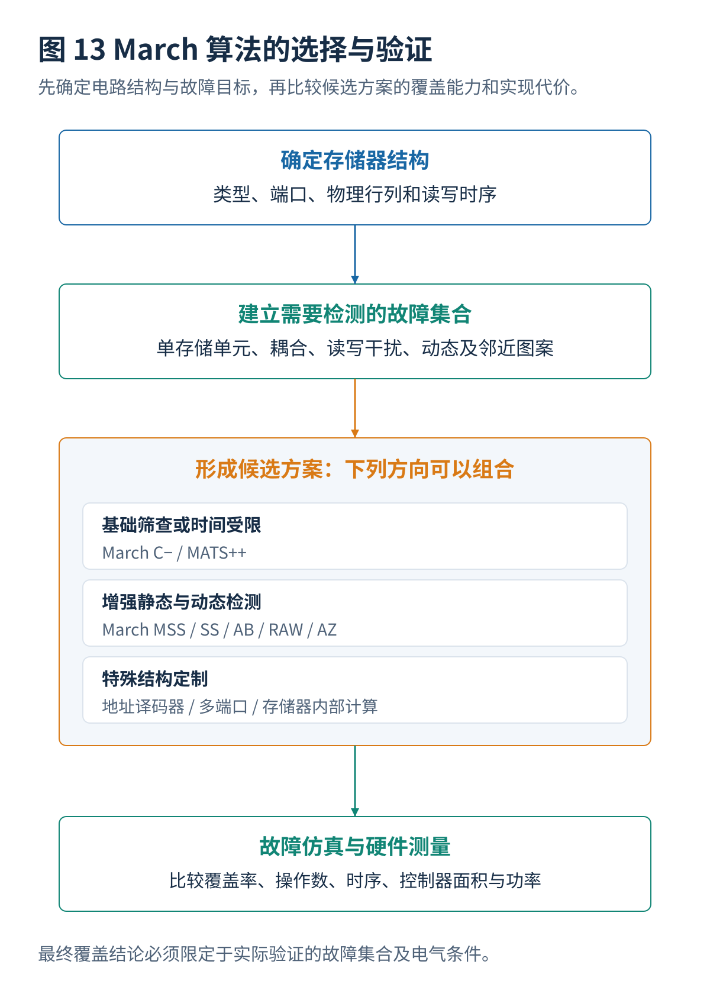

# 05 · 测试算法生成与选择

[总览](00_MBIST总体架构与阅读导航.md) · [上一篇：增强March与复杂故障测试](04_增强March与复杂故障测试.md) · [下一篇：存储器分组与功耗分析](06_存储器分组与功耗分析.md)

---

> **架构位置：算法选择与自动生成层。** 在必要覆盖约束下选择或生成测试，不以操作次数作为唯一优化目标。

| 专题定位 | 范围约定 |
|---|---|
| 输入 | 故障模型、候选序列、允许指令、实际执行代价。 |
| 输出 | 可复现的算法配置、选择理由、覆盖证据和硬件要求。 |
| 前置专题 | [故障模型与检测原理](02_故障模型与检测原理.md)、[March基础与经典算法](03_March基础与经典算法.md)、[增强March与复杂故障测试](04_增强March与复杂故障测试.md) |


## 目录

- [[#1. 使用场景与必要覆盖的确定|1. 使用场景与必要覆盖的确定]]
- [[#2. 从候选片段选择到有序序列搜索|2. 从候选片段选择到有序序列搜索]]
- [[#3. 近期自动生成与图论优化方向|3. 近期自动生成与图论优化方向]]
- [[#4. 研究进展与证据范围|4. 研究进展与证据范围]]
- [[#与其他设计层的衔接|与其他设计层的衔接]]

## 1. 使用场景与必要覆盖的确定

### 1.1 应用场景与算法选择



| 具体场景 | 优先评估 | 依据 | 必须补充的验证 |
|---|---|---|---|
| 普通单端口 SRAM 的基础制造测试 | March C−（10N） | 指令规则、成本较低，适合作为明确基准 | 验证该宏的固定值、转换、主要耦合及地址译码器故障 |
| 极端测试时间限制，且只需基础检查 | MATS++（6N）或 March X（6N） | 操作数较少 | 必须明确接受哪些故障类别的检测不足 |
| 希望提升非关联静态故障检测能力 | March MSS（18N）、March SS（22N） | 对重复读取与写入干扰考虑得更充分 | 用相同故障原型集合比较实际检测数量 |
| 希望压缩静态测试时间但保留较高覆盖 | March AZ（13N）、AZ2（14N） | 通过安排读写顺序提升指定模型的覆盖效率 | 完整检查模型范围和发表版本的序列一致性 |
| 某些关联静态故障是设计主要风险 | March LR（14N）、March AB（22N） | 专门处理故障相互掩盖的一部分情况 | 关联故障检测仿真，不用单故障结果替代 |
| 连续读写才出现错误 | March RAW（26N）和 Dynamic-RAWC | 包含较丰富的重复读取与写入激励 | 测试重复次数、时间间隔与缺陷类型的对应关系 |
| 需要检查长时间静止后的数据丢失 | March 测试与专用保持时间等待相结合 | 纯 March 可能太快，无法激励泄漏类异常 | 写入后的等待时间、电压和温度条件 |
| 存储器地址译码器的电阻性开路与切换异常 | March iC−，或根据晶体管级仿真合成的地址专用 March | 缺陷可能只在特定地址切换后出现 | 地址位变换序列、SPICE 缺陷注入 |
| 已知版图存在复杂邻近图案敏感风险 | MT-NPSF-81N / MT-ENPSF-177N，加独立的其他故障测试 | 需要让物理邻近单元经历多种状态图案 | 物理地址关系、两单元耦合覆盖、实际峰值功耗 |
| 双端口与多端口 SRAM | 并发端口 March 测试 | 单端口逐次测试漏掉部分端口相互干扰 | 宏允许的并发读写行为与端口碰撞规则 |
| 八晶体管 SRAM 存储器内部计算 | March C−8、专用存储器内部计算 March、March CC | 计算模式有独特电路缺陷 | 计算正确值、特殊读出电路和真实周期代价 |
| 系统运行中需要周期检测且不能破坏数据 | 透明 March、分段测试、数据备份与恢复方案 | 需要在保留数据的同时检测存储器 | 失败期间的数据安全、系统暂停条件、分段耦合遗漏 |

优先级为：**首先明确目标制造缺陷与故障原型，其次评估测试长度，最后比较控制器面积、测试功耗与真实周期数。** 不能仅因论文声称操作数较小就更换芯片原本使用的算法。

## 2. 从候选片段选择到有序序列搜索

新的 March 算法研究可划分为三个层次：**故障条件建模、序列搜索与硬件实现代价优化**。其核心难点不是遍历全部 0/1 操作组合，而是证明测试序列满足故障的激励与观察条件。

### 2.1 故障原型覆盖的集合覆盖与整数规划

假设已经生成一批完整且可执行的候选测试片段 $S_1,S_2,\ldots,S_k$，每个片段具有操作长度 $l_j$。对给定故障 $f$，令 $a_{fj}=1$ 表示单独执行片段 $S_j$ 可以检测该故障，否则为 0。设置二元决策变量 $x_j$，表示是否采用该片段，则一个基本模型为：

$$
\min_{x_j\in\{0,1\}}\ \sum_j l_jx_j,
$$

满足：

$$
\sum_j a_{fj}x_j\ge1,\qquad\forall f\in\mathcal{F}_{\mathrm{required}}.
$$

这就是集合覆盖问题的整数规划表达。它可用于**从已有可独立执行、能单独验证检测能力的 March 片段或算法库中，选择尽量短的组合**。

但是对于真正的 March 序列自动合成，单纯使用集合覆盖是不够的。因为片段拼接后，存储器的初始状态可能发生变化，故障可能被掩盖，地址遍历方向也有要求。因此要么让每个候选片段包含完整初始化和观测过程，要么显式加入**片段之间的状态兼容约束**。

### 2.2 有序测试序列的状态搜索

对每个目标故障建立一个状态机，记录：

- 相关存储单元的当前 0/1 状态；
- 已经执行过的必要操作前缀；
- 是否发生故障激励；
- 故障影响是否仍然存在；
- 错误是否已经通过读操作被检测。

然后对候选 March 操作进行搜索，可以使用：

- **广度优先搜索：**故障集合很小时寻找操作次数最短的路径。
- **A\* 搜索：**使用对剩余必要操作数量的下界估计加快搜索。
- **动态规划：**对能够压缩为有限状态的子问题进行最短序列计算。
- **可满足性问题求解（SAT）或可满足性模理论求解（SMT）：**询问是否存在长度不超过 $K$ 的合法测试序列。
- **整数线性规划（ILP）：**同时表达测试步骤、故障覆盖、资源使用及长度上限。
- **遗传算法、模拟退火、局部搜索：**在较大候选空间寻找近似最优解，但最终需要独立故障仿真核实检测覆盖。

对于动态故障，状态必须包含有限长度的历史事件，而不是只存当前数据。否则搜索器可能找到“按各步骤独立观察看似覆盖，但真实组合顺序错误”的无效序列。

### 2.3 使用图论寻找近最优多次运行 March

针对固定的邻近故障模型，建立有向图：

- **顶点：**相关单元当前的数据状态，例如三个单元有 $2^3=8$ 种状态。
- **边：**合法的读取、状态转换写入或非状态转换写入操作；对会改变状态的写入，以变化前后的状态作为边的两端。
- **必须覆盖的边：**故障模型要求激励的状态转换或操作情况。

如果能够按一条路径把全部必须测试的边覆盖且尽量不重复，那么就能接近最低操作长度。2024 和 2025 年多次运行 March 研究使用的欧拉图思想就是这种方法。[^R09][^R10]

不过，实际 March 还必须支持每一个元素中的**完整地址遍历**，并在图案切换与检测读出之间保持数据正确，因此图论中得到的理想路径未必能不经过处理就直接变成真正的 MBIST 指令。

### 2.4 多目标优化

实际产品需要同时考虑：

$$
\min\left(\ T_{\mathrm{test}},\ A_{\mathrm{ctrl}},\ P_{\mathrm{peak}},\ E_{\mathrm{test}},\ C_{\mathrm{implementation}}\right),
$$

并满足某些必需故障集合的覆盖要求，以及时钟、地址生成能力、宏端口能力、读出延迟等约束。

这属于多目标优化问题。可以先将必需覆盖集合设为强制条件，再绘制**测试长度—硬件面积—测试功耗**之间的帕累托曲线。

例如，$81N$ 与 $76N$ 的多次运行算法虽然前者操作数更多，但由于其数据图案可以由地址低位简单生成，总体控制器面积和时钟时序未必更差。反过来，一个很短的序列如果必须使用复杂的地址跳转控制逻辑，也可能在真实硬件中失去优势。

### 2.5 可复现的自动生成研究方案

技术流程如下：

```text
输入：目标 SRAM 参数、目标故障模型、允许的 March 指令集

1. 建立每个故障的激活条件和观测条件。
2. 用故障仿真器验证既有算法：March C−、MSS、SS、AB、RAW。
3. 记录每个故障是否检出、检出位置、所需操作条件。
4. 构造可复用的测试元素库：读写组合、升降序、数据图案。
5. 使用整数规划或状态搜索寻找更短的候选序列。
6. 对候选序列执行完整故障仿真，排除虚假的覆盖声明。
7. 将候选序列编译为 MBIST 控制器指令或有限状态机。
8. 综合和时序分析，评估真实测试周期、面积与峰值功耗。
9. 在多个地址深度、数据宽度、端口结构上重复验证。
10. 公开操作序列、故障模型、故障覆盖明细及优化耗时。
```

**比较基准：**除了 March C− 的 $10N$，也应根据研究目标加入 March AZ 的 $13N$、March MSS 的 $18N$、March AB 的 $22N$ 或 March RAW 的 $26N$。只有将优化前后的故障集合保持一致，算法改进才有意义。

## 3. 近期自动生成与图论优化方向

### 3.1 基于物理缺陷的 March 自动合成

2026 年 VLSI Test Symposium 的地址译码器论文值得关注。传统设计方法往往先选一个 March，再检查它覆盖哪些故障；这篇工作反过来进行：

```text
工业 SRAM 地址译码器晶体管电路
          ↓
注入潜在开路或其他指定缺陷
          ↓
SPICE 仿真所有相关的两操作地址序列
          ↓
提取能够激活并观察每个缺陷的必要条件
          ↓
选择能够同时满足尽可能多条件的操作组合
          ↓
合成更短的专用 March 测试
```

它的价值在于，直接对**实际电路中的制造缺陷**进行优化，而不是仅依据教科书里的抽象故障名称。这种方法更有机会发现现有 March C− 或传统地址译码器测试遗漏的特定故障。[^R11]

研究难点在于：SPICE 缺陷仿真昂贵，地址和数据状态组合数量很大，部分缺陷需要超过两个操作才能触发，因此仍需要缩减候选测试条件、分层仿真和操作历史建模。

### 3.2 从覆盖数量转向最短状态路径

2024 和 2025 年 Cașcaval 等人的工作说明：针对复杂邻近故障，可以建立一张状态转移图，每个状态表示附近若干单元当前存储的 0/1 组合，每条边表示一次读写操作造成的状态变化。这样就可以将算法的设计目标变成：

- 尽量完整访问需要测试的状态转移；
- 尽量少重复已经测试过的状态转移；
- 安排必要的额外读取，使错误能被观察；
- 尽量减少不同数据图案之间的切换；
- 让数据图案可以使用简单的硬件逻辑产生。

**这一方向适合采用组合优化、图论和自动搜索方法。** 最终得到的算法长度更长，但在明确的复杂故障模型里可能接近理论最小操作数量。[^R09][^R10]

## 4. 研究进展与证据范围

| 发表时间 | 工作及出处 | 对 March / MBIST 的主要贡献 | 可核实的研究结果 | 使用时必须注意的限制 |
|---|---|---|---|---|
| **2026 年 4 月** | *Defect-based Testing for SRAM Address Decoders*，IEEE VLSI Test Symposium | 从 SPICE 仿真得到所有相关两操作地址访问条件，并构造更短的专用 March | 在所研究的工业 SRAM 宏上，相比 ADOF 基准，报告缺陷检测更充分且测试时间更短 | 公开摘要未给出普适的操作长度或通用覆盖百分比，不应自行补充。[^R11] |

## 与其他设计层的衔接

本专题输出需要继续交给[存储器接口与测试控制器](01_存储器接口与测试控制器.md)、[存储器分组与功耗分析](06_存储器分组与功耗分析.md)、[设计验证与工具接入](12_设计验证与工具接入.md)。改变某一层的条件以后，应重新检查受到影响的接口和验证要求。


## 参考文献

文献编号与完整条目见[参考文献与研究进展索引](90_参考文献与研究进展索引.md)。

[^R09]: **R09** — **Cașcaval, P.; Cașcaval, E.（2024）.** *Near-optimal March Tests for Three-Cell and Four-Cell Coupling Fault Models in Random-Access Memories.* **Romanian Journal of Information Science and Technology**. [论文全文 PDF](https://www.romjist.ro/full-texts/paper782.pdf)；[DOI: 10.59277/ROMJIST.2024.3-4.06](https://doi.org/10.59277/ROMJIST.2024.3-4.06)。`21N / 37N / 73N` 的特定三单元和四单元邻近故障算法。

[^R10]: **R10** — **Cașcaval, P.; Cașcaval, E.（2025）.** *Near-Optimal Multirun March Memory Test Algorithms for Neighborhood Pattern-Sensitive Faults in Random-Access Memories.* **Mathematics**, 13(16), 2594. [DOI: 10.3390/math13162594](https://doi.org/10.3390/math13162594)；[开放获取全文](https://www.mdpi.com/2227-7390/13/16/2594)。五单元邻近图案敏感故障的 `81N / 177N` 两种多次运行算法。

[^R11]: **R11** — **Hsu, H. J. 等（2026）.** *Defect-based Testing for SRAM Address Decoders.* **2026 IEEE 44th VLSI Test Symposium**. [DOI: 10.1109/VTS69484.2026.11563364](https://doi.org/10.1109/VTS69484.2026.11563364)；[国立阳明交通大学论文信息](https://scholar.nycu.edu.tw/zh/publications/defect-based-testing-for-sram-address-decoders/)。SPICE 缺陷仿真驱动的地址译码器 March 生成。

---

[总览](00_MBIST总体架构与阅读导航.md) · [上一篇：增强March与复杂故障测试](04_增强March与复杂故障测试.md) · [下一篇：存储器分组与功耗分析](06_存储器分组与功耗分析.md)
