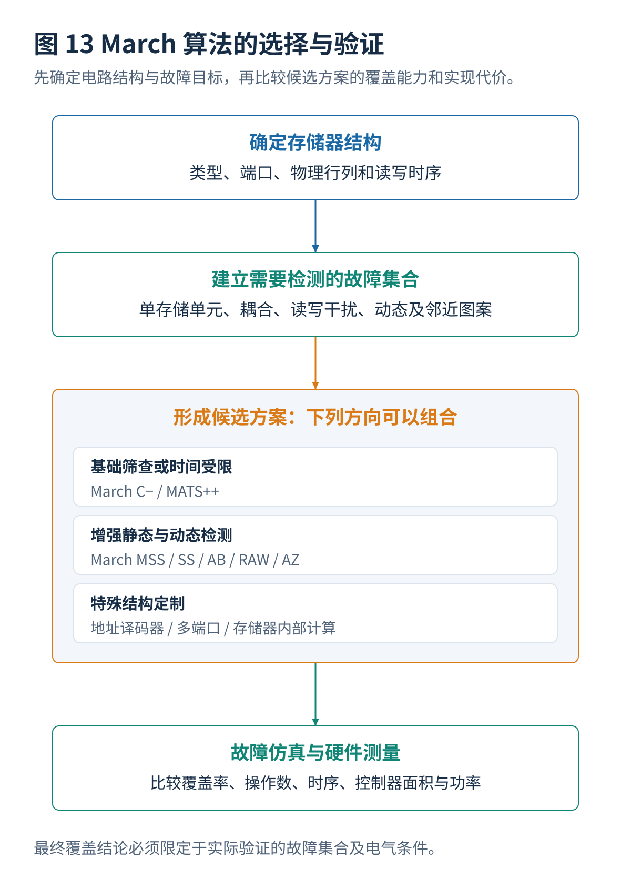
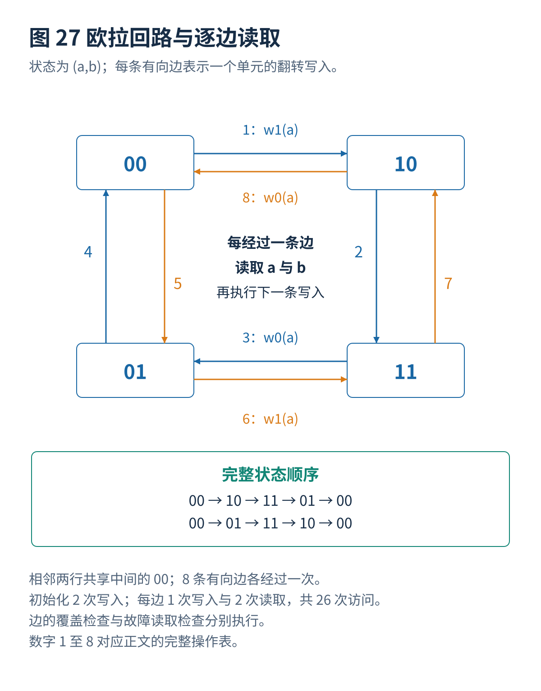
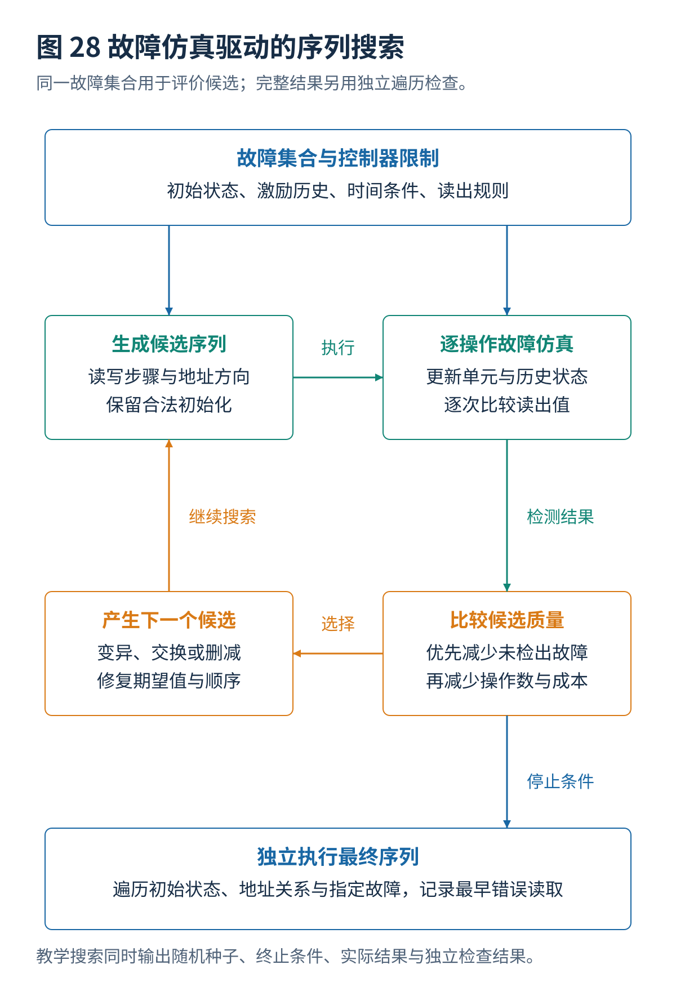

# 05 测试算法生成与选择

[总览](00_MBIST总体架构与阅读导航.md) · [上一篇：增强March与复杂故障测试](04_增强March与复杂故障测试.md) · [下一篇：存储器分组与功耗分析](06_存储器分组与功耗分析.md)

> **本章任务：从故障的激活条件和观测条件出发，生成可执行、可核算、可验证的测试序列。** 重点解释状态图与欧拉回路、操作历史与 de Bruijn 序列、遗传算法、模拟退火、禁忌搜索、变邻域搜索、集合覆盖、精确状态搜索，以及近年的 MarchGen 和深度 Q 学习方法。

本章同时给出论文算法与教学算例。论文算法注明来源及故障范围；教学算例给出完整模型、操作序列和计算过程。配套程序 [sequence_generation_examples.py](src/sequence_generation_examples.py) 使用 Python 标准库即可运行，其输出为 [sequence_generation_results.json](examples/sequence_generation_results.json)。

| 专题定位 | 内容 |
|---|---|
| 输入 | 故障原型及其状态机、允许的读写操作、地址关系、时间条件、控制器限制 |
| 输出 | 完整序列、读期望值、测试长度、逐故障检测结果和具体执行条件 |
| 前置专题 | [故障模型与检测原理](02_故障模型与检测原理.md)、[March基础与经典算法](03_March基础与经典算法.md)、[增强March与复杂故障测试](04_增强March与复杂故障测试.md) |

## 目录

- [[#1. 生成目标与完整的输入描述|1. 生成目标与完整的输入描述]]
- [[#2. 把故障检测转化为状态搜索|2. 把故障检测转化为状态搜索]]
- [[#3. 欧拉回路：从状态转移到读写序列|3. 欧拉回路：从状态转移到读写序列]]
- [[#4. 从局部状态图组织多背景 March|4. 从局部状态图组织多背景 March]]
- [[#5. de Bruijn 序列与多操作历史|5. de Bruijn 序列与多操作历史]]
- [[#6. 遗传算法：编码、交叉、变异与检测反馈|6. 遗传算法：编码、交叉、变异与检测反馈]]
- [[#7. 模拟退火、禁忌搜索与变邻域搜索|7. 模拟退火、禁忌搜索与变邻域搜索]]
- [[#8. 集合覆盖、SAT 与最短状态搜索|8. 集合覆盖、SAT 与最短状态搜索]]
- [[#9. MarchGen 与深度 Q 学习生成方法|9. MarchGen 与深度 Q 学习生成方法]]
- [[#10. 欧拉构造与搜索算法的联合使用|10. 欧拉构造与搜索算法的联合使用]]
- [[#11. 比较方法与可复算结果|11. 比较方法与可复算结果]]
- [[#12. 研究进展与参考文献|12. 研究进展与参考文献]]

## 1. 生成目标与完整的输入描述

### 1.1 首先确定需要检测什么



一个故障名称通常对应多个原型。例如转换故障包含 `0→1` 失败和 `1→0` 失败；双单元耦合还需要区分施扰单元 `a` 与受扰单元 `v` 的地址关系、初始数据、激活操作，以及错误通过哪一次读取表现出来。生成器应接收这些具体条件。

| 测试目标 | 生成时需要明确的内容 | 可选的出发序列或方法 |
|---|---|---|
| 单单元固定值与转换故障 | 两种数据极性、初始化状态、写后检查 | MATS++、March C− 或精确状态搜索 |
| 非关联静态读写故障 | 重复读取、不改变数据的写入、读返回值与存储状态的区别 | March SS、MSS；故障状态搜索 |
| 关联故障 | 同时存在的原型、操作导致的错误与修复顺序 | 直接仿真组合故障、针对剩余故障生成补充序列 |
| 多操作动态故障 | 必需的操作前缀、连续性、重复次数、最大间隔 | 历史状态机、MarchGen 类方法、元启发搜索 |
| 邻近图案敏感故障 | 物理相邻关系、必需图案、每种图案下的操作与观测 | 多背景 March、状态图与欧拉遍历 |
| 保持与时序故障 | 等待时间、访问间隔、温度、电压和时钟条件 | 在完整模型中加入时间参数或等待指令 |
| 多端口或存储器内部计算故障 | 同周期端口动作、碰撞规则、计算输入与期望输出 | 专用并发指令与计算模式指令 |

经典序列及其完整展开见第 03、04 章；多端口和新型存储器的具体模型见第 11 章。

### 1.2 一份能够复现的测试定义

生成程序至少应保存以下信息：

1. **故障定义。** 包括初始状态、激活操作、故障状态变化、读返回值、历史更新规则与时间条件。
2. **程序定义。** 包括每个 March 元素的方向、完整操作表、地址集合、数据背景函数和末尾读出。
3. **读期望值。** 每次读取应与无缺陷存储器在该时刻的状态比较。
4. **执行代价。** 分开统计读取、写入、等待、地址切换和读出流水线排空所需周期。
5. **检查范围。** 说明故障极性、地址关系、初始状态、端口组合和参数取值。

例如，`↑(r0,w1)` 表示按升序访问每个地址，在当前地址先读取并检查 0，再写入 1，完成这两个操作后才访问下一个地址。`↑(r0);↑(w1)` 的跨地址操作顺序不同，对耦合故障产生的条件也不同。生成器应保留 March 元素分组信息。

### 1.3 目标函数

对于必须检测的集合 $\mathcal F_{\mathrm{req}}$，可采用：

$$
\min L(M),\qquad
\mathrm{Detect}(M,f)=1\quad\forall f\in\mathcal F_{\mathrm{req}}.
$$

对于有明确测试预算的补充测试，可采用：

$$
\max_M\sum_{f\in\mathcal F}p_f\,\mathrm{Detect}(M,f),
\qquad L(M)\le L_{\max}.
$$

$p_f$ 是明确给定的权重；只有在具有相应统计定义时，才把它解释为概率。两个目标分别回答在满足必需检测要求时怎样缩短序列，以及预算固定时优先检测哪些故障。

实际实现还可以同时考虑控制器面积、总周期数、峰值功率和总能量。建议先固定必需故障集合，再比较这些代价，避免长度较短的候选通过遗漏必需故障获得较高评价。

## 2. 把故障检测转化为状态搜索

### 2.1 无缺陷状态、故障状态与检测标志

设 $q_t$ 为无缺陷存储器在第 $t$ 步之前的状态，$z_{f,t}$ 为故障 $f$ 的状态，$u_t$ 为操作。两种状态分别按下式更新：

$$
q_{t+1}=T_0(q_t,u_t),\qquad
z_{f,t+1}=T_f(z_{f,t},u_t).
$$

若 $u_t$ 为读操作，分别得到无缺陷返回值 $y_{0,t}$ 与故障返回值 $y_{f,t}$。检测标志更新为：

$$
d_{f,t+1}=d_{f,t}\lor
\bigl(\mathrm{Read}(u_t)\land y_{f,t}\ne y_{0,t}\bigr).
$$

在统计是否已经检出某故障的搜索中，`d_f=1` 可以作为吸收状态保存。尚未检出的故障必须继续更新其真实故障状态，包括可能发生的错误修复与再次激活。

### 2.2 为什么动态故障需要历史

本章使用一个教学模型 `D2R1`：单元当前为 1 时，两次连续读取中的第二次使存储状态变为 0，但该次读取仍返回原来的 1；下一次读取才返回 0。任何写入都清除连续读取计数。其检测过程为：

| 步骤 | 操作 | 无缺陷存储值 | 故障存储值，操作后 | 故障返回值 | 结果 |
|---|---|---:|---:|---:|---|
| 1 | `w1` | 1 | 1 | 无 | 建立初始数据，计数为 0 |
| 2 | `r1` | 1 | 1 | 1 | 第一次读取，计数为 1 |
| 3 | `r1` | 1 | 0 | 1 | 第二次读取激活故障，该次检查通过 |
| 4 | `r1` | 1 | 0 | 0 | 读取错误值，检出故障 |

如果搜索状态只保存当前数值 1，就会混淆尚未读取与已经读取一次这两种情况。加入读取计数后，状态可写为 `(value, consecutive_reads)`。更一般的多操作条件可以用有限状态机表示，例如前缀 `r0,r0,w1` 需要记录当前已经匹配到第几个操作。

`D2R0`、`D2R1` 是本章明确定义的有限教学模型名称。物理器件中需要多少次读取、间隔多大、何时发生破坏，应由目标器件模型提供。

### 2.3 三个独立的检查问题

对每个候选都依次检查：

- **无缺陷执行是否合法：**所有读期望值是否正确，地址和端口操作是否允许。
- **故障是否被激活：**前置数据、施扰操作与时间条件是否同时满足。
- **故障是否被观测：**错误发生后，是否在修复性写入之前读到错误，或者激活读取自身是否返回错误。

第 3 节将用一个具有完整边覆盖的例子，定量展示观测读取位置对结果的影响。

## 3. 欧拉回路：从状态转移到读写序列

### 3.1 图中的顶点和边分别表示什么

设参与故障的 $k$ 个单元均存储一位数据。顶点为这 $k$ 个单元的当前状态：

$$
V=\{0,1\}^{k}.
$$

若只考虑改变存储值的写入，每个状态有 $k$ 条出边，分别表示对其中一个单元执行翻转写入。因此：

$$
|V|=2^k,\qquad |E_{\mathrm{transition}}|=k2^k.
$$

边必须带有操作标签。例如 `00 → 10` 的标签是 `w1(A)`，而 `00 → 01` 的标签是 `w1(V)`。两个方向的边分别表示不同的写入条件。

若模型还要求检查读取与不改变状态的写入，则在每个顶点为每个单元加入两条带不同标签的自环：`r(current_value)` 和 `w(current_value)`。在这一明确的操作集合下，边数变为 $3k2^k$。这些自环在无缺陷图中不改变数据，故障状态机可以使它们改变存储值或读返回值。

### 3.2 欧拉回路解决的具体问题

**欧拉回路是一条从起点出发并返回起点、恰好经过每条边一次的闭合路径。** 对有向图，存在这种回路要求所有非孤立顶点属于适当的连通部分，并且每个顶点的入度等于出度。

若每一条必需边至少要执行一次，则任何方案至少需要 $|E|$ 次对应操作。欧拉回路恰好达到这一边遍历下限。将它编译成存储器测试，还要计入初始写入、观测读取和不能合并的图案切换。

2024 年三、四单元邻近耦合研究，以及 2025 年五单元 NPSF 研究，使用了这种状态图分析方法；其接近最短的判断针对论文定义的状态操作集合，额外背景转换仍有成本。[^R09][^R10]

### 3.3 两单元的完整欧拉算例

取两个独立寻址的单元 `A` 与 `V`，状态按 `(A,V)` 排列。下面的回路访问全部 8 条有向翻转边：

```text
00 → 10 → 11 → 01 → 00 → 01 → 11 → 10 → 00
```



先执行 `w0(A),w0(V)`。每条边执行一次写入后，分别读取两个单元，读取的期望值由该边终点确定。

| 边编号 | 起点 | 终点 | 完整操作片段 | 直接检查的内容 |
|---:|---|---|---|---|
| 1 | `00` | `10` | `w1(A),r1(A),r0(V)` | A 的上升转换，以及 A 上升且 V 原为 0 时对 V 的影响 |
| 2 | `10` | `11` | `w1(V),r1(A),r1(V)` | V 的上升转换，以及 V 上升且 A 原为 1 时对 A 的影响 |
| 3 | `11` | `01` | `w0(A),r0(A),r1(V)` | A 的下降转换，以及 A 下降且 V 原为 1 时对 V 的影响 |
| 4 | `01` | `00` | `w0(V),r0(A),r0(V)` | V 的下降转换，以及 V 下降且 A 原为 0 时对 A 的影响 |
| 5 | `00` | `01` | `w1(V),r0(A),r1(V)` | V 的上升转换，以及 V 上升且 A 原为 0 时对 A 的影响 |
| 6 | `01` | `11` | `w1(A),r1(A),r1(V)` | A 的上升转换，以及 A 上升且 V 原为 1 时对 V 的影响 |
| 7 | `11` | `10` | `w0(V),r1(A),r0(V)` | V 的下降转换，以及 V 下降且 A 原为 1 时对 A 的影响 |
| 8 | `10` | `00` | `w0(A),r0(A),r0(V)` | A 的下降转换，以及 A 下降且 V 原为 0 时对 V 的影响 |

长度为：

$$
L=2+8(1+2)=26
$$

次单单元访问。这里的 26 是两个单元局部试验的访问次数。将这种局部试验用于整个阵列，需要另外安排地址对与物理相邻关系。

例如边 1 的目标原型为：A 原为 0、V 原为 0，执行 `w1(A)` 时 V 被错误翻转为 1。无缺陷状态应变成 `10`，故障状态变成 `11`；随后 `r1(A)` 通过，`r0(V)` 读出 1，从而检出故障。若 A 的 `0→1` 转换本身失败，则 `r1(A)` 已能检出该转换故障。

### 3.4 具有相同翻转边的两个程序为什么结果不同

配套程序定义以下 16 个原型，每次仿真只启用其中一个：

- 两个单元各自固定为 0 或 1，共 4 个固定值原型。
- 两个单元各自的上升或下降转换失败，共 4 个转换原型。
- 选择任一单元作为施扰单元，选择其上升或下降转换，并选择另一个单元的原始数值；满足条件时翻转另一个单元，共 $2\times2\times2=8$ 个耦合原型。

每个原型枚举 `00、01、10、11` 四种初始状态，共 64 种情况。逐边读取的 26 次访问程序检测 **64/64**；保留相同写入顺序，仅在最后读取两个单元的程序检测 **20/64**。

两者差异来自错误的保存时间。例如边 1 激活 V 的错误后，边 2 的 `w1(V)` 可能使 V 恢复到当时的无缺陷期望值；最后读取时，先前错误已经消失。此例直接说明，生成过程需要同时安排激活操作与观测操作。

上述数字由本章程序产生，只用于所定义的 16 个原型。该程序未加入保持、时间间隔、多端口或同时存在多个故障的行为。

### 3.5 Hierholzer 算法怎样得到回路

下面给出适用于带标签有向边的完整过程：

```text
输入：有向图 G、起点 s；每条边具有唯一编号
检查：非孤立部分连通，且各顶点入度等于出度

stack ← [(s, 空)]
reverse_edges ← []
while stack 非空:
    v ← stack 最后一个顶点
    if v 还有未使用的出边 e=(v,u):
        标记 e 已使用
        stack 追加 (u,e)
    else:
        (v,e) ← stack 删除最后一项
        if e 非空:
            reverse_edges 追加 e

circuit ← reverse(reverse_edges)
检查：每条边恰好出现一次，相邻边首尾相接，终点等于 s
输出 circuit
```

图构造完成后，遍历的时间与空间均为 $O(|V|+|E|)$。若有向图的入度与出度不平衡，需要选择额外路径来补足；如果只要求覆盖部分边，还需要优化不同必需边之间的连接。此时应把补入的写入与读取计入实际成本。

### 3.6 欧拉方法适合解决哪些子问题

这种方法特别适合具有明确、有限状态图的局部图案测试。对多操作动态故障，顶点应扩展为 `(存储状态, 历史状态)`；对保持故障，还需要引入等待或时间区间。状态扩展以后，应重新检查图的连通性和各顶点的入度、出度。

另一方面，故障需要的只是一部分状态转移时，遍历全部边可能执行大量额外操作。此时可以把欧拉序列作为初始候选，再使用故障仿真与局部删除减少序列长度。

## 4. 从局部状态图组织多背景 March

### 4.1 数据背景必须写成地址函数

设 $B_i(a)$ 为第 $i$ 轮在地址 $a$ 应保存的值，$\overline B_i(a)=1-B_i(a)$。一个保持轮次前后背景相同的基本结构为：

```text
先建立背景 B_i
↑(rB_i, w¬B_i)
↑(r¬B_i, wB_i)
```

对每个地址，第一遍先验证原始值再翻转，第二遍验证反值再恢复；两遍共 $4N$ 次操作。`rB_i` 和 `wB_i` 的值均根据当前地址计算。

在第一遍访问地址 $a$ 时，较低地址已经变为 $\overline B_i$，较高地址仍为 $B_i$。这个随地址前进而变化的混合图案，决定了当前操作能激活哪些耦合原型。只看每轮开始时的整幅背景，无法完整判断检测能力。

### 4.2 背景转换本身也需要观测

若从 $B_i$ 切换至 $B_{i+1}$，应区分不需要改变的数据和需要改变的数据。对需要改变的单元，可以使用：

```text
rB_i(a), wB_{i+1}(a)
```

前面的读取检查旧背景下仍保留的错误，再执行写入。如果直接写入新背景，旧错误可能被覆盖。

2025 年五单元研究采用 16 种 $4\times4$ 背景。论文的初始背景建立需要 $N$ 次写入；其余背景变化涉及半数单元，各执行一次读和一次写，因此每次背景变化也计为 $N$ 次操作。经典 NPSF 测试据此计为 $16(1+4)N+N=81N$；扩展模型增加读取与不改变数据的写入后为 $177N$。完整背景表和各轮操作见第 04 章。[^R10]

### 4.3 从局部路径到整个阵列的实现步骤

1. 根据阵列布局确定每个目标邻域的单元集合与逻辑地址。
2. 枚举每种局部初始状态和必需操作标签。
3. 为整个阵列选择能够同时产生这些局部条件的背景函数。
4. 对每个背景安排上升、下降或专用地址序列，使施扰操作与受扰单元读取按所需顺序出现。
5. 显式安排背景转换中的旧值读取，以及每轮结束时仍未观测错误的读取。
6. 将整个程序展开成真实访问流，对所有目标邻域逐一仿真。

例如棋盘背景可以写成 `B(r,c)=r[0] XOR c[0]`。使用此式的条件是这些行列地址位对应物理相邻行列。位交织、备用行列替换与地址编码会改变实际邻近关系，因此应使用目标宏提供的对应关系生成背景。

### 4.4 循环背景顺序的优化

把每个背景作为顶点，背景切换成本定义为需要执行的访问次数。若旧值读取与新值写入都按单元执行，可写成：

$$
c(B_i,B_j)=2\,|\{a:B_i(a)\ne B_j(a)\}|.
$$

还应为保持时间或特殊地址访问加入相应成本。背景选择的目标是满足目标邻域的状态与操作要求；背景排序的目标是减少转换和观测成本。这是两个相互影响的优化问题。

闭合背景循环能让最后状态回到初始状态，便于重复运行。若一个测试只执行一次，终点可直接进入最终读取，那么强制闭合可能增加成本。生成器应按照实际执行方式选择开放路径或闭合路径。

## 5. de Bruijn 序列与多操作历史

### 5.1 de Bruijn 序列覆盖的是固定长度的符号窗口

二元长度为 3 的一个 de Bruijn 循环为：

```text
00010111
```

循环读取时出现的八个长度为 3 的窗口依次为：

```text
000, 001, 010, 101, 011, 111, 110, 100
```

若以普通线性形式执行，需要把开头两个符号接到末尾，得到 `0001011100`。这样在线性序列中也能找到全部八个窗口。配套程序逐项验证这些窗口恰好构成 $\{0,1\}^{3}$。

这一序列可以由图构造：顶点表示长度为 2 的历史 `00、01、10、11`；边表示长度为 3 的串；边 `abc` 从 `ab` 指向 `bc`。在这张图中求欧拉回路，就得到每个长度为 3 的窗口恰好出现一次的符号循环。

### 5.2 与存储状态图的区别

| 项目 | 第 3 节的存储状态图 | 此处的历史图 |
|---|---|---|
| 顶点含义 | 多个单元当前存储值 | 最近若干个操作符号 |
| 边含义 | 一个合法存储器操作 | 在历史末尾加入一个新符号 |
| 全部边覆盖的直接含义 | 遍历规定的状态与操作组合 | 包含规定长度的全部符号窗口 |
| 还需要补充的检查 | 观测读取、地址展开、其他故障行为 | 操作是否合法、所需初值、地址、读返回值及观测时机 |

这两种图都可以使用欧拉遍历，但顶点定义不同。对动态故障，可构造两者的组合状态，使存储值与操作历史同时参与搜索。

### 5.3 将符号替换为写操作后，还需要什么

如果把 `0`、`1` 分别解释为 `w0`、`w1`，线性序列 `0001011100` 包含全部三次写入目标值组合。但是某个故障可能要求第一条写入之前单元已经为 1，或者要求三个写入之间没有读取。操作符号窗口只提供了其中一部分条件。

一个容易逐项检查的教学构造是：对每个三位串 `abc`，执行 `wq,wa,wb,wc,rc`，其中 `q` 是该故障要求的初值。三次激活写入连续执行，随后立即观测。对固定 `q` 的八个窗口，总长度为 $8\times5=40$ 次访问。若还需覆盖两种初值，则分别执行两个初值版本。

这个构造适用于在第三次写入后保留错误、且通过随后的读取能够观测的模型。优化时可以合并部分初始化或相邻窗口；合并后应重新仿真，因为插入读取或共享写入可能改变连续操作条件。

## 6. 遗传算法：编码、交叉、变异与检测反馈

遗传算法维护多个候选，通过选择、交叉和变异逐代寻找更好的序列。面向 SRAM 缺陷的遗传式 March 生成已有专门研究；Di Carlo 等人的 2011 年工作把制造缺陷分析与序列生成结合起来。[^SG02] 以下给出一套可以直接编程的教学设计。

### 6.1 染色体怎样表达 March 测试

每个元素保存 `(direction, background_id, operations)`，例如：

```text
[
  (UP, ZERO, [w0]),
  (UP, ZERO, [r0,w1,r1]),
  (DOWN, ONE, [r1,w0,r0])
]
```

另一种适合保证无缺陷读期望正确的编码，把读操作写成 `READ_EXPECTED`，在编译时依据无缺陷状态填入 0 或 1。这样插入一个写操作后，后续读期望由无缺陷执行重新计算。期望值始终来自无缺陷模型。

对背景函数或多端口指令，染色体还需保存被操作的地址类别、端口与时间参数。任意地址指令和标准 March 元素可以使用不同的候选类型，分别统计执行代价。

### 6.2 适应度与必需故障

一个便于理解的排序方法是依次比较：

1. 未检测的必需故障数。
2. 未检测的其余故障的权重总和。
3. 真实测试周期数。
4. 同等检测与周期条件下的控制器或功耗代价。

若使用标量评价，应使遗漏必需故障的惩罚大于任何长度改善。在第 7 节的有限算例中，候选最长 40 个操作，使用 `100 × 未检测情况数 + 操作数`，因此少检测一种情况造成的代价高于可能的长度收益。

### 6.3 一次具体变异

假设某个当前地址上的片段为：

```text
w1,r1,r1
```

对于第 2 节的 `D2R1`，最后一次读取完成激活却仍返回正确值。插入一个读取后得到：

```text
w1,r1,r1,r1
```

新增的末尾读取返回 0，因而检测 `D2R1`。这次变异增加一个操作，并且具有明确的新增检测目标。

其他有意义的变异包括：改变某个 March 元素的地址方向；插入不改变数据的写入以激励 WDF；移动受扰单元的读取，使其发生在修复写入之前；改变背景顺序；删除没有独立检测贡献的重复读取。每次变异后都需重新执行完整故障模型。

### 6.4 交叉为什么需要检查中间状态

设父序列 P 的某个切分点之后，存储器为全 1；父序列 Q 的后半段以 `r0` 开始。把 P 的前半段与 Q 的后半段直接连接，会使无缺陷存储器也报告错误。

有两种明确的处理方法。第一种是在具有相同无缺陷终态、相同背景与相同端口模式的位置交叉。第二种是交叉后重新计算读期望，并视需要加入初始化。第二种方法改变了子序列的检测条件，需要完整重新评价。

对动态模型还要检查历史：两个位置即使都保存 1，其连续读取计数或待完成的激活前缀也可能不同。可以把状态兼容交叉限制在显式初始化之后，或把历史状态纳入兼容条件。

### 6.5 完整的遗传搜索流程

```text
输入：故障集合 F、指令集合 U、候选长度上限、种群大小 P
初始化：既有合法序列、目标故障专用片段和随机合法候选

对每个候选：
    编译并执行无缺陷模型
    删除不合法候选
    对 F 中每个原型执行故障仿真，计算适应度

重复直到达到计算预算或满足停止条件：
    保存当前最好的若干候选
    按适应度选择父序列，同时保持一定的结构多样性
    在兼容位置交叉，或交叉后显式修复初始化与读期望
    执行插入、删除、替换、改变方向或背景重排等变异
    编译并检查合法性
    对完整候选执行故障仿真
    选择下一代种群

对最终候选逐项尝试删除操作
每次删除后重新验证必需故障
输出完整序列与逐故障检测结果
```

若种群大小为 $P$、代数为 $G$、平均长度为 $L$、故障情况数为 $F$，采用直接功能仿真时，主要评价成本约为 $O(PGLF)$，另加地址展开成本。并行评价可以减少运行时间，但不会减少需要正确检查的情况数。

## 7. 模拟退火、禁忌搜索与变邻域搜索

### 7.1 模拟退火的接受规则

模拟退火从一个候选出发，每次产生一个相邻候选。设待最小化的代价为 $E$，变化为 $\Delta E=E(M')-E(M)$。若候选更好则接受；若更差，则按下式随机接受：

$$
P_{\mathrm{accept}}=\exp(-\Delta E/T).
$$

$T$ 是随搜索逐渐降低的参数。较高的 $T$ 允许暂时接受较长序列，为后续改动提供空间；较低的 $T$ 主要保留改善。该方法的基础来自 Kirkpatrick 等人的模拟退火研究。[^SG03]

例如当前候选为 11 个操作，插入一次读取后仍检测相同故障，但长度变为 12。若 $T=4$，接受概率为 $e^{-1/4}\approx0.7788$；若 $T=0.05$，概率约为 $2.06\times10^{-9}$。

### 7.2 本章运行的完整有限模型

下表中 $d\in\{0,1\}$，每类包含两种极性，共 12 个原型。对每个原型分别从 0、1 两种初值开始，共检查 24 种情况。

| 模型 | 精确定义 |
|---|---|
| `SAF_d` | 单元始终保存并返回 d，写入不能改变它 |
| `TF_d` | 当实际状态为 d 时，写入 `1−d` 失败，仍保留 d |
| `WDF_d` | 实际状态为 d 时，再写 d 使实际状态错误地变为 `1−d` |
| `RDF_d` | 实际状态为 d 时，读取使状态变为 `1−d`，并立即返回 `1−d` |
| `DRDF_d` | 实际状态为 d 时，读取使状态变为 `1−d`，该次仍返回 d |
| `D2R_d` | 实际状态为 d 时，第二次连续读取后变为 `1−d`，该次仍返回 d；写入清除计数 |

每次运行只启用一个原型。搜索操作为 `r、w0、w1`，第一步固定为 `w0`；每个 `r` 的期望值由无缺陷执行得到。候选最多 40 个操作。

### 7.3 搜索参数与完整结果

配套程序使用随机种子 `20261118`，执行 6000 次候选生成，温度按几何级数从 4.0 降至 0.05。变动方式为插入、删除或替换一个操作，第一条 `w0` 保持不变。评价函数为：

$$
E(M)=100\,[24-C(M)]+L(M).
$$

$C(M)$ 为已经检测的情况数。初始候选长 20；在第 969 次候选生成时首次得到以下 11 操作序列：

```text
w0,w1,w1,r1,r1,r1,w0,w0,r0,r0,r0
```

对于只含本节独立单单元模型的 $N$ 个地址，可以表达为：

```text
{ ⇕(w0,w1,w1,r1,r1,r1,w0,w0,r0,r0,r0) }
```

即每个地址完成整个操作表后再访问下一个地址，长度为 $11N$。

| 操作位置 | 片段作用 | 首次检出的原型 |
|---|---|---|
| 1 | `w0` 建立起始值 | 为后续上升转换提供前置条件 |
| 2–3 | `w1,w1` 完成上升转换与一次非转换写入 | 错误保留到第 4 步检查 |
| 4 | 第一次 `r1` | `SAF_0、TF_0、WDF_1、RDF_1` |
| 5 | 第二次 `r1` | `DRDF_1`；同时完成 `D2R_1` 的激活 |
| 6 | 第三次 `r1` | `D2R_1` |
| 7–8 | `w0,w0` 完成下降转换与一次非转换写入 | 错误保留到第 9 步检查 |
| 9 | 第一次 `r0` | `SAF_1、TF_1、WDF_0、RDF_0` |
| 10 | 第二次 `r0` | `DRDF_0`；同时完成 `D2R_0` 的激活 |
| 11 | 第三次 `r0` | `D2R_0` |

对两种初值，表中首次检测位置均相同。程序使用第二种独立实现方式重新执行此序列，24 种情况全部检出。第 8 节的广度优先搜索在同一有限空间中得到相同的最短长度 11。

这份结果只针对表中 12 个单单元原型。跨地址耦合与复杂邻域需要额外的地址顺序和背景安排。

### 7.4 模拟退火伪代码

```text
M ← 已验证的初始序列
best ← M
T ← T_start
重复 K 次：
    M_new ← 对 M 执行一次插入、删除或替换
    检查长度与无缺陷执行；不合法则继续下一次
    用完整故障仿真计算 E(M_new)
    Δ ← E(M_new) − E(M)
    若 Δ ≤ 0，或者 uniform(0,1) < exp(−Δ/T)：
        M ← M_new
    若 E(M) < E(best)：
        best ← M
    按指定函数更新 T
输出 best，并独立重新执行所有故障情况
```

真实问题可以采用按元素替换后缀、改变连续读取次数或重新排序背景等较大的改动。接受概率中的代价必须包含未检测故障，否则搜索可能仅仅缩短序列。

### 7.5 禁忌搜索：怎样减少反复返回同一候选

禁忌搜索为最近的改动保存短期记录，在若干轮内限制直接反向操作，同时允许打破历史最好结果的候选通过这一限制。Glover 的原始研究详细讨论了短期记忆和特赦准则。[^SG04]

以第 7.3 节序列为例，在第 6 步之后额外插入一个 `r1`，得到 12 操作完整候选。删除这个额外读取可恢复为 11 操作候选。随后若立刻把同一读取插回相同位置，再次删除，就会重复访问已有候选。可以将这次删除的反向插入禁止 5 轮，并搜索其他位置或其他类型的改动。

适合记录的内容包括操作类型、所在 March 元素、相邻操作与数据极性。只记录一个绝对位置容易受到前面插入或删除的影响，因此宜用局部片段描述改动对象。

```text
每一轮枚举或抽样一批相邻候选
排除近期禁止的反向改动；超过历史最好结果者可以保留
完整评价其余候选，选择其中最好者作为当前候选
把本轮改动的反向操作加入有限长度记录
更新历史最好候选，并使到期记录失效
```

禁忌搜索适合有大量等长、等覆盖候选的序列调整。最终保留的序列仍需满足全部必需故障要求。

### 7.6 变邻域搜索：从一个操作扩展到整个片段

变邻域搜索系统地切换改动范围。其基本思想由 Mladenović 与 Hansen 提出。[^SG05] 对 March 序列可以使用：

| 邻域 | 允许的变化 | 具体用途 |
|---|---|---|
| $\mathcal N_1$ | 删除或插入一个读操作 | 缩短冗余观察，或增加读破坏的后继观察 |
| $\mathcal N_2$ | 同时插入两个读操作，或替换一个完整读写片段 | 满足必须连续执行多次操作的动态原型 |
| $\mathcal N_3$ | 改变一个元素的方向，或交换两个兼容元素 | 改变施扰与受扰地址的先后关系 |
| $\mathcal N_4$ | 重排背景并重新生成背景转换 | 减少切换成本，同时保持邻域条件 |

具体例子是 `w1,r1`：只插入一次 `r1` 得到 `w1,r1,r1`，对 `D2R1` 尚未产生检测收益；一次插入两个读取，得到 `w1,r1,r1,r1`，即可检测它。因此，仅依据单次改动的立即新增覆盖选择候选，可能停在同一位置；较大的邻域能直接生成有效片段。

```text
M ← 当前最好候选；k ← 1
当预算尚未用尽：
    从 N_k(M) 生成一个合法候选
    对候选执行局部缩短和完整故障评价
    若结果改善：更新 M，并令 k ← 1
    否则：令 k ← k+1
    若 k 超过已定义邻域数量：重新从 k=1 开始
输出完整验证后的最好序列
```

## 8. 集合覆盖、SAT 与最短状态搜索

### 8.1 集合覆盖适用于能够独立执行的候选

设候选 $S_j$ 包含完整初始化与观测，其长度为 $l_j$。令 $a_{fj}=1$ 表示候选单独执行时能检测故障 $f$，则可求解：

$$
\min\sum_j l_jx_j,\qquad
\sum_j a_{fj}x_j\ge1\;\forall f,\qquad x_j\in\{0,1\}.
$$

考虑以下可独立执行的四个候选：

| 候选 | 代价 | 可检测集合 |
|---|---:|---|
| $S_1$ | 4 | $\{f_1,f_2,f_3\}$ |
| $S_2$ | 3 | $\{f_3,f_4\}$ |
| $S_3$ | 3 | $\{f_1,f_4\}$ |
| $S_4$ | 2 | $\{f_2\}$ |

最优代价为 7，可以选 $S_1+S_2$ 或 $S_1+S_3$。`S3+S4` 虽然代价为 5，却遗漏 $f_3$。配套程序枚举全部 $2^4=16$ 种选择，验证这两个最优解。

这个模型的输入是候选集合及检测表。若片段需要从特定数据或历史状态开始，拼接顺序会影响检测能力，此时应加入状态兼容条件，或将初始化与必要观测补入候选后再计算代价。

### 8.2 SAT 的完整约束结构

固定长度上限 $K$，为每一步设置操作变量 $u_t$，为无缺陷模型设置状态 $q_t$，为每个故障与初值组合设置状态 $z_{f,t}$ 和检测标志 $d_{f,t}$。加入四组约束：

1. **指令合法性：**每一步恰好选择一个允许操作，地址方向与端口动作满足要求。
2. **无缺陷执行：**状态按 $T_0$ 更新；读期望等于无缺陷返回值。
3. **故障执行：**每个原型独立按 $T_f$ 更新，历史和时间条件包含在状态中。
4. **最终检测：**对所有必需情况都有 $d_{f,K}=1$。

求解成功后，操作变量给出一条具体序列；逐次尝试较小的 $K$，可以确定该有限模型的最短长度。求解器超时的含义是该次求解尚未完成，应保留已找到的可执行候选与已经完成的长度检查结果。

例如对第 7.2 节模型，固定第一步为 `w0`，其余操作从 `r、w0、w1` 选择。可以依次询问是否存在长度 1、2、……、11 的完整测试。读取始终检查无缺陷值，求解器无法通过选择错误期望值虚构检测。

### 8.3 广度优先搜索怎样确认 11 操作最短

本章可执行程序使用有限状态广度优先搜索，状态包含：

```text
无缺陷单元值
24 种故障情况各自的实际值与必要读取计数
24 种情况各自的已检测标志
```

从第一条 `w0` 执行后的状态出发，依次扩展 `r、w0、w1`。完全相同的组合状态只保留一次。每条边代价为一次操作，因此第一次到达全部检测标志均为 1 的状态时，其操作数最少。

```text
queue ← [执行初始 w0 后的组合状态]
保存每个已访问状态的前驱与操作
while queue 非空:
    state ← queue 取出最早加入的状态
    if 所有故障情况均已检测:
        沿前驱恢复序列并返回
    for action in [r,w0,w1]:
        next ← 对所有模型同时执行 action
        if next 尚未访问:
            保存前驱与 action
            queue 追加 next
```

运行中共保存 745 个不同组合状态，得到第 7.3 节的 11 操作序列。这里的最短性适用于本节明确的状态模型、操作集合和初始规则；把模型扩大到耦合、保持或时序故障后，应重新求解。

### 8.4 精确方法与启发方法的组合

精确搜索适合验证小规模子问题、计算最短长度和寻找具体遗漏。元启发算法适合较大的程序结构与参数空间。可用模拟退火先找一个完整候选，再让 SAT 询问是否存在更短的候选；也可把较长序列中的一个局部片段交给精确搜索缩短，并保持片段输入状态与输出要求。

## 9. MarchGen 与深度 Q 学习生成方法

### 9.1 两项工作的研究对象

MarchGen 的论文题名为 *MarchGen: A March Sequence Generation Method for Faults With an Arbitrary Number of Operations in RAMs*，2025 年先行发表，编入 2026 年 *IEEE TCAD* 45(4):1813–1826。其研究对象是多操作故障的 March 序列生成，公开研究摘要介绍了针对简单故障与 2-composite 故障的启发式生成方法，可接收故障模型或测试序列。[^SG01]

Zhu 等人的 *Learn to Generate Complementary March Tests* 于 2026 年 6 月 11 日在线发表，编入同年 9 月的 *IEEE TVLSI* 34(9):3034–3038。它使用状态三元组分析器和 DDQN，从既有测试剩余未检出故障的分布中学习补充序列。下文的动作、奖励、网络结构与具体序列均依据该论文全文。[^SG06]

两种方法可在相同故障模型、相同指令与相同长度定义下比较。比较时还应分别说明生成完整测试，还是生成接续既有测试的补充测试。

### 9.2 多操作故障怎样变成生成条件

用一个教学条件说明多操作输入：故障要求单元原为 0，先执行 `r0,r0`，再执行 `w1`，此时写入失败；随后的 `r1` 返回 0。对应的局部检测片段为：

```text
w0,r0,r0,w1,r1
```

生成器应保存：初值为 0；三次激活操作的顺序；是否允许插入其他操作；最后一次写入的故障结果；观测读取必须在后续写入之前完成。如果两个故障需要同时存在，还应逐步模拟二者作用到同一存储状态的结果。

将多个条件放入一个 March 程序时，可以共享相同前缀、初始化或观测操作。例如两个条件都要求 `w0,r0,r0`，可以尝试共享这个前缀。共享以后，需要检查各自最后的激活操作与后继读取是否仍然满足。这里描述的是通用实现思路，其具体伪代码见第 10 节。

### 9.3 状态三元组怎样减少地址展开

深度 Q 学习论文使用：

$$
T_{i,j}=\langle LAS,CAS,HAS\rangle,
$$

分别表示当前地址以下单元、当前单元和当前地址以上单元的状态。对使用均匀数据的 March 元素，令 $\lambda_{i-1}$ 是前一个元素完成后的数据，$\lambda_i$ 是当前元素完成后的数据，则：

| 方向 | `LAS` | `HAS` |
|---|---|---|
| 升序 | $\lambda_i$ | $\lambda_{i-1}$ |
| 降序 | $\lambda_{i-1}$ | $\lambda_i$ |

`CAS` 则按当前地址已经完成的操作更新。若元素只有读操作，其结束数据沿用进入该元素的数据。

例：施扰单元地址低于受扰单元，故障原型要求 A 原为 1、V 原为 0，A 执行下降写入后 V 变为 1。施扰操作在当前单元执行，所需三元组为 `⟨任意,1,0⟩`。

在 March C− 的降序元素 `↓(r1,w0)` 中，较高地址已写为 0，当前地址在 `w0` 前仍为 1，因此满足所需条件。取 `A=0,V=1`：

| 过程 | 无缺陷状态 `(A,V)` | 故障状态 `(A,V)` |
|---|---|---|
| 进入该元素 | `11` | `11` |
| 先访问 V：`r1(V),w0(V)` | `10` | `10` |
| 再访问 A：`r1(A),w0(A)` | `00` | `01` |
| 后续最终读取 `r0(V)` | 返回 0 | 返回 1，检出 |

三元组说明激活条件如何由地址方向形成；最后一行说明仍需单独找到后继观测。对非均匀背景，应扩展地址类别或直接使用背景函数，不能直接用一个 `LAS` 值代表所有较低地址。

### 9.4 16 个动作如何表示完整 March 程序

论文动作集合由四种操作 `w0、w1、r0、r1` 与四种前缀组合而成：

| 前缀 | 动作效果 |
|---|---|
| `↑` | 创建一个升序 March 元素，并加入当前操作 |
| `↓` | 创建一个降序 March 元素，并加入当前操作 |
| `⇕` | 创建一个方向不影响该元素目标的遍历元素 |
| `*` | 把当前操作加入前一个 March 元素 |

例如动作序列：

```text
[⇕w0, ↑w1, *r1, *r1, ↓w1, *r1, *w0, *r0, *r0, *w0, *r0]
```

编译得到：

```text
{ ⇕(w0);
  ↑(w1,r1,r1);
  ↓(w1,r1,w0,r0,r0,w0,r0) }
```

长度系数为 `1+3+7=11`。每次选择动作之前检查无缺陷合法性，例如当前应保存 1 时，只允许期望值为 1 的读取。

### 9.5 奖励与 DDQN 更新

论文对每个训练回合抽取一个剩余故障集合 $F$。若当前部分序列为 $M_t$，奖励为新增检测比例：

$$
r_t=\frac{|C(M_t,F)|-|C(M_{t-1},F)|}{|F|}.
$$

在 $\gamma=1$ 且初始未检测任何目标的条件下，各步奖励相加得到最终检测比例。考虑故障集合分布 $D$ 时，目标是：

$$
\operatorname{EFC}(M)=\mathbb E_{F\sim D}
\left[\frac{|C(M,F)|}{|F|}\right],\qquad L(M)\le L_{\max}.
$$

以第 7 节教学模型说明奖励计算：11 操作序列完成前 10 步时，尚缺 `D2R0` 的两种初值情况；追加最后一个 `r0` 后，检测数量从 22 增至 24，奖励为 $2/24=1/12$。

DDQN 使用当前网络选择下一动作，使用目标网络评价所选动作。对未结束的状态：

$$
a^*=\arg\max_{a\in V(s')}Q_\theta(s',a),
$$

$$
y=r+\gamma Q_{\theta^-}(s',a^*).
$$

结束状态使用 $y=r$。论文采用经验回放、Huber 损失和目标网络缓慢更新，网络输入为长度上限对应的操作编码向量，未填位置使用 `−1`。两层隐藏层分别为 64、32 个神经元，输出为 16 个动作值。

论文的一个实验设置为：长度上限 11、15000 个训练回合、Adam 学习率 0.001、回放容量 10000、每批 100 个样本、目标更新系数 0.001。探索率从 1.0 开始，按系数 0.99975 指数衰减，下限为 0.2。第 IV-A 节的故障抽样分布为：50% 对应 CFtr/CFir，30% 对应 CFrd/CFdrd，20% 对应 CFst/CFwd。这个分布直接参与 EFC 的计算，比较方法时应同时保持故障定义、抽样分布和长度预算一致。[^SG06]

### 9.6 论文给出的三个完整补充序列

以下序列取自论文表 I。符号 `⇕` 在初始化或最终全存储器读取中表示可以采用固定方向。

**A. 面向 March AB1 剩余集合中 `CFst、CFrd、CFir` 子集的 5N 序列：**

```text
{ ⇕(w0);
  ↑(w1,r1);
  ↓(w0,r0) }
```

上升遍历把已访问地址置为 1，并立即读取；下降遍历把已访问地址置为 0，并立即读取。由此形成目标故障要求的不同施扰数据和地址关系，写后读取检查故障状态或错误读返回。

**B. 面向表 I 中 March AB1 全部 24 个剩余原型的 11N 序列：**

```text
{ ⇕(w0);
  ↑(w1,r1,r1);
  ↓(w1,r1,w0,r0,r0,w0,r0) }
```

| 元素或操作 | 提供的激活与观测条件 |
|---|---|
| `⇕(w0)` | 建立统一的 0 初值 |
| `↑(w1,r1,r1)` | 形成上升转换及不同地址区域的数据组合；两次读用于观察立即或延后表现的读破坏 |
| 下降元素起始 `w1,r1` | 当前地址原为 1 时，再写 1 可激励写干扰，紧随的读取观察结果 |
| 随后的 `w0,r0,r0` | 执行下降转换并连续检查 0；第二次读可发现前一次读引起但未立即返回的错误 |
| 末尾 `w0,r0` | 单元当前原为 0 时再写 0，随后读取检查非转换写入影响 |
| 下降地址顺序 | 较高地址已经完成本元素，较低地址保留前一元素结果，形成另一组施扰与受扰条件 |

给出两个精确检测过程，取 `a=0<v=1`，只启用指定原型：

- **写干扰耦合 `⟨1;1w1/0/−⟩`。** 进入下降元素时 A、V 均为 1；先访问 V 的 `w1` 是非转换写入，在 A=1 条件下使 V 变成 0；紧接的 `r1(V)` 返回 0，检出故障。
- **欺骗性读破坏耦合 `⟨1;1r1/0/1⟩`。** 升序元素访问 V 时，A 已为 1；`w1(V)` 建立 V=1；第一个 `r1(V)` 返回 1，同时把 V 破坏为 0；第二个 `r1(V)` 返回 0，检出故障。

配套程序对这两个过程输出逐操作状态。它也检查上述序列在深度 2、4、16 的无缺陷存储器中全部读取正确，访问次数为 $11N$。论文表 I 的 24 个原型覆盖结果采用作者定义和分析结果。[^SG06]

**C. 面向论文中 March LR 剩余 28 个原型的 16N 序列：**

```text
{ ⇕(w1);
  ↑(r1,w1,r1,r1,w0,w0,r0);
  ↑(r0,w0,r0,r0,w1,w1,r1);
  ⇕(r1) }
```

其长度为 `1+7+7+1=16N`。第一个长元素检查当前 1、非转换写 1、重复读 1，然后转换到 0、非转换写 0并观察；第二个长元素交换数据极性，最后统一读取 1。原文将其用于指定的 DRDF、WDF 和耦合剩余原型，完整测试能力应与这组目标一起说明。[^SG06]

### 9.7 快速分析器的适用条件

状态三元组能把许多均匀背景 March 的地址情况压缩为相对地址关系，使分析不必逐个展开大阵列。分析时间仍与故障原型数量、程序长度、历史条件和实现有关。若增加保持时间、物理邻域、多端口或复杂数据背景，应扩充状态表示，并使用显式访问仿真检查压缩后的模型是否保留了所需条件。

## 10. 欧拉构造与搜索算法的联合使用



### 10.1 各种方法分别承担什么工作

| 方法 | 主要解决的问题 | 输出 |
|---|---|---|
| 状态图与欧拉遍历 | 规定的局部状态操作怎样少重复地执行 | 具有明确边覆盖的初始路径 |
| 背景选择与排序 | 怎样在整个阵列产生所需局部条件 | 背景函数与轮次顺序 |
| GA、SA、禁忌或变邻域搜索 | 怎样调整读写位置、方向和重复次数 | 候选完整程序 |
| 集合覆盖 | 怎样选择独立初始化的候选测试 | 候选组合 |
| BFS、SAT 或 SMT | 小规模条件是否能由更短序列满足 | 最短子序列或长度可行性结果 |
| DDQN | 在故障分布与预算下学习动作选择 | 根据目标生成的补充序列 |
| 独立故障仿真 | 候选在具体模型中实际检测哪些情况 | 每个原型的检测位置或未检测过程 |

### 10.2 一套可实现的联合生成流程

以下流程为本手册的设计方案，可与论文方法在统一输入下比较：

```text
输入：故障状态机集合 F、地址/背景规则、允许指令、长度或周期预算

1. 展开数据极性、相对地址、邻域配置与必要初值。
2. 为每个目标提取初始化、激活、错误保存与观测条件。
3. 建立无缺陷模型与显式故障模型。
4. 运行现有完整序列，得到每个目标的检测位置和未检测集合。
5. 为未检测的局部静态条件构造带操作标签的状态图。
6. 用欧拉遍历或带额外路径的覆盖构造初始序列。
7. 为动态目标加入历史前缀、重复次数和观测片段。
8. 选择背景与地址方向，编译成真正的 March 元素。
9. 执行 GA、SA 或变邻域搜索，优化完整候选。
10. 对所有必需目标重新执行显式故障仿真。
11. 逐项尝试删除或合并操作，重新验证满足要求后保留候选。
12. 将关键短片段交给精确搜索，检查进一步缩短的可能性。
13. 统计实际指令周期、读写比例、背景转换和峰值活动。
14. 输出完整程序、参数、故障检测表和随机种子。
```

搜索期间可以保留暂时遗漏部分目标的中间候选，最终结果必须满足设定的必需集合。

### 10.3 反例怎样用于下一轮搜索

如果某故障未检出，应保存最短的相关访问过程，例如：

```text
背景：A=1,V=0
触发：w0(A) 使 V 错误变成 1
后续：w0(V) 把 V 恢复为 0
观察：r0(V) 返回 0
```

针对这个具体过程，候选修改可以是在 `w0(V)` 前插入 `r0(V)`，或者改变地址方向，使 V 在错误发生后、修复发生前被读取。修改以后还要检查其他故障，因为新加入的读取本身也可能激活读干扰。

这种按未检出过程选择改动的方法，可以减少完全随机尝试。它也便于判断需要增加读取、改换背景，还是增加连续操作历史。

## 11. 比较方法与可复算结果

### 11.1 同一模型下比较什么

比较候选算法时，至少同时列出以下项目：目标原型总数、必需原型检测数、剩余原型检测数、初始化状态、地址或邻域数量、操作系数、实际周期、搜索预算与随机种子。

对于补充测试还需给出初始测试本身，以及二者串接时的状态。把补充序列的 $11N$ 与另一个完整测试的长度比较前，应说明两者承担的检测任务。

对随机搜索方法，宜使用多个随机种子报告成功率、最好值、中位数与最差值。发现一个完整候选时，可以报告其具体序列和实际结果；平均性能需要来自相应的重复实验。

### 11.2 本章程序实际检查的内容

| 检查项目 | 结果 | 适用范围 |
|---|---:|---|
| 两单元欧拉回路 | 8 条要求边各出现一次 | 4 个存储状态的双向翻转图 |
| 逐边观测程序 | 64/64 种情况检出，26 次访问 | 16 个指定原型，各 4 种初值 |
| 相同写入、仅末尾读取 | 20/64 种情况检出 | 用于说明观测位置的影响 |
| de Bruijn 窗口 | 8/8 个三位窗口，均不重复 | 二元循环 `00010111` |
| 集合覆盖 | 最优代价 7，两种最优选择 | 四候选教学输入 |
| 模拟退火 | 20 操作缩短至 11；24/24 种情况检出 | 12 个独立单单元原型 |
| 广度优先搜索 | 最短长度 11，保存 745 个不同状态 | 与模拟退火相同的有限输入空间 |
| 两种故障模型实现的一致性 | 364 条长度不超过 6 的合法序列通过比较 | 每条序列检查 24 种情况 |
| 论文补充序列的无缺陷检查 | 5N、11N、16N，均通过 | 深度 2、4、16，两种统一初值 |
| 论文 11N 的具体故障过程 | 写干扰耦合、欺骗性读破坏耦合均检出 | 本章明确写出的两个 `a<v` 原型 |

执行方式：

```bash
python3 src/sequence_generation_examples.py
```

程序会重新生成 JSON 结果，并在任一检查未通过时终止。输出包含完整序列、每个故障的首次检测位置、逐操作实际状态，以及模拟退火中每次刷新最好结果的迭代编号。

### 11.3 从操作数到控制器周期

若一次读、写分别需要 $c_r,c_w$ 个时钟周期，还有 $c_{\mathrm{wait}}$ 个等待周期，则：

$$
C_{\mathrm{test}}=n_rc_r+n_wc_w+c_{\mathrm{wait}}+c_{\mathrm{control}}.
$$

$c_{\mathrm{control}}$ 包含切换测试模式、地址序列、背景及排空读出流水线等成本。对于能够连续发起读取的流水线接口，吞吐间隔与返回延迟应分别处理，避免把每次读取的全部延迟重复相加。

生成器可以先优化操作数，再把候选编译到同一个控制器后比较真实周期、面积与功耗。缺陷敏感的访问间隔应保存在测试定义中，编译时保持这些要求。

## 12. 研究进展与参考文献

### 12.1 截至 2026 年 11 月的相关方向

| 年份 | 工作 | 与本章相关的内容 |
|---|---|---|
| 2011 | Genetic Defect Based March Test Generation for SRAM | 用遗传算法支持缺陷分析与 March 生成。[^SG02] |
| 2024 | 三、四单元邻近耦合的近最优 March | 用局部状态图说明必需操作与多背景组织。[^R09] |
| 2025 | 五单元 NPSF 与 ENPSF 的多轮测试 | 81N、177N；背景转换与状态操作覆盖共同决定长度。[^R10] |
| 2025 在线、2026 卷期 | MarchGen | 面向多操作故障与 2-composite 条件的启发式序列生成。[^SG01] |
| 2026 | Learn to Generate Complementary March Tests | 状态三元组、剩余故障分布、DDQN 与明确预算下的补充序列。[^SG06] |
| 2026 | Defect-based Testing for SRAM Address Decoders | 从 SPICE 中的有效两周期地址与操作组合提取激活、检测条件，进而构造译码器专用 March。[^R11] |

这些研究体现出三种可以结合的设计方向：把物理缺陷转化为明确操作条件；用状态与历史压缩提高评价效率；在预算内调整完整程序结构。第 02、11 章讨论的新模型可以按同一接口输入生成器，但应为每种模型提供明确的状态更新与观测规则。

### 12.2 参考文献

[^R09]: CAȘCAVAL P, CAȘCAVAL D. Near-optimal March Tests for Three-Cell and Four-Cell Coupling Fault Models in Random-Access Memories[J]. Romanian Journal of Information Science and Technology, 2024, 27(3–4): 323–335. DOI: [10.59277/ROMJIST.2024.3-4.06](https://doi.org/10.59277/ROMJIST.2024.3-4.06). [期刊全文](https://www.romjist.ro/full-texts/paper782.pdf).

[^R10]: CAȘCAVAL P, CAȘCAVAL D. Near-Optimal Multirun March Memory Test Algorithms for Neighborhood Pattern-Sensitive Faults in Random-Access Memories[J]. Mathematics, 2025, 13(16): 2594. DOI: [10.3390/math13162594](https://doi.org/10.3390/math13162594). [开放全文](https://www.mdpi.com/2227-7390/13/16/2594).

[^R11]: HSU H J, LEE H C, SHEN C Y, et al. Defect-based Testing for SRAM Address Decoders[C]//2026 IEEE 44th VLSI Test Symposium. 2026. DOI: [10.1109/VTS69484.2026.11563364](https://doi.org/10.1109/VTS69484.2026.11563364). [作者机构摘要](https://scholar.nycu.edu.tw/zh/publications/defect-based-testing-for-sram-address-decoders/).

[^SG01]: ZHANG S, CUI X, HUANG H, et al. MarchGen: A March Sequence Generation Method for Faults With an Arbitrary Number of Operations in RAMs[J]. IEEE Transactions on Computer-Aided Design of Integrated Circuits and Systems, 2026, 45(4): 1813–1826，先行在线 2025. DOI: [10.1109/TCAD.2025.3609248](https://doi.org/10.1109/TCAD.2025.3609248). [出版记录](https://ieeexplore.ieee.org/document/11159503/). 本章依据公开题录与研究摘要介绍其输入和研究对象。

[^SG02]: DI CARLO S, POLITANO G, PRINETTO P, et al. Genetic Defect Based March Test Generation for SRAM[C]//Applications of Evolutionary Computation. LNCS 6625. Berlin: Springer, 2011: 141–150. DOI: [10.1007/978-3-642-20520-0_15](https://doi.org/10.1007/978-3-642-20520-0_15). [出版方摘要](https://link.springer.com/chapter/10.1007/978-3-642-20520-0_15).

[^SG03]: KIRKPATRICK S, GELATT C D, VECCHI M P. Optimization by Simulated Annealing[J]. Science, 1983, 220(4598): 671–680. DOI: [10.1126/science.220.4598.671](https://doi.org/10.1126/science.220.4598.671). [作者机构记录](https://research.ibm.com/publications/optimization-by-simulated-annealing).

[^SG04]: GLOVER F. Tabu Search—Part I[J]. ORSA Journal on Computing, 1989, 1(3): 190–206. DOI: [10.1287/ijoc.1.3.190](https://doi.org/10.1287/ijoc.1.3.190). [出版方摘要页面](https://pubsonline.informs.org/doi/abs/10.1287/ijoc.1.3.190?journalCode=ojoc).

[^SG05]: MLADENOVIĆ N, HANSEN P. Variable Neighborhood Search[J]. Computers & Operations Research, 1997, 24(11): 1097–1100. DOI: [10.1016/S0305-0548(97)00031-2](https://doi.org/10.1016/S0305-0548(97)00031-2). [作者机构方法介绍](https://www.gerad.ca/en/papers/G-97-51).

[^SG06]: ZHU R, WANG H, GUO C, et al. Learn to Generate Complementary March Tests[J]. IEEE Transactions on Very Large Scale Integration Systems, 2026, 34(9): 3034–3038. DOI: [10.1109/TVLSI.2026.3699930](https://doi.org/10.1109/TVLSI.2026.3699930). [出版记录](https://ieeexplore.ieee.org/document/11558135/)，[作者论文目录](https://tommyguoct.github.io/Research.html). 本章方法、参数与序列依据论文第 II–IV 节及表 I。

---

[总览](00_MBIST总体架构与阅读导航.md) · [上一篇：增强March与复杂故障测试](04_增强March与复杂故障测试.md) · [下一篇：存储器分组与功耗分析](06_存储器分组与功耗分析.md)
