# 06 存储器分组与功耗分析

[总览](00_MBIST总体架构与阅读导航.md) · [上一篇：测试算法生成与选择](05_测试算法生成与选择.md) · [下一篇：并发调度与联合优化](07_并发调度与联合优化.md)

---

> **架构位置：物理组织与电气约束层。** 共享控制器分组与功率、局部电源及温度模型的统一分析。

| 专题定位 | 范围约定 |
|---|---|
| 输入 | 实例属性、物理位置、控制器共享能力、命令能量与电气限制。 |
| 输出 | 合法候选组、功率模型、区域限制和交给调度器的资源预算。 |
| 前置专题 | [存储器接口与测试控制器](01_存储器接口与测试控制器.md) |


> **本次扩展范围。** 保留原有六章结构，重点补充分组算法的原理、步骤、约束检查、示意图和完整算例。第 4.15 节提供实际运行过的 C++17 演示程序及独立核验。论文方法、自拟用例和工程建议分别说明来源与适用条件。全部插图提供可编辑 SVG、PNG 以及绘图源码；公式采用 Obsidian 兼容的 `$...$` 和 `$$...$$` 写法。

**算法阅读索引**

| 关注的问题 | 对应小节 |
|---|---|
| 快速生成合法初始组 | 4.1 装箱，4.2 几何贪心，4.3 层次合并 |
| 利用布局形成候选区域 | 4.4 K-means，4.5 DBSCAN与矩形划分，4.8 网格卷积 |
| 表达相容冲突和共享关系 | 4.6 图着色，4.7 超图划分 |
| 修正早期决策和探索多个目标 | 4.9 局部搜索／退火／禁忌，4.10 遗传算法 |
| 获得精确结果或可验证子问题 | 4.11 整数规划与子集DP，4.12 CP-SAT，4.13 网络流 |
| 运行用例和接入设计流程 | 4.14 混合求解，4.15 可复现对比，4.16 EDA接口，4.17 选择与比较 |

## 目录

- [[#1. 分组层次与优化目标|1. 分组层次与优化目标]]
- [[#2. 功率与能量模型|2. 功率与能量模型]]
- [[#3. 相容性与资源约束|3. 相容性与资源约束]]
- [[#4. 分组算法|4. 分组算法]]
- [[#5. 局部电源与温度约束|5. 局部电源与温度约束]]
- [[#6. 研究进展与证据范围|6. 研究进展与证据范围]]
- [[#与其他设计层的衔接|与其他设计层的衔接]]

## 1. 分组层次与优化目标
### 1.1 四类分组概念
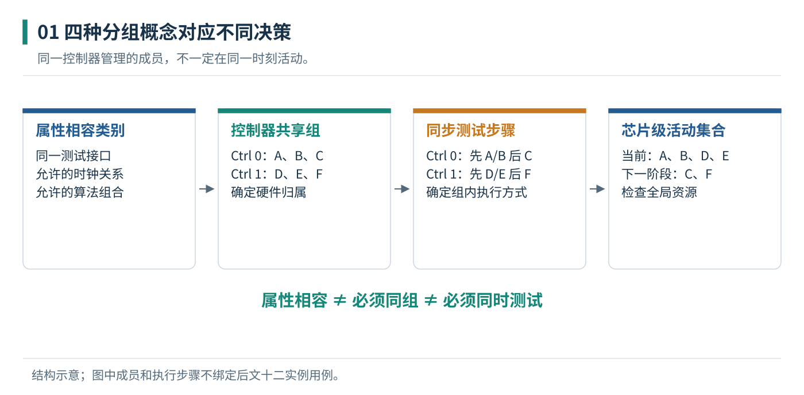

| 名称 | 所回答的问题 | 一个常见误解 |
|---|---|---|
| 属性相容类别 | 哪些实例有机会共享某种测试硬件？ | 属于同一类别，就一定要放入一个控制器 |
| 控制器共享组 | 哪些实例由同一个算法控制器管理？ | 同一个控制器管理，就一定同时测试 |
| 同步测试步骤 | 哪些实例以相同操作进度一起执行？ | 可以分别启动的实例也被强制同步 |
| 芯片级执行集合 | 当前时刻，哪些测试任务实际在运行？ | 当前活动控制器数等于当前活动存储器数 |

本专题用“控制器共享组”和“同步测试步骤”明确区分不同结构。具体商业工具可能使用不同术语；接入工具时应当依据真实对象的含义，而不是只对照名称。2025 年的 Holistic Memory DFT Partitioning 工作与 2026 年的集成分组和调度工作都说明，物理划分不能只看一个孤立的组数目标。[^R29][^R28]

### 1.2 控制器数量与测试时间
反例：A、B 的测试时间都为 $5\,\mu\mathrm{s}$，各需要 $3\,\mathrm{mW}$。全芯片允许 $6\,\mathrm{mW}$。

把它们放入一个“组内依次执行”的控制器，只需要一个控制器，但总时间为 $10\,\mu\mathrm{s}$。为它们各配置一个控制器并同时运行，需要两个控制器，却只需要 $5\,\mu\mathrm{s}$。这不依赖复杂算法，已经足以证明“最少控制器”和“最短测试时间”是不同的优化目标。

另一个反例是诊断带宽：把很多实例同步测试，测试读写时间可能减少，但所有实例同时报告错误，可能使故障记录单元成为限制因素。可见，分组不能只看读写命令一侧。

### 1.3 分组目标先于算法选择

同一份存储器清单，可以对应几种不同的优化问题。若控制器只能逐块执行，合并两个组往往减少控制器数量，却增加该控制器的完成时间；若控制器支持若干同步测试步骤，合并前还要确定哪些实例能在同一步执行；若每个实例具有独立启动能力，则控制器共享关系与运行时活动集合可以进一步分开。

本章采用三层决策顺序：先确认接口和执行方式，再生成满足约束的组，最后评估整个测试安排。算法不能通过假设工具没有实现的并行能力来缩短测试时间。

一个适合早期比较的目标是按优先级依次优化：

$$
\min_{\mathrm{lex}}\left(N_{\mathrm{ctrl}},\;\sum_g H_g,\;T_{\mathrm{test}}\right).
$$

这里 $\min_{\mathrm{lex}}$ 表示字典序比较：先比较控制器数量，只有数量相同时才比较几何代价，前两项都相同时再比较时间。这只是一个设计选择，不代表工业项目都将面积放在第一位。生产测试时间严格受限时，可以改为约束 $T_{\mathrm{test}}\leq T_{\max}$，再最小化控制器面积。

加权目标也可以使用，但需要先归一化：

$$
J=w_A\frac{A}{A_0}+w_T\frac{T}{T_0}+w_H\frac{H}{H_0}.
$$

$A_0,T_0,H_0$ 是固定参考值。否则，改变坐标单位就可能改变“最优方案”，这并不是硬件发生了变化，而是得分计算出现了量纲问题。

### 1.4 全章共用的十二存储器用例

以下数据是为解释算法构造的用例，不来自论文芯片或商业工具。A～F 位于左侧区域，G～L 是向右平移 $1400\,\mu\mathrm m$ 后的另一组实例。所有实例已经通过同一测试接口族 SP1 的相容性检查，工作在同一测试时钟下；“SP1”是用例标签，不是通用存储器库标准。

| 实例 | $x/\mu\mathrm m$ | $y/\mu\mathrm m$ | 活动功率上界 / mW | 单独测试时间 / μs |
|---|---:|---:|---:|---:|
| A | 0 | 0 | 4 | 100 |
| B | 100 | 0 | 4 | 100 |
| C | 200 | 0 | 3 | 60 |
| D | 0 | 100 | 3 | 60 |
| E | 100 | 100 | 3 | 60 |
| F | 200 | 100 | 3 | 60 |
| G | 1400 | 0 | 4 | 100 |
| H | 1500 | 0 | 4 | 100 |
| I | 1600 | 0 | 3 | 60 |
| J | 1400 | 100 | 3 | 60 |
| K | 1500 | 100 | 3 | 60 |
| L | 1600 | 100 | 3 | 60 |

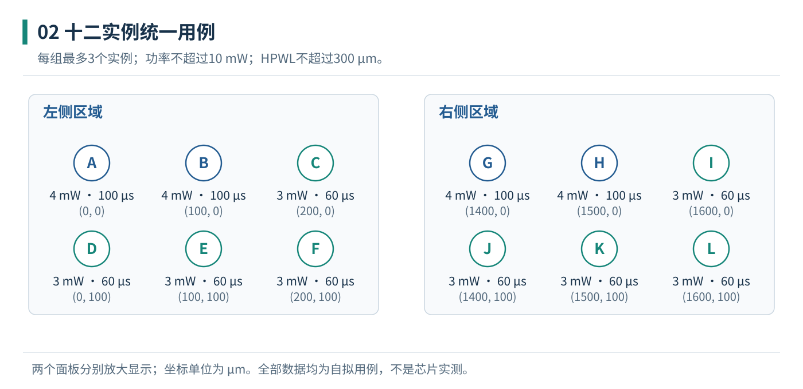

本用例规定每个控制器只有一个同步测试步骤，最多管理三个实例，组内功率上界为 $10\,\mathrm{mW}$，实例中心外接矩形的半周长不超过 $300\,\mu\mathrm m$。调度阶段最多同时启动两个控制器，全局预留功率不超过 $20\,\mathrm{mW}$。

组的测试时间取成员单独测试时间的最大值，组的预留功率取成员活动功率上界之和。短测试提前完成后是否关闭时钟，没有在这个简化模型中利用；因此，调度结果是基于**固定组功率预留**的估计，不是门级功率波形。配置、流水线排空和故障读出时间暂记为零。

后文所有“4 组”“220 μs”等计算结果，只对应上述明确条件。改变为组内串行执行、加入控制器功率或者改变硬件启动方式，必须重新计算。

## 2. 功率与能量模型
### 2.1 功率与能量基础
功率 $P$ 的单位是瓦特，描述当前消耗能量的速率；能量 $E$ 的单位是焦耳，描述整个测试过程消耗多少；电流 $I$ 与供电电压、局部供电路径一起决定电源网络的压力。

$$
E=\int_0^T P(t)\,dt,\qquad P_{\mathrm{avg}}=\frac{E}{T}.
$$

两个方案可能能量相同，但一个集中运行、峰值很高，另一个分散运行、峰值很低。生产测试可能主要受瞬时供电和温度限制；低功耗设备的运行期间测试还会在意总能量。不能只通过“平均功率下降”就判断所有目标都得到改善。

### 2.2 功率来源
在简单电容开关模型下，逻辑电路动态功率近似为：

$$
P_{\mathrm{dynamic}}\approx\alpha C V^2f.
$$

$\alpha$ 是相对于时钟周期定义的有效活动因子，$C$ 是等效电容，$V$ 是电压，$f$ 是频率。不同资料对活动因子的定义可能吸收不同常数，不能只比较符号而忽略定义。

存储器阵列还涉及字线、位线预充电、感应放大器、写驱动、地址译码和外围寄存器。因此对 MBIST 更实用的简化模型经常是每类命令能量：

$$
E_{\mathrm{test}}\approx n_r E_r+n_w E_w
+E_{\mathrm{clock}}+E_{\mathrm{interface}}+E_{\mathrm{compare}}
+\int_0^T P_{\mathrm{leakage}}(t)\,dt.
$$

这里 $E_r$ 和 $E_w$ 应当对应目标存储器、指定电压温度和具体访问模式。连续读、连续写、读写交替以及不同数据图案的能量可能不同。位宽、深度、列选择结构和端口数也会改变命令代价。

**不要重复计数。** 如果某个宏的命令能量已经包括内部时钟、预充电和外围逻辑，外部模型就不能再次把同一部分加入。应当记录每项模型包含和不包含哪些电路。

### 2.3 电气评估层级
| 层次 | 使用的信息 | 可以回答的问题 | 不能据此直接证明的事情 |
|---|---|---|---|
| 早期相对指标 | 容量、宽度、端口数、库表摘要 | 哪些候选安排可能更重，便于快速搜索 | 真实瞬时电流和实际热点 |
| 命令能量模型 | 读写命令、数据图案、宏能量表、时钟活动 | 估计阶段能量和平均功率 | 极短尖峰和复杂局部供电效应 |
| 时间相关活动分析 | 门级活动、存储器模型、时钟网络、寄生参数 | 生成更接近真实执行的功率曲线 | 模型未包含的宏内部行为 |
| 电源与温度分析 | 供电网络、封装、位置、电流波形、热模型 | 检查电压下降、局部热点和温度余量 | 未验证工艺角、温度点或操作模式 |

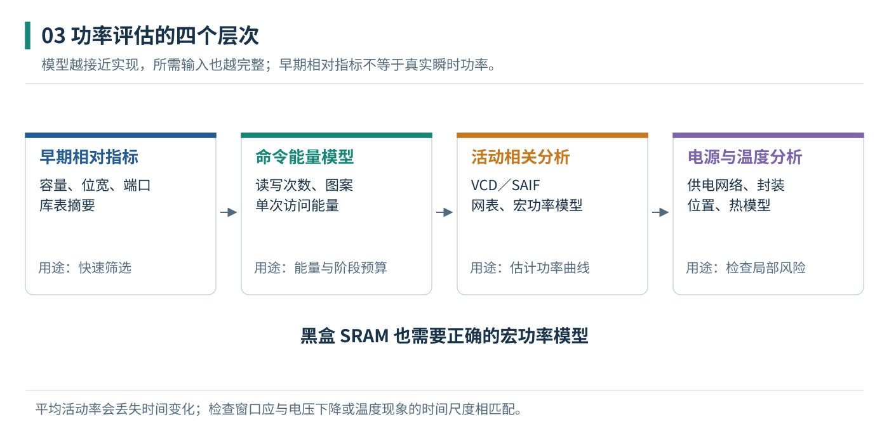

波形转储文件通常称为 VCD，活动统计交换文件通常称为 SAIF。平均活动统计可以帮助估算能量，但如果把整个测试过程平均成一个活动率，就会失去阶段之间的变化。窗口的大小应当与所检查的电源或温度现象相匹配。

对于被当作黑盒的 SRAM，只有外部端口翻转信息仍不够；分析工具还需要正确的宏功率模型。一个“没有任何内部活动”的黑盒模型可能让工具输出很低的功率，却不意味着真实阵列不消耗能量。

### 2.4 Liberty 库数据
库中的内部功率表具有适用事件、输入转换时间、输出电容、条件表达式和单位规则。实际使用时必须依据库格式和工具对该表的解释，将条件和活动频率正确组合。表格取平均值，最多只能在声明假设后作为相对排序指标；它不自动包含测试中真实命令的出现频率、时钟网络和电源网络效应。

因此，论文若使用“relative power”或者归一化数值，应当保留这个限定。将其直接写成毫瓦，既改变了单位，也改变了实验可以支持的结论。[^R28]

### 2.5 功率模型极端条件
不能只测无故障、全零数据和最低频率。应当至少检查读写交替、高翻转图案、多个控制器同步启动、最后读结果排空、故障密集时的比较与记录、修复分析以及电源模式进入和退出。

特别是诊断模式，失败位很多会增加错误掩码和故障地址的切换活动。筛选模式的低故障功率模型，不能直接用于估计故障收集最密集时的峰值。

### 2.6 串行、同步和独立启动的计算区别

设 $a_i(t)$ 表示实例 $i$ 在时刻 $t$ 是否活动。共享组的实际功率应写成：

$$
P_g(t)=P_{\mathrm{ctrl},g}(t)+\sum_{i\in g}a_i(t)P_i(t)
+P_{\mathrm{interface},g}(t)+P_{\mathrm{idle},g}(t).
$$

最后一项包括未活动实例仍然存在的泄漏或其他静态消耗。使用活动功率上界 $\widehat P_i$ 可以构造保守预算，但需要明确哪些实例会同时活动。

| 执行方式 | 简化完成时间 | 简化活动功率上界 | 适用前提 |
|---|---|---|---|
| 同组逐块完成 | $\sum_i T_i$ | $\max_i\widehat P_i$ | 每次只有一个宏活动；另计控制器、接口和静态功率 |
| 同组统一启动、同时测试 | $\max_i T_i$ | $\sum_i\widehat P_i$ | 硬件允许这些宏同步执行；较短测试的收尾可正确处理 |
| 多个同步步骤依次执行 | $\sum_s\max_{i\in s}T_i$ | $\max_s\sum_{i\in s}\widehat P_i$ | 每个步骤有明确成员，步骤间不重叠 |
| 实例独立启动 | 由启动时刻和资源约束决定 | $\max_t\sum_i a_i(t)\widehat P_i$ | 必须有相应的独立控制和状态保存能力 |

这些公式是忽略额外开销后的模型推导，不是所有 MBIST 工具都自动实现的行为。

用两个实例说明：A 的功率为 4 mW、时间为 100 μs，C 的功率为 3 mW、时间为 60 μs。串行执行时，活动功率最高为 4 mW，时间为 160 μs；同步启动时，前 60 μs 两者共需 7 mW。若 C 完成后可以停止其活动，后 40 μs 只剩 A 的 4 mW；若调度器按整组最坏值预留资源，它仍会为全部 100 μs 预留 7 mW。

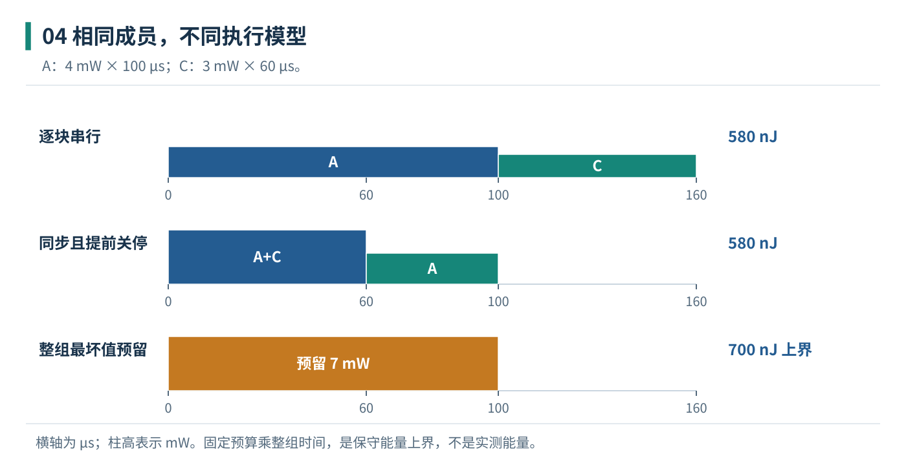

忽略其他开销，两个实例真正完成各自测试的活动能量都是：

$$
E=4\times100+3\times60=580\,\mathrm{nJ}.
$$

而 $7\times100=700\,\mathrm{nJ}$ 是“最坏功率乘整组时间”形成的保守上界，不能把二者当成同一种实测能量。因为 $1\,\mathrm{mW}\cdot1\,\mu\mathrm s=1\,\mathrm{nJ}$，这里的单位也需要一致。

## 3. 相容性与资源约束
### 3.1 冲突图
把每个存储器实例表示成一个顶点。如果两个实例不能放入同一控制器组，就在二者之间画一条边。原因可以是不同测试时钟、不同接口时序、距离太远或者修复机制不兼容。

这形成一个冲突图 $H=(V,E)$。每一个合法组必须是不含内部冲突边的顶点集合。只考虑这些两两限制、并且最小化组数时，可以将其看作图着色问题。

但实际 MBIST 分组通常不止图着色：例如每组最多三个实例、总电流不能超过某个值、组内控制线扇出有限。这些都是针对整个集合的约束，不能只靠一条条冲突边完整表示。

### 3.2 两两相容不足以证明整组可行
两两相容只说明组内每一对实例都不冲突；整组可行还要求整个组同时满足实例数量、总功率、端口和区域等共同约束。

三个存储器各需要 $4\,\mathrm{mW}$，允许总功率为 $10\,\mathrm{mW}$。任意两个同时运行都是 $8\,\mathrm{mW}$，可以通过两两检查；三个一起运行却是 $12\,\mathrm{mW}$，已经超过限制。

因此，即使冲突图没有任何边，也必须执行：

$$
\sum_{i\in G}P_i\leq P_G^{\max}.
$$

注意，这个式子适用于组内同步运行的保守峰值模型。组内依次执行时，不应机械地把所有实例的活动功率相加。此时应当计算真正活动的实例以及共享控制器的功率；额外的组功率限制只能作为另行声明的保守设计规则。

### 3.3 相邻实例相容不保证整组距离合法
如果规则要求同组任意两个实例之间的曼哈顿距离不超过 $D$，就应当检查：

$$
|x_i-x_j|+|y_i-y_j|\leq D,\qquad \forall i,j\in G.
$$

三个实例位于 $x=0,4,8$，距离限制为 $5$。A 与 B 相容，B 与 C 相容，但 A 与 C 不相容。沿着相邻实例连续连接形成一簇，并不能保证整簇合法。

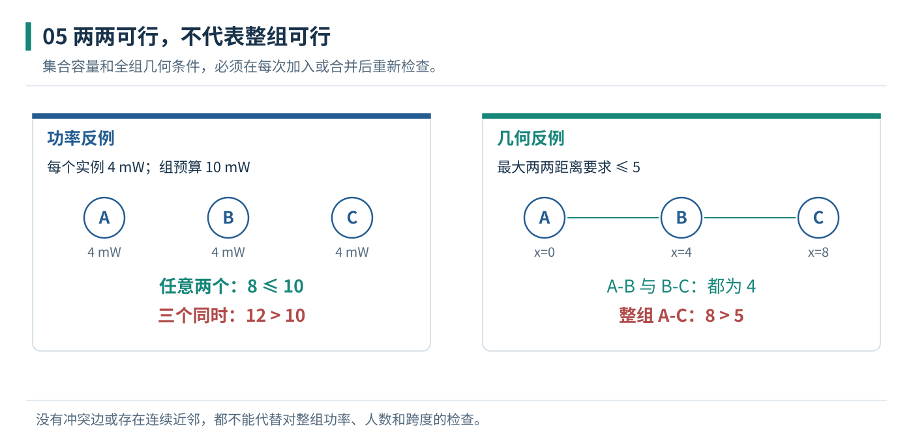

同样，“每个实例距离聚类中心不超过 $D$”只能推出实例之间距离不超过 $2D$，不能替代两两距离不超过 $D$。密度聚类尤其需要在聚类之后执行完整合法性检查；聚类结果只是候选区域，不是约束满足的证明。

### 3.4 整数优化模型
设 $x_{ig}=1$ 表示实例 $i$ 归入候选组 $g$，$y_g=1$ 表示启用该组。以组数最少为目标：

$$
\begin{aligned}
\min\quad &\sum_g y_g\\
\text{满足}\quad
&\sum_g x_{ig}=1, &&\forall i,\\
&x_{ig}\leq y_g, &&\forall i,g,\\
&x_{ig}+x_{jg}\leq1, &&\forall(i,j)\in E,\ \forall g,\\
&\sum_i x_{ig}\leq K_g y_g, &&\forall g.
\end{aligned}
$$

其中，$K_g$ 是每组允许的最大实例数。如果是同步执行组，再按适用模型加入功率、峰值电流或端口带宽约束。也可以限制组的实际外接矩形、控制线跨度或者备用资源区域。

如果将组数换成面积，目标函数应体现真实代价：

$$
A_{\mathrm{test}}=
\sum_g A_{\mathrm{controller},g}
+\sum_i A_{\mathrm{interface},i}
+A_{\mathrm{compare}}+A_{\mathrm{diagnosis}}
+A_{\mathrm{repair}}+A_{\mathrm{buffer}}.
$$

控制器少，接口、比较器和布线缓冲器却可能变大。因此，只报告组数不能证明实际测试逻辑面积减少。

### 3.5 几何约束的三种常见定义

“距离小于上限”必须落实为明确公式。最常见的三种定义并不等价。

**实例两两距离。** 采用曼哈顿距离时，组直径为：

$$
D_1(G)=\max_{i,j\in G}\left(\lvert x_i-x_j\rvert+\lvert y_i-y_j\rvert\right).
$$

它直接约束组内最远的一对实例。对固定点集，令 $u_i=x_i+y_i$、$v_i=x_i-y_i$，可以得到：

$$
D_1(G)=\max\left(\max_i u_i-\min_i u_i,\;\max_i v_i-\min_i v_i\right).
$$

因此，若只需曼哈顿直径，不必每次枚举全部点对；维护这四个极值就能快速评估加入一个实例的后果。这是该距离模型的代数性质，不适用于直接替代欧氏距离。

**外接矩形半周长。** 本章用例采用：

$$
H(G)=\left(x_{\max}-x_{\min}\right)+\left(y_{\max}-y_{\min}\right).
$$

这就是实例中心点外接矩形的 HPWL。它是几何近似，既不是所有测试信号的实际总线长，也没有包含控制器坐标、宏引脚方向、布线绕行和缓冲器。不能给它附加一个对所有芯片都成立的固定误差百分比。

对二维点集有 $D_1(G)\leq H(G)\leq2D_1(G)$。例如四点 $(0,100),(100,0),(200,100),(100,200)$ 的曼哈顿直径为 200 μm，但 HPWL 为 400 μm。采用同一个数字阈值时，两种约束会得到不同的合法组。

**控制器到存储器的距离。** 已选定控制器位置 $c_g$ 时，可以要求：

$$
\max_{i\in G}\lVert (x_i,y_i)-c_g\rVert_1\leq R_g.
$$

这回答的是控制器能否以允许的连线长度连接每个宏。控制器还必须位于可放置标准单元的区域内；纯几何中心可能落在 SRAM 宏内部。先聚类再放置控制器，仍然需要重新检查这一条件。

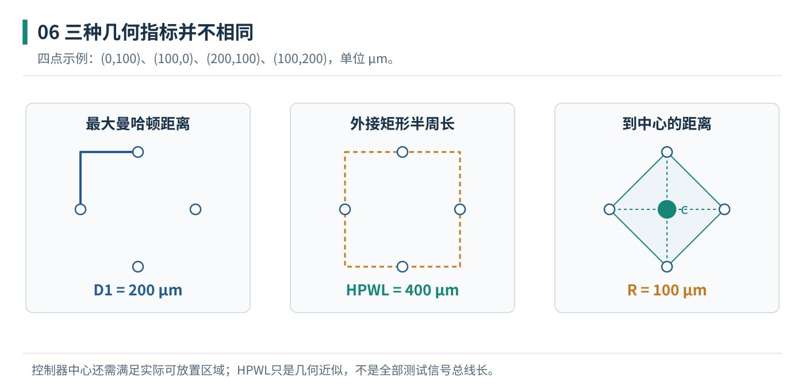

### 3.6 统一的合法性检查函数

每个算法都应调用同一份合法性规则，而不是各自实现一套近似检查。下面对应十二存储器用例；完整实现见 `code/mbist_demo.cpp`。

```cpp
bool legal(const Group& g,
           const std::vector<Memory>& m,
           const Limits& l) {
    if (g.empty() || static_cast<int>(g.size()) > l.count)
        return false;
    for (int i : g) {
        if (m[i].clock != m[g[0]].clock ||
            m[i].interface != m[g[0]].interface)
            return false;
    }
    const Stats s = stats(g, m);
    return s.power <= l.power && s.hpwl <= l.hpwl;
}
```

工程中还需补入电源域、端口时序、测试算法、修复结构和局部资源规则。接口相容性应来自存储器模型和控制器能力检查，不能仅靠“都叫 SRAM”判断。这里的 `power` 相加只因用例采用同步执行模型；串行控制器应改用与执行方式一致的检查。

最终结果还要检查：每个目标实例恰好出现一次、没有未知实例、没有空控制器组、没有遗漏的孤立实例。总数量对得上，不代表没有“一块重复、另一块遗漏”。

### 3.7 组数下界与结果证书

对于统一容量 $K$、统一同步组功率上限 $P_G^{\max}$，任何合法划分至少需要：

$$
N_{\mathrm{LB}}=\max\left(
\left\lceil\frac nK\right\rceil,
\left\lceil\frac{\sum_i P_i}{P_G^{\max}}\right\rceil,
\omega(H)
\right).
$$

$\omega(H)$ 是冲突图中最大完全子图的大小：其中任意两个实例都冲突，因而必须使用不同组。大规模问题中找到一个较大的完全子图，也能给出有效下界，不必为了计算下界再次求解完整的困难问题。

若若干属性类别之间绝对不能共享控制器，可以分别计算下界再求和。功率下界仅适用于上述同步组容量模型；组内串行时，不能用所有实例功率之和推出同样的组数下界。

十二存储器的总功率上界为 40 mW，因此人数和功率都给出至少 4 组。若找到一个完全合法的 4 组方案，就证明了**该模型下的最少组数是 4**。这仍不等于证明面积、实际线长或芯片测试时间也最优。

## 4. 分组算法

### 4.1 首次适合、最佳适合与降序装箱

#### 基本原理

将一个同步测试组视为一个容量受限的容器。实例消耗功率、接口数量和空间跨度等资源，加入后任何一项越限都不允许。与只有一个重量约束的经典装箱相比，MBIST 还存在属性冲突和几何条件，因此经典装箱算法只能作为构造方案的框架。标准装箱的二元分配模型可参照 OR-Tools 官方说明。[^ALG01]

**首次适合（First Fit，FF）**按给定顺序处理实例，检查已建立的组，将实例放入第一个合法组。**最佳适合（Best Fit，BF）**检查所有合法组，再选择加入后剩余资源最少的组。**降序首次适合（FFD）**和**降序最佳适合（BFD）**先按功率等资源需求降序排列，再执行前两种规则。

这里“最佳”仅表示当前这一步的局部选择，不代表最终划分最优。多资源情况下，也没有天然唯一的“剩余容量”；需要指定按功率、数量还是归一化混合代价比较。

```text
按选定规则排列待处理实例
对每个实例 m：
    计算所有满足 legal(G ∪ {m}) 的现有组
    若不存在合法组：建立单独包含 m 的新组
    否则：
        首次适合：选择扫描顺序中的第一个合法组
        最佳适合：选择资源剩余最少的合法组
    更新组的功率、人数及坐标极值
最后对全部分组重新核验覆盖与合法性
```

#### 用例：降序排列仍然可能留下零散实例

只看左侧六个实例，输入顺序为 A、B、C、D、E、F，功率依次为 $4,4,3,3,3,3$ mW。该顺序已经按功率降序排列。

| 当前实例 | 首次适合的处理 | 处理后的组功率 / mW |
|---|---|---|
| A：4 | 建立 G1 | G1＝4 |
| B：4 | 加入 G1 | G1＝8 |
| C：3 | G1 加入后为 11，建立 G2 | G1＝8，G2＝3 |
| D：3 | 加入 G2 | G1＝8，G2＝6 |
| E：3 | 加入 G2 | G1＝8，G2＝9 |
| F：3 | G1 和 G2 都不能容纳，建立 G3 | G1＝8，G2＝9，G3＝3 |

结果为 `{A,B}`、`{C,D,E}`、`{F}`，全部合法，却用了三个控制器。另一个方案 `{A,D,E}`、`{B,C,F}` 的每组功率都为 10 mW、人数都是 3、HPWL 都为 200 μm，只需要两个控制器。

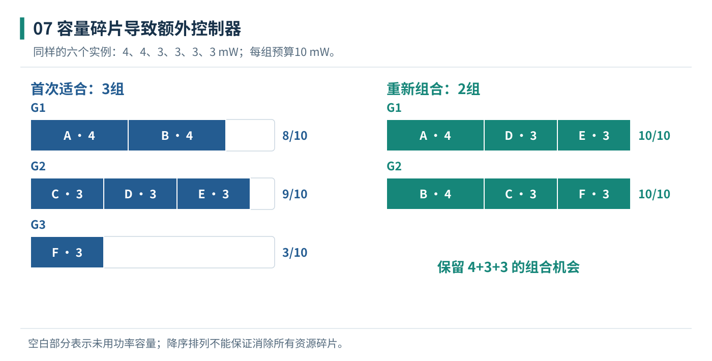

问题出在早期将两个 4 mW 实例放在一起，留下的 2 mW 容量再也容不下任何一个 3 mW 实例。最佳适合也可能做出相同决定。因此，“先放大的”是一种有用策略，但不是所有实例集的最优性保证。

反过来，排序确实可能改善结果：对功率序列 $4,4,6,6$、组上限 10 mW，按原顺序 FF 得到三组；改为 $6,6,4,4$ 后可得到两组。两个例子一起说明：排序有影响，但不能仅凭算法名称预测改进幅度。

#### 实现代价与适用情况

若最多建立 $n$ 个组，且人数、功率和坐标极值可增量维护，朴素实现需要约 $O(n^2)$ 次候选检查；排序另需 $O(n\log n)$。若合法性函数还枚举组内点对，则实际开销需要乘上该检查的成本。

这类方法适合快速产生合法初始解、在线增量加入实例和大规模流程的基准比较。需要记录输入顺序和同分时的选择规则，否则相同数据经过不同导出顺序就可能得到不同结果。

### 4.2 基于最近邻和 HPWL 增量的贪心扩展

#### 基本原理

装箱主要考虑容量，几何贪心则先从一个实例开始，不断吸收附近的合法实例。一个常见选择规则是：

$$
m^*=\arg\min_{m\in U,\;\mathrm{legal}(G\cup\{m\})}
\left[H(G\cup\{m\})-H(G)\right].
$$

$U$ 是尚未分组的实例集合。当前组 $G$ 固定时，最小化 HPWL 增量和最小化合并后的 HPWL 等价；但跨多个现有组比较时，两者不再等价。

种子可以选择左下方实例、最孤立实例或者“可选合法邻居最少”的实例。最后一种规则会优先处理难分配的存储器，以减少其合适邻居被其他组占用的风险。种子规则属于算法的一部分，不能在实验中省略。

#### 用例：最短的局部连接不一定对应最少组数

从 A 开始，加入 B 或 D 都会使 HPWL 变成 100 μm。示例程序在同分时按实例名选择，因此先加入 B，得到 `{A,B}`，功率 8 mW。剩下的任何一个实例都是 3 mW，无法再加入。

下一组从 D 开始，先加入 E，再加入 F，得到 `{D,E,F}`，功率 9 mW、HPWL 200 μm。C 单独成组。左侧三组的 HPWL 总和只有 300 μm，比最少两组方案的 400 μm 还小，却多使用一个控制器。

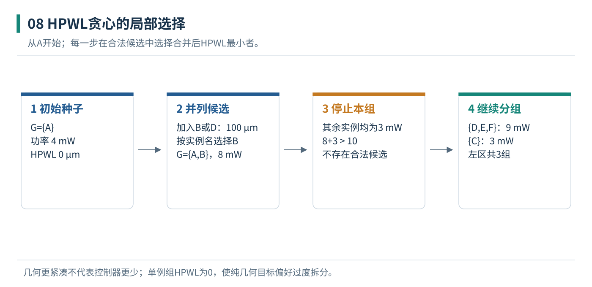

这并不矛盾：单独成组的 HPWL 为零。若只最小化各组 HPWL 之和，极端情况下把每个实例都单独分组就能得到零。因此几何得分必须与组数、面积或其他成本共同使用。

```text
对每个严格相容类别：
    U ← 该类别的所有实例
    当 U 非空：
        选取确定性种子 m，建立 G={m}，从 U 删除 m
        当 U 中存在能加入 G 的合法实例：
            选择加入后 HPWL 最小的实例
            同分时按固定规则比较实例名或资源剩余
            将该实例加入 G，并更新极值
        输出 G
```

“最近的一个实例不合法”不一定意味着所有其他实例都不合法。例如最近的实例功率过大，而稍远的低功率实例仍可加入。上面的版本检查所有合法候选；若实现只尝试最近的一个候选就结束当前组，应在算法说明中明确这一限制。

#### 与吴泽论文的对应关系

吴泽论文第 3.1.4～3.1.5 节采用时钟与类型预分类、距离和功率限制，以及逐步吸收附近实例的贪心思路，并进一步调整测试顺序。论文给出流程图，但没有完整公开种子选择、并列候选处理和源码。这里的“扫描全部合法候选、按 HPWL 和实例名选择”是可复现的补充定义，不应称为作者原始实现。[^WU]

论文第 3.1.5 节采用组内串行、组间并行，第 5.4.2 节又描述组内同时测试。本章统一用例选择同步组模型，不能把它的功率求和规则直接当作该论文所有章节一致采用的规则。复现论文前，应先确定要验证哪一种执行结构。[^WU]

### 4.3 受约束的层次合并

#### 从单个实例逐步合并

层次聚类与几何贪心的区别是：它不只把一个新实例加入某个组，也允许两个已经形成的小组继续合并。初始化时每个实例单独成组，然后反复选择代价最小的合法合并。

可以定义合并代价：

$$
\Delta(G_a,G_b)=J(G_a\cup G_b)-J(G_a)-J(G_b).
$$

只在 $\mathrm{legal}(G_a\cup G_b)$ 成立时保留该候选。对“减少控制器优先”的目标，可以先考虑所有能减少一个控制器的合并，再比较线长增量或测试时间变化。

常见的组间距离包括最近点距离、最远点距离和平均距离。最近点规则容易产生长链；最远点规则控制的是两组间最远点对，更适合与组直径上限配合，但仍不处理人数和总功率。层次聚类的基本距离定义可参照官方算法文档。[^ALG02]

#### 用例：最近点连接形成超长组

三个实例位于一条直线的 0、100、200 μm 处，组内最大两两距离要求不超过 120 μm。最近点距离会认为 `{0,100}` 与 `{200}` 之间只相隔 100 μm；如果只据此合并，最终组的两两距离却达到 200 μm。

采用整组直径检查时，第一次合并合法，第二次被拒绝。若使用 HPWL，直线上的 HPWL 也会从 100 增加到 200 μm，同样需要在合并后检查。

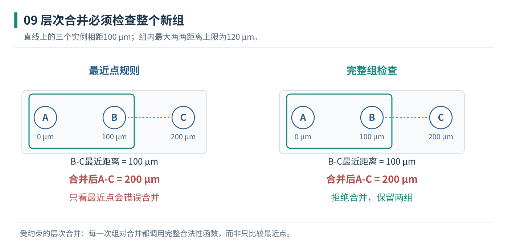

#### 可实现的维护方式

```text
初始化单实例组，并验证单实例本身可行
为候选组对计算合并代价，放入优先队列
反复取出当前代价最小的候选：
    若组已经被其他合并替代，丢弃过期候选
    若合并后违反规则，拒绝本次合并
    否则合并，并重新计算新组与邻近组的候选代价
没有合法合并时停止
```

朴素方式每轮重新扫描全部组对，最坏可达到立方级计算量；优先队列、空间邻域和增量更新可以降低典型开销，但不能无条件宣称所有实现都是 $O(n\log n)$。

该方法适合物理布局具有明显层次、需要输出可解释合并树的场景。局限是合并后通常不再拆开：若较早把 A、B 合在一起，仍可能陷入上一节的三组方案。需要与后续重新分配或局部拆组结合。

### 4.4 K-means、K-medoids 与容量修复

#### 聚类中心与真正的设计约束

K-means 交替执行“分配到最近中心”和“更新中心”，目标是降低簇内平方欧氏距离：

$$
\min_{G_1,\ldots,G_k,\mu_1,\ldots,\mu_k}
\sum_{g=1}^{k}\sum_{i\in G_g}\lVert z_i-\mu_g\rVert_2^2.
$$

$z_i$ 可以只包含位置，也可以包含归一化后的几何属性。这个目标没有自动加入人数、功率、HPWL 或接口相容性；聚类中心也不一定是可以放置控制器的位置。基本迭代与局部最优性质见官方文档。[^ALG02]

K-medoids 则把代表点限制为实际样本点，适合使用非平方欧氏距离或希望保留实际代表实例的情况。但代表存储器所在位置仍然可能是不可放置控制器的宏区域，因此“代表点”与“控制器放置点”仍需区分。

#### 用例：容量修复改变中心附近的分配

对左侧六个实例，设两个初始中心为 $(0,50)$ 和 $(200,50)$ μm。若距离相同时都分配给左侧中心，A、B、D、E 会进入左簇，C、F 进入右簇。

左簇有 4 个实例、14 mW，违反人数和功率限制；右簇只有 2 个实例、6 mW。将 B 从左簇移到右簇后，得到 `{A,D,E}` 与 `{B,C,F}`，两组都为 3 个实例、10 mW、HPWL 200 μm。

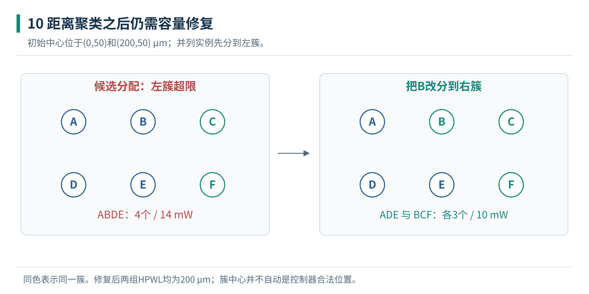

这个例子的重点不是某个初始化必然产生最优结果，而是**距离最小分配与资源可行分配是两个不同问题**。

一种工程化迭代是：先确定中心，然后将实例到中心的距离作为分配成本，在容量约束下求分配；再根据已分配成员更新中心。若各实例只占一个等价名额，分配子问题可使用第 4.13 节的最小费用流；若实例功率不同且不可拆分，则一般需要整数规划或启发式修复。

#### 参数与停止条件

簇数 $k$ 可以从组数下界开始尝试，但“某一次 K-means 无法修复”不能证明这个 $k$ 不可行。可以更换初始化、增加局部交换，或者交给小规模精确求解器判断。

普通 K-means 的每轮核心距离计算约为 $O(nkd)$，其中 $d$ 是特征维度；容量修复可能成为主要开销。它适合空间分布较规则、控制器数量已有预算的设计，不适合把没有经过检查的聚类标签直接写入 EDA 配置。

### 4.5 DBSCAN 与递归矩形划分

#### 密度连通的含义

DBSCAN 使用邻域半径 $\varepsilon$ 和最少邻居数 `minPts` 识别稠密区域。按包含自身的邻域定义：

$$
N_{\varepsilon}(i)=\{j:d(z_i,z_j)\leq\varepsilon\}.
$$

邻域内点数达到阈值的点可以扩展聚类；附近非核心点可以被纳入，孤立点则被标记为噪声。该方法不需要预先指定簇数，但仍然有参数，不能把“不指定簇数”理解为“没有参数”。密度可达的原始定义见 DBSCAN 论文。[^ALG03]

在存储器分组中，“噪声”并不意味着可以删除。它仍然是需要测试的真实宏，必须单独成组或交给后续合法合并步骤。

#### 用例：密度连通不等于短距离组

五个实例沿直线放在 0、100、200、300、400 μm 处，取 $\varepsilon=110\,\mu\mathrm m$、`minPts=2`，且邻域包含自身。相邻实例连续连接，因此会形成一个密度簇，但全簇跨度为 400 μm。

若最终组的 HPWL 上限为 200 μm，这个簇不能直接作为一个控制器组。它只是一个候选区域，需要进一步拆分。

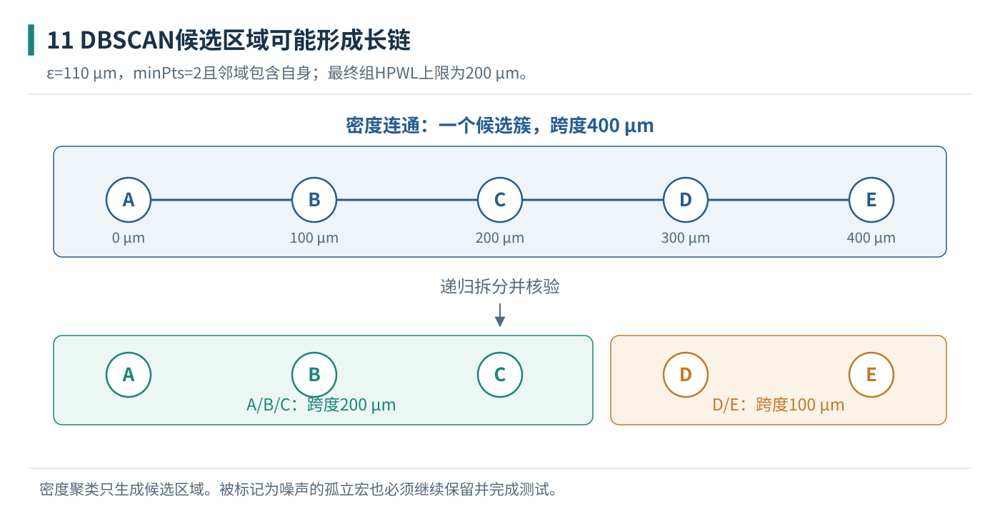

#### 递归矩形划分

矩形划分先计算当前点集的外接矩形。若全组合法，就停止拆分；否则沿较长方向选取切分位置，将成员分成两个非空子集，再分别处理。

```text
RectPartition(G)：
    若 G 合法：返回 {G}
    若 G 只有一个实例：报告该实例不可行
    计算外接矩形，选择较长方向
    生成若干切分候选，排除产生空子集的候选
    对各候选的左右子集分别递归
    比较结果的组数、跨度及资源均衡程度
    返回最优的已检查候选
```

若只选一个切分点，算法较快，但容易错过更好的划分；若每层对多个切分点完整递归搜索，搜索量可能快速增长。需要设置候选数量、深度限制或记忆化缓存，不能仅因为前面用了 DBSCAN，就将整套算法的成本都写成近似线性。

#### 用例：矩形切分限制了可搜索的方案

仍看 A～F。沿水平中线切开，上方 `{A,B,C}` 为 11 mW，不合法，下方 `{D,E,F}` 为 9 mW。上方还要继续拆开，因此最终至少形成三组。沿垂直方向切分也可能得到类似结果。

而 `{A,D,E}` 与 `{B,C,F}` 是两个合法的非轴向分隔方案。在这个点集上，允许一般成员组合比仅允许贯穿区域的横向或纵向切分更灵活。

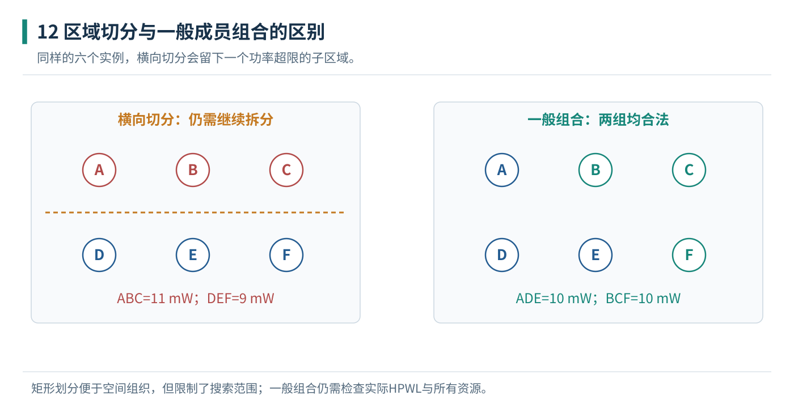

这说明矩形划分具有清晰、快速、便于物理组织的优点，同时也主动缩小了搜索空间。它得到的是该搜索策略找到的合法方案，不自动构成一般分组问题的最优性证明。

Asahina 与 Nakashima 的 2026 年工作采用属性分类、DBSCAN 和递归矩形划分，并连接功率受限的测试调度。本文上述五点直线和六实例切分均为自拟解释用例，不是该论文的实验数据或完整复现。[^R28]

### 4.6 冲突图着色与容量感知 DSATUR

#### 图着色对应的分组含义

冲突图中，一条边表示两个实例不能进入同一个组。同一种颜色代表同一个组，因此相邻顶点必须着不同颜色。目标是尽量减少颜色数量。

DSATUR 是一种动态选择下一个顶点的贪心策略。“饱和度”指某个未分配顶点的邻居已经使用了多少种不同颜色，而不是邻居总数。一般优先处理饱和度高的顶点，再用度数等规则打破并列。NetworkX 官方文档提供了 `saturation_largest_first`／`DSATUR` 策略名称。[^ALG04]

#### 五顶点用例

设冲突边为 A—B、B—C、C—D、D—E、E—A，形成五个顶点的环。先给 A 颜色 1，再给 B 颜色 2，C 可用颜色 1，D 可用颜色 2，但 E 同时与颜色 1 的 A、颜色 2 的 D 相邻，需要颜色 3。

一种分组为 `{A,C}`、`{B,D}`、`{E}`。若每个实例为 4 mW、每组上限 8 mW，这三组也满足功率条件。

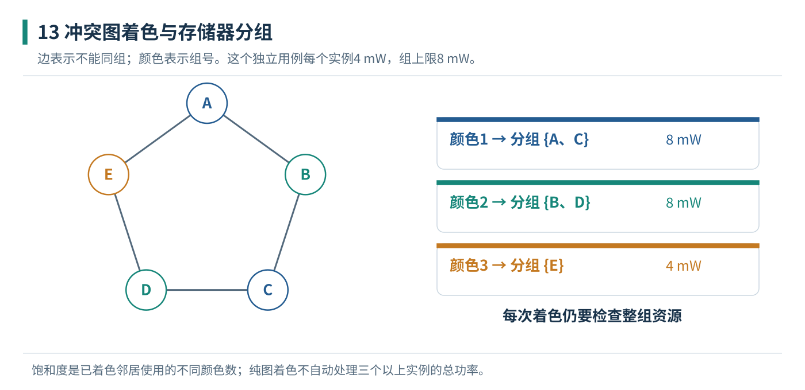

但对没有冲突边的三个 4 mW 实例，纯图着色会只使用一种颜色。若功率上限是 10 mW，三者同时测试却不合法。因此需要在着色时增加整组检查：

$$
\text{可用颜色 }g
\iff \text{不与该颜色成员冲突}\ \land\ \mathrm{legal}(G_g\cup\{i\}).
$$

```text
建立两两冲突图，所有顶点暂未分组
反复选择：饱和度最高的未分组顶点
    同分时比较冲突度数、资源需求和固定实例次序
    依次尝试现有颜色
    只有不冲突且整组合法时才允许加入
    没有可用颜色则建立新组
更新相邻顶点的已用颜色集合
```

这种扩展是“容量感知着色启发式”，不是纯图着色问题的原样求解。其优势是优先处理相容选择少的实例；局限是两两图本身不能完整表达集合资源限制，而且贪心着色不保证最少组数。

稠密图需要约 $O(n^2)$ 存储空间。大规模场景可以先按时钟和接口类别拆开，再为物理邻域或实际冲突维护稀疏结构，避免建立不必要的完整矩阵。

### 4.7 超图划分与 FM 式局部调整

#### 与冲突图的区别

冲突图描述“不能放在一起”，而这里的超图主要描述“放在一起可能更有利”。一条超边可以同时连接多个实例，用来表示共享测试控制、相似测试时间或者需要一起考虑的连接关系。

设超边 $e$ 的权重为 $w_e$。简单的割代价可以写为：

$$
J_{\mathrm{cut}}=\sum_e w_e\,\mathbf1[e\text{跨越两个或更多分区}].
$$

不同工具也可能采用跨越分区数量减一等其他定义。权重代表近似收益或代价，不能直接视为真实电路面积。即使割代价很小，各分区仍需通过功率、人数和几何检查。

#### 六实例用例

设超边为 $e_1=\{A,B,C\}$、$e_2=\{C,D\}$、$e_3=\{D,E,F\}$，权重分别为 5、1、5。为突出超图结构，这个小例子暂不采用前述 4/3 mW 数据，而假定所有成员容量都能满足两个三实例分区。

划分 `{A,B,D}` 与 `{C,E,F}` 会切断三条超边，代价为 11。将 C 与 D 交换后，得到 `{A,B,C}` 与 `{D,E,F}`，只切断中间权重为 1 的超边，代价降到 1。

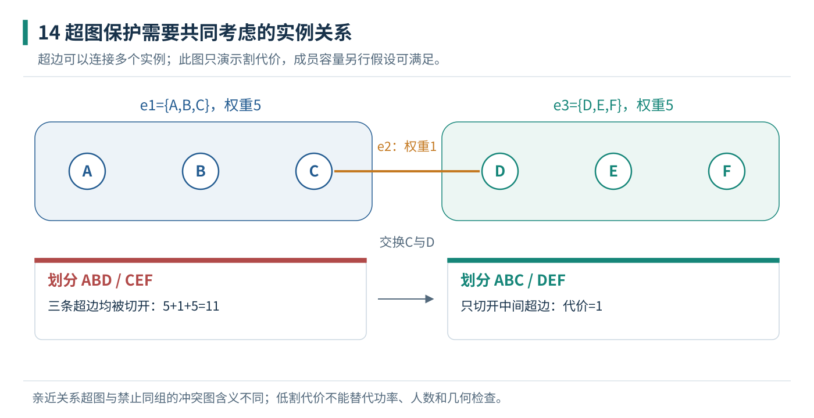

FM 式方法会计算移动一个顶点带来的割代价变化，按收益尝试移动，并暂时锁定已移动顶点。一个完整扫描过程可以允许少量暂时不利的移动，再保留累计收益最好的前缀，撤回后续移动，以避免只接受立即改善时过早停止。

若两个分区都已经达到严格人数上限，单点移动可能没有任何合法选择；这时需要允许成对交换，或者在算法内部使用明确受控的临时容量区间，并保证最终结果满足硬约束。不能在最后直接保留超容量分区。

Kahng 与 Kang 的 DATE 2014 工作把测试时间相关超图划分、局部 ILP 调度和控制逻辑放置结合起来。这里的 5、1、5 权重用例仅解释超图思想，不是其论文超边构造公式的替代实现。[^R27]

该方法适合同时考虑共享关系和物理结构的中大规模设计。难点通常是建立有意义的超边与权重，以及让划分收益与后续真实测试时间、面积保持一致。

### 4.8 网格卷积、窗口密度与候选区域选择

#### 从离散位置计算空间得分

将芯片划成网格，令 $M(x,y)$ 表示一个网格内尚未分组的相容实例数量。使用窗口核 $K(u,v)$ 累加局部得分：

$$
S(x,y)=\sum_{u,v}K(u,v)M(x-u,y-v).
$$

若窗口是全部为 1 的矩形，$S(x,y)$ 就表示附近窗口内有多少实例。也可以分别维护数量网格、功率网格和预计测试时间网格，但这些网格不能混成没有单位说明的单一数值。

这里的卷积是空间统计，不涉及卷积神经网络训练。Romain 等的 ETS 2025 论文题名和机构记录确认其采用卷积式划分方向；由于本次未取得其完整实现，以下是明确给定的通用窗口构造方法，不作为该论文算法复现。[^R29]

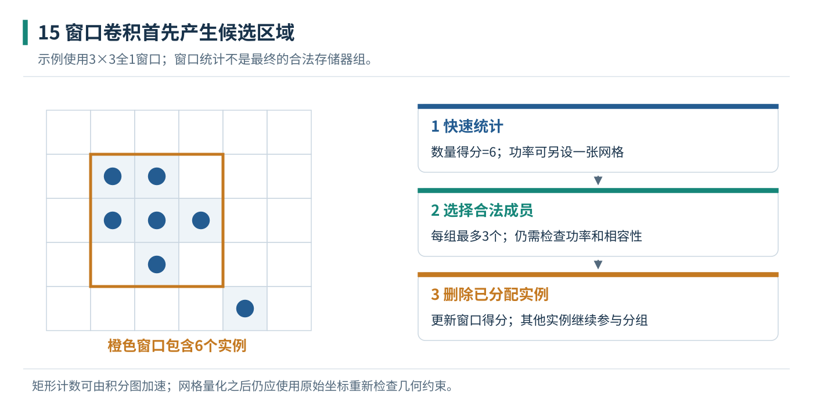

#### 从高密度窗口得到合法组

一个高密度窗口可能包含六个实例，但控制器最多只能管理三个，因此“选中窗口”只完成了候选区域选择。接下来仍需从窗口内挑选子集，检查功率、属性和真实坐标。选中的实例必须从后续可用集合中删除，避免相邻重叠窗口重复使用同一个宏。

```text
按严格相容类别建立位置网格
计算每个候选窗口的数量或收益得分
选取当前得分最高的窗口
在窗口内部用贪心或小规模精确求解挑选合法成员
确定一个组，删除其成员并更新附近窗口得分
对剩余孤立实例和窗口外实例继续处理
最后重新检查真实坐标和完整覆盖
```

#### 积分图加速

对矩形窗口，可以预先建立二维前缀和 $Q(x,y)$。一个矩形范围内的数量由四个角的前缀和相减得到，因此单次矩形计数是常数时间。建立积分图的成本与网格总格数成正比。

不过，常数时间的只是矩形总量查询，不包括窗口内成员选择、冲突检查和动态更新。实例不断移除时，可以重新计算局部区域、维护动态二维索引，或者采用批次处理。

#### 网格精度与几何安全余量

网格越粗，候选数量越少，速度可能越快，但位置误差也越大。若每个坐标分量的量化误差最多为 $\epsilon$，组 HPWL 的误差最多可达到 $4\epsilon$。因此应使用原始坐标复核，或者在粗筛选时保留相应安全余量。

密度最高也不代表分组效果最好：优先拿走一个区域里的通用实例，可能把只能与它们共享的特殊实例留到最后。窗口得分可以加入“剩余可选组数量”这样的紧迫性指标，但这属于额外启发式，需要单独做实验验证。

### 4.9 局部搜索、模拟退火与禁忌搜索

#### 从已有合法解开始修改

构造算法通常只会向前选择；局部搜索则允许重新分配已经分组的实例。常见操作包括移动一个实例、交换两个实例、将两个组重新拆分、从多个组移出少量成员后重新插入，以及对一个小范围重新求解。

关键是定义“邻域”：一次允许修改多少实例、是否可以新建或删除组、是否允许暂时变差。邻域太小，容易无法摆脱早期错误；邻域太大，每次检查都可能接近重新求解整个问题。

#### 用例：仅移动一个实例无法解决的容量组合

初始分组为 `{A,B}`、`{C,D,E}`、`{F}`，功率分别为 8、9、3 mW。将 F 放入前两个组都不合法，简单的“把单例塞进现有组”不会改善结果。

先把 G1 中的 B 与 G2 中的 D、E 交换，得到 `{A,D,E}`、`{B,C}`、`{F}`，功率变为 10、7、3 mW。随后将 F 加入第二组，就得到 `{A,D,E}`、`{B,C,F}`。

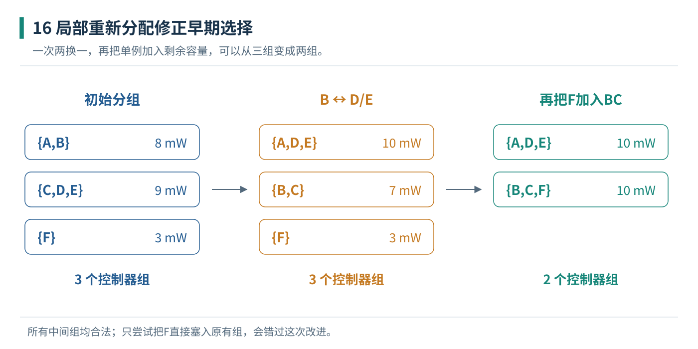

这一过程说明允许“两个实例换一个实例”，或者允许对三组一起重新分配，能解决单点移动无法处理的结构。附带 C++ 示例采用的是**两组或三组范围内的精确重新划分**，并非模拟退火；它只接受按“组数、HPWL 总和”字典序改善的结果。

#### 模拟退火的接受规则

模拟退火允许一定概率接受比当前方案更差、但仍满足硬性约束的候选。设目标变化为 $\Delta J=J_{\mathrm{new}}-J_{\mathrm{old}}$，搜索参数为 $\tau$，常见规则为：

$$
p_{\mathrm{accept}}=
\begin{cases}
1,&\Delta J\leq0,\\
\exp(-\Delta J/\tau),&\Delta J>0.
\end{cases}
$$

这里的 $\tau$ 是优化过程中的参数，不是芯片物理温度。算法开始时取较大的 $\tau$，允许更广泛地探索；随后逐步降低，减少接受变差方案的概率。

例如 $\Delta J=2$，当 $\tau=5$ 时接受概率约为 0.67；当 $\tau=0.5$ 时约为 0.018。前者更容易离开当前局部方案，后者更保守。这些数字由公式直接计算，不是某篇 MBIST 论文的调参结果。

```text
current ← 一个合法初始分组
best ← current
重复直到达到迭代数或时间限制：
    candidate ← 对 current 进行一次邻域修改
    若 candidate 不合法：拒绝，继续下一次
    计算 ΔJ
    若改善，或者随机数小于 exp(-ΔJ/τ)：接受 candidate
    若 current 比 best 更好：保存 best
    按既定规则降低 τ
输出 best，而不是最后一次被接受的 current
```

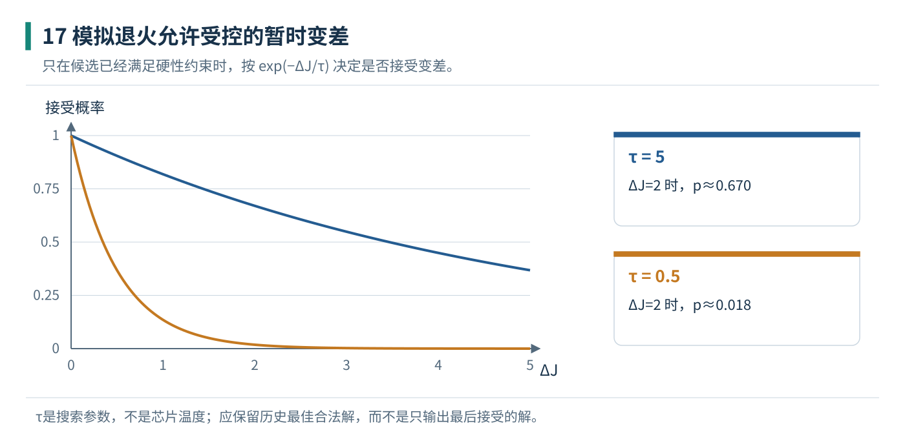

若目标是严格的字典序，不能随意把两个目标直接相加用于退火。可以在固定组数下优化几何，也可以使用经过明确界定的分层搜索；若使用加权标量，需说明允许多少几何改善换取一个额外控制器。

#### 禁忌搜索

禁忌搜索通过短期记忆避免反复执行相反操作。例如刚把 B 从 G1 移到 G2，接下来若干次迭代禁止立刻移回，从而避免在两个方案间来回切换。若一个受禁操作能产生历史最佳解，可以设置特赦规则允许执行。

禁忌长度、邻域大小和停止条件需要与随机种子或确定性顺序一起记录。这类方法适合目标函数复杂、已有较好初始解的设计，但有限次搜索通常只给出较好的可行解，不构成全局最优证明。

### 4.10 遗传算法与多目标进化搜索

#### 编码决定合法性维护的难度

最直观的编码是每个实例所属的组号，例如 `[0,0,1,1,1,2]`。它很紧凑，但组号没有物理含义：把 0 和 1 对换，分组结构并没有变化。直接对组号串做交叉，可能破坏原有的好组，还会产生大量只是编号不同的重复方案。

另一种编码是**实例排列加合法解码器**。染色体表示处理顺序，如 `[A,D,E,B,C,F]`；解码器按这个顺序调用首次适合或几何贪心，得到真正的组。只要每个实例单独可行，解码器又始终执行完整合法性检查，就可以保证每个染色体最终生成一个合法划分。

这会把部分搜索偏好交给解码器：即使某种分组在一般意义上可行，也不一定能被特定解码器轻易产生。因此需要同时说明编码和解码规则，而不能只写“使用遗传算法”。

#### 用例：保序交叉与解码

以父本甲 `[A,B,C,D,E,F]` 和父本乙 `[A,D,E,B,C,F]` 为例，保留甲的 C、D 片段，再按乙中剩余实例的相对顺序补齐空位，可以形成 `[A,E,C,D,B,F]`。这里采用左到右填空的保序示例，不依赖某个软件包对交叉位置的特殊约定。

解码后，A、E、C 的功率为 10 mW；D、B、F 的功率也为 10 mW。两组都满足本用例的人数和 HPWL 上限。这个子代的组数比父本甲少，但 HPWL 总和未必比父本乙小，说明不同目标之间还需要比较。

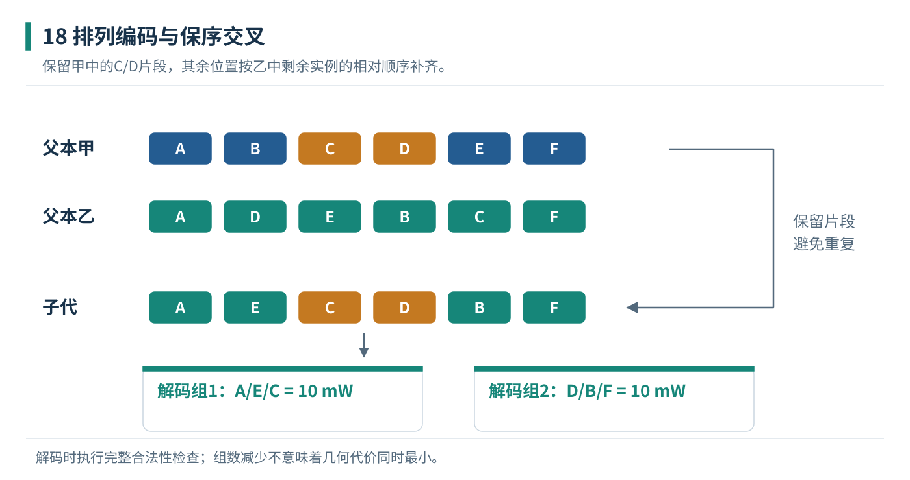

```text
生成种群：部分来自不同贪心顺序，部分来自随机排列
对每个染色体：
    用统一解码器生成合法分组
    计算组数、几何、测试时间等指标
每代重复：
    选择父本，执行保序交叉
    通过交换、插入或片段反转做变异
    解码并评估子代
    保留优秀候选，同时维持一定多样性
达到预算后，输出候选集合及各项指标
```

#### 多目标比较

若同时优化面积和时间，某个方案可能面积更小但测试更慢。Pareto 支配关系可写为：一个方案在所有目标上不差于另一个，并且至少一个目标严格更好。未被其他方案支配的候选构成当前搜索得到的非支配集合。

NSGA-II 一类策略按非支配层级和候选间分布选择保留对象，适合展示不同设计取舍。但搜索得到的非支配集合不一定是真正完整的 Pareto 最优集合；有限种群和迭代次数可能遗漏更好的方案。[^ALG09]

MBIST 领域已有 EMGA 等进化分组研究。本次可确认其正式论文记录，但没有把未经核对的交叉概率、变异机制或性能百分比写成作者结论。上述排列编码和保序交叉是本章给出的通用可实现方案。[^ALG05]

计算成本可以粗略理解为“种群数量 × 代数 × 一次解码与评估成本”。若每个候选都调用完整物理设计，成本会很高；较合理的流程是先用快速模型筛选，再对少量候选做 EDA 评估。随机方法应报告多个种子下的分布，而不是只展示最好一次。

### 4.11 整数规划、集合划分与小规模精确求解

#### 分配变量模型

第 3.4 节已经给出 $x_{ig}$ 和 $y_g$ 的基本定义。对同步组，再加上：

$$
\sum_i P_i x_{ig}\leq P_g^{\max}y_g.
$$

若不允许空控制器，可以加入 $y_g\leq\sum_i x_{ig}$。配合 $x_{ig}\leq y_g$，可以确保组只有实际成员时才启用。统一组数量上限可以取 $n$，因为每个实例单独成组给出了一个自然上界；若单实例已经不可行，应先报告模型不可行原因。

若控制器编号可以自由交换，会出现大量结构相同的对称解。常见做法是限制 $y_g\geq y_{g+1}$，或要求较小编号实例优先占用较小编号组。后一类对称消除约束必须经过证明，避免意外删除真实可行解。

#### 将 HPWL 写入模型

为每个组定义 $X_g^{\min},X_g^{\max},Y_g^{\min},Y_g^{\max}$，用条件约束保证已分配成员位于矩形内。例如：

$$
\begin{aligned}
X_g^{\min}&\leq x_i+M_x(1-x_{ig}),\\
X_g^{\max}&\geq x_i-M_x(1-x_{ig}).
\end{aligned}
$$

$y$ 方向相同，再限制：

$$
X_g^{\max}-X_g^{\min}+Y_g^{\max}-Y_g^{\min}\leq H_{\max}.
$$

坐标变量应有明确的芯片范围，且满足最小值不大于最大值。$M_x$ 可以根据芯片宽度确定，不宜随意取极大常数，否则可能降低数值稳定性和求解效率。支持指示约束的求解器也可以直接表达“若 $x_{ig}=1$，则该成员必须在组矩形内”。

这些式子给出的是本章 HPWL 模型的一种表达，不替代真实引脚线长或控制器放置约束。

#### 合法候选组的集合划分模型

当每组最多只有少量成员时，也可以先生成所有合法候选组。令 $\mathcal C$ 为候选集合、$z_S$ 表示是否选择候选 $S$，则：

$$
\begin{aligned}
\min\quad&\sum_{S\in\mathcal C}z_S,\\
\text{满足}\quad&\sum_{S\in\mathcal C:i\in S}z_S=1,\quad\forall i,\\
&z_S\in\{0,1\}.
\end{aligned}
$$

每个实例恰好被覆盖一次，所以这是集合划分，而不是允许重复覆盖的普通集合覆盖。候选组已经通过人数、功率和几何检查，主模型只需要选择一组互不重叠且覆盖完整的候选。

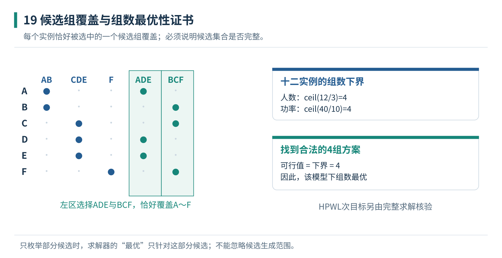

若只生成部分候选，求解器证明的也只是**该候选集合内最优**。要声称一般分组最优，需要完整候选集合，或者具有正确最优性终止条件的列生成、分支定价等方法。不能把“求解器返回 OPTIMAL”与“前面没有遗漏更好的候选”混为一谈。

#### 用例：十二实例的精确结果

完整枚举本用例所有合法子集后，可以选出：

| 组 | 成员 | 功率 / mW | HPWL / μm | 同步完成时间 / μs |
|---|---|---:|---:|---:|
| G1 | A、D、E | 10 | 200 | 100 |
| G2 | B、C、F | 10 | 200 | 100 |
| G3 | G、J、K | 10 | 200 | 100 |
| G4 | H、I、L | 10 | 200 | 100 |

人数和功率下界都为 4，而这个合法方案恰好使用 4 组，因此组数最优。若进一步按“先组数、后 HPWL 总和”求解，附带程序与独立检查器均得到 $(4,800\,\mu\mathrm m)$。

#### 子集动态规划

附带 C++ 程序没有依赖商业整数规划器，而是使用小规模子集动态规划。设 $R$ 是尚未分配的实例集合，选其中编号最小的实例 $i$：

$$
F(R)=\min_{\substack{S\subseteq R,\ i\in S\\S\text{合法}}}
\left\{c(S)+F(R\setminus S)\right\},\qquad F(\varnothing)=0.
$$

若只优化组数，$c(S)=1$；若采用字典序，则把成本保存为 $(1,H(S))$，相加后按字典序比较。强制候选组包含 $i$，可以避免仅因组顺序不同而重复枚举同一划分。

这个递推成立的原因是：完整划分中必然存在且只存在一个包含 $i$ 的组；确定该组后，其余成员形成规模更小的同类问题。它依赖目标在组之间可加，不能直接用于同时存在复杂全局调度代价的模型。

任意子集枚举的常见最坏规模为 $O(3^n)$，状态存储为 $O(2^n)$；人数上限较小时，实际候选数量会更少。示例程序限制在 20 个实例以内，并主要用于十二实例讲解和更小的独立测试，不应当作千实例级求解器。

#### 可行解、下界与最优性差距

整数规划在限定时间内可能只有可行解和下界。对于最小化问题，若当前可行值为 $U$、已证明下界为 $L$，可以自行统一报告：

$$
\mathrm{gap}=\frac{U-L}{\max(1,\lvert U\rvert)}.
$$

这是一种明确给定的统计定义；不同求解器内置相对差距的分母处理可能不同。报告时应同时列出 $U$、$L$ 和停止原因，而不是只给一个百分比。

### 4.12 CP-SAT 与分组—调度联合建模

#### 从“属于哪个组”扩展到“何时运行”

整数分配变量擅长表达成员归属；区间变量更适合表达任务在时间轴上占用资源。对每个测试任务定义开始时刻 $s_i$、持续时间 $d_i$ 和结束时刻 $e_i=s_i+d_i$。

使用 CP-SAT 时，需要将时间和资源转换成整数。单位过粗会丢失细节，单位过细会扩大数值范围。若需要保守保证，可以将需求向上取整、预算向下取整；但由此产生的不可行结论只针对保守后的模型，不能自动说明原连续数值模型不可行。求解状态及整数建模要求可参照官方文档。[^ALG06]

#### 两种不能混用的控制器模型

**串行控制器。** 实例可以分配给某个控制器，其相应可选区间只有在分配成立时存在。同一控制器的这些区间使用不重叠约束，表示每次只测试一个实例。

**同步测试组。** 成员统一启动，直接把整个组当作一个任务，持续时间为 $\max_i T_i$，功率需求为组预算。对这个组的成员逐个施加不重叠约束，会错误地把同步硬件改成串行硬件。

官方作业车间示例说明了区间和不重叠约束的基本用法；下面将其对应到 MBIST 是本章的模型构造，不表示该示例本身是存储器测试工具。[^ALG07]

全局功率限制可以通过累积资源约束表示：

$$
\sum_i P_i\,\mathbf1[s_i\leq t<e_i]\leq P_{\mathrm{chip}}^{\max},\qquad\forall t.
$$

若每个任务正好代表一个控制器组，可以对每个任务设置单位需求，并再加一个容量为 $B_{\max}$ 的累积约束，限制同时活动控制器数量。

若一个控制器可以同时运行多个独立实例，就不能把“活动任务数量”直接当作“活动控制器数量”；需要额外表达该控制器是否至少有一个实例活动。这是硬件结构对数学模型的实质影响。

#### 用例：组数相同，时长也未必相同

对本章 4 组方案，每组固定预算为 10 mW、时间为 100 μs。全局预算 20 mW、最多两个控制器并发，安排 G1/G2 在 0～100 μs，G3/G4 在 100～200 μs，即可得到 200 μs 的计划。

若全局预算降为 15 mW，任意两个 10 mW 的组都不能同时执行。同一分组下的完成时间就变为 400 μs。此时为了缩短时间，可能反而需要重新分组，形成能互相搭配的小功率任务。

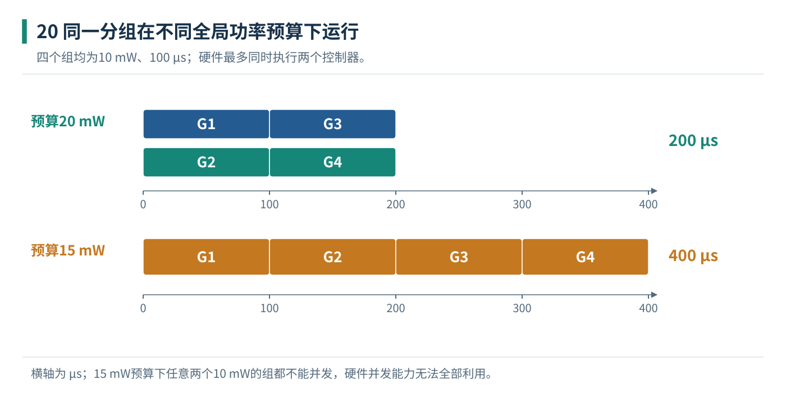

这个例子说明：先最小化组数，再做调度，并不保证最短芯片测试时间。联合建模的优势是能直接比较这些取舍，代价是变量、条件约束和搜索空间都明显增加。实际可以先固定分组求调度，再对造成长等待的少数组局部重新求解。

#### 输出结果的含义

`FEASIBLE` 表示找到满足模型的解，`OPTIMAL` 表示求解器在该模型下完成了最优性证明；达到时间限制时可能仅有可行解，也可能没有找到解。没有找到解不能自动解释为设计不可行。即使模型最优，仍需要检查实际硬件是否支持假设的启动方式、持续时间和并发关系。[^ALG06]

### 4.13 最大流与最小费用流的受限分配方法

#### 适用条件

当候选控制器位置或候选区域已经固定，每个实例占用一个等价名额，而且“是否能加入候选区域”可以单独判断时，成员分配可转化为网络流。常见条件是：同一问题内实例具有相同测试功率，候选区域自身已经满足允许的几何范围，其他集合约束都能归结为整数容量。

例如一个候选矩形的宽度加高度已经不超过 HPWL 上限，那么任意位于该矩形内的成员子集都满足这一 HPWL 条件。相比之下，只知道每个实例距中心小于某个半径，并不自动满足任意给定的组内两两距离上限。

最小费用流用于容量约束分配的基本网络结构可参照 OR-Tools 官方示例。[^ALG08]

#### 网络构造与整数分配

建立源点 $s$、实例节点 $m_i$、候选组节点 $g$ 和汇点 $t$。

$$
\begin{aligned}
s\to m_i &: \text{容量 }1,\\
m_i\to g &: \text{仅当实例能进入该候选组时连边，容量 }1,\\
g\to t &: \text{容量 }K_g.
\end{aligned}
$$

若所有实例的测试功率相同且为 $p>0$，同步组可用名额为：

$$
K_g=\min\left(K_g^{\mathrm{count}},\left\lfloor\frac{P_g^{\max}}p\right\rfloor\right).
$$

所有容量均为整数，求得的整数最大流中，每个实例的一个单位流只会分配给一个候选组。最大流等于实例总数，表示全部实例均已分配；小于实例总数时，最小割可以帮助指出哪些候选区域总容量不足。

#### 用例：增广路修复早期选择

设 M1 可以进入 C1 或 C2，M2 只能进入 C1，M3 只能进入 C2。C1 容量为 1，C2 容量为 2。

贪心先将 M1 放入 C1 后，M2 就没有位置。网络流可以沿残余网络把 M1 改到 C2，释放 C1 给 M2，再把 M3 放入 C2，最终分配成功。

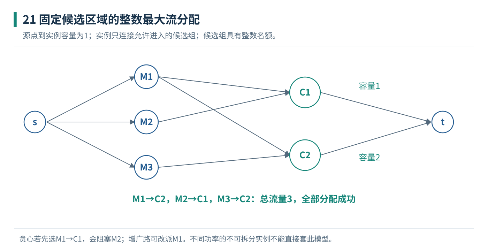

这个例子中的 M2 是“选择很少”的实例，恰好说明局部就近分配为何容易失败。网络流能通过增广路整体调整先前选择，而不是要求第一步就猜对。

在实例到候选组的边上增加距离或布线近似成本 $c_{ig}$，就得到最小费用流，可在所有完整分配中最小化 $\sum_{i,g}c_{ig}x_{ig}$。这一最优性仅针对给定候选区域与可分解的边成本。

#### 不能直接套用的情形

若每个实例功率不同，把一个实例拆成若干个“功率流量单位”会允许它同时流入多个控制器，违反存储器不可拆分的要求；只限制每组实例数量，又无法表达不同功率。这通常已经不是普通单位分配流可以解决的问题。

如果还要决定“开启哪些候选控制器”，并为开启一个控制器收取固定面积成本，目标包含组是否使用的非线性或整数选择，也不能简单交给同一个最小费用流。一般需要外层搜索、整数规划或特定结构下的进一步变换。

更不能先求一个允许实例分数分配的连续解，再对结果直接四舍五入。正确的做法是证明子问题具有整数结构，使用整数流恢复，或者明确求解二元分配模型。

### 4.14 分层混合求解流程

前面的算法不必彼此排斥。一个可实施的组合是：严格属性分类缩小问题，空间方法生成候选区域，贪心构造初始组，再对困难区域做局部精确重新划分，最后让调度与 EDA 评估指出需要调整的组。

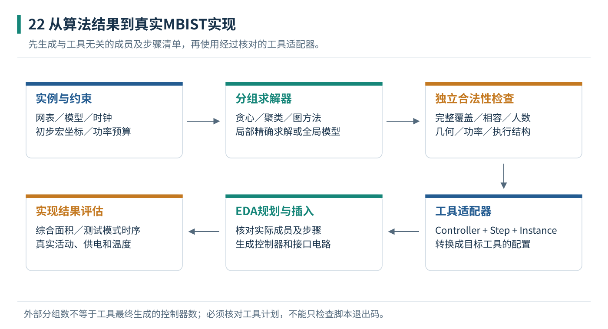

一个具体流程可以定义为：

```text
1. 读取实例及模型，检查单位、缺失值和单实例可行性
2. 按真正不可共享的属性拆成独立类别
3. 通过几何贪心、DBSCAN或窗口方法产生初始合法组
4. 找出单例组、资源剩余较多的组和调度等待较长的组
5. 对相邻的2～3组做重新分配；规模较小时使用精确求解
6. 重新生成测试计划，检查全局与局部功率限制
7. 对少量候选调用EDA生成、综合和时序/功率检查
8. 保留通过所有检查的结果，并记录未通过原因
```

只在物理近邻组之间执行局部搜索通常更快，但这是一个启发式限制；若把它作为对比算法，应说明可能放弃远距离成员交换。使用精确局部求解，也不能把整个混合算法称为全局最优。

精确求解器适合作为局部工具和小规模基准，而不是必须替代所有快速方法。一个有价值的比较是：在相同计算预算下，单纯贪心、贪心加局部修复，以及完整小规模求解分别得到什么结果。

### 4.15 可复现用例与实际运行结果

#### 代码范围

附带 `code/mbist_demo.cpp` 是无第三方库依赖的 C++17 程序，实现六种运行配置：原顺序首次适合、功率降序最佳适合、HPWL 几何贪心、容量感知 DSATUR、贪心加局部精确重新划分，以及完整子集动态规划。

这些程序使用同一份数据与合法性函数。K-means、DBSCAN、超图、模拟退火、遗传算法、CP-SAT 和网络流在本章提供原理、公式及操作流程，但**没有列入下面的实跑对比**。不能把讲解覆盖范围当成已实现并测量的算法数量。

```bash
bash code/run_demo.sh
python3 code/verify_results.py
```

第一条命令编译程序并输出各方法的分组和估计计划；第二条使用独立编写的检查器核验结果。重新生成插图可执行 `python3 code/draw_figures.py`；需要 `cairosvg`，只生成 SVG 时可加 `--svg-only`。

#### 同一模型下的结果

| 方法 | 控制器组数 | HPWL 总和 / μm | 估计完成时间 / μs | 调度最大预留功率 / mW |
|---|---:|---:|---:|---:|
| 原顺序首次适合 | 6 | 800 | 220 | 18 |
| 功率降序最佳适合 | 6 | 800 | 220 | 18 |
| HPWL 几何贪心 | 6 | 600 | 220 | 18 |
| 容量感知 DSATUR | 6 | 800 | 220 | 18 |
| 贪心＋局部精确重新划分 | 4 | 800 | 200 | 20 |
| 完整子集动态规划 | 4 | 800 | 200 | 20 |

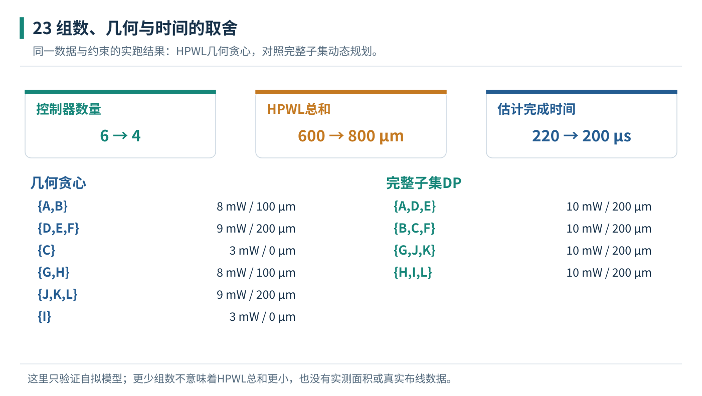

这里的完成时间来自相同的事件驱动贪心调度：优先尝试持续时间较长的组，同分时优先功率较大的组；每次检查剩余功率和并发控制器数量，没有可启动任务时前进到最近的完成事件。这个调度器不是通用最优调度器。

六组方案中，两组 8 mW、100 μs 的任务先运行；随后是两组 9 mW、60 μs；最后两组 3 mW、60 μs。完成时间为 $100+60+60=220\,\mu\mathrm s$。四组方案中，每组都是 10 mW、100 μs，分两轮完成，得到 200 μs。

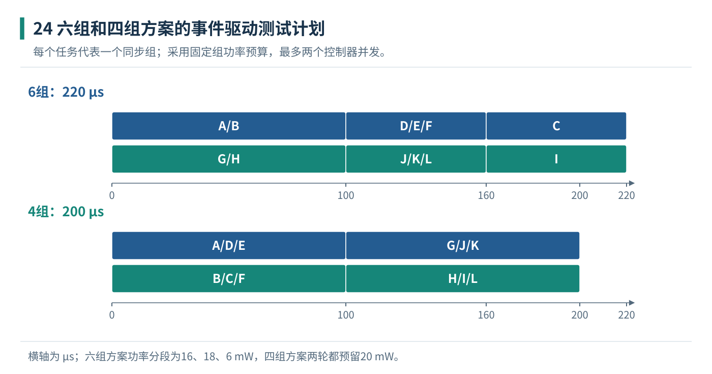

几何贪心的 HPWL 总和更低，却不是组数最少；四组方案的时间更短，却使用了更高的瞬时预留功率。结果展示的是不同目标之间的取舍，不能概括为“所有指标同时更好”。实际总布线、面积和真实功率还没有测量。

#### 核验范围

检查器对六个结果逐项验证实例恰好覆盖一次、属性相容、人数、功率、HPWL，以及各个开始/结束事件处的全局功率和控制器并发数量。对完整例子，它使用“逐实例放入已有组或新建组”的独立枚举方法，复核 $(4,800)$；该实现不复用 C++ 的子集递推。

此外，运行了 24 个固定随机种子生成的小规模实例，对照独立枚举结果，并检查所有六种方法的合法性；重复实例、单实例功率超限和负功率三类输入均被拒绝。详细记录在 `results/verification.json`。

这些检查确认的是演示模型和代码行为，不是商业工具插入成功、芯片制造测试覆盖率或实际功耗。当前没有执行商业 EDA，也没有进行真实网表的综合、布局布线和功率分析。

### 4.16 分组算法与 EDA 工具的接口

#### 输出必须包含实例归属和执行结构

算法结果首先应表示成与工具无关的清单，再转换成所用 EDA 版本支持的配置。一个最小结果包含控制器编号、测试步骤编号、实例层次路径、执行模式及必要的顺序信息。

```csv
controller_id,step_id,memory_instance,execution_model
mbist_0,step_0,soc/u_mem_A,synchronous
mbist_0,step_0,soc/u_mem_D,synchronous
mbist_0,step_0,soc/u_mem_E,synchronous
mbist_1,step_0,soc/u_mem_B,synchronous
mbist_1,step_0,soc/u_mem_C,synchronous
mbist_1,step_0,soc/u_mem_F,synchronous
```

上面的层次路径是展示格式的假定名称，不是附件芯片的真实路径。实际接入时必须使用工具识别到的实例名，并处理综合展开、层次更名和宏替换产生的变化。

同一个 `controller_id` 只表达控制器共享关系；同一个 `step_id` 才进一步表达同步执行要求。若目标工具支持多个步骤，不能只给控制器标签，就假定组内串行/并行已经正确实现。

#### 工具适配器负责的工作

适配器应将清单转换为工具支持的控制器创建、成员指定、步骤编排和测试算法配置。工具版本、控制器类型和相容性规则不同，不能将一套 Tcl 命令名称当作通用标准。

下面是工程适配器的**伪代码**，不是任一厂商的原生命令：

```text
design = adapter.read_design(netlist, memory_models, clocks)
recognized = adapter.list_memory_instances(design)
assert every_exported_instance_exists(recognized, grouping)
for controller in grouping:
    adapter.create_controller(controller.id)
    for step in controller.steps:
        adapter.assign_memories(controller.id, step.id, step.members)
        adapter.set_execution_mode(step.execution_model)
    adapter.set_test_algorithms(controller.algorithms)
plan = adapter.check_and_plan()
assert planned_membership_matches_requested(plan, grouping)
adapter.generate_and_insert()
```

检查后的工具计划非常重要：工具可能因接口或时钟规则进一步拆分、拒绝某些成员组合，或者采用与外部预估不同的步骤结构。算法输出 4 组，不代表最后实际生成的一定是 4 个同等功能控制器。

吴泽论文第 5.4.2 节将分组选择放在控制器配置和 MBIST 插入之前，说明这类外部分组结果可以在该阶段进入流程；论文没有公开完整 dofile，不能据此补造未经核对的精确命令。[^WU]

#### 坐标、功率与时序的反馈

物理坐标可以来自初步宏布局，而不必等待最终布线。宏位置变化后应重新计算组跨度。即使 HPWL 合法，仍需要对真实测试时钟、控制器到宏的路径和响应返回路径做时序分析；HPWL 是筛选条件，不是时序满足的证明。

如果后续分析发现某个区域电压下降过大，可以修改局部并发预算、改变测试顺序或调整分组。若时序不满足，可能需要改变控制器位置、增加流水级或缩小组范围。不同修复会影响面积、时间和硬件结构，不能只在算法表格里修改一个得分。

### 4.17 算法选择与公平比较

| 方法 | 优先解决的问题 | 需要重点检查的条件 | 合适的角色 |
|---|---|---|---|
| FF/BF/FFD/BFD | 快速填充有限资源 | 输入顺序、资源碎片、整组几何 | 基准与初始解 |
| 最近邻／HPWL 贪心 | 保持局部紧凑 | 种子、并列规则、是否检查全部候选 | 物理感知初始解 |
| 层次合并 | 分层组织附近实例 | 合并后的完整约束、错误合并不可撤回 | 候选区域或分层分组 |
| K-means／K-medoids | 给定簇数下的空间组织 | 容量修复、初始化、控制器可放置区域 | 控制器预算已知的候选生成 |
| DBSCAN＋矩形拆分 | 不规则密集区域 | 噪声实例保留、长链、递归搜索成本 | 大规模空间预处理 |
| 容量感知 DSATUR | 处理两两冲突与稀缺选择 | 集合功率限制不能只靠边表示 | 相容性复杂的构造方法 |
| 超图／FM | 保护共享关系并降低割代价 | 权重含义、容量、移动或交换规则 | 结构划分与局部调整 |
| 卷积／积分图窗口 | 快速定位密集候选区域 | 重复分配、量化误差、窗口内子集选择 | 网格化布局搜索 |
| 局部搜索／退火／禁忌 | 修正早期决定 | 邻域、合法性、随机性、停止条件 | 改进已有可行解 |
| 遗传／多目标进化 | 探索不同组合与取舍 | 编码、解码、修复和多个随机种子 | 多目标候选搜索 |
| MILP／集合划分／子集 DP | 精确比较与下界 | 模型完整性、候选遗漏、求解状态 | 小规模基准和局部优化 |
| CP-SAT | 联合成员归属与时间安排 | 执行结构、整数单位、并发资源定义 | 分组—调度联合分析 |
| 最大流／最小费用流 | 固定区域的容量分配 | 单位需求、整数容量、不可拆分性 | 特定可证明子问题 |

比较时应保持相同的实例、硬件结构、属性规则、几何定义、功率模型和测试开销。一个算法允许异构宏共享，另一个只允许完全同型宏共享，两者组数不能直接归因于求解算法优劣。

计算预算也需要一致：记录硬件、线程数、时间上限、随机种子，以及是否把数据解析、候选生成、合法性修复和最终检查计入运行时间。结果至少包括组数、几何代价、估计测试时间、计算时间、可行性和可用的最优性下界。

调参应在独立数据或预先声明的样例集上进行。仅为每一个测试例分别挑出最好参数，会高估方法的稳定性。对于实际工程，建议另外保留“改变宏位置后”“增加一种接口后”“局部功率预算收紧后”的增量测试，观察算法是否仍能稳定生成完整合法结果。


## 5. 局部电源与温度约束
### 5.1 局部电压下降
用一个非常简化的供电模型表示，局部电流变化可以引起：

$$
\Delta V(t)\approx R\,I(t)+L\frac{dI(t)}{dt}.
$$

第一项反映电阻上的电压下降，第二项反映电流快速变化与电感的关系。实际芯片供电网络是分布式网络，还包含电容、封装与多条供电路径；上式说明总平均功率不足以描述该问题的原因。

两个方案全芯片功率相同，若一个把活动集中在角落的弱供电区域，另一个分散到多个区域，局部电压下降可能完全不同。同步开启很多控制器还可能产生很大的电流变化率。

如果测试造成非预期的电压下降，原本合格的存储器也可能报错，形成测试引起的误失败。反过来，为了避免误失败而过度放缓操作，又可能漏掉本来需要特定速度条件才能激活的缺陷。

### 5.2 温度记忆效应
单区域的简单热模型为：

$$
C_{\mathrm{th}}\frac{dT}{dt}
=P(t)-\frac{T-T_{\mathrm{ambient}}}{R_{\mathrm{th}}}.
$$

$R_{\mathrm{th}}$ 是热阻，$C_{\mathrm{th}}$ 是热容。温度不是当前功率的即时函数，而与先前一段时间的活动有关。两个当前功率相同的区域，一个刚运行过高功率测试，另一个已经冷却，其可接受的后续活动可能不同。

多个区域可以写成矩阵形式：

$$
\mathbf C\frac{d\boldsymbol\theta}{dt}
=\mathbf P(t)-\mathbf G\boldsymbol\theta(t),
\qquad
\boldsymbol\theta=\mathbf T-T_{\mathrm{ambient}}\mathbf1.
$$

这类热阻—热容网络是体系结构级热建模的基础方法；具体参数需结合结构与测量校准，示例参数不能视为芯片材料参数。[^R50]

### 5.3 三维芯片热约束
上下堆叠的区域具有垂直热耦合，内部层的散热路径也不同。把多层中垂直对齐的存储器同时运行，可能形成局部热点，即使全芯片总功率没有超限。

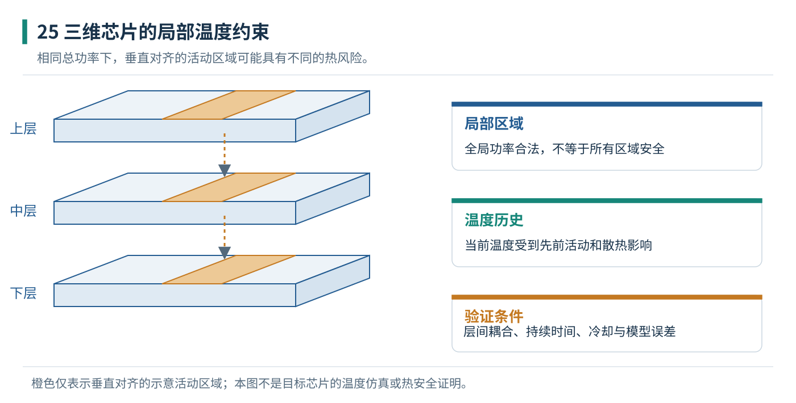

Chen 等 2026 年的 Temperature-Conscious Test Scheduling Strategies for 3D Integrated Circuits 提出了按区域组织的温度感知调度，结合全局功率与垂直区域限制。其研究方向提示我们将空间温度约束加入调度，但论文特定热模型中的合法计划，不能自动替代目标芯片的温度验证。[^R32]

对每个区域 $z$，分析模型可加入：

$$
\sum_{j\in z}\mathbf1[s_j\leq t<s_j+d_j]\leq K_z.
$$

这是用同时活动数量近似温度压力。它比全局功率限制更细，但仍不等价于实际温度约束 $T_z(t)\leq T_z^{\max}$。区域大小、层间热耦合和冷却等待都需要检查。

### 5.4 温度感知调度
在决定启动一个新任务前，先根据当前估计温度和计划功率预测未来温度。如果任何区域会超过限制，则尝试其他任务或者等待。测量温度可以用于校正模型，但传感器的位置、延迟和误差必须计入安全余量。

不能依靠“启动后发现过热再随时停下”作为唯一策略，因为检测可能滞后，而且任意暂停测试可能改变故障覆盖。更稳妥的方法是保守预测、合法启动，以及在允许的检查点执行调整。

### 5.5 局部功率预算对分组结果的影响

十二实例用例只限制全芯片 20 mW，因而可以让左侧两组同时执行，每组 10 mW。但若左侧供电区域另有限制 12 mW，这样的安排就不再合法，即使全局预算仍然满足。

在不修改四组结构的前提下，可以让左侧一组和右侧一组同时运行，再执行另一对。这个例子中每个局部区域只活动 10 mW，总功率仍为 20 mW，完成时间也仍为 200 μs。调度程序附带的默认结果没有使用这一局部约束；这里给出的是加入局部规则后的手工可行安排。

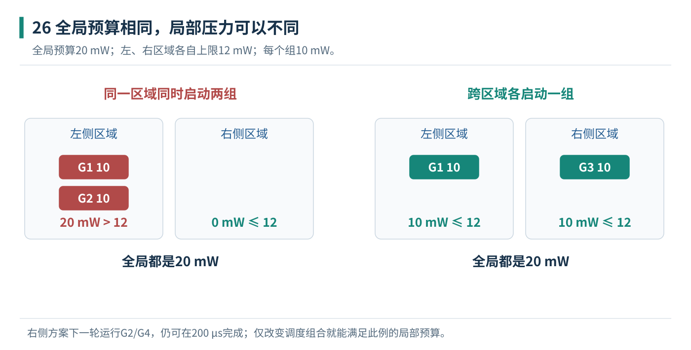

这说明发现局部功率问题后，不一定必须增加控制器或重新分组；先改变执行组合可能已经足够。反过来，若每个组自身就超过所在区域预算，单纯改变组间顺序无法解决，必须修改组内并行度、测试频率或分组结构。

同样的思路适用于温度，但温度还保留过去活动的影响。对于常功率 $P$、环境温度 $T_a$ 的单区域热 RC 模型，初始温度为 $T_0$ 时：

$$
T(t)=T_a+PR_{\mathrm{th}}
+\left(T_0-T_a-PR_{\mathrm{th}}\right)
\exp\left(-\frac{t}{R_{\mathrm{th}}C_{\mathrm{th}}}\right).
$$

由这个模型可见，当前功率相同但 $T_0$ 不同，后续温度轨迹也不同。是否需要等待冷却，取决于持续时间、初始温度和模型参数，而不是只看当前有几个存储器活动。这里没有指定材料参数，也没有据此声称某个演示计划已经通过真实热验证。

## 6. 研究进展与证据范围

### 6.1 论文工作与本章算法的对应

| 年份与工作 | 可以确认的内容 | 本章对应位置与限制 |
|---|---|---|
| 2014，Kahng、Kang，Co-Optimization of Memory BIST Grouping, Test Scheduling, and Logic Placement | 结合超图划分、局部整数规划调度与控制逻辑放置 | 第 4.7、4.11、4.14 节；本章例子不使用论文工业输入，不报告复现收益。[^R27] |
| 2024，Huang、Huang，Memory Grouping for the Built-In Self-Test of Three-Dimensional Integrated Circuits | 讨论三维芯片的存储器分组，并考虑测试安排 | 本次依据出版商索引和摘要；不补写未取得的算法内部参数。[^R31] |
| 2024，Li 等，EMGA: An Evolutionary Memory Grouping Algorithm for MBIST | 已确认正式的进化分组论文记录 | 第 4.10 节给出通用进化方法，不冒充其原始编码、交叉或变异实现。[^ALG05] |
| 2025，吴泽，《存储密集型 AI 芯片 DFT 方法研究与实现》 | 时钟和类型分类、距离与功率限制、贪心分组，以及控制器配置和插入流程 | 第 4.2、4.16 节；保留组内串行／并行表述不一致这一事实，不自行替作者统一。[^WU] |
| 2025，Romain 等，Holistic Memory DFT Partitioning Using a Convolution-Based Algorithm | 已确认会议、作者和卷积式划分方向 | 第 4.8 节是明确给定的通用空间窗口算法；未取得完整实现，不推测其滤波核、阈值和收益。[^R29] |
| 2026，Asahina、Nakashima，Integrated Memory Grouping and Power-Aware MBIST Scheduling for MPSoCs | 属性分类、密度聚类、递归矩形划分，以及功率约束调度；使用相对功率指标 | 第 4.5 节；已核对开放全文，不能把其相对指标转换为真实 mW，也不将启发式结果写成一般最优证明。[^R28] |
| 2026，Chen 等，Temperature-Conscious Test Scheduling Strategies for 3D Integrated Circuits | 三维芯片的温度相关测试安排方向 | 第 5 节；本次保留摘要级说明，不用自拟 RC 例子替代其完整热模型。[^R32] |

### 6.2 文献方法、解释模型与实跑程序的区分

本章沿用原文“分组层次—功率模型—相容约束—分组算法—局部电源与温度”的组织。新增部分分为三类：有来源的论文方法说明、为了理解算法而给出的通用建模与自拟用例，以及附带程序的实际运行结果。

论文方法说明保留其适用条件。原始材料没有给出完整源码或约束时，本章不会用一个通用实现补成“论文原版”。十二存储器数据、五顶点冲突图、最大流三实例和交叉变异示例均是自拟用例。

实际运行结果只覆盖第 4.15 节列出的六种配置。程序证明的最优性仅限完整枚举的简化分组模型；本章没有完成论文工业数据复现，也没有执行真实设计上的 EDA 插入或物理评估。

### 6.3 后续研究可以验证的具体问题

在保持硬件结构和约束相同的前提下，可以分别验证：增加局部重新划分是否减少零散组；使用功率曲线而非整组常数是否降低保守预留；把局部供电区域纳入规划是否改变最佳分组；不同几何近似与最终测试模式时序之间有多大差异。

这些问题应通过明确的对照实验回答。算法名称、聚类图看起来紧凑，或者求解器返回一个合法解，都不能单独证明电路面积、测试时间和功率同时改善。


## 与其他设计层的衔接
本专题输出需要继续交给[并发调度与联合优化](07_并发调度与联合优化.md)、[故障诊断与结果记录](09_故障诊断与结果记录.md)、[设计验证与工具接入](12_设计验证与工具接入.md)。改变某一层的条件以后，应重新检查受到影响的接口和验证要求。


## 参考文献
原有 R 系列编号与总文集一致；本章新增 ALG 编号用于算法基础资料。原文集索引见[参考文献与研究进展索引](90_参考文献与研究进展索引.md)。本章自身已列出使用的参考条目，单独阅读不依赖其他文件。

[^R27]: **R27** — Andrew B. Kahng, Ilgweon Kang. **Co-Optimization of Memory BIST Grouping, Test Scheduling, and Logic Placement**. DATE, 2014. DOI: 10.7873/DATE.2014.209。会议官方全文：<https://past.date-conference.com/proceedings-archive/2014/PDFFILES/07.7_4.PDF>

[^R28]: **R28** — Koki Asahina, Yasuhiko Nakashima. **Integrated Memory Grouping and Power-Aware MBIST Scheduling for MPSoCs**. NG-RES 2026, OASIcs 140, Article 3。出版日期 2026-03-10，DOI: 10.4230/OASIcs.NG-RES.2026.3。开放全文：<https://drops.dagstuhl.de/entities/document/10.4230/OASIcs.NG-RES.2026.3>

[^R29]: **R29** — Olivier Romain, Wojciech Gierszal, Luc Romain, Artur Pogiel. **Holistic Memory DFT Partitioning Using a Convolution-Based Algorithm**. IEEE ETS, 2025, pp. 1–4. DOI: 10.1109/ETS63895.2025.11049595。依据正式论文记录。作者机构：<https://publications.polymtl.ca/66490/> ；出版商：<https://ieeexplore.ieee.org/document/11049595/>

[^R31]: **R31** — Shou-Yi Huang, Shih-Hsu Huang. **Memory Grouping for the Built-In Self-Test of Three-Dimensional Integrated Circuits**. Electronics, 13(18), 3759, 2024. DOI: 10.3390/electronics13183759。依据出版商索引与摘要。<https://www.mdpi.com/2079-9292/13/18/3759>

[^R32]: **R32** — Hsiu-Wei Chen, Sz-Chi Ting, Liang-Ying Su, Shih-Hsu Huang. **Temperature-Conscious Test Scheduling Strategies for 3D Integrated Circuits**. Electronics, 15(14), 3050, 2026。出版日期 2026-07-11，DOI: 10.3390/electronics15143050。依据出版商索引与摘要。<https://www.mdpi.com/2079-9292/15/14/3050>

[^R50]: **R50** — Kevin Skadron 等，**Temperature-Aware Microarchitecture**，ISCA 2003，及作者发布的 HotSpot 热模型资料。用于热阻—热容模型的基础背景，不是 MBIST 专用论文。<https://ieeexplore.ieee.org/document/1206984/> ；<https://www.cs.virginia.edu/~skadron/Papers/hotspot_tr2003_08.abstract.html> ；<https://lava.cs.virginia.edu/HotSpot/>

[^WU]: 吴泽. 存储密集型 AI 芯片 DFT 方法研究与实现[D]. 成都：电子科技大学，2025. 本次使用用户上传全文；相关位置为第 3.1.4～3.1.5 节（正文第 24～27 页）及第 5.4.2 节（正文第 62～63 页）。

[^ALG01]: Google OR-Tools. The Bin Packing Problem[EB/OL]. 官方模型和实现说明，访问核对：2026-10-20. <https://developers.google.com/optimization/pack/bin_packing>。用于标准装箱变量与容量模型，不是 MBIST 专用算法。

[^ALG02]: scikit-learn developers. Clustering: K-means and Hierarchical Clustering[EB/OL]. 官方算法文档，访问核对：2026-10-20. <https://scikit-learn.org/stable/modules/clustering.html>。用于聚类基本定义；本章容量修复与硬件解释是补充建模。

[^ALG03]: ESTER M, KRIEGEL H P, SANDER J, XU X. A Density-Based Algorithm for Discovering Clusters in Large Spatial Databases with Noise[C]//KDD. 1996: 226–231. 原始会议论文：<https://cdn.aaai.org/KDD/1996/KDD96-037.pdf>。

[^ALG04]: NetworkX developers. greedy_color[EB/OL]. 官方文档，访问核对：2026-10-20. <https://networkx.org/documentation/stable/reference/algorithms/generated/networkx.algorithms.coloring.greedy_color.html>。用于 DSATUR 策略名称；本章容量感知版本额外检查整组资源。

[^ALG05]: LI Y, DUAN Y, ZHANG H, et al. EMGA: An Evolutionary Memory Grouping Algorithm for MBIST[C]//ISEDA. 2024: 492–497. DOI: 10.1109/ISEDA62518.2024.10617612. 出版商记录：<https://ieeexplore.ieee.org/document/10617612/>。本章只据正式记录确认工作，不补造原始参数或实验收益。

[^ALG06]: Google OR-Tools. CP-SAT Solver[EB/OL]. 官方文档，访问核对：2026-10-20. <https://developers.google.com/optimization/cp/cp_solver>。用于整数要求及求解状态的含义。

[^ALG07]: Google OR-Tools. The Job Shop Problem[EB/OL]. 官方区间调度示例，访问核对：2026-10-20. <https://developers.google.com/optimization/scheduling/job_shop>。本章将区间资源思想用于 MBIST，是另行给出的模型。

[^ALG08]: Google OR-Tools. Assignment as a Minimum Cost Flow Problem[EB/OL]. 官方文档，访问核对：2026-10-20. <https://developers.google.com/optimization/flow/assignment_min_cost_flow>。本章等功率容量、几何区域和不可拆分条件均单独说明。

[^ALG09]: pymoo developers. NSGA-II: Non-dominated Sorting Genetic Algorithm[EB/OL]. 官方实现说明，访问核对：2026-10-20. <https://pymoo.org/algorithms/moo/nsga2.html>。用于非支配排序与拥挤距离的基本机制；不表示本包实现了 NSGA-II。

---

[总览](00_MBIST总体架构与阅读导航.md) · [上一篇：测试算法生成与选择](05_测试算法生成与选择.md) · [下一篇：并发调度与联合优化](07_并发调度与联合优化.md)
