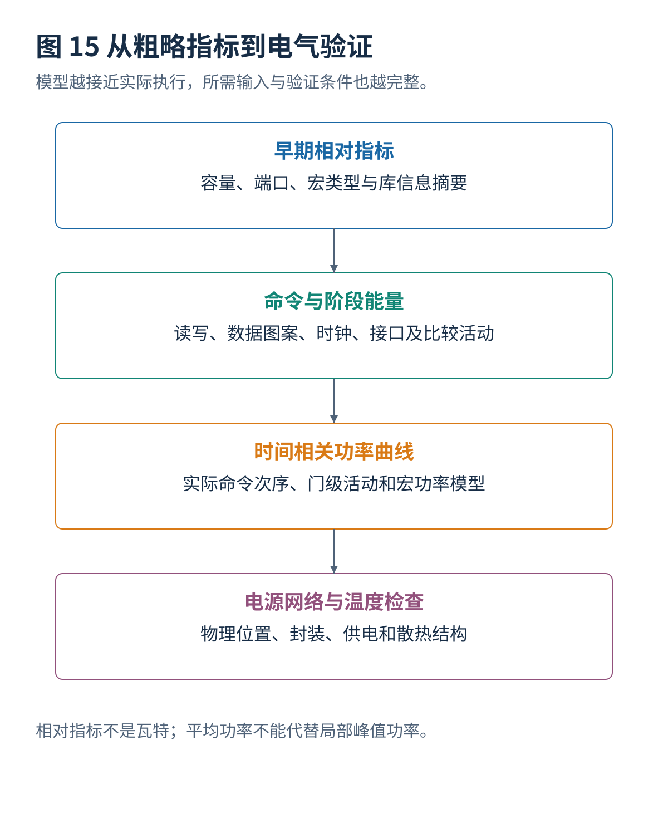
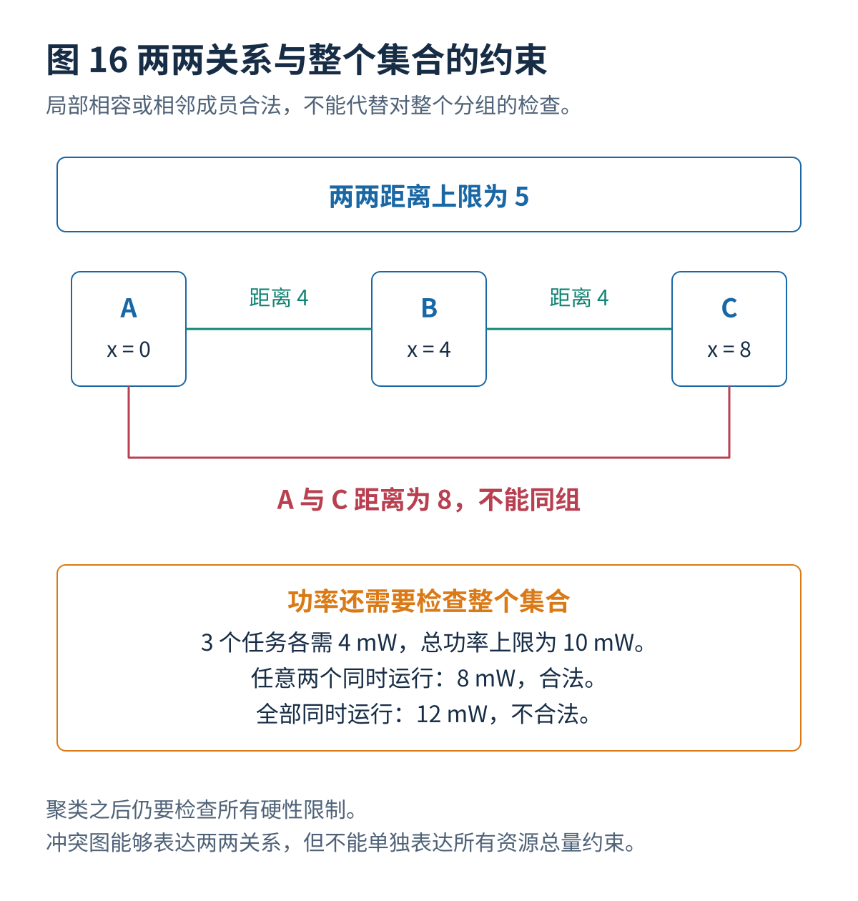
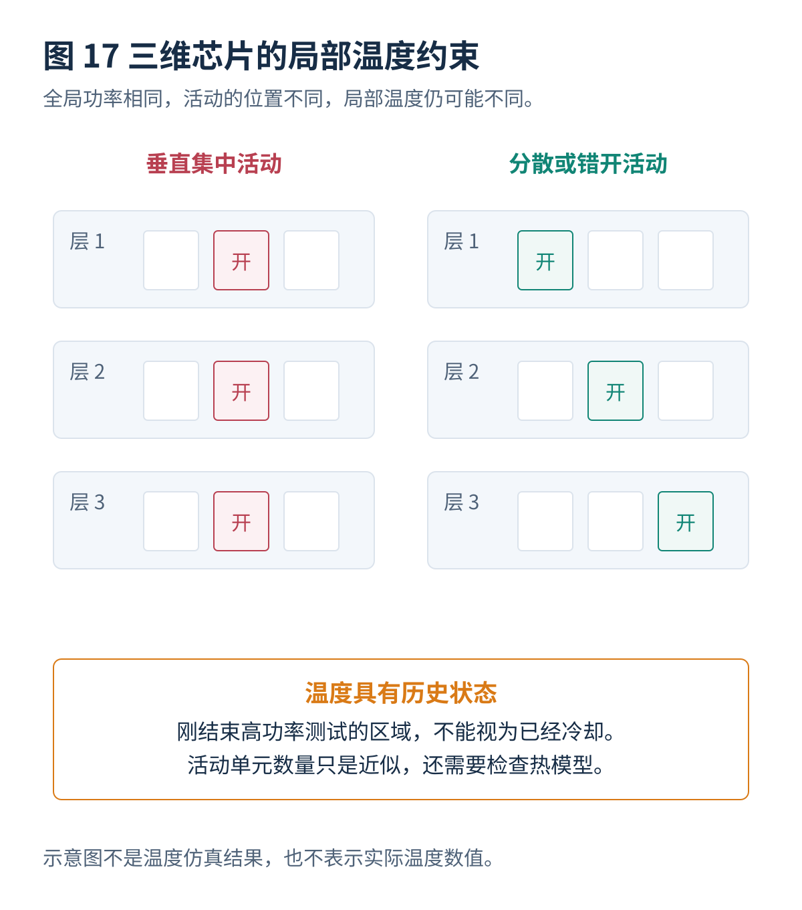

# 06 · 存储器分组与功耗分析

[总览](00_MBIST总体架构与阅读导航.md) · [上一篇：测试算法生成与选择](05_测试算法生成与选择.md) · [下一篇：并发调度与联合优化](07_并发调度与联合优化.md)

---

> **架构位置：物理组织与电气约束层。** 把共享控制器的分组方法与功率、局部电源和温度模型放在同一专题分析。

| 设计入口 | 本专题的约定 |
|---|---|
| 输入 | 实例属性、物理位置、控制器共享能力、命令能量与电气限制。 |
| 输出 | 合法候选组、功率模型、区域限制和交给调度器的资源预算。 |
| 建议先读 | [存储器接口与测试控制器](01_存储器接口与测试控制器.md) |

## 本篇目录

- [[#1. 分组层次与优化目标|1. 分组层次与优化目标]]
- [[#2. 功率、能量与模型精度|2. 功率、能量与模型精度]]
- [[#3. 相容性、距离与集合资源约束|3. 相容性、距离与集合资源约束]]
- [[#4. 分组算法的原理与取舍|4. 分组算法的原理与取舍]]
- [[#5. 局部电源网络与温度约束|5. 局部电源网络与温度约束]]
- [[#6. 相关学术进展与证据范围|6. 相关学术进展与证据范围]]
- [[#与其他设计层的衔接|与其他设计层的衔接]]

## 1. 分组层次与优化目标

### 1.1 四种“组”不能混为一谈

| 名称 | 所回答的问题 | 一个常见误解 |
|---|---|---|
| 属性相容类别 | 哪些实例有机会共享某种测试硬件？ | 属于同一类别，就一定要放入一个控制器 |
| 控制器共享组 | 哪些实例由同一个算法控制器管理？ | 同一个控制器管理，就一定同时测试 |
| 同步测试步骤 | 哪些实例以相同操作进度一起执行？ | 可以分别启动的实例也被强制同步 |
| 芯片级执行集合 | 当前时刻，哪些测试任务实际在运行？ | 当前活动控制器数等于当前活动存储器数 |

本专题用“控制器共享组”和“同步测试步骤”明确区分不同结构。具体商业工具可能使用不同术语；接入工具时应当依据真实对象的含义，而不是只对照名称。2025 年的 Holistic Memory DFT Partitioning 工作与 2026 年的集成分组和调度工作都说明，物理划分不能只看一个孤立的组数目标。[^R29][^R28]

### 1.2 为什么减少控制器数量不一定缩短测试时间

教学反例：A、B 的测试时间都为 $5\,\mu\mathrm{s}$，各需要 $3\,\mathrm{mW}$。全芯片允许 $6\,\mathrm{mW}$。

把它们放入一个“组内依次执行”的控制器，只需要一个控制器，但总时间为 $10\,\mu\mathrm{s}$。为它们各配置一个控制器并同时运行，需要两个控制器，却只需要 $5\,\mu\mathrm{s}$。这不依赖复杂算法，已经足以证明“最少控制器”和“最短测试时间”是不同的优化目标。

另一个反例是诊断带宽：把很多实例同步测试，测试读写时间可能减少，但所有实例同时报告错误，可能使故障记录单元成为限制因素。可见，分组不能只看读写命令一侧。

## 2. 功率、能量与模型精度

### 2.1 三个物理量分别回答什么问题

功率 $P$ 的单位是瓦特，描述当前消耗能量的速率；能量 $E$ 的单位是焦耳，描述整个测试过程消耗多少；电流 $I$ 与供电电压、局部供电路径一起决定电源网络的压力。

$$
E=\int_0^T P(t)\,dt,\qquad P_{\mathrm{avg}}=\frac{E}{T}.
$$

两个方案可能能量相同，但一个集中运行、峰值很高，另一个分散运行、峰值很低。生产测试可能主要受瞬时供电和温度限制；低功耗设备的运行期间测试还会在意总能量。不能只通过“平均功率下降”就判断所有目标都得到改善。

### 2.2 功率从哪里来

在简单电容开关模型下，逻辑电路动态功率近似为：

$$
P_{\mathrm{dynamic}}\approx\alpha C V^2f.
$$

$\alpha$ 是相对于时钟周期定义的有效活动因子，$C$ 是等效电容，$V$ 是电压，$f$ 是频率。不同资料对活动因子的定义可能吸收不同常数，不能只比较符号而忽略定义。

存储器阵列还涉及字线、位线预充电、感应放大器、写驱动、地址译码和外围寄存器。因此对 MBIST 更实用的简化模型经常是每类命令能量：

$$
E_{\mathrm{test}}\approx n_r E_r+n_w E_w
+E_{\mathrm{clock}}+E_{\mathrm{interface}}+E_{\mathrm{compare}}
+\int_0^T P_{\mathrm{leakage}}(t)\,dt.
$$

这里 $E_r$ 和 $E_w$ 应当对应目标存储器、指定电压温度和具体访问模式。连续读、连续写、读写交替以及不同数据图案的能量可能不同。位宽、深度、列选择结构和端口数也会改变命令代价。

**不要重复计数。** 如果某个宏的命令能量已经包括内部时钟、预充电和外围逻辑，外部模型就不能再次把同一部分加入。应当记录每项模型包含和不包含哪些电路。

### 2.3 从粗略指标到可信电气评估的四级方法

| 层次 | 使用的信息 | 可以回答的问题 | 不能据此直接证明的事情 |
|---|---|---|---|
| 早期相对指标 | 容量、宽度、端口数、库表摘要 | 哪些候选安排可能更重，便于快速搜索 | 真实瞬时电流和实际热点 |
| 命令能量模型 | 读写命令、数据图案、宏能量表、时钟活动 | 估计阶段能量和平均功率 | 极短尖峰和复杂局部供电效应 |
| 时间相关活动分析 | 门级活动、存储器模型、时钟网络、寄生参数 | 生成更接近真实执行的功率曲线 | 模型未包含的宏内部行为 |
| 电源与温度分析 | 供电网络、封装、位置、电流波形、热模型 | 检查电压下降、局部热点和温度余量 | 未验证工艺角、温度点或操作模式 |

波形转储文件通常称为 VCD，活动统计交换文件通常称为 SAIF。平均活动统计可以帮助估算能量，但如果把整个测试过程平均成一个活动率，就会失去阶段之间的变化。窗口的大小应当与所检查的电源或温度现象相匹配。

对于被当作黑盒的 SRAM，只有外部端口翻转信息仍不够；分析工具还需要正确的宏功率模型。一个“没有任何内部活动”的黑盒模型可能让工具输出很低的功率，却不意味着真实阵列不消耗能量。

### 2.4 Liberty 库数据为什么不能随手当作瓦特

库中的内部功率表具有适用事件、输入转换时间、输出电容、条件表达式和单位规则。实际使用时必须依据库格式和工具对该表的解释，将条件和活动频率正确组合。表格取平均值，最多只能在声明假设后作为相对排序指标；它不自动包含测试中真实命令的出现频率、时钟网络和电源网络效应。

因此，论文若使用“relative power”或者归一化数值，应当保留这个限定。将其直接写成毫瓦，既改变了单位，也改变了实验可以支持的结论。[^R28]

### 2.5 功率模型需要验证哪些极端情况

不能只测无故障、全零数据和最低频率。应当至少检查读写交替、高翻转图案、多个控制器同步启动、最后读结果排空、故障密集时的比较与记录、修复分析以及电源模式进入和退出。

特别是诊断模式，失败位很多会增加错误掩码和故障地址的切换活动。筛选模式的低故障功率模型，不能直接用于估计故障收集最密集时的峰值。

## 3. 相容性、距离与集合资源约束

### 3.1 两两不相容关系：冲突图

把每个存储器实例表示成一个顶点。如果两个实例不能放入同一控制器组，就在二者之间画一条边。原因可以是不同测试时钟、不同接口时序、距离太远或者修复机制不兼容。

这形成一个冲突图 $H=(V,E)$。每一个合法组必须是不含内部冲突边的顶点集合。只考虑这些两两限制、并且最小化组数时，可以将其看作图着色问题。

但实际 MBIST 分组通常不止图着色：例如每组最多三个实例、总电流不能超过某个值、组内控制线扇出有限。这些都是针对整个集合的约束，不能只靠一条条冲突边完整表示。

### 3.2 为什么“每一对都可以同时运行”仍不代表整个组可运行

三个存储器各需要 $4\,\mathrm{mW}$，允许总功率为 $10\,\mathrm{mW}$。任意两个同时运行都是 $8\,\mathrm{mW}$，可以通过两两检查；三个一起运行却是 $12\,\mathrm{mW}$，已经超过限制。

因此，即使冲突图没有任何边，也必须执行：

$$
\sum_{i\in G}P_i\leq P_G^{\max}.
$$

注意，这个式子适用于组内同步运行的保守峰值模型。组内依次执行时，不应机械地把所有实例的活动功率相加。此时应当计算真正活动的实例以及共享控制器的功率；额外的组功率限制只能作为另行声明的保守设计规则。

### 3.3 距离约束为什么容易写错

如果规则要求同组任意两个实例之间的曼哈顿距离不超过 $D$，就应当检查：

$$
|x_i-x_j|+|y_i-y_j|\leq D,\qquad \forall i,j\in G.
$$

三个实例位于 $x=0,4,8$，距离限制为 $5$。A 与 B 相容，B 与 C 相容，但 A 与 C 不相容。沿着相邻实例连续连接形成一簇，并不能保证整簇合法。

同样，“每个实例距离聚类中心不超过 $D$”只能推出实例之间距离不超过 $2D$，不能替代两两距离不超过 $D$。密度聚类尤其需要在聚类之后执行完整合法性检查；聚类结果只是候选区域，不是约束满足的证明。

### 3.4 一个基本的整数优化模型

设 $x_{ig}=1$ 表示实例 $i$ 归入候选组 $g$，$y_g=1$ 表示启用该组。以组数最少为目标：

$$
\begin{aligned}
\min\quad &\sum_g y_g\\
\text{满足}\quad
&\sum_g x_{ig}=1, &&\forall i,\\
&x_{ig}\leq y_g, &&\forall i,g,\\
&x_{ig}+x_{jg}\leq1, &&\forall(i,j)\in E,\ \forall g,\\
&\sum_i x_{ig}\leq K_g y_g, &&\forall g.
\end{aligned}
$$

其中，$K_g$ 是每组允许的最大实例数。如果是同步执行组，再按适用模型加入功率、峰值电流或端口带宽约束。也可以限制组的实际外接矩形、控制线跨度或者备用资源区域。

如果将组数换成面积，目标函数应体现真实代价：

$$
A_{\mathrm{test}}=
\sum_g A_{\mathrm{controller},g}
+\sum_i A_{\mathrm{interface},i}
+A_{\mathrm{compare}}+A_{\mathrm{diagnosis}}
+A_{\mathrm{repair}}+A_{\mathrm{buffer}}.
$$

控制器少，接口、比较器和布线缓冲器却可能变大。因此，只报告组数不能证明实际测试逻辑面积减少。

## 4. 分组算法的原理与取舍

### 4.1 贪心方法：先构造一个能用的方案

最直接的方法是先按严格属性分类，再按面积、距离、预计测试时间或者资源消耗排序。对每个实例，尝试把它加入一个现有组；如果所有组都不合法，就建立新组。

“首次适合”选择第一个合法组；“最佳适合”选择加入后剩余资源最少或增量代价最小的合法组。如果采用距离和面积的混合代价，就需要先明确量纲与归一化方式，不能把微米、毫瓦和平方微米直接相加。

**优点**是速度快、结果可解释，适合作为大规模问题的初始解。**局限**是早期决定不可轻易撤回，排序稍有变化就可能得到不同结果。一个实例可能只有一个合适邻居；先把这个邻居分配给其他组，会破坏后续安排。

### 4.2 空间聚类加递归拆分

这类方法先寻找物理上相近的区域，再把不满足人数、距离或功率规则的区域拆开。密度聚类可以处理不规则分布；沿较长方向递归分割矩形区域，便于控制组的跨度。

它解决的是“先把搜索范围变小”，并不自动求得全局最优。参数包括距离半径、最少邻居数、分割位置以及是否允许跨簇重新组合。参数选择还会影响孤立实例数量。

Asahina 与 Nakashima 的 NG-RES 2026 工作，将属性分类、密度聚类、递归区域划分与功率约束调度结合。其功率输入包含从库信息得到的**相对指标**；这一点很重要，不能把该指标直接当成经过电源网络验证的真实功率。[^R28]

### 4.3 卷积式空间选择，不等于一定使用神经网络

一种可以用于空间划分的思路，是把宏的位置表示成网格，在邻域窗口中累加可兼容实例的数量或代价，再挑选值得优先处理的局部区域。如果窗口是 $K(u,v)$，位置分布是 $M(x,y)$，就可以写成：

$$
S(x,y)=\sum_u\sum_v K(u,v)M(x-u,y-v).
$$

这里的卷积只是一个计算邻域得分的方法，不必训练卷积神经网络。上式是教学说明，不是对某篇论文全部实现细节的复刻。Romain 等的 ETS 2025 工作以卷积式方法组织存储器测试划分；本专题已经核实其论文记录与出版信息，但没有获得完整可复现实验输入，因此不提供自行推测的参数或性能数字。[^R29]

### 4.4 遗传算法及其他随机搜索

可以把每个实例所属的组作为候选解编码，通过交叉、变异、拆组、合组或交换实例探索不同划分。核心难点不是“能否写出遗传算法”，而是如何维护合法性。

只给违反规则的方案增加惩罚，可能在计算结束时仍留下不合法结果。较可靠的实现会把硬性限制和优化得分分开：先修复或拒绝不合法候选，再比较组数、面积或测试时间。实验还应报告多个随机种子的分布，而不是挑选最好一次结果。

### 4.5 整数规划与约束规划

混合整数线性规划适合表达分配、选择、互斥以及线性资源限制。约束规划中的区间和累积资源约束，更适合表达测试任务占用时间和资源的过程。小规模实例可以用来得到最优值或下界，为启发式算法提供参照。

**已经找到可行解**、**已经证明最优**、**在限定时间内没有找到更好解**是三种不同结论。求解器超时并不意味着当前解最优；同样，没有快速找到解也不意味着不存在合法方案。

### 4.6 比较方法时应该记录什么

| 比较维度 | 必须保持一致或单独说明 |
|---|---|
| 输入 | 相同实例、位置、宏属性、时钟与电源域 |
| 控制器结构 | 组内依次、同步、还是局部独立执行 |
| 合法性规则 | 两两距离、人数、功率、端口时序、区域限制 |
| 时间模型 | 是否计入配置、地址填充、故障读出、修复分析 |
| 功率模型 | 真实瓦特、相对指标、最坏常数还是阶段曲线 |
| 求解条件 | 相同时间限制、硬件、线程数、随机种子 |
| 结果 | 组数、估计与实际面积、测试时间、计算时间、最优性差距 |

不能用自己构造的数据和简化代价函数，写成已经复现某篇论文在工业设计上的收益。重建思想可以很有价值，但应当使用“教学实现”或“方法重建”这样的准确表述。

## 5. 局部电源网络与温度约束

### 5.1 局部电压下降

用一个非常简化的供电模型表示，局部电流变化可以引起：

$$
\Delta V(t)\approx R\,I(t)+L\frac{dI(t)}{dt}.
$$

第一项反映电阻上的电压下降，第二项反映电流快速变化与电感的关系。实际芯片供电网络是分布式网络，还包含电容、封装与多条供电路径；上式只用于解释为什么总平均功率不足以描述问题。

两个方案全芯片功率相同，若一个把活动集中在角落的弱供电区域，另一个分散到多个区域，局部电压下降可能完全不同。同步开启很多控制器还可能产生很大的电流变化率。

如果测试造成非预期的电压下降，原本合格的存储器也可能报错，形成测试引起的误失败。反过来，为了避免误失败而过度放缓操作，又可能漏掉本来需要特定速度条件才能激活的缺陷。

### 5.2 温度具有记忆效应

单区域的简单热模型为：

$$
C_{\mathrm{th}}\frac{dT}{dt}
=P(t)-\frac{T-T_{\mathrm{ambient}}}{R_{\mathrm{th}}}.
$$

$R_{\mathrm{th}}$ 是热阻，$C_{\mathrm{th}}$ 是热容。温度不是当前功率的即时函数，而与先前一段时间的活动有关。两个当前功率相同的区域，一个刚运行过高功率测试，另一个已经冷却，其可接受的后续活动可能不同。

多个区域可以写成矩阵形式：

$$
\mathbf C\frac{d\boldsymbol\theta}{dt}
=\mathbf P(t)-\mathbf G\boldsymbol\theta(t),
\qquad
\boldsymbol\theta=\mathbf T-T_{\mathrm{ambient}}\mathbf1.
$$

这类热阻—热容网络是体系结构级热建模的一种基础方法；具体参数需要结合结构与测量校准，不能把教学参数当作芯片材料参数。[^R50]

### 5.3 三维芯片为什么更难

上下堆叠的区域具有垂直热耦合，内部层的散热路径也不同。把多层中垂直对齐的存储器同时运行，可能形成局部热点，即使全芯片总功率没有超限。

Chen 等 2026 年的 Temperature-Conscious Test Scheduling Strategies for 3D Integrated Circuits 提出了按区域组织的温度感知调度，结合全局功率与垂直区域限制。其研究方向提示我们将空间温度约束加入调度，但论文特定热模型中的合法计划，不能自动替代目标芯片的温度验证。[^R32]

在教学模型中，可以为每个区域 $z$ 加入：

$$
\sum_{j\in z}\mathbf1[s_j\leq t<s_j+d_j]\leq K_z.
$$

这是用同时活动数量近似温度压力。它比全局功率限制更细，但仍不等价于实际温度约束 $T_z(t)\leq T_z^{\max}$。区域大小、层间热耦合和冷却等待都需要检查。

### 5.4 温度感知调度的基本执行方法

在决定启动一个新任务前，先根据当前估计温度和计划功率预测未来温度。如果任何区域会超过限制，则尝试其他任务或者等待。测量温度可以用于校正模型，但传感器的位置、延迟和误差必须计入安全余量。

不能依靠“启动后发现过热再随时停下”作为唯一策略，因为检测可能滞后，而且任意暂停测试可能改变故障覆盖。更稳妥的方法是保守预测、合法启动，以及在允许的检查点执行调整。

## 6. 相关学术进展与证据范围

以下保留两份原报告截至 2026 年 10 月 17 日整理的研究记录；本轮只做了编排合并，没有新增检索或论文复现实验。

| 年份与工作 | 核心问题与可核实方向 | 材料情况与比较时的注意事项 |
|---|---|---|
| 2014，Kahng、Kang，Co-Optimization of Memory BIST Grouping, Test Scheduling, and Logic Placement | 联合考虑分组、测试安排和控制逻辑位置 | 正文；历史对照，不能称为最新方法。[^R27] |
| 2024，Huang、Huang，Memory Grouping for the Built-In Self-Test of Three-Dimensional Integrated Circuits | 三维芯片场景下的存储器分组 | 出版商索引与摘要；本专题不推测其全部约束与实验参数。[^R31] |
| 2025，Romain 等，Holistic Memory DFT Partitioning Using a Convolution-Based Algorithm | 以卷积式方法处理存储器测试划分 | 官方论文记录；没有取得完整输入与实现，不给出未经核对的精确收益。[^R29] |
| 2026，Asahina、Nakashima，Integrated Memory Grouping and Power-Aware MBIST Scheduling for MPSoCs | 属性分类、空间聚类与递归划分，再进行功率约束调度 | 全文；研究使用相对功率指标，启发式结果不能写成全局最优证明。[^R28] |
| 2026，Chen 等，Temperature-Conscious Test Scheduling Strategies for 3D Integrated Circuits | 同时考虑全局功率与垂直区域温度压力 | 出版商索引摘要；不能用归一化功率模型代替目标芯片热验证。[^R32] |

**从这些工作可以得到的教学结论：** 优化层次已经超过“把附近 SRAM 尽量塞入同一组”。需要同时说明空间约束、控制器执行能力以及实际测试资源。这里是对上述研究方向的综合判断，不是每篇论文都已经解决全部问题的意思。

## 与其他设计层的衔接

本专题输出需要继续交给[并发调度与联合优化](07_并发调度与联合优化.md)、[故障诊断与结果记录](09_故障诊断与结果记录.md)、[设计验证与工具接入](12_设计验证与工具接入.md)。改变某一层的条件以后，应重新检查受到影响的接口和验证要求。

## 本篇参考资料

完整去重文献与原编号见[参考文献与研究进展索引](90_参考文献与研究进展索引.md)。本篇脚注保留所用来源，便于独立阅读。

[^R27]: **R27** — Andrew B. Kahng, Ilgweon Kang. **Co-Optimization of Memory BIST Grouping, Test Scheduling, and Logic Placement**. DATE, 2014. DOI: 10.7873/DATE.2014.209。会议官方全文：<https://past.date-conference.com/proceedings-archive/2014/PDFFILES/07.7_4.PDF>

[^R28]: **R28** — Koki Asahina, Yasuhiko Nakashima. **Integrated Memory Grouping and Power-Aware MBIST Scheduling for MPSoCs**. NG-RES 2026, OASIcs 140, Article 3。出版日期 2026-03-10，DOI: 10.4230/OASIcs.NG-RES.2026.3。开放全文：<https://drops.dagstuhl.de/entities/document/10.4230/OASIcs.NG-RES.2026.3>

[^R29]: **R29** — Olivier Romain, Wojciech Gierszal, Luc Romain, Artur Pogiel. **Holistic Memory DFT Partitioning Using a Convolution-Based Algorithm**. IEEE ETS, 2025, pp. 1–4. DOI: 10.1109/ETS63895.2025.11049595。核实材料为正式论文记录，未取得完整实现与原始输入。作者机构：<https://publications.polymtl.ca/66490/> ；出版商：<https://ieeexplore.ieee.org/document/11049595/>

[^R31]: **R31** — Shou-Yi Huang, Shih-Hsu Huang. **Memory Grouping for the Built-In Self-Test of Three-Dimensional Integrated Circuits**. Electronics, 13(18), 3759, 2024. DOI: 10.3390/electronics13183759。原报告整理阶段可核实出版商索引与摘要，完整页面抓取受限。<https://www.mdpi.com/2079-9292/13/18/3759>

[^R32]: **R32** — Hsiu-Wei Chen, Sz-Chi Ting, Liang-Ying Su, Shih-Hsu Huang. **Temperature-Conscious Test Scheduling Strategies for 3D Integrated Circuits**. Electronics, 15(14), 3050, 2026。出版日期 2026-07-11，DOI: 10.3390/electronics15143050。原报告整理阶段依据出版商索引摘要，未以完整表格进行数值重算。<https://www.mdpi.com/2079-9292/15/14/3050>

[^R50]: **R50** — Kevin Skadron 等，**Temperature-Aware Microarchitecture**，ISCA 2003，及作者发布的 HotSpot 热模型资料。用于热阻—热容模型的基础背景，不是 MBIST 专用论文。<https://ieeexplore.ieee.org/document/1206984/> ；<https://www.cs.virginia.edu/~skadron/Papers/hotspot_tr2003_08.abstract.html> ；<https://lava.cs.virginia.edu/HotSpot/>

---

[总览](00_MBIST总体架构与阅读导航.md) · [上一篇：测试算法生成与选择](05_测试算法生成与选择.md) · [下一篇：并发调度与联合优化](07_并发调度与联合优化.md)
