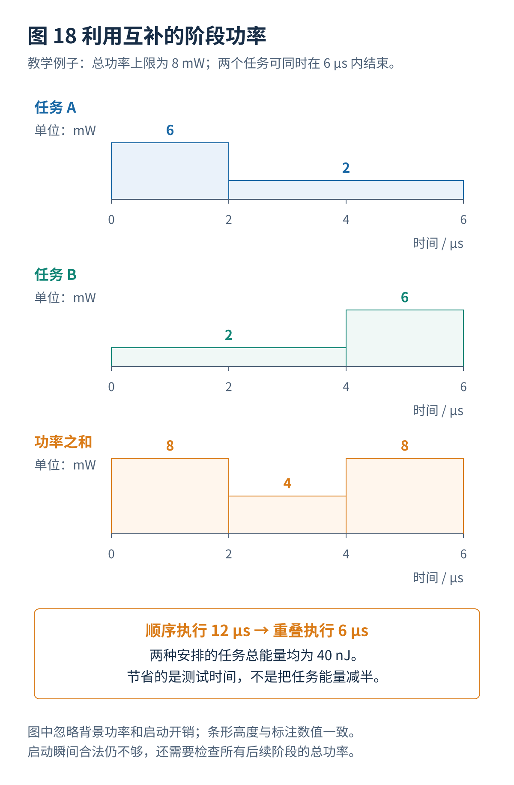
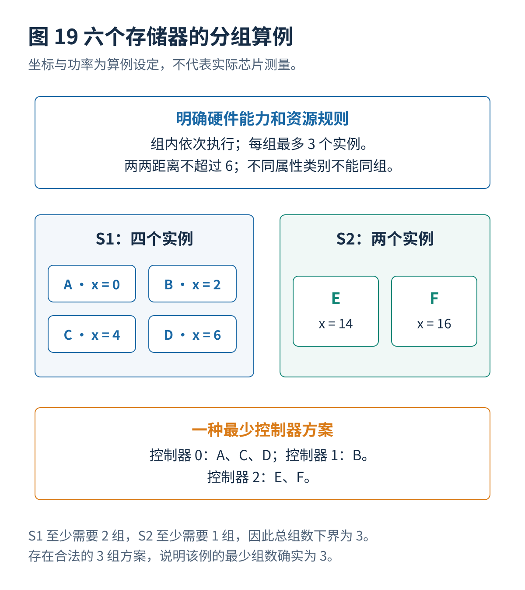
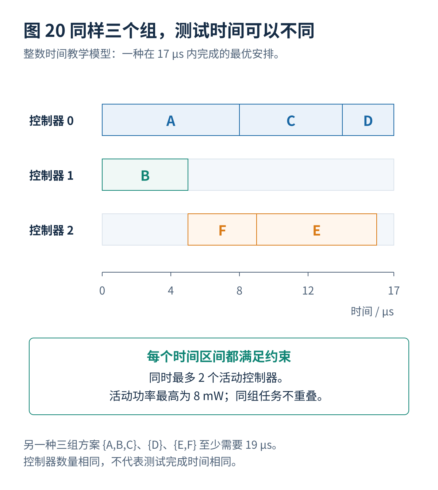

# 07 · 并发调度与联合优化

[总览](00_MBIST总体架构与阅读导航.md) · [上一篇：存储器分组与功耗分析](06_存储器分组与功耗分析.md) · [下一篇：自适应与运行期间测试](08_自适应与运行期间测试.md)

---

> **架构位置：芯片级执行管理层。** 测试任务的执行时刻安排，以及完整时间区间内的资源与功率检查。

| 专题定位 | 范围约定 |
|---|---|
| 输入 | 合法共享组、任务时间、阶段功率、互斥资源与记录能力。 |
| 输出 | 可执行时间表、完成时间、约束检查结果和联合优化比较。 |
| 前置专题 | [存储器接口与测试控制器](01_存储器接口与测试控制器.md)、[存储器分组与功耗分析](06_存储器分组与功耗分析.md) |

## 目录

- [[#1. 测试任务与资源约束|1. 测试任务与资源约束]]
- [[#2. 利用阶段功率而不是固定最坏值|2. 利用阶段功率而不是固定最坏值]]
- [[#3. 六个存储器的完整联合优化算例|3. 六个存储器的完整联合优化算例]]
- [[#4. 更接近真实硬件的联合优化方向|4. 更接近真实硬件的联合优化方向]]
- [[#5. 研究进展与证据范围|5. 研究进展与证据范围]]
- [[#与其他设计层的衔接|与其他设计层的衔接]]

## 1. 测试任务与资源约束

### 1.1 调度问题的输入

把一个不可随意中断的测试过程表示成任务 $j$。它具有持续时间 $d_j$、开始时间 $s_j$、所属控制器 $g(j)$、功率曲线 $p_j(\tau)$、使用的端口和诊断资源。目标通常是最小化所有任务完成的时间：

$$
T_{\max}=\max_j(s_j+d_j).
$$

如果阶段功率曲线从本任务启动时开始计时，全芯片活动功率约束为：

$$
P_{\mathrm{base}}(t)+\sum_jp_j(t-s_j)\leq P_{\mathrm{limit}}(t),\qquad \forall t.
$$

这里约定，任务运行区间以外 $p_j(\tau)=0$。$P_{\mathrm{base}}$ 包含仍然工作的背景电路，不能因为它们“不属于 MBIST”就忽略。

### 1.2 控制器数量限制并不等于存储器数量限制

如果限制是“最多同时开启两个控制器”，应当计算当前活动任务所涉及的不同控制器数量：

$$
\left|\{g(j):s_j\leq t<s_j+d_j\}\right|\leq B_{\max}.
$$

如果一个控制器可以同时测试四个存储器，那么两个活动控制器可能对应八个活动存储器。反过来，对于组内依次执行的结构，同一控制器的任务还必须满足互斥约束。

因此，正确模型往往同时具有“控制器是否活动”“存储器是否活动”“端口是否被占用”三种状态。把它们压缩为一个并发数量，容易低估功率或错误地限制性能。

### 1.3 排序与事件驱动调度

最长任务优先的方法，先考虑预计耗时最长的任务，以减少末尾留下一个长任务独自运行的情况。随后选择一个满足所有资源约束的最早启动位置。如果当前没有任务可以启动，就前进到下一个任务完成或资源条件变化的时刻。

这种思路容易实现，也适合很多工程输入，但在功率、温度、共享端口等约束下，不能直接套用普通多处理机调度的近似比保证。最长任务不一定是当前最值得启动的任务；一个短任务有时可以恰好填入另一个任务的低功率阶段。

### 1.4 全过程功率检查

假设 A、B 都先以 $2\,\mathrm{mW}$ 运行 $2\,\mu\mathrm{s}$，随后以 $7\,\mathrm{mW}$ 运行 $2\,\mu\mathrm{s}$。功率上限是 $10\,\mathrm{mW}$。

同时启动时，总功率只有 $4\,\mathrm{mW}$，但两微秒后会变成 $14\,\mathrm{mW}$。一个只在启动时检查功率的调度器会把这个非法计划判为合法。

对于分段常数曲线，可以收集所有任务的阶段起止时刻，在相邻时刻之间检查功率总和。因为区间内部功率不变，这样的检查对于给定分段模型是完整的，不需要依靠粗糙采样。如果真实功率含有更短的脉冲，就仍然需要更高时间分辨率的模型。

### 1.5 暂停与抢占的风险

对于一般计算任务，暂停后继续可能只影响完成时间；对于某些存储器故障，读写之间的间隔本身就是检测条件。暂停还可能改变数据保持时间、读扰动积累、内部恢复过程和温度状态。

因此应当把“允许暂停的位置”作为算法属性。允许在完整测试步骤结束处暂停，不代表允许在任意读和写之间停顿。自适应降频、故障记录拥塞引起的等待，以及正常总线请求造成的抢占，都必须重新检查是否改变目标故障的触发条件。

## 2. 利用阶段功率而不是固定最坏值

### 2.1 等能量、不同完成时间的算例

任务 A 先以 6 毫瓦运行 2 微秒，再以 2 毫瓦运行 4 微秒。B 则先以 2 毫瓦运行 4 微秒，再以 6 毫瓦运行 2 微秒。总功率上限为 8 毫瓦。

如果把每个任务都当成“全程需要 6 毫瓦”，二者不能重叠，只能运行 12 微秒。但按真实阶段曲线同时启动，0–2 微秒总功率为 8，2–4 微秒为 4，4–6 微秒为 8，全部满足约束，6 微秒即可完成。

两个任务总能量为：

$$
E=(6\times2+2\times4)+(2\times4+6\times2)
=40\,\mathrm{nJ}.
$$

在忽略背景功率和额外开销的本例中，顺序执行与重叠执行的任务能量相同；变化的是完成时间和功率的时间分布。重叠方案的平均功率反而更高。因此，“平均功率低”不是“调度更好”的充分条件。

ITC 2024 的 Power-Aware Test Scheduling for Memory BIST 将存储器及测试电路功率分析与调度联系起来，是值得对照的工业相关研究。本文的两条曲线为独立构造的算例，不是该论文的实验曲线或算法复现。[^R30]

### 2.2 阶段模型还可以有哪些粒度

按整套算法建模最简单，但最保守。按每个 March 元素建模，可以区分初始化、读写交替和最终读出。更细可以区分读、写、地址切换、预充电与故障记录等微操作。

粒度越细，理论上越容易利用互补性，但模型取得成本、调度复杂度和误差也可能增加。微操作曲线如果来自不准确的推断，未必比经过实测校准的粗粒度曲线更可信。

### 2.3 同步启动之外的峰值抑制方法

可以错开独立控制器的启动时刻，使初始化或者写入密集阶段不完全重合；可以限制同一区域同时活动的存储器；可以在允许的位置插入等待；还可以选择满足测试要求的不同控制器组织。

不要默认认为改变地址编码、数据图案或时钟频率不会影响覆盖。例如，减少地址翻转可能同时改变访问物理邻居的次序；减少数据翻转可能减少对耦合故障的激励；降低测试频率可能掩盖速度相关缺陷。需要先证明测试目标仍然满足，再把它作为优化动作。

## 3. 六个存储器的完整联合优化算例

### 3.1 输入与假设

本例时间单位为微秒，功率单位为毫瓦，坐标为示意值。S1 和 S2 表示两种不兼容的接口类别。每个控制器最多管理三个实例；同组任意两实例的曼哈顿距离不能超过 6。**组内依次执行**，全芯片同时最多有两个活动控制器，活动任务功率之和不超过 $8\,\mathrm{mW}$。

| 存储器 | 类别 | 坐标 | 测试时间 | 活动功率 |
|---|---|---|---:|---:|
| A | S1 | (0, 0) | 8 | 5 |
| B | S1 | (2, 0) | 5 | 3 |
| C | S1 | (4, 0) | 6 | 4 |
| D | S1 | (6, 0) | 3 | 2 |
| E | S2 | (14, 0) | 7 | 4 |
| F | S2 | (16, 0) | 4 | 2 |

本例不计启动、故障记录、控制器自身、静态功率和温度开销。所有持续时间和启动时刻都是整数；这是一个便于穷举检查的小型离散模型，而不是完整芯片的时序精度。

### 3.2 最少三个组的证明

S1 有四个实例，每组最多三个，至少需要两个组。S2 与 S1 不相容，至少需要另一个组，因此至少三个组。

例如 `{A,C,D}`、`{B}`、`{E,F}` 满足全部分组规则，恰好使用三个组。所以**三个组既有可行方案，也有相等下界，最少组数得到证明**。这里不需要根据求解器运行了多久来猜测最优性。

随文程序枚举得到 28 个不重复的合法划分，其中 7 个采用最少的三个组。

### 3.3 相同组数下的不同测试时间

对每个三组方案，程序在整数时间模型中枚举合法启动选择，允许在有任务运行时主动等待，并检查完整执行过程中的控制器互斥和功率限制。结果为：

| 三组方案 | 此方案的最短完成时间 |
|---|---:|
| `{A,B,C}`、`{D}`、`{E,F}` | 19 |
| `{A,B,D}`、`{C}`、`{E,F}` | 19 |
| `{A,B}`、`{C,D}`、`{E,F}` | 19 |
| `{A,C,D}`、`{B}`、`{E,F}` | 17 |
| `{A,C}`、`{B,D}`、`{E,F}` | 17 |
| `{A,D}`、`{B,C}`、`{E,F}` | 17 |
| `{A}`、`{B,C,D}`、`{E,F}` | 17 |

第一种方案中，A、B、C 共用串行控制器，该控制器自身就需要 $8+5+6=19$ 微秒。其他控制器再空闲，也无法消除这个限制。

### 3.4 17 微秒时间表

| 存储器 | 控制器 | 启动时间 | 完成时间 |
|---|---:|---:|---:|
| A | 0 | 0 | 8 |
| B | 1 | 0 | 5 |
| F | 2 | 5 | 9 |
| C | 0 | 8 | 14 |
| E | 2 | 9 | 16 |
| D | 0 | 14 | 17 |

在 0–5 微秒，A 与 B 的总功率为 8；在 5–8 微秒，A 与 F 为 7；在 8–9 微秒，C 与 F 为 6；在 9–14 微秒，C 与 E 为 8；在 14–16 微秒，D 与 E 为 6；最后只剩 D，功率为 2。没有任何区间超过上限。

**最优性的适用范围：** 程序证明的是这六个实例、这些分组规则、整数启动时刻、常数任务功率、组内依次执行和两个活动控制器限制下，七个最少组数方案各自的最优时间。它没有证明任意现实 MBIST 系统的最优时间，也没有求解所有更多控制器方案的全局面积—时间最优组合。

### 3.5 算例向研究问题的扩展

可以把“先最少分组，再安排时间”改为双目标优化：同时保留控制器数量少但时间较长、以及控制器稍多但时间更短的非支配方案。加入布线、真实功率曲线或温度限制以后，仍应重新计算，而不是把 17 微秒按一个固定比例放大。

该例也说明，分组优化不应只有 `group_count` 一个评价值。至少应记录控制器结构、共享组、真实任务集合、合法时间表以及资源约束检查结果。

## 4. 更接近真实硬件的联合优化方向

### 4.1 硬件能力一致的分组—调度模型

为每一种控制器记录是否能独立启动成员、是否共享地址进度、允许哪些测试步骤、是否能暂停、有哪些诊断资源。先在这个明确结构下优化，再比较不同结构的面积与时间取舍。

一个有研究价值的结果，可以是证明某类常用简化会生成不可执行的计划，并提供兼容实际控制器的模型与检查器。这比在不明确硬件假设的前提下报告几百分点加速更容易让结果有意义。

### 4.2 把阶段功率与故障记录放在同一个时间模型中

在每个候选启动时刻，同时检查未来功率与记录队列变化。测试读写高峰和错误记录高峰未必发生在相同阶段，联合安排可以发现单资源模型看不到的取舍。

需要分别用无故障、稀疏故障和密集故障分布评估。生产筛选与诊断模式可以保留不同计划，但必须明确模式切换后的资源预算和最长完成时间。

### 4.3 温度与预测误差的余量

候选方案可以在多个可能的功率、温度和延迟参数下同时检查，而不是只在一组最乐观输入上合法。最坏情况模型会偏保守；概率约束需要可靠分布；两者都应报告代价。

学习式模型尤其适合提供候选排序，而不宜单独决定接近硬性上限的方案。对于预测误差大或者不熟悉的宏型号，应优先调用真实工具补充样本。

## 5. 研究进展与证据范围

| 年份与工作 | 核心问题与可核实方向 | 材料情况与比较时的注意事项 |
|---|---|---|
| 2024，Au 等，Power-Aware Test Scheduling for Memory BIST | 功率分析与存储器测试调度结合 | 官方会议摘要；本文曲线为独立算例，不表述为原文复现。[^R30] |

分组与调度联合设计的 DATE 2014、NG-RES 2026 工作及相关温度研究，统一列在[存储器分组与功耗分析](06_存储器分组与功耗分析.md)；这里保留功率感知调度的专门记录。

## 与其他设计层的衔接

本专题输出需要继续交给[自适应与运行期间测试](08_自适应与运行期间测试.md)、[故障诊断与结果记录](09_故障诊断与结果记录.md)、[设计验证与工具接入](12_设计验证与工具接入.md)、[算例与源码说明](13_算例与源码说明.md)。改变某一层的条件以后，应重新检查受到影响的接口和验证要求。

## 参考文献

文献编号与完整条目见[参考文献与研究进展索引](90_参考文献与研究进展索引.md)。

[^R30]: **R30** — Albert Au, Michał Kępiński, Makary Orczyk, Artur Pogiel. **Power-Aware Test Scheduling for Memory BIST**. IEEE ITC, 2024, pp. 384–390. DOI: 10.1109/ITC51657.2024.00060。依据官方会议摘要。<https://ieeexplore.ieee.org/document/10766691/> ；会议摘要：<https://easychair.org/smart-program/ITC2024/2024-11-07.html>

---

[总览](00_MBIST总体架构与阅读导航.md) · [上一篇：存储器分组与功耗分析](06_存储器分组与功耗分析.md) · [下一篇：自适应与运行期间测试](08_自适应与运行期间测试.md)
