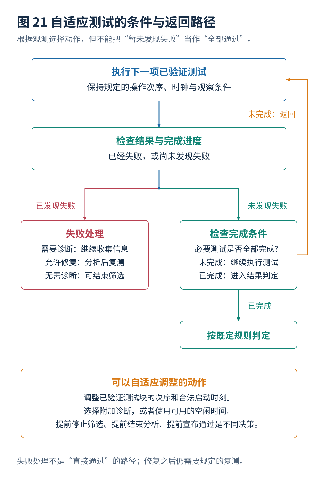
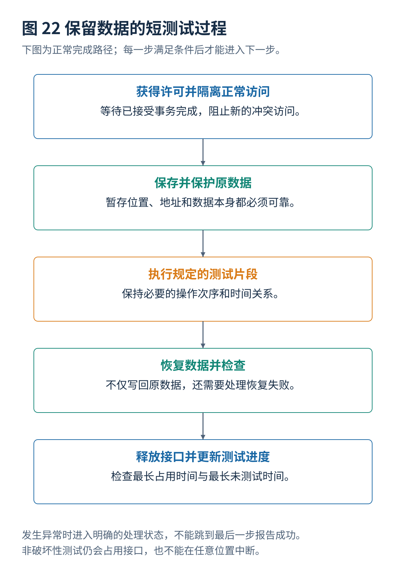

# 08 自适应与运行期间测试

[总览](00_MBIST总体架构与阅读导航.md) · [上一篇：并发调度与联合优化](07_并发调度与联合优化.md) · [下一篇：故障诊断与结果记录](09_故障诊断与结果记录.md)

---

> **架构位置：生命周期与运行期间管理层。** 顺序调整、提前停止、透明测试、数据保存恢复与老化预测的区分。

| 专题定位 | 内容范围 |
|---|---|
| 输入 | 测试目标、已验证测试块、系统访问条件、风险与最大延迟要求。 |
| 输出 | 自适应策略、数据保护过程、停止条件与最大未测试时间。 |
| 前置专题 | [March基础与经典算法](03_March基础与经典算法.md)、[测试算法生成与选择](05_测试算法生成与选择.md)、[并发调度与联合优化](07_并发调度与联合优化.md) |


## 目录

- [[#1. 自适应测试范围|1. 自适应测试范围]]
- [[#2. 平均时间与统计风险|2. 平均时间与统计风险]]
- [[#3. 透明 March 数据恢复|3. 透明 March 数据恢复]]
- [[#4. 运行期间测试与老化预测|4. 运行期间测试与老化预测]]
- [[#5. 强制要求与系统状态|5. 强制要求与系统状态]]
- [[#6. 研究进展与资料范围|6. 研究进展与资料范围]]
- [[#与其他设计层的衔接|与其他设计层的衔接]]

## 1. 自适应测试范围

### 1.1 自适应与机器学习

只要测试过程会根据已经得到的信息选择后续动作，就可以具有自适应性质。信息可以是宏属性、晶圆历史、早期测试结果、电压温度、纠错事件或故障分布。实现可以是规则表、统计决策、优化器，也可以是机器学习模型。

| 自适应层次 | 可调整内容 | 主要风险 |
|---|---|---|
| 设计阶段 | 按宏型号选择控制器、算法与诊断能力 | 优化模型与实际硬件能力不一致 |
| 批次或晶圆级 | 根据已验证统计调整附加筛选顺序 | 工艺分布变化后原策略失效 |
| 单芯片制造测试 | 失败后切换诊断模式，按可修复性提前结束分析 | 把未测完误判为通过 |
| 运行期间 | 利用空闲时间测试，按错误趋势加测 | 破坏数据或延迟关键任务 |
| 表征与裕量测试 | 扫描电压、频率、保持时间 | 改变条件后结果不可与标准筛选直接比较 |

### 1.2 三类早停

**确定失败后停止筛选。** 已经发现一个足以判定不合格的故障，并且无需继续诊断时，可以减少平均测试时间。

**已经证明无修复方案后停止冗余分析。** 对于已知故障集合，资源下界超过可用备用资源时，可以结束修复搜索。故障收集和存储器测试是否继续，由各自的完成条件决定。

**没有看到失败就提前宣布通过。** 这种策略省略了后续检测条件，需要量化漏检风险，并满足强制覆盖要求和产品授权条件。

PETRA 的提前终止针对冗余分析，用于加速可修复性判断；芯片测试通过仍采用完整的测试完成条件。[^R37]

### 1.3 覆盖约束

设候选测试块为 $a$，故障类别为 $f$，$D_{af}=1$ 表示测试块 $a$ 在已经验证的条件下能够检测故障 $f$。选择变量为 $z_a$，可以构造：

$$
\begin{aligned}
\min\quad &\sum_a t_a z_a\\
\text{满足}\quad &\sum_a D_{af}z_a\geq1,\qquad \forall f\in\mathcal F_{\mathrm{mandatory}}.
\end{aligned}
$$

这是针对已验证独立测试块的集合覆盖模型。如果覆盖依赖顺序、初始状态、测试块之间的间隔或先前写入，应将 $D_{af}$ 扩展为序列或状态模型，并检查拼接后每项激活与观察条件。



## 2. 平均时间与统计风险

### 2.1 通过概率排序

对于两个测试 A、B，耗时分别为 $t_A,t_B$，可在发现失败后立即停止，失败概率分别为 $q_A,q_B$，并暂时假设两者的失败事件独立、忽略诊断和修复需求。

先做 A 的平均时间为 $t_A+(1-q_A)t_B$，先做 B 为 $t_B+(1-q_B)t_A$。比较可得，先做 A 更好当且仅当：

$$
\frac{q_A}{t_A}\geq\frac{q_B}{t_B}.
$$

其含义是优先执行“单位时间发现失败概率更大”的测试。失败事件相关时，应根据前序通过结果更新后续测试的条件概率，再调整排序。如果所有芯片都必须完成全部测试以收集诊断，以上早停收益也不成立。

### 2.2 零漏检与零风险

假设独立、同分布的验证样本中，观察到 $n$ 次零漏检。采用二项模型，一侧 95% 上限满足：

$$
p_{\mathrm{upper}}=1-0.05^{1/n}\approx\frac{3}{n}.
$$

例如 $n=3000$，上限约为 0.001，也就是约 0.1%。该数值为所述二项模型的一侧置信上界。应用这一上界时，应核查样本独立性、抽样代表性及工艺分布稳定性。

删减测试的评价应直接测量漏检、误失败、平均时间、最坏时间及对分布变化的敏感性。分类准确率用于评价已收集故障的分类效果，漏检风险则通过相应测试样本单独估计。

## 3. 透明 March 数据恢复

### 3.1 双地址透明 March：操作、检查与数据恢复

透明测试利用测试开始时的存储数据产生写入图案，并在无缺陷执行完成后恢复这些数据。Mrozek 和 Yarmolik 在 *Transparent Memory Tests Based on the Double Address Sequences* 中给出的 `March_2A_1` 与 `March_2A_2`，分别需要 $8N$ 与 $14N$ 次存储器访问。其基本操作包含局部读值比较，初末扫描还要进行签名比较。[^R03]

#### 3.1.1 双地址序列的确切含义

设存储器含 $N=2^m$ 个一位单元。双地址序列 $D=(d_0,\ldots,d_{2N-1})$ 的要求是：每个地址恰好出现两次。一个基本生成方法是让 $m+1$ 位计数器遍历 $0$ 至 $2N-1$，删除其中一位，再将剩余 $m$ 位作为存储器地址。删除位置决定两次访问之间的距离。[^R03]

例如 $N=4$，使用三位计数器 $c_2c_1c_0$：

| 删除的位 | 完整双地址序列 |
|---|---|
| $c_0$ | `0,0,1,1,2,2,3,3` |
| $c_1$ | `0,1,0,1,2,3,2,3` |
| $c_2$ | `0,1,2,3,0,1,2,3` |

以下选用第三行，令：

```text
D     = [0,1,2,3,0,1,2,3]
D_rev = [3,2,1,0,3,2,1,0]
```

`D_rev` 是整个双地址序列的逆序。两个端点扫描统一采用地址 `0,1,2,3`。序列中的连续三次访问全部针对当前地址，完成后才进入下一项。

#### 3.1.2 每次访问如何决定写值和读期望

定义基本操作块 $B(i)$：

```text
x ← read(i)
write(i, 1-x)
y ← read(i)
若 y != 1-x：记录地址 i 与本次比较失败
```

$x$ 是**本次**第一条读取返回的数据，每次进入 $B(i)$ 都重新取得。硬件只需暂存当前数据及其反值。第一条读取用于决定后续写值；第二条读取以 $1-x$ 为期望值，检查刚才的翻转是否成功。论文式（5）的压缩记法为 $2\Uparrow(ra,w\overline a,ra)$，其第 4 节明确要求块内两次读取值互补。把它展开为上述赋值和比较，能够明确最后一次读取的期望。[^R03]

若地址 $i$ 的原值为 $x_i$，两次正常访问依次执行：

$$
\begin{aligned}
B(i)\text{ 第一次}:&\quad r(x_i),\ w(\overline{x_i}),\ r(\overline{x_i}),\\
B(i)\text{ 第二次}:&\quad r(\overline{x_i}),\ w(x_i),\ r(x_i).
\end{aligned}
$$

因此，该地址经历一次上升转换和一次下降转换，并恢复 $x_i$。两次访问之间可以处理其他地址，这些中间状态决定了耦合与邻域故障的激活条件。

#### 3.1.3 两条完整程序与长度

记 `ScanSig(A)` 为按地址排列 $A$ 逐单元读取并计算签名。两个扫描使用相同初始寄存器值、相同更新函数和相同地址顺序。

```text
March_2A_1:
    SF ← ScanSig([0,1,...,N-1])
    对 D 的全部 2N 项，执行 B(i)
    SR ← ScanSig([0,1,...,N-1])
    检查所有局部比较结果，以及 SF == SR

March_2A_2:
    SF ← ScanSig([0,1,...,N-1])
    对 D 的全部 2N 项，执行 B(i)
    对 reverse(D) 的全部 2N 项，执行 B(i)
    SR ← ScanSig([0,1,...,N-1])
    检查所有局部比较结果，以及 SF == SR
```

这对应论文式（6）。每个基本阶段含 $2N$ 个三操作块，长度为 $6N$，因此：

$$
L_{2A\_1}=N+6N+N=8N,\qquad
L_{2A\_2}=N+6N+6N+N=14N.
$$

访问数已经包括初末签名扫描。`March_2A_1` 含 $6N$ 次读和 $2N$ 次写；`March_2A_2` 含 $10N$ 次读和 $4N$ 次写。签名更新可与读返回处理结合，具体时钟周期还要按存储器延迟和控制器实现统计。

#### 3.1.4 四单元完整数据轨迹

下面使用本手册构造的初态 `(x0,x1,x2,x3)=0101`，状态串始终按地址 `0,1,2,3` 排列。初末扫描的正确数据流均为 `0,1,0,1`。

| 阶段 | 块编号 | 地址 | 完整读写片段 | 块结束状态 |
|---|---:|---:|---|---|
| 正向 | 1 | 0 | `r0,w1,r1` | `1101` |
| 正向 | 2 | 1 | `r1,w0,r0` | `1001` |
| 正向 | 3 | 2 | `r0,w1,r1` | `1011` |
| 正向 | 4 | 3 | `r1,w0,r0` | `1010` |
| 正向 | 5 | 0 | `r1,w0,r0` | `0010` |
| 正向 | 6 | 1 | `r0,w1,r1` | `0110` |
| 正向 | 7 | 2 | `r1,w0,r0` | `0100` |
| 正向 | 8 | 3 | `r0,w1,r1` | `0101` |
| 反向 | 1 | 3 | `r1,w0,r0` | `0100` |
| 反向 | 2 | 2 | `r0,w1,r1` | `0110` |
| 反向 | 3 | 1 | `r1,w0,r0` | `0010` |
| 反向 | 4 | 0 | `r0,w1,r1` | `1010` |
| 反向 | 5 | 3 | `r0,w1,r1` | `1011` |
| 反向 | 6 | 2 | `r1,w0,r0` | `1001` |
| 反向 | 7 | 1 | `r0,w1,r1` | `1101` |
| 反向 | 8 | 0 | `r1,w0,r0` | `0101` |

`March_2A_1` 执行正向八块后立即进行末尾扫描，共 32 次访问。`March_2A_2` 执行全部十六块后进行末尾扫描，共 56 次访问。每个基本阶段结束时都恢复原数据，阶段内部仍存在临时图案。

#### 3.1.5 固定值与转换故障怎样被局部读取检测

仍采用初态 `0101`，考察地址 2，分别单独注入以下两个原型：

- `SAF0`：地址 2 始终保存 0，所有写入均不能改变它。
- `TF_up`：地址 2 原为 0 时，写入 1 无法完成上升转换；其余写入正常。

正向第三个基本块的操作如下。访问编号包括开始的四次签名读取。

| 全局访问编号 | 操作 | 无缺陷结果 | 两种故障的结果 | 检测作用 |
|---:|---|---|---|---|
| 11 | 读取地址 2 | 返回 0，暂存 $x=0$ | 返回 0 | 建立本次写入目标 |
| 12 | 写入 $1-x=1$ | 地址 2 变为 1 | 地址 2 保持 0 | 激活固定值限制或上升转换受阻 |
| 13 | 再读地址 2，期望 1 | 返回 1 | 返回 0 | 局部比较失败，记录地址 2 |

初末签名在这两个具体算例中相同，局部比较已经检出故障。实际控制器应累计保存局部失败标志，直到整个测试结束。通过一次失败地址和期望值可以确定发生错误的位置；区分 `SAF0` 与 `TF_up` 还要结合另一转换方向等诊断信息。

#### 3.1.6 耦合故障怎样被最终签名检测

单独定义一个 `CFid` 原型：地址 0 上升时，将地址 1 强制为 0。初态仍为 `0101`，执行 `March_2A_1`。

第一块先从地址 0 读出 0，再写入 1；这次上升把整个故障状态从 `0101` 改为 `1001`。该块最后读取的是地址 0，返回 1，比较通过。下一块从已被破坏的地址 1 读到 0，并按这个实际返回值执行 `w1,r1`，局部比较仍通过。

| 正向块地址顺序 | 每块结束后的故障状态 |
|---|---|
| `0,1,2,3,0,1,2,3` | `1001,1101,1111,1110,0110,0010,0000,0001` |

最终状态 `0001` 与初始 `0101` 在地址 1 不同。此例所有局部互补比较均通过，需要末尾扫描产生的 $S_R$ 与初始 $S_F$ 比较。本手册选定的四位签名计算得到 $S_F=15$、$S_R=3$，从而检出该故障。

#### 3.1.7 反向阶段增加哪一种邻域条件

取初态 `0000`，定义一个三单元被动图案敏感原型：当邻居 `(地址0,地址2)=(0,1)` 时，地址 1 的上升转换失败；其他操作正常。

在正向阶段，地址 1 第一次上升时的邻居为 `(1,0)`，第二次访问执行下降转换，均不满足上述故障条件。单独执行 `March_2A_1` 时该原型未被激活。

反向阶段依次访问地址 `3,2,1,0`。前两个块使状态变为 `0011`，此时访问地址 1：

```text
第 35 次访问：读地址 1，返回 0，暂存 x=0
第 36 次访问：写地址 1 为 1；邻居恰为 (0,1)，转换失败
第 37 次访问：读地址 1，期望 1，返回 0，局部比较失败
```

该实例说明反向阶段如何提供新的邻域背景。需要覆盖哪些背景，应结合选定的双地址顺序与实际初始数据逐项计算。

#### 3.1.8 签名规则与恢复条件

论文要求初末扫描采用相同顺序，通过 $S_F\ne S_R$ 识别数据变化，未规定统一的签名寄存器位数和反馈多项式。本手册程序选择四位 CRC，生成多项式为 $p(x)=x^4+x+1$，初值为 0，无末尾异或。对每个读入位 $b$，计算：

$$
f=S_3\oplus b,\qquad
S\leftarrow(S\ll1)\mathbin{\&}15,\qquad
f=1\text{ 时 }S\leftarrow S\oplus3.
$$

这是一个完整可复算的教学实现。初末签名只接收各自扫描的数据；基本块的第二次读取执行直接互补比较。程序另外保存完整状态用于验证恢复性质，这部分记录属于仿真检查，不是论文硬件所必需的原数据备份。

有限长度签名存在不同数据得到相同结果的可能，程序附有八位数据的具体相同签名实例。选择实际签名结构时，应评估目标错误模式的混叠情况，并保留局部比较失败标志。

无缺陷运行时，每个基本阶段对每个单元翻转两次，故有 $\overline{\overline{x_i}}=x_i$，数据恢复直接由序列完成。若故障改变了读返回值或单元状态，后续写值也会受影响；上述耦合算例最终未恢复原数据。运行期间测试应在发现失败后保留诊断结果，并采用系统已有的数据冗余、备份或故障处理机制。执行整个基本阶段期间应排除其他访问者对测试区域的修改。

#### 3.1.9 已执行验证

[transparent_march_examples.py](src/transparent_march_examples.py) 使用纯 Python 实现，结果见 [transparent_march_results.json](examples/transparent_march_results.json)。运行方式为：

```bash
python3 src/transparent_march_examples.py
```

| 验证内容 | 已完成结果 |
|---|---|
| 容量 2、4、8 的全部二进制初态；计数器与 Gray 码删除各地址位；两条测试 | 4,320 次无缺陷运行，长度正确，局部比较通过，每个基本阶段及最终状态均恢复 |
| 容量 4 的全部初态、全部地址、两种极性的 SAF 与 TF、两条测试 | 512 个实例全部被局部比较检出 |
| 本节 `CFid` 实例 | 局部比较通过，最终签名 15 与 3 不同 |
| 本节三单元被动图案实例 | 8N 序列未检出，14N 序列在第 37 次访问检出 |

这些结果对应程序中明确给定的确定性模型。本文使用的一手资料为论文第 3、4 节、式（5）（6）及地址构造表，完整文献：MROZEK I, YARMOLIK V N. *Transparent Memory Tests Based on the Double Address Sequences*. Entropy, 2021, 23(7): 894. DOI: [10.3390/e23070894](https://doi.org/10.3390/e23070894)；[出版方全文](https://www.mdpi.com/1099-4300/23/7/894)；[全文存档](https://pmc.ncbi.nlm.nih.gov/articles/PMC8304962/)。[^R03]

## 4. 运行期间测试与老化预测

### 4.1 数据保持方式与资源代价

普通破坏性测试会覆盖原数据。运行期间要保留数据，可以在受控区域内暂存原内容、执行经过验证的测试、恢复并检查，然后释放存储器；另一类透明测试使用适合保留原内容的专门算法。

备份恢复流程和专门的透明算法都需检查跨区域耦合、暂存空间故障、恢复错误及中断时状态，并分别验证其故障覆盖。

TI 的实际 PBIST 文档明确说明测试具有破坏性，要求被测核心或模块进入指定电源和复位状态，运行期间调用时由应用负责必要的上下文保存、恢复和退出处理。这些要求共同构成运行期间调用的系统流程。[^R35]

### 4.2 保留数据的短测试流程



可以把一次短过程分成：获得访问许可；阻止新的正常写入；等待已有事务完成；读取并保护原数据；执行规定测试；恢复并检查原数据；释放访问权限。任何一步失败时，都应进入对应的故障处理状态。

需要考虑的访问者不只有处理器，还可能包括直接存储器访问控制器、缓存回写、调试端口、其他处理器和加速器。执行测试的软件代码、栈和异常处理也不能依赖正在被覆盖的存储器。

2025 年 VTS 的 Periodic Non-Destructive Memory BIST for Automotive Applications 研究了由短测试过程组成的架构，根据可用空闲时间调整每次过程的长度，并尽量复用硬件资源。本专题依据出版商摘要介绍其短测试架构、长度调整和资源复用方向；完整故障类别属于论文详细模型的范围。[^R34]

### 4.3 实时时间约束

**最大连续占用时间**决定一次测试会阻塞正常访问多久。**完成全体目标区域测试的最长时间**决定一个潜在故障可能多久才被发现。应分别设定这两个时间上限。

如果一次测试需要：

$$
T_{\mathrm{burst}}=T_{\mathrm{acquire}}+T_{\mathrm{save}}
+T_{\mathrm{test}}+T_{\mathrm{restore}}+T_{\mathrm{release}},
$$

那么减少测试片段长度并不一定按比例减少占用时间，因为保存和恢复可能占很大比例。相反，片段太短会让整个存储器的轮询周期变长。

利用空闲时间还需要防止某些区域一直没有空闲而永远不测试。必须有最大延迟、最低测试进度或者保留访问时间的策略。软件实时性与存储测试有效性应分别验证。

### 4.4 预测性测试裕量

标准测试可以在规定条件下判断当前是否失败；预测性测试希望在数据开始损坏以前，识别接近失效的单元。可以观察最低工作电压、读写延迟、保持能力以及纠错事件的变化趋势。

ITC 2024 的 Predictive Testing for Aging in SRAMs and Mitigation 和 DAC 2025 的 Asymmetric Predictive Testing for Aging in SRAMs 分别研究老化预测以及不同操作条件下的预测测试。它们提示测试条件不必对所有读写操作完全对称，具体电压设置应根据目标技术的故障与老化模型确定。[^R42][^R43]

同一时期，关于先进 SRAM 老化的研究也关注晶体管与互连的共同影响。分析读出变慢时，应同时检查位单元晶体管、字线、位线和外围电路的老化影响。[^R44]

### 4.5 电压二分搜索

如果对某个明确测试模式，假设电压越高越容易通过，可以二分搜索最低通过电压。实际测量存在噪声、温度变化、历史状态以及读写不对称，单调关系未必严格成立。

因此应当重复测量，保留通过与失败样本，处理异常非单调点，并把电压稳定时间计入耗时。报告最低通过电压时，应同时给出频率、温度、数据图案、测试长度和通过规则。

### 4.6 透明测试的暂停、释放与重新开始

透明测试期间应分别维护两个条件：当前存储内容是否处于可供正常访问的状态，以及当前测试结果是否已经完成所需的比较。每个基本块 `B(i)` 对地址 `i` 翻转一次；在无故障执行中，该地址出现偶数次后才恢复原数据。局部读取失败标志与初末签名比较仍须保留。

以第 08 章的初态 `0101` 和 `D=[0,1,2,3,0,1,2,3]` 为例，执行前四个完整基本块后，内容为 `1010`。此时全部局部比较可以通过，但正常读取会取得临时测试图案。当前块执行完成只表示局部读写已完成，恢复条件还需要根据整个地址访问序列检查。

#### 4.6.1 暂停期间继续保持独占访问

可执行步骤如下：

1. 在预先允许暂停的位置停止发出新请求。一个 `B(i)` 内的读取、反值写入和检查读取作为整体执行；需要连续激励的其他测试片段也应完整执行。
2. 等待已经发出的读取全部返回，完成局部比较和签名更新。
3. 保存测试阶段、双地址序列索引、数据相位、初始签名 `SF`、当前签名累加值及累计失败标志。若实现允许在块内暂停，还必须保存临时数据 `x` 和准确的子操作位置，并独立验证该暂停不破坏故障的时间条件。
4. 保持测试区域的独占状态，继续阻止处理器、DMA、缓存回写和其他端口的正常读写。测试内容可以暂时保持为中间图案。
5. 恢复执行时，从保存的位置继续相同测试；原 `SF` 继续用于本次测试结束时的签名比较。
6. 完成数据恢复阶段和末尾扫描后，检查累计局部失败标志及 `SF==SR`，再按结果进入释放或故障处理流程。

这个暂停方式保留了本次测试开始时的数据和比较对象。暂停若改变了目标动态故障规定的时间间隔，应重新执行相应独立测试块，并重新统计其检测完成状态。

#### 4.6.2 恢复正常访问后开始新的测试

释放访问权前，应结束当前独立测试过程：完成规定的数据恢复步骤、等待已发出的事务完成、完成末尾签名和局部结果检查。若必须在中间图案尚未恢复时结束，需要从独立保护的备份恢复原内容，并读取核查；没有可用恢复来源时，继续保持该区域不可访问并进入系统故障处理。

正常访问恢复后，应用可能改变数据。下一次测试按如下顺序执行：

```text
获取目标区域的独占访问权
阻止新的正常访问，并等待已有事务全部完成
SF_new = ScanSig(当前数据)
重新初始化测试状态、地址访问次数、签名累加器与本次失败标志
从所选独立透明测试的起点执行
SR_new = ScanSig(测试完成后的数据)
比较本次全部局部结果以及 SF_new == SR_new
完成本次结果处理后释放访问权
```

`SF_new` 和 `SR_new` 必须属于同一次独占执行期间。既有已完成测试的结果可以保留；上一执行期间尚未形成完整激励与观察的片段，不能与新的数据状态直接拼接计算覆盖。

**应用写入后的签名计算。** 四位 CRC 使用第 08 章既定规则时，数据 `0101` 的签名为 15。完整透明阶段恢复 `0101` 后释放访问权，应用合法地把地址 1 写为 0，当前数据变成 `0001`，签名为 3。此后在无故障阵列上完成另一次透明阶段，数据仍是 `0001`。用旧 `SF=15` 比较新的 `SR=3` 会把合法数据变化报告为错误；新的独立过程应比较 `SF_new=3` 与 `SR_new=3`。

若将原本连续的 `March_2A_2` 拆成两个各含一个基本阶段的独立过程，每个过程都需要自己的初末扫描。两段的总访问数为 `8N+8N=16N`。两个期间的初始数据可以不同，其故障覆盖也应分别计算。

## 5. 强制要求与系统状态

### 5.1 强制测试要求

把可改变动作限定为已验证测试块之间的排序、合法启动时刻以及批准的诊断分支。对于采用统计风险取舍的测试删减，应明确给出保留条件、漏检估计和适用分布。

对于运行期间测试，除了故障检测，还应评价数据保护、正常访问最大延迟和目标区域的最大未测试时间。这些指标共同用于评价系统可靠性与实时性。

### 5.2 在线测试访问约束

传统 March 算法会覆盖原有数据，而透明 March 也可能在测试过程的短时间内改变存储器内容。若其他系统模块同时访问同一存储器，仍可能读到临时测试图案。测试期间应使用访问暂停、独占测试控制，或具备一致性保障的数据备份与恢复机制，防止其他模块读到临时图案。[^R03][^R16]

## 6. 研究进展与资料范围

| 年份与工作 | 核心方向 | 引用范围 |
|---|---|---|
| 2024，Lin 等，Predictive Testing for Aging in SRAMs and Mitigation | 预测老化对 SRAM 性能与可靠性的影响并研究缓解 | 出版商摘要；用于区分当前故障检测与未来裕量预警。[^R42] |
| 2024，Zhang 等，Testing for Aging in Advanced SRAM: From Front End of the Line Transistors to Back End of the Line Interconnects | 同时关注晶体管和互连老化 | 出版商摘要；模型范围包含晶体管与互连老化。[^R44] |
| 2025，Lin 等，Asymmetric Predictive Testing for Aging in SRAMs | 根据不对称老化行为设置预测测试条件 | 出版商摘要；预测条件对应论文采用的存储器技术与老化模型。[^R43] |
| 2025，Zou 等，Periodic Non-Destructive Memory BIST for Automotive Applications | 使用保留内容的短测试过程，根据可用时间调整长度 | 出版商摘要与官方会议记录；重点为数据保护、短测试长度调整与系统干扰。[^R34] |

**关键区别：** 在线监测记录运行期间的错误事件，预测测试估计未来失效风险，制造筛选按规定条件主动检查目标地址。动态调整测试片段时，应保留必需故障的检测条件。

## 与其他设计层的衔接

本专题输出需要继续交给[故障诊断与结果记录](09_故障诊断与结果记录.md)、[冗余分析自修复与纠错码](10_冗余分析自修复与纠错码.md)、[设计验证与工具接入](12_设计验证与工具接入.md)。改变某一层的条件以后，应重新检查受到影响的接口和验证要求。


## 参考文献

文献编号与完整条目见[参考文献与研究进展索引](90_参考文献与研究进展索引.md)。

[^R03]: **R03**：**Mrozek, I.; Yarmolik, V.（2021）.** *Transparent Memory Tests Based on the Double Address Sequences.* **Entropy**, 23(7), 894. [DOI: 10.3390/e23070894](https://doi.org/10.3390/e23070894)。透明测试、`8N` 和 `14N` 地址重复序列。

[^R16]: **R16**：**Microchip Technology.** *Periodic SRAM Test: Diagnostic Coverage and Address Range Considerations.* [官方说明](https://onlinedocs.microchip.com/oxy/GUID-1BC922B5-0BDE-4D42-AC92-68359BB22BEC-en-US-1/GUID-DF313197-EBE8-4890-9306-7D638E485E61.html)。在线部分区域测试与整个存储器耦合故障覆盖的限制。

[^R34]: **R34** — Wei Zou, Artur Pogiel, Albert Au, Martin Keim. **Periodic Non-Destructive Memory BIST for Automotive Applications**. IEEE VTS, 2025, pp. 1–7. DOI: 10.1109/VTS65138.2025.11022822。出版商摘要及正式会议程序。<https://ieeexplore.ieee.org/document/11022822/> ；<https://tttc-vts.org/public_html/new/2025/program-3/index.html>

[^R35]: **R35** — Texas Instruments，**PBIST: Memory Built-In Self-Test**，Jacinto 7 Safety Diagnostic Library 官方文档。文档规定了相应设备的电源、复位和执行条件。<https://software-dl.ti.com/jacinto7/esd/processor-sdk-rtos-jacinto7/latest/exports/docs/sdl/sdl_docs/userguide/j721e/modules/pbist.html>

[^R37]: **R37**：**PETRA: Powerful Early Termination-Based Redundancy Analysis**. IEEE Transactions on Computer-Aided Design of Integrated Circuits and Systems，2025 卷期，先行在线 2024。DOI: 10.1109/TCAD.2024.3424730。依据出版商摘要与正式记录。<https://ieeexplore.ieee.org/document/10587206/>

[^R42]: **R42** — Yunkun Lin, Mingye Li, Sandeep K. Gupta. **Predictive Testing for Aging in SRAMs and Mitigation**. IEEE ITC, 2024。DOI: 10.1109/ITC51657.2024.00050。出版商摘要。<https://ieeexplore.ieee.org/document/10766681/>

[^R43]: **R43** — Yunkun Lin, Mingye Li, Sandeep K. Gupta. **Asymmetric Predictive Testing for Aging in SRAMs**. DAC, 2025。DOI: 10.1109/DAC63849.2025.11132451。出版商摘要；正式会议年份为 2025。<https://ieeexplore.ieee.org/abstract/document/11132451/> ；<https://dl.acm.org/doi/10.1109/DAC63849.2025.11132451>

[^R44]: **R44** — Zhe Zhang 等. **Testing for Aging in Advanced SRAM: From Front End of the Line Transistors to Back End of the Line Interconnects**. IEEE ITC, 2024。出版商摘要与正式题名。<https://ieeexplore.ieee.org/document/10766717/>

---

[总览](00_MBIST总体架构与阅读导航.md) · [上一篇：并发调度与联合优化](07_并发调度与联合优化.md) · [下一篇：故障诊断与结果记录](09_故障诊断与结果记录.md)
