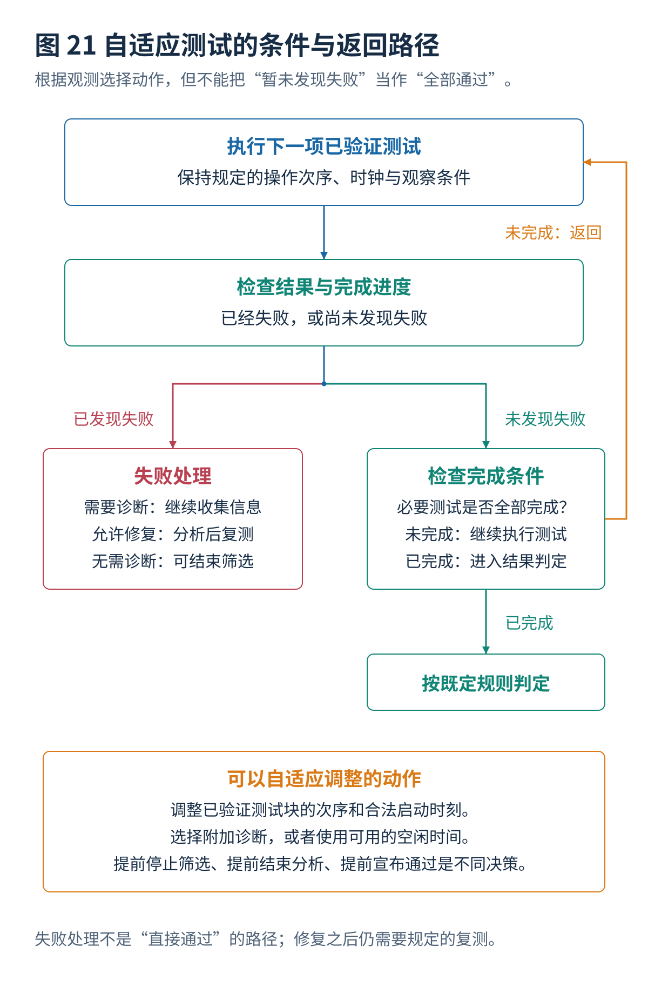
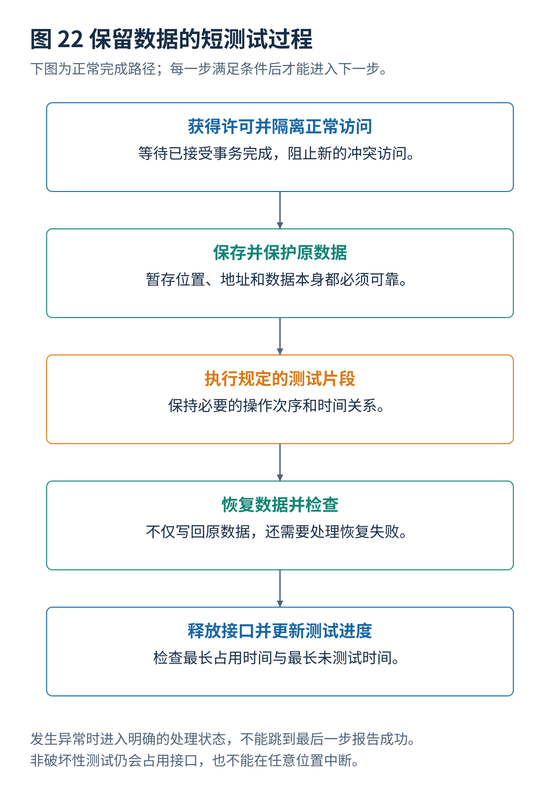

# 08 自适应与运行期间测试

[总览](00_MBIST总体架构与阅读导航.md) · [上一篇：并发调度与联合优化](07_并发调度与联合优化.md) · [下一篇：故障诊断与结果记录](09_故障诊断与结果记录.md)

---

> **架构位置：生命周期与运行期间管理层。** 顺序调整、提前停止、透明测试、数据保存恢复与老化预测的区分。

| 专题定位 | 范围约定 |
|---|---|
| 输入 | 测试目标、已验证测试块、系统访问条件、风险与最大延迟要求。 |
| 输出 | 自适应策略、数据保护过程、停止条件与最大未测试时间。 |
| 前置专题 | [March基础与经典算法](03_March基础与经典算法.md)、[测试算法生成与选择](05_测试算法生成与选择.md)、[并发调度与联合优化](07_并发调度与联合优化.md) |


## 目录

- [[#1. 自适应测试范围|1. 自适应测试范围]]
- [[#2. 平均时间与统计风险|2. 平均时间与统计风险]]
- [[#3. 透明 March 数据恢复|3. 透明 March 数据恢复]]
- [[#4. 运行期间测试与老化预测|4. 运行期间测试与老化预测]]
- [[#5. 强制要求与系统状态|5. 强制要求与系统状态]]
- [[#6. 研究进展与证据范围|6. 研究进展与证据范围]]
- [[#与其他设计层的衔接|与其他设计层的衔接]]

## 1. 自适应测试范围
### 1.1 自适应与机器学习
只要测试过程会根据已经得到的信息选择后续动作，就可以具有自适应性质。信息可以是宏属性、晶圆历史、早期测试结果、电压温度、纠错事件或故障分布。实现可以是规则表、统计决策、优化器，也可以是机器学习模型。

| 自适应层次 | 可调整内容 | 主要风险 |
|---|---|---|
| 设计阶段 | 按宏型号选择控制器、算法与诊断能力 | 优化模型与实际硬件能力不一致 |
| 批次或晶圆级 | 根据已验证统计调整附加筛选顺序 | 工艺分布变化后原策略失效 |
| 单芯片制造测试 | 失败后切换诊断模式，按可修复性提前结束分析 | 把未测完误判为通过 |
| 运行期间 | 利用空闲时间测试，按错误趋势加测 | 破坏数据或延迟关键任务 |
| 表征与裕量测试 | 扫描电压、频率、保持时间 | 改变条件后结果不可与标准筛选直接比较 |

### 1.2 三类早停
**确定失败后停止筛选。** 已经发现一个足以判定不合格的故障，并且无需继续诊断时，可以减少平均测试时间。

**已经证明无修复方案后停止冗余分析。** 对于已知故障集合，如果严格的资源下界已经超过可用备用资源，可以结束搜索。但必须明确停止的是修复分析、故障收集还是整个测试。

**没有看到失败就提前宣布通过。** 这最容易造成覆盖下降。前半段没有故障，并不能推出后半段也不会检测出故障。采用这种策略需要明确统计风险、强制覆盖要求和产品授权，而不能称为“无损加速”。

PETRA 的研究目标是加速冗余分析中的判断；不能把这种“early termination”直接解释为在未完成必要存储测试时提前宣布芯片通过。[^R37]

### 1.3 覆盖约束
设候选测试块为 $a$，故障类别为 $f$，$D_{af}=1$ 表示测试块 $a$ 在已经验证的条件下能够检测故障 $f$。选择变量为 $z_a$，可以构造：

$$
\begin{aligned}
\min\quad &\sum_a t_a z_a\\
\text{满足}\quad &\sum_a D_{af}z_a\geq1,\qquad \forall f\in\mathcal F_{\mathrm{mandatory}}.
\end{aligned}
$$

这只是一个基本的集合覆盖模型。如果覆盖依赖顺序、初始状态、两个测试块之间的间隔或先前写入，就不能把 $D_{af}$ 当作完全独立的常数，而应当扩展为序列或状态模型。静态覆盖表适合已验证独立测试块，不适合随意拼接 March 中间操作。



## 2. 平均时间与统计风险
### 2.1 通过概率排序
对于两个测试 A、B，耗时分别为 $t_A,t_B$，可在发现失败后立即停止，失败概率分别为 $q_A,q_B$，并暂时假设两者的失败事件独立、忽略诊断和修复需求。

先做 A 的平均时间为 $t_A+(1-q_A)t_B$，先做 B 为 $t_B+(1-q_B)t_A$。比较可得，先做 A 更好当且仅当：

$$
\frac{q_A}{t_A}\geq\frac{q_B}{t_B}.
$$

其含义是优先执行“单位时间发现失败概率更大”的测试。真实情况中失败事件可能相关，而且后续测试概率应当根据前序通过结果更新；需要使用条件概率，而不是简单套用固定排序。如果所有芯片都必须完成全部测试以收集诊断，以上早停收益也不成立。

### 2.2 零漏检与零风险
假设独立、同分布的验证样本中，观察到 $n$ 次零漏检。采用二项模型，一侧 95% 上限满足：

$$
p_{\mathrm{upper}}=1-0.05^{1/n}\approx\frac{3}{n}.
$$

例如 $n=3000$，上限约为 0.001，也就是约 0.1%。这是统计模型下的上界，不是该策略的实际漏检率。样本不独立、只抽取容易测试的产品、或者工艺分布变化时，结论还会失效。

因此，机器学习模型把已收集故障分类得很准确，仍然不能证明被删掉的测试不会漏掉未知缺陷。评价自适应测试至少需要漏检、误失败、平均时间、最坏时间和对分布变化的敏感性，而不是一个分类准确率。

## 3. 透明 March 数据恢复
### 3.1 透明 March 数据保持
传统 March 算法通常具有破坏性：最初存储的应用数据会被写成全零、全一或其他测试图案。这在芯片刚启动时通常可以接受，但在系统运行中对存储器进行周期性测试，就可能需要保存原有数据。

**透明 March（Transparent March）**的目标是确保测试结束后存储器恢复为测试前的内容。一种直观的单地址思路是：

```text
读出原内容 x
写入反相内容 ¬x
检查反相内容 ¬x
重新写回原内容 x
检查恢复结果 x
```

这里的 $x$ 每个地址可能都不同，所以控制器必须能够暂存当前地址的原始数据或者使用可计算的测试校验方法。上述流程是原理示例，不代表完整覆盖所有故障的透明 March 算法；恢复前发生的失败以及系统并发访问均需额外处理。

2021 年 Mrozek 和 Yarmolik 使用**重复地址序列**构造了 `March_2A_1` 和 `March_2A_2`，论文给出的长度分别为 **8N** 和 **14N**。其核心是让同一地址在特定时序下被再次访问，使数据变化成对发生，从而恢复原始状态。[^R03]

优点：适合研究运行时周期检测和重要数据保存。局限：需要额外的状态保存或签名计算电路，可能牺牲失效地址定位能力；如果只测试存储器的一部分，还可能漏检这一部分与其余区域之间的耦合故障。Microchip 的周期 SRAM 测试文档也明确警告，分段的无破坏性周期检测不能简单声称完整覆盖整个 SRAM 的所有耦合故障。[^R16]

## 4. 运行期间测试与老化预测
### 4.1 非破坏性与资源占用
普通破坏性测试会覆盖原数据。运行期间要保留数据，可以在受控区域内暂存原内容、执行经过验证的测试、恢复并检查，然后释放存储器；另一类透明测试使用适合保留原内容的专门算法。

两者不能简单等同，也不能认为任意 March 算法外面套一层备份和恢复就能保持全部故障覆盖。跨区域耦合、暂存空间故障、恢复错误和中断时状态都需要分析。

TI 的实际 PBIST 文档明确说明测试具有破坏性，要求被测核心或模块进入指定电源和复位状态，运行期间调用时由应用负责必要的上下文保存、恢复和退出处理。这说明工程问题不仅是调用一个启动函数。[^R35]

### 4.2 安全短测试过程


可以把一次短过程分成：获得访问许可；阻止新的正常写入；等待已有事务完成；读取并保护原数据；执行规定测试；恢复并检查原数据；释放访问权限。如果任何一步失败，都应进入明确的故障处理状态，而不是继续按已完成处理。

需要考虑的访问者不只有处理器，还可能包括直接存储器访问控制器、缓存回写、调试端口、其他处理器和加速器。执行测试的软件代码、栈和异常处理也不能依赖正在被覆盖的存储器。

2025 年 VTS 的 Periodic Non-Destructive Memory BIST for Automotive Applications 研究了由短测试过程组成的架构，根据可用空闲时间调整每次过程的长度，并尽量复用硬件资源。这是与运行期间自适应直接相关的近期工作。本专题已核实其出版商摘要，但不据摘要推断全部支持的故障类别。[^R34]

### 4.3 实时时间约束
**最大连续占用时间**决定一次测试会阻塞正常访问多久。**完成全体目标区域测试的最长时间**决定一个潜在故障可能多久才被发现。两者不能互相替代。

如果一次测试需要：

$$
T_{\mathrm{burst}}=T_{\mathrm{acquire}}+T_{\mathrm{save}}
+T_{\mathrm{test}}+T_{\mathrm{restore}}+T_{\mathrm{release}},
$$

那么减少测试片段长度并不一定按比例减少占用时间，因为保存和恢复可能占很大比例。相反，片段太短会让整个存储器的轮询周期变长。

利用空闲时间还需要防止某些区域一直没有空闲而永远不测试。必须有最大延迟、最低测试进度或者保留访问时间的策略。软件实时性与存储测试有效性应分别验证。

### 4.4 预测性测试裕量
标准测试可以在规定条件下判断当前是否失败；预测性测试希望在数据开始损坏以前，识别接近失效的单元。可以观察最低工作电压、读写延迟、保持能力以及纠错事件的变化趋势。

ITC 2024 的 Predictive Testing for Aging in SRAMs and Mitigation 和 DAC 2025 的 Asymmetric Predictive Testing for Aging in SRAMs 分别研究老化预测以及不同操作条件下的预测测试。它们提示测试条件不必对所有读写操作完全对称，但具体电压设置必须来自该技术的故障与老化模型，不能照搬到任意 SRAM。[^R42][^R43]

同一时期，关于先进 SRAM 老化的研究也关注晶体管与互连的共同影响。这意味着不能把某个读出变慢现象直接归因于位单元晶体管，而忽略字线、位线和外围电路。[^R44]

### 4.5 电压二分搜索
如果对某个明确测试模式，假设电压越高越容易通过，可以二分搜索最低通过电压。实际测量存在噪声、温度变化、历史状态以及读写不对称，单调关系未必严格成立。

因此应当重复测量，保留通过与失败样本，处理异常非单调点，并把电压稳定时间计入耗时。所谓“最低通过电压”还必须附带频率、温度、数据图案、测试长度和通过规则，不能作为脱离条件的器件常数。

## 5. 强制要求与系统状态
### 5.1 强制测试要求
把可改变动作限定为已验证测试块之间的排序、合法启动时刻以及批准的诊断分支。对于覆盖保持无法证明的删减，明确报告它属于统计取舍，而不是把它包装成必然安全的优化。

对于运行期间测试，除了故障检测，还应评价数据保护、正常访问最大延迟和目标区域的最大未测试时间。任何一种指标单独优秀，都不能证明整个系统更可靠。

### 5.2 在线测试访问约束
传统 March 算法会覆盖原有数据，而透明 March 也可能在测试过程的短时间内改变存储器内容。若其他系统模块同时访问同一存储器，仍可能读到临时测试图案。必须使用访问暂停、独占测试控制，或具备一致性保障的数据备份与恢复机制，不能因为最后恢复原值就认定运行中的软件完全不会受到影响。[^R03][^R16]

## 6. 研究进展与证据范围
| 年份与工作 | 核心方向 | 引用范围 |
|---|---|---|
| 2024，Lin 等，Predictive Testing for Aging in SRAMs and Mitigation | 预测老化对 SRAM 性能与可靠性的影响并研究缓解 | 出版商摘要；用于区分当前故障检测与未来裕量预警。[^R42] |
| 2024，Zhang 等，Testing for Aging in Advanced SRAM: From Front End of the Line Transistors to Back End of the Line Interconnects | 同时关注晶体管和互连老化 | 出版商摘要；提醒不能只对位单元建立老化模型。[^R44] |
| 2025，Lin 等，Asymmetric Predictive Testing for Aging in SRAMs | 根据不对称老化行为设置预测测试条件 | 出版商摘要；不把特定条件直接推广到所有存储器技术。[^R43] |
| 2025，Zou 等，Periodic Non-Destructive Memory BIST for Automotive Applications | 使用保留内容的短测试过程，根据可用时间调整长度 | 出版商摘要与官方会议记录；重点在数据保护与系统干扰，而不是无条件删减测试。[^R34] |

**关键区别：** 在线监测、预测测试和制造筛选的标签与目标不同。用纠错次数预测未来风险，不等于完成对全部地址的主动测试；测试片段可动态缩短，也不意味着可以删掉必须检测的故障条件。

## 与其他设计层的衔接
本专题输出需要继续交给[故障诊断与结果记录](09_故障诊断与结果记录.md)、[冗余分析自修复与纠错码](10_冗余分析自修复与纠错码.md)、[设计验证与工具接入](12_设计验证与工具接入.md)。改变某一层的条件以后，应重新检查受到影响的接口和验证要求。


## 参考文献
文献编号与完整条目见[参考文献与研究进展索引](90_参考文献与研究进展索引.md)。

[^R03]: **R03** — **Mrozek, I.; Yarmolik, V.（2021）.** *Transparent Memory Testing with a Double Address Sequence.* **Entropy**, 23(7), 894. [DOI: 10.3390/e23070894](https://doi.org/10.3390/e23070894)。透明测试、`8N` 和 `14N` 地址重复序列。

[^R16]: **R16** — **Microchip Technology.** *Periodic SRAM Test: Diagnostic Coverage and Address Range Considerations.* [官方说明](https://onlinedocs.microchip.com/oxy/GUID-1BC922B5-0BDE-4D42-AC92-68359BB22BEC-en-US-1/GUID-DF313197-EBE8-4890-9306-7D638E485E61.html)。在线部分区域测试与整个存储器耦合故障覆盖的限制。

[^R34]: **R34** — Wei Zou, Artur Pogiel, Albert Au, Martin Keim. **Periodic Non-Destructive Memory BIST for Automotive Applications**. IEEE VTS, 2025, pp. 1–7. DOI: 10.1109/VTS65138.2025.11022822。出版商摘要及正式会议程序。<https://ieeexplore.ieee.org/document/11022822/> ；<https://tttc-vts.org/public_html/new/2025/program-3/index.html>

[^R35]: **R35** — Texas Instruments，**PBIST: Memory Built-In Self-Test**，Jacinto 7 Safety Diagnostic Library 官方文档。具体设备有其电源、复位和执行条件，不推广为全部芯片的统一调用方式。<https://software-dl.ti.com/jacinto7/esd/processor-sdk-rtos-jacinto7/latest/exports/docs/sdl/sdl_docs/userguide/j721e/modules/pbist.html>

[^R37]: **R37** — **PETRA: Powerful Early Termination-Based Redundancy Analysis**. IEEE Transactions on Computer-Aided Design of Integrated Circuits and Systems，2025 卷期，先行在线 2024。DOI: 10.1109/TCAD.2024.3424730。依据出版商摘要与正式记录。<https://ieeexplore.ieee.org/document/10587206/>

[^R42]: **R42** — Yunkun Lin, Mingye Li, Sandeep K. Gupta. **Predictive Testing for Aging in SRAMs and Mitigation**. IEEE ITC, 2024。DOI: 10.1109/ITC51657.2024.00050。出版商摘要。<https://ieeexplore.ieee.org/document/10766681/>

[^R43]: **R43** — Yunkun Lin, Mingye Li, Sandeep K. Gupta. **Asymmetric Predictive Testing for Aging in SRAMs**. DAC, 2025。DOI: 10.1109/DAC63849.2025.11132451。出版商摘要；部分聚合页面存在年份显示差异，本文依据论文 DOI 与会议年份记为 2025。<https://ieeexplore.ieee.org/abstract/document/11132451/> ；<https://dl.acm.org/doi/10.1109/DAC63849.2025.11132451>

[^R44]: **R44** — Zhe Zhang 等. **Testing for Aging in Advanced SRAM: From Front End of the Line Transistors to Back End of the Line Interconnects**. IEEE ITC, 2024。出版商摘要与正式题名。<https://ieeexplore.ieee.org/document/10766717/>

---

[总览](00_MBIST总体架构与阅读导航.md) · [上一篇：并发调度与联合优化](07_并发调度与联合优化.md) · [下一篇：故障诊断与结果记录](09_故障诊断与结果记录.md)
