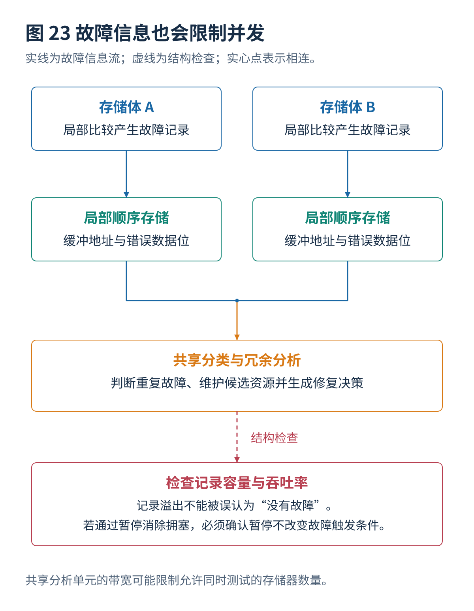

# 09 故障诊断与结果记录

[总览](00_MBIST总体架构与阅读导航.md) · [上一篇：自适应与运行期间测试](08_自适应与运行期间测试.md) · [下一篇：冗余分析自修复与纠错码](10_冗余分析自修复与纠错码.md)

---

> **架构位置：响应收集与故障信息层。** 由检测失败生成可用于定位与修复的记录，并分析记录资源对并发的约束。

| 专题定位 | 范围约定 |
|---|---|
| 输入 | 正确对应的读结果、期望值、错误位及测试阶段。 |
| 输出 | 故障地址与错误位记录、容量与带宽规则、附加诊断策略。 |
| 前置专题 | [存储器接口与测试控制器](01_存储器接口与测试控制器.md)、[故障模型与检测原理](02_故障模型与检测原理.md) |

读请求、期望数据与故障地址的时间对应统一放在[存储器接口与测试控制器](01_存储器接口与测试控制器.md)；本专题在该接口保证成立的基础上，讨论记录和诊断。

## 目录

- [[#1. 检测失败与诊断信息|1. 检测失败与诊断信息]]
- [[#2. 带宽与记录压缩|2. 带宽与记录压缩]]
- [[#3. 自适应诊断与 HBM 记录|3. 自适应诊断与 HBM 记录]]
- [[#4. 研究进展与证据范围|4. 研究进展与证据范围]]
- [[#与其他设计层的衔接|与其他设计层的衔接]]

## 1. 检测失败与诊断信息
### 1.1 检测定位与分类
检测回答是否发生不一致。定位回答哪个实例、哪个逻辑地址、哪些位发生不一致。分类回答观测更接近哪类故障行为。物理分析进一步确定实际缺陷的位置和机制，通常还需要更精细的电路、版图或失效分析手段。

一个错误位图呈现整列失败，可以支持“与某列相关的资源异常”这一假设，但不能只凭图案就断定一定是位线断裂；感应放大器、列选择、比较逻辑甚至测试配置错误都可能形成相似的表现。

### 1.2 故障记录信息项
记录应包含实例标识、逻辑地址、错误位掩码、实际与期望数据（空间允许时）、算法阶段、操作编号、数据图案、端口、测试时钟条件与环境条件。如果采用多拍读出，还应记录产生该读请求时的地址，而不是发现比较失败时当前正在访问的地址。

$$
\mathbf e=\mathbf d_{\mathrm{observed}}\oplus\mathbf d_{\mathrm{expected}}.
$$

错误位掩码 $\mathbf e$ 的第 $b$ 位为 1，表示这一位与期望不同。只保留“当前字有错误”的单个位，会丢失多位故障以及备用列分析所需的信息。

### 1.3 故障记录模式
只保留第一个故障所需硬件最少，适合快速筛选，但不适合一般二维备用行列分析。有限条记录能够降低面积，但必须处理容量满的情况。完整位图提供丰富信息，却可能非常大。

记录空间溢出不一定意味着不可修复：大量故障可能都在同一条可以替换的行上。相反，如果硬件按理论推导保存特定压缩信息，并且能够证明资源不足，就可能在不保留全部位图的情况下判断不可修复。关键是证明依赖什么信息，而不是把“记录满”无条件当作失败原因。

## 2. 带宽与记录压缩
### 2.1 诊断带宽与并发
设任务 $j$ 的失败记录产生速率为 $r_j(t)$，共享读出能力为 $R(t)$，队列容量为 $Q_{\max}$。忽略记录大小变化时，可以写出概念性关系：

$$
\frac{dQ}{dt}=\sum_jr_j(t)-R(t),\qquad 0\leq Q(t)\leq Q_{\max}.
$$

在队列为空时不继续减少，在队列满时必须执行明确的策略。如果靠暂停测试来避免溢出，还必须确认暂停不会破坏动态故障的检测条件。筛选模式只记录一个状态和诊断模式逐条上报地址，允许的并发程度可能完全不同。

2026 年的 HBM 混合故障地址存储研究，把共享关联查找与局部低面积存储相结合；这说明故障收集本身已成为重要的架构优化对象，而不只是测试结束后的打印输出。[^R38]

### 2.2 压缩签名与逐位比较
多输入签名寄存器（Multiple-Input Signature Register，MISR）可以把大量响应压缩成较短签名。它节省输出带宽，但损失定位能力，且某些错误序列可能得到与正确结果相同的签名。

常见的 $2^{-r}$ 混叠估计依赖对 $r$ 位签名、误差分布和压缩结构的特定假设，不能作为所有确定性故障序列的绝对保证。即使最终签名不匹配，仍然可能需要重新运行、分段收集或逐位比较才能定位故障。对存储器修复而言，能直接产生逻辑地址和错误位的局部比较机制通常更便于形成修复输入。

## 3. 自适应诊断与 HBM 记录
### 3.1 自适应诊断与信息增益
设当前候选故障集合的概率分布为 $F$，候选附加测试为 $a$，其结果为 $Y$。理想化地，可以选择单位代价预期信息增益最大的测试：

$$
a^*=\arg\max_a
\frac{H(F)-\mathbb E_Y[H(F\mid Y,a)]}{\mathrm{cost}(a)}.
$$

这是一个诊断选择原则，不是本专题声称已有某个商用 MBIST 自动执行的功能。实际实现可以更简单：根据失败阶段，选择反向地址、不同数据图案、重复读或不同端口的已验证诊断测试。

必须保留“多种缺陷产生相同观测”的可能性。附加测试能够缩小候选集合，不一定能够唯一确定实际制造缺陷。

### 3.2 HBM 故障收集
大量阵列并行测试时，错误地址产生速度可能很高。为每个区域放置很大的全相联故障地址存储器，面积代价可能难以接受；全部共用一个小记录器，又会受吞吐率和记录容量限制。

2025 年的 A Built-In Self-Repair With Maximum Fault Collection and Fast Analysis Method for HBM，以及 2026 年的 A Low Area Built-In Self-Repair Using Hybrid Fault Address Memory for HBM，分别围绕故障收集、快速分析和混合地址存储展开。二者提示调度应同时考虑测试操作资源与故障信息处理资源。[^R39][^R38]

混合结构的一般思想是：把需要快速判断“以前是否见过”的分类功能，与按顺序保存记录的功能分开。前者可以使用容量较小、代价较高的关联查找结构；后者采用较便宜的顺序存储。这样做仍需要证明重复记录、队列满、跨存储体分类和分析输入都被正确处理。

## 4. 研究进展与证据范围
| 年份与工作 | 核心问题与可核实方向 | 材料情况与比较时的注意事项 |
|---|---|---|
| 2024，Bernardi 等，Built-In Self-Test Architecture Enabling Diagnosis for Massive Embedded Memory Banks in Large SoCs | 由处理器组织多个分布式测试单元，支持多存储器测试和诊断 | 出版商摘要；关注软硬件协同，不只是算法操作次数。[^R33] |

| 年份与工作 | 核心方向 | 证据限制或适用条件 |
|---|---|---|
| 2025，A Built-In Self-Repair With Maximum Fault Collection and Fast Analysis Method for HBM | 面向 HBM 的故障收集与快速分析 | 出版商记录和摘要；与普通小型 SRAM 的记录成本不能直接横向排名。[^R39] |
| 2026，A Low Area Built-In Self-Repair Using Hybrid Fault Address Memory for HBM | 将共享故障分类与局部顺序存储结合，降低记录和分析成本 | 作者机构摘要；需关注记录容量、吞吐率与结构开销。[^R38] |

## 与其他设计层的衔接
本专题输出需要继续交给[并发调度与联合优化](07_并发调度与联合优化.md)、[冗余分析自修复与纠错码](10_冗余分析自修复与纠错码.md)、[多端口与新型存储器扩展](11_多端口与新型存储器扩展.md)、[设计验证与工具接入](12_设计验证与工具接入.md)。改变某一层的条件以后，应重新检查受到影响的接口和验证要求。

## 参考文献
文献编号与完整条目见[参考文献与研究进展索引](90_参考文献与研究进展索引.md)。

[^R33]: **R33** — Paolo Bernardi 等. **Built-In Self-Test Architecture Enabling Diagnosis for Massive Embedded Memory Banks in Large SoCs**. Electronics, 13(2), 303, 2024. DOI: 10.3390/electronics13020303。出版商摘要与论文信息。<https://www.mdpi.com/2079-9292/13/2/303>

[^R38]: **R38** — Byungsoo Kim, Seung Ho Shin, Youngki Moon, Eugene Jeong, Sungho Kang. **A Low Area Built-In Self-Repair Using Hybrid Fault Address Memory for HBM**. IEEE Transactions on Very Large Scale Integration Systems, 34(3), 991–1003, 2026；先行在线 2025。DOI: 10.1109/TVLSI.2025.3646232。作者机构摘要与期刊记录。<https://ieeexplore.ieee.org/document/11316804/> ；<https://yonsei.elsevierpure.com/en/publications/a-low-area-built-in-self-repair-using-hybrid-fault-address-memory/>

[^R39]: **R39** — Joonsik Yoon, Hayoung Lee, Youngki Moon, Seung Ho Shin, Sungho Kang. **A Built-In Self-Repair With Maximum Fault Collection and Fast Analysis Method for HBM**. IEEE Transactions on Computer-Aided Design of Integrated Circuits and Systems, 44(5), 2014–2025, 2025；先行在线 2024。DOI: 10.1109/TCAD.2024.3499903。出版商论文记录与摘要。<https://ieeexplore.ieee.org/document/10753471/>

---

[总览](00_MBIST总体架构与阅读导航.md) · [上一篇：自适应与运行期间测试](08_自适应与运行期间测试.md) · [下一篇：冗余分析自修复与纠错码](10_冗余分析自修复与纠错码.md)
