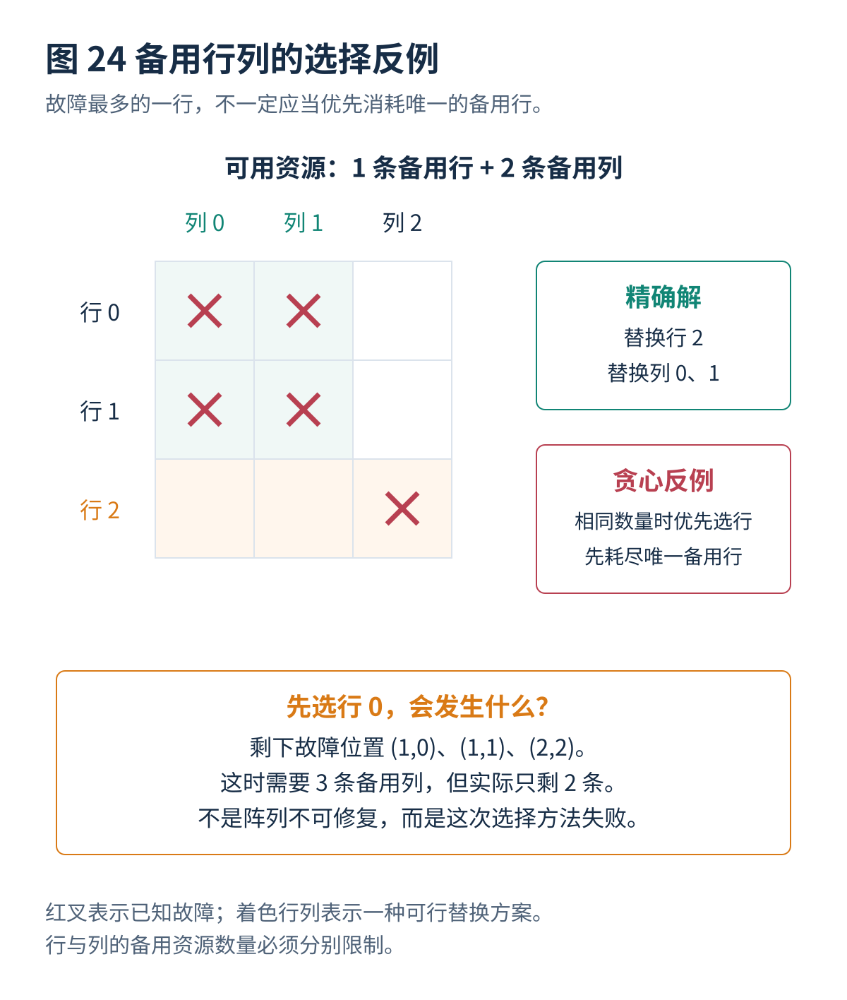

# 10 · 冗余分析自修复与纠错码

[总览](00_MBIST总体架构与阅读导航.md) · [上一篇：故障诊断与结果记录](09_故障诊断与结果记录.md) · [下一篇：多端口与新型存储器扩展](11_多端口与新型存储器扩展.md)

---

> **架构位置：冗余分析与修复执行层。** 备用行列的选择、修复配置装载、复测及与纠错码的协同。

| 专题定位 | 范围约定 |
|---|---|
| 输入 | 故障位置、备用资源范围、修复访问规则和数据保护策略。 |
| 输出 | 合法修复方案或不可修复结论、修复后验证与可靠性处理。 |
| 前置专题 | [故障诊断与结果记录](09_故障诊断与结果记录.md) |

## 目录

- [[#1. 冗余分析的输入与约束|1. 冗余分析的输入与约束]]
- [[#2. 贪心反例、确定性推理与精确搜索|2. 贪心反例、确定性推理与精确搜索]]
- [[#3. 分析目标与结构同构复用|3. 分析目标与结构同构复用]]
- [[#4. 自修复、复测和纠错码|4. 自修复、复测和纠错码]]
- [[#5. 研究进展与证据范围|5. 研究进展与证据范围]]
- [[#与其他设计层的衔接|与其他设计层的衔接]]

## 1. 冗余分析的输入与约束

### 1.1 BIRA 的输入和输出

BIRA 的输入是测试所观察到的故障位置及备用资源规则；输出是一组允许的替换决定，或者无法修复的结论。它并不负责产生 March 读写操作，也不自动保证原故障已经全部被检测。

最基本情形是二维阵列，有 $R_s$ 条备用行、$C_s$ 条备用列。用一条备用行替换原来的第 $r$ 行，可以处理该行上的所有已知故障；备用列类似。实际宏可能限制备用资源只能服务某个子阵列、某个数据位组或者某个存储体，此时必须把这些规则加入分析。

### 1.2 二维行列修复的精确模型

设故障集合为 $\mathcal F$。二元变量 $u_r=1$ 表示替换行 $r$，$v_c=1$ 表示替换列 $c$。合法修复必须满足：

$$
\begin{aligned}
&u_r+v_c\geq1, &&\forall(r,c)\in\mathcal F,\\
&\sum_r u_r\leq R_s,\\
&\sum_c v_c\leq C_s.
\end{aligned}
$$

每一个故障单元都必须至少被一条选中的行或列覆盖。把行、列分别看作二分图两侧的顶点，把故障看作边，就得到带有两侧分别预算限制的顶点覆盖问题。

一个常见错误是只求最少总顶点数，然后检查总数是否不超过 $R_s+C_s$。这不充分：某个最小解可能用了太多行，而实际只有很少备用行。必须分别满足行和列的限制。

## 2. 贪心反例、确定性推理与精确搜索

### 2.1 贪心修复策略的失效条件

反例的故障集合为：

$$
\mathcal F=\{(0,0),(0,1),(1,0),(1,1),(2,2)\},
\qquad R_s=1,\quad C_s=2.
$$

左上角四个故障构成一个 $2\times2$ 小块，另一个故障位于右下角。假设贪心方法每次选取覆盖当前故障最多的行或列，数量相同则优先选行。

第一次它可能选择第 0 行，覆盖两个故障，却用掉唯一备用行。剩余故障分布在第 0、1、2 列，需要三条备用列，而只有两条，于是失败。

实际上，选择**第 2 行**与**第 0、1 列**就能覆盖全部五个故障。这个例子说明，局部覆盖数量并不等于全局可修复性。它不是说所有贪心实现都必然失败，而是一个明确反例，否定这种简单规则的普遍正确性。

### 2.2 两类确定性推理规则

如果某一尚未替换的行中，剩余故障涉及的不同列数大于剩余备用列数，那么只靠备用列已经不可能处理这一行，这一行就必须被替换。列的推理完全对称。

此外，如果故障二分图中存在一个大小为 $k$ 的匹配，这些边互不共享行或列，就至少需要 $k$ 条替换线，因此必须有 $k\leq R_s+C_s$。这是总资源下界，不是同时满足行列各自预算的充分条件。

确定性推理可以先消除必选资源，再对剩余困难部分搜索，通常比从头盲目枚举有效。必须确保每一个提前判定都由正确下界支持，而不是凭“故障看起来很多”。

### 2.3 精确搜索方法

选择一个尚未覆盖的故障 $(r,c)$。任何合法修复方案，要么替换行 $r$，要么替换列 $c$。分别递归尝试这两个分支，减少相应备用资源，删除已经覆盖的故障；资源不够则停止该分支，全部故障被覆盖则得到方案。

随文程序采用另一种同样精确的小规模实现：枚举允许数量以内的行集合；对每个行集合，剩余故障涉及的列均须被选择；再检查其数量不超过列预算。该实现用于复算与对照，不适合直接综合为大规模片上硬件。

## 3. 分析目标与结构同构复用

### 3.1 最优冗余分析的目标定义

它可能表示：只要存在合法方案就一定能找到；也可能表示使用最少备用资源；还可能表示分析时间最短或电路面积最小。前三者不是同一个优化问题。

SPOT 的研究将故障收集期间的候选处理与后续分析相结合；PETRA 关注提前判断以减少分析时间；PRAISE 则利用故障结构的对称性和同构关系减少重复求解。这些方法优化的是分析流程或者表示方式，不能直接解释成 March 故障覆盖提高。[^R36][^R37][^R40]

### 3.2 结构同构方法的价值

把某些故障行、故障列重新编号后，如果得到的故障连接关系完全相同，其可修复性和备用行列数量需求也相同。例如，把前例中的行 0、1、2 改名为 100、103、210，并不会改变“一个小方块加一条孤立故障”的组合结构。

因此可以先把故障结构转换成规范编号，再对等价结构复用已经得到的候选解。如果候选解同时记录备用行和备用列的不同需求，并保留不能被其他方案同时改进的解，就可以适应不同的预算。

以上为同构复用原理的独立说明。PRAISE 的出版商与作者机构记录确认了其结构同构与预计算解编码方向；本文不据此推断任意规模阵列均能以固定存储开销完成分析。[^R40]

## 4. 自修复、复测和纠错码

### 4.1 BISR 是把分析结果落实到硬件

得到“替换第 2 行”的决定后，还需要让此后的地址访问真正到达备用行。可以由宏内部的修复译码电路完成，也可以由允许的外围地址转换结构完成。配置可能保存在易失寄存器、非易失存储器或者一次性可编程单元中，取决于产品设计。

完整过程通常包括测试、故障收集、冗余分析、暂时装载修复配置、检查修复后功能，以及按授权策略决定是否永久保存。永久写入不是普通软件参数修改，必须遵循具体器件和制造流程的保护条件。

### 4.2 修复后复测的必要性

备用资源本身可能有故障；修复译码可能配置错误；地址优先级可能冲突；原始逻辑地址与物理备用位置之间的关系可能没有正确处理。只验证“BIRA 输出了一个数学上覆盖故障的集合”是不够的。

还需要保证修复后的访问不破坏其他地址，并正确处理多端口、按字节写入、纠错码和保持模式。修复前后应使用适合该结构的验证方法，不应把原始物理地址解释和修复后的逻辑地址解释混用。

### 4.3 纠错码与 MBIST 的功能边界

纠错码（Error-Correcting Code，ECC）根据冗余校验信息检测或纠正数据错误。常见的单比特纠正、双比特检测能力，是针对一个码字内的特定错误模式；它不保证任意多比特错误都可以正确识别，更不保证坏地址译码、访问冲突和外围控制故障都会表现为可纠正数据错误。

MBIST 主动施加测试操作寻找潜在缺陷，ECC 主要保护被实际访问的数据。一个很少被正常访问的故障位置，可以长期不产生纠错事件，却仍然是潜在问题。

### 4.4 ECC 前后测试位置的差异

如果比较器看到的是已经纠正的数据，一个固定错误位可能被纠正后不再产生数据不一致。这时“测试通过”可能意味着端到端读数据正确，但不意味着原始存储阵列没有缺陷。

应当明确至少两种目标：检查原始阵列及其修复状态；检查 ECC 编码、译码、纠正和错误上报功能。前者可能需要观察纠正前的数据或错误状态；后者需要受控注入错误、验证综合征和状态处理。具体是否允许旁路 ECC 取决于宏和产品设计，不能统一要求所有模式都关闭 ECC。

公开的 SRAM 控制器设计也表明，数据完整性检查、存储器数据变换与访问错误报告可能位于不同路径。OpenTitan 的 SRAM 控制器文档可用于理解这些接口，但其中某一实现不能视为所有 MBIST 的标准结构。[^R47]

### 4.5 运行期间修复还涉及数据与系统状态

如果一个地址发生不可纠正错误，只把后续访问切换到备用位置，并不能恢复已经丢失的数据。系统仍需要副本、重建机制或者明确的失败响应。

对可纠正错误进行长期观察，可以帮助识别重复发生的位置；但“重复错误”与“永久物理故障”也不是严格等价。决定退役某个区域或者消耗备用资源时，应当结合纠错事件、复测和环境条件。

Han 等 2026 年的双模式在线 BISR 工作，把小芯片系统的存储器故障与互连故障处理放在同一个架构中讨论。它扩展了修复对象，但互连线路替换和存储器备用行列仍然是不同机制，不能统一简化为一个普通 SRAM 行替换表。[^R41]

### 4.6 三类易误读的比例

| 指标 | 分子与分母的定义 |
|---|---|
| 故障覆盖率 | 在明确定义的故障集合中，被指定测试检测出的故障比例 |
| 可修复故障样本比例 | 在某个故障分布和备用资源配置下，能够找到合法修复的样本比例 |
| 冗余分析算法成功率 | 对本来就存在合法方案的样本，算法成功找到方案的比例 |

还有制造良率，它的分母通常是生产的芯片或存储器单元集合，而不是注入故障的模拟样本。除非给出一致的统计模型和实验范围，这些比例不能互相替换，也不能相乘得到可信的芯片出货质量。

## 5. 研究进展与证据范围

| 年份与工作 | 核心方向 | 证据限制或适用条件 |
|---|---|---|
| 2025，SPOT | 收集故障期间形成更有希望的修复候选，结合后续分析 | 作者机构摘要与期刊记录；“最优”依赖其修复模型，不代表测试覆盖提高。[^R36] |
| 2025，PETRA | 用提前判断减少冗余分析时间 | 出版商摘要；提前结束分析不等于提前宣布存储器测试通过。[^R37] |
| 2026，PRAISE | 用故障结构同构和解编码减少重复分析 | 2026 年在线发表，卷期信息以出版商记录为准。[^R40] |
| 2026，A Dual-Mode Online BISR Architecture for Interconnect and Memory Repair in Chiplet-Based Systems | 在小芯片系统中结合互连与存储器在线修复 | 作者机构摘要和期刊记录；不能简化为传统备用行列问题。[^R41] |

**这些改进的重要性：** 当测试并发程度提高时，失败记录与冗余分析可能比读写序列更慢。因此，增加测试控制器不一定线性提升总测试吞吐率。该推论需在目标系统中测量，但它给出了比单纯减少 March 操作数更宽的优化空间。

## 与其他设计层的衔接

本专题输出需要继续交给[自适应与运行期间测试](08_自适应与运行期间测试.md)、[多端口与新型存储器扩展](11_多端口与新型存储器扩展.md)、[设计验证与工具接入](12_设计验证与工具接入.md)、[算例与源码说明](13_算例与源码说明.md)。改变某一层的条件以后，应重新检查受到影响的接口和验证要求。

## 参考文献

文献编号与完整条目见[参考文献与研究进展索引](90_参考文献与研究进展索引.md)。

[^R36]: **R36** — Donghyun Han, Sunghoon Kim, Dayoung Kim, Sungho Kang. **SPOT: Fast and Optimal Built-In Redundancy Analysis Using Smart Potential Case Collection**. IEEE Transactions on Very Large Scale Integration Systems, 33(3), 780–792, 2025；先行在线 2024。DOI: 10.1109/TVLSI.2024.3499955。已核实作者机构摘要。<https://ieeexplore.ieee.org/document/10767428/> ；<https://yonsei.elsevierpure.com/en/publications/spot-fast-and-optimal-built-in-redundancy-analysis-using-smart-po/>

[^R37]: **R37** — **PETRA: Powerful Early Termination-Based Redundancy Analysis**. IEEE Transactions on Computer-Aided Design of Integrated Circuits and Systems，2025 卷期，先行在线 2024。DOI: 10.1109/TCAD.2024.3424730。依据出版商摘要与正式记录。<https://ieeexplore.ieee.org/document/10587206/>

[^R40]: **R40** — Younwoo Yoo, Seung Ho Shin, Dahoon Kim, Sungho Kang. **PRAISE: Parallel Redundancy Analysis Using Isomorphism-Based Solution Encoding**. IEEE Transactions on Very Large Scale Integration Systems, 2026。DOI: 10.1109/TVLSI.2026.3704618。2026 年在线发表，卷期信息以出版商记录为准。<https://www.computer.org/csdl/journal/si/2026/09/11575242/2hyA4tjhA1G> ；<https://yonsei.elsevierpure.com/en/publications/praise-parallel-redundancy-analysis-using-isomorphism-based-solut/>

[^R41]: **R41** — Donghyun Han 等. **A Dual-Mode Online BISR Architecture for Interconnect and Memory Repair in Chiplet-Based Systems**. IEEE Transactions on Reliability, 75, 1525–1539, 2026。DOI: 10.1109/TR.2026.3679968。已核实作者机构摘要与期刊记录。<https://ieeexplore.ieee.org/document/11466463/> ；<https://yonsei.elsevierpure.com/en/publications/a-dual-mode-online-bisr-architecture-for-interconnect-and-memory-/>

[^R47]: **R47** — OpenTitan，**SRAM Controller — Theory of Operation**，官方设计文档。用于举例说明存储数据、完整性位和数据变换路径，不把它描述成通用 MBIST 产品。<https://opentitan.org/book/hw/ip/sram_ctrl/doc/theory_of_operation.html>

---

[总览](00_MBIST总体架构与阅读导航.md) · [上一篇：故障诊断与结果记录](09_故障诊断与结果记录.md) · [下一篇：多端口与新型存储器扩展](11_多端口与新型存储器扩展.md)
