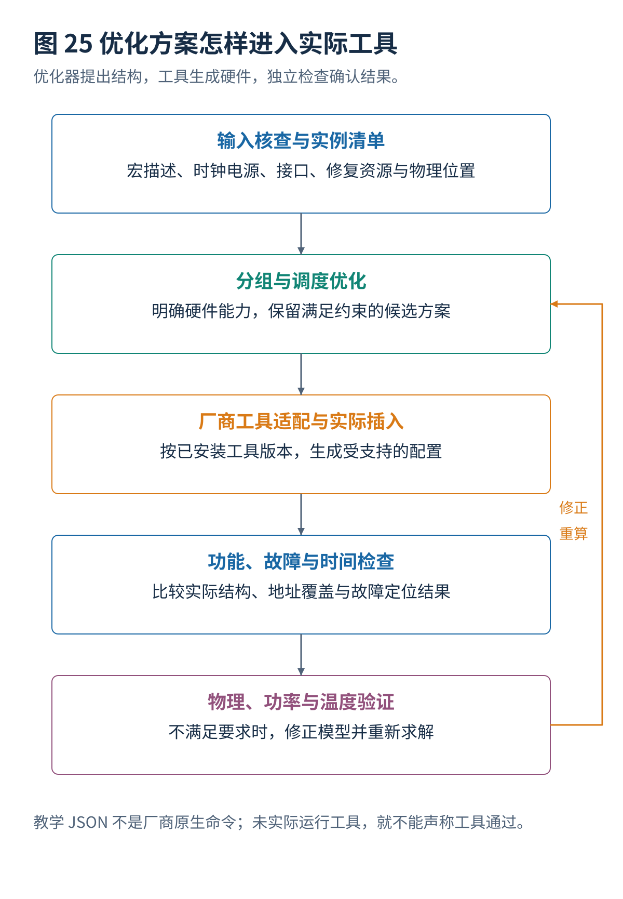

# 12 设计验证与工具接入

[总览](00_MBIST总体架构与阅读导航.md) · [上一篇：多端口与新型存储器扩展](11_多端口与新型存储器扩展.md) · [下一篇：算例与源码说明](13_算例与源码说明.md)

---

> **架构位置：工具实现与验证层。** 各层决定到实际硬件的转换，以及算法、执行、定位与电气条件的分别验证。

| 专题定位 | 范围约定 |
|---|---|
| 输入 | 算法配置、分组与时间表、宏描述、工具能力和验证模型。 |
| 输出 | 生成结构、周期与面积报告、故障验证、物理验证和可审查证据。 |
| 前置专题 | [存储器接口与测试控制器](01_存储器接口与测试控制器.md)、[测试算法生成与选择](05_测试算法生成与选择.md)、[存储器分组与功耗分析](06_存储器分组与功耗分析.md)、[并发调度与联合优化](07_并发调度与联合优化.md)、[故障诊断与结果记录](09_故障诊断与结果记录.md)、[冗余分析自修复与纠错码](10_冗余分析自修复与纠错码.md) |


## 目录

- [[#1. 控制器与接口验证|1. 控制器与接口验证]]
- [[#2. 优化结果到工具配置|2. 优化结果到工具配置]]
- [[#3. 学习式早期代价预测|3. 学习式早期代价预测]]
- [[#4. 可复现比较|4. 可复现比较]]
- [[#5. 研究进展与证据范围|5. 研究进展与证据范围]]
- [[#与其他设计层的衔接|与其他设计层的衔接]]

## 1. 控制器与接口验证
### 1.1 无故障模式误判检查
最先验证合法宏模型在全部支持模式下都不会被误判：复位、算法结束、最后一次读返回、读写切换、地址最后一项、写掩码以及不完整的二进制地址范围。地址宽度可以表示的范围，可能大于实际存在的字数；越界访问不能默默进入测试。

不同读延迟和端口时序的宏，应当分别验证期望信息与响应的对应关系。支持多个测试时钟或电源域时，还要验证启动请求、完成响应和复位释放的跨时钟行为。

### 1.2 故障注入检查
| 验证对象 | 需要检查的结果 |
|---|---|
| 算法检测 | 指定故障是否在正确条件下触发并被观察 |
| 地址与位定位 | 报告是否指向正确实例、请求地址和错误位 |
| 阶段定位 | 报告是否与实际读写阶段对应 |
| 有限记录容量 | 满状态是否明确、是否按策略停止或保留必要信息 |
| 调度执行 | 实际启动和完成时刻是否符合计划，是否发生未建模等待 |
| 修复 | 替换资源是否可用，修复后访问是否正确 |
| 正常功能 | 退出测试后是否正确恢复端口、电源和系统状态 |

只在比较器输出上强制一个错误，能够测试错误报告路径，但不能证明 March 对位单元故障具有覆盖能力。只在存储器输出上翻转一位，也不一定能够代表需要操作历史才能触发的动态故障。

### 1.3 断言不变量
每个已发出且被接受的读请求，在规定条件下必须产生一次正确关联的比较。每个需要测试的有效地址都被访问。测试完成时不存在未处理的读响应。只有获得测试访问许可时才能驱动测试写入。故障记录满不能被误报为无故障。修复方案不能重复占用同一备用资源。

对于并发计划，还应使用独立检查器重算活动控制器数量、功率区间和独占资源使用。优化器自己输出 `valid=true` 不足以替代独立检查，尤其是在复杂启发式或自动生成代码的场景中。

### 1.4 故障覆盖不变条件
如果只改变不同独立存储器之间的启动次序，同时保持每个存储器内部操作、时钟条件和观测方式不变，算法级覆盖可以在相应模型下保持。但如果并发改变了局部电压、温度或共享接口等待，物理检测条件仍可能变化。

因此，应分别给出“抽象操作序列保持不变”的证明与“实际电气和时序条件仍合格”的验证。不能用前者替代后者。

## 2. 优化结果到工具配置
### 2.1 优化器在流程中的位置
推荐将流程组织为：读取寄存器传输级设计和存储器描述；建立实例清单；根据已有平面布局形成候选共享组；执行分组与调度优化；将配置交给真实 MBIST 插入工具；完成综合、功能和故障仿真；根据物理实现和功率结果调整。



“插入前优化”与“插入后验证”不构成替代关系。前者决定候选结构，后者确认工具究竟生成了什么。如果工具自动拆分一个候选组、改变执行步骤或者增加等待，最终应当以实际生成结构重新计算时间与功率。

### 2.2 厂商无关配置示例
下列 JSON 为本文定义的示例交换格式，**不是 Tessent、Synopsys 或其他厂商的原生命令格式**。功率上限与分组来自[并发调度与联合优化](07_并发调度与联合优化.md)的算例。

```json
{
  "schema_version": "1.0-teaching",
  "units": {"time": "us", "power": "mW"},
  "controller_contract": {
    "member_execution": "serial",
    "independent_member_progress": false,
    "maximum_active_controllers": 2,
    "global_active_power_limit": 8
  },
  "groups": [
    {"id": "g0", "members": ["A", "C", "D"]},
    {"id": "g1", "members": ["B"]},
    {"id": "g2", "members": ["E", "F"]}
  ],
  "policy": {
    "pause_allowed": false,
    "diagnostic_overflow": "explicit_error",
    "permanent_repair_programming": "not_authorized"
  }
}
```

`independent_member_progress=false` 在这里表示组内不存在多个并行进度引擎，不妨碍控制器依次选择下一个成员。如果工具使用不同的含义，适配层应当转换成它真实支持的概念，而不是只复制字段名字。

### 2.3 适配层验证
适配层至少应核对实例是否存在、宏描述是否一致、工具能否表达指定组结构、所选算法是否受支持、测试时钟是否可达、结果读取方法是否存在、以及修复是否属于当前授权动作。

厂商工具的能力和脚本接口会随版本、许可证及产品配置变化。本专题只依据官方资料讨论能力类别，不给出未经当前安装环境核实的“可直接执行 Tcl”。实际工程应从已安装版本手册或经过验证的工程模板生成脚本。[^R25][^R26][^R46]

### 2.4 智能代理适用范围
智能代理可以整理实例清单、发现缺失属性、构造候选配置、调用有明确接口的求解器、比较资源报告、定位约束违反位置并生成可审查的配置差异。它也可辅助设计区分模型错误与工具实现限制的实验。

不应让语言模型直接以自然语言“确认功率安全”或者“确认无遗漏故障”。这些结论需要由可执行检查器、故障仿真或电气分析支撑。永久修复写入、修改受保护配置等动作应独立受控，不能与普通优化实验同等处理。

### 2.5 EDA 工具实现
对于工业 MBIST 工具，常规步骤通常是：读入存储器宏说明文件、从 RTL 或综合后网表识别存储器、规划控制器与存储器分组、指定算法与可选数据图案、生成测试硬件、验证连接与测试时序、执行故障仿真，然后进行后续逻辑综合和物理实现。不同厂商和版本提供的自定义测试指令能力差异很大。

可以将研究代码和 EDA 工具集成分成两个阶段：

1. **离线算法验证阶段：**用 Python 或硬件验证环境对 March 序列进行语法解析、操作计数、无故障执行模拟和故障注入。此阶段无需改动工业 EDA 工具内部算法实现。
2. **硬件接入阶段：**若工具支持用户自定义的测试算法指令，可以把搜索得到的序列转换为其支持的微指令格式；若工具没有开放这一能力，则通过独立设计的 MBIST 控制器和存储器访问选择电路实现，同时解决与芯片已有测试访问控制、时钟和隔离信号的整合问题。

不能仅依据某个产品版本的宣传材料推断其能够执行所有研究型 March 序列。例如，一条含特殊非顺序地址跳转、可变次数重复读取或双端口同周期操作的算法，可能超过工具内建指令集的表达能力。

### 2.6 March 算法支持
部分工业工具支持可配置的基本读写序列，另外一些支持自定义微指令，但对于长时间等待、地址跳转、双端口并发或任意长操作历史不一定具有相同能力。工具能力必须查目标版本的命令手册，或者用一个最小例子试运行，不适合只看产品名称来判断。

## 3. 学习式早期代价预测
### 3.1 机器学习代价预测
2026 年 8 月的预印本 Automated Estimation of MBIST Area and Test Time in Heterogeneous Memory IPs via Stacked Ensemble Framework，研究在早期根据存储器配置预测 MBIST 面积和时间。其报告中，面积与时间预测分别有 **90.68% 和 96.80% 落在真实值的 ±10% 区间内**。这不是故障覆盖率，也不是所有新设计都达到该误差的保证。[^R22]

这种模型适合筛选大量候选方案，随后对少数高价值方案执行真实工具。需要关注训练和测试是否按设计家族分开、相近参数变体是否造成信息泄漏、换工艺或工具版本后误差是否变化，以及预测区间能否可靠提示不确定性。

最合理的用途是降低搜索成本，而不是用预测取代最终的综合、物理实现和测试验证。

## 4. 可复现比较
### 4.1 硬件假设与算法比较
同样一组存储器，串行控制器和局部独立执行控制器得到的最短时间不同。如果一个方法允许动态改变进度，另一个必须同步广播，不能只把结果归因于调度算法好坏。

实验应公开硬件约束、任务粒度、允许的暂停位置、启动粒度、背景活动以及诊断模式。硬件面积改变时，也要报告，而不是只比较测试时间。

### 4.2 四层证据
**第一层：确定性小例子。** 能手工解释每个约束，使用穷举或者精确求解得到最优值，验证算法没有基础错误。

**第二层：公开或可发布输入。** 扩大规模，记录随机种子和全部模型参数，比较计算时间、解质量和稳定性。

**第三层：真实工具生成。** 把分组方案变成可执行控制器，核对实际结构、周期、面积和测试报告。

**第四层：物理和电气验证。** 使用实际位置、供电网络、活动曲线和温度条件，检查早期估计的收益是否仍然存在。

仅完成前两层时，应报告算法与模型结果，不能表述为已验证工业工具与芯片。反之，真实工具跑通一个设计，也不等于证明启发式在所有实例上更优。

### 4.3 消融实验
分别移除物理距离约束、阶段功率曲线、诊断带宽和温度预测，观察是否出现非法计划或性能变化。分别比较组数目标、测试时间目标以及联合目标。用相同硬件结构测试不同排序方法，避免把架构改变与算法效果混在一起。

如果提出学习式预测，应当比较无预测、简单线性预测与复杂模型，并报告失败候选比例和调用真实工具的次数。如果只报告模型训练集误差，就很难证明它对设计搜索有价值。

### 4.4 多目标评价与硬约束
一个多目标向量可以写成：

$$
\left(
A_{\mathrm{test}},\ T_{\mathrm{max}},\ E_{\mathrm{test}},\
P_{\mathrm{peak}},\ \Theta_{\mathrm{peak}},\ T_{\mathrm{diagnosis}}
\right).
$$

这里 $T_{\mathrm{max}}$ 表示完成时间，$\Theta_{\mathrm{peak}}$ 表示最高温度，二者采用不同符号。实际代码同样应使用明确名称，例如 `makespan_us` 与 `peak_temperature_C`。

硬性约束例如故障覆盖要求、最大温度、端口合法性和数据保留要求，不适合只转化成一个可能被性能收益抵消的小惩罚。先确保合法，再比较非支配方案，通常更容易解释。

### 4.5 论文与项目对比
新算法与现有算法的可复现比较应统一报告以下内容：

| 类别 | 需要公开的实验信息 | 说明目的 |
|---|---|---|
| 待测电路 | SRAM 宏深度、位宽、端口、读出延迟、工艺信息或公开替代模型 | 决定每次操作的执行方式与可能出现的故障 |
| 故障模型 | 故障名称、完整故障原型、激励与观测条件 | 防止不同论文采用不同故障集合却直接比较百分比 |
| 测试序列 | 每个 March 元素、地址方向、读写操作、数据图案、等待时间 | 允许其他研究者重现真实测试 |
| 操作长度 | 单次完整遍历的操作数与总 $N$ 系数 | 验证算法是否真比基准更短 |
| 实际时钟周期 | 读写等待、流水线、图案变化及最后比较所需周期 | 反映实际测试时间，不只显示操作数量 |
| 故障覆盖 | 检测故障数、未检测故障清单、分故障类别统计 | 明确优化收益与代价 |
| 测试硬件 | 控制器面积、最高时钟频率、峰值功耗和平均功耗 | 比较部署成本 |
| 基准算法 | 使用相同宏、相同仿真器、相同故障集合的 C−/MSS/AB/RAW 等 | 才能得出公平的算法改进结论 |

完成上述实验后，可使用帕累托前沿图展示：如果两个算法检测同一故障集合，而一个在所有受约束指标上都不差、至少一个指标更好，那么另一个算法对该实验条件而言就不是优选方案。

## 5. 研究进展与证据范围
| 发表时间 | 工作及出处 | 对 March / MBIST 的主要贡献 | 可核实的研究结果 | 使用时必须注意的限制 |
|---|---|---|---|---|
| **2026 年 8 月** | *Automated Estimation of MBIST Area and Test Time in Heterogeneous Memory IPs via Stacked Ensemble Framework*，预印本 | 用机器学习估计不同存储器与 MBIST 配置下的面积及测试时间 | 论文以 4470 个面积样本、624 个时间样本训练，公布相应预测结果 | 这是设计早期代价估计研究，不是新的 March 故障检测序列。[^R22] |

| 年份与工作 | 核心方向 | 引用范围 |
|---|---|---|
| 2026，Teoh 等，Automated Estimation of MBIST Area and Test Time in Heterogeneous Memory IPs via Stacked Ensemble Framework | 根据异构存储器配置预测测试面积与时间 | 可读全文，2026-08-20 的 arXiv 预印本；预测误差指标不是故障覆盖。[^R22] |

## 与其他设计层的衔接
本专题输出需要继续交给[算例与源码说明](13_算例与源码说明.md)、[参考文献与研究进展索引](90_参考文献与研究进展索引.md)。改变某一层的条件以后，应重新检查受到影响的接口和验证要求。


## 参考文献
文献编号与完整条目见[参考文献与研究进展索引](90_参考文献与研究进展索引.md)。

[^R22]: **R22** — **Teoh 等（2026 年 8 月）.** *Automated Estimation of MBIST Area and Test Time in Heterogeneous Memory IPs via Stacked Ensemble Framework.* [arXiv:2608.19705](https://arxiv.org/abs/2608.19705)。使用机器学习估计 MBIST 面积与测试时间，**不是 March 操作序列的直接改进**。

[^R25]: **R25** — Synopsys，**Synopsys IP for Embedded Memory Test and Repair（SMS）** 官方数据表。资料文件：`star-bist-ds.pdf`。用于核实测试、诊断、修复、可编程算法及不同存储技术支持的功能类别；不将数据表年份视为当前最新软件版本。<https://www.synopsys.com/content/dam/synopsys/implementation%26signoff/datasheets/star-bist-ds.pdf>

[^R26]: **R26** — Siemens，**Tessent MemoryBIST** 官方产品页。用于核实产品功能类别，不推断当前用户许可证或具体脚本接口。<https://www.siemens.com/en-us/products/ic/tessent/test/memorybist/>

[^R46]: **R46** — Siemens，**Automation of Shared-Bus Memory Test With Tessent MemoryBIST**，官方白皮书页面。用于讨论共享功能总线的测试组织，不推断任意设计具有相同并发能力。<https://resources.sw.siemens.com/en-US/white-paper-automation-of-shared-bus-memory-test-with-tessent-memorybist/>

---

[总览](00_MBIST总体架构与阅读导航.md) · [上一篇：多端口与新型存储器扩展](11_多端口与新型存储器扩展.md) · [下一篇：算例与源码说明](13_算例与源码说明.md)
