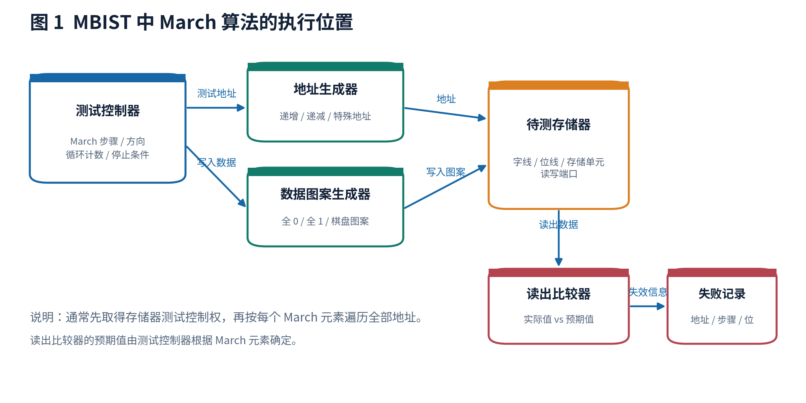
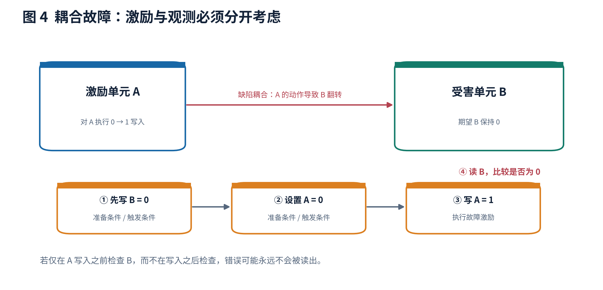
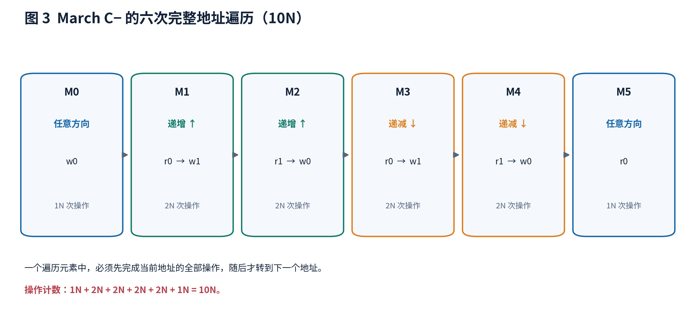
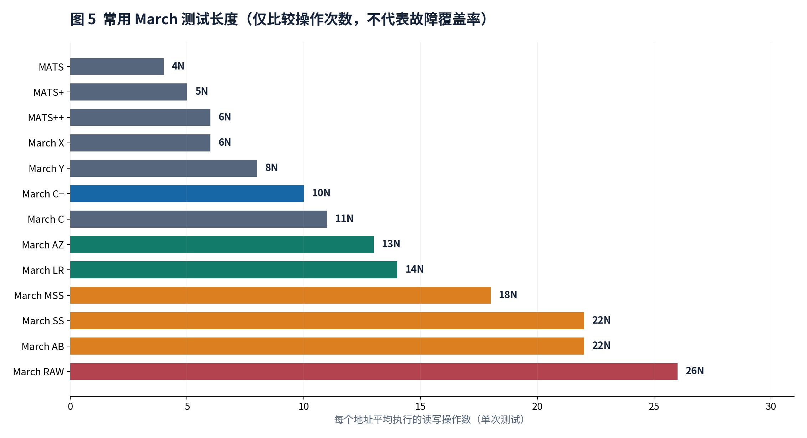
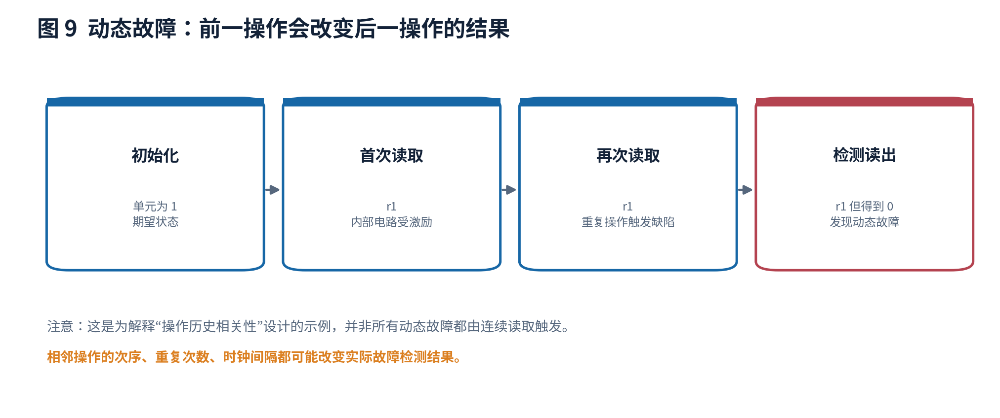
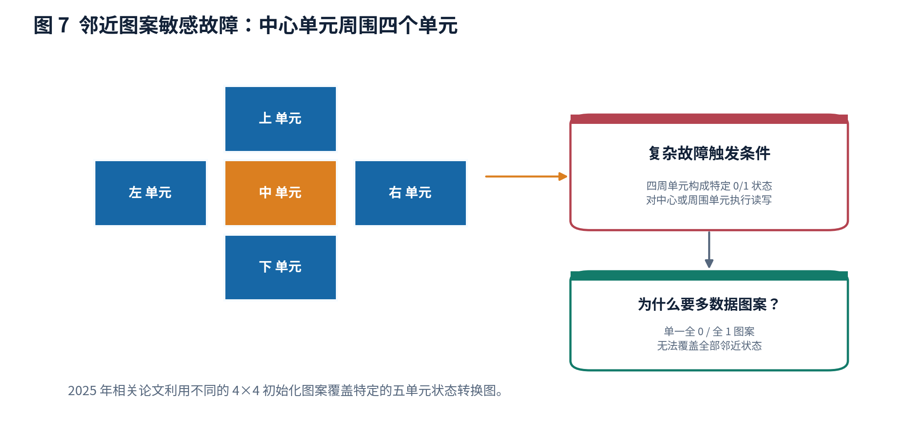
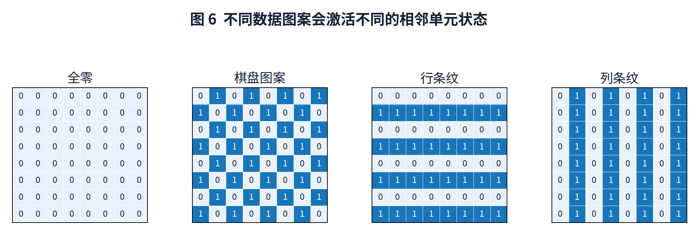
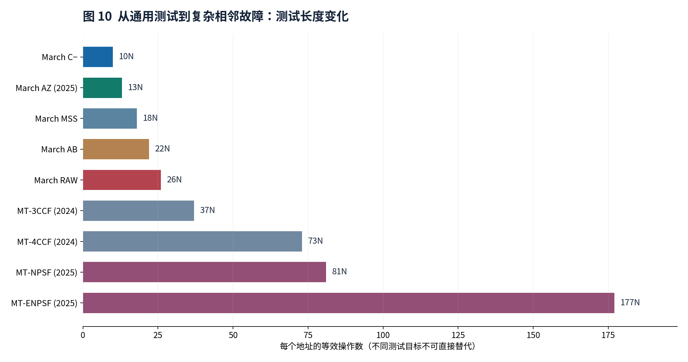
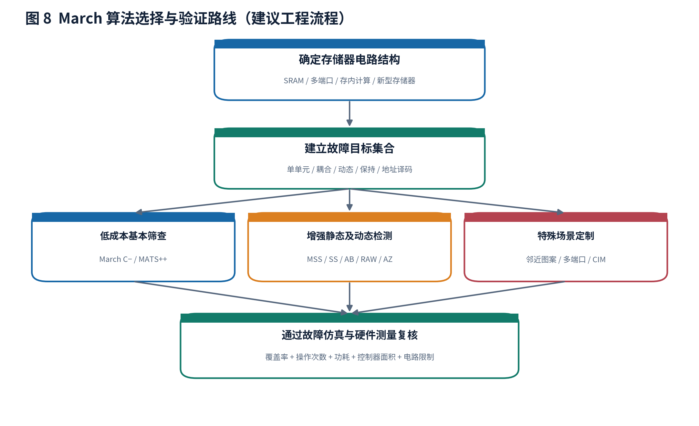

# MBIST 中的 March 算法：完整原理、经典变体、先进改进与 2024—2026 年研究进展

> **资料核查日期：2026 年 10 月 17 日。** 本报告以片上静态随机存取存储器（Static Random-Access Memory，SRAM）为主要对象，兼顾双端口存储器、存内计算存储器、磁性随机存取存储器和在线测试。March 算法的命名没有完全统一的全球标准，因此本报告在给出名称时尽可能同时给出操作序列、操作次数、目标故障模型和来源。论文声称的“完全覆盖”始终限定于论文明确规定的故障模型。它不意味着所有物理制造缺陷都能被发现。
>
> **插图说明：** 文中的 10 张图均为本报告重新绘制的原理图，而非复制论文图片。测试序列与数据图案示意图用于理解，不应在未经故障仿真核验的情况下直接当作生产测试代码。

## 阅读目录

1. [March 算法到底解决什么问题](#一march-算法到底解决什么问题)
2. [完整理解 March 测试的表达方法](#二完整理解-march-测试的表达方法)
3. [存储器的故障模型与检测原理](#三存储器的故障模型与检测原理)
4. [逐步推导 March C− 的工作过程](#四逐步推导-march-c-的工作过程)
5. [经典 March 算法家族及其优劣](#五经典-march-算法家族及其优劣)
6. [面向复杂静态故障的改进算法](#六面向复杂静态故障的改进算法)
7. [面向动态故障的算法](#七面向动态故障的算法)
8. [针对地址译码器、相邻单元和特殊存储器的算法](#八针对地址译码器相邻单元和特殊存储器的算法)
9. [2024—2026 年最新学术研究](#九20242026-年最新学术研究)
10. [算法优化可以采用哪些数学方法](#十算法优化可以采用哪些数学方法)
11. [工程实现、评估方法和算法选择](#十一工程实现评估方法和算法选择)
12. [容易出现的技术误解与资料错误](#十二容易出现的技术误解与资料错误)
13. [参考文献与论文链接](#十三参考文献与论文链接)

---

## 一、March 算法到底解决什么问题

### 1.1 存储器内建自测试与 March 算法不是一回事

**存储器内建自测试**（Memory Built-In Self-Test，MBIST）是在芯片内部增加专门的测试控制电路，用于对嵌入式存储器执行读写测试、比较结果并记录失败信息。它是硬件实现和测试方法的总称。

**March 算法**是一种测试操作编排方法：规定先访问哪个地址、对该地址进行哪些读写操作、随后访问哪个地址、期望读回什么值。它通常由 MBIST 控制器执行，也可以通过软件实现某些存储器测试。**March 不是某个特定的逻辑门电路，也不自动等于故障覆盖率百分之百。**



如图 1 所示，控制器至少需要协调：

- **地址产生单元：**按照所要求的升序、降序或专用地址序列选择存储地址。
- **测试数据产生单元：**输出全零、全一、棋盘图案，或由行列地址决定的数据值。
- **读写控制单元：**在正确的时钟周期启动读操作、写操作，以及必要的等待。
- **比较单元：**将真正读出的数据与当前 March 操作的期望值比较。
- **失败信息记录单元：**记录失败的存储器、地址、数据位、March 步骤、期望值和实际值；是否保存多个失败信息取决于控制器设计。

### 1.2 为什么仅写入并读回所有数据还不够

假设一个存储单元总是读出 0。依次写入全零、读回全零时不会发现异常；必须写入 1 并尝试读回 1 才可能发现。

再假设两个存储单元 A、B 存在异常电气耦合：A 从 0 写成 1 时，B 的内容可能由 0 意外翻转成 1。如果仅测试 A，而没有在这一动作后读取 B，故障也可能被遗漏。因此，检测效果取决于：

1. 是否安排了能够**触发**该故障的初始化状态与操作；
2. 是否在错误被后续操作覆盖之前**观察**到错误；
3. 是否考虑了存储器不同物理位置之间的相互影响；
4. 是否在实际可能出现的时间间隔、读写频率、供电电压和温度下测试。

这就是 March 算法不仅规定“写什么”，还规定“先做什么、后做什么、从哪个方向访问”的原因。

## 二、完整理解 March 测试的表达方法

### 2.1 标准操作符号

| 符号 | 准确含义 | 特别注意 |
|---|---|---|
| `w0` | 向当前存储地址写入逻辑值 0 | 无论以前存储什么，均执行写 0 操作 |
| `w1` | 向当前存储地址写入逻辑值 1 | 不等于从 0 变成 1；是否发生状态转换取决于原内容 |
| `r0` | 读取当前存储地址，检查返回值是否为 0 | 必须真正比较，不能只发送读取命令 |
| `r1` | 读取当前存储地址，检查返回值是否为 1 | 对同步 SRAM，需要处理读取延迟 |
| `↑` | 按给定地址次序从低地址到高地址逐一遍历 | 通常表示逻辑地址顺序，未必是物理相邻次序 |
| `↓` | 按给定地址次序从高地址到低地址逐一遍历 | 可改变不同单元间激励与观测的先后关系 |
| `⇕` | 可以选择升序或降序，但一个遍历过程中应保持选定顺序 | 不是在每次访问后随机翻转方向 |
| `;` | 分隔两个 March 元素 | 每个元素都重新遍历全部指定地址 |
| `N` | 对于一次处理一位的存储器，是需要测试的存储单元数量；对于一次处理整个字的存储器，是需要遍历的字地址数量 | 必须同时注明每次操作的数据宽度 |

### 2.2 March 元素的关键规则

例如：

```text
↑(r0, w1, r1)
```

表示：从最低地址开始，先读取并检查该地址是否为 0，然后在**同一个地址**写入 1，再读取并检查是否为 1；完成上述三项操作之后才前往下一个地址。它**不是**先读取整个存储器、再写入整个存储器、最后读取整个存储器。

如果有 N 个有效地址，那么这个 March 元素执行 `3N` 次存储器操作。

### 2.3 操作次数、复杂度与实际测试时间

对一般 March 测试：

\[
L=N\sum_{i=1}^{m}k_i,
\]

其中 `m` 表示 March 元素数量，`k_i` 表示第 `i` 个 March 元素中对每个地址执行的读写操作数量。例如 `March C−` 的六个元素分别执行 `1,2,2,2,2,1` 次操作，因此总长度为 `10N`。

**重要：`10N` 是操作计数，不代表必然只有 `10N` 个时钟周期。** 当读出数据需要多个时钟周期、读写方向切换有额外开销、控制器存在流水线延迟，或者测试含有保持时间等待时，实际测试时间还包括这些开销：

\[
T_{\mathrm{test}}\approx L_r t_r+L_w t_w+T_{\mathrm{switch}}+T_{\mathrm{pipeline}}+T_{\mathrm{wait}}.
\]

如果一个 SRAM 支持每周期执行一次已完整确认的读或写操作，且不存在额外空闲周期，那么才可以近似为 `L × 时钟周期`。

### 2.4 地址顺序不等于物理位置

March 测试默认的地址排列可能是逻辑地址排列。真正的存储器宏内部可能有：行列地址重新编码、位交织、列复用、数据位交错排列、冗余行列和地址扰乱。某些邻近单元故障测试必须知道**逻辑地址对应的物理行列位置**，否则按逻辑地址产生的棋盘图案可能无法让真正相邻的晶体管处于预期状态。

---

## 三、存储器的故障模型与检测原理

### 3.1 单个存储单元故障

| 故障模型 | 真实现象 | 一个用于理解的触发与检查方法 | 基础 March C− 的典型局限 |
|---|---|---|---|
| 固定值故障（Stuck-At Fault） | 单元不能正确表示 0 或 1 | 写 0、读 0；写 1、读 1 | 通常可以覆盖经典模型中的两种故障 |
| 状态转换故障（Transition Fault） | 0→1 或 1→0 的写入转换失败 | 确认原状态后写入相反值并读取 | 通常可以覆盖经典模型 |
| 读出破坏故障（Read Destructive Fault） | 读操作改变存储内容，常伴随当次读出异常 | 写入已知值后读出并检查，再确认状态 | 覆盖取决于故障的具体定义与操作序列 |
| 伪装性读出破坏故障（Deceptive Read Destructive Fault） | 当次读取可能正确，但内部存储内容已被破坏 | 连续读取同一个地址，检查后续结果 | 常规 C− 不一定覆盖全部故障原型 |
| 读取值错误故障（Incorrect Read Fault） | 单元内容未变化，但读取结果错误 | 设定已知值并读出 | 对所设置的状态通常容易触发 |
| 写入干扰故障（Write Disturb Fault） | 再次写入原有数值，却破坏存储内容 | 先使单元为 0，再执行 `w0` 并读取 | 需要有意识地安排“非状态转换写入” |
| 数据保持故障（Data Retention Fault） | 一定时间之后内容丢失 | 写已知值、等待、再读取 | 没有专用等待时，不保证检测较慢的泄漏 |
| 动态故障（Dynamic Fault） | 只有按顺序进行两次或多次相关操作时才异常 | 连续读、连续写、读后写等特定组合 | 单次操作触发的故障测试条件不足 |


**静态故障与动态故障的区分：**在经典存储器功能故障分类中，静态故障通常指最多一个存储器操作即可触发的故障；动态故障指必须按顺序执行至少两个相关操作才能触发的故障。**状态转换故障虽然包含数据变化，依然可以属于静态故障模型。**“静态”和“动态”不是简单地按数据是否发生变化区分。[文献 9、11]

### 3.2 多个存储单元之间的耦合故障

发生耦合故障时，一个存储单元的操作会影响另一个存储单元。为了描述这种故障，通常称前者为**激励单元**（aggressor），后者为**受害单元**（victim）。主要类别包括：

- **状态耦合故障（State Coupling Fault）：**激励单元保持特定 0/1 状态时，受害单元操作表现异常。
- **反转耦合故障（Inversion Coupling Fault）：**激励单元发生指定状态转换时，受害单元错误翻转。
- **幂等耦合故障（Idempotent Coupling Fault）：**激励动作把受害单元强制设置成某一个确定数值。
- **状态转换耦合故障（Transition Coupling Fault）：**激励单元处于某状态或执行某操作时，受害单元不能完成某方向的转换。
- **读出破坏耦合故障、写入干扰耦合故障：**某单元的读取或非状态转换写入会破坏其他单元。
- **关联故障（Linked Fault）：**一个故障造成的效果可能影响或掩盖另一个故障，两个故障不能视为相互独立。
- **三单元、四单元及五单元邻近图案敏感故障：**某单元的错误取决于它周围多个物理单元共同形成的状态组合。



检测一类耦合故障通常需要同时满足两个条件：**先让激励单元和受害单元处于合适的数据状态，再执行激励操作；必须在异常被后续写入消除之前读取受害单元。** 这比测试单个固定值故障困难，因为还要覆盖两种地址先后次序与不同初始状态。

### 3.3 故障的激活、传播和观测

对某个故障 `f`，可以把它的检测要求抽象为三个部分：

1. **激活条件：**哪些地址、初始数据、操作序列会造成物理异常。
2. **传播条件：**异常能否影响到某个可读取的存储值，或者读出路径。
3. **观测条件：**在后续写入、读取修复或其他故障掩盖该异常前，能否读取并发现差异。

用故障原型（Fault Primitive）描述上述条件时，测试序列的优化便可以转化为“用尽量短的合法读写序列覆盖要求的故障原型集合”。这正是近年自动生成 March 算法研究的主要理论基础。

---

## 四、逐步推导 March C− 的工作过程

March C− 是工程中非常重要的基准。Microchip 的正式技术文档也给出了相同的六个测试阶段，并将其用于 SRAM 诊断。[文献 1]

### 4.1 完整测试序列

```text
March C− = {
  ⇕(w0);
  ↑(r0, w1);
  ↑(r1, w0);
  ↓(r0, w1);
  ↓(r1, w0);
  ⇕(r0)
}

测试长度 = N + 2N + 2N + 2N + 2N + N = 10N
```



### 4.2 六个元素分别有什么作用

| 元素 | 地址方向 | 对每个地址执行的操作 | 主要目的 | 完成之后正确存储器的内容 |
|---|---|---|---|---|
| M0 | 任意固定方向 | `w0` | 令初始状态明确 | 全零 |
| M1 | 递增 | `r0, w1` | 先检验初始 0，然后执行 0→1 转换 | 全一 |
| M2 | 递增 | `r1, w0` | 检查 1，然后执行 1→0 转换 | 全零 |
| M3 | 递减 | `r0, w1` | 从相反地址方向测试 0→1 | 全一 |
| M4 | 递减 | `r1, w0` | 从相反地址方向测试 1→0 | 全零 |
| M5 | 任意固定方向 | `r0` | 检查结束时的状态 | 全零 |

为什么 M1 和 M3 都要执行 `r0,w1`？因为它们遍历地址的次序相反。对于“低地址单元的变化影响高地址单元”和“高地址单元的变化影响低地址单元”这两种情况，需要分别考虑故障何时被激励、何时被读取；若只在一个方向遍历，可能遗漏部分耦合条件。

为什么需要 M5？M4 的最后一次写入发生在最后访问的地址，若不安排后续读取，就有机会让某些写入异常未得到观测；最终读取同时确认测试结束时的全部地址内容。

### 4.3 用四个地址解释步骤

假设待测地址为 `0、1、2、3`，M1 的执行顺序如下：

```text
地址 0：r0 → w1
地址 1：r0 → w1
地址 2：r0 → w1
地址 3：r0 → w1
```

M3 的执行顺序则是：

```text
地址 3：r0 → w1
地址 2：r0 → w1
地址 1：r0 → w1
地址 0：r0 → w1
```

这两个序列包含同一种读写操作，但它们对不同单元的**先后顺序不同**，因此对于某些耦合故障，其激励与观测能力也不同。

### 4.4 优势与不足

**主要优势：**硬件执行过程规则；只要维护 March 元素编号、读写子步骤及地址，就能生成控制指令；测试长度只有 `10N`；对经典固定值故障、状态转换故障和若干主要耦合故障模型具有良好的覆盖能力；易于作为生产测试和后续改进的对照基准。

**主要不足：**不能覆盖所有现代 SRAM 静态故障原型，尤其是某些写入干扰和伪装性读出破坏故障；不能保证检测需要连续多次操作才激活的动态故障；没有明确保持时间等待；无法仅凭逻辑地址顺序覆盖全部地址译码器缺陷与物理相邻图案敏感故障；执行时会破坏原来的存储器内容。

> **理解重点：**March C− 之所以经典，不是因为它万能，而是因为它使用较小、规则、容易硬件化的测试序列覆盖了一组非常重要的故障模型。

---

## 五、经典 March 算法家族及其优劣

### 5.1 常见算法的测试长度比较



**表中的长度只反映存储器读写操作数量，绝不能把“操作越多”直接理解为“覆盖率必然越高”。** 新算法可能针对特定故障优化，所以 `13N` 的算法在一个故障集合上优于 `14N` 的算法，但并不一定优于 `18N` 算法的全部检测能力。

### 5.2 由简单到复杂的代表性算法

以下序列以文献中常见版本为准。`March X/Y` 等名称在不同资料中可能存在操作方向或末尾读取的细微差异，真正进行硬件实现时应以**序列本身**为准。[文献 2、3、4]

#### 5.2.1 MATS：4N

```text
{ ⇕(w0); ↑(r0,w1); ⇕(r1) }
```

这是极为简单的基础测试：首先全部写 0，然后逐地址验证 0 并写 1，最后逐地址验证 1。优点是测试时间很短。缺点是每个地址没有完整地再执行 `1→0` 的检查，不能覆盖所有状态转换与耦合故障，不应作为要求较高的 SRAM 生产测试的唯一方案。

#### 5.2.2 MATS+：5N

```text
{ ⇕(w0); ↑(r0,w1); ↓(r1,w0) }
```

增加了从 1 写回 0 的过程，改善状态转换相关的测试能力。仍然缺少对结束时写入结果的统一检查，也不能完整覆盖复杂耦合或多操作动态故障。适用于硬件资源和测试时间非常受限的初步筛查，而非完整替代 March C−。

#### 5.2.3 MATS++：6N

```text
{ ⇕(w0); ↑(r0,w1); ↓(r1,w0,r0) }
```

相较 MATS+，在降序元素增加了 `r0`，使得每个地址的最后一次写入立即得到确认。它对部分单单元和简单耦合故障有更好的观测能力，但是故障激励图案依然很有限。

#### 5.2.4 March X：6N

```text
{ ⇕(w0); ↑(r0,w1); ↓(r1,w0); ⇕(r0) }
```

March X 与 MATS++ 的总长度相同，不过最后的 `r0` 被放在独立 March 元素中。因此，它的**跨地址操作先后关系**与 MATS++ 不同。它可以作为比较短的基础算法，但不同地址方向对耦合故障的影响仍需分析。

#### 5.2.5 March Y：8N

```text
{ ⇕(w0); ↑(r0,w1,r1); ↓(r1,w0,r0); ⇕(r0) }
```

March Y 在两次状态转换写入之后立即增加读取操作，使得写入结果更快被检查。相对于 March X，能够发现部分需要紧邻写入进行观察的异常，但增加了测试长度。2021 年透明测试研究也采用这一 `8N` 序列作为标准对照。[文献 3]

#### 5.2.6 March C：11N

一种常见的完整形式是：

```text
{ ⇕(w0);
  ↑(r0,w1); ↑(r1,w0); ↑(r0);
  ↓(r0,w1); ↓(r1,w0); ⇕(r0) }
```

相对 March C−，多增加一个完整读取遍历，因此长度从 `10N` 增加到 `11N`。增加的独立读取阶段在某些故障激励与检查之间形成了额外观察机会，但不意味着所有故障集合的覆盖能力都严格优于 March C−。有些工程实现更愿意采用 `10N` 的 March C−。

#### 5.2.7 March C−：10N

完整分析参见上一节。它是**优先推荐的基准算法**，并非唯一值得使用的算法。

#### 5.2.8 March C+：14N

```text
{ ⇕(w0);
  ↑(r0,w1,r1);
  ↑(r1,w0,r0);
  ↓(r0,w1,r1);
  ↓(r1,w0,r0);
  ⇕(r0) }
```

四个核心遍历元素均为 `读—写—读`，每次写入后立即检验，因此有利于提高某些读写异常的可观测性。缺点是相对于 March C−，测试长度增加了 40%，对某些更复杂的静态耦合故障和动态故障仍非完整覆盖。[文献 4]

### 5.2.9 March CL：约 12N

March CL 是 March C− 的一个增强分支，通过将部分单次读取改为重复读取，或者在特定阶段增加写入后的检查，尝试改善读出相关故障的发现能力。常见版本约为 `12N`，但其测试操作在不同论文中并不一致，有的二级资料还出现读操作没有注明预期值的排版错误。因此，本报告不把未经完整原文核对的版本当作“标准序列”。评价它时，应重点检查新增的重复读取是否出现在可能触发读出破坏的时刻，以及最后能否观察到存储单元的异常。[文献 4、14]

### 5.3 March A 和 March B：15N 与 17N

**March A 和 March B 属于早期扩展算法家族。** 与只在每个地址写入一次相反数值的极简算法不同，它们刻意安排连续的交替写入与读取，以检查一些较复杂的状态转换和耦合条件。下列是公开教程中常见、经过基本无故障状态检查的版本；与其他文献进行对照时，需要同时核验具体元素与遍历方向。[文献 2]

**March A（15N）：**

```text
{ ⇕(w0);
  ↑(r0,w1,w0,w1);
  ↑(r1,w0,w1);
  ↓(r1,w0,w1,w0);
  ↓(r0,w1,w0) }
```

长度为 `1+4+3+4+3=15N`。它多次更改同一单元的内容，以扩大单次写入和连续状态变化的测试能力。最后写入 0 后没有再增加单独的完整数组检查，因此具体故障的最终观测条件需要结合序列本身分析。

**March B（17N）：**

```text
{ ⇕(w0);
  ↑(r0,w1,r1,w0,r0,w1);
  ↑(r1,w0,w1);
  ↓(r1,w0,w1,w0);
  ↓(r0,w1,w0) }
```

长度为 `1+6+3+4+3=17N`。它相对 March A 增加部分写入后读取操作，有利于观察某些写入或读取产生的异常，但操作次数增加不等于对任意故障集合都必然优于 March A。

March A 和 March B 在不同教材、工具配置或论文的命名中可能存在操作方向或末尾元素差异，因此**不能仅依算法名称判断覆盖范围**。

它们的共同特点是：

- 优点：比极简算法提供更多读写排列，可作为讨论经典故障检测条件的教学或研究对照。
- 不足：对于需要特殊连续操作的现代动态故障仍然不足；在已有 March C−、MSS、SS、AB 等明确故障原型目标的方案时，其工程优势需要重新评估。
- 实施原则：**必须保存具体算法序列及其检测故障集合，不要只在测试报告中写“March B”。**

---

## 六、面向复杂静态故障的改进算法

### 6.1 为什么需要增强版本

较短算法通常存在两类不足。第一类是**同一存储单元的操作种类不足**：例如没有“存储 0 时再次写 0”，就可能无法触发某些写入干扰故障。第二类是**不同单元之间的激励与观测顺序不足**：某个耦合故障发生后，受害单元可能在检查之前被其他写入修复，从而使故障无法被发现。

因此，较先进的静态故障算法不仅增加操作次数，还仔细控制每次读取或写入的**具体位置**。

### 6.2 March LR：14N 级别，重点解决特定关联故障

March LR（Linked-fault-oriented March）系列针对某些相互影响的静态故障条件，通过调整遍历方向和读写顺序改善检测能力。它不是笼统地多执行一次 March C−。

一种常见的 `14N` 版本可写为：

```text
{ ⇕(w0);
  ↓(r0,w1);
  ↑(r1,w0,r0,w1);
  ↑(r1,w0);
  ↑(r0,w1,r1,w0);
  ↑(r0) }
```

按元素计数为 `1+2+4+2+4+1=14N`。上述版本特别强调在已经触发一个故障之后、另一个可能使其隐藏的操作之前安排读取。**并不是全部关联故障都可以由此版本保证检测。** 早期同类工作还包括 March LRD、March LRDD 等针对地址译码器及耦合条件调整的版本，其总复杂度可能含有地址位数 `D` 的附加项。[文献 13]

### 6.3 March SR：14N，面向更多静态读写故障原型

March SR 系列通过增加重复读取和特定非状态转换写入，提高某些静态读写故障的触发和观察能力。其常见 `14N` 版本为：

```text
{ ↓(w0);
  ↑(r0,w1,r1,w0);
  ↓(r0,r0);
  ↑(w1);
  ↓(r1,w0,r0,w1);
  ↑(r1,r1) }
```

操作数为 `1+4+2+1+4+2=14N`。与 March C+ 相比，两者即使同为 `14N`，重复读取的摆放位置、写入相同数值的情形与跨地址顺序也不同，因此必须在相同故障模型下验证后才可比较。

### 6.4 March SS：22N，较完整的非关联静态故障覆盖

Hamdioui 等人在 2002 年提出 March SS，针对所列出的全部现实中有代表性的**非关联静态故障原型**，论文给出的测试长度是 `22N`。[文献 5]

一个常见的 `22N` 表达版本：

```text
{ ⇕(w0);
  ↑(r0,r0,w0,r0,w1);
  ↑(r1,r1,w1,r1,w0);
  ↓(r0,r0,w0,r0,w1);
  ↓(r1,r1,w1,r1,w0);
  ⇕(r0) }
```

它的设计思想不是单纯使用更复杂的地址遍历，而是补充**重复读取、非状态转换写入、读后立即检查**等动作，使更多静态故障原型被触发并被看到。适合用作增强覆盖的研究基准。缺点是比 March C− 多 `12N` 次操作，即测试操作总数为后者的 `2.2` 倍。

请注意，**“检测全部非关联静态故障”不等于检测全部动态故障、全部关联故障或全部晶体管级物理缺陷。**

### 6.5 March MSS：18N，减少完全静态故障检测所需操作

March MSS 可视为静态故障完整覆盖方向的重要进一步改进。一个文献常见版本为：

```text
{ ⇕(w0);
  ↑(r0,r0,w1,w1);
  ↑(r1,r1,w0,w0);
  ↓(r0,r0,w1,w1);
  ↓(r1,r1,w0,w0);
  ⇕(r0) }
```

按操作计数为 `1+4+4+4+4+1=18N`。这类算法通过删去冗余操作、保留必要的故障激励与观察条件，减少为规定的非关联静态故障集合提供完整检测所需的长度。2026 年的一篇系统综述指出，对于其比较的全部非关联静态故障集合，`18N` 是重要的完整覆盖参考长度；而 `14N` 级算法通常是在长度与覆盖之间折中。[文献 14]

**对比 March SS：**优势是操作次数更少；限制是应检查具体来源采用的故障原型分类、是否包括相互关联故障，以及是否将某些新工艺故障排除在外。

### 6.6 March AB：22N，重点是现实关联静态故障

March AB 的代表性工作明确称为 **“A 22n March Test for Realistic Static Linked Faults in SRAMs”**。它针对特定现实关联静态故障集合设计，作者将其与更长的 March SL 测试进行比较，目标是在保持模型覆盖的情况下缩短操作长度。[文献 6]

一个常见资料中给出的、读写状态彼此一致的 `22N` 操作序列如下。由于部分二级资料存在初始化数值、操作顺序及末尾读取值不一致的问题，工程复现仍应回到原始论文逐项核实：

```text
{ ⇕(w0);
  ↓(r0,w1,r1,w1,r1);
  ↓(r1,w0,r0,w0,r0);
  ↑(r0,w1,r1,w1,r1);
  ↑(r1,w0,r0,w0,r0);
  ⇕(r0) }
```

对每个地址的操作计数为 `1+5+5+5+5+1=22`。其中连续读取有助于观察先前读写可能造成的变化，连续写入可激励某些非状态转换写入故障。它的优势是特别处理“一个异常可能掩盖另一个异常”的情况；缺点是测试时间超过 March C− 两倍，并且对于其模型以外的动态故障不作通用保证。

**资料核验提示：**一些二级中文论文将上面这个 `22N` 序列误标成 `14N`。判断复杂度时应以每个 March 元素实际包含的读写操作数量重新计算，不能直接复制表格中的标签。参见[文献 4、6]。

### 6.7 March AZ1、March AZ2 与 March AZ：13N、14N、13N

这一家族采用故障原型分析，对有限长度内的读写操作进行**重新安排**，而不是单纯增加测试次数：

- **March AZ1：13N。**较早提出，试图在短测试长度下覆盖较多非关联静态故障模型。
- **March AZ2：14N。**对 AZ1 的测试操作安排进行调整，换取相应故障集合的更高覆盖程度或不同检测重点。
- **March AZ（2025）：13N。**通过移动关键写入操作，提升部分状态转换耦合故障的检测，同时仍然保持 `13N`。

2025 年的 March AZ 论文报告：对其定义的故障集合，状态转换耦合故障原型的覆盖比例由 `62.5%` 增加到 `75%`；综合静态故障覆盖比例达到 `83.3%`。这些数字来自作者选择的有限故障原型集合，**不能直接与其他论文给出的“80.9% 动态故障覆盖率”作高低比较**。[文献 7]

为什么仅调整写入顺序就能改善检测？因为若异常发生在一次写入之后，而下一次写入恰好把受害单元改回正确状态，那么后续读取就可能读出正确值。将某个写入移到其他阶段，可以避免这种**故障被掩盖**的情况。

另外，2025 年论文的部分打印表格存在“列出的操作数”与“声明的 `13N` 长度”不完全一致的地方。因此若要复现 March AZ，请以作者的完整控制器实现、逐项元素说明和正确计数为最终依据，而不要只从某个扫描表格直接录入。

### 6.8 综合比较：不能只看长度

| 算法 | 代表长度 | 主要设计目的 | 有利之处 | 关键不足 |
|---|---:|---|---|---|
| MATS / MATS+ / MATS++ | 4N / 5N / 6N | 最短的基本单元读写检查 | 时间短、实现简单 | 耦合、读写干扰和动态故障能力有限 |
| March X / Y | 6N / 8N | 在有限操作中增加重要检测条件 | 易于编写控制器 | 不足以替代较完整的静态故障测试 |
| March C− | 10N | 经典单单元与常见耦合故障 | 工程成熟、性能均衡 | 复杂静态和动态故障遗漏 |
| March C+ | 14N | 增加写后立即读取 | 提高某些故障可观测性 | 需要多 40% 的读写操作 |
| March LR / SR | 约 14N | 关联故障、重复读取及静态复杂故障 | 重点明确、可以定制 | 对保证覆盖的故障集合有前提 |
| March AZ（2025） | 13N | 短测试长度下改善静态故障覆盖 | 对作者模型的覆盖效率较好 | 不保证全部静态故障，更不保证全部动态故障 |
| March MSS | 18N | 指定非关联静态故障集合的完整检测 | 相对 SS 缩短长度 | 仍需确认覆盖集合是否符合新工艺宏 |
| March SS | 22N | 较完整的非关联静态故障检测 | 覆盖目标全面明确 | 较长、控制逻辑更复杂 |
| March AB | 22N | 现实关联静态故障 | 抑制某些故障掩盖问题 | 不能直接代替动态故障测试 |
| March RAW | 26N | 增加动态故障激励能力 | 重复读写更充分 | 检测较复杂的动态故障仍有限 |

---
## 七、面向动态故障的算法

### 7.1 为什么静态故障测试不等于动态故障测试

当存储器制造尺寸不断缩小时，一些电阻性开路、较弱的写入驱动电路、读出放大器异常和内部节点充放电问题可能产生**操作历史相关**的故障：单独执行一次读取能够正常返回，但若紧接着再次读取、读取之后立即写入，或者在短时间内持续访问相邻地址，才会出现错误。

例如，下面的过程仅用于说明动态故障的产生方式：

```text
先写入 1 → 第一次读取 1 → 第二次读取 1 → 再次读取异常
```

这与“延迟很久后发生的数据保持故障”不同：动态故障往往与操作的组合和先后次序有关，保持故障则需要专门的等待时间条件。并不是全部动态故障都会通过重复读取触发。



### 7.2 March RAW：26N

March RAW（Read After Write 等相关读写操作的组合）是将测试重点进一步扩展到静态故障与一部分动态故障的重要算法。其常见 `26N` 序列如下：[文献 4]

```text
{ ⇕(w0);
  ↑(r0,w0,r0,r0,w1,r1);
  ↑(r1,w1,r1,r1,w0,r0);
  ↓(r0,w0,r0,r0,w1,r1);
  ↓(r1,w1,r1,r1,w0,r0);
  ⇕(r0) }
```

操作计数为 `1+6+6+6+6+1=26N`。与 March C− 不同，它包含更多重复读操作和对当前内容再次写入相同值的操作：

- `r0,w0,r0`：有机会检查“原本为 0 的单元再次写 0”是否引发错误。
- `r0,r0`：有机会检查一次读取之后再进行读取的异常。
- `w1,r1`：立即观察写入 1 的结果。
- 正向与反向遍历：增加不同地址先后关系下触发耦合故障的机会。

**主要优点：**相对 C−，可以触发更多与连续读写有关的故障。**主要不足：**测试长度为 C− 的 `2.6` 倍，而且对需要更长读写历史、重复多次读取，或更复杂的相邻地址操作组合的故障，仍可能检测不足。

### 7.2.1 March RAW1：13N 的单存储单元故障取舍

一些研究还列出 **March RAW1（13N）**，其重点是将多种单存储单元读取、写入和重复操作安排在较短序列中，以获得比完整 March RAW 更少的测试操作数。它的故障覆盖目标较窄，不能因名称接近 March RAW 就假设它保持 `26N` 版本的双单元耦合故障能力。[文献 14]

对 RAW1 一类低复杂度算法，尤其需要确认其每次地址遍历之间的状态是否一致，以及是否要求对存储器执行特殊的初始化或数据反转；否则纸面上 `13N` 的测试长度也无法保证硬件可正确执行。

### 7.3 Dynamic-RAWC：2023 年的可调节动态 March 算法

2023 年发表于《电子与信息学报》的《一种基于存储器内建自测试的新型动态March算法设计》提出 Dynamic-RAWC。其主要思想是在 March RAW 基础上加入**可以按照目标动态故障调整的连续操作次数**，而不是固定只重复两次读取。[文献 4]

它讨论至少两类增强：

**第一类：连续读取增强。** 例如在有关的读写元素中，允许用参数 `n` 控制某一读取操作的重复次数，使序列可以激励需要三次、四次或更多次相关操作才表现出来的故障。

**第二类：连续写入与读写结合增强。** 通过在既有的重复读取之外加入重复写入操作，扩大对需要先后执行多个写入或读写组合才能激活的故障的检测能力。

文章还讨论了根据测试需要选择重复次数及组合的做法。实际测试长度必须根据具体 `n` 与所启用的元素重新计算；不能把同一个名称下的所有参数配置都视为固定 `26N`。

论文以定义的 **282 个动态故障原型**作为统计对象，报告如下结果：

| 算法 | 检测的动态故障原型数量 | 同一论文故障集合中的比例 |
|---|---:|---:|
| MATS++ | 6 / 282 | 2.1% |
| March C− | 18 / 282 | 6.4% |
| March C+ | 58 / 282 | 20.6% |
| March AB | 112 / 282 | 39.7% |
| March RAW | 140 / 282 | 49.6% |
| Dynamic-RAWC | **228 / 282** | **80.9%** |

这些数字非常有参考价值，但必须明确：**80.9% 是作者对其选取的 282 个动态故障原型执行功能故障分析得出的比例，不是实际量产芯片的物理缺陷覆盖率。** 此外，Dynamic-RAWC 依然没能覆盖全部动态状态转换耦合故障等复杂模型。[文献 4]

如果要在真实宏中采用 Dynamic-RAWC，建议先查清楚该宏中可能出现哪些操作历史相关缺陷，再选择合适的重复次数。**在没有故障物理证据时，单纯把重复次数调得很高只会显著增加测试时间及动态功耗。**

### 7.4 多操作动态故障应如何描述

如果一个故障的激活需要按照顺序完成 `r0, r0, w1`，那么仅统计该测试有没有分别执行过 `r0` 和 `w1` 不够。必须检查：

1. 三次操作是否针对正确的地址或正确的相关地址组合；
2. 操作发生的先后次序是否一致；
3. 操作之间是否允许插入别的地址访问；
4. 两次操作之间的时间间隔是否满足缺陷出现的条件；
5. 异常结果是否有机会被读取，并且不会提前被写入修复。

因此，针对动态故障优化 March 序列时，需要记录**操作历史**，而不是只记录某个地址当前是 0 还是 1。这也是 2026 年数字化上下文监测研究的核心动机。[文献 12]

---

## 八、针对地址译码器、相邻单元和特殊存储器的算法

### 8.1 地址译码器故障：与存储单元故障不同

地址译码器的作用是把输入地址转换为存储器内部的字线或列选择信号。电路故障可能导致：

- 某个地址对应的单元始终无法被访问；
- 一个地址访问了两个存储位置；
- 两个逻辑地址错误地选择了同一个物理位置；
- 当连续访问的地址位出现特定变化时，译码器不能及时切换；
- 电阻性开路使异常只在某些先后访问顺序或时间条件下发生。

完整测试地址译码器不仅要读写存储数据，还需要安排适当的**地址变化顺序**。对这一类故障，地址生成方法和操作数据图案的重要性可能不低于单个地址上执行多少次 `r0/w1`。

#### March iC−：约 10N

March iC− 是面向某些地址译码器开路缺陷所研究的 March 变体，其基本思想是保留紧凑的 March 测试框架，同时采用更有针对性的**地址访问顺序和交替数据图案**。部分研究采用 Gray 编码的地址遍历：相邻地址变化时只有一个地址位翻转，便于隔离某些译码条件。[文献 12、15]

优点是可将特定译码缺陷检测纳入常规 March 风格控制器。局限是覆盖依赖译码器电路结构和目标故障模型；**Gray 编码不是普遍最佳地址顺序**，有些缺陷反而需要两个或更多地址位同时改变才能被激活。

#### March LA、March LRD 与 March LRDD

这些专用版本考虑某些地址译码器故障或关联故障。部分版本的测试次数还与地址位数 `D = ⌈log₂N⌉` 有关，因此会出现例如 `15N+2D`、`18N+2D` 等形式。**这些长度与名称只对相应论文的具体序列成立，不能据此推断所有“March LRD”版本的统一覆盖率。**

### 8.2 相邻单元故障：需要的不只是更长 March 序列

对于两个单元的耦合故障，只需要考虑两个单元之间的状态关系。对于三单元、四单元、五单元故障，目标单元的表现可能取决于周围多个单元共同存储什么数据。



如果中心单元的四个邻近单元分别存储 0 或 1，则周围四个单元就有 `2⁴=16` 种状态组合；若连中心单元自身的当前数值也考虑进去，就有 `2⁵=32` 种状态。再考虑对哪个单元执行读取、状态转换写入或者非状态转换写入，状态组合与转移要求会进一步增加。

这就是为什么只使用“全部写 0、全部写 1”不能覆盖全部相邻图案敏感故障。

### 8.3 多次运行 March：改变数据图案

多次运行 March（Multirun March）并不是把同一序列机械重复若干遍，而是在不同阶段使用不同的地址相关数据图案。例如：



对于物理二维阵列，行列地址可分别记为 `Ar`、`Ac`，典型的数据产生规则为：

| 数据图案 | 一个简单的数据生成公式 | 用途 |
|---|---|---|
| 全零 | `data = 0` | 使所有单元处于相同状态 |
| 全一 | `data = 1` | 检查另一种相同状态 |
| 棋盘图案 | `data = Ar[0] XOR Ac[0]` | 使横向与纵向直接相邻单元交替为 0、1 |
| 行条纹 | `data = Ar[0]` | 使相邻行采用不同数值 |
| 列条纹 | `data = Ac[0]` | 使相邻列采用不同数值 |

这些公式假定 `Ar[0]` 和 `Ac[0]` 真正对应物理相邻的行列交替关系。若存储器宏存在地址重新编码或位交织，则需要由物理设计信息推导图案，否则只能声称覆盖逻辑地址上的图案。

### 8.4 三单元及四单元复杂耦合：2024 年的近最优算法

Cașcaval 等人在 2024 年研究了相邻三个、四个存储单元构成的复杂故障模型，允许单元受到状态转换写入、非状态转换写入和读取的影响。[文献 9]

代表性结果如下：

| 算法 | 长度 | 覆盖对象 | 重要限制 |
|---|---:|---|---|
| MT-3CCF | **37N** | 特定的三个物理邻近单元组成的“角形”构造，涵盖较完整的静态故障操作 | 与其他三单元排列及任意位置故障不是同一模型 |
| MT-R3CCF | **21N** | 文中比较的受限三单元故障模型 | 对读取与非状态转换写入引起的扩展故障不能照搬 37N 的覆盖主张 |
| MT-4CCF | **73N** | 四个物理邻近单元构成的 2×2 方形结构 | 依赖明确的物理相邻关系与故障原型条件 |

2024 年论文使用**状态转移图和欧拉路径思想**来分析为什么某些序列接近最短。通俗地说，如果模型要求依次检查很多种状态变化，那么理想测试就应当尽量让每一种必需状态转移只发生一次，而不是反复执行没有新增检测价值的操作。切换数据图案时不可避免的额外写入，使其成为“近最优”而非严格全局最优。

### 8.5 五单元相邻图案敏感故障：2025 年 81N 与 177N

2025 年发表于 *Mathematics* 的研究提出两种面向特定五单元模型的多次运行 March 算法。[文献 10]

**MT-NPSF-81N（81N）：**针对经典的、由**状态转换写入**触发的五单元邻近图案敏感故障模型。使用 16 种 `4×4` 初始化图案，并在不同图案下完成需要的状态转移。作者给出的长度分解为：

\[
L=16(1+4)N+N=81N.
\]

**MT-ENPSF（177N）：**针对更广泛的五单元扩展模型，不仅考虑状态转换写入，还考虑**读取**和**不改变数据状态的写入**也可能激活故障。因需加入更多操作，测试长度扩展为 `177N`。

两者的创新点不只是“加长测试”：

1. 从故障模型对应的状态转移图确定必须覆盖的操作。
2. 选择 `4×4` 数据图案，以便让不同物理位置的五单元组合经历必要状态。
3. 通过简化行列地址的数据计算降低 MBIST 图案生成电路的实现难度。
4. 与采用 `3×3` 图案的早期算法相比，减少对行列地址进行模 3 运算的需要。

**最重要的限制：**作者明确指出，这些面向五单元邻近模型的算法，虽然完整覆盖各自规定的五单元故障模型，**却不能完整覆盖全部两单元耦合故障**，也不能保证覆盖另一种四单元方形模型。它们不能作为 March C− 或专门的两单元耦合测试的无条件替代品。这是“覆盖更复杂的故障模型不一定自动覆盖全部简单故障模型”的典型反例。[文献 10]



### 8.6 透明 March：测试结束后保持原有数据

传统 March 算法通常具有破坏性：最初存储的应用数据会被写成全零、全一或其他测试图案。这在芯片刚启动时通常可以接受，但在系统运行中对存储器进行周期性测试，就可能需要保存原有数据。

**透明 March（Transparent March）**的目标是确保测试结束后存储器恢复为测试前的内容。一种直观的单地址思路是：

```text
读出原内容 x
写入反相内容 ¬x
检查反相内容 ¬x
重新写回原内容 x
检查恢复结果 x
```

这里的 `x` 每个地址可能都不同，所以控制器必须能够暂存当前地址的原始数据或者使用可计算的测试校验方法。上述流程是原理示例，不代表完整覆盖所有故障的透明 March 算法；恢复前发生的失败以及系统并发访问均需额外处理。

2021 年 Mrozek 和 Yarmolik 使用**重复地址序列**构造了 `March_2A_1` 和 `March_2A_2`，论文给出的长度分别为 **8N** 和 **14N**。其核心是让同一地址在特定时序下被再次访问，使数据变化成对发生，从而恢复原始状态。[文献 3]

优点：适合研究运行时周期检测和重要数据保存。局限：需要额外的状态保存或签名计算电路，可能牺牲失效地址定位能力；如果只测试存储器的一部分，还可能漏检这一部分与其余区域之间的耦合故障。Microchip 的周期 SRAM 测试文档也明确警告，分段的无破坏性周期检测不能简单声称完整覆盖整个 SRAM 的所有耦合故障。[文献 16]

### 8.7 双端口和多端口 SRAM

对于同时允许两个端口读写的存储器，单端口 March C− 可能只覆盖每个端口单独工作时的部分故障。额外需要考虑：

- 两端口同时访问**同一地址**时的电路规定及潜在冲突；
- 两端口同时访问**不同地址**时，端口电路之间的耦合；
- 一端口写入、另一端口读取时的干扰；
- 两个端口具有不同数据宽度、读取延迟或时钟域的情况。

经典多端口 March 研究提出 M1、M2、M3 等测试，强调在同一时刻通过多个端口执行精心安排的操作，并为某些写入安排预先读取，以减少错误被隐藏的机会。[文献 17]

不能简单地把 March C− 在每个端口上分别执行一遍，就声称覆盖全部端口之间的耦合故障。尤其是对于**两个端口同周期操作**才能激活的故障，应在故障模型里明确并发动作与允许的地址组合。

### 8.8 存内计算 SRAM、八晶体管 SRAM 和 March CC

存内计算（Computing-in-Memory）存储器既能正常读写，也能使用内部位线、电路和感测单元进行与、或、与非等计算。**普通 March 测试主要针对数据存储模式；它未必检查存储器的计算模式。**

- 早期八晶体管 SRAM 存内计算研究提出 **March C−8，12N**，通过增加计算操作检查隔离读取端口等相关故障。[文献 18]
- 2024 年 DATE 会议论文提出面向八晶体管 SRAM 存内计算架构的专用 March 测试，重点解决普通存储模式测试对存内计算电路缺陷覆盖不足的问题。[文献 19]
- 2025 年在线发表、2026 年期刊卷期对应的 March CC 研究，将**存储器读写测试和计算模式检查**组合到测试步骤中，论文报告 `10N` 测试长度，在其定义的 6 类单单元与 9 类双单元故障模型集合上，将覆盖率由 `66.7%` 提高到 `79.8%`。[文献 20]

March CC 的百分比仍然只针对作者评估的存内计算故障模型，不能据此认定它比 March AB 或 MSS 更能覆盖普通 SRAM 的全部静态故障。此外，将这种思想移植到电阻式随机存取存储器或磁性随机存取存储器时，需要重新验证设备特性、读写机制与计算电路，而不是直接复用 `10N` 的代码。

### 8.9 磁性随机存取存储器：需要重新建立故障模型

自旋转移力矩磁性随机存取存储器（STT-MRAM）通过磁性隧道结表示数据。它和普通 SRAM 的物理存储机制完全不同，存在随机磁化翻转、磁耦合和写入脉冲宽度依赖等问题。对 SRAM 有效的读写序列并不必然适用于磁性存储器。

2026 年发表于 *IEEE Transactions on Computer-Aided Design of Integrated Circuits and Systems* 的研究使用 Verilog-A 与 SPICE 建立磁耦合缺陷模型，并使用**整数线性规划**自动合成 March 测试。论文报告在其研究的设计中，通过调整写入脉冲宽度降低测试时间约 **45%**，但需要增加相应测试电路。这项工作展示了从晶体管或器件物理缺陷出发，反向设计 March 序列的价值。[文献 21]

---
## 九、2024—2026 年最新学术研究

### 9.1 先区分四种不同性质的创新

阅读近期论文时，建议先判断作者究竟改进了哪一部分：

1. **提出新的 March 操作序列：**改变读写步骤本身，提升某个故障模型的检测能力或缩短操作次数。例如 March AZ、March CC。
2. **提出新的数据图案或地址访问方法：**在多次运行测试时安排不同物理相邻状态。例如 MT-NPSF-81N、针对地址译码器的定制地址序列。
3. **提出新的故障建模与自动生成方法：**由电路缺陷仿真得到需要的操作条件，再利用优化算法合成 March。例如 2026 年地址译码器缺陷驱动测试。
4. **改进 MBIST 控制器的硬件实现：**同样的 March 序列，以更小电路面积、更低功耗或更短实际执行时间实现。例如 2026 年基于有限状态机的 March AZ2 实现。

这四类研究可能同时存在，但不能把硬件面积降低误解成故障覆盖能力提升，也不能把仿真方法上的进步误解成已经提出了一条新的 March 算法。

### 9.2 具有代表性的近期论文对照表

| 发表时间 | 工作及出处 | 对 March / MBIST 的主要贡献 | 可核实的研究结果 | 使用时必须注意的限制 |
|---|---|---|---|---|
| **2024** | *Near-optimal March Tests for Three-Cell and Four-Cell Coupling Fault Models in Random-Access Memories*，罗马尼亚信息科学技术期刊 | 使用状态转移图分析复杂相邻耦合故障，提出近最优多次运行测试 | `37N` 三单元模型；`73N` 四单元模型；分析了受限 `21N` 三单元测试 | 故障单元必须满足论文限定的物理邻近构造；与所有位置的耦合模型不同。[9] |
| **2024** | *A Novel March Test Algorithm for Testing 8T SRAM-Based IMC Architectures*，DATE | 将计算模式缺陷纳入八晶体管 SRAM 测试 | 面向指定八晶体管 SRAM 存内计算架构的专用测试 | 不是通用 SRAM 的 March C− 替代算法。[19] |
| **2025** | *A new 13N-complexity memory built-in self-test algorithm to balance static random access memory static fault coverage and test time*，IJECE | March AZ 重新安排写操作，降低故障被掩盖的风险 | `13N`；指定模型中状态转换耦合故障检测 `62.5%→75%`，综合覆盖 `83.3%` | 仅适用于论文明确分析的静态故障原型。[7] |
| **2025** | *Near-Optimal Multirun March Memory Test Algorithms for Neighborhood Pattern-Sensitive Faults*，Mathematics | 使用 4×4 图案，避免复杂的模 3 图案生成 | `81N` 经典五单元模型，`177N` 扩展模型；在各自规定模型内完整覆盖 | 论文明确表明不能自动完整覆盖全部两单元耦合故障。[10] |
| **2025** | *Power, delay Optimized MBIST Controller Architecture using March Algorithms*，IEEE 会议 | 比较多个 March 算法的控制电路功耗与时序实现 | 研究重点是控制器实现代价 | “实现电路更优”不等于“算法本身覆盖更好”。[24] |
| **2026 年 1 月** | *FSM-Based MBIST Controller Implementation using the March AZ2 Test Algorithm*，IIUM Engineering Journal | 使用手工设计的有限状态机实现 `14N` 的 March AZ2 | 作者报告与其 Siemens Tessent 对照实现相比，面积降低 **84%**、功耗降低约 **32%**，覆盖结果相近 | 这是特定硬件平台与实施方法的比较，不能直接推导所有工艺中的普遍优势。[8] |
| **2026 年 4 月** | *Defect-based Testing for SRAM Address Decoders*，IEEE VLSI Test Symposium | 从 SPICE 仿真得到所有相关两操作地址访问条件，并构造更短的专用 March | 在所研究的工业 SRAM 宏上，相比 ADOF 基准，报告缺陷检测更充分且测试时间更短 | 公开摘要未给出普适的操作长度或通用覆盖百分比，不应自行补充。[11] |
| **2026 年** | *Analysis and Design of Memory Testing Algorithm for Computing-in-Memory Using MBIST*，ACM JETC | 提出 March CC，在一条 March 风格测试中融合存储和计算操作 | `10N`；作者选定的 6 类单单元与 9 类双单元模型覆盖由 `66.7%→79.8%` | 同样长度的“计算操作”可能对应与普通读写不同的真实周期代价。[20] |
| **2026 年** | *Impact of Magnetic Coupling on Testing Contact and Interconnect Defects in STT-MRAMs*，IEEE TCAD | 器件级磁耦合建模 + 整数线性规划构造 March 测试 | 对研究设计报告通过调整写入脉冲宽度缩短测试时间约 **45%** | 面向 STT-MRAM 及指定缺陷，不能直接迁移到 SRAM。[21] |
| **2026 年 8 月** | *A comprehensive review of memory BIST algorithms for SRAM static fault detection*，IJEECS | 系统比较静态故障的测试长度、故障覆盖和设计方法 | 将 `18N` 作为完整非关联静态故障检测的重要长度参考；`14N` 适合覆盖与时间折中 | 综述结论依赖其故障分类和算法集合；非新算法。[14] |
| **2026 年 8 月** | *Automated Estimation of MBIST Area and Test Time in Heterogeneous Memory IPs via Stacked Ensemble Framework*，预印本 | 用机器学习估计不同存储器与 MBIST 配置下的面积及测试时间 | 论文以 4470 个面积样本、624 个时间样本训练，公布相应预测结果 | 这是设计早期代价估计研究，不是新的 March 故障检测序列。[22] |
| **2026 年 10 月** | *A hardware context monitoring for testing complex dynamic SRAM faults in digital test environment*，Microprocessors and Microsystems | 在数字故障仿真及自动测试生成环境中追踪多操作历史、数据图案和电路相互影响 | 示范了动态读出破坏故障与电阻性地址译码器开路故障分析 | 属于**故障建模和仿真框架**，不能将其结果误称为新提出的固定长度 March 算法。[12] |

### 9.3 最值得重点研究的三个最新方向

#### 方向一：从具体物理缺陷自动合成 March

2026 年 VLSI Test Symposium 的地址译码器论文值得关注。传统设计方法往往先选一个 March，再检查它覆盖哪些故障；这篇工作反过来进行：

```text
工业 SRAM 地址译码器晶体管电路
          ↓
注入潜在开路或其他指定缺陷
          ↓
SPICE 仿真所有相关的两操作地址序列
          ↓
提取能够激活并观察每个缺陷的必要条件
          ↓
选择能够同时满足尽可能多条件的操作组合
          ↓
合成更短的专用 March 测试
```

它的价值在于，直接对**实际电路中的制造缺陷**进行优化，而不是仅依据教科书里的抽象故障名称。这种方法更有机会发现现有 March C− 或传统地址译码器测试遗漏的特定故障。[文献 11]

研究难点在于：SPICE 缺陷仿真昂贵，地址和数据状态组合数量很大，部分缺陷需要超过两个操作才能触发，因此仍需要缩减候选测试条件、分层仿真和操作历史建模。

#### 方向二：从“故障覆盖数量”转向“覆盖要求的最短状态路径”

2024 和 2025 年 Cașcaval 等人的工作说明：针对复杂邻近故障，可以建立一张状态转移图，每个状态表示附近若干单元当前存储的 0/1 组合，每条边表示一次读写操作造成的状态变化。这样就可以将算法的设计目标变成：

- 尽量完整访问需要测试的状态转移；
- 尽量少重复已经测试过的状态转移；
- 安排必要的额外读取，使错误能被观察；
- 尽量减少不同数据图案之间的切换；
- 让数据图案可以使用简单的硬件逻辑产生。

**这一方向适合采用组合优化、图论和自动搜索方法。** 最终得到的算法长度更长，但在明确的复杂故障模型里可能接近理论最小操作数量。[文献 9、10]

#### 方向三：把操作历史纳入故障模型与测试工具

2026 年的硬件上下文监测（Hardware Context Monitoring，HCM）工作并不要求每个动态故障必须被简化成“前后两次操作”的模型。它用数字硬件描述模块记录测试过程中相关信号随时间的变化，根据完整的事件历史检查故障是否被激励、是否传播到可观察位置、是否被其他操作掩盖。[文献 12]

其意义在于：当测试优化器只看简单故障原型时，很难知道某些动态故障为何没有被检测；加入上下文监测后，优化器可以获得更准确的“这段读写序列是否真正满足故障条件”的反馈。这将支持未来使用自动测试生成器寻找更复杂但更短的动态故障测试序列。

### 9.4 如何阅读论文中的覆盖率数字

以下几个数字**不允许直接相互排序**：

| 研究中的比例 | 它所对应的故障集合 | 正确解读 |
|---|---|---|
| Dynamic-RAWC：80.9% | 2023 年研究选定的 282 个动态故障原型 | 同一论文中比 March RAW 的 49.6% 更高 |
| March AZ：83.3% | 2025 年研究选定的静态故障原型 | 该静态故障集合上的覆盖比例，不是动态故障覆盖 |
| March CC：79.8% | 2025/2026 年研究选定的存内计算相关单单元与双单元故障模型 | 与计算模式和存储模式联合测试相关 |
| MT-NPSF-81N：100% | 规定的五单元经典邻近图案敏感模型 | 并未保证全部两单元耦合故障 |
| 2026 年地址译码器研究“更高覆盖” | 工业 SRAM 宏上指定译码器缺陷注入集合 | 公开摘要没有统一百分比，不应编造 |

故障覆盖率通常计算为：

\[
\mathrm{Coverage}=\frac{\text{检测到的指定故障数量}}{\text{评估的指定故障总数量}}.
\]

实际项目还需要明确每种故障是否按发生概率、面积、制造缺陷统计或安全影响程度赋予不同权重。未经统一故障集合、仿真条件和统计方法，**不同论文的百分比不能构成公平排名**。

---

## 十、算法优化可以采用哪些数学方法

如果计划研究新的 March 算法，建议将问题划分为三个层次：**故障条件建模、序列搜索和硬件实现代价优化**。其中最难的问题并不是遍历全部 0/1 操作组合，而是如何证明测试序列满足故障的激励及观察条件。

### 10.1 故障原型覆盖的集合覆盖与整数规划

假设已经生成一批完整且可执行的候选测试片段 `S₁, S₂, …, Sₖ`，每个片段具有操作长度 `lⱼ`。对给定故障 `f`，令 `a_{fj}=1` 表示单独执行片段 `Sⱼ` 可以检测该故障，否则为 0。设置二元决策变量 `xⱼ`，表示是否采用该片段，则一个基本模型为：

\[
\min_{x_j\in\{0,1\}}\ \sum_j l_jx_j,
\]

满足：

\[
\sum_j a_{fj}x_j\ge1,\qquad\forall f\in\mathcal F_\mathrm{required}.
\]

这就是集合覆盖问题的整数规划表达。它可用于**从已有可独立执行、能单独验证检测能力的 March 片段或算法库中，选择尽量短的组合**。

但是对于真正的 March 序列自动合成，单纯使用集合覆盖是不够的。因为片段拼接后，存储器的初始状态可能发生变化，故障可能被掩盖，地址遍历方向也有要求。因此要么让每个候选片段包含完整初始化和观测过程，要么显式加入**片段之间的状态兼容约束**。

### 10.2 有序测试序列的状态搜索

对每个目标故障建立一个状态机，记录：

- 相关存储单元的当前 0/1 状态；
- 已经执行过的必要操作前缀；
- 是否发生故障激励；
- 故障影响是否仍然存在；
- 错误是否已经通过读操作被检测。

然后对候选 March 操作进行搜索，可以使用：

- **广度优先搜索：**故障集合很小时寻找操作次数最短的路径。
- **A\* 搜索：**使用对剩余必要操作数量的下界估计加快搜索。
- **动态规划：**对能够压缩为有限状态的子问题进行最短序列计算。
- **可满足性问题求解（SAT）或可满足性模理论求解（SMT）：**询问是否存在长度不超过 `K` 的合法测试序列。
- **整数线性规划（ILP）：**同时表达测试步骤、故障覆盖、资源使用及长度上限。
- **遗传算法、模拟退火、局部搜索：**在较大候选空间寻找近似最优解，但最终需要独立故障仿真核实检测覆盖。

对于动态故障，状态必须包含有限长度的历史事件，而不是只存当前数据。否则搜索器可能找到“按各步骤独立观察看似覆盖，但真实组合顺序错误”的无效序列。

### 10.3 使用图论寻找近最优多次运行 March

针对固定的邻近故障模型，建立有向图：

- **顶点：**相关单元当前的数据状态，例如三个单元有 `2³=8` 种状态。
- **边：**合法的读取、状态转换写入或非状态转换写入操作；对会改变状态的写入，以变化前后的状态作为边的两端。
- **必须覆盖的边：**故障模型要求激励的状态转换或操作情况。

如果能够按一条路径把全部必须测试的边覆盖且尽量不重复，那么就能接近最低操作长度。2024 和 2025 年多次运行 March 研究使用的欧拉图思想就是这种方法。[文献 9、10]

不过，实际 March 还必须支持每一个元素中的**完整地址遍历**，并在图案切换与检测读出之间保持数据正确，因此图论中得到的理想路径未必可以不经处理就变成真正的 MBIST 指令。

### 10.4 多目标优化：不能只把操作数作为唯一目标

实际产品需要同时考虑：

\[
\min\left(\ T_\mathrm{test},\ A_\mathrm{ctrl},\ P_\mathrm{peak},\ E_\mathrm{test},\ C_\mathrm{implementation}\right),
\]

并满足某些必需故障集合的覆盖要求，以及时钟、地址生成能力、宏端口能力、读出延迟等约束。

这属于多目标优化问题。可以先将必需覆盖集合设为强制条件，再绘制**测试长度—硬件面积—测试功耗**之间的帕累托曲线。

例如，`81N` 与 `76N` 的多次运行算法虽然前者操作数更多，但由于其数据图案可以由地址低位简单生成，总体控制器面积和时钟时序未必更差。反过来，一个很短的序列如果必须使用复杂的地址跳转控制逻辑，也可能在真实硬件中失去优势。

### 10.5 一个可复现的自动生成研究方案

建议采用如下技术流程：

```text
输入：目标 SRAM 参数、目标故障模型、允许的 March 指令集

1. 建立每个故障的激活条件和观测条件。
2. 用故障仿真器验证既有算法：March C−、MSS、SS、AB、RAW。
3. 记录每个故障是否检出、检出位置、所需操作条件。
4. 构造可复用的测试元素库：读写组合、升降序、数据图案。
5. 使用整数规划或状态搜索寻找更短的候选序列。
6. 对候选序列执行完整故障仿真，排除虚假的覆盖声明。
7. 将候选序列编译为 MBIST 控制器指令或有限状态机。
8. 综合和时序分析，评估真实测试周期、面积与峰值功耗。
9. 在多个地址深度、数据宽度、端口结构上重复验证。
10. 公开操作序列、故障模型、故障覆盖明细及优化耗时。
```

**比较基准：**除了 March C− 的 `10N`，也应根据研究目标加入 March AZ 的 `13N`、March MSS 的 `18N`、March AB 的 `22N` 或 March RAW 的 `26N`。只有将优化前后的故障集合保持一致，算法改进才有意义。

---
## 十一、工程实现、评估方法和算法选择

### 11.1 从 March 测试序列到真正的 MBIST 控制器

实际工程中，不能把 `↑(r0,w1)` 简单理解为“两个相邻时钟周期分别向 SRAM 发送读和写”。应根据存储器宏的端口协议、时钟周期、读出延迟和写入允许条件，编译成可以正确执行的控制信号。

一个比较可靠的实现方式是把 **March 元素** 和 **存储器微操作** 分开描述：

```text
测试算法描述
    │  例如 {↑(w0); ↑(r0,w1); ...}
    ▼
March 元素选择器
    │  当前元素、地址方向、需要执行的操作
    ▼
地址计数器 + 读写操作控制器 + 数据图案发生器
    │  memory_address, memory_write_enable, memory_write_data
    ▼
存储器宏
    │  返回数据及其实际有效时间
    ▼
期望值延迟对齐 + 比较器
    │
    ├── 数据相同：前往下一个微操作
    └── 数据不同：记录失败地址、数据位和测试步骤
```

**有限状态机控制器：**对 March C− 等固定且较短的序列，使用有限状态机可获得简单的控制逻辑，状态通常包括初始化、请求访问、等待读取、比较、下一微操作、地址变化、阶段结束和报告结果。2026 年的 March AZ2 控制器研究采用这一方式，并在特定硬件对照下取得较低的电路面积与功耗。[文献 8]

**微指令式控制器：**如果同一个 MBIST 控制器需要执行 March C−、SS、AB、RAW 或不同的地址图案，可考虑使用可编程的 March 微指令，令每条指令至少记录：地址方向、数据图案、读写动作、期望值、每地址重复次数、是否遍历完整地址空间。这样可以减少为每种算法分别增加完全独立控制逻辑的需求，但要额外实现指令存储和译码。

两种方案的实际面积和功耗不能只按算法名称判断，应在同一技术库、同一存储器宏接口、同一时钟频率和同一比较方法下综合比较。

### 11.2 容易遗漏的时序和数据处理问题

**第一，正确处理同步读取延迟。** 如果存储器的读取结果在请求发出后的一个或多个周期才有效，比较器必须延迟相同周期保存期望值、目标地址和数据位选择。如果错误地使用下一次写入操作对应的期望值比较上一笔读取，可能导致全部地址都错误失败，或者某些真正故障被错误忽略。

**第二，处理同一地址紧邻读写的限制。** 一些存储器宏支持每周期一次访问，但并不允许任意顺序的连续读写。控制器应按照宏的时序模型增加必要的等待或改变命令发送时刻，不能假设任意 `r0,w1` 都可在两个无等待周期内正确执行。

**第三，处理数据宽度。** `N` 是一次完整 March 遍历中的地址数量。如果存储器为 `65536×32`，一次 `w0` 是对 32 位同时写 0，`10N` 通常表示 `655360` 次**字操作**，不是 `655360×32` 次位操作。若要检查同一字内位之间的耦合，就需要额外的数据图案、逐位写掩码或专用测试模式；单纯对整字执行全零与全一不足以覆盖这些位间关系。

**第四，区分读写结果与纠错结果。** 如果存储器输出通过错误纠正码处理，读出的错误可能被自动修复，导致 MBIST 无法直接观察内部位错误。需要按芯片结构决定测试是在原始存储器宏输出处比较，还是对带纠错的数据通路另设独立测试。不要直接把“最终软件读取正确”当成物理存储器没有故障。

**第五，检查写入掩码和字节使能。** 对具有字节写使能的 SRAM，整个字一次性写 0 和写 1 不能检查所有部分写入条件；如果这些控制信号属于目标故障范围，应构造启用单个字节、启用若干字节以及交替使能的数据测试。

**第六，检查端口与内部地址对应关系。** 如果一个 MBIST 控制器复用到多个深度、位宽、读写端口不同的存储器，需要对每个宏分别核实有效地址范围、数据掩码和读取延迟，而不能只复用同一段计数逻辑。

### 11.3 测试时间怎样估算：一个完整数值例子

假设待测单端口同步 SRAM 深度为 `65536` 个字，位宽为 `32` 位。假设每周期能够完成一项 March 读或写操作，测试时钟为 `100 MHz`，不计额外启动时间、等待时间和失败信息写入时间。

| 测试算法 | 按字地址计算的操作总数 | 理想时钟周期数 | 理想测试时间 |
|---|---:|---:|---:|
| March C−，10N | 655,360 | 655,360 | 6.5536 毫秒 |
| March AZ，13N | 851,968 | 851,968 | 8.51968 毫秒 |
| March MSS，18N | 1,179,648 | 1,179,648 | 11.79648 毫秒 |
| March SS / AB，22N | 1,441,792 | 1,441,792 | 14.41792 毫秒 |
| March RAW，26N | 1,703,936 | 1,703,936 | 17.03936 毫秒 |
| 2025 年五单元邻近图案，81N | 5,308,416 | 5,308,416 | 53.08416 毫秒 |

这些数字是根据读写操作数计算的**理论下限示例**，并不代表任何特定存储器宏的测量结果。如果每次读取都需要再等待一个周期，真实测试时间就可能显著增加。多次运行 March 还可能在图案切换、初始化和最后读取之外增加其他周期，必须依据原始算法计数方式核算，不能重复计数。

对于包括 20 个存储器宏的大型芯片，还需要计算：各宏是否并行执行、是否有共享的测试控制资源、同时测试的峰值电流是否超过电源设计允许值，以及能否把不同宏的测试开始时间错开。**优化芯片整体测试时间，并不等于选择单个 SRAM 上操作次数最少的算法。**

### 11.4 按应用场景选择合适的算法



| 具体场景 | 建议首先评估 | 为什么 | 必须补充的验证 |
|---|---|---|---|
| 普通单端口 SRAM 的基础制造测试 | March C−（10N） | 指令规则、成本较低，适合作为明确基准 | 验证该宏的固定值、转换、主要耦合及地址译码器故障 |
| 极端测试时间限制，且只需基础检查 | MATS++（6N）或 March X（6N） | 操作数较少 | 必须明确接受哪些故障类别的检测不足 |
| 希望提升非关联静态故障检测能力 | March MSS（18N）、March SS（22N） | 对重复读取和写入干扰具有更多考虑 | 用相同故障原型集合比较实际检测数量 |
| 希望压缩静态测试时间但保留较高覆盖 | March AZ（13N）、AZ2（14N） | 通过安排读写顺序提升指定模型的覆盖效率 | 完整检查模型范围和发表版本的序列一致性 |
| 某些关联静态故障是设计主要风险 | March LR（14N）、March AB（22N） | 专门处理故障相互掩盖的一部分情况 | 关联故障检测仿真，不用单故障结果替代 |
| 连续读写才出现错误 | March RAW（26N）和 Dynamic-RAWC | 包含较丰富的重复读取与写入激励 | 测试重复次数、时间间隔与缺陷类型的对应关系 |
| 需要检查长时间静止后的数据丢失 | March 测试与专用保持时间等待相结合 | 纯 March 可能太快，无法激励泄漏类异常 | 写入后的等待时间、电压和温度条件 |
| 存储器地址译码器的电阻性开路与切换异常 | March iC−，或根据晶体管级仿真合成的地址专用 March | 缺陷可能只在特定地址切换后出现 | 地址位变换序列、SPICE 缺陷注入 |
| 已知版图存在复杂邻近图案敏感风险 | MT-NPSF-81N / MT-ENPSF-177N，加独立的其他故障测试 | 需要让物理邻近单元经历多种状态图案 | 物理地址关系、两单元耦合覆盖、实际峰值功耗 |
| 双端口与多端口 SRAM | 并发端口 March 测试 | 单端口逐次测试漏掉部分端口相互干扰 | 宏允许的并发读写行为与端口碰撞规则 |
| 八晶体管 SRAM 存内计算 | March C−8、专用存内计算 March、March CC | 计算模式有独特电路缺陷 | 计算正确值、特殊读出电路和真实周期代价 |
| 系统运行中需要周期检测且不能破坏数据 | 透明 March、分段测试、数据备份与恢复方案 | 需要在保留数据的同时检测存储器 | 失败期间的数据安全、系统暂停条件、分段耦合遗漏 |

建议优先级是：**首先明确目标制造缺陷和故障原型，再评估测试长度，最后比较控制器面积、测试功耗和真实周期数。** 不能反过来只因论文声称操作数较小，就直接更换芯片原本使用的算法。

### 11.5 新算法在 EDA 工具中怎样落地

对于工业 MBIST 工具，常规步骤通常是：读入存储器宏说明文件、从 RTL 或综合后网表识别存储器、规划控制器与存储器分组、指定算法与可选数据图案、生成测试硬件、验证连接与测试时序、执行故障仿真，然后进行后续逻辑综合和物理实现。不同厂商和版本提供的自定义测试指令能力差异很大。

可以将研究代码和 EDA 工具集成分成两个阶段：

1. **离线算法验证阶段：**用 Python 或硬件验证环境对 March 序列进行语法解析、操作计数、无故障执行模拟和故障注入。此阶段无需改动工业 EDA 工具内部算法实现。
2. **硬件接入阶段：**若工具支持用户自定义的测试算法指令，可以把搜索得到的序列转换为其支持的微指令格式；若工具没有开放这一能力，则通过独立设计的 MBIST 控制器和存储器访问选择电路实现，同时解决与芯片已有测试访问控制、时钟和隔离信号的整合问题。

不建议只依据某个产品版本的宣传材料推测它一定能执行所有研究型 March 序列。例如，一条含特殊非顺序地址跳转、可变次数重复读取或双端口同周期操作的算法，可能超过工具内建指令集的表达能力。

### 11.6 建议用于论文或项目对比的实验设计

为了让新算法与现有算法的比较可复现，建议统一报告以下内容：

| 类别 | 需要公开的实验信息 | 为什么必须说明 |
|---|---|---|
| 待测电路 | SRAM 宏深度、位宽、端口、读出延迟、工艺信息或公开替代模型 | 决定每次操作如何执行、哪些故障可能出现 |
| 故障模型 | 故障名称、完整故障原型、激励与观测条件 | 防止不同论文采用不同故障集合却直接比较百分比 |
| 测试序列 | 每个 March 元素、地址方向、读写操作、数据图案、等待时间 | 允许其他研究者重现真实测试 |
| 操作长度 | 单次完整遍历的操作数与总 `N` 系数 | 验证算法是否真比基准更短 |
| 实际时钟周期 | 读写等待、流水线、图案变化及最后比较所需周期 | 反映实际测试时间，不只显示操作数量 |
| 故障覆盖 | 检测故障数、未检测故障清单、分故障类别统计 | 明确优化收益与代价 |
| 测试硬件 | 控制器面积、最高时钟频率、峰值功耗和平均功耗 | 比较部署成本 |
| 基准算法 | 使用相同宏、相同仿真器、相同故障集合的 C−/MSS/AB/RAW 等 | 才能得出公平的算法改进结论 |

完成上述实验后，可使用帕累托前沿图展示：如果两个算法检测同一故障集合，而一个在所有受约束指标上都不差、至少一个指标更好，那么另一个算法对该实验条件而言就不是优选方案。

---

## 十二、容易出现的技术误解与资料错误

### 12.1 把“指定故障模型完全覆盖”当成“全部缺陷完全覆盖”

这是 March 研究中最严重的误解。某论文检测了全部 36 个指定静态故障原型，其结论也只适用于这 36 个模型。制造缺陷可能涉及开路电阻值分布、温度、供电条件、内部晶体管结构、读出放大器、地址译码器及存储器外围电路。**功能故障模型覆盖率与真实制造缺陷覆盖率不能自动画等号。**

### 12.2 把 `14N`、`22N` 等当成真实时钟周期

它们通常是**存储器操作次数**。真实测试周期还可能包含访问延迟、比较器等待、端口切换、时钟启动和保持时间。不同研究把某个操作视为“一次读写操作”时，也不一定对应相同硬件成本。

### 12.3 混淆 March AB 的实际测试长度

2006 年原始研究的题目明确指出，March AB 是 **22N** 的测试。后续文献中存在将它列成 `14N`，但实际仍列出每地址合计 22 次操作的错误。本报告选用的序列 `1+5+5+5+5+1=22N`，并已检查没有故障时每个读取步骤的期待值与此前写入结果相符。[文献 4、6]

### 12.4 看到额外的连续读取就假设可以检测全部动态故障

有些动态故障需要“先写 1、连续读两次”，有些需要特定地址之间交替访问，有些依赖非常短或非常长的时间间隔。相同的重复读取数量不一定能够激励所有类型，甚至在不同存储器宏上可能表现不同。因此，研究重点必须是**故障触发条件与读写序列是否吻合**。

### 12.5 认为更复杂的邻近故障测试必然包括较简单的故障

2025 年 `81N` 和 `177N` 算法展示了相反情况：它们专门针对五单元邻近图案敏感故障设计，却不能据此直接推导它们对全部两单元耦合故障的覆盖。故障检测不是可以无条件按“涉及的单元数”递增的等级关系。[文献 10]

### 12.6 把逻辑地址相邻看成物理单元相邻

对于五单元邻近故障，一旦地址经过位交织、行列复用或重新编码，逻辑上的行列图案就可能不再对应实际的物理棋盘图案。这会让所谓“完整遍历全部邻近状态”失去依据。建议从存储器编译器提供的接口、版图信息或厂商测试说明确定行列地址的实际排列。

### 12.7 对在线测试忽略原有数据与系统访问

传统 March 算法会覆盖原有数据，而透明 March 也可能在测试过程的短时间内改变存储器内容。若其他系统模块同时访问同一存储器，仍可能读到临时测试图案。必须使用访问暂停、独占测试控制，或具备一致性保障的数据备份与恢复机制，不能因为最后恢复原值就认定运行中的软件完全不会受到影响。[文献 3、16]

### 12.8 把控制器面积优化误称为算法本身的故障覆盖提升

2026 年的 March AZ2 有限状态机论文报告在其 FPGA 对照条件下控制器面积和功耗下降，但算法故障覆盖能力与另一实现方式相近。实验测得面积下降，不意味着故障模型变了，也不能外推到所有晶圆厂工艺和综合设置。[文献 8]

### 12.9 把工具支持“March 算法”理解为支持任意 March

部分工业工具支持可配置的基本读写序列，另外一些支持自定义微指令，但对于长时间等待、地址跳转、双端口并发或任意长操作历史不一定具有相同能力。工具能力必须查目标版本的命令手册或用一个最小例子试运行，不宜仅看产品名称判断。

### 12.10 将 2026 年新研究一概称为“新 March 变体”

需要区分：2026 年地址译码器论文确实给出了生成专用 March 的方法；March CC 提出了面向存内计算的新算法；硬件上下文监测主要改进了故障建模与自动生成环境；机器学习面积估计论文则主要解决早期代价预测问题。它们都与 MBIST 相关，但创新对象并不相同。[文献 11、12、20、22]

---

## 十三、参考文献与论文链接

以下优先列出正式期刊、会议论文、大学机构论文库和器件厂商的技术文档。**实际工程采用前，应以论文最终发表版本、目标存储器宏的正式技术规格和工业 EDA 工具当前版本手册为准。** 部分论文可能需要机构订阅，但 DOI 或机构信息页面通常可访问。

1. **[文献 1] Microchip Technology.** *March C− Test for SRAM*, Microchip Online Documentation. [官方技术说明](https://onlinedocs.microchip.com/oxy/GUID-CA566412-3E3C-467B-98AF-9F1D156615B7-en-US-3/GUID-8D7156E0-ECFE-4055-B0DE-AC9C32162163.html)。用于核实经典六阶段算法和工程语境。

2. **[文献 2] ASP-DAC 2025 Tutorial T3-1.** 存储器测试、功能故障模型与 March 方法教程。[官方教程 PDF](https://www.aspdac.com/aspdac2025/archive/pdf/T3-1.pdf)。用于经典测试表达、故障模型与测试控制器背景。

3. **[文献 3] Mrozek, I.; Yarmolik, V.（2021）.** *Transparent Memory Testing with a Double Address Sequence.* **Entropy**, 23(7), 894. [DOI: 10.3390/e23070894](https://doi.org/10.3390/e23070894)。透明测试、`8N` 和 `14N` 地址重复序列。

4. **[文献 4] Liu 等（2023）.** 《一种基于存储器内建自测试的新型动态 March 算法设计》，《电子与信息学报》。[DOI: 10.11999/JEIT221032](https://doi.org/10.11999/JEIT221032)。Dynamic-RAWC、282 个动态故障原型与覆盖率对照。**注意其比较表中 March AB 的操作次数标注问题。**

5. **[文献 5] Hamdioui, S.; van de Goor, A. J.; Rodgers, M.（2002）.** *March SS: a Test for All Static Simple RAM Faults.* IEEE International Workshop on Memory Technology, Design and Testing. [DOI: 10.1109/MTDT.2002.1029769](https://doi.org/10.1109/MTDT.2002.1029769)。`22N` 静态故障检测。

6. **[文献 6] Benso, A.; Bosio, A.; Di Carlo, S.; Di Natale, G.; Prinetto, P.（2006）.** *A 22n March Test for Realistic Static Linked Faults in SRAMs.* IEEE European Test Symposium. [DOI: 10.1109/ETS.2006.2](https://doi.org/10.1109/ETS.2006.2)。March AB `22N` 的原始依据。

7. **[文献 7] Jidin, A. Z.; Hussin, R.; Mispan, M. S.; Lee, W. F.（2025）.** *A new 13N-complexity memory built-in self-test algorithm to balance static random access memory static fault coverage and test time.* **International Journal of Electrical and Computer Engineering**, 15(1), 163–173. [DOI: 10.11591/ijece.v15i1.pp163-173](https://doi.org/10.11591/ijece.v15i1.pp163-173)；[大学机构论文库](https://eprints.utem.edu.my/id/eprint/28949/)。March AZ 及 83.3% 指定静态故障原型覆盖。

8. **[文献 8] Jidin, A. Z. 等（2026）.** *FSM-Based MBIST Controller Implementation using the March AZ2 Test Algorithm.* **IIUM Engineering Journal**, 27(1), 292–303. [DOI: 10.31436/iiumej.v27i1.3749](https://doi.org/10.31436/iiumej.v27i1.3749)。`14N` 的 March AZ2、有限状态机与 EDA 自动生成对照。

9. **[文献 9] Cașcaval, P.; Cașcaval, E.（2024）.** *Near-optimal March Tests for Three-Cell and Four-Cell Coupling Fault Models in Random-Access Memories.* **Romanian Journal of Information Science and Technology**. [论文全文 PDF](https://www.romjist.ro/full-texts/paper782.pdf)；[DOI: 10.59277/ROMJIST.2024.3-4.06](https://doi.org/10.59277/ROMJIST.2024.3-4.06)。`21N / 37N / 73N` 的特定三单元和四单元邻近故障算法。

10. **[文献 10] Cașcaval, P.; Cașcaval, E.（2025）.** *Near-Optimal Multirun March Memory Test Algorithms for Neighborhood Pattern-Sensitive Faults in Random-Access Memories.* **Mathematics**, 13(16), 2594. [DOI: 10.3390/math13162594](https://doi.org/10.3390/math13162594)；[开放获取全文](https://www.mdpi.com/2227-7390/13/16/2594)。五单元邻近图案敏感故障的 `81N / 177N` 两种多次运行算法。

11. **[文献 11] Hsu, H. J. 等（2026）.** *Defect-based Testing for SRAM Address Decoders.* **2026 IEEE 44th VLSI Test Symposium**. [DOI: 10.1109/VTS69484.2026.11563364](https://doi.org/10.1109/VTS69484.2026.11563364)；[国立阳明交通大学论文信息](https://scholar.nycu.edu.tw/zh/publications/defect-based-testing-for-sram-address-decoders/)。SPICE 缺陷仿真驱动的地址译码器 March 生成。

12. **[文献 12] Ronga, D.; Faehn, E.; Girard, P.; Virazel, A.（2026）.** *A hardware context monitoring for testing complex dynamic SRAM faults in digital test environment.* **Microprocessors and Microsystems**, 124（Part B）, 105305. [DOI: 10.1016/j.micpro.2026.105305](https://doi.org/10.1016/j.micpro.2026.105305)；[期刊页面](https://www.sciencedirect.com/science/article/pii/S0141933126000621)。动态故障数字仿真的操作历史建模。

13. **[文献 13] van de Goor 等早期地址测试与关联故障研究（1996 年起）.** *March LR: a Test for Realistic Linked Faults.* [DOI: 10.1109/VTEST.1996.510868](https://doi.org/10.1109/VTEST.1996.510868)；[Delft 相关研究材料](https://repository.tudelft.nl/file/File_1b7c1fe4-459e-4d45-b50e-528eebc1f76b)。March LR、地址译码器变体以及不同长度表达的背景。

14. **[文献 14] Jidin 等（2026）.** *A comprehensive review of memory BIST algorithms for SRAM static fault detection.* **Indonesian Journal of Electrical Engineering and Computer Science**, 43(2), 400–412. [DOI: 10.11591/ijeecs.v43.i2.pp400-412](https://doi.org/10.11591/ijeecs.v43.i2.pp400-412)。2026 年静态故障算法综述、March MSS 和短序列的覆盖权衡。

15. **[文献 15] Dilillo 等（2004）.** *March iC−: an Improved Version of March C− for ADOFs Detection.* IEEE VLSI Test Symposium 相关论文. [DOI: 10.1109/VTEST.2004.1299236](https://doi.org/10.1109/VTEST.2004.1299236)。地址译码器专用算法。

16. **[文献 16] Microchip Technology.** *Periodic SRAM Test: Diagnostic Coverage and Address Range Considerations.* [官方说明](https://onlinedocs.microchip.com/oxy/GUID-1BC922B5-0BDE-4D42-AC92-68359BB22BEC-en-US-1/GUID-DF313197-EBE8-4890-9306-7D638E485E61.html)。在线部分区域测试与整个存储器耦合故障覆盖的限制。

17. **[文献 17] 多端口存储器经典研究.** *New March Tests for Multiport RAM Devices.* [论文 PDF](https://web.eecs.umich.edu/~mazum/PAPERS-MAZUM/30_MarchTests.pdf)。多端口同周期读写、跨端口故障检查。

18. **[文献 18]（2021）.** *Testing of in-memory-computing memories with 8T SRAMs.* [出版方页面](https://www.sciencedirect.com/science/article/pii/S0026271421001815)。八晶体管 SRAM 存内计算模式与 March C−8（`12N`）。

19. **[文献 19]（2024）.** *A Novel March Test Algorithm for Testing 8T SRAM-Based IMC Architectures.* **Design, Automation and Test in Europe（DATE）**. [DOI: 10.23919/DATE58400.2024.10546583](https://doi.org/10.23919/DATE58400.2024.10546583)。存内计算故障测试。

20. **[文献 20] Lin, Z.-T. 等（2025 年在线发表、2026 年期刊卷期）.** *Analysis and Design of Memory Testing Algorithm for Computing-in-Memory Using MBIST.* **ACM Journal on Emerging Technologies in Computing Systems**. [DOI: 10.1145/3766540](https://doi.org/10.1145/3766540)。March CC（`10N`）和计算模式与存储模式联合覆盖。

21. **[文献 21] Yuan, S. 等（2026）.** *Impact of Magnetic Coupling on Testing Contact and Interconnect Defects in STT-MRAMs.* **IEEE Transactions on Computer-Aided Design of Integrated Circuits and Systems**. [DOI: 10.1109/TCAD.2026.3700944](https://doi.org/10.1109/TCAD.2026.3700944)；[代尔夫特理工大学研究信息](https://research.tudelft.nl/en/publications/impact-of-magnetic-coupling-on-testing-contact-and-interconnect-d/)。面向磁性存储器的缺陷驱动优化。

22. **[文献 22] Teoh 等（2026 年 8 月）.** *Automated Estimation of MBIST Area and Test Time in Heterogeneous Memory IPs via Stacked Ensemble Framework.* [arXiv:2608.19705](https://arxiv.org/abs/2608.19705)。使用机器学习估计 MBIST 面积与测试时间，**不是 March 操作序列的直接改进**。

23. **[文献 23] Harutyunyan, G.; Vardanian, V.; Zorian, Y.（2005）.** *Minimal March Tests for Unlinked Static Faults in Random Access Memories.* IEEE VLSI Test Symposium. [DOI: 10.1109/VTS.2005.56](https://doi.org/10.1109/VTS.2005.56)。较低操作数检测静态故障的早期工作及 March MSS 研究背景。

24. **[文献 24]（2025）.** *Power, delay Optimized MBIST Controller Architecture using March Algorithms.* IEEE 会议论文. [DOI: 10.1109/ICRTEECT67512.2025.11448959](https://doi.org/10.1109/ICRTEECT67512.2025.11448959)。硬件实现的功耗和时序代价，而不是增加故障覆盖的另一固定 March 序列。

---

**报告结论：** March C− 仍然是一个合理的工程出发点；March MSS、March SS、March AB 和 March RAW 分别增强静态、关联和动态故障检测；2024—2026 年的重要研究进一步表明，**针对物理故障模型自动生成和优化专用测试，比无依据地叠加额外读取操作更有研究价值**。是否应该选用某个新算法，最终取决于同一故障集合下实际检测能力、真实测试时钟周期、硬件代价和应用场景。
