# 面向 NPU 脉动阵列 PE 的 LBIST 设计研究现状

## 寄存器、MAC、阵列测试结构与运行期间诊断

**检索截止：2026 年 11 月 3 日**  
**研究对象：数字 NPU / DNN 加速器中的 Reg + MAC 型处理单元及其互连**  
**交付内容：研究报告、12 幅原创示意图、可编辑 SVG、PNG、绘图源码与文献核验表**

> 本报告区分已核验的论文结果、公开摘要中的作者声明，以及本报告提出的工程分析和待验证方案。图中尺寸、分区和时序示例均用于说明原理；本次没有获得待测 NPU 的 RTL、综合网表或工艺库，也没有执行 ATPG、故障仿真或 PPA 实验。

---

## 摘要

面向 NPU 处理单元的测试研究，已经从“给每个 MAC 增加随机激励和签名寄存器”，发展为**利用重复 PE、功能数据通路、局部时钟控制和分层响应观察的阵列级测试设计**。C-Testing、选择性扫描、STRAIT 与低功耗测试架构，主要解决结构故障测试的可扩展性；短序列在线检查、运行期间定位与代数测试向量，则主要降低运行期间的检查开销。它们相互补充，但不能直接用论文中的覆盖率数字排序。[R01](#r01)[R04](#r04)[R05](#r05)[R10](#r10)[R11](#r11)[R14](#r14)

本报告的核心判断是：**面向典型 Reg + MAC PE，最值得研究的不是单独的 LFSR，而是“可控状态、可观察响应、向量生成、局部测试安排”之间的联合设计。** 单 PE 上能够检测的故障，在阵列中可能因权重加载受限、累加相消、量化截断、过早空间压缩或控制状态不可达而失去可检测性。反过来，复用功能通路也不必然降低结构测试质量，只要能把所需的结构测试状态送达、在正确时刻捕获，并对同一故障清单验证。

因此，建议以**全扫描确定性 ATPG 为参考基准**，研究“共享 PRPG / 重播种 + 少量确定性补充向量 + 功能通路分发 + 必要的选择性扫描或测试点 + Tile 级可重构观察”。研究贡献应体现在统一条件下的故障覆盖、测试时间、附加面积、时序和诊断能力，而不是仅展示若干人工注入错误能够被发现。

---

## 阅读导航

| 章节 | 主要内容 |
|---|---|
| 1—2 | 调研范围、证据等级、PE 架构与故障对象 |
| 3—4 | 研究演进、代表文献、数值结果及其适用条件 |
| 5—7 | 测试架构、MAC 测试难点、响应压缩与定位 |
| 8—9 | 时序、功耗、运行期间测试、工业资料 |
| 10—11 | 面向 Reg + MAC 的建议架构与可复现实验方案 |
| 12—13 | 研究空缺、选题定位与结论 |
| 附录 | 术语、图示目录、参考文献、检索与核验方法 |

## 1. 调研范围与证据使用方法

### 1.1 范围

本报告讨论数字脉动阵列或规则 MAC 阵列中的 PE，重点包括输入与权重触发器、乘法器、加法器、部分和或累加寄存器、使能与选择逻辑、相邻 PE 数据连接，以及测试结构本身。权重 SRAM、激活 SRAM、片上缓存的存储单元测试属于 MBIST 的主要范围；其端口控制和与 PE 相连的数据路径仍可能属于逻辑测试对象。

定点整数 PE 是主要对象，扩展讨论 W4A8、多精度、WS/OS 切换和稀疏控制。模拟计算存储器、SRAM 位单元故障模型和通用神经网络鲁棒性不是本文主线。浮点 PE 的对阶、规格化、舍入与特殊值逻辑不能直接套用整数 MAC 的测试集，应单独建立结构故障基准。

### 1.2 四个容易混淆的概念

| 概念 | 判断依据 | 不应作出的推断 |
|---|---|---|
| 结构级 LBIST | 片上生成或提供激励、执行测试并评价响应；对明确的电路故障模型验证 | 使用随机向量不自动意味着高覆盖率 |
| DFT / 测试访问架构 | 改善内部状态的设置、捕获和读取 | 能接收外部 ATPG 向量，不等于已经形成自主 LBIST |
| 功能通路自测试 | 通过正常算术输入和数据路径实施检查 | “功能通路”不等于只能评价功能错误；也可传送结构 ATPG 向量 |
| 在线校验 / ABFT | 在正常计算或短暂停顿中验证算术关系、参考输出或错误特征 | 检出本次计算错误，不等于覆盖所有门级 stuck-at 和时序故障 |

商用混合式测试产品已经把确定性测试、伪随机生成、响应压缩和测试点结合起来，因此“纯随机”与“完全外部确定性”也不是唯一的两个选项。[R20](#r20)[R21](#r21)

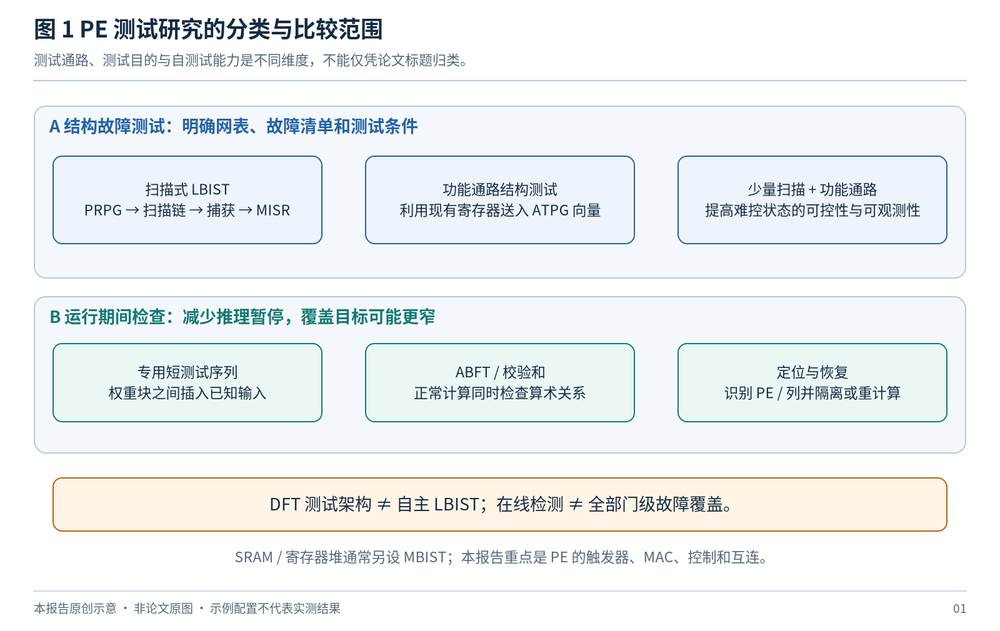

*图 1：本报告采用的分类。分类维度不能替代故障清单和实验条件。*

### 1.3 证据等级

| 等级 | 本次实际核验到的材料 | 可支持的结论 |
|---|---|---|
| A | 原始论文全文、作者公开全文或公开预印本 | 可检查结构、故障假设、实验设置与结果；仍需标明预印本状态 |
| B | 出版社、作者机构或会议官网的原始摘要 | 可引用摘要明确陈述的内容；不能补写未公开的故障清单或实现细节 |
| C | 作者机构论文目录、正式题录 | 仅确认论文存在、题目、作者和出版信息；不据此宣称性能优势 |
| P | 公开专利说明书 | 说明工业界公开提出的技术方案；不是量产证据或独立实测结果 |

证据等级不是论文质量排名。某篇高质量期刊论文在本次调研中只有摘要可访问，仍标为 B。全文预印本标为 A，也不代表已经同行评审。

## 2. 典型 PE 的结构与实际测试对象

### 2.1 WS 与 OS：相同 MAC，不同状态可控性

对代表性的权重驻留结构（Weight-Stationary，WS），可写为：

$$
p_{r+1,c}(t+1)=p_{r,c}(t)+a_{r,c}(t)w_{r,c}.
$$

权重保存在本地，激活值沿行传播，部分和沿列传播。公式只是说明一种常见组织；实际设计可能把部分流水寄存器放在 Tile 间，或把累加存储放在阵列外。Gemmini 的官方说明明确区分 PE、Tile 和 Mesh，并支持 WS/OS，因此不能把“每个 PE 的每条连接都带寄存器”当作通用事实。[R24](#r24)

对输出驻留结构（Output-Stationary，OS），代表性计算为：

$$
acc_{r,c}(t+1)=acc_{r,c}(t)+a_{r,c}(t)w_{r,c}(t).
$$

WS 的测试难点在于本地权重能否独立设置、部分和是否能可靠传播到观察点；OS 则更突出累加初值、反馈路径、保持、清零与读出过程。两类 PE 都必须检查转发寄存器，而不只是算术结果。

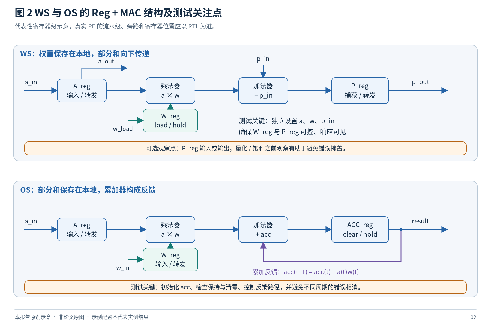

*图 2：WS 与 OS 的代表性 Reg + MAC 结构。省略了不同实现中的部分旁路、多精度与握手逻辑。*

### 2.2 “Reg + MAC”至少包含六类测试对象

| 对象 | 需要验证的行为 | 常见观察盲区 |
|---|---|---|
| A/W 输入、保持和转发寄存器 | 每一位的 0/1 存储、加载、保持与传递 | 只做数值 MAC，可能漏掉未被使用的转发路径 |
| 乘法器 | 部分积、符号处理、压缩与进位逻辑 | 固定权重使内部某些逻辑长期无法被激活 |
| 加法器与累加器 | 加法、进位、反馈、初值、清零和保持 | 错误在后续累加中相消，或在截断后消失 |
| 控制逻辑 | valid、enable、load、clear、mode、MUX 选择 | 单一运算模式下看似正常，其余模式存在故障 |
| PE 间连接 | 位传递、方向、时序与接收端控制 | 最终列输出不能直接识别故障所在行 |
| 测试电路本身 | PRPG、计数器、MISR、参考签名、状态机、状态寄存器 | 被测逻辑出错，而损坏的检查器仍报告通过 |

需要区分以下故障层次：寄存器位永久固定、门级节点 stuck-at、转换故障、物理路径延迟故障、桥接或开路缺陷、瞬态翻转，以及只在算术结果上人工添加的数值误差。后两者可用于运行期间可靠性研究，但不能自动替代门级结构故障评价。

### 2.3 阵列输出可见，不等于故障位置可见

在以下 4 × 4 示例中，某一列的输出异常只能直接说明该列参与的计算存在问题。要确定故障 PE 的行号，必须引入不同的行激励、隔离机制、额外观察或满足条件的代数编码。

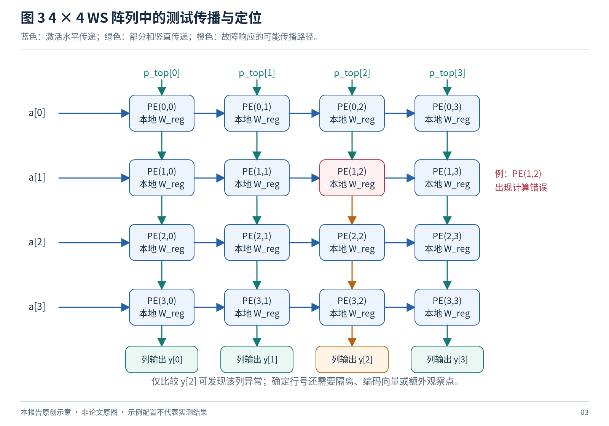

*图 3：示例中的红色 PE 不代表特定物理故障模型；橙色路径仅表示错误可能传播的方向。*

## 3. 研究演进：从阵列扫描到运行期间定位

本次检索到的工作可以归纳为三条并行演进线，而不是相互替代的单一路线。

**第一条是结构测试的规模化。** 选择性扫描、主从式测试分发和 C-Testing 利用相同 PE 重复出现的特点，把大量工作留在单 PE 上完成，再通过规则结构送入阵列。其重点是减少测试生成、数据传输与扫描成本。[R01](#r01)[R03](#r03)[R04](#r04)

**第二条是功能通路与低功耗测试。** STRAIT、零附加硬件测试和 Robust Test Architecture 尝试利用既有寄存器、复位与时钟控制，降低额外结构成本。但“额外门很少”依赖原架构已有条件，不代表整个自主 BIST 系统没有发生器、控制器和响应处理开销。[R05](#r05)[R08](#r08)[R10](#r10)

**第三条是短时检查、故障定位和恢复。** RunSAFER、稀疏阵列周期测试、Runtime Fault Localization、FLARE 和 RePAIR，分别从指令支持、专用输入、校验和、代数向量及恢复机制出发。它们对在役检测很有价值，但必须核对各自的故障假设。[R07](#r07)[R11](#r11)[R12](#r12)[R14](#r14)[R15](#r15)

### 3.1 文献总览

下表只保留用于判断研究位置的信息。数值条件另见第 4 节，不能将“100%”跨行直接比较。

| 编号 | 工作及时间 | 核心机制 | 与 PE-LBIST 的关系 | 证据 |
|---|---|---|---|---|
| R01 | Test Architecture，2021 | 选择性扫描、既有 A/W 通路、结构向量 | 直接相关的 PE 测试结构 | A |
| R02 | Time-Multiplexed LBIST，2021 | 子阵列分时测试与时钟控制 | 直接相关的低功耗 LBIST | A |
| R03 | Master–Slave Test，2021 | 主 PE 串行装载、从 PE 并行装载 | 降低阵列扫描成本 | A |
| R04 | C-Testing，2022；2021 在线 | 单 PE ATPG、可重构扫描、分层压缩 | 阵列结构测试与诊断 | B |
| R05 | STRAIT，2023 | 功能通路形成扫描、测试与恢复 | 结构测试与 PE 处理 | B |
| R06 | Fixed-Point MAC BIST，2023 | 单 MAC BIST、IEEE 1687 访问 | 最直接的 MAC 单元实现参考 | B |
| R07 | RunSAFER，2023 | 指令支持的运行期间检查 | 邻近：功能检查而非完整扫描 LBIST | B |
| R08 | Zero-Overhead Test，2024；2023 在线 | 利用复位和结构重复性 | 低附加硬件测试 | B |
| R09 | Fault-Location LBIST，2024 | one-hot 生成与阵列分区 | 直接相关的定位型 LBIST | B，技术报告 |
| R10 | Robust Test Architecture，2025；2024 在线 | 功能通路与既有门控结构 | 低功耗结构测试 | B |
| R11 | Periodic Online Testing，2025 | 每个权重块插入短测试 | 稀疏阵列在线检查 | A |
| R12 | Runtime Fault Localization，2025 在线 | 正常计算中形成校验与定位信息 | 运行期间诊断 | B |
| R13 | Functional-Path BIST，2026 | 题名针对功能路径 BIST | 直接相关，细节尚未充分核验 | C |
| R14 | FLARE，2026-05 预印本 | 代数测试向量、权重错误定位 | 受限故障模型下的快速定位 | A，预印本 |
| R15 | RePAIR，2026-09 | 检查指令与 FPGA 局部重配置 | 邻近：瞬态错误恢复体系 | B |
| R16 | Workload-Aware Self-Testing，2026-10 | 选择影响任务的故障及对应向量 | 应用相关测试缩减 | B，会议官网摘要 |
| R17 | Optimized Fault-Tolerant Module，2026 | 专用计算模块与容错组织 | 邻近：不等同通用 MAC LBIST | A |
| R18 | Test and Yield Loss Reduction，2020 预印本 / 2022 期刊 | 故障影响与产品分级、PE 隔离 | 邻近：测试接受目标的改变 | A，公开稿 |
| R19 | Non-Interruptive Runtime LBIST，2026-01 公开 | 静态指令间空闲窗口执行测试 | 工业界公开的运行期间 LBIST 方案 | P |

## 4. 关键研究的实际贡献与适用限制

### 4.1 选择性扫描：对 Reg + MAC 最直接的启发

Solangi 等将激活与权重加载交给已有数据路径，将较难控制的部分和状态保留为扫描对象，响应通过后继 PE 或末端寄存器捕获，并讨论双向量测试。它不是“用正常推理顺便测一下”，而是重组结构测试向量的进入方式。文中的单 PE 数据通路实验不能直接等同于全部阵列控制与互连的覆盖率。[R01](#r01)

**本报告分析：** 这种路线的价值在于把测试成本与状态可控性联系起来。能快速、独立通过功能端口设置的寄存器，不必默认全部扫描；但任何被省略的扫描位，都应有可验证的替代设置和观察方法。

### 4.2 分时 LBIST 与主从装载：分别处理功耗和扫描活动

Time-Multiplexed LBIST 将阵列划分为子阵列，利用分时控制限制同时活动范围。原方案包含响应比较结构；不能把它概括成“每块各放一个 MISR”。其 NPU 示例还加入了测试点，因此只引用时钟控制器面积会低估整体附加成本。[R02](#r02)

Master–Slave 方法让一个 PE 接收串行扫描数据，再向相邻 PE 并行装载，减少每个从 PE 的长串行移位活动，并支持逐步读出定位。它是测试分发结构，不是仅凭该结构就具备了完整片上自主测试能力。[R03](#r03)

**本报告分析：** 两者都利用重复结构，但瓶颈不同。前者限制同时活动的区域，后者改变模式装载方式。联合使用之前，应检查装载额外周期、局部捕获峰值与比较器成本是否抵消收益。

### 4.3 C-Testing：把测试生成规模降到单 PE

C-Testing 在 PE 级进行 ATPG，结合可重构扫描和分层响应处理。其摘要给出 256 × 256 阵列相对传统方案的结果：stuck-at 模式数、ATPG 时间、测试周期最多分别减少 4.2、1530、170 倍；transition 对应 3.5、2388、142 倍，同时保持原有覆盖率。这些是特定基线下的“最多”结果。[R04](#r04)

**本报告分析：** “测试生成与 PE 数量解耦”不意味着任意规模的总执行时间都不变。实际带宽、捕获功耗、分区数、响应读出和跨 Tile 连接仍可能随阵列扩大而增长。

### 4.4 STRAIT、零附加硬件与 Robust Test Architecture

STRAIT 利用功能通路构成扫描结构，并把故障诊断与恢复结合；公开摘要对其评估的 stuck-at 和 transition-delay 故障报告完全覆盖。该工作不能称为“完全没有扫描”的测试。[R05](#r05)

Zero-Overhead Test 利用复位与结构重复性，针对 MAC 和比较器提出测试方案。摘要中的零附加硬件是相对给定架构的结论；本次可见摘要没有足够信息把其覆盖率进一步拆成全部故障模型。[R08](#r08)

Robust Test Architecture 同样利用功能路径和时钟门控，摘要报告目标 stuck-at 与 transition-delay 故障的完全覆盖。其“一个 AND 门”的说法必须与既有低功耗结构一起理解，不是整个 PRPG、MISR、控制、时钟和访问网络的总代价。[R10](#r10)

**本报告分析：** 对这些方案复现时，应同时报告“原功能设计”“带已有门控/复位能力的基础设计”“增加测试功能后设计”三者的差异。否则不同论文的面积百分比没有共同分母。

### 4.5 单 MAC BIST：实现切入点，而非覆盖率上限

Grout 的工作直接面向定点 MAC，结合 IEEE 1687 访问、综合前 Verilog 故障仿真及 FPGA 原型验证。它适合研究单元级 BIST 接口、控制和验证组织；公开摘要不足以证明其已经获得完整 ASIC 门级故障覆盖。[R06](#r06)

**本报告分析：** 对小型 PE 而言，每个 PE 独立放置 PRPG 和 MISR 的相对成本可能很高。因此应区分“便于验证的独立单元原型”与“适合成千上万个 PE 的最终阵列实现”。

### 4.6 定位型 LBIST：不能省略故障极性

2024 年 IEICE 技术报告利用 one-hot 测试生成与阵列分区，目标是识别故障 PE。其英文摘要明确写的是 stuck-at-0 检出率接近 100%；不能改写成全部 stuck-at-0/1、控制和时序故障均被覆盖。[R09](#r09)

**本报告分析：** one-hot 可以帮助隔离某一路或某个位的贡献，但对进位产生、符号扩展、相邻位交互和任意乘法器压缩结构，不应预设充分性。定位向量与高覆盖率向量可以分开设计。

### 4.7 稀疏阵列在线测试：最值得关注的覆盖限制

Periodic Online Testing 的实验对象是 **8 × 8、INT16、32 位累加**的稀疏阵列。每次加载权重块后插入四个测试向量，报告 ResNet50、DenseNet121、VGG16 的**累计** stuck-at 覆盖率分别为 94.2%、94.3%、94.1%，应用延迟增加约 2%、1%、0.5%，面积增加约 3%。未覆盖故障主要涉及固定权重未能激活的乘法器内部逻辑。[R11](#r11)

**本报告分析：** 此处的“累计”非常重要。相同四个输入作用于不同权重块，才形成更多内部测试条件。一次四向量检查、一个权重块的检出率，以及整段应用积累的检出率，是三个不同指标。

### 4.8 RunSAFER 与运行期间 PE 定位

RunSAFER 用指令支持的检查进入运行流程，原始摘要给出的固定附加成本是每次矩阵乘法 **3 个周期**，而不是后续部分比较表中的其他计数。[R07](#r07)

Runtime Fault Localization 使用正常计算数据形成校验与定位信息，摘要对 256 × 256 阵列报告小于 2% 的面积增加，以及对其注入故障集合的完全检测与定位。本次没有取得足够的完整实验条件，不能把这个结果扩展为任意多故障或全部门级故障。[R12](#r12)

**本报告分析：** “无需专用测试向量”与“能检出全部永久缺陷”不是等价命题。正常应用可能从未触发某些逻辑条件；完整自测试仍有必要主动控制这些状态。

### 4.9 FLARE：代数定位很有启发，但不是通用 MAC LBIST

FLARE 是 2026 年 5 月公开的预印本，主要研究 WS 阵列权重寄存器的永久错误。利用有界误差与测试向量的代数关系定位 PE，关键条件包括每列至多一个故障 PE、错误在测试中被激活、无破坏推导的溢出，以及其他相关路径正常。其一轮或两轮是测试向量轮次，不是完整阵列的总时钟数。[R14](#r14)

**本报告分析：** 数学可辨识性与电路可检测性需要分别证明。编码可以区分“哪一行的权重发生错误”，却不自动激活乘法器任意内部节点，也不自动检测损坏的定位检查器。

### 4.10 2026 年的新公开工作

Functional-Path BIST 论文的题名、作者、会议与 DOI 已在作者机构页面核验。本次未取得足以核对故障清单的原始全文或完整原始摘要，因此不沿用二手页面上的规模、开销或覆盖率宣传，暂作为继续追踪的直接相关文献。[R13](#r13)

RePAIR 于 **2026 年 9 月 8 日**在 ACM 页面标注发表，将运行期间检查与 FPGA 动态局部重配置结合。它说明检测、状态保存和恢复需要协同设计，但 FPGA 配置存储故障恢复不能直接迁移成 ASIC PE 的 LBIST 结论。[R15](#r15)

BEC 2026 官方摘要公布了工作负载感知测试：在 OS 阵列上选择对任务影响大的故障及其测试向量，LeNet-5 和 ResNet-8 的向量数分别减少 63.2% 与 64.4%。这是对选定目标集合的缩减，不能理解为保持所有结构故障覆盖率的通用压缩结果。[R16](#r16)

### 4.11 相邻研究的价值与不能越过的适用范围

PLOS One 2026 的专用容错数据处理模块，报告了 PE 输入寄存器 stuck-at-1 的相关检测结果。其模块结构与通用完整乘法 MAC 不同，因此不能拿来证明普通 MAC 内部逻辑的覆盖能力。[R17](#r17)

Sadi 与 Guin 将硬件故障的影响与任务精度、PE 隔离和产品分级联系起来。它提醒研究者区分“电路存在故障”和“是否接受该产品”，但任务容错不能反向证明未检出的结构故障不存在。[R18](#r18)

### 4.12 数值结果的使用约束

| 经常看到的表述 | 本报告采用的准确解释 |
|---|---|
| 100% coverage | 对作者声明并实际评估的故障清单；不自动包含全部物理缺陷 |
| constant testing | 可能指固定的 PE 级模式或生成工作，不自动包含传输、分区和恢复时间 |
| zero overhead | 必须说明是附加面积、专用硬件、时延还是其他指标，以及基础设计含有什么 |
| 3 cycles / 4 vectors | 向量数与附加时钟数不是同一个量；还要明确是否包含权重加载和流水排空 |
| one-shot / one round | 可能只表示一次向量集合，不等于一个芯片时钟 |
| all injected faults detected | 只覆盖实际注入的样本和注入层次，不能替代完整目标故障集合 |
| low power | 必须给出工艺、频率、活动条件和估计方法，不能只依据活动 PE 数量推算实测功率 |

## 5. 典型测试架构的实现路径

### 5.1 扫描式 LBIST：覆盖率与可控性的参考方案

典型扫描式 LBIST 使用伪随机模式发生器（PRPG）和相位扩展电路驱动多条扫描链，执行移位、功能捕获，再将响应送入多输入签名寄存器（MISR）。确定性补充模式、重播种、未知值处理和测试点可以与此组合；商用产品也提供相应混合机制。[R20](#r20)[R21](#r21)[R22](#r22)

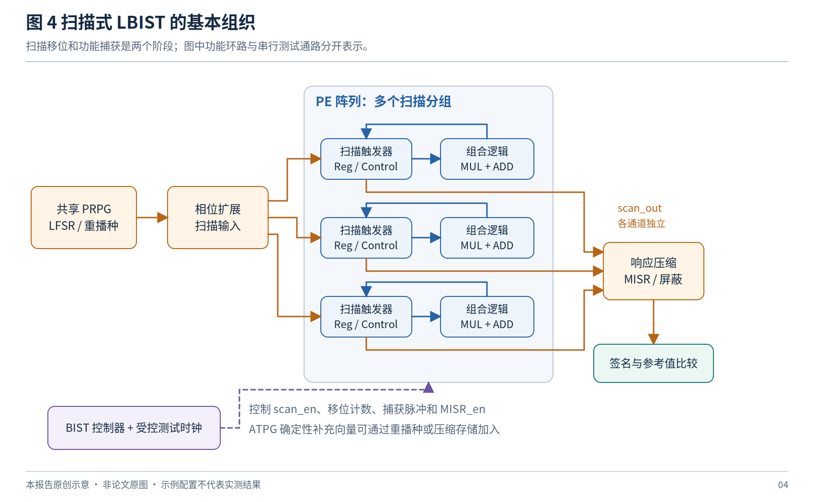

*图 4：橙色表示测试装载与响应收集，蓝色表示功能捕获关系。多条 scan_out 为独立通道，不是物理短接。*

对 NPU 而言，它的主要优点是能够直接控制、观察大量内部状态，便于为完整故障清单建立基准。代价则来自扫描触发器、连接、移位周期、活动功耗与诊断数据处理。要公平评价新结构，应把“全扫描确定性 ATPG”和“全扫描伪随机 LBIST”分成两个基线：后者覆盖不足，不能说明前者也无法检测相应故障。

### 5.2 选择性扫描：按实际可控性选择寄存器

对于可以通过功能端口独立加载的 A/W 状态，可首先评估复用其加载和转发过程；对于难以通过正常运算设置的 P/ACC 状态、控制触发器或反馈状态，再考虑选择性扫描或测试点。这与 R01 的主要结构思想一致，但具体选择应重新由目标 RTL 和网表决定。[R01](#r01)

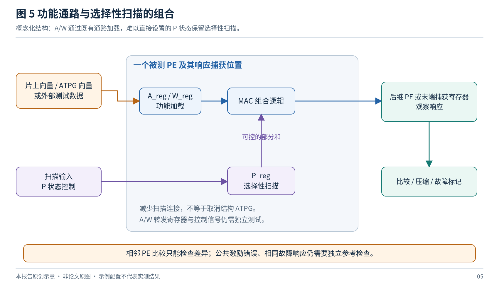

*图 5：不是要求所有设计都只扫描 P_reg，而是说明按状态可控性分配测试能力。*

**工程判断方法：** 对每个计划不扫描的寄存器，建立“设置所需状态的最短合法序列”和“将故障传播到观察点的序列”。若只能同时改变多个寄存器、或某些状态根本不可达，必须检查这是否破坏目标结构向量。不要用“它有正常加载接口”替代证明。

### 5.3 纯功能路径 BIST：硬件简单，覆盖责任更重

一种概念性结构是：测试发生器选择 A/W/P 输入，控制清零和使能，经正常 MAC 路径计算，最后观察原始结果或签名。这种方案避免完整扫描移位，但它必须解决以下问题。

| 问题 | 设计时需要回答的内容 |
|---|---|
| 状态初始化 | 所有会影响结果的触发器、流水状态和累加值是否确定 |
| 权重控制 | WS 下能否覆盖每一个 W_reg，是否存在广播导致的相关性 |
| 响应读出 | 能否在错误被后续算术处理掩盖前观察 |
| 控制测试 | clear、hold、load、旁路和模式选择是否真正切换过 |
| 多种配置 | 位宽、符号、舍入、饱和和流水级变化后，参考签名是否同步变化 |
| 故障评价 | 缺失覆盖来自状态不可控、逻辑未激活、传播受阻还是压缩别名 |

它适合作为低成本候选或在线补充，而不是在未做结构故障验证时直接取代完整测试。

### 5.4 Tile 共享与分时安排

每个 PE 配置一套独立发生器与压缩器，便于局部验证，但会重复消耗状态位、组合逻辑与访问结构。一个更合理的待评估选择是以 Tile 为共享单位：全局或局部 PRPG 分发激励，Tile 内收集响应，失败后进入更细粒度观察模式。

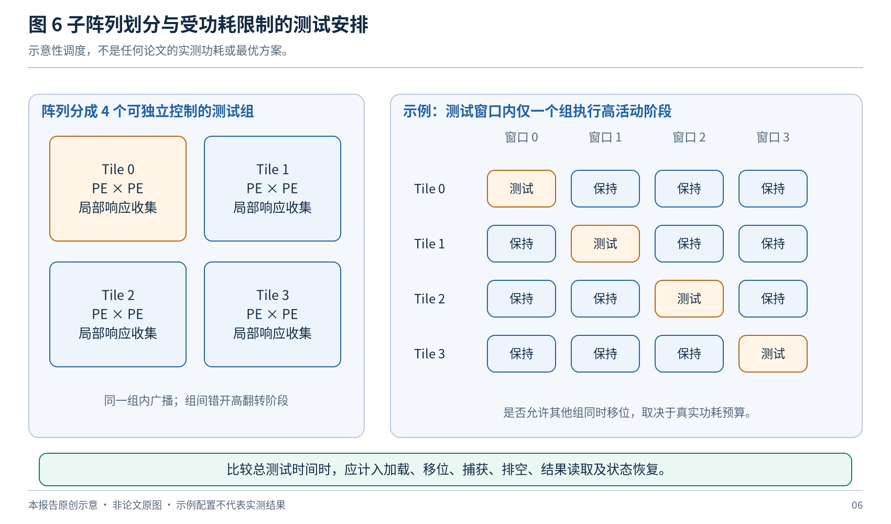

*图 6：分区降低同时活动范围，也可能增加总测试时间；实际结论取决于能否重叠加载、捕获与读出。*

Tile 的选择不应只看 PE 数量。更重要的是局部时钟可控范围、数据注入端口、输出读取带宽、测试点位置，以及不同区域之间的物理连接。跨 Tile 通路必须有明确的测试模式，否则局部全部通过仍可能遗漏阵列连接故障。

## 6. MAC 的测试向量与结构覆盖

### 6.1 随机输入为什么可能不够

故障被检出至少需要三个条件：被激活、传播至可见响应、没有在压缩中被掩盖。用条件概率可以写为：

$$
P(D_f)=P(A_f)\,P(O_f\mid A_f)\,P(C_f\mid A_f,O_f).
$$

其中 $A_f$ 表示故障被激活，$O_f$ 表示产生可观察差异，$C_f$ 表示压缩结果仍能区分。该式是事件分解，并不假设三者独立。PRPG 增加向量数量只能改善其能够访问的状态空间；不能解决无法加载某个权重、无法打开某个门控或输出被固定掩蔽的问题。

稀疏阵列在线测试中固定权重造成的乘法器覆盖不足，是这种限制的实际例子；但具体缺口仍应在自己的综合后乘法器上重新评估。[R11](#r11)

### 6.2 定向向量应作为候选族，而不是未经验证的完整解

| 测试目标 | 可尝试的向量或操作 | 仍需验证的内容 |
|---|---|---|
| A/W/P 寄存器 | 全 0、全 1、walking-1/0、交替位型、加载后保持 | 寄存器每位、控制输入及转发路径是否真正可观察 |
| 无符号乘法基础行为 | 0、1、单比特值、稀疏与稠密位型组合 | 内部压缩节点、进位和不同实现结构的覆盖 |
| 有符号乘法 | 正负组合、最小负数、最大正数、符号变化 | Booth 编码、符号扩展、边界值及模式选择 |
| 加法与累加 | 产生进位、传播进位、终止进位；正负累加序列 | 每一级进位逻辑及反馈、保持和清零 |
| 多精度与分段 | 分别覆盖各精度模式、拼接与分割选择 | 模式间共享逻辑和被关闭的位段 |
| 稀疏与零跳过 | 非零计算、零跳过、跳过后恢复、连续有效 | 零检测、选择器和门控本身是否受到测试 |

以一个 $n$ 位加法器为例，选择某一位产生进位、其后若干位传播进位，可以形成受控的进位路径测试。可用位关系描述：产生位取 $a_i=b_i=1$；传播位取 $a_j\oplus b_j=1$；终止位可取 $a_k=b_k=0$。这是向量构造思路，不是对任意综合加法器的完备故障覆盖证明。

对有符号位宽必须特别谨慎。例如 INT8 的位型 `0x80` 表示 −128，不是 +128；walking-one 是位模式，不总是一个正数测试值。W4A8 的 4 位权重必须按其符号规则扩展，不能简单截取 INT8 测试向量后沿用原参考值。

### 6.3 混合向量生成的可执行步骤

首先在真实网表上建立全扫描 ATPG 参考故障集合；再用基础 PRPG、候选定向向量和控制序列做故障仿真。对未检出故障逐类分析，决定补充确定性向量、增加重播种种子，还是增加局部控制与观察点。最后重新评价全部故障，而不是只检查原先残留的故障。

可将选择测试向量形式化为带成本的集合覆盖问题。设 $D_{fp}=1$ 表示模式 $p$ 可以检测故障 $f$，$z_p$ 表示是否选用该模式：

$$
\min \sum_p c_p z_p,\qquad
\sum_p D_{fp}z_p\geq 1,\quad \forall f\in F_{\mathrm{target}}.
$$

这里 $c_p$ 可以包含模式存储、装载和执行成本。**$D_{fp}$ 必须来自故障仿真或有依据的结构分析，不能从算术输入的“看起来全面”推断。** 若按任务影响加权而允许部分故障不覆盖，应同时公开未覆盖集合，不能继续使用“完整结构覆盖”的措辞。

### 6.4 重复结构上的复用条件

单 PE 的向量能否在全阵列复用，取决于 PE 是否真正相同。边缘 PE、不同流水级、融合了激活函数的末端 PE、不同位宽区域、跨 Tile 寄存器，都可能需要不同的故障清单和向量集。布局布线也会改变时序路径；同样的逻辑模式不能代替逐类物理时序验证。

## 7. 响应压缩、别名与故障定位

### 7.1 必须区分四种漏检原因

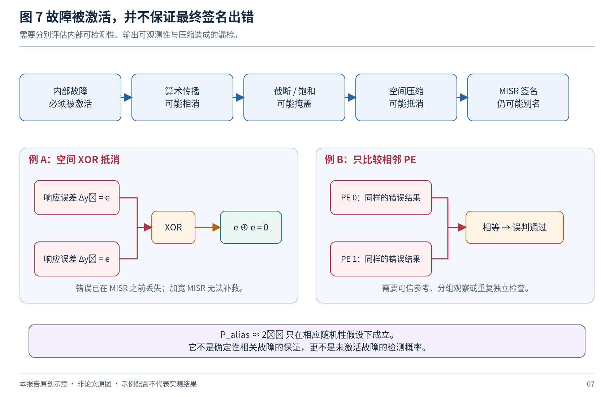

*图 7：错误可能在进入 MISR 之前已经消失；后端签名更长并不能解决所有问题。*

**逻辑未激活。** 两个操作数没有形成必要的内部状态，故障电路与正确电路产生相同结果。

**算术或输出掩盖。** 先前误差被后续加法抵消，错误只发生在被截去的低位，或不同结果在饱和后变成同一输出。

**空间抵消。** 两个输出具有相同异或误差 $e$，则 $e\oplus e=0$。若先把它们异或成一个值，后面的 MISR 无法恢复已经丢失的信息。

**时间压缩别名。** 原始响应不同，但在给定压缩多项式和时间序列下得到相同签名。常见的 $2^{-m}$ 近似需要相应的随机性和分布假设，不能当作所有确定性故障的严格上界。

### 7.2 比较相邻 PE 的局限

相邻 PE 在相同测试条件下产生不同响应，能够快速指出不一致；但若公共输入错误、公共控制错误或多个 PE 产生同样的错误值，仅比较彼此可能全部通过。因此需要可信的参考签名、阶段性已知答案检查或其他独立证据。比较器、参考数据和错误状态寄存器本身也必须纳入测试。[R23](#r23)

### 7.3 建议的两级观察方式

**快速模式**采用 Tile 或列级压缩，在较短周期内判断是否异常。**诊断模式**对失败区域重跑，逐组开放观察点、读出局部原始响应，或使用满足故障假设的行列编码。二者共享主要数据路径，但具有不同观察粒度。

这样可以把“低成本发现问题”与“高粒度定位问题”分开优化。不能假设一次签名不匹配就足以准确指出某个 PE；反之，能定位某类权重错误的编码，也不能自动完成完整逻辑检测。

### 7.4 应记录原始响应和签名两个检测集合

设 $F_{\mathrm{raw}}$ 是原始响应可检测的故障集合，$F_{\mathrm{sig}}$ 是签名可检测的故障集合。除总覆盖率之外，还应记录：

$$
F_{\mathrm{compression\ loss}}=F_{\mathrm{raw}}\setminus F_{\mathrm{sig}}.
$$

如果漏检在原始响应中已经存在，应优化激励和观察路径；如果只在签名中丢失，再优化压缩、分组和诊断模式。这个分解能避免把所有问题都归咎于 MISR 位数不足。

## 8. 时序、功耗与运行期间测试

### 8.1 转换故障测试不是“让 MAC 跑得快一点”

转换故障测试需要明确的两向量关系、转换发起与捕获时刻，以及目标频率。在 Launch-on-Capture 场景中，先扫描装入初始状态，再用功能脉冲发起和捕获转换。功能通路分发方案还必须保证每个 PE 在捕获时看到预定的第二向量，不能忽略脉动传播的时间差。[R01](#r01)

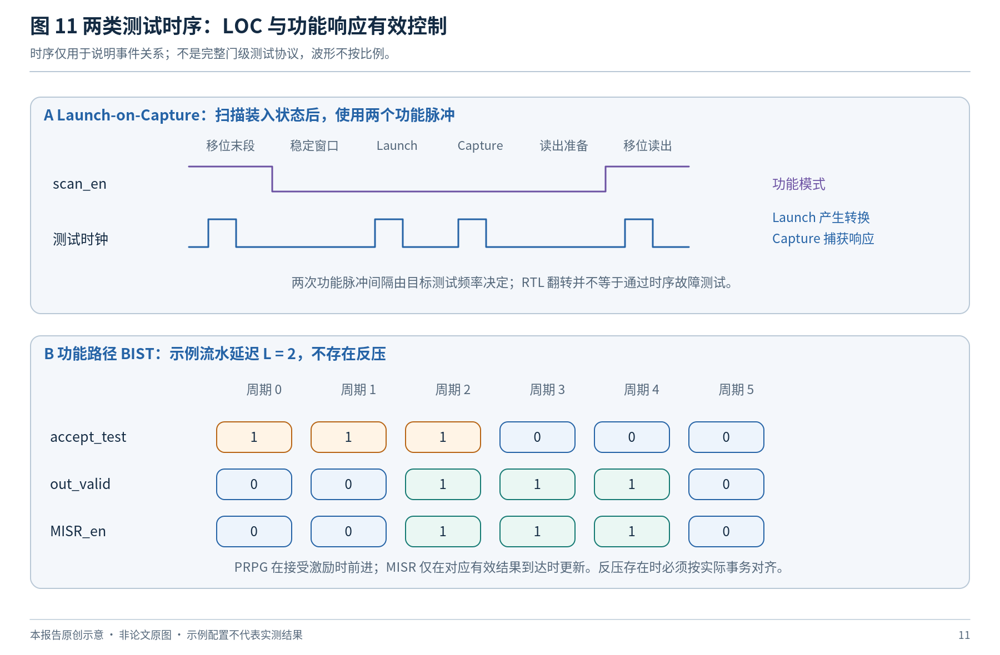

*图 11：上半部分表示 LOC 的事件关系；下半部分说明功能路径 BIST 中激励接受与输出有效之间的延迟。*

RTL 级零延迟仿真中的信号翻转不是 transition fault 覆盖证明。应分别使用支持该故障模型的 ATPG / 故障仿真，检查测试时钟约束，并在需要时结合延迟回标与实现后的时序分析。转换故障模型也不等同于任意路径延迟、桥接或单元内部缺陷模型。

### 8.2 控制时钟应使用完整的时钟设计方法

测试结构需要考虑扫描使能切换、测试脉冲、门控使能稳定性、复位释放与跨时钟域访问。论文概念图中的 AND 门不能直接作为任意 RTL 组合门控的实现建议；实际设计应使用适配工艺与流程的门控单元、受控测试时钟和完整约束。

对于有多个电源或时钟域的 NPU，还要定义哪些域在测试中保持供电、隔离或复位。若某个域关闭，其输出不能以未知状态进入 MISR。未知值屏蔽可用于必要场景，但被屏蔽的故障覆盖损失必须单独记录。

### 8.3 测试时间必须有完整组成

对一个需要进入独立测试模式的方案，总时间可以写成：

$$
T_{\mathrm{total}}=T_{\mathrm{enter}}+T_{\mathrm{save}}+T_{\mathrm{init}}
+\sum_g T_{\mathrm{group},g}+T_{\mathrm{check}}+T_{\mathrm{restore}}.
$$

每组的时间还包含向量装载、移位或传播、捕获、响应排空及结果读取。某些部分可以重叠，但应根据实际时序计算，而不是简单把模式数乘以一个固定周期数。

低功耗测试可以采用分区、交错捕获、受控移位和向量活动限制等方法。调度优化的输入应来自实际活动与功耗估计；“同时启用的 PE 减半”并不严格意味着峰值功耗减半，因为时钟树、共享网络和局部翻转都可能占据重要比例。

### 8.4 在线测试应明确“在线”的具体含义

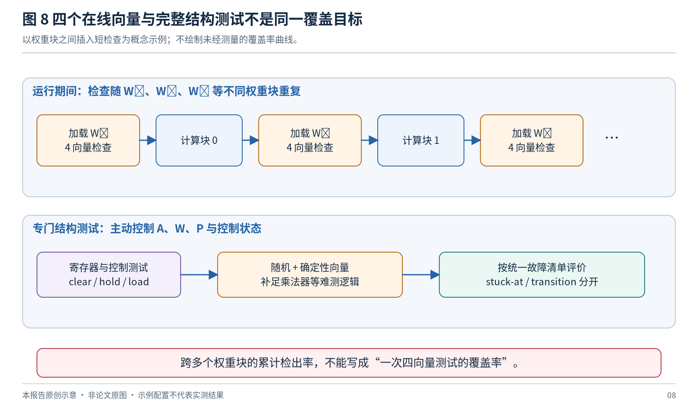

*图 8：短测试序列可以随权重变化逐步扩大覆盖，但不能把累计结果归给单次检查。*

“运行期间”至少有三种情形：空闲时暂停业务做完整测试；在权重块或算子间插入短测试；正常计算同时生成校验。它们对暂停时间、故障检测延迟和硬件成本的约束不同。

若允许每次只测试一部分逻辑，还应报告一个故障从发生到被检测的最长等待时间，以及连续繁忙时能否保证测试机会。某个 PE 在当前任务中不活跃，不代表它没有保存有效状态，也不代表其转发路径可以任意改写。

## 9. 工业资料与目前能够确认的趋势

### 9.1 商用 EDA 的启发

Synopsys TestMAX XLBIST 的官方资料涉及确定性压缩测试、未知值处理和重播种等能力；Siemens 的混合式方案强调扫描压缩与 LBIST 资源共享，并通过观察扫描技术改善测试效率。这些资料说明混合式测试有成熟工具支持，但不能据此推断某家 NPU 的内部具体 PE-LBIST 结构。[R20](#r20)[R21](#r21)[R22](#r22)

一个常被忽略的工业要求是**测试逻辑也会出错**。PRPG 停止、计数器提前结束、MISR 不更新、参考签名损坏或状态寄存器卡在 PASS，都可能使坏电路看似通过。官方混合测试资料也专门讨论 DFT 逻辑的测试问题。[R23](#r23)

### 9.2 2026 年公开的工业专利方向

Sima Technologies 名下公开的 US20260023667A1 于 **2026 年 1 月 22 日**公布，描述在机器学习加速器的静态指令块之间安排 LBIST，并由管理逻辑利用计算单元空闲窗口执行检查，以避免破坏原静态调度。[R19](#r19)

这提供了一个重要的软件—硬件协同方向：编译器或运行时暴露可用窗口，硬件保存测试进度并执行可分段检查。但专利公开不代表已经量产，也没有独立证明任意任务下都存在足够空闲时间。本报告不作专利有效性、权利范围或侵权判断。

### 9.3 已形成的趋势与尚不能确认的结论

可以从多项研究共同确认的方向，是复用重复 PE、减少额外测试连线、降低测试活动、提升局部观察，以及把检测与定位、隔离和恢复联系起来。2026 年的应用相关向量缩减与空闲窗口 LBIST，又把测试安排与软件执行计划连接起来。[R01](#r01)[R04](#r04)[R10](#r10)[R12](#r12)[R16](#r16)[R19](#r19)

但公开材料尚不足以证明某一种结构已成为所有商用 NPU 的统一实现。尤其不能仅根据通用工具宣传推断 NVIDIA、Google TPU 或其他厂商采用了某个具体 PE 级 PRPG/MISR 组织。对此应保持“未取得可核验公开证据”的状态，而不是补写架构细节。

## 10. 面向 Reg + MAC 的建议研究架构

### 10.1 目标与基本选择

以下是本报告的**待验证设计建议**：在不为每个 PE 完整复制 BIST 电路的前提下，使寄存器、乘法器、加法器、控制和相邻连接具有足够的可控性与可观测性，并支持快速检测和细化诊断两种模式。

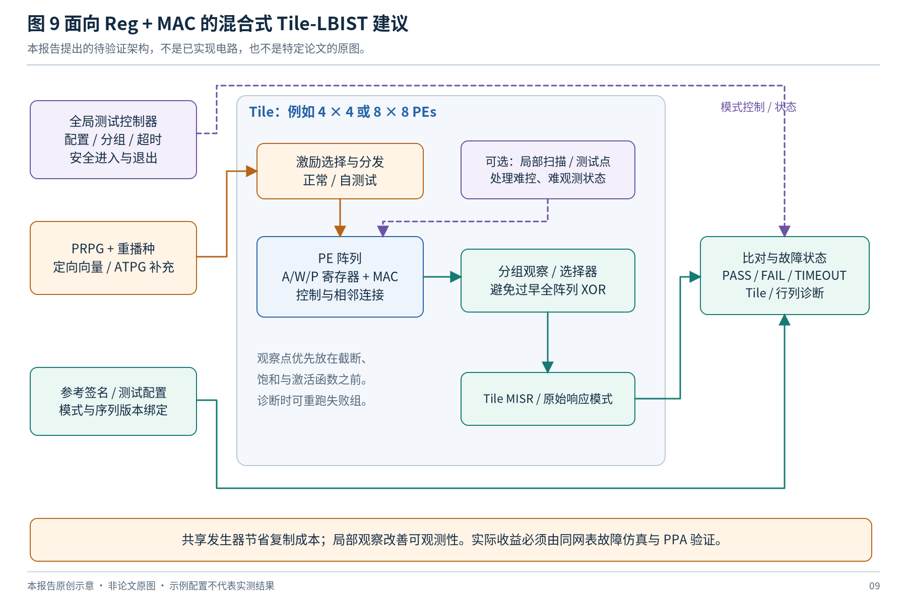

*图 9：全局控制、共享激励、局部测试点与分级观察的概念架构。示意图未画出所有时钟与控制连接。*

建议保留四类能力：可重播种的伪随机激励；针对难测故障的确定性补充；少量必要的局部扫描或测试点；可切换观察粒度的 Tile 响应处理。具体采用多少 PRPG、多少 MISR、哪些寄存器扫描，不应在故障分析前固定。

### 10.2 最小配置与状态接口

| 类别 | 建议记录或控制的信息 | 原因 |
|---|---|---|
| 被测配置 | PE 类型、精度、数据流、Tile 范围、流水配置 | 同一签名不能跨任意配置复用 |
| 向量配置 | 测试族、种子、模式版本、向量数量 | 保证可重复执行 |
| 观察配置 | 观察组、压缩多项式、初值、有效结果数量 | 明确签名对应的序列 |
| 时序配置 | 装载方式、捕获模式、周期预算 | 防止丢样、提前结束和无限等待 |
| 结果 | 完成、通过、失败、超时、未知状态、诊断位置 | 不能把所有异常压成一个 PASS/FAIL 位 |

对于参考签名，至少应绑定如下配置元组：

$$
G=(\text{RTL版本},\text{测试版本},\text{模式},\text{位宽},\text{种子},\text{初值},\text{观察顺序},\text{有效结果数}).
$$

若改变 PRPG 步进规则、流水长度、饱和模式或输出顺序，必须重新生成并验证相应参考结果。

### 10.3 执行过程

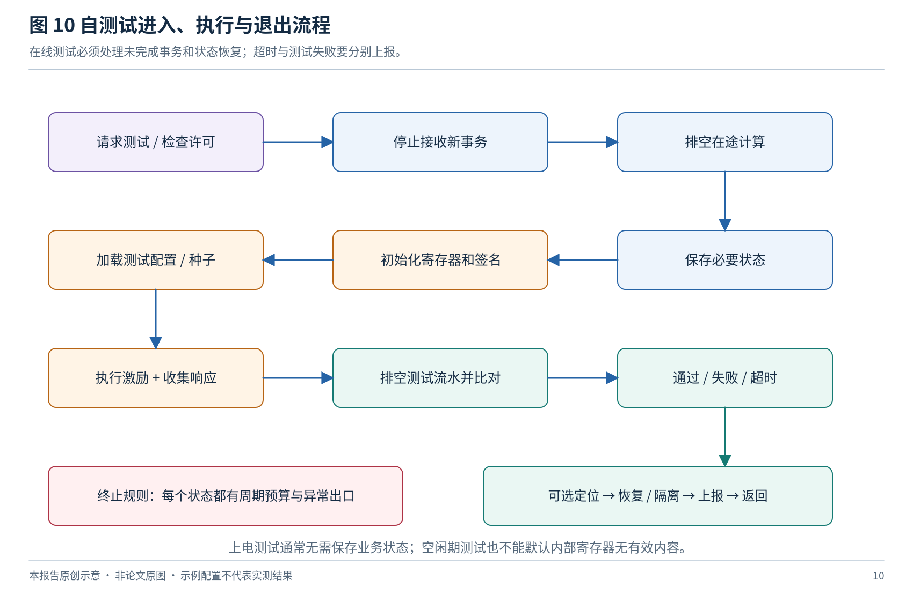

*图 10：完整执行流程。实际工程可以省略不需要的保存操作，但必须有明确依据。*

进入测试前停止接收新事务，等待在途计算完成；保存会被测试改写且需要恢复的状态；初始化所有相关寄存器、PRPG 和 MISR；执行控制测试、定向向量与随机序列；排空测试流水；比较结果；必要时定位；最后恢复、隔离或上报。每一阶段设置周期预算，测试异常不能令系统无限停留。

若数据通路存在 `valid/ready`，PRPG 应按实际接受的测试事务前进，而不是无条件每拍变化。MISR 应按相应输出有效事件更新；存在反压和多路输出时，还需保证确定的收集顺序。对所有事务均固定时延且无停顿的专用测试模式，可以采用简化计数，但应通过断言验证该前提。

### 10.4 测试序列的分层

**第一层是基础状态与控制。** 覆盖加载、保持、清零、转发、模式选择、测试使能与状态读取。先确认测试电路能确实执行预定序列。

**第二层是算术逻辑。** 结合随机与定向激励，主动改变 A/W/P，检查符号、进位、反馈与不同精度模式。对剩余结构故障使用 ATPG 补充，不凭数学样例宣称完备性。

**第三层是阵列传播。** 检查边缘、内部、末端和跨 Tile 连接，验证向量时间对齐，并与单 PE 可检测集合逐一比较。

**第四层是诊断与异常处理。** 验证坏 Tile、多个坏 PE、共同错误、签名碰撞样例、MISR 停更、超时和参考配置错误时的行为。

### 10.5 不建议一开始采用的设计决策

不建议先决定“每个 PE 一个 MISR”，再寻找面积理由；不建议先删掉全部扫描，再用少量数值注入证明可行；不建议为节约几个引脚而把所有输出无条件异或成一个值；不建议只测试当前应用常用模式，随后声称芯片全部精度与数据流均通过。

对需要长期运行检查的产品，制造测试、高覆盖上电测试和短时在线检查可以使用不同序列，但应共享清晰的故障与模式定义。分层不是降低测试要求，而是把不同时间预算下的目标明确分开。

## 11. 可复现的实验与验证方案

### 11.1 实验分为三个层次

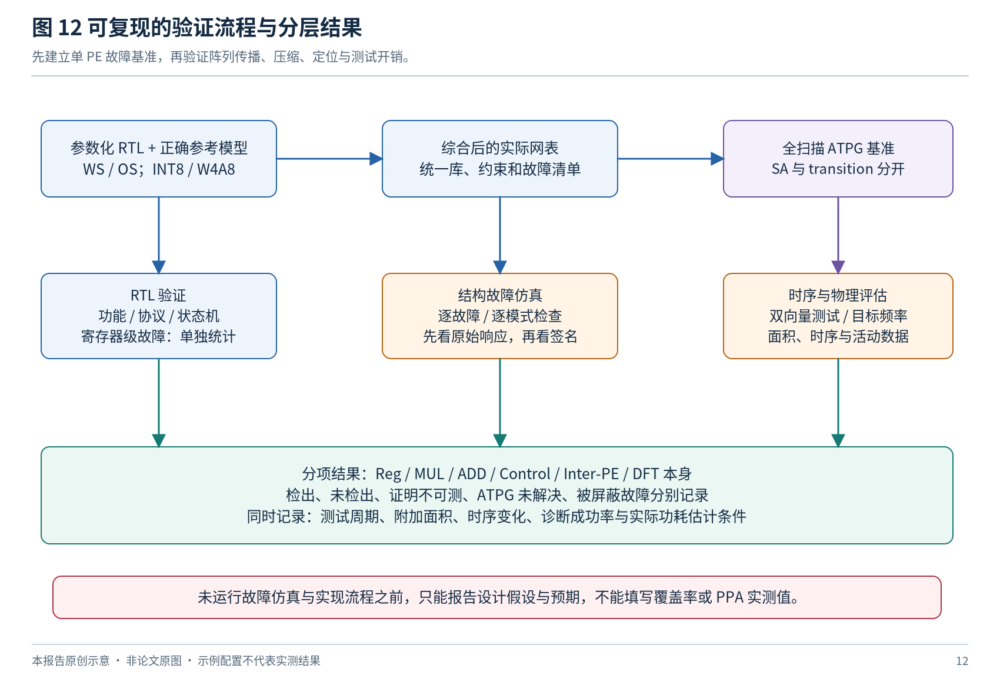

*图 12：RTL 协议验证、门级结构覆盖和时序/PPA 评价互相补充，不能互相替代。*

**单 PE 层。** 建立参数化 Reg + MAC，确定数值规则与全部控制行为，综合为真实门级电路。比较全扫描 ATPG、伪随机扫描 LBIST、纯功能路径与混合方案。先找出难测逻辑在哪，再扩展到大阵列。

**小阵列层。** 使用 4 × 4 或 8 × 8 作为示例，验证激励传播、流水对齐、响应收集、跨 PE 控制与定位。小阵列适合运行完整故障清单，不能只抽取“最容易观察”的 PE。

**扩展层。** 在资源允许时增大阵列，比较向量复用、分区、测试周期和附加结构。若只对大阵列进行抽样，应明确抽样策略、样本量和统计不确定性，不把小阵列覆盖率直接复制过去。

### 11.2 建议基线

| 编号 | 基线 | 作用 |
|---|---|---|
| B0 | 原始功能 PE / 阵列 | 面积与时序的共同参考 |
| B1 | 全扫描 + 确定性 ATPG | 建立结构可测性参考；本身不必是自主 LBIST |
| B2 | 全扫描 + 伪随机 LBIST | 观察随机难测故障和扫描测试成本 |
| B3 | 纯功能路径 + PRPG | 量化不扫描时的覆盖缺口 |
| B4 | 功能路径 + 定向向量 | 检查仅优化向量能补多少缺口 |
| B5 | 混合架构 | 加入少量扫描/测试点和局部观察，验证增量收益 |
| B6 | 在线短检查 | 单独评价延迟和运行期间检测，不与制造测试混为同一任务 |

所有基线尽量使用同一功能 RTL、工艺库、约束和故障定义。若某方案额外改变了乘法器实现、流水级或数值规则，需单独说明，不能把这部分差异算作纯测试结构收益。

### 11.3 故障清单与覆盖率

建议对 Reg、MUL、ADD/ACC、Control、Inter-PE、DFT 自身分组，分别报告 stuck-at 与 transition。单故障结构实验和多故障诊断实验分开组织；RTL 寄存器位注入也单独列出。

设总目标故障集合为 $F$，检出集合为 $D$，已证明不可测集合为 $U$。可以同时报告：

$$
FC_{\mathrm{all}}=\frac{|D|}{|F|},\qquad
FC_{\mathrm{testable}}=\frac{|D|}{|F\setminus U|}.
$$

不同工具对 fault coverage、test coverage 和故障分类的定义可能不同，因此报告时应给出实际公式。ATPG 超时、尚未解决和未检测到不能自动并入“已证明不可测”。还应列出被 X 屏蔽的故障、压缩漏检和未支持的模式。

对故障定位，需同时记录检测率、已检测故障上的正确定位率、全部注入故障上的正确定位率，以及误定位数量。只在已经检出的样本中统计定位率，会隐藏前端漏检。

### 11.4 仿真工具的分工

可用 Verilator 或 VCS 建立功能回归、参考结果、协议检查和控制状态测试；使用具备目标故障模型能力的 ATPG / 故障仿真流程产生结构覆盖结果。具体工具命令、许可证能力和注入方式应以实际版本文档为准，不能由本报告凭空编写为已执行脚本。

VCS 等事件驱动仿真环境可用于相应库模型、测试波形与延迟条件的验证；但“运行了一次带延迟仿真”本身仍不是完整 transition fault 覆盖报告。反过来，抽象 RTL 注入适合快速检查机制，却不代表真实综合节点的完整故障集合。

本建议不依赖 FPGA 上板。要报告 ASIC 面积或功耗，仍需要相应综合、实现和功耗估计条件；没有这些条件时，应保留为空，不填写预测为实测。

### 11.5 建议保存的结果表字段

```text
experiment_id, rtl_revision, test_revision, tool_version,
cell_library, synthesis_constraints, array_shape, pe_mode,
fault_model, fault_site, module_class, fault_polarity,
pattern_set, seed, pattern_count, raw_detected, signature_detected,
first_detect_cycle, diagnosis_expected, diagnosis_actual,
status, abort_reason, total_test_cycles, save_restore_cycles
```

面积记录应拆分扫描单元、MUX、测试点、PRPG、压缩器、控制器、参考存储和访问结构。时序至少记录正常模式关键路径、测试模式限制以及新增逻辑是否进入 MAC 关键路径。功耗应说明频率、工艺、电压、活动文件、捕获和移位阶段，并区分估计与测量。

### 11.6 关键消融实验

| 对比 | 要回答的问题 |
|---|---|
| 同样向量，原始响应与签名响应 | 漏检是否由压缩造成 |
| 相同模式数，随机与定向混合 | 模式质量是否优于单纯增加数量 |
| 不同 Tile 大小，相同功耗约束 | 分区收益是否真实，而非不公平并行度 |
| 有/无局部测试点 | 覆盖提升是否值得附加面积和时序影响 |
| 相同故障清单，单 PE 与阵列 | 扩展后丢失了哪些可检测故障 |
| 单故障与相关多故障 | 相消、公共模式错误与定位冲突有多严重 |
| INT8、W4A8 与数据流切换 | 混合精度与模式共用是否留下测试盲区 |

这些实验比只展示一个最终覆盖率更能说明方法贡献，也更容易判断改进究竟来自向量、测试结构还是观察方式。

## 12. 尚未充分解决的问题与研究选题

### 12.1 结构感知的 MAC 向量与局部测试点联合选择

研究问题不是“哪些整数看起来特别”，而是在实际综合结构中，哪些故障对随机模式抵抗明显、哪些状态无法经现有通路控制，以及增加哪个测试点最划算。可以联合优化模式存储、模式数量、局部控制点和观察点，采用迭代故障仿真形成可验证的改进过程。

与已有功能通路 BIST 拉开差异的关键，是给出逐模块覆盖和残余故障分析，而不是只证明最终结果在若干注入场景下不正确。

### 12.2 覆盖约束下的可重构响应观察

全阵列只保留一个签名成本低，但诊断困难，相关错误可能抵消；每个 PE 单独保留签名则成本高。值得研究的是在快速检测模式和细化诊断模式之间重构观察组，并把响应压缩损失作为显式优化目标。

这里需要与 C-Testing 的分层响应处理和运行期间定位工作对照，不能把“分组 MISR”本身作为充分创新。[R04](#r04)[R12](#r12)

### 12.3 稀疏、多精度与 GEMM/GEMV 共用 PE

稀疏模式可能关闭乘法路径，多精度模式可能改变分段运算，GEMV 或小矩阵模式可能改变活动 PE 集合和旁路。研究重点应是模式之间共享的测试能力，以及只有特定模式才出现的控制、符号扩展和连接。

一个合理目标是：共用大部分发生器与控制结构，但保留模式相关的向量和参考签名；同时明确是否测试全部硬件模式，还是仅服务于当前部署应用。两种目标都可以有价值，但不能混称。

### 12.4 不破坏执行计划的可分段 LBIST

把测试拆成可暂停的小片段，可以利用指令块间空闲窗口。研究难点在于保持覆盖进度、保存签名和发生器状态、限制最长检测延迟，以及处理空闲机会不足。Sima 的公开方案和工作负载相关测试表明，这一方向已存在公开先行工作。[R16](#r16)[R19](#r19)

新的贡献应落到可验证的任务兼容性和覆盖保证，而不是只提出“在空闲时运行测试”。应证明哪些状态可改写、哪些必须保留，以及在连续繁忙场景下如何避免永久推迟测试。

### 12.5 检查器可信性与多故障

PRPG、MISR、参考存储、时钟控制和状态上报的共同失效，可能绕过单一检测机制。针对这些部件安排已知答案检查、计数一致性、超时和故障注入，是完整研究的重要部分。若恢复依赖同一片损坏逻辑，还应验证恢复路径的独立性。

多故障研究也不能只把单故障结果重复若干次。两个故障可能相消、产生相同签名，或破坏代数定位的唯一性。应设计相关故障样本，而不仅是独立均匀随机注入。

### 12.6 适合形成论文主线的组合

**建议主线：面向混合精度 Reg + MAC 阵列的结构覆盖驱动混合 LBIST。** 先用残余故障分析指导少量测试点与向量选择，再采用可重构 Tile 观察和功耗约束调度。贡献应分别回答：覆盖缺口怎样关闭、附加硬件为何较少、阵列扩大后为何仍有效，以及故障定位和在线检查能复用多少结构。

不建议把所有方向一次堆入一个原型。先确定一个主要优化目标，例如在相同附加面积预算下提高门级覆盖率，或在相同覆盖和功耗限制下降低总测试时间；其余指标作为约束，才能形成清晰对比。

### 12.7 通用 PRPG 配置研究的可借鉴性

2026 年作者实验室目录还列出了利用深度学习推断 PRPG 配置的通用 LBIST 工作。本次仅核验到题录，未取得足以评价算法与 NPU 适用性的原始结果，因此不把它列为已验证的 PE-LBIST 改进。它提示可以进一步考察种子、结构与难测故障之间的配置选择，但效果仍须用同一 NPU 故障清单验证。[R25](#r25)

## 13. 结论与优先阅读顺序

面向 NPU PE 的 LBIST 已有多种成熟的结构思想：单 PE 测试向量复用、选择性扫描、功能通路组织、子阵列测试和分层诊断。真正的开放问题集中在现代 PE 的控制复杂性、混合精度、稀疏模式、相关故障、有限观察能力与运行期间时间预算的共同约束，而不是单纯缺少一个随机发生器。[R01](#r01)[R02](#r02)[R04](#r04)[R05](#r05)[R10](#r10)[R11](#r11)[R14](#r14)

针对典型 Reg + MAC，建议优先阅读 **R01、R04、R05、R06**，分别理解测试通路、规模扩展、结构测试与恢复、单 MAC BIST 实现；随后阅读 **R11 和 R14**，理解轻量在线检查的覆盖限制与代数定位的条件。**R16 和 R19**适合进一步研究软件执行计划与在役测试的结合。

最终应建立三层互补能力：**制造阶段的完整结构测试，上电或维护窗口的较高覆盖自测试，以及运行期间的短时检查与诊断。** 是否能够共享扫描、发生器、观察点与控制结构，需要实际网表、故障清单和时序验证回答。没有这些证据时，最准确的结论是一个有依据的架构候选，而不是已经验证的高覆盖、低功耗实现。

---

# 附录 A. 术语与缩写

| 术语 | 本报告中的含义 |
|---|---|
| PE | Processing Element，处理单元 |
| MAC | Multiply–Accumulate，乘加运算；具体是否本地累加由数据流决定 |
| LBIST | Logic Built-In Self-Test，逻辑内建自测试 |
| DFT | Design for Testability，可测性设计 |
| ATPG | Automatic Test Pattern Generation，自动测试向量生成 |
| PRPG / LFSR | 伪随机模式发生器 / 线性反馈移位寄存器 |
| MISR | 多输入签名寄存器，压缩多个输入随时间形成的响应 |
| SA / TD | 本文故障讨论中分别指 stuck-at / transition-delay；脉动阵列写全称以免歧义 |
| WS / OS | 权重驻留 / 输出驻留 |
| LOC | Launch-on-Capture，通过功能捕获时钟发起转换 |
| ABFT | Algorithm-Based Fault Tolerance，基于算法关系的容错或检查 |
| Tile | 为计算或测试组织的局部 PE 分组，不一定等于独立物理模块 |
| X | 仿真或测试响应中的未知状态；其屏蔽可能造成覆盖损失 |

# 附录 B. 图示目录与编辑说明

| 图 | 内容 | 文件主名 |
|---|---|---|
| 1 | 测试分类 | `01_scope` |
| 2 | WS / OS PE 结构 | `02_pe_ws_os` |
| 3 | 阵列传播与定位 | `03_array_observation` |
| 4 | 扫描式 LBIST | `04_scan_lbist` |
| 5 | 选择性扫描 | `05_partial_scan` |
| 6 | 分区与测试安排 | `06_partition_schedule` |
| 7 | 掩盖与压缩别名 | `07_masking_aliasing` |
| 8 | 在线检查与结构测试 | `08_online_vs_structural` |
| 9 | 建议混合架构 | `09_hybrid_architecture` |
| 10 | 自测试进入与退出 | `10_bist_lifecycle` |
| 11 | LOC 与有效响应时序 | `11_timing` |
| 12 | 验证流程 | `12_validation` |

Markdown 使用 PNG，便于不同阅读器显示；同名 SVG 可直接编辑矢量对象与文字。`diagram_src/render_figures.py` 是全部插图的精确生成源码，`mermaid/` 提供部分结构的逻辑关系版本，并不保证与手工布局 SVG 的位置完全一致。图中中文字体来自本地已安装字体，交付包不包含字体文件。

# 附录 C. 参考文献与原始来源

以下链接均为公开来源。期刊卷期年份与 DOI 中的年份可能不同；已明确的 online-first 情况在正文中区分。访问核验日期统一为 **2026-11-03**。

<a id="r01"></a>

**[R01]** Solangi U S, Ibtesam M, Ansari M A, Kim J, Park S. **Test Architecture for Systolic Array of Edge-Based AI Accelerator**. IEEE Access, 9: 96700–96710, 2021. DOI: `10.1109/ACCESS.2021.3094741`. [原始来源](https://doi.org/10.1109/ACCESS.2021.3094741)；[补充原始页面 / 全文](https://www.researchgate.net/publication/353026837_Test_Architecture_for_Systolic_Array_of_Edge-Based_AI_Accelerator)。**证据 A**。核验内容：作者公开原文；选择性扫描、功能加载与 LOC。限制：单数据通路结果不能推为全控制/全互连覆盖。

<a id="r02"></a>

**[R02]** Solangi U S, Ibtesam M, Park S. **Time multiplexed LBIST for in-field testing of automotive AI accelerators**. IEICE Electronics Express, 18(24): 20210451, 2021-12-25. DOI: `10.1587/elex.18.20210451`. [原始来源](https://www.jstage.jst.go.jp/article/elex/18/24/18_18.20210451/_article)；[补充原始页面 / 全文](https://www.jstage.jst.go.jp/article/elex/advpub/0/advpub_18.20210451/_pdf)。**证据 A**。核验内容：原始全文与 PDF 图表；子阵列分时、响应比较、测试点。限制：组件面积不等于整个测试体系面积。

<a id="r03"></a>

**[R03]** Solangi U S, Ibtesam M, Park S. **Master-slave based test cost reduction method for DNN accelerators**. IEICE Electronics Express, 18(24): 20210425, 2021-12-25. DOI: `10.1587/elex.18.20210425`. [原始来源](https://www.jstage.jst.go.jp/article/elex/18/24/18_18.20210425/_article)；[补充原始页面 / 全文](https://www.jstage.jst.go.jp/article/elex/18/24/18_18.20210425/_pdf)。**证据 A**。核验内容：原始全文与图表；主 PE 扫描、从 PE 并行加载。限制：是测试访问架构，不自动等于自主 LBIST。

<a id="r04"></a>

**[R04]** Chaudhuri A, Liu C, Fan X, Chakrabarty K. **C-Testing and Efficient Fault Localization for AI Accelerators**. IEEE TCAD, 41(7): 2348–2361, 2022-07-01（2021 在线）. DOI: `10.1109/TCAD.2021.3107401`. [原始来源](https://asu.elsevierpure.com/en/publications/c-testing-and-efficient-fault-localization-for-ai-accelerators/)。**证据 B**。核验内容：机构原始摘要；单 PE ATPG、分层压缩、256×256 相对改进。限制：全文细节未取得；倍数为给定基线下的最多值。

<a id="r05"></a>

**[R05]** Lee H, Kim J, Park J, Kang S. **STRAIT: Self-Test and Self-Recovery for AI Accelerator**. IEEE TCAD, 42(9): 3092–3104, 2023-09-01. DOI: `10.1109/TCAD.2023.3236875`. [原始来源](https://yonsei.elsevierpure.com/en/publications/strait-self-test-and-self-recovery-for-ai-accelerator/)。**证据 B**。核验内容：机构摘要；功能通路构成扫描、SA/TD、诊断与恢复。限制：不能称为 scan-free；目标故障条件需读全文。

<a id="r06"></a>

**[R06]** Grout I. **BIST Design and Implementation for a Fixed-Point Arithmetic MAC Unit within a Systolic Array**. iEECON 2023: 113–116, 2023-03. DOI: `10.1109/iEECON56657.2023.10126602`. [原始来源](https://pure.ul.ie/en/publications/bist-design-and-implementation-for-a-fixed-point-arithmetic-mac-u/)。**证据 B**。核验内容：机构摘要；综合前 Verilog、IEEE 1687、FPGA 原型。限制：不能据此证明完整 ASIC 门级覆盖。

<a id="r07"></a>

**[R07]** Vacca E, Ajmone G, Sterpone L. **RunSAFER: A Novel Runtime Fault Detection Approach for Systolic Array Accelerators**. IEEE ICCD 2023: 596–604, 2023-11. DOI: `10.1109/ICCD58817.2023.00095`. [原始来源](https://ieeexplore.ieee.org/document/10360983/)；[补充原始页面 / 全文](https://iris.polito.it/handle/11583/2982644)。**证据 B**。核验内容：IEEE 原始摘要与机构记录；额外 3 周期。限制：原始来源计数优先于后续论文比较表。

<a id="r08"></a>

**[R08]** Lee S, Park J, Park S, Kim H, Kang S. **A New Zero-Overhead Test Method for Low-Power AI Accelerators**. IEEE TCS II, 71(5): 2649–2653, 2024-05-01（2023 在线）. DOI: `10.1109/TCSII.2023.3344696`. [原始来源](https://yonsei.elsevierpure.com/en/publications/a-new-zero-overhead-test-method-for-low-power-ai-accelerators/)。**证据 B**。核验内容：机构原始摘要；复位、MAC 与比较器测试。限制：零硬件开销有前提；摘要不足以拆分全部故障模型。

<a id="r09"></a>

**[R09]** Zhang J, Namba K. **A LBIST Method for Detecting Fault Locations in AI Accelerators**. IEICE Technical Report, 124(73), DC2024-9: 46–51, 2024-06-11. [原始来源](https://ken.ieice.org/ken/paper/20240611Ncd1/eng/)。**证据 B**。核验内容：官方英文摘要；one-hot 与分区；接近 100% stuck-at-0。限制：技术报告；不能改写成全部 SA0/SA1/TD。

<a id="r10"></a>

**[R10]** Lee H, Lee J, Kang S. **A Robust Test Architecture for Low-Power AI Accelerators**. IEEE TCAD, 44(4): 1581–1594, 2025-04（2024 在线）. DOI: `10.1109/TCAD.2024.3476464`. [原始来源](https://yonsei.elsevierpure.com/en/publications/a-robust-test-architecture-for-low-power-ai-accelerators-2/)。**证据 B**。核验内容：机构原始摘要；功能通路与门控、SA/TD。限制：一个 AND 门为架构条件下增量，非完整 LBIST 总成本。

<a id="r11"></a>

**[R11]** Peltekis C, Nicopoulos C, Dimitrakopoulos G. **Periodic Online Testing for Sparse Systolic Tensor Arrays**. MOCAST 2025；公开稿 arXiv:2504.18628v1, 2025-04-25（公开稿）. DOI: `10.48550/arXiv.2504.18628`. [原始来源](https://arxiv.org/html/2504.18628v1)；[补充原始页面 / 全文](https://arxiv.org/pdf/2504.18628v1)。**证据 A**。核验内容：原文及 PDF 表格；8×8 INT16，跨权重块累计覆盖。限制：四向量一次检查不等于整个应用累计覆盖。

<a id="r12"></a>

**[R12]** Liu W K, Talukdar J, Tan B, Chakrabarty K. **Runtime Fault Localization in Deep Neural Network Accelerators**. ACM TODAES, 31(1), Article 11, 2025-11-11（在线）. DOI: `10.1145/3770920`. [原始来源](https://asu.elsevierpure.com/en/publications/runtime-fault-localization-in-deep-neural-network-accelerators/)。**证据 B**。核验内容：机构原始摘要；256×256、运行期校验定位。限制：完整注入条件未核验；不能扩展为任意多故障。

<a id="r13"></a>

**[R13]** Gowda H M, Jisha P. **A Low-Overhead Functional-Path BIST Architecture for Systolic AI Accelerator Cores**. ICKECS 2026: 1–6, 2026. DOI: `10.1109/ICKECS70176.2026.11527682`. [原始来源](https://bmsce.ac.in/home/Electronics-and-Communication-Engineering-Conferences)；[补充原始页面 / 全文](https://ieeexplore.ieee.org/document/11527682)。**证据 C**。核验内容：作者机构目录核验题名、作者、会议、IEEE 编号。限制：未取得完整原始摘要/全文；不使用二手覆盖或开销数值。

<a id="r14"></a>

**[R14]** Venkatasubramanian L, Wan Z, Cadambe V. **FLARE: One-Shot PE-Level Fault Localization in Systolic Arrays via Algebraic Test Vectors**. arXiv:2605.08594v1，预印本, 2026-05-09. DOI: `10.48550/arXiv.2605.08594`. [原始来源](https://arxiv.org/html/2605.08594v1)。**证据 A**。核验内容：原始全文；WS 权重寄存器故障与代数定位。限制：每列至多一个故障、激活、无溢出等假设；不是通用 MAC 网表覆盖。

<a id="r15"></a>

**[R15]** Cora G, Vacca E, De Sio C, Azimi S, Sterpone L. **Fast SEU Detection and Recovery in FPGA-Based AI Accelerators**. ACM TRETS, 19(3), Article 42: 1–34, 2026-09-08. DOI: `10.1145/3806052`. [原始来源](https://doi.org/10.1145/3806052)；[补充原始页面 / 全文](https://iris.polito.it/handle/11583/3009709)。**证据 B**。核验内容：出版社与机构原始摘要；RePAIR 检测及 FPGA 动态局部重配置。限制：FPGA 配置故障与 ASIC LBIST 必须区分。

<a id="r16"></a>

**[R16]** Spera G, Emmanuele A, Barbareschi M, Bosio A. **Workload-Aware Online Self-Testing for Systolic Array Neural Network Accelerators**. BEC 2026 TAICHIP Special Session，官方摘要, 2026-10-08. [原始来源](https://taichip.taltech.ee/events/taichip-industry-day-2026)。**证据 B**。核验内容：官方会议摘要；OS、LeNet-5/ResNet-8，向量缩减 63.2%/64.4%。限制：保留高影响故障，不等于保持全部结构故障覆盖。

<a id="r17"></a>

**[R17]** Yoon S K, Lee S H, Jo J, Lee Y W. **Optimized fault-tolerant data processing module for high-reliability CNN accelerator**. PLOS ONE, 21(2): e0337338, 2026-02-27. DOI: `10.1371/journal.pone.0337338`. [原始来源](https://journals.plos.org/plosone/article?id=10.1371/journal.pone.0337338)。**证据 A**。核验内容：原始全文；专用模块、输入寄存器故障。限制：不能推广为普通乘法器内部结构覆盖。

<a id="r18"></a>

**[R18]** Sadi M, Guin U. **Test and Yield Loss Reduction of AI and Deep Learning Accelerators**. IEEE TCAD, 41(1): 104–115；公开稿题名 Yield Loss Reduction and Test of AI and Deep Learning Accelerators, 2022（公开稿 2020-06-08）. DOI: `10.1109/TCAD.2021.3051841`. [原始来源](https://arxiv.org/abs/2006.04798)。**证据 A**。核验内容：作者公开全文；故障影响、产品分级与 PE 隔离。限制：任务精度容忍度不是故障不存在的证明。

<a id="r19"></a>

**[R19]** Jain S, Pati V, Hu C；公开记录中的申请人：Sima Technologies Inc. **Non-interruptive run-time logic built-in self-test for a machine learning accelerator**. 公开专利说明书 US20260023667A1, 2026-01-22. [原始来源](https://patents.google.com/patent/US20260023667A1/en)。**证据 P**。核验内容：公开说明书；静态指令块之间的空闲窗口测试。限制：不是量产或独立实测证据；不作法律判断。

<a id="r20"></a>

**[R20]** Synopsys. **TestMAX XLBIST**. 官方产品技术说明, 动态网页；核验于 2026-11-03. [原始来源](https://www.synopsys.com/implementation-and-signoff/test-automation/testmax-xlbist.html)。**证据 B**。核验内容：确定性压缩、重播种、未知值处理等官方能力描述。限制：不是具体 NPU 的 PE 级公开实现。

<a id="r21"></a>

**[R21]** Siemens EDA. **Enhance Test Time and Quality with Tessent Hybrid TestKompress/LogicBIST**. 官方技术文章, 2024-01-30. [原始来源](https://blogs.sw.siemens.com/xcelerator-academy/2024/01/30/enhance-test-time-and-quality-with-tessent-hybrid-testkompress-logicbis/)。**证据 B**。核验内容：扫描压缩与 LBIST 资源共享。限制：工业通用机制，非 NPU 对比实测。

<a id="r22"></a>

**[R22]** Siemens EDA. **Tessent LBIST with Observation Scan Technology wins Elektra Design Tool Award 2020**. 官方技术文章, 2021-04-09. [原始来源](https://blogs.sw.siemens.com/tessent/2021/04/09/tessent-lbist-with-observation-scan-technology-wins-elektra-design-tool-award-2020/)。**证据 B**。核验内容：观察扫描技术与 LBIST。限制：不沿用通用宣传倍数作为 NPU 收益。

<a id="r23"></a>

**[R23]** Siemens EDA. **Ensure Defect-Free Automotive ICs with the Hybrid TK/LBIST Solution that also Finds Faults in the DFT Logic**. 官方技术文章, 2016-05-31. [原始来源](https://blogs.sw.siemens.com/tessent/2016/05/31/ensure-defect-free-automotive-ics-with-the-hybrid-tklbist-solution-that-also-finds-faults-in-the-dft-logic/)。**证据 B**。核验内容：对 DFT 本身进行测试的必要性与机制。限制：并非某一现代 NPU 的诊断覆盖报告。

<a id="r24"></a>

**[R24]** UC Berkeley BAR / Gemmini contributors. **Gemmini: README and architecture description**. 官方开源仓库, 动态文档；核验于 2026-11-03. [原始来源](https://github.com/ucb-bar/gemmini/blob/master/README.md)。**证据 A**。核验内容：WS/OS、PE/Tile/Mesh 与可配置数据类型。限制：具体 RTL 仍以选定提交版本为准。

<a id="r25"></a>

**[R25]** Cho H, Park J, Kim J, Jung L, Kang S. **Deep-Learning-Based PRPG Configuration Inference for Efficient LBIST**. IEEE TVLSI Systems, 34(9): 3039–3042；作者实验室目录, 2026-09. [原始来源](https://soc.yonsei.ac.kr/)。**证据 C**。核验内容：作者实验室公开目录核验题名、作者与卷期。限制：通用 PRPG 方向；未据此声称 NPU 性能或覆盖提升。

# 附录 D. 检索方法、核验与局限

检索组合包括 `systolic array LBIST`、`processing element logic built-in self-test`、`MAC BIST`、`selective partial scan AI accelerator`、`C-testing`、`functional-path BIST`、`runtime fault localization systolic`、`online self-testing neural network accelerator`，并通过核心论文的相关工作和作者机构页面扩展。

优先采用出版社、作者机构、官方会议网页、公开原文、预印本和专利原始说明书。全文中涉及图表的部分结合原 PDF 页面检查；不依靠二手摘要补全实验数字。证据等级与本次访问状态保存在 `sources.csv`。

本报告是结构化文献调研，不是拥有完整数据库检索记录和双人筛选过程的系统综述，也不声称穷尽所有专利、非公开工业实现和受限文献。部分 2026 年工作只有官方摘要或题录，已单独标识。未核验的完整故障模型、工艺条件、面积分母和测试周期组成，不在正文中补写为确定事实。

**研究建议、公式化优化问题、架构图和实验流程均为本报告的分析，不是声称已有论文已经实现的结果。** 所有“建议配置”都需要在目标 NPU 的 RTL、网表和工艺条件下重新验证。
