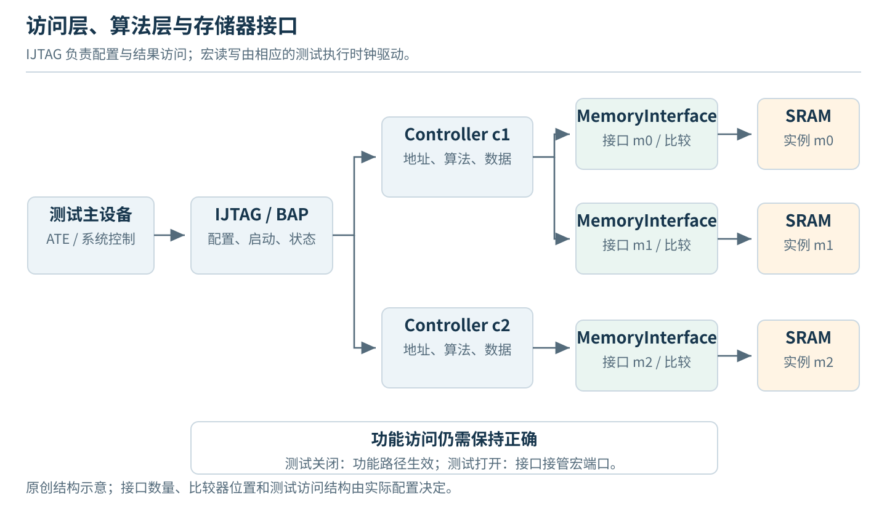
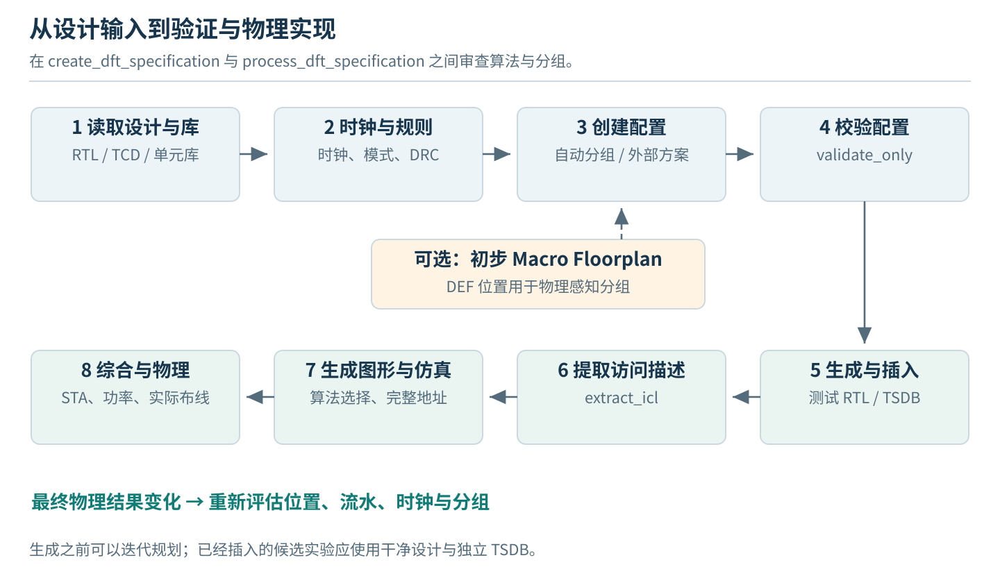
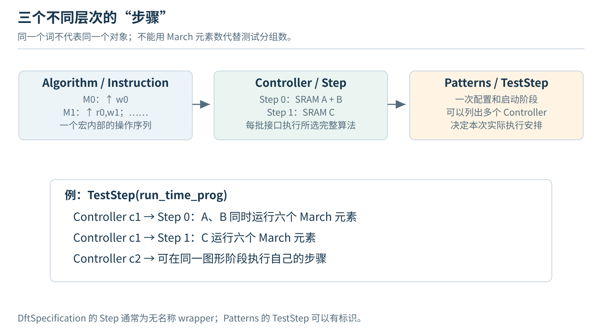
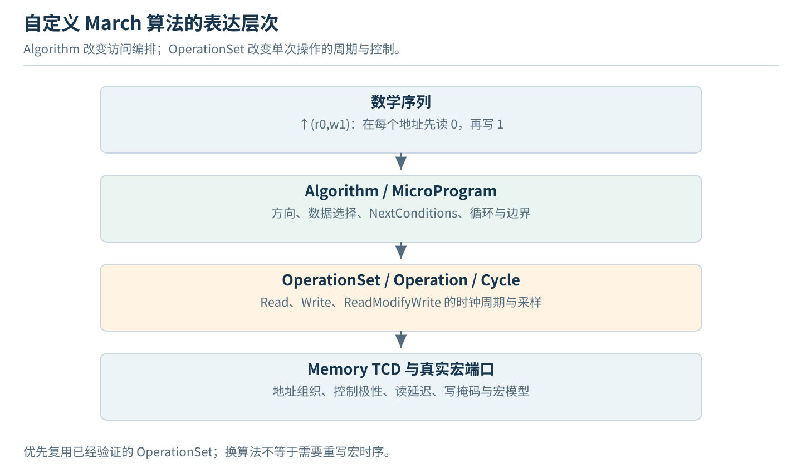
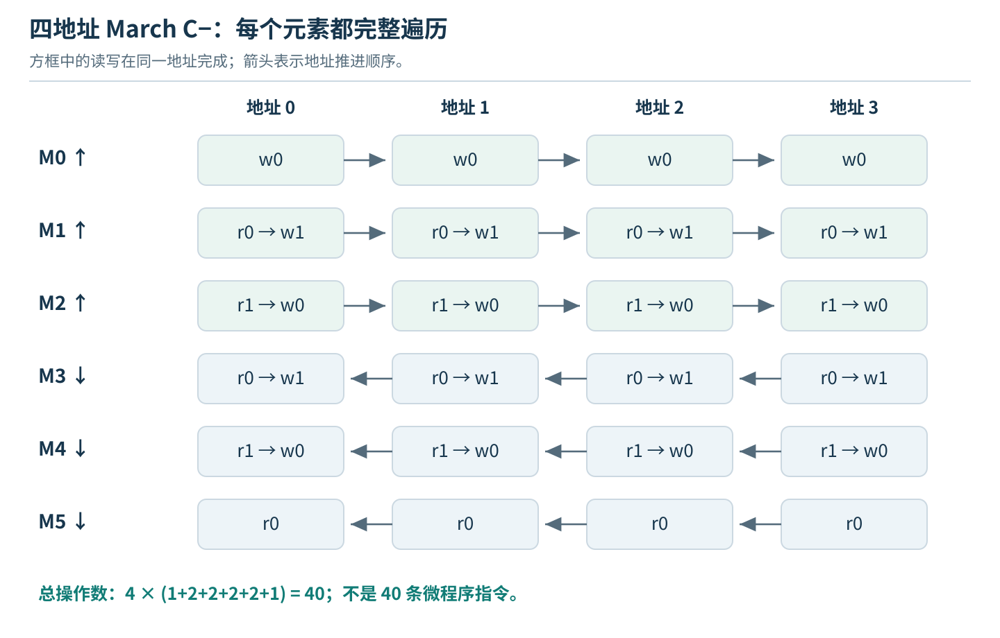
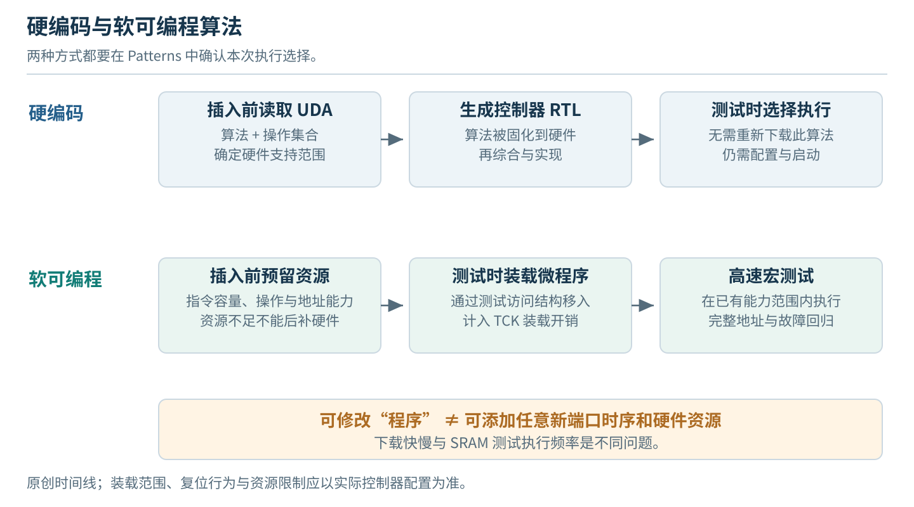
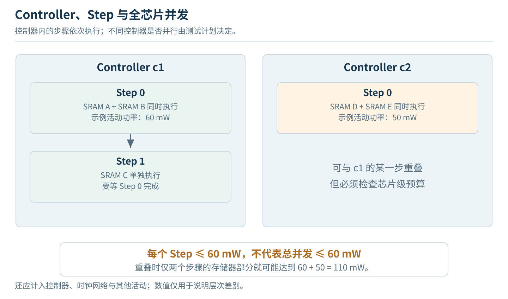
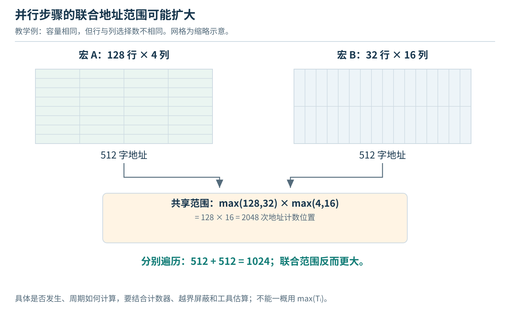
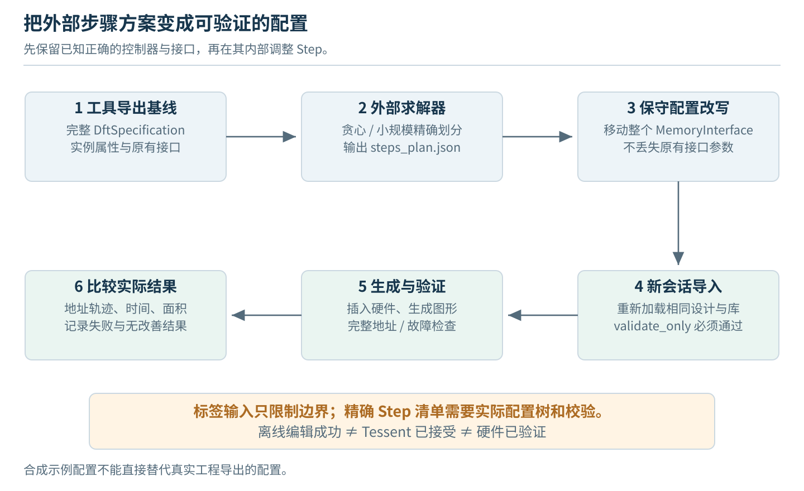
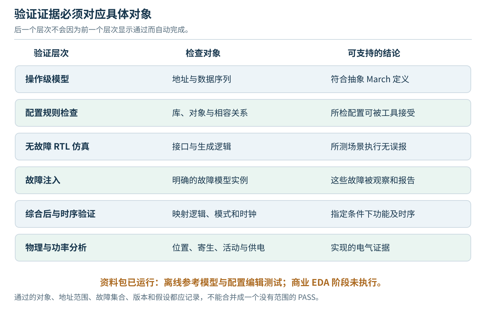

# Tessent MemoryBIST 插入教材

## 从设计加载到 March 算法定制、存储器分组与验证

本教材以 **Tessent Shell 中的 MemoryBIST RTL 插入流程**为主线，围绕三个实际操作展开：为控制器选择测试算法；将自定义 March 算法加入或下载到控制器；让自动分组或外部优化结果变成真实的 Controller、Step 和 MemoryInterface 结构。

命令与配置接口主要依据 Siemens 编写的《Tessent MemoryBIST User’s Manual, For Use With Tessent Shell》，2025.1、Revision 36。公开可检索的手册是第三方保存的原厂文档副本，不是 Siemens 官方下载站。算法编程机制同时核对了 Siemens 官方技术文章；架构与分组原理参考了 Siemens 在 ASP-DAC 2025 的教程。[1–3]

**适用范围与验证状态。** 示例面向普通同步 SRAM 的直接接口方式，不自动覆盖 ROM、DRAM、多端口同时访问、共享总线存储器、修复熔丝和安全启动的完整工程需求。本教材没有运行商业 Tessent、VCS、综合或布局布线。附带程序实际验证了抽象 March 序列、简化分组模型以及离线配置改写；这些结果与“工具接受配置”“生成 RTL 正确”“芯片故障覆盖合格”是不同层次。使用 2025.4 或其他版本时，应以安装目录中的同版本手册、`help` 和 `report_config_syntax` 复核接口，不把 2025.1 示例视为跨版本保证。

### 阅读与操作路线

| 路线 | 目标 | 主要章节 | 应保存的结果 |
|---|---|---|---|
| 基础插入 | 使用经过验证的存储器库默认算法 | 第 1–5、13 章 | 实例清单、DFT 配置、插入结果、仿真报告 |
| 算法定制 | 切换内置算法、硬编码 UDA、软可编程 UDA | 第 6–10 章 | 算法文件、资源配置、实际执行配置、地址与数据轨迹 |
| 分组优化 | 改变共享控制器与同步测试步骤 | 第 11–12 章 | 输入属性、期望方案、工具实际方案、时间与功率评估 |
| 工程交付 | 合成功能与测试模式、验证物理影响 | 第 14–17 章 | 时序约束、模式矩阵、检查记录、可复现运行清单 |

配套文件中的示例数据均为教材构造，不是用户芯片或任何论文的工业测量结果。正文给出关键脚本和算法描述；完整辅助程序、测试记录与可编辑 SVG 位于同一个资料包中。


## 目录

- [[#1. 工具对象与插入边界|1. 工具对象与插入边界]]
- [[#2. 输入准备与存储器识别|2. 输入准备与存储器识别]]
- [[#3. 四类配置对象|3. 四类配置对象]]
- [[#4. 最小插入流程|4. 最小插入流程]]
- [[#5. 可移植的工程脚本|5. 可移植的工程脚本]]
- [[#6. 选择内置 March 算法|6. 选择内置 March 算法]]
- [[#7. 自定义 March 算法的三层表达|7. 自定义 March 算法的三层表达]]
- [[#8. 硬编码自定义算法|8. 硬编码自定义算法]]
- [[#9. 软可编程算法|9. 软可编程算法]]
- [[#10. OperationSet 与宏时序|10. OperationSet 与宏时序]]
- [[#11. 自动分组的设置与解释|11. 自动分组的设置与解释]]
- [[#12. 外部分组优化器的接入|12. 外部分组优化器的接入]]
- [[#13. 测试激励与验证|13. 测试激励与验证]]
- [[#14. 综合、时序与物理交付|14. 综合、时序与物理交付]]
- [[#15. 常见问题的定位|15. 常见问题的定位]]
- [[#16. 课程实验|16. 课程实验]]
- [[#17. DFT Agent 的实现接口|17. DFT Agent 的实现接口]]
- [[#18. 关键配置速查|18. 关键配置速查]]
- [[#附录 A. 本次资料包的验证记录|附录 A. 本次资料包的验证记录]]
- [[#附录 B. 文档与示例的使用边界|附录 B. 文档与示例的使用边界]]

---

## 1. 工具对象与插入边界

### 1.1 MemoryBIST 不是在 RTL 中加入一个独立计数器

一个可工作的 MemoryBIST 系统至少要解决三类问题。访问逻辑接收测试配置与启动请求；控制器产生地址、操作和数据图案；存储器接口把这些命令施加到目标宏，并将读数据送入比较或诊断逻辑。功能访问与测试访问还必须正确切换。BAP、Controller、Memory Interface 是理解 Tessent 结构的入口。[3，幻灯片 16–19]



图 1 是教学结构图，不表示每种配置都会生成相同端口或固定数量的 BAP。IJTAG 侧的 TCK 与存储器执行测试的高速时钟也不是同一个概念。软算法通过低速访问接口装载，不意味着每一次 SRAM 读写都以 TCK 执行。

控制器共享可以减少重复的算法逻辑，但不能消除每个存储器所需的接口适配、数据比较、控制选择和部分诊断电路。因此，控制器数量不是总面积的充分指标。两个宏共享一个控制器以后，连线与缓冲开销也可能增加。

### 1.2 采用 Tessent Shell，不能混用旧版 MBISTArchitect 脚本

| 流程体系 | 本教材中的处理方式 |
|---|---|
| Tessent Shell MemoryBIST | 使用 `set_context`、`DftSpecification`、`process_dft_specification` 等配置式流程 |
| 旧版 MBISTArchitect | `setup mbist algorithms`、`add new controller`、`setup memory test` 等命令不直接搬到本教材脚本中 |
| Synopsys / Cadence | 分组思想可以对应，命令、库描述和对象结构不能互换 |

例如，本教材选择算法的位置是 `Controller/AdvancedOptions/algorithm`，不是假设存在一个通用的 `set_march_algorithm` 命令。外部分组结果也通过配置树表达，不是把优化器源码塞进 March 微程序。

### 1.3 插入发生在物理实现之前，物理信息可以提前反馈

基本路线为：读取 RTL 与存储器测试描述，完成时钟和测试访问规划，创建分组与算法配置，生成并插入测试 RTL，然后进入综合、布局、时钟树与布线。采用门级插入时，输入和后续综合处理不同，不能把 `dft -rtl` 与 `dft -no_rtl` 的设置随意拼接。[1，第 2–3 章]



图中的初步 Macro Floorplan 是可选输入。它给分组提供相对可靠的宏坐标，不要求标准单元已经完成最终布局布线。最终位置变化较大时，需要重新评估控制距离、流水级、测试时钟和分组；并不意味着应当等最终布线结束才首次插入 MBIST。

---

## 2. 输入准备与存储器识别

### 2.1 六类文件不能互相代替

| 输入 | 主要作用 | 典型错误 |
|---|---|---|
| RTL 或门级网表 | 设计结构和宏实例连接 | 工具加载的层次与优化器中的实例路径不一致 |
| Tessent cell library | 工具需要的标准单元测试行为 | 把综合用 Liberty 当作唯一 Tessent 库 |
| Memory TCD | 存储器端口、时序、地址组织、算法与操作集合等测试描述 | 只有 SRAM 的 Verilog 模型，没有测试描述 |
| Verilog 仿真模型 | 仿真时的 SRAM 与标准单元行为 | 黑盒可以被识别，却没有可执行读写行为 |
| Liberty、LEF 与物理数据 | 综合时序、功率和物理实现 | 从一个功率常数推断所有测试阶段的真实电流 |
| DEF、UPF 与工程测试配置 | 宏位置、电源域、测试可访问性 | 位置过期、功率域未上电或复位未解除 |

同样叫 `.lib` 的文件可能是完全不同的格式。应按内容和读取命令识别，不按扩展名猜测。`read_cell_library`、`read_core_descriptions` 和综合工具的库读取命令职责不同。[1，第 2 章、附录 A]

### 2.2 先验证一个宏，再扩大规模

首先选择一个已经取得正确 TCD 与仿真模型的小 SRAM，完成单宏测试。需要核对宏实例名、地址深度、数据位宽、片选和写使能极性、读延迟、写掩码、休眠引脚、测试专用端口，以及地址的行、列、Bank 解释。

假设某宏的写使能低有效，功能模型在 `WEN=0` 时写入。如果测试描述把它当作高有效，即使 March 微程序完全正确，产生的读写也会相反。又如同步读输出延迟一拍，比较使能却提前一拍，就可能在几乎每次读取时报告失败。这些问题属于宏接口模型，不是“March 覆盖率不好”。

对于带 byte enable 的宏，写入全字背景前应保证所有需要测试的字节真正被选中。将未使用端口、睡眠或保持信号置为固定值，也必须符合宏的正式规格。不能用任意常量“消除 DRC”后便认为模型有效。

### 2.3 建立实例清单

在工具完成当前设计识别后运行：

```tcl
report_memory_instances
```

把输出与设计预期清单比较。至少记录实例路径、宏型号、测试端口、测试时钟、电源域、算法、OperationSet、物理坐标来源和例外原因。对于未被识别的目标宏，先定位库绑定和层次问题；不要直接从报告中消失的实例推断其“不需要测试”。

如果某个存储器确实排除在 MBIST 之外，应有明确原因，例如由另一个 IP 提供独立测试、采用单独 ROM 测试方案，或该数组最终不是物理 SRAM。排除清单与纳入清单共同构成覆盖对象定义。

### 2.4 时钟标签与测试访问结构

下面的命令把一个已存在的设计时钟引脚或端口加入工具的时钟描述：

```tcl
add_clocks CLK -period 10ns -label clka
```

`CLK` 是设计对象，`clka` 是配置中引用的时钟域标签。标签相同不能凭空让两个异步时钟同步；不同名称也不必然代表两个真实异步域。需要结合功能与测试模式下的时钟选择、门控和 PLL 设置判断。

`set_design_level physical_block` 表示按物理块处理当前设计；它不是“自动为任意 SoC 接好所有顶层 JTAG 信号”的保证。芯片已有 TAP、调试模块或上层 IJTAG 网络时，要说明块级测试接口如何接入。第 5 章脚本把这些工程设置留给明确的现场配置入口，不隐式新建第二套冲突的测试端口。

---

## 3. 四类配置对象

### 3.1 配置树与命令执行顺序

Tessent 的配置文件不是 Verilog，也不是任意 Tcl 字典。花括号中的 wrapper、属性和值由工具的配置语法解释。以下四类对象应分别保存和审查。

| 对象 | 解决的问题 | 主要阶段 |
|---|---|---|
| `DefaultsSpecification` | 自动规划时采用什么默认限制 | 创建 DFT 配置之前 |
| `DftSpecification` | 生成哪些控制器、接口和硬件能力 | 硬件生成之前 |
| `MemoryOperationsSpecification` | 自定义 Algorithm 与 OperationSet 的内容 | 硬编码生成前或软算法加载时 |
| `PatternsSpecification` | 本次如何配置、启动和检查已存在的测试硬件 | 测试激励生成阶段 |

最常见的错误是修改了其中一个对象，却期待另一个对象自动发生变化。`extra_algorithms` 表示增加硬件支持，并不等于在每个测试图形中依次运行所有附加算法；相反，只在 Patterns 中填写一个不存在于硬件且无法软加载的算法，也不会创造新硬件。[1，第 399–409 页；2]

### 3.2 查询语法与实际值

```tcl
help set_memory_instance_options
help set_config_value
report_config_syntax DefaultsSpecification/DftSpecification/MemoryBist

set spec [create_dft_specification]
report_config_data $spec
report_config_data ${spec}/MemoryBist/Controller(c1) -show_unspecified
```

`report_config_syntax` 用来查看当前版本支持的结构与参数；`report_config_data` 查看当前对象内容。`-show_unspecified` 有助于看到未显式写入文件的默认项。对某个属性，进一步使用 `get_config_value` 查询。保存实际报告，比仅保存一份输入 Tcl 更有助于复现。[1，第 87–100 页]

### 3.3 区分三个“步骤”

`MicroProgram/Instruction` 是 March 微程序的一条指令；`DftSpecification/.../Controller/Step` 是控制器内的一批存储器；`PatternsSpecification/.../TestStep` 则是测试图形中的一次执行阶段。三者不能互相替代。



例如，Controller(c1) 的第一个 Step 可以包含两个 SRAM，每个 SRAM 都执行完整的六阶段 March C−。这不是“第一个 SRAM 只执行第一个 March 元素”。一个 Patterns 的 TestStep 又可能同时启动多个 Controller。

### 3.4 导出、修改与重新导入

```tcl
write_config_data reports/auto.dft_spec -wrappers $spec
```

导出的完整 DFT 配置中还包括 IJTAG、时钟和其他相关对象。外部编辑时应保留这些信息。第 12 章提供一种保守方法：只改现有控制器内的 Step 归属，完整保留每个 MemoryInterface 的原有配置；然后在一个重新加载相同设计和库的干净会话中直接读入完整配置。

```tcl
# 已加载相同设计、TCD、时钟和约束，且 check_design_rules 已通过。
# 此分支不再调用 create_dft_specification。
read_config_data reports/edited.dft_spec
set spec [get_config_elements DftSpecification]
process_dft_specification -validate_only
```

避免“导入外部结果以后又调用自动规划”而覆盖自己的调整。编辑后通过校验，也不表示功率和时序都已完成验证；它首先证明工具配置结构和适用规则可以接受。

---

## 4. 最小插入流程

### 4.1 主流程代码

下面是便于阅读的主流程，不包含具体 PDK 和项目库路径。`site_load_design.tcl`、`site_access_setup.tcl` 是本例要求工程自行提供的脚本，不是 Tessent 内置命令。

```tcl
set_context dft -rtl
set_tsdb_output_directory ./work/baseline/tsdb

# 现场脚本：读取 Tessent 单元库、Memory TCD 与完整 RTL。
source site_load_design.tcl
set_current_design mbist_lab
set_design_level physical_block
set_dft_specification_requirements -memory_test on
add_clocks CLK -period 10ns -label clka

# 现场脚本：测试模式、复位、门控与块级测试访问安排。
source site_access_setup.tcl

# 规划参数在 create_dft_specification 之前设置。
set_defaults_value DftSpecification/MemoryBist/max_steps_per_controller 4
set_defaults_value DftSpecification/MemoryBist/max_memories_per_step 4
set_defaults_value DftSpecification/MemoryBist/max_power_per_step 60

report_memory_instances
check_design_rules
set spec [create_dft_specification]
report_config_data ${spec}/MemoryBist
write_config_data ./work/baseline/auto.dft_spec -wrappers $spec

# 在此处调整算法、软微程序资源或精确分组。
process_dft_specification -validate_only
process_dft_specification
extract_icl

set pat_spec [create_patterns_specification]
report_config_data $pat_spec

# 在此处选择实际执行算法和全地址测试范围。
process_patterns_specification

# 仿真库与仿真器选项按工程环境配置。
set_simulation_library_sources -v ./models/sram_sim.v -v ./models/stdcells.v
run_testbench_simulations
check_testbench_simulations
```

各命令构成的阶段顺序依据原厂流程；库、访问、时钟与仿真设置必须由实际工程补全。[1，第 2–4 章]

### 4.2 每一阶段的作用与输出

**设计加载。** 工具必须看到正确的顶层、子模块及存储器测试描述。未解析模块、错误库模型和错误层次应在这个阶段解决，不能留给分组优化器猜测。

**规则检查。** `check_design_rules` 分析测试时钟、存储器可访问性等条件，并进入后续规划所需状态。对每个 DRC，先理解电路含义和工具建议，再决定修改设计、补充约束或使用适用的自动修复，不以“减少告警数量”为唯一目标。

**创建配置。** `create_dft_specification` 产生可检查的结构方案。这是分组算法与工具实现之间最重要的边界：此时能看到实际 Controller/Step/MemoryInterface 归属，但尚未等同于完成所有硬件生成。

**配置校验。** `process_dft_specification -validate_only` 检查配置，不生成测试 RTL、不修改设计。尤其在手工移动接口或替换算法后，应单独运行并保存日志。[1，第 94 页]

**生成与插入。** `process_dft_specification` 根据最终配置生成测试逻辑并连接到设计。TSDB 中保存生成的测试部件及修改后的设计；实际文件位置以运行日志为准。`-no_insertion` 是只生成不接入设计的不同操作，不能把这种结果报告成“已完成插入”。[1，第 101 页附近]

**访问描述与激励。** `extract_icl` 提取测试访问结构。之后生成 PatternsSpecification，选择测试行为，再生成测试激励与仿真平台。读写比较逻辑正确和测试访问网络正确都需要检查。

**验证与交付。** `run_testbench_simulations` 启动仿真，`check_testbench_simulations` 检查状态。还需要检查哪些测试真正运行、是否采用完整地址、是否包含故障案例，以及是否具有正确的宏行为模型。

### 4.3 阶段性检查点

| 检查点 | 不能缺少的证据 |
|---|---|
| 设计可识别 | 目标宏全部在清单中，端口与时钟信息正确 |
| 方案合法 | DFT 配置校验通过，实际分组与预期一致 |
| 硬件已插入 | 生成日志、修改后的 RTL/网表、访问结构 |
| 算法实际运行 | Patterns 中的算法选择和宏端口波形一致 |
| 验证完成 | 明确仿真类型、地址范围、测试集合与结果 |

---

## 5. 可移植的工程脚本

### 5.1 工程目录

```text
Tessent_MemoryBIST_插入教材/
  Tessent_MemoryBIST_插入教材.md
  Tessent_MemoryBIST_离线阅读.html
  scripts/
    site_setup.tcl              现场配置模板
    grouping_defaults.tcl       自动分组参数
    run_mbist.tcl               分阶段主流程
    inspect_environment.tcl     本机命令与语法核对
  algorithms/
    lab_march_cminus.tcd_mem_lib 自定义 March C−
  examples/
    memories.csv               自拟分组输入
    auto_synthetic.dft_spec     仅用于离线编辑的合成配置
  tools/
    march_reference.py          操作级参考模型
    grouping_demo.py            贪心与小规模精确步骤划分
    config_steps.py             保守的离线 Step 改写
    selftest.py                 独立测试
  results/                     本次离线测试的实际输出
  assets/                      原创 SVG、PNG 与生成源码
```

### 5.2 现场配置文件

将 `scripts/site_setup.tcl` 复制为 `scripts/site_local.tcl`。路径采用当前机器上的真实文件，不附带或假设存在工艺厂商业 IP。


```tcl
# Copy to site_local.tcl and fill real project inputs. No foundry IP is included.
set TOP mbist_lab
set DESIGN_LEVEL physical_block
set TESSENT_CELL_LIBS {}
set RTL_FILES {}
set MEMORY_TCD_FILES {}
set SIM_VERILOG_FILES {}
set CLOCKS {{CLK 10ns clka}}
set FLOORPLAN_DEF ""
set POWER_UPF ""
set SITE_EXTRA_SETUP ""
set SITE_SIM_SETUP ""

# plan | insert | patterns | simulate
set RUN_STAGE plan
# preserve | builtin_default | builtin_extra | uda_default | uda_extra | soft
set ALGO_MODE preserve
set ALGORITHM LabMarchCMinus
set OPERATION_SET SyncWR
set CONTROLLERS {c1}
set SOFT_INSTRUCTIONS 16

# Empty = automatic planning. Full exported DftSpecification = exact-plan import.
set MANUAL_DFT_SPEC ""
set GROUPING_TAGS ""
set PHYSICAL_CLUSTER_RATIO ""

# Read names from the generated pattern specification, not from this example.
set PATTERN_MBIST_SCOPES {
    Patterns(MemoryBist_P1)/TestStep(run_time_prog)/MemoryBist
}
set PATTERN_CONTROLLER_TARGETS {}
# Example only; replace with the real generated instance path:
# set PATTERN_CONTROLLER_TARGETS {
#   Patterns(MemoryBist_P1)/TestStep(run_time_prog)/MemoryBist/Controller(mbist_lab_rtl_tessent_mbist_c1_controller_inst)
# }
set FULL_ADDRESS_TEST 1
```


`CONTROLLERS` 是 DFT 配置中的控制器标识；`PATTERN_CONTROLLER_TARGETS` 是生成后 Patterns 配置中的完整控制器对象路径。二者不是同一个名称。第一次运行可以先用 `RUN_STAGE plan` 检查前者；需要 Patterns 对象时，生成初始配置后查看 `02_initial.pat_spec`。

`ALGO_MODE` 的含义如下。切换到内置算法模式时，还必须把 `ALGORITHM` 改成实际存在、经过库兼容性确认的名称；模板里的 `LabMarchCMinus` 是本教材的 UDA，不是厂商内置算法。

| 模式 | 生成阶段 | 运行阶段 |
|---|---|---|
| `preserve` | 保留库默认配置 | 使用生成的默认测试计划 |
| `builtin_default` | 覆盖默认内置算法 | 显式选择该算法以便审查 |
| `builtin_extra` | 增加一个内置算法 | 显式选择新增算法 |
| `uda_default` | 自定义算法作为默认硬编码算法 | 显式选择自定义算法 |
| `uda_extra` | 保留默认算法并增加 UDA | 显式选择 UDA |
| `soft` | 预留软微程序资源和所需 OperationSet | 加载 UDA，生成下载和执行序列 |

### 5.3 主流程脚本

主脚本要求输入存在，并拒绝直接覆盖已有 TSDB。一次运行失败后，应保留失败日志，再用新的工作目录重试，而不是修改历史记录。脚本中的 `require_config` 和 `ensure_wrapper` 是普通 Tcl 辅助过程，不是额外安装的 EDA 功能。


```tcl
# Entry: tessent -shell -dofile scripts/run_mbist.tcl
# Requires a project-specific scripts/site_local.tcl and licensed Tessent.
set ROOT [file normalize [file join [file dirname [info script]] ..]]
set LOCAL [file join $ROOT scripts site_local.tcl]
if {![file isfile $LOCAL]} {
    error "Create scripts/site_local.tcl from site_setup.tcl; real RTL and libraries are required."
}
source $LOCAL
proc require_file {path} {
    if {![file isfile $path]} {error "Missing file: $path"}
}
proc require_config {path} {
    set n [get_config_elements $path -count]
    if {$n != 1} {error "Expected one config object; found $n: $path"}
}
proc ensure_wrapper {path} {
    set n [get_config_elements $path -count]
    if {$n == 0} {add_config_element $path}
    require_config $path
}
foreach list_name {TESSENT_CELL_LIBS RTL_FILES MEMORY_TCD_FILES} {
    if {[llength [set $list_name]] == 0} {error "$list_name must not be empty"}
    foreach f [set $list_name] {require_file $f}
}
if {$RUN_STAGE ni {plan insert patterns simulate}} {error "Invalid RUN_STAGE"}
if {$ALGO_MODE ni {preserve builtin_default builtin_extra uda_default uda_extra soft}} {
    error "Invalid ALGO_MODE"
}
set OUT [file join $ROOT work]
if {[info exists ::env(MBIST_WORK)]} {set OUT [file normalize $::env(MBIST_WORK)]}
if {[file exists [file join $OUT tsdb]]} {
    error "Existing TSDB found. Select a fresh MBIST_WORK directory; do not overwrite a prior run."
}
file mkdir [file join $OUT reports]

set_context dft -rtl
set_tsdb_output_directory [file join $OUT tsdb]
foreach f $TESSENT_CELL_LIBS {read_cell_library $f}
foreach f $MEMORY_TCD_FILES {read_core_descriptions $f}
if {$ALGO_MODE in {uda_default uda_extra}} {
    read_core_descriptions [file join $ROOT algorithms lab_march_cminus.tcd_mem_lib]
}
foreach f $RTL_FILES {read_verilog $f}
set_current_design $TOP
set_design_level $DESIGN_LEVEL
set_dft_specification_requirements -memory_test on
foreach item $CLOCKS {
    if {[llength $item] != 3} {error "CLOCKS entries must be {port period label}"}
    lassign $item port period label
    add_clocks $port -period $period -label $label
}
if {$POWER_UPF ne ""} {require_file $POWER_UPF; read_upf $POWER_UPF}
if {$FLOORPLAN_DEF ne ""} {require_file $FLOORPLAN_DEF; read_def $FLOORPLAN_DEF}
if {$PHYSICAL_CLUSTER_RATIO ne ""} {
    if {$FLOORPLAN_DEF eq ""} {error "This example requires a DEF for physical clustering"}
    set_memory_instance_options -physical_cluster_size_ratio $PHYSICAL_CLUSTER_RATIO
}
source [file join $ROOT scripts grouping_defaults.tcl]
if {$GROUPING_TAGS ne ""} {require_file $GROUPING_TAGS; source $GROUPING_TAGS}
if {$SITE_EXTRA_SETUP ne ""} {require_file $SITE_EXTRA_SETUP; source $SITE_EXTRA_SETUP}
report_memory_instances
check_design_rules

# Exact import bypasses automatic specification creation in this fresh session.
if {$MANUAL_DFT_SPEC eq ""} {
    set spec [create_dft_specification]
} else {
    require_file $MANUAL_DFT_SPEC
    read_config_data $MANUAL_DFT_SPEC
    set spec [get_config_elements DftSpecification]
    require_config $spec
}
write_config_data [file join $OUT reports 00_initial.dft_spec] -wrappers $spec

if {$ALGO_MODE ne "preserve"} {
    foreach cid $CONTROLLERS {
        set ctl "${spec}/MemoryBist/Controller($cid)"
        require_config $ctl
        if {$ALGO_MODE eq "soft"} {
            ensure_wrapper "${ctl}/AlgorithmResourceOptions"
            set_config_value soft_instruction_count \
                -in_wrapper "${ctl}/AlgorithmResourceOptions" $SOFT_INSTRUCTIONS
            # The waveform operation set still has to exist in generated hardware.
            ensure_wrapper "${ctl}/AdvancedOptions"
            set_config_value extra_operation_sets \
                -in_wrapper "${ctl}/AdvancedOptions" $OPERATION_SET
        } else {
            ensure_wrapper "${ctl}/AdvancedOptions"
            if {$ALGO_MODE in {builtin_default uda_default}} {
                set_config_value algorithm -in_wrapper "${ctl}/AdvancedOptions" $ALGORITHM
                set_config_value operation_set -in_wrapper "${ctl}/AdvancedOptions" $OPERATION_SET
            } else {
                set_config_value extra_algorithms -in_wrapper "${ctl}/AdvancedOptions" $ALGORITHM
                set_config_value extra_operation_sets -in_wrapper "${ctl}/AdvancedOptions" $OPERATION_SET
            }
        }
    }
}
report_config_data "${spec}/MemoryBist" -show_unspecified
write_config_data [file join $OUT reports 01_final.dft_spec] -wrappers $spec
process_dft_specification -validate_only
if {$RUN_STAGE eq "plan"} {exit}

process_dft_specification
extract_icl
if {$RUN_STAGE eq "insert"} {exit}
if {$ALGO_MODE eq "soft"} {
    read_core_descriptions [file join $ROOT algorithms lab_march_cminus.tcd_mem_lib]
}
set pat_spec [create_patterns_specification]
write_config_data [file join $OUT reports 02_initial.pat_spec] -wrappers $pat_spec
if {$FULL_ADDRESS_TEST} {
    if {[llength $PATTERN_MBIST_SCOPES] == 0} {error "Explicit pattern MemoryBist scopes are required"}
    foreach relative $PATTERN_MBIST_SCOPES {
        set mb "${pat_spec}/$relative"
        require_config $mb
        set_config_value reduced_address_count -in_wrapper $mb off
    }
}
if {$ALGO_MODE ne "preserve"} {
    if {[llength $PATTERN_CONTROLLER_TARGETS] == 0} {
        error "Inspect 02_initial.pat_spec, set PATTERN_CONTROLLER_TARGETS, then rerun in a fresh work directory."
    }
    foreach relative $PATTERN_CONTROLLER_TARGETS {
        set pc "${pat_spec}/$relative"
        require_config $pc
        ensure_wrapper "${pc}/AdvancedOptions"
        set_config_value apply_algorithm -in_wrapper "${pc}/AdvancedOptions" $ALGORITHM
        set_config_value apply_operation_set -in_wrapper "${pc}/AdvancedOptions" $OPERATION_SET
    }
}
write_config_data [file join $OUT reports 03_final.pat_spec] -wrappers $pat_spec
report_config_data $pat_spec
process_patterns_specification
if {$RUN_STAGE eq "patterns"} {exit}

if {[llength $SIM_VERILOG_FILES] == 0} {error "Provide simulation models before simulation"}
set cmd [list set_simulation_library_sources]
foreach f $SIM_VERILOG_FILES {require_file $f; lappend cmd -v $f}
{*}$cmd
if {$SITE_SIM_SETUP ne ""} {require_file $SITE_SIM_SETUP; source $SITE_SIM_SETUP}
run_testbench_simulations
check_testbench_simulations
exit
```


运行入口：

```bash
cp scripts/site_setup.tcl scripts/site_local.tcl
# 编辑 site_local.tcl：填写真实 RTL、TCD、Tessent 库和现场配置。
MBIST_WORK="$PWD/work/baseline_01" tessent -shell -dofile scripts/run_mbist.tcl
```

脚本只对 `PATTERN_MBIST_SCOPES` 明确列出的 MemoryBist 运行设置全地址范围；它不会保证其他未列出的图形也被修改。对于生产测试或完整地址回归，应检查每一个相关 TestStep 的实际值。

此脚本是有明确接入点的工程模板，不是已在目标工艺和当前 Tessent 版本中通过验证的交付脚本。模板拒绝缺失输入，有意不提供“没有真实宏和库仍显示成功”的替代流程。

---

## 6. 选择内置 March 算法

### 6.1 从库默认值开始

Siemens 的默认算法选择来源是存储器库中的定义，并不是所有存储器都无条件使用一个固定名字。某个工程报告采用 `SMarchCHKB`，并不能推导其他宏也应当使用它。对于有正式测试描述的工艺宏，先保留供应商已验证的算法与操作集合，再增加对比实验。[2]

```tcl
report_config_data ${spec}/MemoryBist/Controller(c1)/AdvancedOptions \
    -show_unspecified
```

当报告出现 `algorithm : from_library` 或 `operation_set : from_library`，含义是继续采用库信息，并非算法没有设置。进一步核查目标 Memory TCD、工具解析结果和最终生成报告，不能只把 `from_library` 当成一个可执行算法名。

### 6.2 默认算法覆盖

下面假设当前控制器的全部接口已确认支持 `SMarchCHKB` 与 `SyncWR`。该配对仅作为命令位置示例，不是任意 SRAM 的通用选择。

```tcl
set ctl "${spec}/MemoryBist/Controller(c1)"
set_config_value algorithm \
    -in_wrapper "${ctl}/AdvancedOptions" SMarchCHKB
set_config_value operation_set \
    -in_wrapper "${ctl}/AdvancedOptions" SyncWR
process_dft_specification -validate_only
```

如果 AdvancedOptions 尚未成为显式 wrapper，可先通过 `get_config_elements` 检查，再用 `add_config_element` 建立；第 5 章脚本已经封装这一步。

**名称应精确。** 论文中的数学名称“March C−”、工具库中实际名称如 `LVMarchCMinus`、以及用户定义的 `LabMarchCMinus`，处于不同层次。不能把书上标题直接填入 `algorithm` 后就假设工具能够解析。内置算法的详细故障目标、适用接口与数据背景，应根据同版本算法说明及宏供应商要求确认。[1，第 7 章与库算法说明]

### 6.3 保留默认算法并加入额外算法

```tcl
set_config_value extra_algorithms \
    -in_wrapper "${ctl}/AdvancedOptions" LVMarchCMinus
```

这里也需要确认新增算法使用的 OperationSet 已由硬件支持；需要额外集合时设置 `extra_operation_sets`，不要无依据地把默认集合换成 `SyncWR`。附加算法会增加生成硬件的能力集合，而不是让每次默认运行自动多做一遍测试。[1，第 399–400 页；2]

选择替换还是附加，取决于测试计划。如果是对比两个算法，通常保留已验证的默认测试，再增加实验算法，分别生成运行图形。比较时记录硬件是否含有两套算法；不能一边只综合一个算法，一边综合多个算法，却把面积差全部归因于算法本身。

### 6.4 Patterns 中明确选择实际执行算法

```tcl
set pat_spec [create_patterns_specification]
report_config_data $pat_spec

# 必须从实际报告中复制对象路径，不能假定总叫这个名字。
set pc "${pat_spec}/Patterns(MemoryBist_P1)/TestStep(run_time_prog)/MemoryBist/Controller(mbist_lab_rtl_tessent_mbist_c1_controller_inst)"
set_config_value apply_algorithm \
    -in_wrapper "${pc}/AdvancedOptions" LVMarchCMinus
# 只有已经确认正确的集合名称才填写：
set_config_value apply_operation_set \
    -in_wrapper "${pc}/AdvancedOptions" SyncWR

process_patterns_specification
```

若示例对象不存在，应停止并查看生成配置，不以模糊匹配改写全部控制器。配置中的 `c1` 与生成实例 `mbist_lab_rtl_tessent_mbist_c1_controller_inst` 不能混用。名称还可能受到设计层次、design identifier、共享总线或工具版本影响。

### 6.5 算法变化后的重新分组

同一个 Step 的接口需要在算法、操作和数据返回条件上相容。将原本共享步骤的某个宏改成不同算法，可能导致重新拆分；强行把不相容接口继续留在同一步骤中，不是优化，而是非法配置。

建议先形成“每个宏需要执行的算法集合”，再确定硬件与分组。对于只适用于部分存储器的实验算法，明确限定控制器或步骤，不默认让所有宏执行同一个 UDA。

---

## 7. 自定义 March 算法的三层表达

### 7.1 数学操作、微程序与端口时序



数学层写出访问次序，例如递增地址执行 `r0,w1`。Algorithm 层把方向、数据选择和结束条件组织成微程序。OperationSet 层定义一次 Read、Write 或 ReadModifyWrite 如何展开到测试时钟周期。Memory TCD 再将这些抽象控制与真实宏的端口及响应时序对应起来。[1，第 7 章、附录 B]

因此，有两种完全不同的“自定义”：一种只改变 March 顺序，仍使用已有正确的 OperationSet；另一种连宏的读写时序都需要新增定义。第一种通常更适合作为初次 UDA 开发任务。第二种需要专门的宏模型验证，不应由一个算法名称变化隐式触发。

### 7.2 教学用 March C−

本例选取以下六个元素，背景数据为全零，反相背景为全一：

$$
\{\uparrow(w0);\uparrow(r0,w1);\uparrow(r1,w0);\downarrow(r0,w1);\downarrow(r1,w0);\downarrow(r0)\}.
$$

这里的 N 表示被访问的字地址数，不是芯片上 SRAM 的数量。按每地址抽象读写操作计数，操作总数为：

$$
N_{\mathrm{op}}=(1+2+2+2+2+1)N=10N.
$$

如果一次读写需要多个测试时钟周期，或者存在比较流水、地址边界、图形装载和诊断开销，实际周期数就不是简单的 10N。对多端口测试还要说明操作数是按端口、地址还是联合操作计数。

| 元素 | 地址方向 | 每个地址上的动作 | 完成后的理想数据 |
|---|---|---|---|
| M0 | 递增 | 写 0 | 全部为 0 |
| M1 | 递增 | 读 0，再写 1 | 全部为 1 |
| M2 | 递增 | 读 1，再写 0 | 全部为 0 |
| M3 | 递减 | 读 0，再写 1 | 全部为 1 |
| M4 | 递减 | 读 1，再写 0 | 全部为 0 |
| M5 | 递减 | 读 0 | 保持全 0 |



图中 `r0,w1` 必须在同一个地址完成后再改变地址。把一个元素错误改成“先把整个数组读完，再把整个数组写完”，虽然读写总数相同，却已经不是同一个测试序列。

### 7.3 本例 UDA 的前提

本例采用行优先计数，存在有效的 x1 与 y1 地址段，使用经过验证的 `SyncWR` 集合，没有额外 Bank 维度。x1、y1 是 Tessent 地址发生器的段名，不代表任意宏中固定的地址位编号。它们的范围与真实地址关系来自存储器描述。

对于无列地址、包含多个 Bank、地址段被拆成 x0/x1/y0/y1、存在非普通地址转换或特殊数据背景的宏，需要重新设计初始化与结束条件。不能仅将本例 Algorithm 名称换掉就称为通用 UDA。单端口数学测试也不能证明多端口同时访问故障已被覆盖。

### 7.4 完整 Algorithm 配置

下面的文件作为可检查的教学 UDA。它按已核对的配置语法组织六个元素，使用自己的算法名与指令名；没有包含工艺厂宏模型。其算法级参考轨迹已做离线检查，但它尚未由 Tessent 编译或在真实宏模型中验证。


```text
// Teaching UDA: row-first traversal with nonempty x1/y1 segments, no banks.
// Requires an already validated compatible SyncWR operation set and memory TCD.
// Not a certified replacement for a foundry-recommended test algorithm.
MemoryOperationsSpecification {
  Algorithm(LabMarchCMinus) {
    TestRegisterSetup {
      operation_set_select : SyncWR;
      AddressGenerator {
        AddressRegisterA {
          y1_carry_in : x1_carry_out;
          x1_carry_in : none;
        }
      }
      DataGenerator {
        load_write_data : all_zero;
        load_expect_data : all_zero;
      }
    }
    MicroProgram {
      Instruction(UP_INIT) {
        operation_select : Write;
        AddressCommands {
          x1_address : increment;
          y1_address : increment;
        }
        DataCommands {
          write_data : data_reg;
        }
        NextConditions {
          x1_end_count : on;
          y1_end_count : on;
        }
      }
      Instruction(UP_FLIP) {
        operation_select : ReadModifyWrite;
        AddressCommands {
          x1_address : increment;
          y1_address : increment;
        }
        DataCommands {
          write_data : inverse_data_reg;
          expect_data : data_reg;
        }
        NextConditions {
          x1_end_count : on;
          y1_end_count : on;
        }
      }
      Instruction(UP_RESTORE) {
        operation_select : ReadModifyWrite;
        AddressCommands {
          x1_address : increment;
          y1_address : increment;
          inhibit_last_address_count : on;
        }
        DataCommands {
          write_data : data_reg;
          expect_data : inverse_data_reg;
        }
        NextConditions {
          x1_end_count : on;
          y1_end_count : on;
        }
      }
      Instruction(DOWN_FLIP) {
        operation_select : ReadModifyWrite;
        AddressCommands {
          x1_address : decrement;
          y1_address : decrement;
        }
        DataCommands {
          write_data : inverse_data_reg;
          expect_data : data_reg;
        }
        NextConditions {
          x1_end_count : on;
          y1_end_count : on;
        }
      }
      Instruction(DOWN_RESTORE) {
        operation_select : ReadModifyWrite;
        AddressCommands {
          x1_address : decrement;
          y1_address : decrement;
        }
        DataCommands {
          write_data : data_reg;
          expect_data : inverse_data_reg;
        }
        NextConditions {
          x1_end_count : on;
          y1_end_count : on;
        }
      }
      Instruction(DOWN_VERIFY) {
        operation_select : Read;
        AddressCommands {
          x1_address : decrement;
          y1_address : decrement;
        }
        DataCommands {
          expect_data : data_reg;
        }
        NextConditions {
          x1_end_count : on;
          y1_end_count : on;
        }
      }
    }
  }
}
```


### 7.5 逐项理解关键字段

`operation_set_select` 指定初始化时选择的操作集合。`y1_carry_in : x1_carry_out` 让 x1 的计数结束参与 y1 的推进，形成行优先访问。`load_write_data` 和 `load_expect_data` 给数据寄存器装入背景；后续指令通过 `data_reg` 与 `inverse_data_reg` 选择背景或反相背景。

`operation_select : ReadModifyWrite` 在这里表示一次按预期读出并随后写入指定数据的测试操作，不等于处理器的原子读改写指令。读结果是否改变后续写入值，由具体操作与数据配置决定；本例的写入值是预先指定的背景值，不是根据错误读数计算的新值。

`NextConditions` 表示何时离开当前指令。在本例的递增阶段，需要两个有效地址段均到达终点；递减阶段则依据递减方向判断低端边界。没有覆盖到的 Bank 或地址段，不会因为写了 `x1_end_count` 就自动得到遍历。

### 7.6 地址方向切换与最后一次计数

Tessent 的该类地址操作采用先完成当前访问、再更新计数器的方式。M2 完成最高地址的 `r1,w0` 后，下一条 M3 应当从最高地址递减。如果仍然执行通常的末次回绕，就可能先回到最低地址，破坏预期的边界和访问顺序。[1，第 383–386 页]

```text
M2 最后一次访问：最高地址，读 1、写 0
正确边界：停在最高地址 → M3 从最高地址开始递减
错误风险：回绕到最低地址 → M3 的起始位置和结束条件不再符合原计划
```

本例只在 M2 的 AddressCommands 中设置：

```text
inhibit_last_address_count : on;
```

因为 M2→M3 改变方向；其他相邻同方向阶段依靠通常的回绕进入下一轮。调试时同时观察指令号、行列计数器、宏地址、访问使能和数据，不只看最终 `done`。`done` 变为有效并不证明所有地址都按正确次序执行。

### 7.7 自定义算法不自动等于更高覆盖率

新增一条读写操作需要说明针对的故障行为、所需初始状态、哪个操作使错误发生、后续哪个读取观察到错误。若只看到仿真在无故障模型上通过，能说明的主要是算法与模型相容，不能据此宣布覆盖某一类耦合故障或所有动态故障。

本例只用全零和全一背景。面向字内不同 bit 的关系、物理相邻关系、列交错或多端口扰动时，还需要额外背景与访问组织。工艺厂认可的算法也可能包含保持测试、读扰动测试等内容；把它替换为更短的教学 March C−，应先重新确认测试要求，而不能仅以执行时间减少为理由。

---

## 8. 硬编码自定义算法

### 8.1 在生成硬件之前读取 UDA

```tcl
set_context dft -rtl
# 此处读取单元库、宏描述和设计。
read_core_descriptions ./algorithms/lab_march_cminus.tcd_mem_lib
# 完成设计与时钟设置后：
check_design_rules
set spec [create_dft_specification]
```

本教材采用原厂 UDA 流程中的 `read_core_descriptions` 入口。不要把 UDA 当成 Verilog 文件读入，也不要混用 MBISTArchitect 的算法定义文件。配置型说明还存在通用配置读取机制；工程应统一一个已验证入口，避免在同一会话中重复加载同名算法的不同定义。[1，第 399–400 页、附录 B]

### 8.2 增加 UDA，而不删除原默认算法

```tcl
set ctl "${spec}/MemoryBist/Controller(c1)"
set_config_value extra_algorithms \
    -in_wrapper "${ctl}/AdvancedOptions" LabMarchCMinus
set_config_value extra_operation_sets \
    -in_wrapper "${ctl}/AdvancedOptions" SyncWR
process_dft_specification -validate_only
process_dft_specification
extract_icl
```

上述设置是替换属性值的写法。若控制器已经存在其他附加算法或集合，不能不检查便覆盖整个列表；应读取当前值，按同版本属性格式合并，或者重新生成统一配置。不同版本和属性的多值表达可能不同，应查看本机配置语法，不擅自把 Tcl 列表形式当作配置文件列表形式。

### 8.3 把 UDA 作为默认算法

```tcl
set_config_value algorithm \
    -in_wrapper "${ctl}/AdvancedOptions" LabMarchCMinus
set_config_value operation_set \
    -in_wrapper "${ctl}/AdvancedOptions" SyncWR
```

此时默认行为发生改变。应记录对哪些存储器生效、为什么允许替换供应商算法，以及测试计划中是否仍保留原有必需测试。对于含多种宏的控制器，尤其要重新校验每个 MemoryInterface 的兼容性。

### 8.4 选择并运行已生成的 UDA

```tcl
set pat_spec [create_patterns_specification]
set mb "${pat_spec}/Patterns(MemoryBist_P1)/TestStep(run_time_prog)/MemoryBist"
set pc "${mb}/Controller(mbist_lab_rtl_tessent_mbist_c1_controller_inst)"
set_config_value reduced_address_count -in_wrapper $mb off
set_config_value apply_algorithm \
    -in_wrapper "${pc}/AdvancedOptions" LabMarchCMinus
set_config_value apply_operation_set \
    -in_wrapper "${pc}/AdvancedOptions" SyncWR
process_patterns_specification
run_testbench_simulations
check_testbench_simulations
```

在真实运行中先报告对象，再使用真实路径。需要比较默认算法与 UDA 时，生成两个明确区分的测试运行；不要只覆盖前一个 Patterns 文件，导致无法证明默认测试仍然存在。

---

## 9. 软可编程算法

### 9.1 硬件能力与软件加载分开



软可编程方式把算法微程序在测试时装入预先生成的资源。它允许在已有资源范围内更换算法，但不允许在制造后添加一个不存在的比较器、计数器位宽或全新的端口时序电路。硬编码方式无需每次下载该算法，软可编程方式则要计算装载时间和资源面积。[2]

### 9.2 插入阶段预留资源

```tcl
set ctl "${spec}/MemoryBist/Controller(c1)"
set_config_value soft_instruction_count \
    -in_wrapper "${ctl}/AlgorithmResourceOptions" 16
```

16 是教材示例，不是工业推荐值。本例直观写法有六条 Instruction，但资源评估还要考虑控制器支持的操作、地址分段、循环、数据模式和其他将要加载的算法。设置“至少六条”不能替代完整资源兼容性检查。

如果 UDA 使用自定义行、列、Bank 最小/最大地址装载，则还应检查并按要求开启相应能力：

```tcl
set_config_value soft_algorithm_address_min_max \
    -in_wrapper "${ctl}/AlgorithmResourceOptions" on
```

本教材 March C− 没有使用这些可编程范围属性，因此不为它额外强制开启。`preserve_microcode_initial_values` 等面积与初始化相关选项也不应照抄示例值；需要结合复位、上电默认测试和重新加载策略，按同版本说明决定。[1，第 401–403 页]

### 9.3 测试生成阶段读取新算法

在已生成具备软编程能力的控制器后，读取 UDA，并使用与硬编码算法相同的 `apply_algorithm` 与 `apply_operation_set` 运行选择接口：

```tcl
# 硬件已经生成，并进入可创建 Patterns 的阶段。
read_core_descriptions ./algorithms/lab_march_cminus.tcd_mem_lib
set pat_spec [create_patterns_specification]

# 从实际配置取得正确的 Controller wrapper 后：
set_config_value apply_algorithm \
    -in_wrapper "${pc}/AdvancedOptions" LabMarchCMinus
set_config_value apply_operation_set \
    -in_wrapper "${pc}/AdvancedOptions" SyncWR
process_patterns_specification
```

这里的 `$pc` 需要在当前新生成的 `$pat_spec` 下重新解析，不能沿用上一次会话的对象。工具负责生成对应的微程序下载与执行序列；单纯把 UDA 文件放在目录里，不会让硅片自动读取该文件。[1，第 407–409 页]

### 9.4 资源与测试时间预算

一个简化的估计是：若微程序需要移入 B 位，访问时钟为 f，则纯移位部分至少需要 B/f 的时间；实际还有网络配置、指令、Update/Capture、控制器启动与结果读取等开销。对于测试本身很短的小 SRAM，装载时间可能成为主要部分。

为多个控制器配置软算法时，还需要说明装载是否可以合并、访问路径有多长、哪些控制器能同时测试，以及是否每次复位后都需要重新下载。不能仅比较 March 操作数，忽略测试访问时间。

### 9.5 软算法变更回归

每次修改 UDA 至少应重新检查：可用指令资源；引用的 OperationSet 是否已经存在；全部地址是否被覆盖；方向切换和循环是否正确；完整地址无故障仿真；指定故障能否产生报告；加载后、复位后和再次运行时的行为。涉及系统内测试时，还要验证软件是否先停止功能访问，并明确测试是否破坏原存储内容。

---

## 10. OperationSet 与宏时序

### 10.1 复用已有集合是优先路径

改变 March 元素顺序，并不必然需要自定义 OperationSet。只要现有集合正确实现需要的读写动作，优先复用经过验证的集合，减少时序模型变化。自定义集合适用于真正不同的访问协议，例如特殊读延迟、保持动作或经过宏规格允许的多端口组合。

`OperationSet` 是操作波形描述；`Algorithm` 是操作编排。两者分别核查，可以避免把“读数据晚一拍”错误修成“增加一个 March 元素”。[1，第 7 章、附录 B]

### 10.2 一个同步读操作的逻辑时序

假设宏在时钟沿接受读地址，结果在下一周期可比较。测试逻辑必须把地址对应的期望值、比较使能和实际数据对齐：

```text
周期 k       ：发出 Read(A)，记录对 A 的期望数据 E(A)
周期 k+L     ：Q(A) 有效，使用同一个 E(A) 进行比较
之后         ：把比较结果归属到 A 对应的接口与诊断地址
```

L 来自宏读延迟以及测试接口流水，不能仅由“同步 SRAM”四个字确定。对于流水读取，周期 k+1 可能已经发出另一个地址，但比较器仍要处理先前地址的返回值。错误的对齐不一定导致所有地址报错；相同背景可能掩盖部分错位，因此测试需要覆盖地址相关图案和方向边界。

### 10.3 自定义集合的描述位置

现代配置形式使用 `OperationSet` 下的 `Operation` 和 `Cycle` 来描述操作周期。以下仅展示层次，不是可执行的完整集合：

```text
MemoryOperationsSpecification {
  OperationSet(LabCustomOps) {
    SignalPipelineStages {
      /* 按实际宏和接口定义信号延迟 */
    }
    Operation(Read) {
      Cycle {
        /* 定义选中、读写控制与比较采样条件 */
      }
    }
    Operation(Write) {
      Cycle {
        /* 定义写入周期 */
      }
    }
  }
}
```

不在这个示意中伪造一套“任何同步 SRAM 都适用”的完整读写波形。原厂资料中还可能出现旧式 `Tick` 描述及其兼容转换；不要把不同语法代际的字段混成一个文件。实际定义应从当前库已验证的相近集合出发，按安装版本的 OperationSet/Operation/Cycle/SignalPipelineStages 参考项逐一核对。[1，附录 B]

### 10.4 多端口与保持测试

双端口宏不一定允许两个端口同时写同一个地址，读写碰撞的结果也可能未定义。只有宏规格明确允许的组合，才有资格成为测试操作。若故障目标要求端口间交互，应写清楚两个端口的参考地址关系、同周期动作和预期结果。

保持测试还涉及等待时间、是否保持或关闭时钟、低功耗控制、写入背景与等待后的读回。随意暂停一个正在进行的 March 元素可能改变原测试条件，不应把调度器的任意暂停当作标准保持测试。


---

## 11. 自动分组的设置与解释

### 11.1 先决定优化的是哪一层

Controller 归属决定共享的算法硬件和控制范围；Controller 内的 Step 决定哪些接口作为一批进行测试；多个 Controller 的启动安排决定芯片级并发。一个“group_id”不足以表达这三个层次。[1，第 85–86 页；3，幻灯片 28–30]



假设 c1 有两个 Step，第一步同时测试 A、B，第二步测试 C；c2 同时测试 D、E。即使 c1 内部始终不超过某个功率限制，c1 与 c2 一起运行时的总功率仍可能超限。`max_power_per_step` 不是一个自动约束整个芯片所有控制器瞬时活动的总预算。

### 11.2 自动规划参数

下表的数值均为教材示例，不能直接用作真实工艺的限值。

| 参数 | 示例 | 控制内容 | 解释边界 |
|---|---:|---|---|
| `clock_partitioning` | `per_clock_domain` | 时钟分组策略 | 多端口、多时钟及同步时钟组需进一步核对 |
| `max_steps_per_controller` | 4 | 每个控制器最多多少个 Step | 不是 March 元素数量 |
| `max_memories_per_step` | 4 | 一个 Step 中的存储器数量上限 | 不是每个控制器总存储器数量 |
| `max_power_per_step` | 60 | 一步测试的存储器功率估算上限，单位 mW | 不是实测峰值电流限制，也不自动含整个控制器及功能电路 |
| `max_test_time_per_controller` | `10ms` | 控制器测试时间规划限制 | 不自动包括所有芯片级访问、装载和调度开销 |
| `single_memory_dimension_per_step` | `on` | 收紧同一步骤的存储器尺寸组合策略 | dimension 的细节按同版本参考核对，不能简化成“总 bit 数相同” |

这些属性位于 `DefaultsSpecification/DftSpecification/MemoryBist`。默认设置与可接受值应从本机报告读取，不依赖教程里的默认数值。[1，第 41、65–66、85–86 页]


```tcl
# Tutorial values, NOT recommendations for a specific process or chip.
# This file is sourced before check_design_rules/create_dft_specification.
set_defaults_value DftSpecification/MemoryBist/clock_partitioning per_clock_domain
set_defaults_value DftSpecification/MemoryBist/max_steps_per_controller 4
set_defaults_value DftSpecification/MemoryBist/max_memories_per_step 4
set_defaults_value DftSpecification/MemoryBist/max_power_per_step 60
set_defaults_value DftSpecification/MemoryBist/max_test_time_per_controller 10ms
set_defaults_value DftSpecification/MemoryBist/single_memory_dimension_per_step on
```


这组命令应在自动创建 DFT 配置前执行。改变功率上限后，通常要重新规划并检查实际步骤，而不是只改一个数字便宣称功率已经下降。

### 11.3 功率参数的真实含义

2025.1 手册对自动步骤划分的说明是：使用 Memory TCD 中的 `MilliWattsPerMegaHertz` 与相应时钟频率形成存储器功率估算；此处没有包括控制器本身和周围功能逻辑的全部功率。[1，第 86 页]

若某宏系数为 0.08 mW/MHz，测试频率为 200 MHz，则这一线性模型给出的宏功率是 16 mW。三个相同宏同步执行时，估算的存储器部分是 48 mW。这个计算并没有给出时钟树、诊断逻辑或电源网络的实际峰值电流。

还应避免两种错误。第一，工具报告采用 mW 时，外部求解器不能把未乘频率的 mW/MHz 系数直接当作 mW。第二，若源码或报告使用的是归一化相对指标，就必须保留相对单位，不人为加上“mW”标签。每次变更测试频率、数据模式和接口结构，应重新检查估计模型是否仍然适用。

全芯片约束可以在另一个模型中表达为：

$$
P_{\mathrm{chip}}(t)=\sum_{c\in A(t)}P_c(t)+P_{\mathrm{clock}}(t)+P_{\mathrm{other}}(t).
$$

这里 A(t) 是当前实际运行的控制器集合。这是本教材建议的核算形式，不是 `max_power_per_step` 已经完整实现的功能声明。

### 11.4 物理分组

```tcl
read_def ./physical/preliminary.def
set_memory_instance_options -physical_cluster_size_ratio 15
```

`15` 不是 15 μm，也不是 15 个 SRAM。手册把该比率解释为物理簇包围矩形对角线相对于当前设计包围矩形对角线的百分比。工具在加入实例时检查簇对角线是否超过相应比例。因此，这个几何量与 HPWL、任意两宏的曼哈顿距离、控制器到宏的实际布线长度不同。[1，第 63、70–73 页]

例如设计外接矩形为 3000 μm×4000 μm，对角线为 5000 μm；15% 对应的尺度为 750 μm。仍应让工具确认具体宏包围范围、位置与区域，不能用这个计算替代完整物理检查。

```tcl
set_memory_instance_options {u_tile0/u_sram0 u_tile0/u_sram1} \
    -physical_cluster_override TILE0_LOCAL
```

`physical_cluster_override` 用于指定物理簇归属，不能越过时钟、存储器类型和电源域等合法性要求。把所有宏强行放到同一簇，只是减少一个拆分原因，并不保证最终只有一个控制器。

### 11.5 逻辑分组标签

```tcl
set_memory_instance_options {u_cpu/u_ram0 u_cpu/u_ram1} \
    -partitioning_group CPU_GROUP
set_memory_instance_options {u_acc/u_ram0 u_acc/u_ram1} \
    -partitioning_group ACC_GROUP
```

这里的保证是：不同标签的存储器不会由同一个控制器管理。相同标签不保证被放入同一个控制器，更不保证进入同一个 Step。工具仍会考虑其他相容规则。把外部优化器的每一组写成一个标签，是一种施加边界的方法，不是精确方案导入的完整替代。[1，第 85 页，CCR4]

### 11.6 Controller 相容与 Step 相容

控制器层需要考虑类型、物理区域、时钟、电源域和存储器簇。步骤层还需要考虑算法和 OperationSet、地址范围、数据分组、读出延迟和流水配置等。相同型号通常是一个方便但更严格的初始分类；完整工具规则并不等于“只有型号完全相同才能共享控制器”。[1，第 85–86 页]

一个具体例子：A、B 都是同步 SRAM，也在同一时钟域，但 A 的数据经过一个额外返回流水级，B 没有。将二者放到同一个共享比较时序中可能不合法。外部算法只检查类型、功率和坐标，就会漏掉这个条件。

因此，优化输入中应包含“可共享控制器”和“可同时作为一个 Step 执行”的不同相容关系。已经属于同一个 Controller，只能说明通过了部分条件，不能直接推断任意重排成一个 Step 都合法。

### 11.7 并行测试不一定更快

下面是按共享行列计数器机制构造的教学例子，与任何实际宏数据无关。

| 宏 | 行数 | 列选择数 | 字地址数 |
|---|---:|---:|---:|
| A | 128 | 4 | 512 |
| B | 32 | 16 | 512 |

分别测试时，总遍历规模为 512+512=1024；如果同一步骤采用共享的最大行、列范围，范围可能成为 128×16=2048。即使越界部分不实际访问宏，控制器仍可能付出额外计数时间。这说明“并行步骤时间等于所有成员单独时间最大值”只在已确认的条件下成立。Siemens 的教程也专门讨论了这种行列维度不匹配问题。[3，幻灯片 30]



第 12 章的小规模求解器明确限制为相同宏型号、相同接口与相同算法，用简化模型演示导入。真正研究混合尺寸分组时，应从工具取得步骤级周期估算，或建立能解释行、列、Bank 与流水的模型。

### 11.8 重新规划的正确顺序

在尚未生成硬件的规划会话中，可按以下顺序调整输入并重新创建配置：

```tcl
set_system_mode setup
set_memory_instance_options -physical_cluster_size_ratio 20
set_defaults_value DftSpecification/MemoryBist/max_power_per_step 50
check_design_rules
set spec [create_dft_specification -replace]
report_config_data ${spec}/MemoryBist
```

`-replace` 会重新创建配置；此前在 DftSpecification 上手工加入的算法与资源设置可能不再保留，应重新应用统一的配置脚本。已经完成插入的比较实验则应从干净设计和独立 TSDB 重新开始，不在原已插入设计上反复套用第二次插入。

### 11.9 参数扫描与优化目标

可以扫描功率上限、实例数量、簇比例和控制器步骤数，但每个点都要保存实际配置和结果。较低的每步功率可能增加步骤和时间；更小物理簇可能增加控制器面积，却减少布线压力；允许更多步骤可能减少控制器数量，却增加测试时间。

只比较一个“组数”列，不能判断谁更优。建议至少保留：控制器数、步骤数、实际测试时间估算、存储器功率估算、综合面积、关键路径与实际几何代价。多目标问题可以报告一组非支配方案，而不是把不同单位直接相加得出一个没有解释的分数。

---

## 12. 外部分组优化器的接入

### 12.1 三种接入强度

**第一种：只改规划限制。** 优化器搜索功率上限、步骤数量、簇尺度等，仍由 Tessent 自动完成具体归属。这种方法最容易接入，但算法输出不是精确分组清单。

**第二种：提供分组边界。** 输出 `set_memory_instance_options ... -partitioning_group` 或适用的物理簇设置。工具不会跨指定边界合并，但仍可能在边界内部继续拆分。

**第三种：明确配置结构。** 输出最终 Controller/Step/MemoryInterface 归属，并导入完整 DFT 配置。此方式才能严格表达某个存储器必须属于哪个步骤，但还必须通过工具的合法性检查。无法接受的外部方案应被拒绝或重新求解，不能关闭规则检查。

### 12.2 保守的第一阶段：只优化现有控制器内部的 Step

本教材首先固定控制器归属，仅优化每个控制器的步骤。这样可以保留已有时钟、访问、接口和控制器参数，减少跨控制器移动涉及的工程问题。后续研究再扩展到控制器合并与拆分。



这个策略不是声称控制器内任意宏都相容。外部检查仍需要完整的 Step 级条件。配套示例进一步采用“同宏、同时钟、同操作集合、同算法”的保守规则，并明确不处理 Bank、复杂流水与修复分配。

### 12.3 输入格式

下面六个实例全部归属 c1，测试时间均假定为 100 μs。功率是人为设置的教学数值，不是来自 Liberty 或芯片测量。几何位置只用于 HPWL 示范。


```csv
name,controller,clock,macro,operation_set,algorithm,x_um,y_um,power_mw,time_us
u_mem0,c1,clka,SRAM_16x8,SyncWR,LabMarchCMinus,0,0,36,100
u_mem1,c1,clka,SRAM_16x8,SyncWR,LabMarchCMinus,20,0,30,100
u_mem2,c1,clka,SRAM_16x8,SyncWR,LabMarchCMinus,10,0,18,100
u_mem3,c1,clka,SRAM_16x8,SyncWR,LabMarchCMinus,0,20,12,100
u_mem4,c1,clka,SRAM_16x8,SyncWR,LabMarchCMinus,20,20,12,100
u_mem5,c1,clka,SRAM_16x8,SyncWR,LabMarchCMinus,40,20,12,100
```


约束为每步骤不超过 60 mW、不超过四个存储器，HPWL 不超过 200 μm。每个存储器必须且只能出现一次。简化的控制器完成时间为各步骤时间之和，步骤时间是成员单独时间的最大值：

$$
T_{c}=\sum_{G\in c}\max_{i\in G}T_i.
$$

该式只用于本例已声明的抽象模型；不用于替代 Tessent 对混合行列维度、流水、微程序加载和诊断的估算。

### 12.4 贪心步骤划分

示例按功率从大到小处理实例。每次尝试加入已有合法步骤，在可行位置中优先选择 HPWL 增量较小的步骤，随后比较剩余功率和确定性序号；没有合法位置时新建步骤。其核心代码如下：

```python
def greedy(memories, limits):
    groups = []
    ordered = sorted(memories,
                     key=lambda m: (-m.power_mw, -m.time_us, m.name))
    for memory in ordered:
        candidates = []
        for index, group in enumerate(groups):
            merged = group + [memory]
            if feasible(merged, limits):
                score = (
                    hpwl(merged) - hpwl(group),
                    limits.power_mw - sum(m.power_mw for m in merged),
                    index,
                )
                candidates.append(score)
        if candidates:
            groups[min(candidates)[2]].append(memory)
        else:
            groups.append([memory])
    return groups
```

完整程序对空输入、重复实例、非有限数值、单个宏功率已超限等情况直接报错。真实 EDA 中的层次路径可能包含特殊转义；示例只接受已明确支持的路径字符，避免生成具有意外 Tcl 含义的字符串。

### 12.5 小规模精确求解

对于不超过 16 个实例的演示问题，可以枚举全部非空子集，筛选合法 Step，再对剩余实例集合进行动态规划。选一个仍未分配的实例作为锚点，只枚举包含它的合法步骤，避免重复搜索步骤排列。

状态为尚未分配的实例集合 S。若 G 是 S 内包含锚点的合法步骤，就比较“G 的时间 + 剩余集合 S−G 的最优时间”。本例依次比较总时间、步骤数、HPWL 总和。有限状态全部完成后，才有资格称为该模型的最优解；限时返回或只搜索部分候选时不能这样表述。

这不是建议在几万个宏上直接运行指数级子集程序。它是一个用于校验启发式和工具接入的小规模参考方法。大规模情况可以采用属性分解、空间分区、局部精确重排或整数规划，但仍使用相同的输入与审查接口。

### 12.6 实际离线运行结果

配套程序在本次环境中得到以下结果：

| 方案 | c1 的步骤 | 简化时间 | 最大步骤功率 | HPWL 总和 |
|---|---|---:|---:|---:|
| 贪心 | {0,2}；{1,3,4}；{5} | 300 μs | 54 mW | 50 μm |
| 小规模精确解 | {0,3,4}；{1,2,5} | 200 μs | 60 mW | 90 μm |

精确解缩短了本例的抽象测试时间，但增加了 HPWL 总和，并提高了活动功率上界。这是一个有意展示取舍的构造例子，不支持“精确算法在所有指标都更好”的结论。总功率数值之和是 120 mW，而一步上限为 60 mW，所以至少需要两步；两步方案达到该下界。所有存储器的抽象时间相同，因此本例也达到 200 μs 的时间下界。

这些数据不是 Tessent 自动方案与外部方案的真实对照。真正的对照还需要运行同一设计、相同模型、相同算法与时钟的自动和自定义流程，并比较工具实际输出。

### 12.7 导出精确步骤清单

输出的 `steps_plan.json` 为：

```json
{
  "c1": [
    ["u_mem0", "u_mem3", "u_mem4"],
    ["u_mem1", "u_mem2", "u_mem5"]
  ]
}
```

它不是 Tessent 原生命令文件，而是配套工具之间的中间数据。离线编辑器把它转换为完整 DftSpecification 中的 Step 结构。例如最终控制器的主要部分为：

```text
Controller(c1) {
  clock_domain_label : clka;
  AdvancedOptions {
    algorithm : LabMarchCMinus;
    operation_set : SyncWR;
  }
  Step {
    MemoryInterface(m0) { instance_name : u_mem0; }
    MemoryInterface(m3) { instance_name : u_mem3; }
    MemoryInterface(m4) { instance_name : u_mem4; }
  }
  Step {
    MemoryInterface(m1) { instance_name : u_mem1; }
    MemoryInterface(m2) { instance_name : u_mem2; }
    MemoryInterface(m5) { instance_name : u_mem5; }
  }
}
```

这里保留每个接口原有标识。真实接口中还可能存在流水、输出使能、诊断等设置，不能像这个缩略展示一样丢弃，只留下 `instance_name`。

### 12.8 离线编辑器的保护规则

`config_steps.py` 读取一份完整导出的配置，找到现有控制器与 MemoryInterface，把整个接口对象移动到新的 Step，而不是重新构造接口内容。它检查目标控制器存在、成员没有遗漏与重复、不发生跨控制器移动，并在改写后再次解析和比较接口内容。

如果原 Step 中存在额外的步骤级属性，编辑器拒绝自动改写，因为不能判断这些属性应如何迁移或是否允许合并。这种拒绝是必要保护，而不是需要绕过的障碍。程序也不是完整的 Tessent 配置解析器：某些转义路径、增量编辑语法或更复杂结构不在支持范围内，应使用工具的配置 API、可视化编辑或经过验证的工程适配器处理。

```bash
python tools/grouping_demo.py examples/memories.csv \
  --method exact --power 60 --count 4 --hpwl 200 \
  --out results/exact

python tools/config_steps.py \
  examples/auto_synthetic.dft_spec \
  results/exact/steps_plan.json \
  results/exact/exact_steps.dft_spec
```

上述命令只验证离线示例。真正导入时，把 `examples/auto_synthetic.dft_spec` 换成同一工程由 Tessent 导出的完整配置，同时使用该工程真实实例的方案。合成示例文件不是可直接用于任意芯片的插入配置。

### 12.9 在 Tessent 中接收外部结果

运行一个新的、重新加载相同输入的会话，把现场配置设为：

```tcl
set MANUAL_DFT_SPEC /absolute/path/to/edited_real_design.dft_spec
set RUN_STAGE plan
```

第 5 章主脚本会跳过自动创建分支，读取这份配置，应用必要的明确算法设置并执行：

```tcl
process_dft_specification -validate_only
```

校验通过后，再在另一个新的工作目录中使用 `RUN_STAGE insert` 或后续阶段执行硬件生成。每次导入都应重新导出实际 DFT 配置，将其成员表与 `steps_plan.json` 对照。任何工具拆分、重新编号或不接受的条件都必须反映在结果报告中，不把“输入计划合法”当成“实际硬件完全按计划生成”。

### 12.10 扩展到跨控制器重组

跨控制器移动涉及的不只是 Step 列表。需要同时考虑时钟域标签、访问接口、控制器实例位置、软硬算法资源、诊断与修复共享、已有接口标识以及上层测试计划。合并控制器还可能改变全局并发能力。

建议的接口是让优化器输出完整的预期归属表，再由版本适配器构造或修改 DftSpecification，并调用工具校验。适配器可以使用 `add_config_element`、`move_config_element`、`delete_config_element` 等配置命令，但其选项应从本机 Shell Reference 确认。本教材不凭未经核对的命令参数，伪装成一个通用的跨控制器搬移脚本。

---

## 13. 测试激励与验证

### 13.1 快速结构仿真与完整地址仿真

Tessent 的部分 signoff 图形会为 RAM 使用缩减地址测试，以缩短插入验证时间。`reduced_address_count` 需要按实际图形检查；制造测试与 signoff 图形的默认处理也不完全相同。因此，“自动生成的仿真通过”不能直接解释为整个存储空间已经完整执行目标算法。[1，第 104–110 页]

```tcl
set mb "${pat_spec}/Patterns(MemoryBist_P1)/TestStep(run_time_prog)/MemoryBist"
set_config_value reduced_address_count -in_wrapper $mb off
report_config_data $mb
```

本例先在小深度宏上进行完整地址运行，再在大宏上保留至少一组完整回归。缩减地址测试仍可用于快速检查访问结构和部分边界，但应在报告中明确其范围。

### 13.2 六层验证不能互相替代



| 层次 | 检查对象 | 可以得到的结论 |
|---|---|---|
| 操作级参考模型 | March 地址、读写次序和预期数据 | 抽象序列符合所写算法 |
| 配置与规则检查 | 对象结构、接口与相容条件 | 工具可以接受所检查的配置 |
| 无故障 RTL 仿真 | 生成逻辑与宏模型的共同执行 | 这些测试情况下没有误报或执行错误 |
| 故障注入 | 已明确建模的错误行为与观察路径 | 指定故障实例能否被检测 |
| 综合后/带时序验证 | 映射后的逻辑、复位、延迟与约束 | 在指定模式和条件下功能及时序满足要求 |
| 物理与功率检查 | 位置、寄生、电压下降、切换活动 | 对实际实现的电气条件给出依据 |

一个 Python 参考模型无法代替 SRAM 宏时序。一个带故障的宏模型也不能证明全部制造缺陷都符合该模型。应根据验证对象陈述结论，而不是把所有阶段都写成一个“PASS”。

### 13.3 操作级参考模型

配套 `march_reference.py` 生成每一次字地址访问，并对指定 bit 注入固定 0、固定 1、0→1 转换失败、1→0 转换失败。核心序列定义如下：

```python
PHASES = (
    ("UP_INIT",       1, (("w", 0),)),
    ("UP_FLIP",       1, (("r", 0), ("w", 1))),
    ("UP_RESTORE",    1, (("r", 1), ("w", 0))),
    ("DOWN_FLIP",    -1, (("r", 0), ("w", 1))),
    ("DOWN_RESTORE", -1, (("r", 1), ("w", 0))),
    ("DOWN_VERIFY",  -1, (("r", 0),)),
)
```

对 16×8 bit 教学存储器，输出 160 次抽象访问。无故障模型不报错；测试程序还逐一检查四种故障在全部 16×8 个 bit 位置上的表现，共 512 个单故障位置用例。该检查没有模拟读写电气时序、耦合故障、动态扰动、多端口或地址译码缺陷，不应给出一个超出这些范围的“100% 芯片覆盖率”。

```bash
python tools/march_reference.py --depth 16 --width 8 --out results/march
python tools/selftest.py
```

### 13.4 对照生成控制器的真实行为

在 RTL 仿真中，可以从宏接口采集地址、读写使能、写数据、读数据与时钟周期。将宏端口事件归一化成 `(地址, 操作, 数据)`，再与参考模型比较。允许的流水延迟应由接口模型解释，不能用随意删除事件或无限放宽匹配窗口来消除差异。

需要特别检查：第一次有效访问；每个元素的首末地址；递增到递减的转换；最大地址位；最后一次读结果是否排空；失败标志是否保持；结果读取是否对应正确存储器。对多控制器运行，还要检查各控制器启动和结束时间。

### 13.5 故障注入与报告含义

在宏仿真模型的存储数组或可控接口行为中注入一个明确错误，比简单强制最终 `fail` 信号更有意义。后者只验证了结果线被外部强制后的传播，不证明 MBIST 读写过程发现了故障。

例如，在某地址的 bit 0 上模拟固定 0，应让每次写入 1 后该 bit 仍保持 0，并在后续读 1 时检查控制器是否报告不匹配。还应测试最小与最大地址，避免只在中间地址通过。诊断模式需要进一步检查故障地址和 bit 标识，而不只是总的失败标志。

### 13.6 制造测试图形与系统内测试

生产 ATE 图形还需要明确测试访问时钟、宏执行时钟、上电状态、复位序列、测试模式切换、软算法装载与结果读出。生成某种 STIL 或 WGL 文件，只表示已经采用该输出格式，不自动保证测试机程序和管脚时序已完成集成。[1，第 107–110 页]

系统内 MBIST 还需要停止其他主设备访问，并处理被破坏的数据。一般 March 写入测试具有破坏性；不能在缓存或工作缓冲仍被功能任务使用时直接启动，除非设计了相应的隔离、保存恢复或非破坏性机制。恢复功能模式、复位和数据重建也属于测试流程的一部分。

---

## 14. 综合、时序与物理交付

### 14.1 插入 RTL 之后还需要正常实现流程

生成测试逻辑后，要把功能 RTL、修改后的连接和生成的测试部件一起纳入工程综合。`run_synthesis` 在 Tessent 流程中的作用与现场综合配置相关；不能把工具生成测试部件的综合过程，直接等同于整个 SoC 所有功能和测试模式已经完成综合验证。[1，第 2 章]

功能模式的等价性检查应明确测试选择信号状态。测试模式中接口接管存储器输入是预期行为，不应要求它与未插入 MBIST 的纯功能逻辑在所有输入模式下完全等价。

### 14.2 时序模式矩阵

| 模式 | 要确认的内容 |
|---|---|
| 功能模式 | 测试选择关闭，新增选择逻辑对功能路径的影响 |
| MBIST 执行 | 高速测试时钟、宏地址与数据路径、比较与诊断流水 |
| 测试访问 | TCK、访问寄存器和控制握手 |
| 扫描移位 | MBIST 逻辑进入扫描后的时钟与控制关系 |
| 高速捕获 | 相应扫描时钟控制与功能捕获路径 |
| 修复/系统启动 | 仅在工程支持时检查修复数据加载与上电模式 |

MBIST 中存在多周期路径，不代表全部测试路径都可以放宽。原厂手册说明，部分内部控制和诊断路径可采用相应 MCP，而对存储器执行读写的路径仍需要满足实际测试速率；必要时通过流水实现。[1，第 82–84 页；3，幻灯片 20–22]

### 14.3 采用生成约束，不猜测通用例外

应检查生成的 SDC 与调用过程，明确哪个过程用于功能模式、测试访问与 MBIST 模式。不同版本、设计名称和选项会影响过程名，不能把另一工程的 `tessent_constrain_*` 名称直接照搬。

遇到负 slack 时，先判断是实际数据路径过长、时钟定义错误、接口流水不足还是约束场景不匹配。不能为了使报告变绿而给全部 MBIST 数据路径添加 false path，也不能任意把 setup 改成两个周期。多周期设置必须由生成硬件的真实运行节拍支持。

### 14.4 分组改变后的物理反馈

一个控制器管理更远的宏，可能增加驱动扇出与连线延迟；增加流水可以帮助时序，却改变比较对齐和步骤相容性；拆分控制器可能降低局部布线压力，却增加面积和并发功率。这些影响要求分组、配置、综合和物理验证使用同一个最终版本。

建议至少对基线与候选方案比较新增标准单元面积、控制器数量、接口与比较逻辑面积、缓冲器数量、关键路径、测试时间及功率模型。HPWL 是早期几何指标，不是最终线长或电源完整性的证明。

### 14.5 修复能力是独立的设计要求

MBIST 检测失败，BIRA 分析修复方案，BISR 管理修复数据应用，三者不是同一个功能。若目标宏有冗余资源，TCD、修复分析、熔丝/非易失存储和加载方式必须共同规划。不能等到测试插入完成后，假设随时补一条配置就能无条件添加完整修复能力；原厂流程对可修复宏的共同插入存在要求。[1，第 71 页、第 5 章]

---

## 15. 常见问题的定位

| 现象 | 优先核查 | 不应采取的处理 |
|---|---|---|
| 目标 SRAM 没有出现在实例清单 | 模块解析、TCD 绑定、层次、宏类型 | 当作无需测试而忽略 |
| 配置中算法不存在 | 名称、UDA 是否读取、版本与配置位置 | 随意把数学名称改成猜测命令 |
| 已设置额外算法但仍运行默认测试 | Patterns 中 `apply_algorithm` 与实际波形 | 认为 `extra_algorithms` 会自动串行运行 |
| UDA 可以解析但生成失败 | OperationSet、指令资源、地址段、接口相容性 | 只增加 soft instruction 数后跳过其他检查 |
| 读取普遍失败 | 读延迟、比较使能、端口极性、睡眠与写掩码 | 直接删掉读操作 |
| 只在方向转换处失败 | 最后一次计数、回绕、末地址与流水排空 | 关闭地址边界测试 |
| 控制器数多于外部“分组数” | 标签不是强制合并、其他 CCR/SCR 限制 | 对非法对象强行合并 |
| 修改默认值但结构没变 | 是否重新创建配置、是否复用了旧 TSDB | 只凭脚本中数字变化报告优化成功 |
| 每步功率合格但总功率超限 | 多控制器并发、时钟树与其他活动 | 将每步预算当成芯片总预算 |
| 无故障仿真通过但故障不报 | 故障注入位置、比较使能、读取与失败观察 | 强制最终 fail 信号当成故障检测测试 |
| 新方案控制器少但测试更慢 | 串行步骤、行列维度、装载与诊断开销 | 只比较组数 |
| 离线编辑器拒绝 Step | 原步骤带有必须保留的额外配置 | 删除这些配置来让解析通过 |

调试日志应记录首次出现的实际错误和相应配置，不仅保留后续连锁报错。每次修改保持范围明确：一次处理接口时序，一次处理算法边界，或一次处理分组规则，避免同时改变多个条件后无法解释结果。

---

## 16. 课程实验

### 实验一：库默认算法基线

准备一个已经完成 Memory TCD 验证的小顶层，保留库默认算法。依次运行 plan、insert、patterns、simulate 阶段。记录目标实例数、控制器数、步骤数、默认算法与集合、时钟、图形地址范围和仿真结果。

完成条件不是“工具退出码为零”，而是目标实例全部纳入、DFT 配置合法、插入结果存在、相关测试实际运行。若工具自动图形采用缩减地址，报告中应单独注明，并增加一次完整地址运行。

### 实验二：硬编码 UDA

使用 `uda_extra`，保留默认算法并加入 `LabMarchCMinus`。先保存生成后的硬件能力配置，再显式选择 UDA 运行。对小地址空间导出真实宏端口访问轨迹，核对六个阶段的方向、读写顺序和数据背景。

对照实验可以故意移除方向切换处的末次计数抑制，在受控教学环境中观察边界轨迹变化；错误版本不应用于正式测试。通过这种方式区分“控制器能够结束”与“算法按预期遍历”。

### 实验三：软可编程资源

分别构造不同 `soft_instruction_count` 的候选配置，记录工具是否接受目标 UDA、生成硬件大小和装载时间。只在真实工具报告资源不足时报告失败，不能把 Python 中的六条指令计数当成实际工具资源分析结果。

在支持的资源范围内改变一条非破坏原测试目标的实验序列，重新生成加载与运行图形。验证没有重新生成硬件时哪些修改仍可接受，哪些因资源或操作集合不支持而被拒绝。

### 实验四：自动分组扫描

固定相同设计、算法、时钟、宏功率模型和位置，改变 `max_power_per_step` 与物理簇比例。每次使用独立工作目录，导出实际配置。绘制参数与控制器数、步骤数、时间、功率和面积的关系，而不是只挑一个最好结果。

### 实验五：精确步骤导入

先运行配套六宏离线例子，检查贪心三步与精确两步的方案。再用实际工具导出的配置和实际实例清单替换教学输入。将修改后的完整配置读入新会话，通过配置校验后生成硬件、完整地址激励并仿真。

若真实工具估算与简化求解器的时间不同，先分析模型缺少哪些因素。不能手工改工具报告或把额外周期删掉来维持预期收益。

### 实验六：故障和功能模式回归

在单宏模型中注入固定与转换故障，检查总失败、诊断地址和 bit 信息。移除故障后重新运行，验证无误报。最后在测试关闭状态验证功能访问，确认新增逻辑没有改变预期功能。

---

## 17. DFT Agent 的实现接口

### 17.1 把自由生成限制在可检查边界

Agent 可以组织输入、提出候选参数、调用优化器、编写受约束的配置文件并解析结果；它不应为了让流程完成而静默排除宏、降低测试频率、删除测试元素或增加无依据的时序例外。这些变化会改变验证目标，必须单独记录并经过工程判断。

建议把工具调用拆成“识别与导出”“候选方案”“配置校验”“硬件生成”“图形生成”“仿真检查”“实现评估”几个步骤。失败时停止在对应阶段，保留已完成的证据。不要在只有算法参考模型通过时写“MBIST 插入成功”。

### 17.2 单次运行记录

```json
{
  "run_id": "mbist_experiment_001",
  "tool_version": "填写实际 Tessent 完整版本",
  "design_revision": "填写提交号或输入摘要",
  "input_hashes": {
    "rtl": "...",
    "memory_tcd": "...",
    "algorithm": "...",
    "floorplan": "..."
  },
  "algorithm_mode": "uda_extra",
  "requested_algorithm": "LabMarchCMinus",
  "requested_grouping": "steps_plan.json",
  "actual_dft_specification": "01_final.dft_spec",
  "actual_patterns_specification": "03_final.pat_spec",
  "validation": {
    "offline_model": "passed",
    "tessent_validate": "not_run",
    "hardware_generation": "not_run",
    "full_address_simulation": "not_run",
    "fault_injection": "not_run",
    "physical_timing_power": "not_run"
  }
}
```

`not_run` 与 `failed`、`passed` 应分开。外部算法未能改善测试时间也应保留，不能只展示成功案例。对工具实际拆分或重新编号后的结果，应记录实际结构，不以最初请求覆盖最终事实。

### 17.3 接口建议

| Agent 能力 | 输入 | 输出 |
|---|---|---|
| `mbist.inspect` | 设计、库、时钟、模式 | 宏清单、已有配置、缺失输入 |
| `mbist.plan` | 明确的相容与资源规则 | 参数或 Controller/Step 候选方案 |
| `mbist.configure` | 基线完整配置、候选方案、算法 | 可审查的最终配置与差异 |
| `mbist.validate` | 最终配置 | 工具规则结果，不修改测试目标 |
| `mbist.insert` | 已校验配置 | RTL、TSDB、访问描述和日志 |
| `mbist.verify` | 实际图形、仿真模型、故障集合 | 地址覆盖、操作轨迹与结果 |
| `mbist.evaluate` | 综合与物理结果 | 面积、时间、时序、功率及适用假设 |

这些是教材提出的软件接口名称，不是 Tessent 原生命令。实现可使用 C++ 或其他工程语言；与 EDA 工具的边界仍然是经过版本核对的 Tcl、配置文件和报告，而不是让小模型直接修改不受约束的网表文本。

---

## 18. 关键配置速查

| 需求 | 配置入口 | 生效时机 |
|---|---|---|
| 保留宏库默认算法 | `AdvancedOptions/algorithm : from_library` | 硬件规划/生成 |
| 替换控制器默认算法 | `AdvancedOptions/algorithm` | 硬件生成前 |
| 增加硬编码算法 | `AdvancedOptions/extra_algorithms` | 硬件生成前 |
| 指定或增加操作集合 | `operation_set` / `extra_operation_sets` | 硬件生成前 |
| 预留软算法指令资源 | `AlgorithmResourceOptions/soft_instruction_count` | 硬件生成前 |
| 选择本次执行算法 | `Patterns.../Controller/AdvancedOptions/apply_algorithm` | 图形生成前 |
| 选择本次操作集合 | `Patterns.../Controller/AdvancedOptions/apply_operation_set` | 图形生成前 |
| 完整地址运行 | `Patterns.../MemoryBist/reduced_address_count : off` | 图形生成前 |
| 限制每步功率与实例数 | `max_power_per_step` / `max_memories_per_step` | 自动创建配置前 |
| 限制控制器步骤与时间 | `max_steps_per_controller` / `max_test_time_per_controller` | 自动创建配置前 |
| 指定不能共享的边界 | `set_memory_instance_options -partitioning_group` | 自动创建配置前 |
| 几何簇尺度 | `-physical_cluster_size_ratio` | 带物理信息的规划阶段 |
| 精确步骤归属 | `Controller/Step/MemoryInterface` | 硬件生成前 |
| 检查修改后的配置 | `process_dft_specification -validate_only` | 每次重要修改之后 |

速查表只定位对象，不替代适用条件。最重要的三个核对是：**硬件是否支持该算法；本次图形是否真的选择了它；实际分组和测试范围是否与要求一致。**

---

## 附录 A. 本次资料包的验证记录

本资料包实际执行了 21 项单元测试。测试包含 20 个随机小规模步骤划分实例与独立集合划分枚举的对照，以及 16×8 bit 数组上四类单 bit 故障的 512 个位置用例。全部通过；日志保存在 `results/selftest.log`。

算法级用例的 `trace.csv` 和四类代表性故障的首个不匹配保存在 `results/march/`；全部 512 个位置的检查由单元测试执行。贪心与精确方案保存在 `results/greedy/`、`results/exact/`。配置编辑器产生输入、输出 SHA-256 摘要，并明确标记 `tessent_validation : NOT RUN`。

还对 Tcl 文件做了文本结构完整性检查。它只能发现不完整括号、引号等 Tcl 文本问题，不等于工具命令选项、对象名、许可、宏模型或目标版本已验证。

**尚未执行的项目：** Tessent 配置编译、商业 RTL 插入、VCS/Questa 仿真、完整门级测试、综合面积、STA、布局布线、电压下降和硅片测试。资料包中的输入并不包含完成这些步骤所需的工艺厂 IP 与商业工具环境。

## 附录 B. 文档与示例的使用边界

正文中的属性名与流程来自明确版本的原厂资料；布局解释、算法推导、软件接口建议、六宏数据与离线程序是本教材编写的教学内容。代码中的数值均需要结合目标宏、测试频率和工程限制重新配置。

本教材的 `LabMarchCMinus` 不声称是新的 March 算法，不声称替代供应商认证测试。`config_steps.py` 不声称实现完整 Tessent 配置语言。`grouping_demo.py` 不声称替代商业分组器，也没有解决芯片级多控制器动态功率调度。

复现时最先替换的是输入与模型，而不是盲目增加优化算法复杂度。先得到可信的宏识别、真实接口、正确算法和可解释基线，再研究分组或测试时间优化。

## 参考资料与查阅位置

[1] SIEMENS EDA. *Tessent MemoryBIST User’s Manual: For Use With Tessent Shell*, Software Version 2025.1, Revision 36 [M]. 2025. 本教材核对的主要位置：第 2 章基础流程；第 3 章规划、分组与插入；第 4 章测试图形；第 7 章 UDA；附录 A Memory TCD；附录 B 配置语法。特别参见印刷页 41、63–73、82–110、381–409。公开可检索副本：https://www.scribd.com/document/917659691/tshell-mbist-user-1 。该地址是第三方保存的原厂文档，实际工程应以授权安装版本中的文档为准。

[2] WALUGEMBE J. *Diverse Ways To use Algorithms With Programmable Controllers in Tessent Memory BIST* [EB/OL]. Siemens EDA Support Blogs, 2024-05-31. 官方说明默认、额外与用户自定义算法，以及软/硬可编程控制器的差别。https://blogs.sw.siemens.com/eda-support/2024/05/31/diverse-ways-to-use-algorithms-with-programmable-controllers-in-tessent-memory-bist/ 。

[3] SEETHARAMAN P. *Memory Built-In Self-Test (MBIST): Advanced Techniques for SoC Design and Verification* [R]. Siemens EDA, ASP-DAC 2025 Tutorial. 本教材参考幻灯片 16–22 的结构与性能因素、28–30 的分组规则与维度例子、38 的验证范围。会议公开全文：https://www.aspdac.com/aspdac2025/archive/pdf/T3-1.pdf 。

[4] SIEMENS EDA. *Tessent Shell Reference Manual* [M]. 与本机安装版本配套。用于进一步核对 `set_memory_instance_options`、配置编辑命令和各 wrapper 的完整属性。这里列为本机必须核对的参考，不宣称已经取得或完整核对用户机器上的 2025.4 参考手册。

[5] SIEMENS EDA. 随安装版本提供的 Memory TCD、库算法、OperationSet 说明与宏供应商测试资料。用于确认具体宏适用性、故障目标和操作时序；本教材没有附带或替代这些受许可约束的文件。
