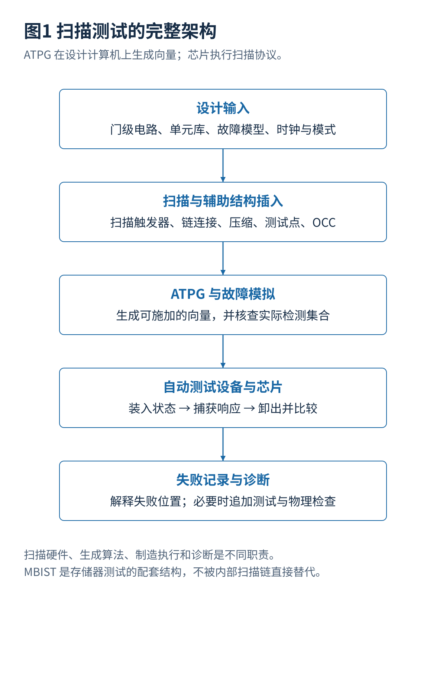

# 00 · 扫描链与ATPG总体架构与阅读导航

[总览](00_扫描链与ATPG总体架构与阅读导航.md) · [参考文献](90_参考文献与材料证据索引.md) · [教学与源码](14_教学算例源码与学习练习.md)

## 1. 本卷研究什么

扫描链与自动测试向量生成（Automatic Test Pattern Generation，ATPG）是一套相互依赖、但不能互相替代的技术。扫描链改变电路的测试访问方式，让内部状态更容易设置和读出；ATPG 根据电路、故障模型和测试限制，寻找能够把正常电路与故障电路区分开的输入。ATPG 通常在工作站或服务器上运行，不是每颗芯片都内置的“自动写测试软件”。[S01](90_参考文献与材料证据索引.md#s01)[S04](90_参考文献与材料证据索引.md#s04)

本卷是前一套《MBIST 设计架构与方法》的配套教材。存储器内建自测试通常用片上控制器执行 March 等有规律的存储器读写；扫描测试主要处理数字逻辑、寄存器及可访问的接口。二者可以共享测试管理、时钟、电源和访问接口，却使用不同的对象模型与生成方法。对大容量 SRAM，逐个扫描其全部存储单元通常不是合理替代方案。

**资料检索截止：2026 年 10 月 17 日。** 最新研究覆盖已核实的 DAC 2024—2025、ITC 2025—2026、VTS 2026 及相关作者预印本。正式会议议程只能证明工作被列入议程，不能代替完整实验论文。本卷不声称穷尽所有数据库、商业内部算法或尚未公开的成果。

## 2. 沿着一次测试看清职责

设计阶段先准备门级电路、标准单元库、时钟复位规则、工作模式和电源域说明。扫描插入工具替换或选用可扫描触发器，连接扫描链，按需要加入压缩、测试点、片上时钟控制器和访问控制。ATPG 工具读取实际测试结构，生成测试向量及期望响应；故障模拟检查这些向量到底覆盖了什么。自动测试设备再按规定的电压、时序、引脚方向和比较窗口向芯片施加向量，最后保存失败信息用于诊断。这里“工具生成了一个向量”与“硅上确实能够正确执行该向量”是两项不同的结论。

| 层次 | 输入与输出 | 主要问题 |
|---|---|---|
| 测试硬件 | 功能电路 → 可测试电路 | 内部状态可否设置和观察，功能与时序是否受到影响？ |
| 生成与评估 | 测试电路和故障模型 → 向量、期望值、覆盖报告 | 是否真正激活并观察错误，未检测原因是什么？ |
| 数据与时钟传输 | 外部比特流 → 片上各条扫描链 | 带宽、引脚、时钟域、功率与未知值怎样处理？ |
| 制造执行 | 测试程序 → 芯片响应 | 自动测试设备是否按正确周期施加和比较？ |
| 诊断与改进 | 失败响应 → 候选故障与下一步检查 | 是扫描结构、功能逻辑、时钟、电压还是约束问题？ |

## 3. ATPG 究竟测试什么，不测试什么

它不是按照“把每个封装引脚都拉高拉低一次”来定义完成情况。测试对象通常是指定电路中的故障位置，例如某条连线固定为零、某个转换过慢或某个单元内部缺陷。内部扫描触发器提供大量可控制与可观察位置，因此很多测试并不要求在功能引脚上直接看到完整内部行为。

数字输入输出的部分逻辑可以被覆盖，但驱动强度、漏电流、模拟精度、收发器眼图、电源完整性、协议互操作和完整软件功能需要相应测试。边界扫描也不能自动替代模拟参数测试。ATPG 只依据给定模型与限制工作，并不知道某个寄存器“对安全最重要”或某个软件功能“最常使用”；这些信息需要通过对象选择、故障权重和额外测试要求加入。

因此，较高的结构故障覆盖率不能替代功能验证，也不能证明不存在设计错误。功能验证检查实现是否符合需求；制造测试主要区分同一个实现中健康与有缺陷的器件。即使 ATPG 能自动生成大部分制造数字测试，人工仍需要制定模式、约束、风险和检查计划。

## 4. 设计时首先回答的五个问题

扫描覆盖多少触发器，哪些状态必须排除？外部可用多少测试数据通道，片上可并行多少链？启动与捕获使用什么时钟关系，哪些路径允许或禁止测试？压缩后是否还能编码目标向量并观察错误？失败时能否保存足够信息，同时满足数据和安全控制？这些答案共同决定结构，而不是先指定一个压缩比再补救其余问题。

**全扫描不等于无限自由。** 在一个理想组合测试切面中，扫描寄存器的输出可以看作额外输入，输入端可以看作额外输出；但是多周期约束、捕获相关性、部分扫描、时钟门控、未知值、电源隔离和编码限制会减少真实可施加状态。原理模型的简化必须在工程阶段逐项恢复。

## 5. 阅读路线

初学者按 01→02→05→06→07→08 顺序学习，先手算四个触发器和四个逻辑门的例子。做硬件集成时重点读 02、03、04、12。做算法研究时读 05—10 和 13，先固定故障集合、硬件结构与时间预算，再比较新方法。做硅后问题定位时结合 03、04、11、12，而不是只看总覆盖率。

本卷所有位序、故障矩阵、SAT 示例、最小测试集合和压缩反例均为独立教学构造，附有可运行程序。研究章节明确区分作者报告、作者材料中能够核实的条件，以及本卷提出的分析与实验建议。

## 6. 全部文档

| 编号 | 独立文档 |
|---|---|
| 01 | [扫描触发器与移位捕获原理](01_扫描触发器与移位捕获原理.md) |
| 02 | [扫描架构与物理实现](02_扫描架构与物理实现.md) |
| 03 | [测试时钟复位与高速捕获](03_测试时钟复位与高速捕获.md) |
| 04 | [JTAG测试访问与芯片级数据传输](04_JTAG测试访问与芯片级数据传输.md) |
| 05 | [故障模型覆盖率与测试质量](05_故障模型覆盖率与测试质量.md) |
| 06 | [ATPG激活传播与结构搜索算法](06_ATPG激活传播与结构搜索算法.md) |
| 07 | [SAT求解故障模拟与测试集合优化](07_SAT求解故障模拟与测试集合优化.md) |
| 08 | [测试压缩未知值与可编码性](08_测试压缩未知值与可编码性.md) |
| 09 | [测试功耗并发与运行期间测试](09_测试功耗并发与运行期间测试.md) |
| 10 | [测试点插入与可测试性设计优化](10_测试点插入与可测试性设计优化.md) |
| 11 | [扫描故障诊断与失败分析](11_扫描故障诊断与失败分析.md) |
| 12 | [设计验证工具接入与制造执行](12_设计验证工具接入与制造执行.md) |
| 13 | [2024至2026年学术成果分析与研究路线](13_2024至2026年学术成果分析与研究路线.md) |
| 14 | [教学算例源码与学习练习](14_教学算例源码与学习练习.md) |
| 90 | [参考文献与材料证据索引](90_参考文献与材料证据索引.md) |
| 99 | [证据范围版本与使用说明](99_证据范围版本与使用说明.md) |

---

[总览](00_扫描链与ATPG总体架构与阅读导航.md) · [下一篇](01_扫描触发器与移位捕获原理.md)
