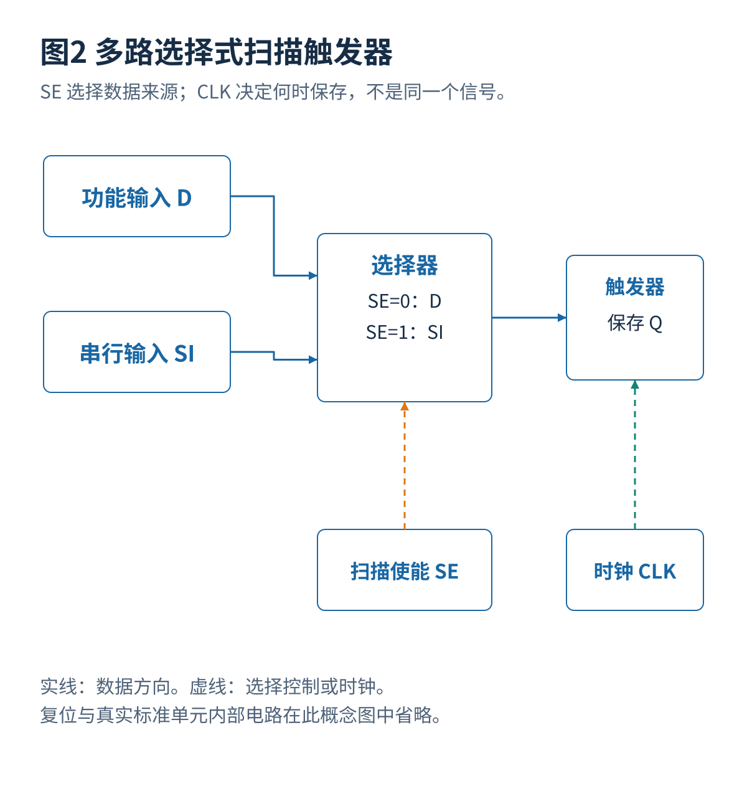
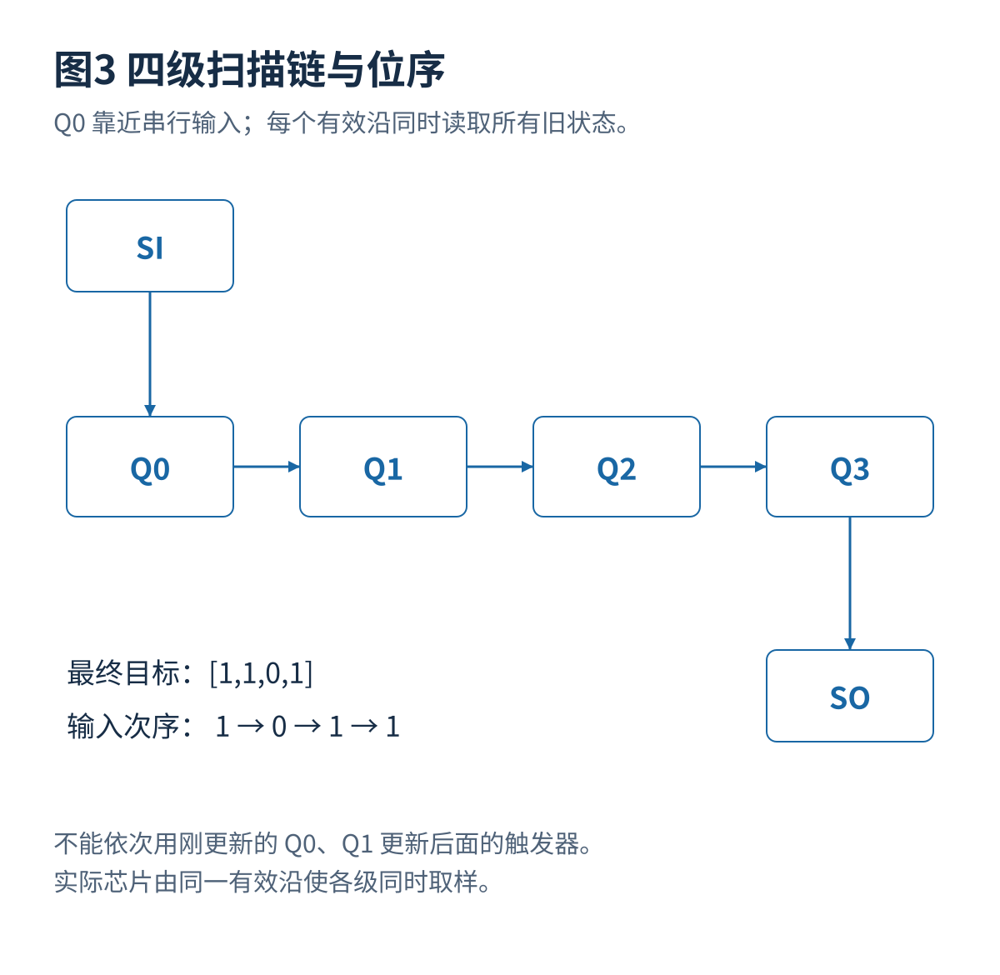
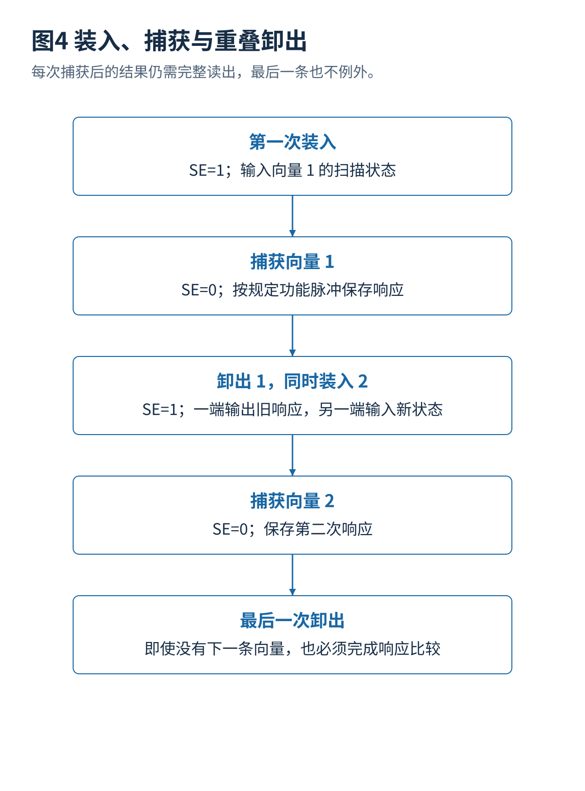

# 01 扫描触发器与移位捕获原理

[总览](00_扫描链与ATPG总体架构与阅读导航.md) · [参考文献](90_参考文献与材料证据索引.md) · [算例与源码](14_算例与源码说明.md)

## 1. 可扫描触发器
普通时序电路的内部状态通常只能通过正常输入和很多个时钟周期间接设置。假设为了检查一个组合逻辑节点，要求三个内部寄存器同时为特定值；仅使用正常功能输入时，这个状态可能很难到达。扫描结构增加一条测试数据入口，使指定寄存器可以像移位寄存器一样串行设置，再用正常数据路径执行一到多个捕获周期。[S01](90_参考文献与材料证据索引.md#s01)

最常见的多路选择式扫描触发器，在数据端选择功能输入 $D$ 或串行输入 $SI$。忽略复位并在有效时钟沿取样：

$$
Q^{+}=\begin{cases}SI,&SE=1,\\D,&SE=0.\end{cases}
$$

$SE$ 是扫描使能。它选择的是数据来源，不等于“芯片所有测试功能都已经打开”；顶层测试模式往往还控制时钟门控、复位、隔离和引脚复用。实际标准单元可能把多路选择结构集成到触发器内部，面积、延迟和时钟电容应以库为准。

## 2. 位序定义
约定 $Q_0$ 靠近扫描输入，$Q_3$ 靠近扫描输出。移位时：

$$
(Q_0^+,Q_1^+,Q_2^+,Q_3^+)=(SI,Q_0,Q_1,Q_2).
$$

算例在时钟有效沿**到达以前**读取串行输出，因此读到的是旧 $Q_3$。如果期望最终状态为 $[1,1,0,1]$，应按时间先后输入 `1,0,1,1`，也就是从最远的触发器所需位开始。外部文件可能采用不同的字符串显示顺序，不能仅凭“高位在左”判断实际时序。

初始状态为 $[0,1,1,0]$ 时，程序给出：

| 有效沿次数 | 当前 SI | 沿前 SO | 沿后状态 $[Q_0,Q_1,Q_2,Q_3]$ |
|---:|---:|---:|---|
| 1 | 1 | 0 | `[1,0,1,1]` |
| 2 | 0 | 1 | `[0,1,0,1]` |
| 3 | 1 | 1 | `[1,0,1,0]` |
| 4 | 1 | 0 | `[1,1,0,1]` |

串行连接时，不能用软件中“先更新 $Q_0$，再用新 $Q_0$ 更新 $Q_1$”模拟一个时钟沿；所有触发器应同时读取旧状态。否则一个时钟就会错误地把同一位传播到链尾。

## 3. 移位捕获与卸出
移位阶段 $SE=1$，把测试状态送入扫描寄存器。捕获阶段 $SE=0$，正常组合逻辑根据这些状态计算结果，触发器在规定时刻保存结果。卸出阶段重新打开扫描使能，把捕获结果送往外部比较单元或片上响应压缩器。移位过程也可能引起正常组合逻辑翻转，因此它并非“只动扫描线而功能逻辑静止”。

上一条向量的卸出通常可以与下一条向量的装入重叠，因为同一个移位周期一端输入新位、另一端输出旧位。第一条向量需要先装入，最后一条仍需完整卸出；忘记最后一次卸出会漏比较最后一次捕获。

对 $P$ 条向量、最长链长 $L$、每条 $c$ 个捕获脉冲，在可重叠、固定长度、没有额外协议开销的简化模型中：

$$
T\approx\frac{(P+1)L}{f_{\mathrm{shift}}}+\frac{Pc}{f_{\mathrm{capture}}}+T_{\mathrm{config}}.
$$

不同捕获脉冲间有非均匀等待时，应使用实际事件表，而不是把全部捕获脉冲除以一个频率。启动时钟、切换模式、屏蔽未知值及自动测试设备比较时间也可能增加开销。

## 4. 链数与测试时间
$F$ 个扫描触发器分到 $K$ 条平衡链时，理想最长链约为 $\lceil F/K\rceil$。但外部通道未必有 $K$ 个；压缩逻辑可能增加编码限制；链之间可能需要不同捕获时钟；大规模同时移位还受到功率限制。因此链长只是测试时间的一项因素。

例如 1200 个触发器分成六条链，均匀分配为每条 200 个，最长链为 200；分配为 `[350,250,200,150,150,100]` 时，短链等候最长链，理想移位代价增加 75%。这个比较固定了向量数、频率和并发方式，不能直接推广到压缩配置改变后的完整流程。

## 5. 扫描链自检
如果某个扫描单元或连接固定为零，后面功能逻辑的失败响应可能只是上游扫描损坏造成的。先使用规定的链完整性向量，确认长度、顺序、时钟极性和串行传输，再执行大量逻辑测试，能减少错误定位。仅使用全零、全一并不能自动覆盖所有短路、保持时间和频率相关故障；链测试同样需要明确模型及条件。

---

[上一篇](00_扫描链与ATPG总体架构与阅读导航.md) · [总览](00_扫描链与ATPG总体架构与阅读导航.md) · [下一篇](02_扫描架构与物理实现.md)
