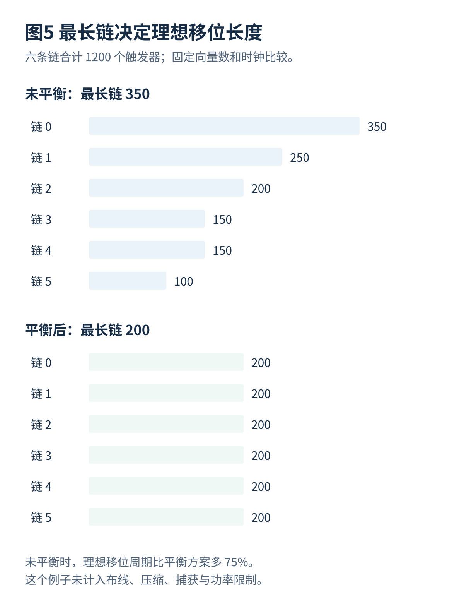

# 02 扫描架构与物理实现

[总览](00_扫描链与ATPG总体架构与阅读导航.md) · [参考文献](90_参考文献与材料证据索引.md) · [算例与源码](14_算例与源码说明.md)

## 1. 全扫描与部分扫描
全扫描通常把目标数字时序逻辑中可选的触发器都接入扫描结构，显著降低状态初始化和观察的难度。这里的“全”仍受设计范围限制，不意味着 SRAM 位单元、模拟状态或安全排除寄存器都必须串入。部分扫描只改造一部分触发器，节省某些开销，却保留了需要跨多个周期求解的内部状态，因此 ATPG 复杂性通常提高。[S01](90_参考文献与材料证据索引.md#s01)

| 结构 | 优点 | 主要代价或风险 |
|---|---|---|
| 单条长链 | 数据访问结构简单，外部通道少 | 移位时间长，单点故障影响大 |
| 多条并行链 | 缩短最长链，便于层次化组织 | 通道和时钟电容增加，并发功率受限 |
| 全扫描 | 组合测试抽象清楚，生成与诊断较直接 | 面积、时序、功率和敏感状态访问需处理 |
| 部分扫描 | 可按面积、功能时序与安全要求选择 | 仍有顺序相关约束，覆盖和生成难度需验证 |
| 分层扫描与核包装 | 复用核级模式和向量，隔离层次 | 包装开销、层间访问与模式转换更复杂 |

## 2. 不可连接与高代价连接
电源域、测试时钟关系、触发沿、隔离策略和授权规则可能构成硬限制。物理距离、扫描使能线扇出、链长不平衡和跨区布线通常影响代价。哪些是硬限制取决于架构：不同时钟域并非绝对不能同链，但必须有经过验证的时钟关系、排序规则或锁存器隔离；没有这些条件时应分开。

一个合理输入表应包含实例名、扫描单元型号、时钟域、有效沿、电源状态、复位来源、允许测试模式、物理坐标、是否允许重排和所需时序限制。**容量和位置不是唯一分组依据。** 将不同使能或复位规则的触发器混在一起后，再靠 ATPG 自动补救，可能产生无法合法捕获的结构。

## 3. 链平衡与线长

只优化最长链长，可能把远距离触发器串在一起；只优化最近邻连接，可能得到一条特别长的链。可用下式表示设计者定义的综合目标，而不是某一商业工具的内部公式：

$$
\min\ \alpha\max_k L_k+\beta\sum_{(i,j)\in E_{\mathrm{scan}}}d_{ij}+\gamma A_{\mathrm{extra}},
$$

同时满足时钟、电源、链数、保持时间和压缩可编码性约束。$d_{ij}$ 可以是早期曼哈顿距离估计；实际布线经过障碍、拥塞和缓冲器后不一定等于这个数。$A_{\mathrm{extra}}$ 可以计入额外缓冲、锁存器及测试逻辑面积。

扫描重排一般改变测试串行次序而不改变功能数据来源，但它会改变外部比特位置和压缩器连接。因此重排后必须重新导出链描述并检查测试向量对应关系。沿用旧链表可能让健康芯片失败；“功能等价成立”不能证明扫描协议仍正确。

## 4. 层次化设计
核级先确定局部扫描链和测试模式，再由芯片级组织数据传输、捕获时钟及并发。核包装寄存器可以为核的输入提供控制、为输出提供观察，减少对其他模块状态的依赖。但对包装外连线、跨核接口和片上网络仍需相应测试；只测试每个核内部，不自动覆盖核之间的连接。[S01](90_参考文献与材料证据索引.md#s01)[S06](90_参考文献与材料证据索引.md#s06)

## 5. 扫描插入的设计阶段
测试要求应在寄存器传输级设计时考虑，单元替换与连接通常与综合和物理设计协作。早期链规划有助于面积与引脚估计；放置后利用真实位置重排；实际布线与时钟树完成后重新检查保持时间和模式路径。不能把“扫描插入”理解为在芯片完成后随便追加一条线。

OpenROAD 的公开文档给出 `scan_replace` 和放置后执行扫描连接计划的流程，并注明 `scan_opt` 目前没有实际操作。它能作为了解公开扫描插入流程的入口，但不能据此假定已经包含商业 ATPG、压缩、OCC 和所有制造协议。命令必须依所用软件版本核查。[S09](90_参考文献与材料证据索引.md#s09)

## 6. 链次序研究
VTS 2026 的正式议程同时出现“压缩条件下提高覆盖的扫描链重排”和“相同功率条件下的低功率 LBIST 重排”。这说明研究对象不只是布线长度，链次序还可能影响编码相关性和可施加的激励。这里只核实这些工作的题目及会议归属，不据此声称某种重排规则已被完整验证。[S18](90_参考文献与材料证据索引.md#s18)

**分析。** 对压缩扫描，两个难控制位落在同一输入变量关系中可能造成矛盾；换位置改变关系矩阵，有机会减少矛盾。但这种收益必须与线长、保持时间和功率一起衡量。第 08 篇给出一个小规模不可编码反例。

---

[上一篇](01_扫描触发器与移位捕获原理.md) · [总览](00_扫描链与ATPG总体架构与阅读导航.md) · [下一篇](03_测试时钟复位与高速捕获.md)
