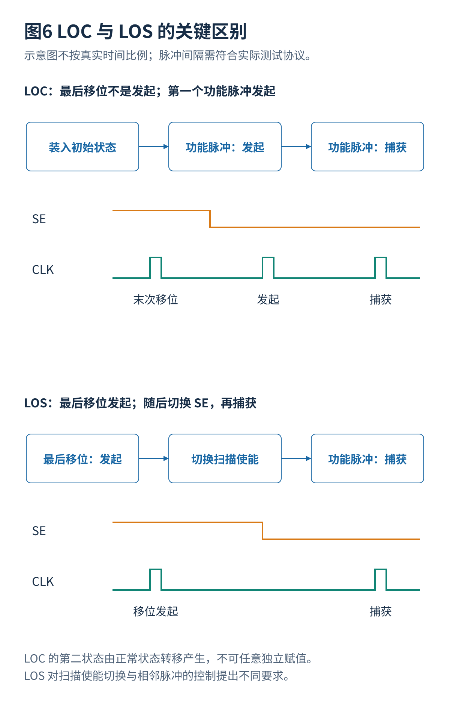
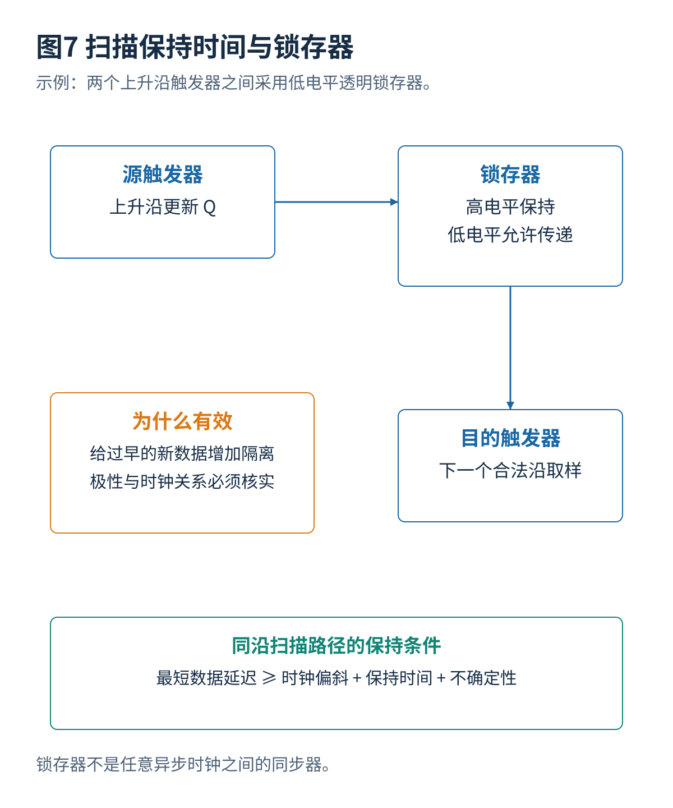

# 03 测试时钟复位与高速捕获

[总览](00_扫描链与ATPG总体架构与阅读导航.md) · [参考文献](90_参考文献与材料证据索引.md) · [算例与源码](14_算例与源码说明.md)

## 1. 移位与捕获时钟
移位主要传输测试状态，通常可以采用较低频率以满足设备带宽、扫描路径时序和平均功率。延迟故障测试则需要在规定的时间间隔内发起转换并观察其到达，因此两个关键脉冲可能需要接近目标工作频率。全程用低速测试时钟只能检查部分逻辑功能，不能据此证明高速路径符合要求。[S01](90_参考文献与材料证据索引.md#s01)[S04](90_参考文献与材料证据索引.md#s04)

片上时钟控制器（On-Chip Clock Controller，OCC）按协议选择慢速测试时钟或片上高速时钟，并发出指定的捕获脉冲。它不是 ATPG 求解器，也不自动知道所有跨时钟域路径应该怎样测试。时钟源、锁相环稳定时间、脉冲数量、门控覆盖和复位释放时序必须由设计与测试协议约定。

## 2. 发起与捕获方式

**捕获发起（Launch-On-Capture，LOC，也常称 broadside）。** 先扫描装入初始状态，退出移位。第一个功能脉冲使状态经过正常逻辑变化，发起目标转换；第二个功能脉冲捕获结果。第二个向量由正常状态转移产生，不是可以任意选择的独立向量。

**移位发起（Launch-On-Shift，LOS）。** 最后一个移位脉冲用于形成发起转换，接着切换扫描使能，再由捕获脉冲观察结果。它可能提供不同的状态可控制性，却对扫描使能切换时序、最后移位脉冲与捕获脉冲间隔提出要求。扫描路径的活动也可能不同于正常功能路径。

两者没有不依赖设计条件的绝对覆盖优劣。必须在真实可生成的脉冲、状态约束与安全电气条件下比较；把 LOC 的第二个状态任意赋值，会错误夸大可测试性。

## 3. 建立与保持时间
对一个简化的同步路径，建立时间要求可以写为：

$$
t_{\mathrm{cq,max}}+t_{\mathrm{logic,max}}+t_{\mathrm{setup}}+u_{\mathrm{setup}}
\le T_{\mathrm{launch\to capture}}+s,
$$

这里 $s=t_{\mathrm{clk,dst}}-t_{\mathrm{clk,src}}$，目的时钟较晚到达时为正；$u$ 表示按当前定义加入的时序不确定性。实际工具会结合具体发起沿、捕获沿和模式展开分析。

同沿移位的保持时间条件在相同偏斜定义下近似为：

$$
t_{\mathrm{cq,min}}+t_{\mathrm{scan,min}}\ge s+t_{\mathrm{hold}}+u_{\mathrm{hold}}.
$$

扫描数据路径很短，目的时钟又较晚到达时，新数据可能过早进入目的触发器的保持窗口。降低移位频率通常不能修复这种同沿保持违例，因为问题取决于两个时钟沿的相对到达时间，而不只是完整周期长度。

## 4. 锁存器隔离

对一种常见的同为上升沿触发的连接，可以加入低电平透明锁存器：高电平期间保持旧值，在较晚的低电平阶段才允许源数据继续传播，从而对过早到达的新数据增加隔离。具体极性和位置应按两个时钟及单元结构选择，不能机械套用“任何跨域都加一个同极性锁存器”。

锁存器会改变测试数据时序，必须体现在链描述和时钟协议中。它不是异步同步器，不能让任意相位和频率的两个独立时钟天然可靠。跨域时钟可以分开捕获、按受控顺序触发，或限制相应路径；选择取决于要测试哪类功能行为。

## 5. 复位与电源隔离
异步复位若在移位中意外拉有效，会覆盖扫描装入状态。功能时钟门控若无法在测试模式打开，部分扫描寄存器收不到时钟；若无条件打开所有门控，又可能导致捕获功率过高。断电模块的输出、保持寄存器与隔离单元也会改变 ATPG 的可观察条件。

测试复位覆盖必须区分安全隔离和正常复位：允许测试路径控制复位不意味着正常运行时允许非授权访问。恢复功能模式时还需重新建立合法系统状态，不能把扫描装入的任意内部状态直接交给软件。

## 6. 时钟与复位检查顺序
先验证移位时钟传到哪些触发器和每条链的位序；然后在无故障模型中验证捕获脉冲、扫描使能和复位；再加入包含延迟的门级时序检查。OCC 输出脉冲“数量正确”不代表宽度、间隔和时钟门控交互均正确。最后才讨论故障检测，因为错误协议本身足以产生失败响应。

---

[上一篇](02_扫描架构与物理实现.md) · [总览](00_扫描链与ATPG总体架构与阅读导航.md) · [下一篇](04_JTAG测试访问与芯片级数据传输.md)
