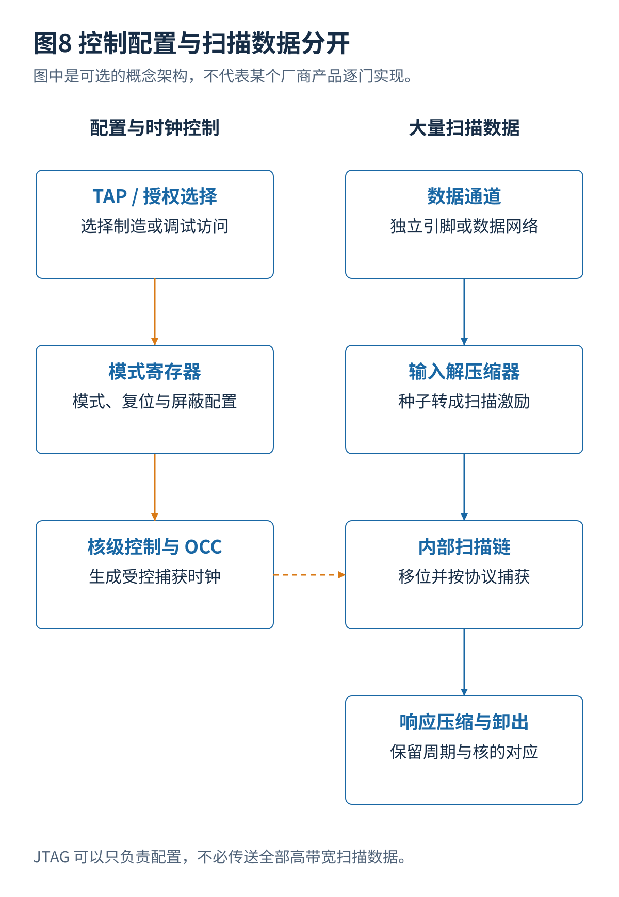

# 04 · JTAG测试访问与芯片级数据传输

[总览](00_扫描链与ATPG总体架构与阅读导航.md) · [参考文献](90_参考文献与材料证据索引.md) · [教学与源码](14_教学算例源码与学习练习.md)

## 1. 四个经常被混用的概念

扫描链是内部状态串行传输结构。测试访问端口（Test Access Port，TAP）是一个访问控制与寄存器选择接口。IEEE 1149.1 通常与 JTAG TAP 和边界扫描联系在一起；边界扫描主要在芯片输入输出附近提供测试单元，不等于把全部内部逻辑寄存器都接成了制造扫描链。ATPG 则是在这些可用结构之上生成故障检测激励的软件过程。[S01](90_参考文献与材料证据索引.md#s01)[S07](90_参考文献与材料证据索引.md#s07)

IEEE 1500 常用于嵌入核测试包装；IEEE 1687 关注片内仪器访问；IEEE 1838 关注三维堆叠器件测试访问。这些标准处于不同设计层次，不应被理解为四种互相替代的故障模型。本卷只说明用途，不将正在讨论的标准扩展或某个厂商实现写成所有芯片已采用的标准版本。

## 2. 哪些信号需要到封装引脚

| 信号或功能 | 芯片内部用途 | 外部访问可能方式 |
|---|---|---|
| 串行数据输入／输出 | 装入状态、卸出响应 | 独立通道、功能引脚复用、压缩接口或数据总线 |
| 扫描使能 | 选择移位与功能数据 | 专用信号、片上控制器产生或寄存器配置后控制 |
| 测试时钟 | 移位、启动捕获协议 | 外部测试时钟加片上高速时钟控制 |
| 测试模式 | 门控、复位、隔离和压缩模式选择 | 启动配置、TAP 指令、测试控制寄存器等 |
| JTAG 信号 | TAP 状态与寄存器传输 | 常见 TCK、TMS、TDI、TDO，复位配置依实现 |

逻辑端口不应直接按数量换算为封装引脚。数据和控制也未必走同一接口：JTAG 可以负责配置某个高速扫描数据通路，而大量向量数据通过并行引脚或片上总线传输。[S06](90_参考文献与材料证据索引.md#s06)[S07](90_参考文献与材料证据索引.md#s07)

## 3. 已有 JTAG 和调试模块，怎样增加制造测试

**复用一个 TAP。** 在允许修改 TAP 的条件下，增加独立指令与数据寄存器选择，接到测试控制器；需要避免指令冲突并验证复位、旁路和访问权限。不能把内部扫描链直接替换调试数据寄存器而不修改协议。

**多个 TAP 串接。** 让外部 TDI/TDO 依次经过多个 TAP；非目标 TAP 可以按协议进入旁路。串行长度、复位与指令装入都必须正确计算。多个 TAP 串接不等于各自可以在同一组时钟下无条件独立调试。

**按模式选择 TAP。** 外部 JTAG 引脚通过受控选择连接到调试 TAP 或制造测试 TAP；结构更独立，但不被选中的 TAP 不同时取得那组引脚。选择控制必须可靠，不能在传输途中意外切换。

这些方案都可能实现，但哪一个适合已有系统，要看 TAP 是否可修改、生命周期状态、调试授权和测试数据带宽。厂商工具能够自动加入 TAP，并不代表它有权任意改写既有调试模块的协议。[S23](90_参考文献与材料证据索引.md#s23)

## 4. 一个能够公开核实的例子：OpenTitan

OpenTitan 的 pinmux 文档明确描述了 DFT 模式配置脚和 TAP 选择脚；根据生命周期状态，外部 JTAG 接口可以选择生命周期控制、RISC-V 或 DFT TAP。文档还说明 DFT 控制器可由工具插入，以及 pad 的 `ScanRole` 可以标记扫描输入或输出。[S07](90_参考文献与材料证据索引.md#s07)[S08](90_参考文献与材料证据索引.md#s08)

这证明“测试信号可以复用引脚、调试与制造访问需要选择及权限控制”是公开设计中实际出现的机制。但公开内容不足以完整重建生产版本所有内部扫描链和每个制造引脚连接，本卷不补写未公开的链号、并发能力和精确引脚表。

## 5. 压缩网络与传输网络不是同一个东西

解压缩器把较少输入变量转换成较多扫描位，解决编码与数据量问题。扫描数据传输网络把比特送到不同核，解决带宽共享、目的核选择和核之间的调度问题。两者可以同时存在。Tessent Streaming Scan Network 是厂商提供的芯片级扫描数据传输方案示例，其说明强调核级测试与芯片级数据传输之间的解耦。[S05](90_参考文献与材料证据索引.md#s05)[S06](90_参考文献与材料证据索引.md#s06)

**本卷分析。** 如果核 A 要 10000 条模式而核 B 只要 500 条，把它们固定绑成相同完成进度可能浪费 B 的通道；数据分发与局部链组织分开后，可以按阶段调整资源。但重新配置也有开销，响应比较与未知值屏蔽仍必须保持核和周期的准确对应。

## 6. 2025—2026 年相关工作怎样阅读

ITC 2025 有 Persistent High-Bandwidth IJTAG Data Delivery 和 Holistic Validation Pattern Generation for IEEE 1687 and Streaming Scan Networks。前者讨论访问数据传输，后者讨论测试基础设施本身的验证。它们不能只根据题目被归为“新的逻辑 ATPG 求解器”。本卷取得正式摘要，未复现完整实现。[S17](90_参考文献与材料证据索引.md#s17)

对于多芯片和三维集成，先测试裸片、再测试装配连接、最后测试完整系统是不同阶段。已知健康裸片不能保证封装连接无缺陷；裸片扫描覆盖也不能代替微凸点和高速接口的专项测试。生命周期安全同样需要考虑：制造访问能够读写大量内部状态，功能密钥与正常软件数据不能无保护地暴露。

---

[上一篇](03_测试时钟复位与高速捕获.md) · [总览](00_扫描链与ATPG总体架构与阅读导航.md) · [下一篇](05_故障模型覆盖率与测试质量.md)
