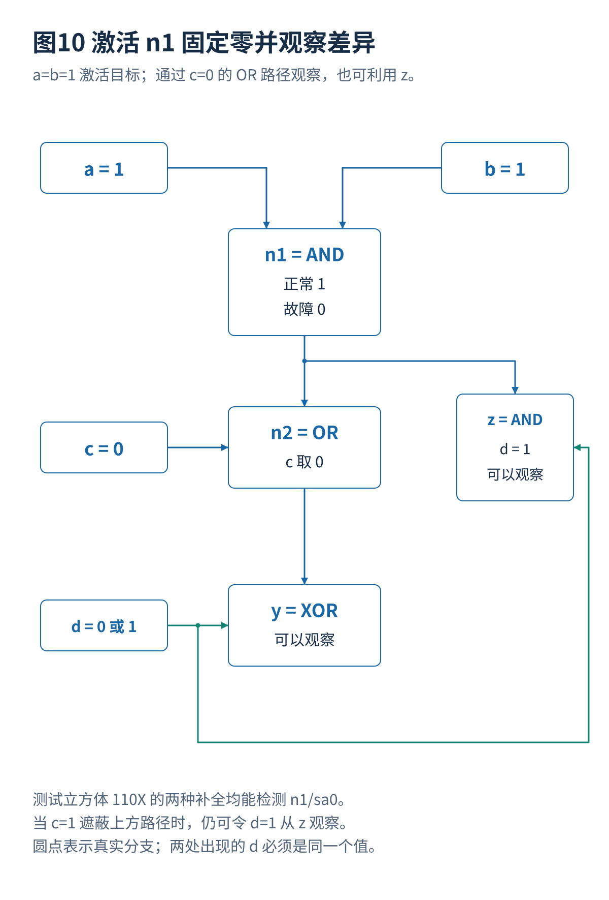
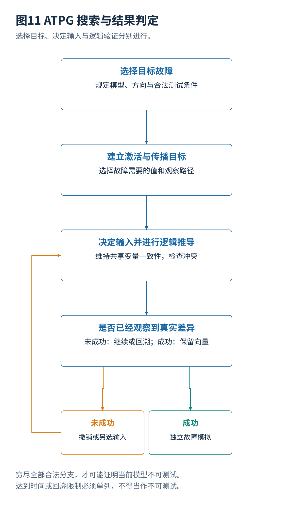

# 06 ATPG 激活传播与结构搜索算法

[总览](00_扫描链与ATPG总体架构与阅读导航.md) · [参考文献](90_参考文献与材料证据索引.md) · [算例与源码](14_算例与源码说明.md)

## 1. 生成问题定义
设正常电路为 $C(x)$，指定故障电路为 $C_f(x)$，合法输入条件为 $A(x)$。寻找：

$$
\exists x:\quad A(x)\land\bigl(C(x)\ne C_f(x)\bigr).
$$

这里的输入可以包括功能输入和扫描装入状态；输出可以包括功能输出以及捕获到扫描寄存器的结果。限制 $A$ 应包含不能同时打开的模式、有效时钟和确定的固定控制值。真实压缩结构还会引入可编码条件，不能求出无法传到芯片的向量。

## 2. 四门电路示例
统一算例：

$$
\begin{aligned}
n_1&=a\land b, & n_2&=n_1\lor c,\\
y&=n_2\oplus d, & z&=n_1\land d.
\end{aligned}
$$

目标为 $n_1$ 固定为零。首先需要正常 $n_1=1$，因此 $a=b=1$。若选择经过 $n_2$ 到 $y$ 的观察路径，OR 门的另一输入不能遮住错误，所以选 $c=0$。这时正常 $n_2=1$、故障 $n_2=0$；无论 $d=0$ 还是 1，XOR 输出都不同。因此 `110X` 是合法测试立方体，表示最后一位可以取任意值，而不是芯片输入真实处于未知电压。

若误选 $c=1$，经 OR 门到 $y$ 的差别消失。但还存在另一条输出 $z$：只要 $d=1$，它仍能观察 $n_1$ 的异常。这说明“某条路径传播失败”不能直接推出该故障不可测试，求解器需要尝试其他观察方式。

## 3. D 代数
使用 $(v_{\mathrm{good}},v_{\mathrm{faulty}})$ 表示正常与故障值对：$D=(1,0)$，$\overline D=(0,1)$；共同零、共同一分别记作 0、1，未确定时记 X。D 算法将激活、传播和前提满足统一在这种双电路逻辑中。[S02](90_参考文献与材料证据索引.md#s02)

例如 $D\land1=D$，$D\land0=0$；$D\lor0=D$，$D\lor1=1$。这些等式解释了为什么 AND 的非目标输入常需设为 1，OR 的非目标输入常需设为 0。XOR 的另一个确定输入只会保持或反转差别，不会像 AND 的零一样遮蔽。

只有五个符号并不足以避免所有搜索冲突。一个信号经多条路径重新进入同一门时，赋值相关性必须保持；不能将同一个变量的两处出现当作两项独立选择。

## 4. 结构搜索算法
| 方法 | 核心思想 | 优点 | 局限 |
|---|---|---|---|
| D 算法 | 对内部目标建立激活、传播与一致性要求 | 直接反映故障检测结构，适合手工理解 | 内部赋值冲突和多路径相关性可能使回溯增加 |
| PODEM | 建立内部目标，再回溯到主要输入做决定 | 决策主要集中在输入，避免任意内部赋值 | 多次回溯、重复逻辑推导仍可能昂贵 |
| FAN | 利用扇出结构、多重回溯和更强的推导策略 | 更充分利用电路结构，减少无效搜索 | 仍是启发式组合，效果依电路与目标而变 |
| SAT 型方法 | 将双电路差异与限制转成布尔约束 | 可利用冲突学习和证明机制 | 编码、内存、搜索与测试压缩需要共同设计 |

PODEM 的两个方向不要混淆：从故障目标往输入追溯，决定“应如何控制”；从已赋值输入向输出推导，检查“实际发生了什么”。当冲突出现时，撤销某个决定并尝试另一个值，而不是修改故障定义让当前输入通过。

## 5. 可控性与可观测性
SCOAP 是常用结构性估计。组合零可控制性 $CC_0$ 和一可控制性 $CC_1$ 越大，表示按该估计越难控制；不是数值越小越难。对主要输入可设代价为 1，对二输入 AND 门：

$$
CC_0(y)=1+\min(CC_0(a),CC_0(b)),
$$

$$
CC_1(y)=1+CC_1(a)+CC_1(b).
$$

因为产生零只需一个输入为零，产生一则要求两个输入都为一。若输出观察代价为 $CO(y)$，经 AND 观察输入 $a$ 的估计为：

$$
CO(a)=1+CO(y)+CC_1(b).
$$

这些是忽略部分相关性的启发式代价，不是故障检测概率或最小 SAT 决策数。对重汇合逻辑，局部可控制性很好仍可能存在全局矛盾。[S01](90_参考文献与材料证据索引.md#s01)[S03](90_参考文献与材料证据索引.md#s03)

## 6. 故障模拟
为 $n_1/sa0$ 生成的 `1100` 可能顺便检测别的故障。故障模拟计算该向量实际检测的集合，再决定哪些目标不必继续单独生成。只统计“求解器成功处理的目标数”，会漏算附带检测，也可能把不正确的启发式答案当成成功。

在全部 16 个输入组合上模拟 32 个故障，得到检测矩阵。精确枚举证明四条向量可以覆盖全部 32 个目标，一组最小解为 `0100,1011,1100,1101`。这是这个明确小电路与故障集合的结论，不表示任意四门电路都需要四条向量。

## 7. 学习式搜索定位
学习器可以建议下一个输入、内部目标或搜索顺序；结构推导、SAT 或独立故障模拟负责确认结果。这样可以改变搜索效率而不牺牲对每条成功向量的逻辑验证。SmartATPG 和 InF-ATPG 属于这一研究脉络；它们与把整个问题改写为连续优化的 DEFT 应分开讨论，详见第 13 篇。[S11](90_参考文献与材料证据索引.md#s11)[S15](90_参考文献与材料证据索引.md#s15)

---

[上一篇](05_故障模型覆盖率与测试质量.md) · [总览](00_扫描链与ATPG总体架构与阅读导航.md) · [下一篇](07_SAT求解故障模拟与测试集合优化.md)
