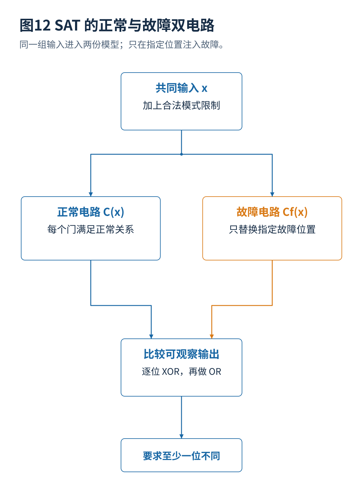

# 07 · SAT求解故障模拟与测试集合优化

[总览](00_扫描链与ATPG总体架构与阅读导航.md) · [参考文献](90_参考文献与材料证据索引.md) · [教学与源码](14_教学算例源码与学习练习.md)

## 1. SAT 的优势来自表达与证明，不是一个神奇按钮

布尔可满足性求解（SAT）判断一组布尔条件能否同时满足。将正常电路与指定故障电路并列，令两者共享真实输入，再要求至少一个可观察输出不同，就得到一个检测求解模型。这个比较结构常称为 miter。只有把故障所在连接和测试限制准确表达出来，SAT 结果才对应真实 ATPG 问题。[S02](90_参考文献与材料证据索引.md#s02)[S12](90_参考文献与材料证据索引.md#s12)

对 AND 门 $y=a\land b$，合取范式（CNF）为：

$$
(\neg a\lor\neg b\lor y)\land(a\lor\neg y)\land(b\lor\neg y).
$$

前一项保证两个输入都为一时输出不能为零，后两项保证输出为一时两个输入都为一。整个电路为每个门增加类似关系。以输出 $y,z$ 为例，检测要求为：

$$
(y_g\oplus y_f)\lor(z_g\oplus z_f)=1.
$$

对节点固定故障，故障电路中的该节点直接被强制为固定值，同时切断它原来的计算约束；不能既要求它遵守正常门函数，又要求它固定，否则错误地缩小了故障行为。对分支故障，只替换相应门输入，其他扇出保留。

## 2. SAT、UNSAT 与中止不能混为一谈

SAT 给出一个满足条件的赋值，抽取输入后再做独立故障模拟确认。UNSAT 表示在当前编码、时序展开长度和合法条件下不存在解；若要把它解释为“这个故障不可测试”，必须确认模型没有漏掉合法模式。资源限制或超时则仅表示当前过程未得到结论。

本卷实现的小型 DPLL 求解器没有超时和冲突学习，仅适用于小电路教学；它通过单位子句传播及穷尽分支给出 SAT/UNSAT。工业规模通常需要更强的学习、预处理、增量复用和内存管理，不能根据这个小程序速度推断先进方法的工业表现。

## 3. 一个真正不可测试的逻辑例子

令 $n=a\land b$，$y=a\lor n$。由吸收律 $y=a$，所以内部节点 $n$ 固定为零不会改变输出。穷举全部四个输入和本卷 SAT 模型都证明该目标没有检测向量。

但是 $n$ 固定为一可能使 $a=0$ 时输出错误，因此“这个节点处于冗余逻辑”不表示其所有故障方向都等价。删除冗余逻辑还会改变故障位置集合；不能在比较覆盖率时静悄悄改动电路再使用旧分母。

## 4. 顺序 ATPG 与有界展开

部分扫描或 LOC 场景需要显式状态转移：

$$
s_{t+1}=F(s_t,x_t),\qquad y_t=G(s_t,x_t).
$$

展开 $k$ 个周期后，把每一帧连起来并设置初始化和时钟条件。一次长度为 $k$ 的 UNSAT 只证明该展开范围内没有向量，未必证明更长序列也没有。全扫描降低这种历史依赖，但并不消除工程协议带来的帧间关系。

## 5. 故障模拟怎样加速

最直接的串行方法对每条向量、每个故障分别计算。位并行方法把多个故障或多个向量编码到处理器字的不同位中，用一个位运算并行求多个逻辑实例。事件驱动方法只传播发生变化的节点；差分方法利用正常与故障电路的大部分计算相同；故障丢弃则在筛选任务中暂时不再模拟已经满足检测次数的故障。[S01](90_参考文献与材料证据索引.md#s01)[S10](90_参考文献与材料证据索引.md#s10)

这些方法的加速来自不同维度，并行数量、事件稀疏性、存储访问和电路结构共同决定收益。完整诊断或多次检测时，简单丢弃所有已检测故障可能失去后续信息。

## 6. 向量合并与数据压缩是两个问题

测试立方体中的 X 是未规定输入位。两个立方体在所有已规定位置不冲突时可以尝试合并，例如 `10XX` 与 `X01X` 得到 `101X`。但要保留各自目标，合并结果应再次故障模拟；若还有压缩器和多周期条件，也要检查可编码性与时序关系。

**静态测试集合缩减**从已有向量中删去冗余项；**动态合并**在生成过程中尽量让一条向量同时检测多个目标；**扫描数据压缩**减少传输这些位所需的外部数据。第一项减少向量数量，第三项可能保持向量数量却改变每条的外部长度，不能统称为相同压缩比。

## 7. 最小集合覆盖模型

令候选向量 $i$ 检测故障集合 $D_i$，选择变量 $z_i\in\{0,1\}$。一个教学模型是：

$$
\min\sum_i z_i,\qquad
\sum_{i:f\in D_i}z_i\ge1\quad\forall f\in F_{\mathrm{target}}.
$$

若不同向量的应用代价不同，目标应改为 $\sum_i t_i z_i$。若重排影响功率，还要加入相邻向量代价，此时不能只独立选择每条向量。多次检测时覆盖约束右端可以增加，但还需规定怎样区分独立的检测条件。

本卷对 16 条候选向量精确枚举，最少为四条；贪心也得到四条，但一般问题中贪心并无最优保证。程序提供完整检测矩阵，读者可自行改变目标集合或代价。

## 8. PastATPG 带来的研究问题

PastATPG 在 DAC 2025 提出结合部分赋值 SAT 的混合生成框架，重点是保留有用的未规定位以改善测试合并，作者公开了程序入口。本卷未运行原代码，不提供未经复现的性能结论。[S12](90_参考文献与材料证据索引.md#s12)[S13](90_参考文献与材料证据索引.md#s13)

**本卷分析。** 普通 SAT 解把很多变量赋值，只能证明这一点可检测；删除某些赋值形成立方体后，要保证其所有合法补全仍满足所需条件，或明确定义后续求解／故障模拟如何保持目标。一个求解器“能输出 X”本身不是充分正确性证明。对实际压缩，保留自由度还可能提高可编码概率，第 08 篇给出线性代数解释。

---

[上一篇](06_ATPG激活传播与结构搜索算法.md) · [总览](00_扫描链与ATPG总体架构与阅读导航.md) · [下一篇](08_测试压缩未知值与可编码性.md)
