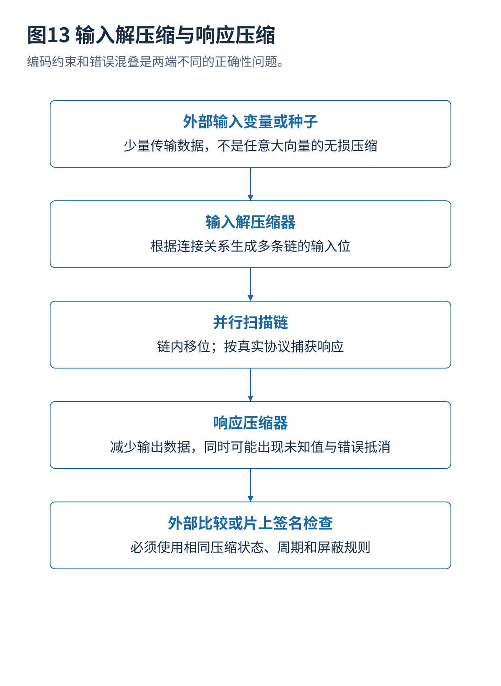
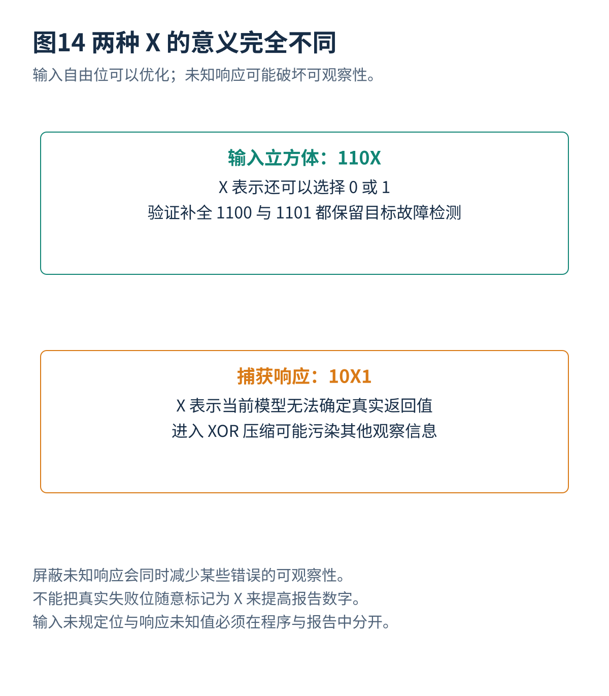

# 08 测试压缩未知值与可编码性

[总览](00_扫描链与ATPG总体架构与阅读导航.md) · [参考文献](90_参考文献与材料证据索引.md) · [算例与源码](14_算例与源码说明.md)

## 1. 压缩通道结构
未压缩的扫描测试需要把每个规定扫描位逐一传进去。若一个向量仅有少数位必须固定，其他位只是满足故障检测所剩的自由度，就可以把少量种子或控制位送入片上解压缩器，生成完整扫描数据。嵌入式确定性测试压缩利用的是这种自由度，不是把任何长度的任意比特串无损压到任意小。[S05](90_参考文献与材料证据索引.md#s05)

常见输入结构使用线性反馈寄存器、相位变换网络和外部注入变量；这里的具体连接决定可生成的扫描位。响应侧则通过空间或时间压缩减少卸出通道。输入与响应两端有不同正确性问题：前者必须能施加所需激励，后者必须保留足够错误可观察性。

## 2. 三扫描位反例
在二元域 $GF(2)$ 中加法为异或，考虑：

$$
\begin{bmatrix}q_0\\q_1\\q_2\end{bmatrix}
=
\begin{bmatrix}1&0\\0&1\\1&1\end{bmatrix}
\begin{bmatrix}s_0\\s_1\end{bmatrix}.
$$

四种种子只生成 `000,011,101,110`。若 ATPG 得到三个必须为一的位 `111`，它要求 $s_0=1$、$s_1=1$，同时 $s_0\oplus s_1=1$，发生矛盾。因此“逻辑上能检测”不代表“通过当前解压缩器能施加”。

若目标只要求 `1X1`，则 $s_0=1$ 且 $s_1=0$ 即可，实际扫描位为 `101`。保留未规定位使编码成功。对一般规定子集 $C$，需要解：

$$
A_Cs=b_C.
$$

线性系统可解当且仅当 $\operatorname{rank}(A_C)=\operatorname{rank}([A_C\mid b_C])$。自由变量多通常有利，但是否可解还取决于约束相关性，而不仅是规定比特数量。实际时序解压缩器在多个周期上构造更大的关系，还涉及种子状态和注入控制。

## 3. 响应异或抵消
若压缩器只输出 $r_0\oplus r_1\oplus r_2$，错误向量 `110` 的两个翻转相互抵消，压缩后看不出来。即使增加一个独立观察位，仍可能存在非零零空间：例如输出 $[r_0\oplus r_1,r_1\oplus r_2]$ 时，错误 `111` 仍然被抵消。

因此响应压缩要结合实际故障模拟和压缩器结构分析。多输入签名寄存器的某些随机模型可得到与签名宽度有关的混叠概率，但对确定的故障与向量，是否混叠是一个具体代数事实，不能随意套用随机概率代替验证。

## 4. 两类未知值

**输入立方体中的 X** 表示某位还可以选择零或一，是优化自由度。**实际响应中的 X** 表示在当前模型下无法确定的值，例如未初始化寄存器、存储器黑盒输出或被隔离的信号。将后者接入异或网络，可能让其他本来可比较的数据也变成未知。

可以控制未知值来源、调整捕获、隔离或屏蔽相应响应，也可以采用更能容忍未知值的观察结构。屏蔽不是免费：该处错误也可能无法再观察。若把失败位错误标成 X 屏蔽，覆盖报告可能虚假改善。因此每个屏蔽规则都应可解释，并在故障集合和比较周期上反映影响。

## 5. 压缩比定义
设内部扫描位数为 $F$、外部每条向量实际输入位数为 $B_{\mathrm{in}}$，可定义输入数据比 $F/B_{\mathrm{in}}$；输出需要单独定义。还应计入种子、模式控制、屏蔽位、对齐和配置开销。若高压缩导致向量数增加，最终数据量可能不降反升：

$$
V_{\mathrm{total}}=\sum_{p=1}^{P}(B_{\mathrm{in},p}+B_{\mathrm{out},p}+B_{\mathrm{control},p}).
$$

压缩前后的实际执行时间还受通道并行度、最大链长、移位频率和捕获约束影响。厂商产品介绍中的典型比率不能直接作为特定电路的保证。[S05](90_参考文献与材料证据索引.md#s05)

## 6. 编码与链重排
扫描重排会改变某些目标位落在关系矩阵的哪些行，测试点会改变故障激活及观察所需的规定位置，生成算法则决定选择哪个立方体。因此“先随意连接链，再单独优化 ATPG”可能错过更好的方案，但联合搜索也会增加计算规模。一个可管理的方法是先筛选小批候选结构，用近似评估排序，再对前几名执行真实插入、ATPG、故障模拟与时序检查。

2025 年 ITC 的 EDT 输入配置选择，以及 2026 年 ITC 的压缩感知 ATPG 仿真评估，都涉及更快估计候选压缩结构代价。公开材料支持这一研究方向，不足以证明近似排序在任意设计上保持最优。更详细的证据范围见第 13 篇。[S17](90_参考文献与材料证据索引.md#s17)[S19](90_参考文献与材料证据索引.md#s19)

---

[上一篇](07_SAT求解故障模拟与测试集合优化.md) · [总览](00_扫描链与ATPG总体架构与阅读导航.md) · [下一篇](09_测试功耗并发与运行期间测试.md)
