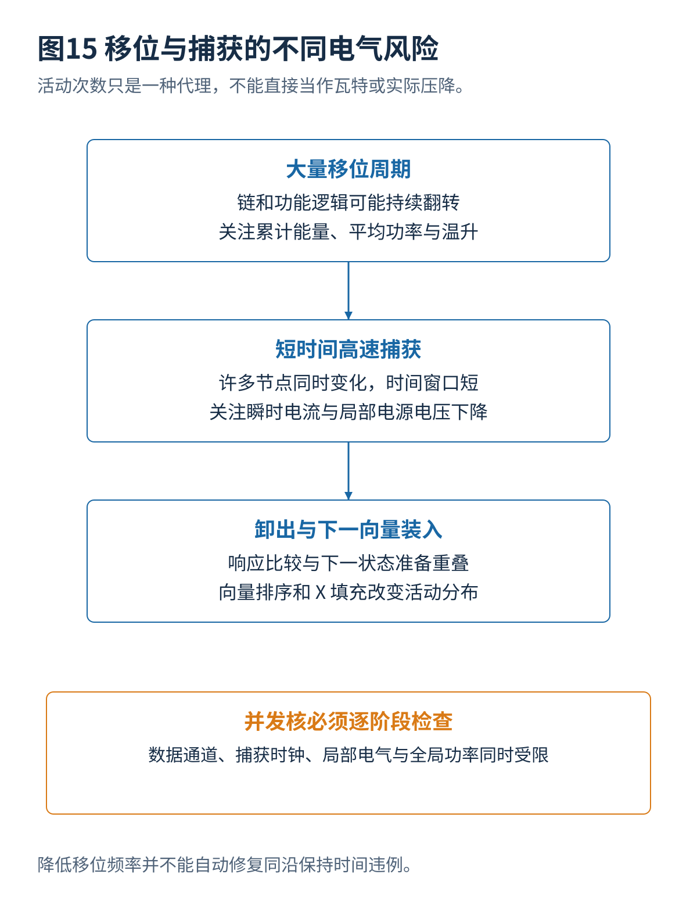

# 09 测试功耗并发与运行期间测试

[总览](00_扫描链与ATPG总体架构与阅读导航.md) · [参考文献](90_参考文献与材料证据索引.md) · [算例与源码](14_算例与源码说明.md)

## 1. 移位与捕获功率
移位周期很多，影响总能量和温升；高速捕获时间短，却可能同时翻转大量时钟与逻辑节点，产生局部电流峰值。扫描装入状态通常不必满足正常软件可达性，因此可能激活正常运行时很少同时活动的组合路径。若测试引起异常电压下降，健康芯片也可能出现错误响应。

一个常用动态功率近似为：

$$
P_{\mathrm{dyn}}\approx\alpha C_{\mathrm{eff}}V^2f.
$$

这里将 $\alpha$ 定义为与所用有效电容一致的充放电活动因子；不同统计定义可能把常数系数并入它。实际功率还包括内部短路、时钟树、泄漏与毛刺。简单汉明距离只能作为活动代理，不能直接变成瓦特。

## 2. 未知位填充
给定初始扫描状态和输入立方体，可以选择 X 的值以减少移位过程中的寄存器翻转。算例初始状态 `[0,1,1,0]`，目标立方体 `[1,X,0,X]`，按第 01 篇位序输入。程序逐个统计每次移位前后四个触发器的变化：

| 填充后的状态 | 整个装入过程寄存器翻转次数 |
|---|---:|
| `1000` | 5 |
| `1001` | 12 |
| `1100` | 6 |
| `1101` | 13 |

本例全零填充恰好最好，不意味着全零填充普遍最优。改变初始捕获状态、链次序、压缩关系或目标规定值，就可能改变最优结果。更重要的是，这个统计没有组合逻辑毛刺、电容、时钟树与捕获电流，所以只称为“寄存器翻转次数”，不报告虚构的功率节省百分比。

## 3. 控制量与代价
降低移位频率通常降低动态平均功率，却增加测试时间；分段时钟门控减少同时移位的单元，却可能增加控制与向量长度；捕获分域减少峰值，却限制跨域故障激励；向量排序改变相邻状态，却可能使诊断流程和压缩种子组织更复杂。每种方案都要明确哪个条件保持不变，不能把多个变化的收益归给一个算法。

捕获安全需要检查向量下的活动分布，不仅看全芯片总和。靠近同一电源网区域的大量活动可能造成局部压降，即使总功率低于预算仍不安全。可从活动估计、门级功率到电源网络分析逐级提高精度，不提供实际工艺电流模型。

## 4. 多核调度
设核 $i$ 的测试从 $s_i$ 开始，局部功率曲线为 $P_i(\tau)$。简单全局约束为：

$$
\sum_i P_i(t-s_i)\le P_{\mathrm{budget}}\quad\forall t.
$$

还要检查共享数据通道、OCC、比较带宽、断电区域和空间电气约束。只检查启动瞬间是不够的：两个核可能开始都在低功率移位，稍后同时进入高功率捕获。把同一个测试核从 10 条短链改成 2 条长链，还会改变它的持续时间与曲线，所以调度不能固定地脱离结构优化。

此处与前一卷 MBIST 调度的数学形式相似，但扫描还增加向量间差异、快速捕获和压缩器状态；不能直接把一个“每个存储器固定功率”的模型照搬。

## 5. LBIST 与 ATPG
逻辑内建自测试（Logic Built-In Self-Test，LBIST）通常在片上生成激励、控制扫描和累计响应签名。伪随机激励结构简单，但某些需要许多条件同时成立的故障难以检测，可能需要测试点、加权、重播种或确定性补充。[S01](90_参考文献与材料证据索引.md#s01)

在极简的独立样本模型中，某个故障每条随机向量的检测概率为 $p$，$m$ 条后漏检概率为 $(1-p)^m$。若 $p$ 极小，增加向量数的效果有限；真实 LFSR 序列并不满足所有独立随机假设，工程结论仍需实际故障模拟。

LBIST 与 ATPG 并非二选一：确定性算法可以帮助生成种子或补充难故障向量。VTS 2026 列有相同功率限制下的可编程低功率 LBIST 扫描重排工作；仅依据议程不能推断具体调度或编码实现。[S18](90_参考文献与材料证据索引.md#s18)

## 6. 运行期间测试
制造筛选可以先执行高失败概率的向量，尽早发现不合格器件；然而提前结束会减少诊断信息。对尚未发现失败的器件，基于统计跳过测试需要验证漏检风险，并监控工艺和批次变化，不能仅凭训练集效果修改出货标准。

运行期间扫描通常破坏被扫描状态，因此需要暂停或隔离任务、保存必要状态、测试、复位或恢复，再重新开放功能。CPU 缓存一致性、DMA、外部设备、看门狗和密钥状态都会影响是否可恢复。测试了一个核不等于测试了其他核仍在活动时的系统交互，也不自动满足某个功能安全标准。

---

[上一篇](08_测试压缩未知值与可编码性.md) · [总览](00_扫描链与ATPG总体架构与阅读导航.md) · [下一篇](10_测试点插入与可测试性设计优化.md)
