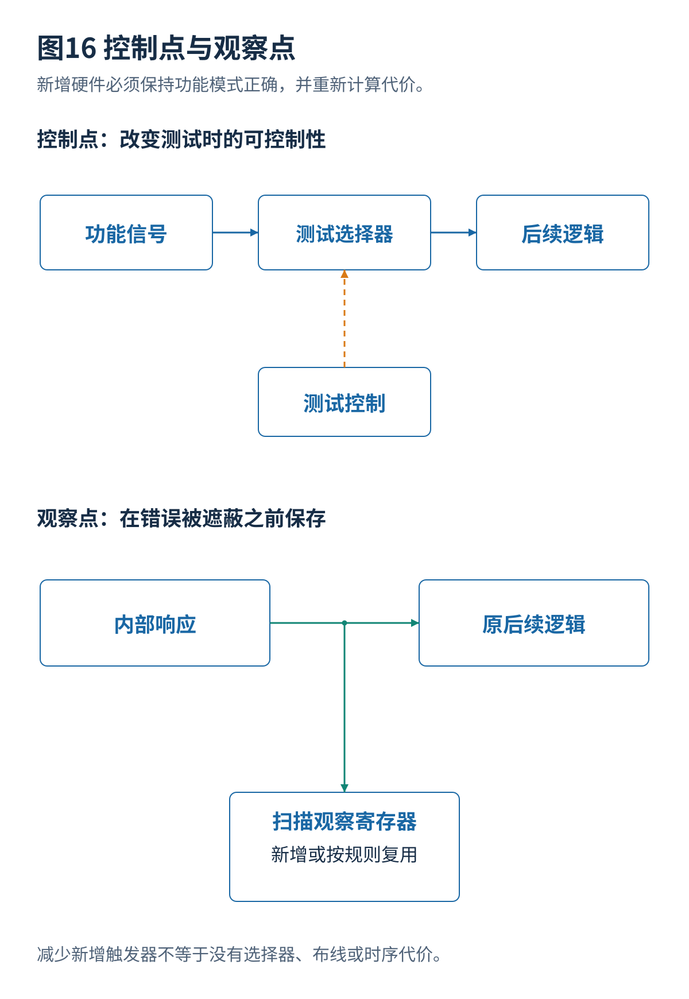

# 10 测试点插入与可测试性设计优化

[总览](00_扫描链与ATPG总体架构与阅读导航.md) · [参考文献](90_参考文献与材料证据索引.md) · [算例与源码](14_算例与源码说明.md)

## 1. 控制点与观察点
控制点允许在测试模式强制或影响某个内部节点，以减少激活故障所需的复杂输入组合。观察点把某个内部响应送到扫描触发器或响应观察网络，缩短传播路径。二者都改变可测试结构，而不仅改变求解顺序。[S01](90_参考文献与材料证据索引.md#s01)[S24](90_参考文献与材料证据索引.md#s24)

例如 $u=a\land b\land c\land d$，要使 $u=1$ 需要四个输入都为一。测试控制能在适当位置提供一个额外可控制变量，就可能降低后面目标的控制难度。观察点则可以在错误被后级门遮蔽之前捕获它。但额外选择器、导线、触发器、时钟电容和功能路径延迟都必须计入代价。

## 2. 功能等价验证
测试使能无效时，新增控制逻辑必须退化为原功能关系。还应检查真实电源状态、复位、未知值和时序，不只是理想二值布尔等价。对控制点强制值的选择，需要区分 AND 型、OR 型、选择器型等实现；不同形式能改善的控制方向不一样。

观察点也不是永远无害。附加扇出会改变延迟；多个信号通过 XOR 合并可能使错误抵消；复用现有触发器可能同时限制其原先功能捕获。增加观察点后，一些寄存器位不能再被认为完全独立，因此 ATPG 模型需要同步更新。

## 3. 测试点选择
可用 SCOAP 找到控制或观察代价较大的节点，但纯局部代价不等于真实故障收益。更直接的方法是评估候选点后故障覆盖、规定比特数、向量数和工具执行时间的变化。候选点很多时，逐个完整插入和 ATPG 很昂贵，因此研究采用贪心、结构分组、学习式排序或代理评估。[S11](90_参考文献与材料证据索引.md#s11)[S24](90_参考文献与材料证据索引.md#s24)

分析上宜区分四个目标：固定面积下提高检测数；固定覆盖下减少向量；减少求解时间；降低实际应用时间。它们可能冲突。例如观察点提高覆盖，却因为增加扫描位和编码困难而延长测试。

## 4. 选择模型
令候选点 $j$ 的选择变量为 $z_j$，其硬件代价为 $a_j$。在预算 $A$ 下：

$$
\sum_j a_jz_j\le A.
$$

目标不能简单认为是 $\sum_jg_jz_j$，因为两个点可能覆盖相同难故障，也可能只有组合使用才有效。实际收益更适合写作 $G(S)$，其中 $S$ 是整个选点集合。贪心能提供易解释的增量流程，但只有在特定数学条件下才有近似保证，不能假定真实 ATPG 收益必然满足这些条件。

## 5. LITE 资源复用
LITE 的作者全文讨论 ATPG 感知的轻量扫描插入，并利用已有功能扫描触发器减少专用观察资源的开销；ITC 2025 正式议程列有相应工作。根据作者稿解释其方向，而不把概念图当作论文电路的逐门复制。[S16](90_参考文献与材料证据索引.md#s16)[S17](90_参考文献与材料证据索引.md#s17)

**分析。** 复用的价值在于减少某些新增存储单元，但选择器、异或与连接仍可能有面积和时序代价。应核查复用位置是否影响原扫描捕获、多个观察信号是否抵消，以及省下的触发器是否被额外向量或更高时钟电容抵消。合理对照应固定覆盖目标、标准单元库和完整插入规则，而不只比较新增触发器个数。

## 6. RTL 到网表
早期优化更容易利用设计意图，修改代价也较低；但寄存器传输级结构与综合后门级电路不一一相同，综合可能合并、复制或删除节点。因此早期预测必须与真实综合和扫描结果对应。ITC 2025 的 TESLA 讨论多大语言模型协作的提前测试优化；ITC 2026 列有在设计流程中选择测试点插入位置的研究。这些工作关注的正是“何时决策和用什么反馈”，而不仅是最后选几个门。[S17](90_参考文献与材料证据索引.md#s17)[S20](90_参考文献与材料证据索引.md#s20)[S21](90_参考文献与材料证据索引.md#s21)

**研究设计。** 先用无学习方法建立稳定基线，固定每次综合版本和约束，保存原始与插入后的功能等价结果，再研究学习器是否减少昂贵评估次数。不要把模型生成脚本成功运行当成可测试性提升证据。

---

[上一篇](09_测试功耗并发与运行期间测试.md) · [总览](00_扫描链与ATPG总体架构与阅读导航.md) · [下一篇](11_扫描故障诊断与失败分析.md)
