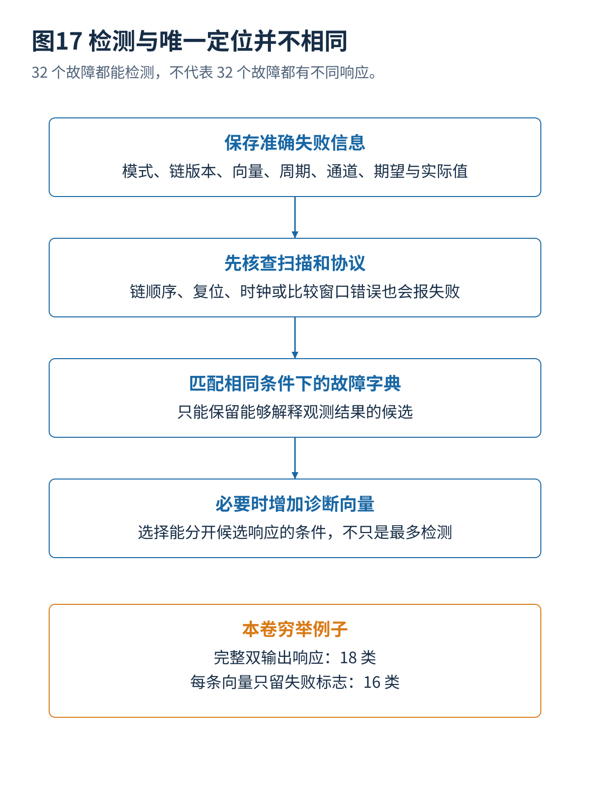

# 11 扫描故障诊断与失败分析

[总览](00_扫描链与ATPG总体架构与阅读导航.md) · [参考文献](90_参考文献与材料证据索引.md) · [算例与源码](14_算例与源码说明.md)

## 1. 失败信息与定位
制造筛选只要找到一次可信错误就可以知道器件不满足测试；诊断要根据在哪条向量、哪个比较周期、哪个输出位失败，推断哪些故障最可能解释结果。只有“总计失败一次”的记录通常无法定位，响应压缩和提前停止都会改变可用信息。[S01](90_参考文献与材料证据索引.md#s01)

最小可追溯记录应包含设计和链描述版本、测试模式、向量编号、比较周期、输出通道、期望值、实际值、屏蔽设置以及时钟电压温度条件。实际设备的失败存储容量有限，需要明确记录溢出是否被标记；截断记录不能伪装成完整响应。

## 2. 结构故障与逻辑故障
错误链长、链序、扫描使能、复位和时钟都可能让大量输出同时失败。若低速链完整性测试已经失败，应先检查扫描路径，而不是直接运行复杂功能逻辑故障定位。若只在高速捕获失败，再结合时序、电压和活动分布检查，不能立即认定是某条功能路径过慢。

扫描断链或某位固定故障可能影响后面许多位置。实际观察到的首个错误位还受卸出顺序和错误传播影响，不能将“最先报错的比较周期”机械换成“物理上第一处坏点”。

## 3. 故障字典与等价类
对每个候选故障预先模拟一组向量，保存响应或错误签名；实际失败时比较候选。令故障 $f$ 在测试集合 $T$ 上的错误签名为：

$$
\sigma_T(f)=\bigl(C(t)\oplus C_f(t)\bigr)_{t\in T}.
$$

若 $\sigma_T(f_1)=\sigma_T(f_2)$，这组测试不能区分两者。它们可以都被检测到，却不能被彼此定位。增加能使两者响应不同的向量，才可能提高诊断分辨能力。

本算例电路在全部 16 个输入上，可以检测 32 个故障，但完整双输出错误签名只有 **18 类**。若每条向量只保留“是否有任何输出错误”，只剩 **16 类**。因此 100% 检测不等于每个故障都能唯一定位。这些类别由随文程序实际枚举，而不是经验估计。

## 4. 诊断向量选择
假设当前候选集合为 $H$。一个简单策略是选择能把候选响应尽量分开的向量，而不是只检测最多故障。无先验概率时可以最小化最大响应组大小；有可信先验时可以最大化预期信息增益：

$$
\operatorname{IG}(t)=H(F)-\sum_rP(r\mid t)H(F\mid r,t).
$$

这里的先验和响应模型必须可信。对于间歇故障、噪声、多故障或电压敏感行为，实际响应未必匹配单故障字典，需要允许不一致并报告置信范围。候选为空既可能是新缺陷，也可能是链描述、期望值或条件错误。

## 5. 压缩与记录带宽
若响应经过压缩，应在相同压缩器与屏蔽规则下生成字典。使用原始扫描响应的字典去匹配压缩输出，或者忽略控制器种子状态，会使正确故障也解释不了记录。未知值屏蔽可能把某些候选区分信息一起删掉。

数据量很大时，可以分阶段收集：先低成本筛选，再只对失败器件启用较细观察或选择性重测。但额外模式必须经过验证，并确认不会因重新上电或重新初始化而消除原先间歇现象。

## 6. 物理定位
逻辑诊断输出的是与响应一致的候选位置或缺陷模型，需要结合放置布线、单元内部结构、制造批次及进一步物理分析，才能缩小到实际缺陷。多个逻辑候选可能对应同一条物理连接，某个缺陷也可能产生多个逻辑异常。机器学习可排序候选或识别模式，但不能把概率最高位置表述为已确认的物理结论。

最新工作还在改进高级故障模型下的诊断效率、扫描压缩条件下的可分辨性，以及面向测试数据的自动分析。若只取得会议摘要，只陈述研究目标，不写成已经验证其物理定位准确率。诊断工具的速度、候选集合大小和真正定位准确率应分别评估。

---

[上一篇](10_测试点插入与可测试性设计优化.md) · [总览](00_扫描链与ATPG总体架构与阅读导航.md) · [下一篇](12_设计验证工具接入与制造执行.md)
