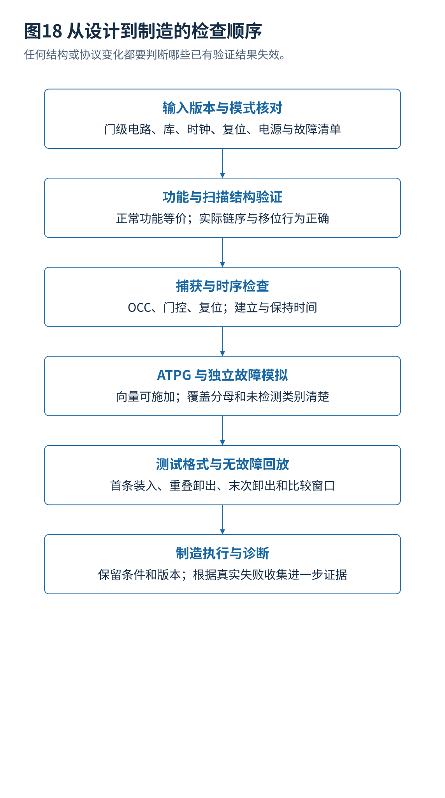

# 12 · 设计验证工具接入与制造执行

[总览](00_扫描链与ATPG总体架构与阅读导航.md) · [参考文献](90_参考文献与材料证据索引.md) · [教学与源码](14_教学算例源码与学习练习.md)

## 1. 一个可以落地的资料清单

开始 ATPG 前需要实际门级网表、标准单元功能与测试模型、扫描链描述、工作模式、时钟复位规则、捕获协议、电源状态、接口固定值、黑盒与未知值处理，以及明确故障集合。设计版本、单元库和模式不一致，比求解算法稍慢更容易造成无效结果。[S04](90_参考文献与材料证据索引.md#s04)[S09](90_参考文献与材料证据索引.md#s09)



## 2. 扫描插入流程的六项检查

检查正常模式功能等价；检查扫描结构和所有链的移位行为；检查测试时钟、复位及隔离控制；检查捕获协议；检查新增结构的建立与保持时间；检查压缩、故障与向量描述对应实际连接。每项都保留独立结果，不能只用“综合成功”代替。

实现后重新排序扫描链会改变位序，重综合会改变节点名和故障位置，时钟树优化会改变移位保持时间，电源结构修改会改变合法测试模式。因此每次结构改变都要判断哪些测试结果失效，不能按文件时间最新就自动继承旧覆盖报告。

## 3. 工具接入不要从虚构命令开始

商业工具的具体 Tcl 命令、对象类型、上下文和许可证会随版本变化。本卷给出**阶段接口定义**，不把伪代码伪装成 Tessent、TestMAX 或 Modus 可以直接运行的脚本：

```text
输入：设计版本、库版本、目标实例、时钟与复位、测试模式
阶段1：扫描可测试性检查 → 违规列表
阶段2：扫描与所选辅助结构插入 → 新网表、链描述、控制协议
阶段3：放置和合法重排 → 实际链顺序、物理与时序报告
阶段4：ATPG 模型建立 → 故障清单、约束检查、可观察范围
阶段5：生成、合并、故障模拟 → 向量、覆盖类别、未检测原因
阶段6：无故障与故障回放 → 期望响应、周期和位序一致性
阶段7：测试格式导出与设备转换 → 实际比较周期、引脚时序
阶段8：失败诊断 → 候选故障及追加检查
```

OpenROAD 和 NTU FAN_ATPG 提供公开学习入口，但它们各自解决的子问题不同。能插入扫描链不等于能完整生成商业制造程序；能对一个基准做 ATPG，也不等于支持所有电源模式、延迟模型和压缩器。本次只提供链接，没有宣称运行这些外部项目。[S09](90_参考文献与材料证据索引.md#s09)[S10](90_参考文献与材料证据索引.md#s10)

## 4. 模式限制怎样排查

当覆盖下降时，先检查故障分布和类别。大量无法控制可能来自复位、模式固定值、门控或黑盒；大量不可观察可能来自输出屏蔽、电源隔离或压缩未知值；大量中止可能是搜索难度或资源限制。只有在确认限制错误时才修正它，不能为了提高分数而随意解除真实硬件要求。

正确诊断应该保留原始与修改后两份故障分类，说明哪些约束改变，以及为何改变符合硬件。机器代理建议删除一个限制时，也应经过相同检查，不能因为日志更“好看”就自动采用。

## 5. 自动测试设备中的向量不是抽象比特表

设备程序还定义驱动沿、保持窗口、输出比较窗口、双向引脚方向、电平、周期以及连续模式之间的切换。一个功能输出在延迟之后才有效，比较太早会误判；一个扫描输出在移位沿前后值不同，取样定义错一拍就会整体错位。ATPG 文件到设备格式的转换需要验证，而不是只有文件格式能打开就算正确。

用完整芯片无故障模型回放时，要覆盖首条装入、重叠卸出、最后卸出、模式切换、复位和多个捕获脉冲。再通过明确故障注入确认预期比较位置失败，可减少“从未真正比较”或错误屏蔽的风险。带延迟仿真并不覆盖所有电气效应，电源网络和实际器件表征仍有独立职责。

## 6. 公平比较研究方法

固定电路与综合版本、故障集合与合并规则、测试模式、扫描结构、压缩器、最大搜索努力和资源预算。报告预处理、训练、推理、故障模拟和后处理的全部开销，至少分别给出覆盖、未检测类别、向量数、输入输出数据量、执行时间估计和软件运行资源。

学习方法应区分同电路未见故障、同系列电路和全新设计。训练与测试共享同一电路中的结构信息，不能写成跨设计泛化。GPU 与 CPU 比较要交代硬件，不应将某个并行算子的加速比当成全流程加速。基准名称相同也不保证网表相同，重新综合会改变门数、故障数量和搜索难度。

## 7. 本卷实际检查范围

程序运行在独立小型二值电路上，验证故障注入、SAT 与穷举的一致性、最小测试集合、链位序、X 填充翻转数和压缩反例。它不包含工业规模冲突学习 SAT、不包含完整 PODEM／FAN 实现，也不模拟亚稳态、真实单元延迟、功率和晶体管缺陷。本次没有运行商业 ATPG、扫描插入、静态时序、自动测试设备或芯片测试。

---

[上一篇](11_扫描故障诊断与失败分析.md) · [总览](00_扫描链与ATPG总体架构与阅读导航.md) · [下一篇](13_2024至2026年学术成果分析与研究路线.md)
