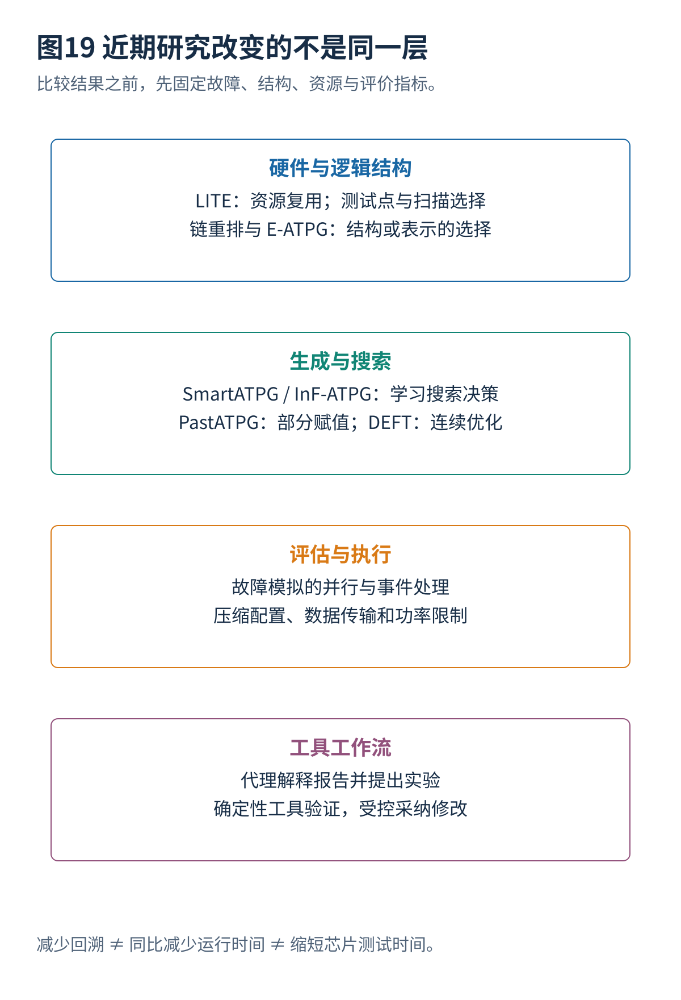

# 13 2024 至 2026 年学术成果分析与研究路线

[总览](00_扫描链与ATPG总体架构与阅读导航.md) · [参考文献](90_参考文献与材料证据索引.md) · [算例与源码](14_算例与源码说明.md)

## 1. 研究层次划分
扫描与 ATPG 不是只有一个优化问题。研究可能改变电路结构、搜索决策、SAT 表达、并行模拟、压缩器配置、数据传输或诊断流程。若只比较某个百分数，就会把不同层次误当成直接竞争方法。

本篇采用三种证据描述：**全文**表示取得并阅读了作者稿中方法和实验说明；**摘要**表示方法介绍来自正式会议或出版记录，缺少完整条件；**议程**只核实题目和会议归属。它们不是论文质量等级，而是现有材料能够支持的判断深度。资料范围截至 2026-10-17，不能把未来会议的预告写成已经完成的出版实验。

| 工作 | 时间与材料 | 所改变的层次 | 重点判断 |
|---|---|---|---|
| SmartATPG | DAC 2024；正式记录／摘要 | 结构搜索决策 | 学习策略与验证器的分工 |
| PastATPG | DAC 2025；正式记录＋作者代码 | SAT 与测试合并 | 未规定位是否真正带来更好合并 |
| LITE | 2025 作者全文；ITC 2025 议程 | 扫描和测试点结构 | 少加触发器不等于零硬件代价 |
| TESLA | ITC 2025；正式摘要 | 早期设计与工具协作 | 模型建议必须经实际工具验证 |
| EPICS | DAC 2025；作者机构记录 | 故障模拟 | 并行维度与事件计算量分别评价 |
| EDT 输入配置选择 | ITC 2025；正式摘要 | 压缩架构评估 | 估计成本与真实插入结果区分 |
| InF-ATPG | 2025 作者全文预印本 | 区域级强化学习搜索 | 回溯次数不等于端到端运行时间 |
| DEFT | 2025 作者全文；ITC 2026 议程 | 连续优化生成 | 保留二值检测验证，关注难故障子集 |
| E-ATPG | ITC 2026；摘要＋作者机构记录 | 逻辑表示与搜索空间 | 功能等价与原始故障保持并非一回事 |
| 压缩感知 ATPG 仿真评估 | ITC 2026；正式摘要 | 候选结构评估 | 代理排序需要真实流程复核 |
| ATPG Coverage Debug | ITC 2026；海报摘要 | 代理式覆盖调试 | 建议、执行权限和证据分别管理 |

具体原始入口为 [S11](90_参考文献与材料证据索引.md#s11)—[S22](90_参考文献与材料证据索引.md#s22)。表中一些工作跨多个层次，分类只用于组织讨论。

## 2. SmartATPG
**能够核实的内容。** DAC 2024 正式记录列出 SmartATPG，采用图卷积网络与强化学习辅助生成。它位于启发式搜索改进方向，现有材料未包含足够完整的实验信息，因此不转述未经核查的速度或覆盖提升。[S11](90_参考文献与材料证据索引.md#s11)

**原理分析。** 经典方法用结构代价决定回溯方向，学习方法尝试从电路图和当前状态估计哪一个选择更有利。可以把状态写成当前部分赋值、待检测故障及图特征，动作写成下一个目标或输入选择。奖励设计若只鼓励马上传播错误，可能偏好短期容易目标；若只在整个故障求解完成后奖励，长搜索序列又使学习困难。这里是该类方法的一般分析，不是对未获得论文细节的补写。

**应如何比较。** 固定推导规则与搜索限制，只替换决策器；记录每次模型调用、回溯、推导和总时间。网络每次推理很贵时，减少回溯未必减少总时间。训练电路与测试电路应明确分开，不能仅用同一电路中不同故障替代全新设计测试。

## 3. PastATPG
**能够核实的内容。** DAC 2025 的 PastATPG 将部分赋值 SAT 用于混合 ATPG，作者仓库提供复现入口。已核实论文记录和代码目录，未完成原项目构建与实验。[S12](90_参考文献与材料证据索引.md#s12)[S13](90_参考文献与材料证据索引.md#s13)

**原理分析。** 当 SAT 给出 `1100`，它证明这一点检测目标；但第 06 篇证明 `110X` 已经足够。把最后一位提前固定为零，会阻止与要求该位为一的另一个目标合并，也可能减少满足解压缩器关系的机会。部分赋值的价值，是把“检测所必需”与“求解过程顺便选了一个值”区分开。

**关键验证。** 输出立方体需要满足什么条件？是所有合法补全都检测目标，还是保留后续约束并在最后重新求解？怎样处理共享变量、重汇合与多目标？这些问题必须有精确验证路径。SAT 框架本身并不禁止多目标、优化或合并；把“某个单故障编码存在的不足”概括为“SAT 天生不能做测试集合优化”是不准确的。

**可做的实验。** 在同一个 SAT 或混合框架中比较完整赋值、部分赋值、后处理去规定位三种版本；固定故障清单，统计规定密度、合并成功率、编码失败率和真实总向量数。不能只展示每条向量 X 多了，却不检查目标保留及最终测试时间。

## 4. InF-ATPG
**作者报告与条件。** 该作者稿用无扇出区域（Fanout-Free Region，FFR）组织决策，并结合 ATPG 状态特征及 QGNN。摘要报告相对门级启发式平均减少 55.06% 回溯、相对其 FFR-GNN 对照减少 38.31%。主要评价量是回溯次数；训练为每个电路选 100 个困难故障，其余同电路故障用于测试。网表经过重新综合，不应当作原始标准网表。[S15](90_参考文献与材料证据索引.md#s15)

**为什么区域粒度有帮助。** 假设一个内部目标需要经过连续五个只有单一路径的门才能回到输入，逐门决策可能反复处理局部确定步骤；区域级决策可以把其中确定性结构作为整体。减少决策长度，也可能让奖励更快关联到有意义的动作。但是区域之间仍可能重汇合，不能把“区域内部无扇出”理解为全电路被分成互不相关问题。

**必须限制的解读。** 回溯少不是端到端速度提高相同百分比；网络推理、图构造和训练成本仍存在。同电路剩余故障测试说明一定程度的故障迁移能力，不是未见电路泛化证明。平均改善也不保证每个电路都改善，应同时查看最差个例和达到相同覆盖时的成本。

**对照设计。** 用相同 C++ 搜索执行层分别接门级启发式、区域级启发式、区域级学习策略；固定训练预算，在完全未见设计上运行。报告总时间与决策统计，并为模型无收益的困难目标准备确定性后备求解。这样才能分开“粒度改进”和“学习带来的额外收益”。

## 5. DEFT
### 5.1 论文证据范围
作者稿将难检测固定故障的向量生成改写为连续优化，使用二值检测与平滑目标结合的重参数化、探索项、梯度归一化和专用 CUDA 实现。其在两个目标故障子集上报告相同向量预算下平均检测数提升 21.1% 与 48.9%。这些不是全芯片总体覆盖率增加的百分点，也不是物理缺陷率下降。稿件实验使用 GPU，内核与 PyTorch+DGL 的加速比较不等于相对商业全流程的加速。ITC 2026 正式议程列有该工作。[S14](90_参考文献与材料证据索引.md#s14)[S19](90_参考文献与材料证据索引.md#s19)

### 5.2 概率近似的局限
以下为本文构造的反例。令 $y=a\oplus a$，真实输出恒为零。如果两次出现的同一个信号被错误当成独立概率为 $p$ 的变量，概率异或近似会给出 $2p(1-p)$，在 $p=1/2$ 时为 $1/2$。这个“平滑差异”并不存在任何对应的二值向量。因此连续目标上升不自动等于故障已被检测。

更一般地，设实际二值检测指示量为：

$$
I_f(x)=\mathbf1[C(x)\ne C_f(x)],\qquad x\in\{0,1\}^n.
$$

设计一个可微分数 $S_f$ 并不困难，困难的是让它对二值检测有效。可以用概率参数 $p_i=\sigma(\ell_i)$ 生成二值样本，同时保留软样本来传递梯度。DEFT 的核心方向正是把真实二值检测与平滑搜索联系起来，而不是仅将 AND 换成乘法。[S14](90_参考文献与材料证据索引.md#s14)

### 5.3 连续优化的探索与二值判定
从优化的一般角度，若初始所有样本都未检测到目标，仅对已检测样本优化会没有有效信号；探索项有助于向可能成功区域移动。一旦出现真实成功样本，可以优先利用它附近的参数。梯度归一化有助于数值稳定，却不提供全局最优证明。离散采样、硬判定和梯度估计的处理都应按论文推导和实现核对，不能因为写出了期望目标，就声称所有实现的梯度都是无偏的。

实际交付必须保存并独立模拟**最终二值向量**。连续优化没有找到向量，不能像完整 UNSAT 证明一样判定故障不可测试；局部优化停滞也不能作为删去目标的依据。

### 5.4 DEFT 的适用条件与验证
价值在于对一批困难目标联合探索，并利用 GPU 批量计算。要证明工程价值，还需要纳入真实解压缩器约束、响应未知值、多周期捕获、功率限制和附加故障模型，并测量构图、优化、故障模拟及后处理总成本。更合理的工程组合可能是传统方法覆盖容易部分，再用连续优化和 SAT 分别处理剩余目标；这属于分析性组合建议，不是声称论文已经实现的完整工具。

**版本注意。** 所读 arXiv HTML 含有不一致的遗留会议模板信息。来源以明确 arXiv 版本和 ITC 2026 正式议程标注来源，不据页首模板添加未经确认的 DAC 年份或 DOI。

## 6. LITE 与测试点
作者稿的 LITE 利用已有扫描资源进行轻量控制和观察插入，报告的一个配置在所用基准上平均减少约 31.8% 的向量数。实验采用重新综合后的电路及指定标准单元库；新增组合逻辑也会改变故障数。这个结果不能直接解释成面积不变、原始故障集合不变时的全流程提升。[S16](90_参考文献与材料证据索引.md#s16)

**分析。** 比较时应分别给出原始功能逻辑故障和新增测试逻辑故障的覆盖，说明功能延迟、扫描长度和时钟电容。若观察点减少向量却增加最长链，总时间可能没有同比下降。若为实现复用而改变捕获模式，还需验证它没有让某些原本可独立控制的位相关。

TESLA 与 2026 年测试点插入阶段研究进一步把问题推到较早设计阶段：何时插入，什么信息足够可靠，如何用实际工具反馈修正选择。模型生成建议与硬件功能等价必须分别验证。[S17](90_参考文献与材料证据索引.md#s17)[S21](90_参考文献与材料证据索引.md#s21)

## 7. E-ATPG
正式摘要与作者机构记录说明 E-ATPG 使用 e-graph 探索有利于测试的逻辑重构，以改变搜索空间。现有材料未包含足够完整的全文实验信息，不报告量化优越性，也不补写其具体原始故障对应机制。[S19](90_参考文献与材料证据索引.md#s19)[S21](90_参考文献与材料证据索引.md#s21)

**关键原理。** 同一个布尔函数可以有很多等价表达，例如展开式、因式分解式和不同共享子表达式。求解器在不同图结构上遇到的推导深度和冲突可能不同，因此表达方式本身可以优化。

**关键陷阱。** 正常函数等价不保证内部固定故障集合等价。若把 $a\lor(a\land b)$ 改为 $a$，正常输出完全一致，但原来的内部节点不再存在。若修改实际电路，应重新综合和建立故障集合；若只修改搜索表示，必须保留目标原始故障与正常／故障双电路之间的关系，并回到原网表验证最终向量。这是评价任何重构型 ATPG 时都应追问的问题，不是对该论文作未经证实的负面结论。

## 8. 评估与代理工作流
**EPICS。** 作者机构介绍其从并行和事件处理改进故障模拟。现有材料包含机构记录，未取得完整重现实验；因此只把它列为模拟执行层的相关进展，不将其加速与 ATPG 搜索加速直接等同。[S22](90_参考文献与材料证据索引.md#s22)

**压缩配置评估。** 2025 年 EDT 输入配置选择与 2026 年压缩感知 ATPG 仿真评估，试图减少遍历候选配置时昂贵的重复求解或插入工作。后者正式摘要讨论虚拟压缩感知评估与分布式优化，仅按摘要解读。[S17](90_参考文献与材料证据索引.md#s17)[S19](90_参考文献与材料证据索引.md#s19)

**分析。** 代理预测器最应评价的是候选排序和最终选择代价，而不只是平均预测误差。若预测误差只集中在最有希望的候选，平均误差很小也可能选错。应保留若干候选做真实插入、故障模拟和物理检查，同时报告总计算预算。

**代理式覆盖调试。** ITC 2026 海报 ATPG Coverage Debug: The Shift to Agentic AI 讨论代理协调工具分析覆盖问题。它是海报摘要，不是现有材料已完整评测的通用自主 ATPG 系统。[S20](90_参考文献与材料证据索引.md#s20)

**面向 DFT Agent 的建议。** 把代理权限划成读报告、生成候选修改、运行受控实验、采纳变更四步。每次运行保存网表、库、模式和故障清单摘要；任何减少故障分母、放宽时钟限制或增加屏蔽的建议都单独审查。让确定性工具判断向量与约束正确，代理负责解释和选择下一项实验，避免语言上“解释通了”就跳过真实验证。

## 9. VTS 2026 工作
以下工作的题目和会议归属已在正式议程核实，但未取得足以深入评述的全文。它们提供研究线索，不据题目推断未公开算法和实验结果。[S18](90_参考文献与材料证据索引.md#s18)

| 正式题目 | 从题目能确定的研究对象 | 建议进一步追问，不是作者已证明的结论 |
|---|---|---|
| Scan Chain Reordering for Improving Test Coverage with Compression | 压缩条件下的扫描重排 | 编码矩阵、位相关性、物理代价怎样一起评价？ |
| Coverage-Aware Scan Chain Reordering under Iso-Power Constraints for Programmable Low-Power LBIST | 相同功率限制下的重排 | “相同功率”是活动估计、平均功率还是捕获峰值？ |
| C2C: Cell-to-Cell Controllability Evaluation for Partial Scan Selection | 部分扫描选择 | 剩余状态依赖如何反映到最终顺序 ATPG？ |
| Pre-processing Functional And Physical Defect Equivalences To Accelerate Cell-Aware Model Generation | 单元感知模型生成 | 合并保留什么缺陷条件，是否影响目标覆盖？ |
| WARP-TPG: Warpage-Aware Test Pattern Generation for Small-Delay Defects | 与翘曲有关的小延迟测试 | 电气变化怎样进入模型，硅数据如何支持？ |

这些题目不能支撑“2026 年已经彻底解决跨工艺泛化”之类结论。对于工程决策，应取得原文和输入模型后再作方法选择。

## 10. 研究选题与对标
**求解层课题。** 建立统一的结构搜索与 SAT 后备接口，在固定难故障子集上比较启发式、学习式和连续优化。最关键结果是固定资源下新检测多少真实目标，而不是单独看训练损失。

**结构层课题。** 联合扫描重排、压缩可编码性和测试点选择。先用小例子找到可以解释的编码冲突，再扩展到有物理与时序限制的中等设计，避免开始就用不可复核的大规模代理评估。

**执行层课题。** 并行故障模拟、分层数据访问与功率约束调度。固定应用模式和故障质量，比较端到端成本，而非仅一个内核。

**代理层课题。** 用可追溯工具反馈完成覆盖调试。基线可以是规则系统和固定诊断流程，评价正确建议比例、无效运行次数、总计算成本与错误放宽约束的次数。代理自动化程度不应以绕过人工批准的数量衡量。

最终对标表应把“硬件结构是否改变、故障集合是否改变、是否使用训练、是否有压缩、是否含延迟、使用什么资源、结果是否可由独立工具验证”列在同一行。满足同一问题定义之后，比较百分数才有意义。

---

[上一篇](12_设计验证工具接入与制造执行.md) · [总览](00_扫描链与ATPG总体架构与阅读导航.md) · [下一篇](14_算例与源码说明.md)
