# NPU 指令与硬件架构设计 Spec

> [!abstract] 文档目的
> 本文定义面向 Transformer、RNN、GRU 和 LSTM 整数推理的 NPU 设计规格，规定 128-bit 指令、模块划分、模块连接、片上存储、模块级接口、状态转换和功能时序。张量和参数按指令选择INT4、INT8、INT16、INT32存储或raw binary16/binary32位型；整数主干、分组缩放和复杂数学连续流按各自明确的数值规则执行。本文是硬件设计、模型编译器、软件驱动、运行时、固件及 SoC 集成共同遵循的设计依据。

| 项目   | 内容                                                                                     |
| ---- | -------------------------------------------------------------------------------------- |
| 文档状态 | VU13P 200 MHz 目标配置；功能与物理时序分别验收的 NPU 设计规格                                                              |
| 适用对象 | 架构、硬件设计、编译器、运行时、固件、软件驱动、SoC 集成                                                |
| 基准结构 | NPU 顶层包含 AXI Slave Frontend、CFE、TaskScheduler、执行单元、L1BUF、MIF、LSC、WDT 和 CRG |
| 参考文档 | [[NPU 设计 spec 总结]]、[[T100 NPU TOP Architecture Spec]]、[[面向Transformer和LSTM加速的NPU设计目标]] |

详细模块说明见 [二级模块设计文档](module_spec/README.md)，分册解释执行过程、接口、存储与流水组织、设计取舍及利用率限制；指令编码和寄存器定义仍以本文为准。

---

## 1. 文档约定

### 1.1 规范用语

本文使用下列用语表示要求强度：

| 用语    | 含义                                     |
| ----- | -------------------------------------- |
| 必须、不得 | 硬件、固件和软件均需遵守的强制要求                     |
| 应     | 默认采用；若改变，需要在设计说明中给出原因和影响               |
| 可     | 可选功能，不影响基础指令的正确执行                      |

### 1.2 缩略语

| 缩略语   | 含义                                           |
| ----- | -------------------------------------------- |
| DSA   | Domain-Specific Accelerator，专用计算加速器          |
| TS    | TaskScheduler，任务调度器                          |
| ME    | Matrix Engine，矩阵计算单元；当前与 Vector 控制路径集成在 Matrix-Vector 包装内 |
| VE    | Vector Engine，整数向量控制及轻量 ALU；MUL/FMA 复用 Matrix PE |
| CME   | Complex Math Engine，完成复杂函数、Softmax、Norm 和按指定维度统计 |
| L1BUF | NPU 内的共享片上 SRAM                         |
| MIF   | NPU 内部模块到系统总线的 AXI Master 接口桥                    |
| LSC   | 本地系统控制器                                      |
| GADDR | 全局物理地址，用于 DDR 或外设空间                          |
| LADDR | NPU 的 L1BUF 字节地址                         |
| CMD   | 任务命令头                                        |
| TC    | Task Context，发射时由任务表中的指令和提交时基地址快照展开的执行单元任务信息 |

### 1.3 设计范围

本文覆盖：

1. NPU的顶层接口、配置差异、层级归属与内部请求/返回关系；
2. 外部主控 CPU 经 SoC AXI Fabric 访问 NPU AXI Slave 的命令、控制和 L1BUF 接口；
3. TaskScheduler、DMA、Matrix、Vector、CME、L1BUF、MIF 和 LSC；
4. 由两个 64-bit beat 组成的 128-bit 指令，以及各操作的 80 bit payload；
5. INT8、INT16、INT32 的 GEMM、BMM、逐元素运算、按维度统计、特殊函数和多维 DMA；
6. Event、完成通知和错误传播；
7. 上电、复位、初始化、任务启动、任务完成和低功耗时序；
8. 模块级接口、状态转换、功能时序和异常处理要求；
9. 可选功能裁剪、公共接口容量与实际物理执行速率的对应关系。

本规格以当前可综合 RTL 为准；接口与功能说明的主要核对点如下。参数取值分为模块默认值、`npu_single_core_top` 集成值和 SoC 顶层覆盖值，阅读参数表时必须同时看清作用层级。

| 设计部分 | 主要 RTL 定义 | 本文对应内容 |
| --- | --- | --- |
| 公共命令编码与状态 | `rtl/npu_rtl_pkg.sv` | 第 2、4、6、15 章 |
| 引擎任务、操作码与矩阵基本类型 | `rtl/engines/npu_engine_pkg.sv` | 第 3、6、11～14 章 |
| AXI Slave 命令、CSR 与本地窗口 | `rtl/top/axi/npu_axi_slave_frontend.sv`、`rtl/top/npu_single_core_top.sv` | 第 5、7 章 |
| 命令接收、程序取指、描述符装载 | `rtl/control/frontend/npu_cmd_frontend.sv`、`npu_program_sequencer.sv`、`npu_external_desc_loader.sv` | 第 6～8 章 |
| 任务和事件调度 | `rtl/control/scheduler/npu_task_scheduler.sv` 及 `scheduler/` 子目录 | 第 8 章 |
| L1 bank 与客户端 fabric | `rtl/memory/npu_l1buf.sv`、`rtl/top/interconnect/npu_l1_client_fabric.sv` | 第 10 章 |
| Matrix/Vector 共享 PE 和任务路由 | `rtl/engines/matrix/`、`rtl/engines/vector/`、`rtl/engines/context/npu_matrix_vector_engine.sv` | 第 11、12 章 |
| Complex 流、算术共享与裁剪 | `rtl/engines/complex/` | 第 13 章 |
| 系统总线 MIF、LSC、CRG、WDT | `rtl/top/interconnect/`、`rtl/control/system/` | 第 14、15 章 |

架构图的可编辑源为同名 Draw.io 文件，SVG/PNG 是发布预览。图中兼容小配置不作为 SoC 的物理参数表：128 PE、64 bank、在线八路和原生宽端口按第 2、5、10、11、13 章定义。图源保存在 [_assets](./_assets/)，几何检查不能替代 RTL 端口核对。

下列物理参数由硬件配置确定，第 2.2 节给出本设计采用的固定值：

- Matrix 的 4/8/16/128 物理 PE 配置、plane/列掩码、上下文容量与兼容控制路径；
- Vector功能开关、轻量逐元素运算，以及经 Matrix 共享 PE 执行的 MUL/FMA；
- L1BUF 总容量、bank 数和每个 bank 的端口数；
- AXI outstanding 深度；
- 具体工艺下的 SRAM 和乘法器实现；
- 保留 opcode 是否启用。

---

## 2. 顶层设计目标与配置参数

### 2.1 顶层设计目标

NPU 子系统遵循下列执行和存储约束：

1. 系统存储器由原生宽 DMA 和控制侧 MIF 共用外部 AXI Master 访问；MIF 服务程序、描述符和兼容 DMA，原生 DMA 数据不必逐字经过 MIF。Matrix、Vector 和 Complex 的张量访问以 L1BUF 为目标，不能把程序读取或描述符装载视为张量复制。
2. AXI Slave 接收主控命令、寄存器访问和 L1 Host 窗口访问。主控直接提交命令与自主取指共享同一 CFE、命令编号检查和调度器，不能同时作为独立命令源交错提交。
3. 指令为 128 bit，在 64-bit 接口上依次提交低字和高字。一般指令内联展开；分组缩放重量化及完整动态 A8 也接受外部描述符，续接与紧凑内联编码减少重复的外存参数读取。
4. 每条任务具有命令编号、事件依赖、成功或失败状态。CFE 接收成功表示完整命令已经入队，不等于描述符读取、引擎检查或计算已经成功；最终结果由任务完成和程序状态给出。
5. TaskScheduler 调度有限的任务记录，不解析模型图。编译器预先确定分块、常量、参数布局和依赖；运行时 token、位置、有效长度和动态尺度由明确的数据区或程序状态传递。
6. Direct、Scalar 兼容控制和分组缩放共用由物理配置确定的一组 PE。SoC 为八个 plane、每 plane 十六列，共 128 PE；传统模式只使用 plane 0，并行模式支持多行或 split-K，模式切换前排空计算与结果。十六列逻辑结果不等于 16×16 个物理 PE。
7. 每个物理 PE 复用八个 4×8 乘法叶，组成 W4A8、W8A8/W6A8 或 W16A16 运算。W4A4 不属于当前 Matrix 支持模式；INT4 仍作为权重存储编码和部分通用算子的存储格式存在。
8. 通用 Vector 为独立可选执行路径，轻量 ADD/SUB/MAX/MIN/CMP/SELECT/CLAMP/ReLU 使用 Vector ALU；MUL/FMA 没有独立乘法阵列，而是经 Matrix 引擎请求同一组物理 PE。关闭 Vector 路径的配置不能执行其指令；独立任务接口不代表独立乘法硬件。
9. Complex 由连续流前端、共享算术 fabric、同步 RAM/FIFO 和兼容控制器组成。公共混合精度后端保留两条物理 FMA，在线 Softmax/PV 在 SoC 中选择八路 FP32 FMA，其中两路复用公共后端、六路补充在线计算。不同指令的读口、归约和返回格式限制各自吞吐；不能把在线八路能力套用到全部 Complex 指令。
10. L1BUF 为多 bank、单读单写的同步 RAM。容量、bank 数与可选执行路径由综合参数确定；地址分配、bank 使用次序和数据驻留由指令及编译器决定。不得用编译器地址安排暗示存在硬件未实现的读端口。
11. 全局地址内部使用 48 bit，AXI Master 默认只连接 40 bit。访问必须同时满足配置的物理地址范围和端口可表示范围，超出时报告地址错误，不静默截取高位。外部描述符指针另有 40-bit 编码限制。
12. 完成、异常和错误中断为由状态位产生的电平，状态保持到软件显式清除或受控复位。系统可合并三类电平后送往 PLIC，处理程序读取状态判断原因；不能把清除 PLIC pending 当作清除 NPU 状态。
13. DVFS、停止、软复位和断电准备均等待已接受的请求按各自协议排空。功能复位、AXI 响应、描述符缓存和任务终态的寿命分别规定；复位 RAM 的有效位不表示 RAM 内容被清零。
14. 综合配置可以关闭 Scalar、Vector 或部分 Complex 流；关闭后应按该配置的错误路径完成不支持的任务。编译器目标能力必须与实际综合参数一致，不能把通用配置全部操作码作为面积裁剪配置的默认能力。

### 2.2 基准配置

#### 2.2.1 固定协议与内部表示

| 参数或表示 | 定义 | 约束说明 |
| --- | ---: | --- |
| AXI Slave 数据宽度 | 64 bit | CPU 命令、CSR 和 Host 窗口保持 RV64 访问方式 |
| AXI Master 数据宽度 | 64/128/256 bit | `AXI_M_DATA_W` 参数；SoC 为 256 bit，每拍 32 B、32-bit WSTRB |
| 普通 L1 客户端数据宽度 | 64 bit | 读写握手与返回状态按客户端分别处理 |
| 外部命令宽度 | 128 bit | 低 64 bit 在前，高 64 bit 在后 |
| 公共操作码字段 | 6 bit | `CMD[127:122]`，不等于内部 8-bit opcode |
| 外部命令编号字段 | 10 bit | `CMD[121:112]`；内部编号端口扩展为 12 bit |
| 内部全局地址 | 48 bit | 描述符、引擎完成错误地址、MIF 请求统一使用 |
| AXI Master 默认地址宽度 | 40 bit | 参数 `AXI_M_ADDR_W`；不承诺任意 64-bit CPU 地址可达 |
| AXI Slave 默认局部地址宽度 | 24 bit | SoC 译码后的 NPU 局部窗口 |
| 外部描述符指针 | 40 bit | `CMD[39:0]` 为绝对物理地址，低六位为零；不与基地址相加 |
| 完整内部描述符接口 | 2048 bit | 公共任务端口容量为 256 B；并非每次都从 DDR 读取256 B |
| DMA/L1内部地址总线 | 21 bit | 2 MiB 字节地址；端地址检查至少使用 22 bit，防止回绕 |
| 普通算术与 Host L1 地址 | 21 bit | 覆盖 `0x000000..0x1fffff`；紧凑指令另受原字段范围约束 |
| 原生 Matrix 连续读返回 | 参数化，SoC 为 4096 bit | 64 个 64-bit word，逐 lane mask；不是 64 个任意地址端口 |
| Direct A/B 根操作数字 | 各1024 bit | 十六个64-bit逻辑根；物理执行分相位消费 |
| Direct 面板读响应 | 2048 bit | 32个64-bit逻辑lane的打包结果，多bank分阶段收集 |
| Direct 面板写载荷 | 1024 bit | 十六个64-bit字；与读响应容量不同 |
| 兼容阵列结果 | 768 bit | 十六个 signed48 逻辑累加结果 |
| 并行阵列结果 | 6144 bit | 八 plane×十六列×48 bit；私有归约后为十六列 INT32 |
| 每PE输入容量 | A为64 bit，B为32 bit | 八个4×8叶的输入切片总宽为96 bit |
| 每PE叶乘积总宽 | 96 bit | 八个完整12-bit部分积；后续按模式组合位权 |

#### 2.2.2 通用 NPU 顶层默认参数

| 参数 | 默认值 | 实际含义 |
| --- | ---: | --- |
| `L1_BYTES` | 2097152 | 2 MiB，有效字节地址为 `0x000000..0x1fffff` |
| `L1_BANKS` | 16 | 通用顶层默认；SoC 为 64，独立 L1 模块默认仍为 4 |
| `MATRIX_PHYSICAL_PE_COUNT` | 16 | 支持 4/8/16/128；SoC 为 128 |
| `MATRIX_L1_DATA_W` | 256 | SoC 为 4096 bit；与外存拍宽独立 |
| `AXI_M_DATA_W` | 64 | 支持 64/128/256，SoC 为 256 |
| `COMPLEX_ONLINE_LANES` | 4 | SoC 为 8；只限定在线 PV 组织 |
| `TASK_SLOTS` | 8 | 调度任务容量，不是物理PE数量 |
| `EVENT_COUNT` | 255 | 有效事件ID为0..254，`0xFF`表示没有事件 |
| `BASE_MUL_ROWS` | 16 | 兼容接口参数，不决定实际物理 PE 数量 |
| `BASE_MUL_COLS` | 16 | 同上，不能按两参数乘积计算物理PE数量 |
| `MATRIX_SCALAR_ENABLE` | 1 | 保留GEMM/BMM等兼容控制与局部部分和 |
| `MATRIX_W4A8_ONLY` | 0 | 通用阵列保留较高整数精度模式 |
| `MATRIX_MQR1_REQUANT_ENABLE` | 1 | 保留Direct静态重量化；与分组缩放路径不同 |
| `VECTOR_ENABLE` | 1 | 保留独立 Vector 控制与轻量 ALU；MUL/FMA 请求 Matrix 共享 PE |
| `COMPLEX_GENERIC_SUM_STREAMS` | 1 | 保留通用归约流 |
| `COMPLEX_GENERIC_SOFTMAX_STAT` | 1 | 保留通用Softmax/STAT相关流 |
| `COMPLEX_FP16_MIXED_PIPELINE` | 1 | 允许共享混合精度流水的FP16模式 |
| `COMPLEX_MIXED_FMA_STREAM` | 1 | 保留显式MIXED_FMA命令流 |
| `COMPLEX_LEGACY_SLOW_CONTROLLER` | 1 | 保留兼容复杂函数控制 |
| `COMPLEX_QWEN_NORM_ONLY_CONTROLLER` | 0 | 不把兼容控制器限定为NORM |
| `COMPLEX_RMS_A8_CACHE_DEPTH` | 2048 | 融合归一化私有缓存深度；不是L1容量或最大上下文 |
| `DESC_CACHE_ENTRIES` | 512 | 外部描述符缓存的直接索引项数 |
| `DESC_CONTEXT_W` | 2048 | 内部保存的描述符位数；外部记录仍为256 B |
| `MIF_READ_OUTSTANDING` | 8 | MIF读环的未完成读事务容量 |
| `MIF_DMA_WINDOW_WHILE_PROGRAM_WAITS` | 4 | 程序读等待期间的DMA窗口约束；不新增AXI主口 |

CFE默认保存八条完整命令，第二拍等待上限为32个时钟。Program Sequencer默认预取八条命令，并使用两批命令缓冲，最大任务在途数为八。命令缓冲、调度任务槽和MIF读环属于不同资源，各自满时分别反压，不能把它们统一称为一个八项FIFO。

#### 2.2.3 SoC 部署配置

| 功能组 | SoC 默认选择 | 软件能力约束 |
| --- | --- | --- |
| 目标器件与周期 | `xcvu13p-fhgb2104-2-i`，5 ns | 目标 200 MHz；仿真和构建成功不证明布线时序通过 |
| L1 | 2 MiB、64 个 64-bit 1R1W bank | 地址分配及数据生命周期由编译器决定 |
| Matrix | 128 PE，Scalar 默认关闭，W4A8-only 默认关闭 | 保留 W4A8、W8A8/W6A8、W16A16；不支持 W4A4 |
| Matrix 读口 | 4096 bit、64-bit lane mask | 私有 group 使用全宽；通用 tile 目前每请求消费低 256 bit |
| 原生外存 | NPU 256 bit、系统 256 bit | 6.4 GB/s 是 200 MHz 单方向原始拍带宽 |
| Vector | 默认关闭 | 不能把通用 Vector 指令作为该部署的默认可执行后处理 |
| Complex 在线 PV | 八路 FP32 FMA | 公共两路加六路在线补充；scalar math 可反压相关请求 |
| Complex 通用功能 | SUM、Softmax/STAT、FP16 mixed、MIXED_FMA、兼容控制均保留 | 不因单个模型未使用就宣称该功能被裁剪 |
| 描述符 | 缓存 512 项，内部上下文默认保存 1728 bit | 外部记录长度仍为 256 B；高位保留字段继续检查 |
| MIF | 读环八项、程序等待时 DMA 窗口四 | 只描述控制/兼容子通路，原生 bulk DMA 另有队列 |

通用模块、普通 NPU 顶层、SoC 顶层和具体测试命令可以使用不同默认值。能力必须从
参数逐级传递和构建清单核对，不能只读取某个叶模块的 `parameter`。CPU XLEN 保持 64，
CPU Cache、系统互连和板级 DDR 的独立配置不由模型指令改写。

#### 2.2.4 计算速率与端口容量

| 模式 | 每 PE 的 MAC/拍 | 十六 PE 的 MAC/拍 | 128 PE 的 MAC/拍 | 128 PE、200 MHz 理论 GOPS |
| --- | ---: | ---: | ---: | ---: |
| W4A8 | 8 | 128 | 1024 | 409.6 |
| W8A8 / W6A8 | 4 | 64 | 512 | 204.8 |
| W16A16 | 1 | 16 | 128 | 51.2 |

一次 MAC 计两次运算。只有实际使能的 PE 与有效乘积计入算力，掩码、K/M/N 尾部、
供数、归约、缩放和结果等待均影响持续速度。M=1 私有分组可以通过 split-K 使用多个
plane，但满阵列的两拍执行不能证明完整 group 的时间利用率为 100%。

公共 `npu_complex_fma_pair_pipeline` 使用两条独立物理流水，每条公共 word 为 64 bit，
`FP16_ELEMENTS=4`。在供数和返回无阻塞时可接收两个 FP32 或八个 FP16 运算/拍。
在线 PV 的八路配置通过 `npu_complex_fma_pair_share` 补充六条 FP32 流水；四路兼容配置
仍需核对实际 `PHYSICAL_PIPELINES`，不能把四个逻辑请求恒等于四条物理 FMA。

ADD、MUL 和 MAC 分别使用 `A×1+C`、`A×B+0` 和三操作数 FMA。公共 lane 0 的 scalar math
由 `shared_alu_flight_q` 保持请求归属，相关在线请求被反压；该标量接口不能视为独立 II=1。
Mixed-FMA 的定点出口仍按一个 64-bit word/拍转换，八个 FP16 的输入块需两拍输出。
RMSNorm、Softmax/PV 的归约依赖及普通 L1 读写不能用算术峰值代替。

分组重量化的 `ACCUM_LANES=4`、`SCALE_LANES=1` 分别限定组内缩放和 REDUCE/FINAL，
与物理 PE 数独立。它们的任务服务时间须连同 profile 和输出流量核算。

#### 2.2.5 L1 bank 与队列条件

2 MiB 共 262144 个 64-bit word。4/8/16/64 bank 对应每 bank 65536/32768/16384/4096 行。
一个 bank 始终只有一个读口和一个写口；同 bank 不同行可 1R1W，同一行读写拆拍。
RAM 数据不复位，valid、计数、返回状态和仲裁状态共同隔离旧内容。

普通客户端有两项请求存储和八项端到端返回额度，额度包含在途流水与响应缓存，不能只数
FIFO 中可见项。七路基础接口为 Host、DMA 主口、两个 MV 普通口、Complex 主口、
DMA 本地复制写口和 Complex 写口。原生 256-bit DMA 再增加四读、四写 lane，PV 增加
两个 64-bit 读 lane；SoC 的普通客户端合计十七路，Matrix 原生宽读不扩成六十四路普通客户端。

原生宽读使用共享入口 FIFO、八项返回额度、bank mask 和两段旋转返回，连续有效读峰值
为 512 byte/拍。全 mask 读取占用全部 bank 读口，此时 Complex 读依靠公平让拍和内部
缓冲推进；不同行的普通写仍可与读并行。DDR 256-bit 与 L1 4096-bit 是不同层次的能力，
不能把前者空闲解释成后者也空闲。

### 2.3 整数推理与内部浮点计算

#### 2.3.1 软件可见的数据格式

模型输入、权重、bias、中间张量、KV Cache 和模型输出允许以下四种整数格式：

| 格式 | 数值范围 | 典型用途 | 存储方式 |
| --- | ---: | --- | --- |
| INT4 | $[-8,7]$ | Direct Matrix 的 W4 权重、启用时的 packed Vector 逐元素张量及指定量化输出；部分兼容路径也使用 byte-contained INT4 | 由 opcode 定义 packed-nibble 或 byte-contained 布局；packed 行每字节两个元素，偶数下标在低半字节 |
| INT8 | $[-128,127]$ | 激活、权重、门值、Softmax 或 Norm 的整数输出 | 每个元素一个字节 |
| INT16 | $[-32768,32767]$ | 循环层输入、循环层权重、需要更细数值间隔的中间张量或输出 | 每个元素两个字节，低地址保存低 8 bit |
| INT32 | $[-2^{31},2^{31}-1]$ | Matrix 累加结果、bias、需要较大数值范围的中间结果 | 每个元素四个字节 |

模型整数采用有符号二进制补码。Packed INT4 的偶数逻辑元素保存在低半字节，奇数逻辑元素保存在高半字节；每行独立补齐到字节边界，奇数长度行的最后一个高半字节必须为 0。byte-contained INT4 则每元素占一个 byte，由指令合同定义高半字节的处理方式。INT16 和 INT32 均按小端字节次序保存。例如，INT16 数值 `0x1234` 在较低地址保存 `0x34`，在下一地址保存 `0x12`。完整 packed 规则与指令支持边界见 [Packed INT4 存储 ABI](./INT4存储ABI.md)。

> [!important] 数据格式编码 0 的处理
> 指令中的 2-bit 数据格式编码为 `0=INT4`、`1=INT8`、`2=INT32`、`3=INT16`。编码 0 不再是全局保留值；接收端必须按 opcode 检查能力。Integer Vector 的轻量逐元素 ALU和存储格式可接受 packed INT4；Vector MUL/FMA 的共享 PE 合同仅接受同类型 INT8 或 INT16。Matrix `DIRECT_GEMM`接受A为INT8、B为packed INT4的W4A8低位宽权重模式、同类型INT8/INT16及Q6，不接受W4A4；Complex 的普通算术路径不读取 packed INT4，但 `COMPLEX_REQUANTIZE` 和 `COMPLEX_FP32_REQUANTIZE` 可直接写 packed INT4；普通 Matrix Scalar 路径仍拒绝 INT4。DMA 只按 INT8 原始字节视图搬运 packed 缓冲区。

> [!important] 浮点位型与整数dtype容器
> 普通量化指令按自己的输入/输出整数格式执行。显式浮点流可将binary32位型保存在INT32容器中，packed binary16使用相应命令的格式标志；这些位型不是signed INT32数值，也不新增2-bit dtype枚举。Complex私有行RAM、流水寄存器与L1工作区均可承载具体指令定义的浮点中间值。FP32 scale、$\epsilon$、函数系数和查找表可以由指令中的字段确定，或保存在任务指定的 L1BUF 参数区。显式 FP32_ADD、FP32_SUM、FP32_MAC、FP32_REQUANTIZE 和 raw-binary32 ARGMAX 可以通过 INT32 dtype 容器在 L1BUF 保存或消费 binary32 位型；这不会新增浮点 dtype 编码，CPU 也不得把这些位型交给软件浮点运算。

#### 2.3.2 整数值所表示的实数

设整数张量中的元素为 $q$，缩放系数为 $s>0$，zero point 为 $z$，则它所表示的实数为：

$$
x_{\mathrm{fp}}=(q-z)s.
$$

各符号含义如下：

| 符号 | 含义 |
| --- | --- |
| $q$ | INT4、INT8、INT16 或 INT32 的存储值 |
| $z$ | 与 $q$ 使用相同数值范围的整数 zero point |
| $s$ | FP32 缩放系数；它由指令中的字段或任务拥有的 L1BUF 参数区提供，不是模型张量 |
| $x_{\mathrm{fp}}$ | 专用单元内部使用的 FP32 数值 |

Matrix 输入采用对称形式，即 $z=0$。激活函数、Softmax 和 Norm 的参数由指令中的字段或 L1BUF 参数区提供。ACT、SOFTMAX 和 NORM 的数值参数模式可从参数记录取得非零输入与输出 zero point；NORM 还可取得 gamma 和 beta 的非零 zero point。其他未明确允许非零 zero point 的模式收到非零值时必须返回 `BAD_DESC`，不得静默忽略。

#### 2.3.3 `INT → FP → INT` 计算次序

Sigmoid、Tanh、GELU、SiLU、Exp、Reciprocal、ReciprocalSqrt、Softmax、LayerNorm 和 RMSNorm 按以下次序处理：

1. 从 L1BUF 读取 INT8、INT16 或 INT32。
2. 执行符号扩展，得到 INT32。
3. 根据输入 $s_x,z_x$ 转为内部 FP32：

   $$
   x_{\mathrm{fp}}=(q_x-z_x)s_x.
   $$

4. 在 FP32 流水中执行指定数学函数。
5. 使用输出 $s_y,z_y$ 转回整数：

   $$
   q_y=
   \operatorname{clip}_{[q_{\min},q_{\max}]}
   \left(
   \operatorname{round}\left(\frac{y_{\mathrm{fp}}}{s_y}\right)+z_y
   \right).
   $$

6. 将 INT8、INT16 或 INT32 结果写回 L1BUF。

其中 `round_mode` 必须明确选择最接近偶数、向零、向正无穷或向负无穷；默认使用最接近偶数。`clip` 把结果限制在目的整数格式的数值范围内。

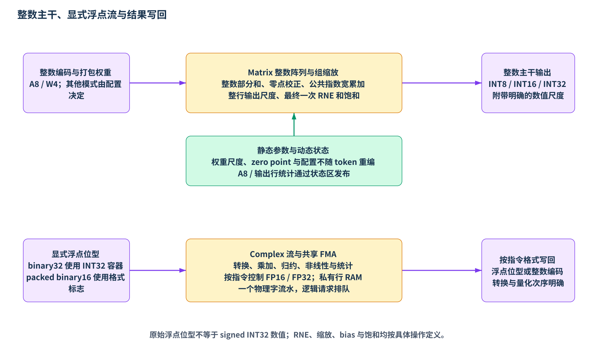

#### 2.3.4 Matrix 的整数计算

Matrix的通用精度包括W4A8、W6A8、同类型INT8和INT16，实际可用集合还受`MATRIX_W4A8_ONLY`限制。W4A8的A为INT8、B为packed signed INT4；W6A8的B以byte-contained signed Q6保存。没有A/B同为INT4的W4A4执行模式，packed INT4的存储能力不能用于推导该模式存在。普通GEMM/BMM兼容控制只接受相应的同类型整数输入；packed W4和Q6由Direct路径解释。

Direct命令的M、N分别为1..16。W4A8的K上限为4864，W6A8为2048；普通同类型Direct编码的K字段允许更大的分块长度，执行时必须同时检查地址范围、面板组计数与所选输出模式。W6A8使用M=1、紧凑A/C与16-K部分和输出。Direct任务没有独立bias字段，带bias的完整模型按编译后的后处理次序执行，不能将bias提前加入会影响整行输出尺度的阶段。

兼容 4/8/16 PE 路径将十六条逻辑 lane 分成 4/2/1 个物理 phase，A/B 队首在最后一个 phase 后按 advance 释放。128 PE 使用八 plane 的并行 packet，支持多行及 split-K；传统兼容请求仍只使用 plane 0。各模式复用八个 4×8 叶/PE，缓冲保证已接受操作数稳定，但不能补偿长期平均供数不足。

兼容输出tile为固定1024 B排列，M=1可选择连续64 B的紧凑INT32结果。结果存储与控制器按列对提交；Direct静态重量化的实际默认并行度为两列，不是通用重量化叶默认的最大lane数。静态profile确定目标dtype、系数、移位和饱和范围；输出能力受计算完成频率、归约、列对准备和写口共同约束。

`accumulate_c=0`从零开始，`accumulate_c=1`先读取旧INT32结果并符号扩展到累加seed。Direct局部状态和公开逻辑出口为signed48；普通Scalar控制保留signed64累计和部分和处理，乘法仍通过同一阵列。不同任务不能并行占用这套Matrix阵列。

编译器确定紧凑A、重排B、K/N填充、工作区和事件次序。A/B/部分和在L1中的地址与驻留范围由指令决定，不存在根据模型层大小改变硬件cache根数的配置。较大的M/N/K通过多条命令覆盖，K段续算使用明确的C、局部部分和或分组宽域状态。

下式先定义普通有符号、零点为零且不含bias的乘累加结果。原生affine W4不能在本式中省略零点：分组缩放任务另执行`P=sum(qA*cW)-zW*sum(qA)`的组校正，再按该组静态权重尺度加入宽和。组校正与最终重量化在同一Matrix子系统处理，不以Complex逐组FP32缩放代替。

$$
p_{m,n}
=\sum_{k=0}^{K-1}
q^A_{m,k}q^W_{k,n}.
$$

各符号含义如下：

| 符号 | 含义 |
| --- | --- |
| \(m\) | 输出行编号，范围为 \(0\) 到 \(M-1\) |
| \(n\) | 输出列编号，范围为 \(0\) 到 \(N-1\) |
| \(k\) | 乘累加方向的编号，范围为 \(0\) 到 \(K-1\) |
| \(q^A_{m,k}\) | A 矩阵第 \(m\) 行、第 \(k\) 列的有符号整数 |
| \(q^W_{k,n}\) | B 或权重矩阵第 \(k\) 行、第 \(n\) 列的有符号整数 |
| \(p_{m,n}\) | 尚未加入 bias 的临时累加结果 |

上述普通Matrix公式采用零点为0的整数定义，因此不写零点减法；分组affine W4按前述组校正规则处理。Scalar 路径的 `GEMM` 可以加入形状为 \([N]\) 的 INT32 bias；`DIRECT_GEMM` 没有 bias 字段：

$$
a_{m,n}=p_{m,n}+b^{\mathrm{acc}}_n.
$$

这里的 \(b^{\mathrm{acc}}_n\) 是 bias 数组的第 \(n\) 个 INT32 元素。同一个值会加到第 \(n\) 列的每一行，也就是 \(a_{0,n},a_{1,n},\ldots,a_{M-1,n}\)。它不会加到其他列。`BMM` 指令没有 bias 字段；BMM 需要 bias 时，编译器必须在 BMM 后安排 Vector 或 CME 任务。

若模型中的实数 bias 为 $b_n$，则编译器预先计算：

$$
b_n^{\mathrm{acc}}
=
\operatorname{round}
\left(
\frac{b_n}{s_As_{W,n}}
\right).
$$

因此第 $n$ 个 INT32 bias 与第 $n$ 个输出通道的累加值使用相同的实数单位。

公开指令有两种写回方式：

1. 目的格式为 INT32 时，执行饱和后写回 \(a_{m,n}\)。
2. 目的格式为 INT8 或 INT16 时，使用指令中的 5-bit `requant_shift`。公开指令固定乘数为 1、整数 zero point 为 0，并使用最接近且中点取偶数的舍入方式。

令 \(r=\texttt{requant\_shift}\)，其范围为 0～31，则非 INT32 输出为：

$$
q^Y_{m,n}
=
\operatorname{clip}_{D}
\left(
\operatorname{round\_shift}(a_{m,n},r)
\right).
$$

\(D\) 表示目的整数格式。`clip` 把结果限制在该格式的数值范围内，例如 INT8 的范围是 \([-128,127]\)。当 \(r=0\) 时不移动数值；当 \(r>0\) 时，相当于除以 \(2^r\) 后舍入。

当 \(r>0\) 时，对最接近且中点取偶数的方式，先令：

$$
u=|v|,\qquad
q=\left\lfloor\frac{u}{2^r}\right\rfloor,\qquad
d=u-q2^r.
$$

\(v\) 是移位前的 signed 64-bit 值，\(u\) 是它的非负幅值，\(q\) 是除法得到的整数部分，\(d\) 是被移除部分形成的余数。若 \(d>2^{r-1}\)，则把 \(q\) 加 1；若 \(d=2^{r-1}\) 且 \(q\) 为奇数，也把 \(q\) 加 1；其他情况保持 \(q\)。最后恢复 \(v\) 的正负号。例如，\(13/2=6.5\) 得到 6，\(15/2=7.5\) 得到 8。

这里的 $u$ 必须用无符号幅值表示。若 $v$ 是 64-bit 二进制补码，设计采用：

```text
v >= 0: u = uint64(v)
v <  0: u = (~uint64(v)) + 1
```

因此 `v=INT64_MIN` 时仍可得到 \(u=2^{63}\)，幅值转换不得按有符号取负实现。

设 A、B 和输出的实数缩放系数分别为 \(s_A\)、\(s_W\) 和 \(s_Y\)。公开指令只能直接表示：

$$
\frac{s_As_W}{s_Y}\approx2^{-r}.
$$

若模型需要任意整数乘数、按输出列分别使用参数、负移位、非零输出 zero point 或其他舍入方式，编译器不能假定 Matrix 指令能够直接完成。它必须调整前后张量的缩放系数，或安排后续 Vector/CME 任务。

> [!note] 公开指令与内部任务信息的边界
> 标量矩阵通路的内部任务信息保留从 L1BUF 读取整数参数表的字段，可表示按列乘数、signed 8-bit shift 和四种舍入方式。公开指令没有对应位域，指令展开固定生成乘数 1、shift 0～31、zero point 0 和最接近且中点取偶数。编译器与驱动只能依照公开指令能力生成程序。

> [!important] Matrix 内没有 FP32 数据通路
> \(s_A\)、\(s_W\) 和 \(s_Y\) 只供编译器分析数值范围。Matrix 运行时只做整数乘法、整数累加、整数右移、舍入与裁剪。需要复杂函数或两个不同 scale 张量相加时，编译器发射 CME 任务。

#### 2.3.5 复杂函数内部阶段与显式格式边界

Softmax 等复合函数的中间 `I2F`/`F2I` 仍属于单条任务内部阶段，不能把 Exp 等内部结果拆成软件可见张量。为连接定点与显式浮点算术，ISA 另以字段 31 提供同宽双向 `I2F/F2I`、以 `FP32_REQUANTIZE` 提供任意 scale/zero-point 重量化，且 `MIXED_FMA` 可隐式携带输入/输出 Q 格式参数。例如 Softmax 仍应由一条行级任务完成多遍整数读取和内部 FP32 统计：

1. 第一遍读取整数输入并计算行最大值；
2. 第二遍重新读取整数输入，计算 $\exp(x_i-m)$ 并累加分母；
3. 第三遍再次读取整数输入，重新计算指数、除以分母并转换为整数输出。

该方法增加 L1BUF 读取次数，但保证软件可见张量始终是 INT8、INT16 或 INT32。CME 不保存软件可见的 FP32 中间张量，第三遍必须重新读取整数输入并计算指数。

---

## 3. 整体架构与模块连接

### 3.1 NPU 子系统结构

主控CPU、PLIC、系统互连和DDR均位于NPU外部。CPU经SoC AXI Fabric访问NPU的AXI Slave；NPU的AXI Master经同一系统互连访问DDR或授权的系统存储目标。NPU不是CPU流水线的执行级，不接收CPU取指、Cache或WFI控制信号。

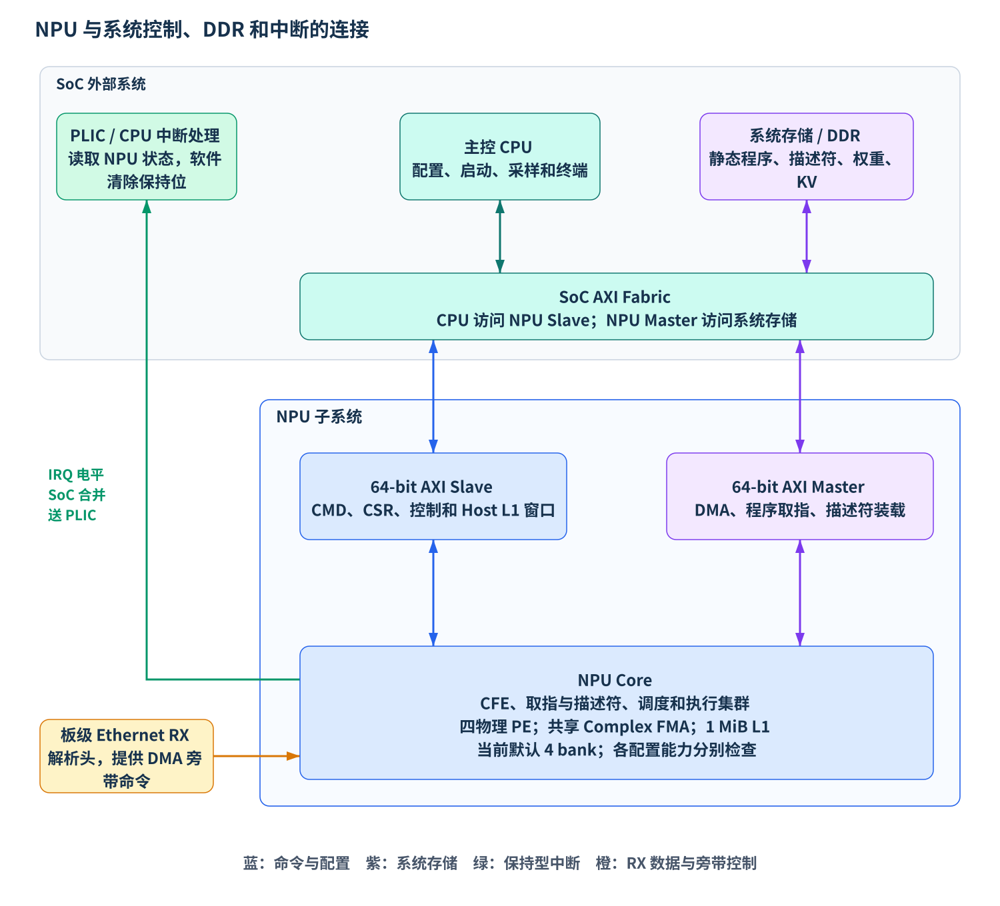

AXI Slave的局部窗口区分命令、接收响应、控制请求、CSR和L1 Host访问。软件可直接写入一对命令beat，也可向LSC设置程序地址、记录数、运行位置和有效历史长度，由Program Sequencer自主取指。程序路径和主控路径在CFE之前选择，不能把它们作为两个互不相关的调度器。

系统 AXI 读取包括原生 DMA、兼容 DMA、静态程序和外部描述符。控制侧 MIF 仲裁后三类请求，原生 bulk DMA 保持独立的宽数据队列；两者在 NPU 外部 Master 前按 ID 区分返回。Matrix、Vector 和 Complex 仍通过 L1 读取张量，不直接读取 DDR。

Ethernet RX可通过独立AXI-Stream旁带接口进入DMA。板级模块解析传输头，提供目的物理地址与字节数；NPU端负责按TKEEP/TLAST消费payload并向系统存储写入。旁带DMA不经过计算指令译码，完成脉冲与LSC保持型中断是不同接口。

NPU保留完成、异常和错误三个电平输出。SoC对三者逻辑或后送入PLIC；软件处理时读取NPU状态，清除相应保持位，再完成中断控制器处理。系统连接不要求CPU每条算子发起一次中断或重新装载模型。

### 3.2 命令、配置与存储控制

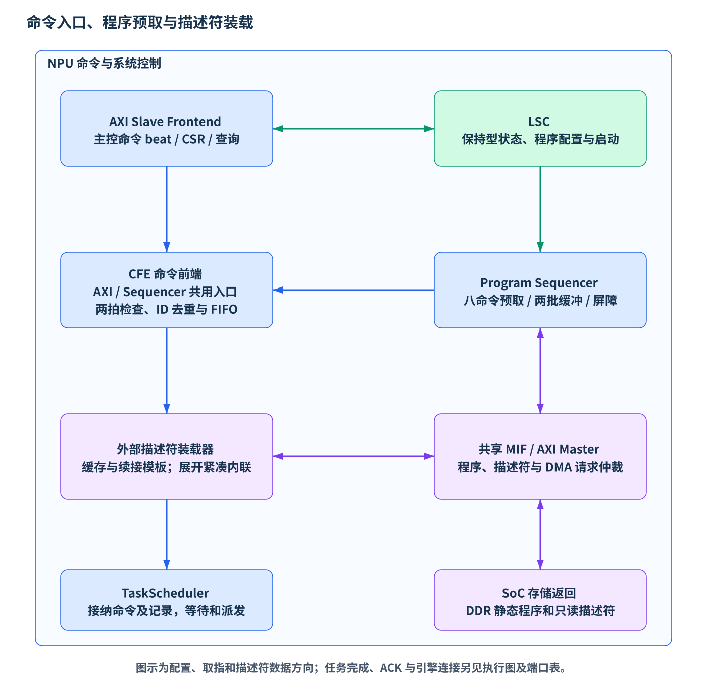

图示控制 MIF 及兼容 DMA；原生 bulk DMA 的宽数据队列与 Master 仲裁另见第 5.2、9.8 节。

#### 3.2.1 主控直接提交

AXI Slave把固定地址的两个64-bit命令beat及first/last交给CFE。CFE检查分拍、保留字段和编号冲突，将完整128-bit命令写入同步命令存储，并形成接收响应。下游是否就绪不会把一个已接受的命令改写为另一条命令。

接收响应与任务执行状态分开：命令可以已经进入CFE队列，而描述符仍在装载、任务仍在等事件、执行单元仍未接受。软件检查最终状态不能只依据AXI写响应或CFE接收成功。

#### 3.2.2 自主程序取指

LSC保存48-bit程序地址、32-bit记录数、32-bit运行位置和有效历史长度。Program Sequencer以burst方式预取命令，在两批缓冲中保存命令与原程序索引；发射路径与MIF读取路径分别推进，调度反压不要求丢弃已取到的命令。

Sequencer将普通命令按低字、高字送入同一CFE，跟踪任务完成并向TaskScheduler发ACK以回收终态。事件换代和地址窗口切换等屏障在提交前排空相关旧任务，屏障完成后再继续提交。

上下文guard、patch及有界loop是Sequencer内部消费的程序控制记录，不作为普通算术任务下发。控制记录修改本次命令的展开字段或程序游标，不能据此认为模型权重、量化参数或整段DDR程序被CPU逐token重写。

#### 3.2.3 描述符装载与内联续接

CFE完整命令先经过外部描述符装载器再进入TaskScheduler。一般指令不需要外部读取，调度器在派发时按其指令字段和基地址形成任务上下文。field48和field50使用绝对描述符指针，装载器读取完整记录并随命令提供到调度器。

描述符缓存保存完整指针tag、操作码与同步RAM载荷。命中可以减少DDR读取，但仍需按字恢复内部记录；未命中时按burst读取，并在记录成功完成后才发布有效项。abort或复位使有效项失效，静态描述符不依赖普通CPU写缓存的硬件一致性。

field54复用最近的分组缩放模板并推进tile列；field55显式选择阶段、从第零列开始；两者替换tile局部L1地址。field56直接提供动态A8的源、状态、目的和长度，不在指令中携带运行时计算出的scale。模板有效性、地址范围和阶段检查失败时不能使用旧模板继续计算。

### 3.3 执行集群与存储层次

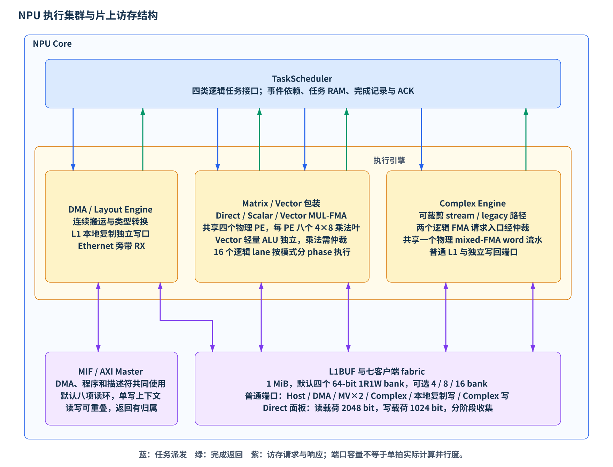

图中基础通路之外，原生宽 DMA、PV 读口和 Matrix 宽读按第 10 章连接；物理宽度与客户端数量以该章接口表为准。

执行集群接收DMA、Matrix、Vector、Complex四类任务请求。Matrix与Vector属于同一外围访存包装中的不同任务接口；DMA和Complex分别是另外两个物理引擎包装。任务接口数量不等于乘法阵列或浮点单元数量。

Direct、Scalar和分组缩放重量化在Matrix内部选择并互斥占用共享PE阵列。Direct使用独立的A/B输入FIFO和结果存储；Scalar在启用时把单点乘法转换为array_uop；分组路径利用Direct形成组部分和，再执行零点校正、尺度对齐、宽累加、行归约和最终写出。

Complex 各流前端分别维护输入/输出计数与缓存。公共两路物理 FMA 由带 tag 请求驱动，在线八路配置另补六条流水；scalar math 仍会与公共 lane 0 竞争。归一化、A8、SiLU、RoPE 和在线 Attention 各自维护状态，独立请求口不等于多项 Complex 任务可同时执行。Matrix 与 Complex 可以在任务依赖和 L1 条件允许时并行。

### 3.4 模块职责

| 模块或功能组 | 输入 | 输出 | 主要职责与限制 |
| --- | --- | --- | --- |
| AXI Slave Frontend | 五通道AXI、接收/控制/寄存器/L1返回 | 内部命令beat、CSR、控制事务、Host L1请求 | 检查访问属性，分别保持AXI响应 |
| 命令源选择 | 主控命令、程序命令 | 一路命令beat及接收响应 | 程序活动期间隔离主控直接提交 |
| CFE | 两个命令beat、编号查询结果 | 128-bit队首命令、接收结果 | 分拍、等待超时、操作码合法性与重复编号检查 |
| Program Sequencer | 程序地址/数量、运行位置、完成返回 | burst读取、命令beat、终态ACK | 两批预取、在途管理、屏障与上下文记录 |
| 外部描述符装载器 | 完整命令、MIF返回 | 命令及描述符存在/有效标志 | 缓存、记录恢复、内联模板和错误记录 |
| 调度接纳 | 命令、外部记录、基地址配置 | 任务记录、事件登记 | 保存提交时需要的参数，拒绝错误字段 |
| 任务表与描述符RAM | 接纳写入、扫描和回收 | 当前任务状态、命令与上下文 | 状态小寄存、成组数据同步存储 |
| Event Table | 等待/发布/换代 | 事件状态及代次 | 防止旧代完成被误当成新依赖 |
| 派发扫描 | 就绪任务、引擎ready | 四类任务快照 | 依赖检查与资源选择，不解释模型结构 |
| 完成生命周期 | 引擎done、查询、ACK | 事件结果、终态、LSC通知 | 记录完成，软件或Sequencer ACK后回收 |
| 内联展开 | 指令及已保存的基地址 | 公共2048-bit任务记录 | 组合字段生成，不读取DDR参数 |
| DMA控制 | 任务与访存返回 | 地址/数据请求及完成 | 形状、转换、错误排空和进度 |
| DMA连续流 | DDR/L1数据及额度 | 连续读写beat | 在缓冲容量内交叠供给与消费 |
| DMA本地复制流 | L1读数据和复制配置 | 独立L1写请求 | 不经过DDR回写再载入 |
| Ethernet DMA流 | AXI-Stream与旁带命令 | 系统存储写请求与旁带状态 | 与命令任务仲裁，协议错误单独保持/报告 |
| Matrix选择 | Matrix任务 | Direct/Scalar/分组任务 | 同一时刻选择一个控制上下文 |
| Direct几何与配置 | 形状、类型、地址、参数 | topology、面板与累加控制 | 验证合法尺寸和位宽组合 |
| Direct输入与面板 | L1面板返回 | A/B根操作数FIFO | 两侧独立接受，兼容配置按实际 phase 执行；并行流另有 packet FIFO |
| 共享 PE bank | 带 plane/列掩码的操作数与上下文 | signed48 部分和 | SoC 为 128 PE；传统与并行模式互斥；无 W4A4 |
| Direct结果存储 | 逻辑结果与列号 | 列对、普通/紧凑结果 | 同步分bank存储与前部读出缓冲 |
| Direct重量化 | INT32结果及静态profile | 目标格式列对 | 与实际两列提交容量配合 |
| Scalar兼容控制 | 普通Matrix任务 | array_uop与L1请求 | 仅在功能开启时存在；不复制PE |
| 分组缩放上下文 | 外部/内联任务记录 | 各阶段控制与地址 | 解析PREP/ACCUM/REDUCE/FINAL及缓存参数 |
| 分组缩放数据通路 | 部分和、激活和、系数、旧宽和 | 宽域结果、行摘要和最终整数 | 零点校正、共享乘法、指数对齐和最终RNE |
| Vector控制及整数流水 | 通用Vector任务与操作数 | 整数结果或乘法请求 | 独立可选的控制/轻量 ALU；MUL/FMA 请求进入共享 PE 仲裁 |
| Vector共享 PE 接口 | Vector MUL/FMA请求 | signed32逐元素乘积 | 复用 Matrix PE 的兼容入口；支持 INT8/INT16 乘数 |
| Matrix/Vector访存包装 | 两引擎普通请求 | 两路普通L1及Direct面板 | 请求FIFO、旁路缓存、返回目标与写冲突控制 |
| Complex流选择 | Complex任务与描述符 | 选中流的ready/valid | 一个任务占据引擎上下文，不承诺多算子并行启动 |
| Complex共享算术 | 带 tag 请求 | 对应请求的乘加、转换和函数结果 | 公共物理两路，在线 PV 可扩为八路；支持配置裁剪 |
| Complex行RAM/FIFO | 输入与中间值 | 连续元素及统计 | 保存归约所需整行，不使用宽复位FF表代替RAM |
| Complex独立写口 | 可并行的写回beat | L1写请求和写确认 | 单独返回额度，不保证同bank无冲突 |
| L1客户端fabric | 七路基础口、宽 DMA/PV lane、面板及 Matrix 原生读 | bank读写与各自返回 | SoC 普通口共十七路；共享实际 bank，不额外复制存储器 |
| L1BUF仲裁与bank | 请求、字节使能 | 同步读返回和写确认 | 单读单写bank、请求队列与响应额度 |
| MIF请求仲裁 | DMA、程序、描述符请求 | 单一内部MIF请求序列 | 保存读写响应归属，程序等待期间限制DMA窗口 |
| AXI Master | 48-bit内部请求 | 参数化地址宽度的系统AXI | 范围检查、读环与独立写上下文 |
| LSC | CSR、任务/程序终态、错误 | 启停、配置、保持型状态和中断 | 不把IRQ ACK转换成自动丢失状态 |
| CRG | 两时钟、复位、使能与准备请求 | 功能复位和时钟状态 | 当前系统事务仍按core时钟推进，无异步FIFO声明 |
| WDT | 启动、kick及进度 | 超时与复位请求 | 进度判定和错误恢复不由CPU轮询替代 |

#### 3.4.1 控制与数据分离

控制记录包含操作码、命令编号、任务阶段、有效位与计数；张量、面板、完整命令、描述符和部分和保存在独立RAM/FIFO中。公共package记录定义跨层字段，ready信号独立传递，不能把一个大结构体当作每个周期全部写回的寄存器组。

数据路径持续发射的前提是输入有效、结果有容量且不存在必须完成的归约。完整行absmax、平方和、在线Attention末片归一化和输出尺度发布属于真实数据依赖；它们不因控制器流水化而消失。

Direct输入FIFO用于吸收A/B供给偏差，在四phase完成前保持队首；不能用有限FIFO证明同bank持续带宽不足时PE仍然永不等待。吞吐分析同时记录物理PE有效槽、输入空窗、流水排空和结果提交时间。

### 3.5 主要数据路径与位宽

| 发送模块 | 接收模块 | 接口内容 | 载荷容量 | 控制方式 |
| --- | --- | --- | ---: | --- |
| 主控CPU | AXI Slave Frontend | 配置、命令与L1窗口 | 64 bit/beat | 系统AXI五通道 |
| AXI Slave或Sequencer | CFE | 命令分拍 | 64 bit | valid/ready加first/last |
| CFE | 描述符装载器 | 完整命令 | 128 bit | 队首保持到下游接受 |
| 描述符装载器 | TaskScheduler | 命令、存在/有效标志、记录 | 128+2048 bit接口容量 | 成对提交；配置可窄化内部存储 |
| TaskScheduler | 引擎集群 | opcode、ID、descriptor | 8+12+2048 bit/任务 | 四类独立ready/valid |
| 引擎集群 | TaskScheduler | ID、status、fault、progress | 12+8+48+64 bit | done载荷保持到握手 |
| 普通引擎客户端 | L1fabric | 地址、写数据、byte strobe | 20或21+64+8 bit | 每客户端独立请求和返回 |
| Direct | L1面板 | A/B/C基址、组/列对、写数据 | 写1024 bit | 面板独立握手，不能按普通端口时延理解 |
| L1面板 | Direct | A/B或C读取结果 | 2048 bit | 多phase收集后一次逻辑返回 |
| 兼容 Direct | 阵列 | 两组根操作数 | 各1024 bit | 独立弹性 FIFO，逻辑 step 配对 |
| 并行 Direct | 128 PE bank | plane/列 mask、A/B、context/tag | A 为 8×64 bit，B 为 8×16×32 bit | 首尾与操作数共同接受；结果 context 有界 |
| 阵列 | 结果存储 | 十六个逻辑累加结果 | 16×48 bit | 上下文与流水有效共同确定可读时间 |
| Complex公共请求 | 两条物理 FMA | A/B/C、格式、tag | 每源3×64 bit | 独立握手与响应 FIFO；在线另补六路 |
| DMA/Sequencer/描述符 | MIF | 地址、写数据、strobe、burst | 48+64+8+8 bit | 独立归属；经仲裁后共用Master |
| NPU Master 仲裁 | SoC互连 | AXI Master | 参数化 64/128/256-bit 数据、默认 40-bit 地址 | 控制 MIF 与原生 bulk DMA 独立返回归属 |
| LSC | SoC中断汇聚 | 完成、异常、错误 | 三个1-bit电平 | 状态保持，SoC可或成一个PLIC源 |

48-bit内部地址、40-bit外部地址、40-bit描述符指针和AREF28基址引用属于不同编码层次。地址转换先解析指令引用，再验证每次实际访问；不能因为CPU为RV64而推导NPU具有64-bit物理地址总线。

L1普通响应返回原客户端；MV内部按请求目标顺序交回Matrix或Vector。Direct面板绕过普通请求FIFO，Complex独立写回和DMA本地复制使用各自客户端槽。返回通路不需要重新从地址猜测请求属于哪一个引擎。

### 3.6 跨层记录与请求寿命

#### 3.6.1 引擎任务与完成记录

引擎集群的任务入口按DMA、Matrix、Vector、Complex排列为四项记录。每项含valid、8-bit opcode、12-bit command ID和2048-bit descriptor，packed总宽为2069 bit；对应ready独立存在。valid是记录有效性，不是描述符第一个字节，也不是软件写入256 B记录时的字段。

完成记录每项含valid、12-bit command ID、8-bit status、48-bit fault address和64-bit progress，packed总宽为133 bit。外层跟踪任务归属，内部单任务流不必重复保存命令编号，但包装返回的编号必须仍与被接受的任务一致。关闭的引擎配置也不能让合法握手后的任务永远没有完成记录。

任务只有在valid与ready同时为1时被引擎接受。调度器尚未被ready接受的记录必须保持，不能依据引擎内部组合状态提前改变descriptor；引擎只有在done_valid与done_ready同时为1后才允许释放本次完成载荷。任务接收、运算结束、L1写请求提交和最后写确认分别属于不同条件。

公共packed记录用于RTL连线，不作为DDR记录的布局依据。外部描述符使用按byte偏移定义的格式，片上任务记录按字段解释，不能用SystemVerilog结构体的位拼接顺序替代外部二进制ABI。内部保存1728 bit时仍通过2048-bit公共接口提供已定义字段，其余部分按照该配置的记录规则处理。

#### 3.6.2 普通L1客户端

普通请求含valid、write、地址、64-bit写数据和8-bit字节使能；返回含valid、64-bit读数据与3-bit状态，接收方单独给ready。写请求的响应不携带新的有效读数据，读请求的写数据不能被当作隐式更新。

Host、两个 MV 普通口、Complex、DMA 和面板基址均使用 21-bit 字节地址。SoC 容量为 2 MiB，范围检查使用至少 22-bit 中间值；不得在检查前截掉 bit20 或地址加法的进位。较小物理容量配置仍按实际 L1_BYTES 拒绝越界请求。

七个普通客户端在L1中各有请求存储、返回计数和容量预留，跨客户端可以返回不同周期的数据，同一客户端仍按自己的已接受次序返回。请求被接受后，地址与写数据已经成为L1队列中的载荷，不要求上游一直保持到RAM完成；但上游仍要保存足够的归属信息直到响应被消费。

MV包装在Matrix和Vector逻辑请求与两个普通口之间保存返回目标，Direct面板则具有独立的请求/响应。Complex普通口与独立写口各自完成握手，不能用普通口的ready代替独立写口的确认。DMA本地复制读后经专用写客户端完成L1到L1复制，不占系统AXI的DDR写事务。

字节写使能限定实际修改的byte。输出不足一拍时只写有效元素对应的字节；地址、格式与strobe必须共同保证相邻有效数据不被覆盖。不同格式共享同一bank不产生自动格式转换，转换由执行该任务的DMA或算术流明确完成。

#### 3.6.3 面板、根操作数与结果

Direct 面板请求含 21-bit A/B/C 基址、15-bit K 组索引、3-bit 列对、dtype、compact-A 和 B-only。2048-bit 返回是兼容面板容量，分段数由 bank 数与 dtype 决定；128 PE 私有分组另使用原生宽读，不能混用两种端口的时序。

兼容面板返回进入 A/B 各自的弹性 FIFO，默认深度随物理配置确定。A、B入队独立握手，队首配对和逻辑step接受是后续条件。逻辑step锁存上下文、A/B组号、使能mask和advance，小配置按对应 phase 使用逻辑 lane，末 phase 后才按 advance 弹出所需队首。某侧继续复用时可以不advance，避免重复从L1读取同一组根操作数。

每个PE把精度组合后的贡献加入对应上下文。逻辑结果为十六个signed48值，但计算过程中不同phase和流水中的数据尚未全部提交；seed加载、结果读取和下一次覆盖必须服从pipeline_pending及各控制器的就绪条件。不能把组合accums总线存在当作整tile已经完成。

结果存储按行和列对服务普通、紧凑及重量化输出。普通输出的物理tile与紧凑行的地址公式不同，写回模块按本次模式形成地址和strobe。两列重量化的结果可以与后续准备交叠，但参数读取、最终行尺度和结果容量仍可能限制其持续接受频率。

### 3.7 系统存储请求与参数分工

#### 3.7.1 三类全局访问

MIF前端为DMA、Program Sequencer、描述符装载器保存独立的请求/返回归属。每次内部请求带48-bit地址、write、64-bit写数据、strobe和8-bit burst长度。长度采用AXI LEN含义，零表示一个beat，不是零字节访问。

程序读取与描述符读取也是系统读流量，但不写入Matrix张量面板。程序返回填充命令缓冲；描述符返回填充记录缓存和当前任务上下文；只有DMA复制任务把系统张量写入L1。性能计数中必须区分这些用途，不能把每次Master读都称作权重DMA。

读环保存尚未完成的burst地址和剩余beat。多个读请求可在规定额度内等待，返回顺序仍按同ID规则处理；读数据通过有界响应缓冲传给原客户端。下游暂时不接受时，返回容量最终使AXI RREADY回落，数据不允许丢弃后靠下一次fetch补回。

系统写入有独立上下文，AW与W分别等待各自ready，并在B响应确认后完成内部写请求。读环仍可在这个写上下文活动期间推进。读写重叠减少互相串行等待，但不能绕过DDR读写转换开销、互连仲裁或RAMbank冲突。

#### 3.7.2 四类参数和状态

| 对象 | 位置和寿命 | 更新者 | 消费方式 |
| --- | --- | --- | --- |
| 静态命令记录 | 系统存储中的程序区，整个部署期间稳定 | 模型编译器/装载软件 | Sequencer以burst读取，必要时片上修补下一条命令 |
| 完整描述符 | 系统只读记录区，可被片上缓存 | 编译器确定形状、区域与指针 | field48/50装载；field54/55复用模板 |
| 数值profile与常量 | DDR镜像并按调度搬至L1参数窗口 | 编译器生成，DMA搬入 | Matrix/Complex从L1读取，不随描述符命中自动驻留 |
| token/归约状态 | 指令绑定的L1或DDR工作区 | NPU相应生产任务 | 等事件后读取或续算，最终阶段发布结果 |

描述符缓存只减少记录读取，不包含其所引用的全部权重、profile或激活。一个描述符命中后，其引用的数据仍可能需要DMA；反过来，数据已经驻留L1也不表示完整外部描述符曾被装载过。缓存命中率、参数重读和张量重读分别统计。

动态A8使用同一套静态任务地址，但写出的scale、reciprocal和A8码随输入变化。分组Matrix消费发布的状态，完成后再生成自己的行摘要与最终输出尺度。这种变化属于数据内容，不要求每token重编译或重写DDR指令。

#### 3.7.3 地址与容量检查

48-bit引擎地址先经过允许范围检查，再缩到默认40-bit AXI地址。burst首地址、末beat地址和加法溢出均要检查。外部描述符指针只有40 bit；AREF28则由selector、offset和已配置的基址组成，二者不能共用同一“加parameter_base”的公式。

L1地址还有独立容量限制。一个 21-bit 基址本身在范围内，不表示`base+length`或按stride计算的末元素仍合法。Matrix输入、输出、profile、宽和、行统计及shift数组分别按实际byte跨度检查；只验证最大的一个缓冲区不能替代其他区域检查。

编译器的生存期控制防止正在被消费的数据被下一次预取覆盖。硬件请求仲裁解决物理端口竞争，不负责从任意地址推断完整模型依赖。跨Linear复用状态或工作区时，程序必须用事件、阶段标志和必要屏障明确所有最后使用者。

### 3.8 完成、错误与受控排空

#### 3.8.1 接收结果与执行结果

主控提交时的AXI响应、CFE接收响应、TaskScheduler任务终态和Sequencer程序终态分别存在。AXI正常写入并不承诺数值任务成功；CFE成功入队也不承诺外部描述符合法。软件和程序控制只把对应最终status为成功的结果发布给下一阶段。

调度器等待两个事件、全局先后关系和执行资源，符合条件才派发。依赖任务失败时，后续任务按依赖错误结束，不向引擎发射。正常完成更新事件及终态记录，并根据IRQ选项通知LSC；命令编号只有在相应ACK回收后才可重新使用。

Sequencer消费自动完成通知并发送ACK，维持有限在途窗口。完整程序记录数可以超过10-bit命令编号空间，原因是编号按窗口安全复用，不是命令头实际扩展到了32 bit。控制记录不占任务槽，也不能通过一个虚构的完成事件参与普通算子依赖。

#### 3.8.2 错误保持与中断

数值、字段、范围、总线和依赖错误分别保留原始分类与故障地址。引擎收到错误后仍须消费已接受请求的必要返回，不能让MIF或L1因无人接收而永远非空闲。错误任务不能写出看似成功的最后标志来释放下游消费者。

LSC的IRQ状态和首错记录独立于PLIC内部状态。IRQ mask只控制电平输出，不表示已记录事件被清除。CPU处理程序读状态、执行必要的数据可见性处理并写清除位；清除与新错误/完成同拍的优先级按LSC实现规定。IRQ是电平，内部活动统计脉冲和Ethernet旁带done不是外部PLIC的脉冲中断源。

#### 3.8.3 停止与软复位

停止新的命令接纳不意味着可以立即丢弃CFE队列、描述符读取或AXI返回。受控复位先阻止新工作，向相关引擎提供abort，排空已接受事务，再完成内部复位及确认。时钟/电源请求也必须等待相应空闲与返回条件。

描述符缓存、续接模板和程序预取缓冲的valid在abort或复位后失效。RAM物理内容可保留，但未被新valid确认的旧内容不参与任务。恢复运行时重新设置需要的软件配置、装入首个有效模板并重新建立事件代次，不能依赖复位前的隐式队首状态。


存储访问的接收、RAM 或 AXI 提交、响应返回与客户端消费分别发生在不同流水级。受控排空必须同时覆盖执行单元内部队列、L1 普通与面板返回、MIF 已发读事务和独立写上下文，不能只根据一次请求握手或单个 bank 当前没有使能判断整个 NPU 已空闲。

## 4. 接口通用规则

### 4.1 时钟、复位与信号命名

| 项目 | 规则 |
| --- | --- |
| 主时钟 | CFE、TS、DMA、Matrix-Vector Engine、CME、L1BUF、MIF 和 LSC 使用 `core_clk_i`；`noc_clk_i` 只进入 CRG |
| 主复位 | CRG 从外部 `reset_n` 产生 `core_reset_n_o` 和 `noc_reset_n_o`。AXI Slave Frontend、CFE、TS、三个物理执行模块、L1BUF 和 MIF 使用由 `core_reset_n_o` 与内部软复位脉冲组合得到的 `functional_reset_n`；LSC 与 WDT 使用 `core_reset_n_o` |
| ready/valid | 发送端驱动 `valid` 和 payload，接收端驱动 `ready` |
| 传输发生条件 | 某周期上升沿同时采样到 `valid=1` 且 `ready=1` |
| payload 保持 | `valid=1` 且 `ready=0` 时，发送端必须保持 payload 不变 |
| ID | 带 ID 的接口必须按 ID 对应请求与返回；DMA 到 MIF 的内部接口不携带 ID |
| 字节地址 | 所有地址、stride 和长度都以字节为单位，只有 shape 以元素个数表示 |
| 保留位 | 发送端写 0；指令与 Task Context 中要求写 0 的位若非零，接收端拒绝该请求；CSR 保留位按各寄存器表规定处理 |
| 跨时钟域 | 必须经过异步 FIFO、握手同步器或项目选定的 CDC 组件 |

> [!warning] 不允许组合回授
> `valid` 不得组合依赖同一接口的 `ready`。`ready` 可以由接收端资源状态产生，但不得经过对端 `valid` 再直接返回，以免形成组合回授。

> [!note] 复位信号后缀
> `_n` 只表示低有效，不表示端口方向。顶层必须使用低有效复位输入 `reset_n`；CRG 输出名为 `core_reset_n_o` 和 `noc_reset_n_o`。AXI Slave Frontend、CFE、TS、DMA、Matrix-Vector Engine、CME、L1BUF 和 MIF 使用 `functional_reset_n`，LSC 与 WDT 使用 `core_reset_n_o`。LSC 在自身 RESET 状态机中处理软复位期间的错误记录与状态清理。每个端口的 Input 或 Output 方向由接口表单独规定。

### 4.2 ready/valid 基本时序

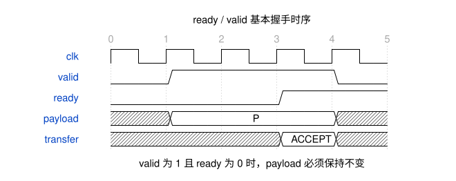

### 4.3 错误状态编码

所有模块的完成接口使用统一的 8-bit `status`：

| 编码 | 名称 | 含义 |
| ---: | --- | --- |
| `0x00` | `SUCCESS` | 任务正确完成 |
| `0x01` | `ILLEGAL_OPCODE` | opcode 未定义、已关闭或对应功能位为 0 |
| `0x02` | `BAD_DESC` | 指令中的字段、字段组合或内部 Task Context 非法 |
| `0x03` | `BAD_SHAPE` | shape、stride 或有效长度非法 |
| `0x04` | `ADDR_FAULT` | 物理地址非法或访问超出允许范围 |
| `0x05` | `BUS_DECERR` | AXI 返回 DECERR |
| `0x06` | `BUS_SLVERR` | AXI 返回 SLVERR |
| `0x07` | `DTYPE_UNSUPPORTED` | 数据格式组合不属于支持集 |
| `0x08` | `DEPENDENCY_FAILED` | 依赖事件处于失败终态 |
| `0x09` | `TIMEOUT` | CFE 高 beat 等待超时、WAIT/FENCE 控制请求超时或 WDT 停滞超时 |
| `0x0A` | `ABORTED` | 软件复位或取消请求终止任务 |
| `0x0B` | `L1_ECC_UNCORRECTABLE` | L1BUF 检测到不可修正 ECC 错误 |
| `0x0C` | `NUMERIC_EXCEPTION` | 执行单元按操作规则检测到不可继续的数值异常 |
| `0x0D` | `ADDR_OVERLAP` | 该 opcode 不允许源和目的地址范围重叠 |
| `0x81` | `NOT_FOUND` | WAIT 或 QUERY 指定的 Event、任务编号不存在；该状态用于控制请求结果，不作为执行单元 done 状态 |

执行单元在 `status != SUCCESS` 时同时返回 48-bit `fault_addr` 和 64-bit `progress`。执行单元 done 接口只允许 `0x00～0x0D`；`NOT_FOUND` 由 TaskScheduler 的 WAIT 或 QUERY 控制请求产生。TaskScheduler 根据任务状态生成内部 `error_info[31:0]`，该字段供任务查询使用，不属于执行单元 done 接口。

---

## 5. NPU 顶层接口定义

### 5.1 顶层时钟、复位、电源和中断

下表的方向以 NPU 顶层为参照。外部主控处理器的取指、数据 Cache、WFI 和处理器流水控制信号不属于 NPU 顶层端口。

| 信号 | 方向 | 位宽 | 功能 | 有效条件 | 暂停、错误与复位行为 |
| --- | --- | ---: | --- | --- | --- |
| `core_clk_i` | input | 1 | CFE、TaskScheduler、执行单元、L1BUF 和 LSC 使用的时钟 | NPU工作期间连续运行 | 不得在未排空任务时无协议停钟 |
| `noc_clk_i` | input | 1 | 送入 CRG 产生 NoC 域门控与复位观测信号；MIF 使用 `core_clk_i` | NoC复位与时钟观测 | 当前MIF仍使用core_clk_i，不构成独立CDC传输保证 |
| `reset_n` | input | 1 | 顶层低有效复位；内部 CRG 分别产生计算域和 NoC 域复位 | 低有效异步置位复位 | 释放按CRG条件同步；RAM内容不清零 |
| `dvfs_prepare_req_i` | input | 1 | SoC 请求改变计算时钟频率 | 相应控制请求或状态有效时 | 按LSC/CRG的受控排空及复位次序；不可当作普通命令ready |
| `dvfs_prepare_ack_o` | output | 1 | DVFS 请求有效，且 NPU 与两个 AXI 接口都空闲 | 相应控制请求或状态有效时 | 按LSC/CRG的受控排空及复位次序；不可当作普通命令ready |
| `soft_reset_req_i` | input | 1 | 请求受控软复位 | 相应控制请求或状态有效时 | 按LSC/CRG的受控排空及复位次序；不可当作普通命令ready |
| `soft_reset_done_o` | output | 1 | 排空请求并完成模块复位后置 1 | 相应控制请求或状态有效时 | 按LSC/CRG的受控排空及复位次序；不可当作普通命令ready |
| `power_down_req_i` | input | 1 | 请求进入断电准备状态 | 相应控制请求或状态有效时 | 按LSC/CRG的受控排空及复位次序；不可当作普通命令ready |
| `power_down_ack_o` | output | 1 | NPU 已满足断电条件 | 相应控制请求或状态有效时 | 按LSC/CRG的受控排空及复位次序；不可当作普通命令ready |
| `accept_new_cmd_o` | output | 1 | LSC 已启动且未停止时为 1；AXI Slave Frontend 还要同时检查 FIFO 空间 | 相应控制请求或状态有效时 | 按LSC/CRG的受控排空及复位次序；不可当作普通命令ready |
| `core_idle_o` | output | 1 | 命令队列、执行单元、L1 写队列和 AXI 请求均为空 | 相应控制请求或状态有效时 | 按LSC/CRG的受控排空及复位次序；不可当作普通命令ready |
| `module_clk_active_o` | output | 8 | CRG 计算出的模块时钟使能状态 | 相应控制请求或状态有效时 | 按LSC/CRG的受控排空及复位次序；不可当作普通命令ready |
| `irq_done_o` | output | 1 | 完成中断，高电平保持到软件清除 | 对应IRQ_STATUS位与IRQ_MASK位均为1 | 电平保持至软件W1C或复位；屏蔽不清除状态 |
| `irq_exception_o` | output | 1 | 数值异常或任务超时中断 | 对应IRQ_STATUS位与IRQ_MASK位均为1 | 电平保持至软件W1C或复位；屏蔽不清除状态 |
| `irq_error_o` | output | 1 | 地址、协议、ECC 或命令字段错误中断 | 对应IRQ_STATUS位与IRQ_MASK位均为1 | 电平保持至软件W1C或复位；屏蔽不清除状态 |
| `wdt_reset_req_o` | output | 1 | 看门狗复位请求 | 相应控制请求或状态有效时 | 按LSC/CRG的受控排空及复位次序；不可当作普通命令ready |

外部主控停止提交命令时，不需要控制处理器取指。软件先停止新的命令提交，再写 `CORE_CONTROL.stop`，随后等待 `core_idle_o`；通过 AXI 轮询时，软件读取 `CORE_STATUS.idle`，该字段使用不包含当前 CSR 读事务的功能空闲条件。`accept_new_cmd_o=0` 后，AXI Slave Frontend 不再接受新的 CMD burst，但已经接收的命令继续执行或按软复位规则结束。

`soft_reset_req_i/soft_reset_done_o` 与 `power_down_req_i/power_down_ack_o` 均采用请求与确认握手，详细次序见第 15.8、15.9 节。`power_down_ack_o` 只能在 `core_idle_o=1`、MIF 无未完成事务且 LSC 已进入停止状态后置 1。外部主控 CPU 自身的运行状态由 SoC 电源管理单元处理，不计入 NPU 的 `core_idle_o`。

#### 5.1.1 Ethernet RX旁带DMA

该接口是内部集成扩展，不属于AXI4五通道。系统先在`external_axis_dma_ready_o=1`时提交目的地址与字节数，再连续提供payload。NPU端不解释以太网/IP/UDP帧头；帧解析位于板级包装。未连接该功能时，输入valid/start置0，其他输入给确定值。

| 信号 | 方向 | 位宽 | 功能 | 有效条件 | 暂停、错误与复位行为 |
| --- | --- | ---: | --- | --- | --- |
| `s_axis_eth_rx_tdata_i` | input | 64 | 接收payload数据 | tvalid有效 | tvalid且tready为0时源端保持 |
| `s_axis_eth_rx_tkeep_i` | input | 8 | 各字节有效位 | 与tdata同拍 | 与数据保持；有效字节数计入剩余长度 |
| `s_axis_eth_rx_tlast_i` | input | 1 | payload末拍 | 与tdata同拍 | 必须与声明字节数的最终beat一致 |
| `s_axis_eth_rx_tvalid_i` | input | 1 | 接收数据有效 | 有待提交payload | 源端保持至握手；复位后不发送旧包 |
| `s_axis_eth_rx_tready_o` | output | 1 | 当前能接受一个payload beat | DMA已启动且输入缓存空、有写额度 | 可因等待写响应而反压，非永久高电平 |
| `external_axis_dma_start_i` | input | 1 | 提交一条旁带复制命令 | ready为1时给启动脉冲 | 活动期间不得重复启动或替换参数 |
| `external_axis_dma_dst_addr_i` | input | 48 | 系统存储目的物理地址 | start被接受时 | 同次启动参数稳定，后续由内部游标递增 |
| `external_axis_dma_byte_count_i` | input | 21 | 期望payload总字节数 | start被接受时 | 非零；不等于21-bit L1地址 |
| `external_axis_dma_ready_o` | output | 1 | 旁带命令可启动 | 普通DMA控制空闲且无竞争流 | 忙时为0；启动与任务仲裁共同约束 |
| `external_axis_dma_active_o` | output | 1 | 旁带复制正在处理 | 启动后至完成或错误 | 不用作LSC任务完成IRQ |
| `external_axis_dma_done_o` | output | 1 | 最后一次写响应成功 | 完成的单拍通知 | 下一周期清零；与保持型irq不同 |
| `external_axis_dma_protocol_error_o` | output | 1 | 长度、零有效字节或TLAST错误 | 发生输入协议错误 | 保留至下一次启动或复位 |
| `external_axis_dma_bus_error_o` | output | 1 | 系统写响应失败 | MIF返回非成功状态 | 保留至下一次启动或复位 |
| `external_axis_dma_bus_error_status_o` | output | 3 | 原始MIF错误分类 | bus_error为1 | 随错误记录保持；复位为0 |
| `external_axis_dma_fault_addr_o` | output | 48 | 发生错误的当前写地址 | protocol_error或bus_error有效 | 下一次启动更新；不是CPU虚拟地址 |

一个beat在`tvalid&&tready`时计入。输入有效字节数不能为0，不能超过剩余长度；TLAST必须恰在剩余字节被消费时出现。接收后保存数据与strobe，MIF写响应返回成功后才递减剩余字节。该实现具有输入保持和写等待控制，不能把64-bit Stream端口直接换算为每拍一个DDR写beat的稳态性能。

#### 5.1.2 Matrix物理槽统计

下列为顶层观测端口，不是AXI标准信号，也不直接定义软件CSR偏移。

| 信号 | 方向 | 位宽 | 功能 | 有效条件 | 暂停、错误与复位行为 |
| --- | --- | ---: | --- | --- | --- |
| `matrix_compute_window_cycles_o` | output | 64 | Direct计算窗口累计周期 | 对应计算窗口推进 | 功能复位清零，任务间累计；不能当完整token周期 |
| `matrix_active_step_cycles_o` | output | 64 | 逻辑step接受数 | step有效且ready | 一步跨四phase，不等于物理PE active周期 |
| `matrix_active_pe_slots_o` | output | 64 | 有效物理PE槽累计 | 物理计算phase有效 | 按使能PE计数，尾块不假作满载 |
| `matrix_available_pe_slots_o` | output | 64 | 计算窗口可用物理PE槽累计 | 计算窗口统计有效 | 与有效槽作同一区间差值；复位清零 |

利用率使用同一测量区间内 `active_pe_slots/available_pe_slots`，其中分母为实际物理 PE 数乘计算窗口拍数。contract 3 包含首个并行 packet 出现后至末次物理执行之间的 FIFO 空泡，不能只统计有发射的拍。MAC 数还需按 dtype 换算；最终重量化、参数访问及 L1 等待不记作 PE 乘法。组件内窗口、整个引擎 busy 和完整 token 的利用率必须分别报告。

### 5.2 可配置 64/128/256-bit AXI4 Master 接口

NPU 顶层提供一组参数化 `m_axi_*` AXI4 Master，由控制 MIF 与原生 bulk DMA 仲裁后连接系统。通用默认数据宽度 64 bit，SoC 为 256 bit；CPU 侧 `s_axi_*` 仍为 64 bit。DMA、程序及描述符访问保持独立的返回归属。DDR 经 SoC 互连接入，NPU 不直接假定板卡 DDR 引脚速率。

| 信号 | 方向 | 位宽 | 功能 | 有效条件 | 暂停、错误与复位行为 |
| --- | --- | ---: | --- | --- | --- |
| `m_axi_awid_o` | Output | AXI_M_ID_W，默认8 | 写事务 ID | `m_axi_awvalid_o`有效时 | 发送方在valid且ready为0时保持；valid为0时载荷无效 |
| `m_axi_awaddr_o` | Output | AXI_M_ADDR_W，默认40 | MIF 检查后的物理字节地址 | `m_axi_awvalid_o`有效时 | 发送方在valid且ready为0时保持；valid为0时载荷无效 |
| `m_axi_awlen_o` | Output | 8 | 原生 DMA 为 burst 拍数减一；兼容 MIF 写为零 | `m_axi_awvalid_o`有效时 | 发送方在valid且ready为0时保持；valid为0时载荷无效 |
| `m_axi_awsize_o` | Output | 3 | 原生 64/128/256-bit 满拍分别为 3/4/5 | `m_axi_awvalid_o`有效时 | 发送方在valid且ready为0时保持；valid为0时载荷无效 |
| `m_axi_awburst_o` | Output | 2 | 固定使用 INCR | `m_axi_awvalid_o`有效时 | 发送方在valid且ready为0时保持；valid为0时载荷无效 |
| `m_axi_awlock_o` | Output | 1 | 固定为 0，不产生独占访问 | `m_axi_awvalid_o`有效时 | 发送方在valid且ready为0时保持；valid为0时载荷无效 |
| `m_axi_awcache_o` | Output | 4 | 写事务存储属性，默认值见下文 | `m_axi_awvalid_o`有效时 | 发送方在valid且ready为0时保持；valid为0时载荷无效 |
| `m_axi_awprot_o` | Output | 3 | 权限和指令/数据属性 | `m_axi_awvalid_o`有效时 | 发送方在valid且ready为0时保持；valid为0时载荷无效 |
| `m_axi_awqos_o` | Output | 4 | 服务质量值固定为 0 | `m_axi_awvalid_o`有效时 | 发送方在valid且ready为0时保持；valid为0时载荷无效 |
| `m_axi_awvalid_o` | Output | 1 | 写地址有效 | 本通道载荷有效 | 发送方保持有效和载荷至ready；复位清除发送有效状态 |
| `m_axi_awready_i` | Input | 1 | 接收方可接收写地址 | 本通道valid与本信号同时为1时接受 | 由接收容量决定，可反压；不表示其他通道同时就绪 |
| `m_axi_wdata_o` | Output | `AXI_M_DATA_W` | 写数据 | `m_axi_wvalid_o`有效时 | 发送方在valid且ready为0时保持；valid为0时载荷无效 |
| `m_axi_wstrb_o` | Output | `AXI_M_DATA_W/8` | 每个字节一个有效位 | `m_axi_wvalid_o`有效时 | 发送方在valid且ready为0时保持；valid为0时载荷无效 |
| `m_axi_wlast_o` | Output | 1 | 当前 burst 的最后一个 beat | `m_axi_wvalid_o`有效时 | 发送方在valid且ready为0时保持；valid为0时载荷无效 |
| `m_axi_wvalid_o` | Output | 1 | 写数据有效 | 本通道载荷有效 | 发送方保持有效和载荷至ready；复位清除发送有效状态 |
| `m_axi_wready_i` | Input | 1 | 接收方可接收写数据 | 本通道valid与本信号同时为1时接受 | 由接收容量决定，可反压；不表示其他通道同时就绪 |
| `m_axi_bid_i` | Input | AXI_M_ID_W，默认8 | 写响应 ID | `m_axi_bvalid_i`有效时 | 发送方在valid且ready为0时保持；valid为0时载荷无效 |
| `m_axi_bresp_i` | Input | 2 | `OKAY`、`SLVERR` 或 `DECERR` | `m_axi_bvalid_i`有效时 | 发送方在valid且ready为0时保持；valid为0时载荷无效 |
| `m_axi_bvalid_i` | Input | 1 | 写响应有效 | 本通道载荷有效 | 发送方保持有效和载荷至ready；复位清除发送有效状态 |
| `m_axi_bready_o` | Output | 1 | NPU 可接收写响应 | 本通道valid与本信号同时为1时接受 | 由接收容量决定，可反压；不表示其他通道同时就绪 |
| `m_axi_arid_o` | Output | AXI_M_ID_W，默认8 | 读事务 ID | `m_axi_arvalid_o`有效时 | 发送方在valid且ready为0时保持；valid为0时载荷无效 |
| `m_axi_araddr_o` | Output | AXI_M_ADDR_W，默认40 | MIF 检查后的物理字节地址 | `m_axi_arvalid_o`有效时 | 发送方在valid且ready为0时保持；valid为0时载荷无效 |
| `m_axi_arlen_o` | Output | 8 | 读burst的beat数减1；0..255对应1..256个beat | `m_axi_arvalid_o`有效时 | 发送方在valid且ready为0时保持；valid为0时载荷无效 |
| `m_axi_arsize_o` | Output | 3 | 每个 beat 的字节数 | `m_axi_arvalid_o`有效时 | 发送方在valid且ready为0时保持；valid为0时载荷无效 |
| `m_axi_arburst_o` | Output | 2 | 固定使用 INCR | `m_axi_arvalid_o`有效时 | 发送方在valid且ready为0时保持；valid为0时载荷无效 |
| `m_axi_arlock_o` | Output | 1 | 固定为 0，不产生独占访问 | `m_axi_arvalid_o`有效时 | 发送方在valid且ready为0时保持；valid为0时载荷无效 |
| `m_axi_arcache_o` | Output | 4 | 读事务存储属性，默认值见下文 | `m_axi_arvalid_o`有效时 | 发送方在valid且ready为0时保持；valid为0时载荷无效 |
| `m_axi_arprot_o` | Output | 3 | 权限和指令/数据属性 | `m_axi_arvalid_o`有效时 | 发送方在valid且ready为0时保持；valid为0时载荷无效 |
| `m_axi_arqos_o` | Output | 4 | 服务质量值固定为 0 | `m_axi_arvalid_o`有效时 | 发送方在valid且ready为0时保持；valid为0时载荷无效 |
| `m_axi_arvalid_o` | Output | 1 | 读地址有效 | 本通道载荷有效 | 发送方保持有效和载荷至ready；复位清除发送有效状态 |
| `m_axi_arready_i` | Input | 1 | 接收方可接收读地址 | 本通道valid与本信号同时为1时接受 | 由接收容量决定，可反压；不表示其他通道同时就绪 |
| `m_axi_rid_i` | Input | AXI_M_ID_W，默认8 | 读返回 ID | `m_axi_rvalid_i`有效时 | 发送方在valid且ready为0时保持；valid为0时载荷无效 |
| `m_axi_rdata_i` | Input | `AXI_M_DATA_W` | 读返回数据 | `m_axi_rvalid_i`有效时 | 发送方在valid且ready为0时保持；valid为0时载荷无效 |
| `m_axi_rresp_i` | Input | 2 | 读返回状态 | `m_axi_rvalid_i`有效时 | 发送方在valid且ready为0时保持；valid为0时载荷无效 |
| `m_axi_rlast_i` | Input | 1 | 当前 burst 的最后一个 beat | `m_axi_rvalid_i`有效时 | 发送方在valid且ready为0时保持；valid为0时载荷无效 |
| `m_axi_rvalid_i` | Input | 1 | 读返回有效 | 本通道载荷有效 | 发送方保持有效和载荷至ready；复位清除发送有效状态 |
| `m_axi_rready_o` | Output | 1 | NPU 可接收读返回 | 本通道valid与本信号同时为1时接受 | 由接收容量决定，可反压；不表示其他通道同时就绪 |

AXI 接口必须满足：

1. 地址单位为 byte，AxLEN 为实际物理拍数减一。原生数据拍的 AxSIZE 为
   $\log_2(\texttt{AXI\_M\_DATA\_W}/8)$；控制/兼容访问经宽度转换，不凭空复制窄请求。
2. 每个 burst 不跨越 4 KiB，首尾物理拍都在授权范围。尾部无效 byte 用 WSTRB 屏蔽，
   但读尾拍的物理范围也须合法，不能靠软件只使用部分 byte 来允许越界读取。
3. AW、W、B、AR、R 分别握手。读窗口、数据 FIFO、写地址和 B 计数独立推进；
   同一 DDR→DDR 搬运可读写同时在途，不代表两项独立 DMA 任务已可同时接受。
4. ID 保留控制与 bulk 请求来源。控制兼容 master 的局部 ID=0 检查只适用于其子通路；
   NPU 外部 ID 还包含归属位，SoC 再扩展系统来源。不得把所有响应 ID 强制当零或截掉来源。
5. RLAST 与对应已接受 burst 的长度一致；WLAST 只在末拍置位。收到对应 B 之前不得
   报告写成功；非 OKAY 返回保存首个错误，并排空已发出的事务后结束任务。
6. 下游反压时请求、数据和标签保持。读环、返回队列和写队列有各自信用，只有真正接受的
   事务才能占用或回收信用；无错误的连续数据拍不需要等整项 DMA 完成后才能接收。
7. 控制 MIF 的窄字访问、原生 DMA 的宽拍和程序 cmd128 的分组宽度不同，必须分别统计
   有效 byte 和物理 beat。256-bit fetch 一拍含两条指令，不表示 scheduler 每拍派发两任务。
8. CSR `M_AXI_ADDR_LIMIT` 保持“最后一个允许访问 64-bit word 的首地址”的既有定义，
   原生端以 `limit | 7` 形成包含最后 byte 的范围；不能把许可范围向 32-byte 拍额外放宽。
9. 默认存储属性与权限由各主口设置；普通任务不得产生独占访问。错误地址和状态保持到
   软件清除或受控复位，不能把单拍错误通知当作完整状态。

#### 5.2.1 外部主控处理器的总线位置

外部主控处理器的取指、Cache 和通用数据访问由 SoC 处理器子系统完成，不经过 NPU，也不属于 NPU 顶层。NPU 不设置处理器取指、I-cache、D-cache 或寄存器写回端口。

外部主控处理器与 NPU 的关系只有两类：

1. 外部主控处理器作为 AXI Master，经 SoC AXI Fabric 访问 NPU 的 `s_axi_*`；
2. NPU 的 `irq_done_o`、`irq_exception_o` 和 `irq_error_o` 经 SoC 中断控制器送到外部主控处理器。

因此，NPU 的 `core_idle_o`、软复位和断电确认只检查 NPU 内部模块及 NPU `m_axi_*` 的未完成事务，不检查外部主控处理器的取指或 Cache 状态。处理器是否继续运行、进入 WFI 或关闭时钟，由 SoC 处理器子系统和电源管理模块处理。

### 5.3 64-bit AXI4 Slave 接口

`s_axi_*` 是 NPU 面向 SoC AXI Fabric 的 Slave 接口。外部主控处理器或其他获准主控通过该接口提交指令、访问 LSC CSR、发起 WAIT/QUERY/FENCE 控制请求，并访问 L1BUF 外部窗口。地址宽度为 24 bit，数据宽度为 64 bit，信号组与标准 AXI4 一致。

| 信号 | 方向 | 位宽 | 功能 | 有效条件 | 暂停、错误与复位行为 |
| --- | --- | ---: | --- | --- | --- |
| `s_axi_awid_i` | Input | AXI_S_ID_W，默认8 | 写事务 ID | `s_axi_awvalid_i`有效时 | 发送方在valid且ready为0时保持；valid为0时载荷无效 |
| `s_axi_awaddr_i` | Input | AXI_S_ADDR_W，默认24 | 本地字节地址 | `s_axi_awvalid_i`有效时 | 发送方在valid且ready为0时保持；valid为0时载荷无效 |
| `s_axi_awlen_i` | Input | 8 | burst beat 数减 1 | `s_axi_awvalid_i`有效时 | 发送方在valid且ready为0时保持；valid为0时载荷无效 |
| `s_axi_awsize_i` | Input | 3 | 每个 beat 的字节数 | `s_axi_awvalid_i`有效时 | 发送方在valid且ready为0时保持；valid为0时载荷无效 |
| `s_axi_awburst_i` | Input | 2 | CMD FIFO 接受 FIXED；CSR、控制和 L1BUF 接受 INCR | `s_axi_awvalid_i`有效时 | 发送方在valid且ready为0时保持；valid为0时载荷无效 |
| `s_axi_awlock_i` | Input | 1 | 独占属性；只接受 0 | `s_axi_awvalid_i`有效时 | 发送方在valid且ready为0时保持；valid为0时载荷无效 |
| `s_axi_awcache_i` | Input | 4 | 存储属性；Frontend 忽略该字段 | `s_axi_awvalid_i`有效时 | 发送方在valid且ready为0时保持；valid为0时载荷无效 |
| `s_axi_awprot_i` | Input | 3 | 权限属性；Frontend 忽略该字段 | `s_axi_awvalid_i`有效时 | 发送方在valid且ready为0时保持；valid为0时载荷无效 |
| `s_axi_awqos_i` | Input | 4 | 服务质量值；Frontend 忽略该字段 | `s_axi_awvalid_i`有效时 | 发送方在valid且ready为0时保持；valid为0时载荷无效 |
| `s_axi_awvalid_i` | Input | 1 | 写地址有效 | 本通道载荷有效 | 发送方保持有效和载荷至ready；复位清除发送有效状态 |
| `s_axi_awready_o` | Output | 1 | NPU 可接收写地址 | 本通道valid与本信号同时为1时接受 | 由接收容量决定，可反压；不表示其他通道同时就绪 |
| `s_axi_wdata_i` | Input | 64 | 写数据 | `s_axi_wvalid_i`有效时 | 发送方在valid且ready为0时保持；valid为0时载荷无效 |
| `s_axi_wstrb_i` | Input | 8 | 每个字节一个写使能 | `s_axi_wvalid_i`有效时 | 发送方在valid且ready为0时保持；valid为0时载荷无效 |
| `s_axi_wlast_i` | Input | 1 | 当前 burst 最后一拍 | `s_axi_wvalid_i`有效时 | 发送方在valid且ready为0时保持；valid为0时载荷无效 |
| `s_axi_wvalid_i` | Input | 1 | 写数据有效 | 本通道载荷有效 | 发送方保持有效和载荷至ready；复位清除发送有效状态 |
| `s_axi_wready_o` | Output | 1 | NPU 可接收写数据 | 本通道valid与本信号同时为1时接受 | 由接收容量决定，可反压；不表示其他通道同时就绪 |
| `s_axi_bid_o` | Output | AXI_S_ID_W，默认8 | 写响应 ID | `s_axi_bvalid_o`有效时 | 发送方在valid且ready为0时保持；valid为0时载荷无效 |
| `s_axi_bresp_o` | Output | 2 | OKAY 或 SLVERR | `s_axi_bvalid_o`有效时 | 发送方在valid且ready为0时保持；valid为0时载荷无效 |
| `s_axi_bvalid_o` | Output | 1 | 写响应有效 | 本通道载荷有效 | 发送方保持有效和载荷至ready；复位清除发送有效状态 |
| `s_axi_bready_i` | Input | 1 | 发起方可接收写响应 | 本通道valid与本信号同时为1时接受 | 由接收容量决定，可反压；不表示其他通道同时就绪 |
| `s_axi_arid_i` | Input | AXI_S_ID_W，默认8 | 读事务 ID | `s_axi_arvalid_i`有效时 | 发送方在valid且ready为0时保持；valid为0时载荷无效 |
| `s_axi_araddr_i` | Input | AXI_S_ADDR_W，默认24 | 本地字节地址 | `s_axi_arvalid_i`有效时 | 发送方在valid且ready为0时保持；valid为0时载荷无效 |
| `s_axi_arlen_i` | Input | 8 | burst beat 数减 1 | `s_axi_arvalid_i`有效时 | 发送方在valid且ready为0时保持；valid为0时载荷无效 |
| `s_axi_arsize_i` | Input | 3 | 每个 beat 的字节数 | `s_axi_arvalid_i`有效时 | 发送方在valid且ready为0时保持；valid为0时载荷无效 |
| `s_axi_arburst_i` | Input | 2 | 接受 INCR | `s_axi_arvalid_i`有效时 | 发送方在valid且ready为0时保持；valid为0时载荷无效 |
| `s_axi_arlock_i` | Input | 1 | 独占属性；只接受 0 | `s_axi_arvalid_i`有效时 | 发送方在valid且ready为0时保持；valid为0时载荷无效 |
| `s_axi_arcache_i` | Input | 4 | 存储属性；Frontend 忽略该字段 | `s_axi_arvalid_i`有效时 | 发送方在valid且ready为0时保持；valid为0时载荷无效 |
| `s_axi_arprot_i` | Input | 3 | 权限属性；Frontend 忽略该字段 | `s_axi_arvalid_i`有效时 | 发送方在valid且ready为0时保持；valid为0时载荷无效 |
| `s_axi_arqos_i` | Input | 4 | 服务质量值；Frontend 忽略该字段 | `s_axi_arvalid_i`有效时 | 发送方在valid且ready为0时保持；valid为0时载荷无效 |
| `s_axi_arvalid_i` | Input | 1 | 读地址有效 | 本通道载荷有效 | 发送方保持有效和载荷至ready；复位清除发送有效状态 |
| `s_axi_arready_o` | Output | 1 | NPU 可接收读地址 | 本通道valid与本信号同时为1时接受 | 由接收容量决定，可反压；不表示其他通道同时就绪 |
| `s_axi_rid_o` | Output | AXI_S_ID_W，默认8 | 读返回 ID | `s_axi_rvalid_o`有效时 | 发送方在valid且ready为0时保持；valid为0时载荷无效 |
| `s_axi_rdata_o` | Output | 64 | 读返回数据 | `s_axi_rvalid_o`有效时 | 发送方在valid且ready为0时保持；valid为0时载荷无效 |
| `s_axi_rresp_o` | Output | 2 | OKAY 或 SLVERR | `s_axi_rvalid_o`有效时 | 发送方在valid且ready为0时保持；valid为0时载荷无效 |
| `s_axi_rlast_o` | Output | 1 | 当前 burst 最后一拍 | `s_axi_rvalid_o`有效时 | 发送方在valid且ready为0时保持；valid为0时载荷无效 |
| `s_axi_rvalid_o` | Output | 1 | 读返回有效 | 本通道载荷有效 | 发送方保持有效和载荷至ready；复位清除发送有效状态 |
| `s_axi_rready_i` | Input | 1 | 发起方可接收读返回 | 本通道valid与本信号同时为1时接受 | 由接收容量决定，可反压；不表示其他通道同时就绪 |

| 访问对象 | 地址区段 | 访问宽度 | 行为 |
| --- | --- | ---: | --- |
| LSC CSR | `0x000000～0x00FFFF` | 8、16、32 或 64 bit | 对齐的单 beat 访问；支持读写、W1C 和只读属性 |
| Debug / Performance | `0x010000～0x01FFFF` | 8、16、32 或 64 bit | 对齐的单 beat 访问；有意义的读要求 Core 空闲或调试数据已冻结 |
| CMD FIFO 数据 | `0x020000` | 64 bit × 2～16 beat | FIXED burst；每两个 beat 组成一条 128-bit 指令 |
| CMD 接收响应 | `0x020008` | 64 bit | 读取 `command_id`、接收状态和 FIFO 空闲项数 |
| CMD FIFO 状态 | `0x020010` | 64 bit | 读取接收端状态 |
| 控制参数 0 | `0x020020` | 64 bit | WAIT/QUERY/FENCE 的第一个参数 |
| 控制参数 1 | `0x020028` | 64 bit | WAIT/QUERY/FENCE 的第二个参数 |
| 控制启动 | `0x020030` | 64 bit | 启动一次控制请求 |
| 控制状态 | `0x020038` | 64 bit | 读取 busy、done 和前端完成状态 |
| 控制结果 | `0x020040` | 64 bit | 读取控制请求返回值 |
| 控制取消 | `0x020048` | 64 bit | 取消正在等待的 WAIT 或 FENCE |
| L1BUF 外部窗口 | `0x100000～0x1FFFFF` | 8、16、32 或 64 bit | `L1_HOST_ACCESS_ENABLE=1` 时访问 |

保留地址返回 `SLVERR`，不得把无效写入当成成功。NPU 忙时访问受限制的调试寄存器，或在授权位为 0 时访问 L1BUF 外部窗口，也返回 `SLVERR`。

AXI Slave Frontend 不使用 `AWCACHE/ARCACHE`、`AWPROT/ARPROT` 或 `AWQOS/ARQOS`，这些输入不改变目标选择、返回数据或响应状态。特权级、安全域和设备访问许可由 SoC 总线访问控制单元检查。`AWLOCK/ARLOCK` 不属于这组忽略字段：它们必须为 0，否则格式检查失败并返回 `SLVERR`。L1BUF 外部访问还必须通过本 NPU 内部的 `L1_HOST_ACCESS_ENABLE` 检查。

LSC CSR 与 Debug / Performance 区域只接受对齐的 1B、2B、4B 或 8B 单 beat 事务。CMD 响应、CMD 状态和控制寄存器只接受 8B 单 beat 事务。CMD FIFO 数据地址只接受 2～16 个 beat 的 FIXED 写 burst，beat 数必须为偶数。L1BUF 外部窗口可接受 INCR burst，但一次 burst 不得跨越 4KiB 地址区段或 L1BUF 末地址。

AXI Slave 对窄访问和 burst 使用以下固定规则：

- `AWSIZE/ARSIZE=0、1、2、3` 分别表示 1B、2B、4B、8B；CSR 与 Debug / Performance 只允许单 beat，且访问必须按所选宽度对齐；
- 多 beat L1BUF 访问必须满足 `AWSIZE=ARSIZE=3`，内部地址每个 beat 增加 8；
- 窄写把 AXI 地址向下对齐到 8B，并使用 `WSTRB` 选择实际字节；
- 窄读同样读取对齐后的完整 64-bit word，再按照 AXI 地址低 3 bit 把所需字节放到规定的数据 lane；未选中的 `RDATA` lane 固定返回 0；
- 不支持的 size、未按所选 2B/4B/8B 宽度对齐的访问或窄 burst 返回 `SLVERR`，不产生内部请求。

> [!note] 为什么地址是 24 bit
> NPU Slave 本地空间使用低 24 bit 地址。SoC 集成时，系统地址译码根据分配给 NPU 的物理地址选择该 Slave，并向前端提供低 24 bit 本地地址；NPU 的 MIF 不参与外部主控到 `s_axi_*` 的访问。


#### 5.3.1 AXI Slave Frontend

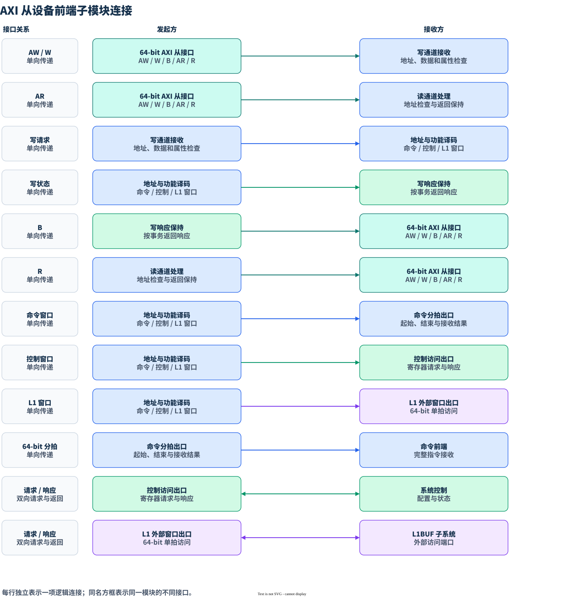

AXI Slave Frontend 终止 `s_axi_*`，并产生 LSC 寄存器请求、CMD beat、控制请求或 L1BUF Host 请求。`wr_state_q` 和 `rd_state_q` 分别保存写事务与读事务状态，但接收条件会检查另一个方向是否空闲：读事务或未接收的 R response 存在时不接收新的 AW，写事务或未接收的 B response 存在时不接收新的 AR；AW 和 AR 同时有效时写地址优先。由此，两个方向各有自己的状态寄存器，却不会同时推进两个 AXI 事务。写通道先接收 AW，随后才对对应的 W 数据拉高 `s_axi_wready_o`；Frontend 固定接收 `AWLEN+1` 个 W beat，全部内部处理完成后产生一次 B response。

`s_axi_idle_o` 必须由下式生成：

```text
(wr_state_q == WR_IDLE) && !s_axi_bvalid_o
&& (rd_state_q == RD_IDLE) && !s_axi_rvalid_o
```

它只描述外部 AXI 读写事务状态，不包含内部 CMD 入口占用数、命令响应 FIFO 占用数、CFE 处理状态或控制端 `busy/pending/inflight`。需要判断正常停止或软复位条件时，必须与 `cmd_ingress_idle_o`、CFE 和 TS 的状态信号分别配合。

Frontend 还接收以下控制输入：

| 信号 | Frontend 方向 | 位宽 | 说明 |
| --- | --- | ---: | --- |
| `core_idle_i` | Input | 1 | 顶层 NPU 空闲状态 |
| `debug_frozen_i` | Input | 1 | 性能计数器已经冻结，可稳定读取调试快照 |
| `l1_host_access_enable_i` | Input | 1 | LSC 对 L1BUF 外部窗口的授权位 |
| `cmd_accept_enable_i` | Input | 1 | LSC 允许接收新 CMD |

Debug / Performance 读访问要求 `core_idle_i=1` 或 `debug_frozen_i=1`。NPU 没有可写的 Debug / Performance 寄存器；格式正确的写请求仍可到达 LSC，但不修改调试状态。L1BUF 外部访问要求 `l1_host_access_enable_i=1`。为了避免软件与执行单元同时修改同一存储区，驱动在装载权重、写输入或读取最终输出前应停止相关任务；硬件仍通过 L1BUF Controller 的正常仲裁处理 Host 请求。

`core_idle_i` 必须由本周期开始时的 AXI 命令接收、CFE、TS、四类任务接口、三个物理执行模块、L1BUF 和 MIF 状态产生，不能使用上一周期保存的 `core_idle_o`。若本周期接收新的 CMD burst，则本周期的受限制 Debug 请求按忙状态检查。

地址选择规则如下：

| `s_axi` 地址 | 内部目的 | 内部地址或处理 |
| --- | --- | --- |
| `0x000000～0x00FFFF` | LSC CSR | `reg_req_space=0`，`reg_req_addr=s_axi_addr[15:0]` |
| `0x010000～0x01FFFF` | Debug / Performance | `reg_req_space=1`，`reg_req_addr=s_axi_addr[15:0]` |
| `0x020000` | CMD FIFO 数据 | 把偶数个 W beat 依次送到 CFE |
| `0x020008` | CMD 接收响应 | 读出一条 CFE 接收响应 |
| `0x020010` | CMD FIFO 状态 | 返回接收端忙状态和可用项数 |
| `0x020020～0x020048` | WAIT/QUERY/FENCE 控制端口 | 保存参数、启动请求、读取状态和结果、取消等待 |
| `0x100000～0x1FFFFF` | L1BUF Host 端口 | `laddr=s_axi_addr-0x100000` |

`reg_req_space` 必须随寄存器请求一起锁存并保持到响应完成。没有该选择位时，`0x000000` 与 `0x010000` 会产生相同的 16-bit 内部地址，LSC 无法判断应访问普通 CSR 还是调试寄存器组。

AXI Slave Frontend 到 LSC 的对应端口名为 `reg_req_space_o`，位宽为 1；它与第 15.2 节的 `reg_req_space_i` 直接连接，并与 `reg_req_valid`、地址、写数据和 strobe 在同一周期完成请求握手。对 1B、2B 或 4B 的寄存器访问，`reg_req_addr_o` 必须向下对齐到 8B；`reg_req_wdata_o` 和 `reg_req_wstrb_o` 保留 AXI 原始 lane 位置，LSC 按 strobe 更新对应字节。

L1BUF Host 窗口长度随 `L1_BYTES`，当前为 2 MiB。NPU 局部窗口从 `0x100000` 起，Host 请求使用 21-bit L1 地址，不能把高半区折回低 1 MiB。软件地址、范围检查与实际容量必须一致。

Frontend 到 L1BUF Controller 的 Host 接口保持 64 bit：

| 信号 | Frontend 方向 | 位宽 | 说明 |
| --- | --- | ---: | --- |
| `l1_req_valid_o` | Output | 1 | Host 请求有效 |
| `l1_req_ready_i` | Input | 1 | L1BUF Controller 可接收 |
| `l1_req_write_o` | Output | 1 | 0 为读，1 为写 |
| `l1_req_addr_o` | Output | 20 | L1BUF 字节地址 |
| `l1_req_wdata_o` | Output | 64 | 写数据 |
| `l1_req_wstrb_o` | Output | 8 | 写字节使能 |
| `l1_rsp_valid_i` | Input | 1 | 读返回或写完成有效 |
| `l1_rsp_ready_o` | Output | 1 | Frontend 可接收 |
| `l1_rsp_rdata_i` | Input | 64 | 读数据 |
| `l1_rsp_status_i` | Input | 3 | 正常、ECC 状态或访问失败 |

授权位为 0 时，Frontend 不向 L1BUF 发请求，直接返回 `SLVERR`。

AXI Slave Frontend 的功能时序：

| 阶段 | 读事务 | 写事务 |
| --- | --- | --- |
| T0 | 接收 AR，检查格式并保存 ID、地址、长度和读宽度 | 接收 AW，检查格式并保存 ID、地址和长度 |
| T1 | 译码到 LSC、CMD/控制端口或 L1BUF Host 端口 | 仅在 AW 已锁存后接收第一拍 W |
| T2～ | 逐拍发内部 64-bit 请求并等待返回 | 逐拍处理 W，检查地址类型、beat 数、WSTRB 和 WLAST |
| Tend | 生成 RDATA/RRESP，末拍设置 RLAST | 全部内部写完成后生成一次 BRESP |

L1BUF 满宽 burst 在内部拆成单 beat `l1_req_*` 请求，内部地址每拍增加 8。窄访问只有一拍，内部请求地址向下对齐到 8B。任一内部请求失败时，Frontend 停止发出新的 L1 请求，完成已经接受的请求后返回 `SLVERR`。

`WLAST` 的检查以 `AWLEN+1` 为准：若 `WLAST` 在较早 beat 置 1，或在最后一个预期 beat 仍为 0，Frontend 记录协议错误并最终返回 `SLVERR`。发现错误后不再产生新的内部写请求，但仍继续接收直到第 `AWLEN+1` 个 W beat，避免写通道永久停住；已经握手的内部请求必须等待响应。B response 的 ID 使用已锁存的 `AWID`。

#### 5.3.2 CMD FIFO、接收响应和控制端口

CMD FIFO 写 burst 必须同时满足：

1. `AWADDR=0x020000`、`AWSIZE=3`、`AWBURST=FIXED`、`AWLOCK=0`；
2. `AWLEN+1` 为 2～16 范围内的偶数；
3. 每个 W beat 的 `WSTRB=8'hff`；
4. `WLAST` 只在声明的最后一个 beat 置 1；
5. Frontend 的 ingress buffer 能保存整个 burst；
6. `cmd_accept_enable_i=1`。

Frontend 先接收并检查完整 burst，再按低 word、高 word 的次序把每条指令送入 CFE。若 AXI 属性或 W 通道格式错误，整个 burst 返回 `SLVERR`，并且不得向 CFE提交其中的任何命令。若 burst格式正确，AXI B response 返回 `OKAY`；每条命令的操作码、`command_id` 和任务字段检查结果由 CMD 接收响应 FIFO 分别返回。

每条命令的 64 bit 接收响应格式如下：

| bit | 字段 | 说明 |
| ---: | --- | --- |
| `[11:0]` | `command_id` | 低 10 bit 有效，高 2 bit 为 0 |
| `[19:12]` | `status` | `SUCCESS` 表示命令通过 CFE 的 opcode 与重复编号检查并进入 CFE FIFO；TaskScheduler 后续发现 payload 或事件错误时，该接收状态仍保持 `SUCCESS` |
| `[27:20]` | `fifo_free` | 产生该响应时 CFE FIFO 的剩余项数 |
| `[63:28]` | 保留 | 读出为 0 |

主控提交 $N$ 条命令后，必须从 `0x020008` 读取 $N$ 条响应。AXI B response 只说明 burst传输完成，不能替代逐命令接收响应。驱动还要核对返回的 `command_id` 是否与提交次序一致。

WAIT、QUERY 和 FENCE 使用控制参数与控制启动寄存器，不使用 CPU 自定义指令。控制启动值为：

| `CTL_START[1:0]` | 操作 | 参数 |
| ---: | --- | --- |
| `1` | WAIT | `ARG0[7:0]` 为 Event ID，`ARG1[31:0]` 为最大等待周期 |
| `2` | QUERY | `ARG0[9:0]` 为 `command_id`，`ARG0[63:10]` 必须为 0，`ARG1[2:0]` 为查询 selector |
| `3` | FENCE | `ARG0[3:0]` 为执行单元选择，`ARG1[31:0]` 为最大等待周期 |

写 `CTL_START` 时高 62 bit 必须为 0，并且当前控制端口不能处于 busy。Frontend 将参数和操作码通过 `ctl_req_*` ready/valid 接口送到 TaskScheduler。正常返回到达后，`CTL_STATUS.done=1`，`CTL_STATUS[15:8]` 写入 `SUCCESS`，完整的 64-bit 操作结果写入 `CTL_RESULT`。WAIT、QUERY 和 FENCE 的任务状态、事件状态或失败信息均按各自结果格式从 `CTL_RESULT` 读取。Frontend 本地处理取消请求时，`CTL_STATUS[15:8]` 写入 `8'h0a`。

写 `CTL_CANCEL=1` 可以取消正在等待的 WAIT 或 FENCE。QUERY 不接受取消。取消只结束本次同步控制请求，不修改被查询任务、Event Table 或已经产生的张量数据。

### 5.4 外部主控处理器与软件调用方式

外部主控处理器通过软件驱动访问 NPU。NPU 不定义处理器自定义指令，不包含处理器发射适配器，也不设置处理器寄存器写回端口。软件驱动把上层设备操作转换成 AXI Slave 访问。

驱动对上层软件提供以下操作：

| 软件操作 | 作用 | NPU 侧访问 |
| --- | --- | --- |
| 初始化设备上下文 | 建立平台访问能力并初始化软件状态 | 不产生 NPU 访问 |
| 配置存储基址 | 配置 INPUT、WEIGHT、WORK、OUTPUT 和 KV 物理基址及允许访问范围 | 写 LSC CSR |
| 配置软件等待上限 | 限制软件轮询时间 | 不写入 NPU 任务超时寄存器 |
| 启动设备 | 允许 NPU 接收新命令 | 写 `CORE_CONTROL.start` |
| 停止设备 | 停止接收新命令并等待内部请求排空 | 写 `CORE_CONTROL.stop`，随后读取状态 |
| 提交单条命令 | 提交一条 128-bit 指令 | 向 `0x020000` 写 2-beat FIXED burst，再读一条接收响应 |
| 提交命令批次 | 提交 1～8 条指令 | 向 `0x020000` 写 2～16 beat FIXED burst，再逐条读取接收响应 |
| 查询任务 | 读取任务状态、错误地址和进度 | 通过控制参数、QUERY 和控制结果寄存器完成 |
| 等待任务 | 轮询任务直到终态或达到软件等待上限 | 重复 QUERY，轮询间隔由平台控制 |
| 确认任务 | 释放终态任务表项和 `command_id` | 发起 QUERY selector `ACK` |
| 等待事件 | 等待 Event 进入成功或失败状态 | 发起 WAIT 控制请求 |
| 执行栅栏 | 等待所选执行单元中更早提交的任务结束 | 发起 FENCE 控制请求 |
| 同步设备读取区 | 使主控处理器写入的输入和权重对 NPU 可见 | 执行缓存清理与写屏障 |
| 同步处理器读取区 | 使主控处理器读取到 NPU 写回的结果 | 执行缓存失效与读屏障 |

平台适配接口必须提供：

| 平台能力 | 用途 |
| --- | --- |
| 64-bit MMIO 读写 | 访问 CSR、CMD 状态、控制参数、控制状态和控制结果 |
| FIXED burst 提交 | 向 CMD FIFO 固定地址发送一组 64-bit 写数据拍 |
| 命令响应读取 | 从 CMD 接收响应 FIFO 读取一条结果 |
| 控制请求 | 通过第 5.3.2 节的 MMIO 控制端口发起 WAIT、QUERY 或 FENCE |
| 读写屏障 | 保证处理器、互连和 NPU 按规定次序观察访问 |
| 缓存清理与失效 | 维护非一致 Cache 系统中的输入、权重和输出数据 |
| 轮询让步 | 在等待期间让出处理器执行资源或降低总线访问频率 |

控制请求是驱动平台抽象，不表示处理器自定义指令。MMIO 平台按以下顺序完成一次控制请求：

软件依次写入两个控制参数和启动位，随后轮询完成状态并读取结果。

#### 5.4.1 指令提交时序

提交一批命令前，驱动必须完成以下软件操作：

1. 确认每个 `command_id` 不与尚未 ACK 的任务重复。
2. 确认生成配置、五组基地址和 DMA 全局地址引用给出的都是 SoC 物理地址，且高于 `PA_W-1` 的 bit 为 0。
3. 对 NPU 将要读取的处理器 Cache 区域执行缓存清理。
4. 执行写屏障，保证基地址 CSR、输入和权重先于 CMD burst 对 NPU 可见。
5. 按命令顺序把 `lo`、`hi` 依次放入 beat 数组。
6. 通过平台适配接口提交 FIXED burst。
7. 为每条命令读取一条接收响应，核对 `command_id` 和接收状态。

一次提交 2 条命令时，软件与硬件的顺序为：

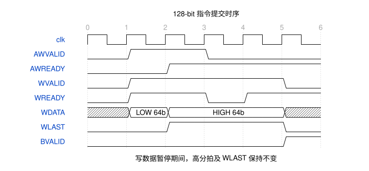

AXI B response 为 `OKAY` 只表示 burst格式和传输被接受。每条 CMD 的 CFE 检查结果必须从 CMD 接收响应 FIFO 读取。若某条命令返回非 `SUCCESS`，该命令没有进入 TaskScheduler，驱动应报告对应数组下标。

#### 5.4.2 查询、等待、FENCE 与 ACK

QUERY selector 定义如下：

| Selector | 名称 | 64 bit 结果 |
| ---: | --- | --- |
| 0 | `STATUS` | `[3:0]` 任务状态，`[11:4]` 完成 status，`[23:12]` 为零扩展后的 `command_id` |
| 1 | `TAG_EVENT` | `[31:0]` 内部任务标记，`[43:32]` 完成事件引用 |
| 2 | `FAULT_ADDR` | `[47:0]` 第一个错误地址 |
| 3 | `PROGRESS` | 64 bit 进度值 |
| 4 | `ACK` | `0=ACKED`、`1=NOT_TERMINAL`、`2=NOT_FOUND` |
| 5 | `ERROR_INFO` | `[31:0]` 错误附加信息 |
| 6 | `DONE_FLAGS` | `[15:0]` 完成标志 |
| 7 | `RESERVED` | 返回 `BAD_DESC`，不修改任务 |

Selector 0～3、5 和 6 只读取状态。Selector 4 只有在任务已经进入终态时才能成功；ACK 响应完成后，TaskScheduler 释放 Task 表项和 `command_id`。ACK 不清除 Event Table 项。

WAIT 的最大等待周期为 0 时检查一次；最大等待周期为 $L>0$ 时，硬件最多等待 $L$ 个周期。目标在超时检查所在周期进入终态时，目标结果优先于 `TIMEOUT`。达到上限只结束本次控制请求，不自动取消正在执行的 NPU 任务。

FENCE 在控制请求握手时保存当时被执行单元选择值选中的全部任务槽、每个任务的 `submit_seq`，以及当时已经终止任务的 status。随后每周期检查一个任务槽；8 槽配置一轮检查需要 8 个周期。握手后提交的新任务不加入本次 FENCE。仍有未终止目标时，每周期检查最大等待周期；全部目标已经终止时，扫描器继续读取尚未处理的 status，再返回最终结果。

---

## 6. 指令体系

### 6.1 执行模型

软件可见命令记录固定为 128 bit，由 48 bit 公共命令头和 80 bit 操作载荷组成。多数操作的地址、尺寸、数据格式、事件依赖和控制选项直接编码在载荷中；分组重量化与完整动态 A8 操作另有 256-byte 外部静态参数记录，命令携带其绝对物理地址。缓存续接和紧凑内联变体可复用已装载模板或直接在命令中提供本次变化字段。外部记录只保存编译期确定的配置和 L1 工作区地址，随 token 更新的激活、部分和及状态仍位于其独立数据区。

一条命令的处理过程如下：

1. 外部主控 CPU 作为 AXI Master，把命令写入 NPU AXI Slave 的固定 CMD FIFO 地址。
2. AXI Slave 前端把连续两个 64 bit beat 组成一条完整指令，低 64 bit 先到，高 64 bit 后到。
3. Command Front End 检查操作码、命令编号和两拍格式。检查通过后，完整命令进入命令 FIFO。
4. CFE 通过独立的 10-bit command ID 查询检查编号占用情况。通过本地操作码检查和编号查询后，完整命令进入 CFE FIFO；CFE 的接收响应只确认入 FIFO。
5. CFE 队首随后交给外部描述符装载器。普通命令和内联命令按其编码直通或组合；字段 48/50 对应的完整记录由该装载器按绝对地址查缓存，未命中时经 MIF 读取 256 byte 并检查保留区域；字段 54/55/56 根据缓存模板或命令载荷构造内部 context。描述符失败也以带错误状态的任务记录交给 TaskScheduler，不能进入执行单元。
6. TaskScheduler 接收命令与 descriptor context 后执行内联字段、Event 资源和地址格式检查，读取 Event Table 当前 generation，并把 8-bit Event ID 扩展为内部事件引用。接纳寄存级保存检查结果、事件引用、前序任务位图、目标 FREE 槽、完整指令、描述符状态、五个 48-bit 基址和 21-bit L1 参数区基址快照；下一周期写任务表并分配 `submit_seq`。
7. WAIT_EVENT 检查器每周期读取一个任务槽的两个事件引用并寄存结果；下一周期复查任务状态和 `submit_seq` 后，依赖失败的任务进入错误终态，依赖成功且前序任务位图不再指向运行中任务的项目进入 READY。发射扫描器每周期检查一个非 Control 任务槽，在 `TASK_SLOTS` 项检查中保存 `submit_seq` 最小的可发射候选；最后一项检查结束时复查候选状态和目标执行单元，再把获胜任务的指令、描述符有效信息、提交时基地址和任务编号保存到发射窄快照寄存器。
8. 共享发射解码器依据操作码、80-bit payload、已检查描述符和基址快照生成内部 Task Context，并写入对应执行单元的发射暂存；发射暂存从下一周期给出任务，执行单元接收后开始运行。
9. 执行单元完成后返回状态；TaskScheduler 保存终态，普通 signal Event 经发布暂存写入 Event Table，再把完成持有槽中的稳定终态送到 LSC，由 LSC 按命令选项设置粘滞中断状态。

硬件中的 `desc_flat[2047:0]` 是模块间传递的展开 Task Context，不等同于外部参数记录。普通命令和内联命令由片上解码生成；分组重量化与完整动态 A8 命令由外部描述符装载器将缓存命中或 DDR 读取的静态记录展开；续接命令则由缓存模板和本命令字段合成。SoC 可把内部有效宽度配置为 1728 bit，通用顶层默认仍为 2048 bit，接口输出高位补零。外部记录固定占 256 byte，内部字段有效长度由具体 ABI 版本决定。

> [!note] 为什么仍保留内部 Task Context
> DMA、Matrix、IVE 和 CME 接口需要较多展开字段，例如实际地址、行字节数、tile 尾部尺寸和函数参数。发射前把命令与必要的静态描述符展开成固定的内部 Task Context，可让各执行单元使用稳定的模块接口。TaskScheduler 的接纳级保存命令、描述符存在/有效状态和基址快照；任务表不长期保存完整 2048-bit context，展开结果只通过发射暂存交给目标执行单元。外部记录不会因此成为所有任务的必经路径：普通命令不访问描述符 DDR 区。

DMA、Matrix-Vector Engine 和 CME 可以同时工作。Matrix 与 Vector 任务可以同时处于运行状态，也各自拥有普通 L1 请求通道；Vector 的轻量 ALU可与 Matrix PE 计算重叠，但 Matrix Direct/Scalar 乘法与 Vector MUL/FMA 共用同一批物理 PE，不能同周期发射。共享阵列忙时 Vector 乘法请求保持在 ready/valid 接口等待。普通任务由 `wait0`、`wait1` 和 `signal` 表达数据先后关系；需要严格顺序的任务使用 `ordered`。Matrix 子系统还要保证分块乘累加、部分和读取与结果写回的先后关系。

### 6.2 64 bit AXI 上的提交方式

NPU 命令接收端是 AXI Slave。主控 CPU 必须向相对 NPU AXI Slave 基地址的 `0x0002_0000` 写入命令，写事务采用以下固定属性：

| AXI 属性 | 要求 |
| --- | --- |
| `AWADDR` | 固定为 CMD FIFO 地址 `0x0002_0000` |
| `AWSIZE` | `3`，每个 beat 为 8B |
| `AWBURST` | `FIXED` |
| `AWLEN` | `1、3、5、…、15`，对应 2～16 个 beat |
| `WSTRB` | 每个 beat 都为 `8'hff` |
| `WLAST` | 只在整个 burst 的最后一个 beat 置 1 |
| beat 数 | 必须是 2～16 范围内的偶数，一次可提交 1～8 条命令 |

CMD FIFO 使用固定地址 burst，因此每个 beat 的地址保持不变。一次 burst 中，第 `2i` 个 beat 是第 `i` 条命令的 `CMD[63:0]`，第 `2i+1` 个 beat 是该命令的 `CMD[127:64]`。例如，一次提交 3 条命令时，`AWLEN=5`，W 通道次序为：

| W beat 序号 | 数据 |
| ---: | --- |
| 0 | `CMD0[63:0]` |
| 1 | `CMD0[127:64]` |
| 2 | `CMD1[63:0]` |
| 3 | `CMD1[127:64]` |
| 4 | `CMD2[63:0]` |
| 5 | `CMD2[127:64]`，同时 `WLAST=1` |

AXI Slave 前端会为每对 beat 产生内部 `first/last` 标志：低 word 对应 `first=1,last=0`，高 word 对应 `first=0,last=1`。这些标志是 NPU 内部信号，不需要主控 CPU 额外发送。

接收端只在 burst 的地址、属性、beat 数、`WSTRB` 和 `WLAST` 全部正确时提交其中的命令。beat 数为奇数、低高 word 次序错误、`AWBURST` 不是 `FIXED`、FIFO 空间不足或高 word 等待超时，都必须返回错误，并且不能把不完整命令交给 TaskScheduler。

> [!note] 字节顺序与发送顺序
> 命令数组按 little-endian 保存。内存中最低地址处是 `CMD[7:0]`。驱动提交一条命令时先发送结构体的 `lo`，再发送 `hi`。这里的“低 word 先发送”是总线协议要求，不能根据 CPU 的打印顺序自行交换。

### 6.3 指令公共位域

| CMD bit | 字段 | 位宽 | 说明 |
| ---: | --- | ---: | --- |
| `[127:122]` | `opcode` | 6 | 软件命令字段；有效集合为 0～52、54～56。53 仅作 Program Sequencer 静态控制记录标记，不进入 CFE；57～63 保留 |
| `[121:112]` | `command_id` | 10 | 命令编号，取值 0～1023 |
| `[111:104]` | `wait0` | 8 | 第一个等待 Event ID，`8'hff` 表示不用 |
| `[103:96]` | `wait1` | 8 | 第二个等待 Event ID，`8'hff` 表示不用 |
| `[95:88]` | `signal` | 8 | 任务终态时更新的 Event ID，`8'hff` 表示不用 |
| `[87]` | `irq_success` | 1 | 任务成功时请求完成中断 |
| `[86]` | `irq_error` | 1 | 任务失败时请求错误中断 |
| `[85]` | `strict_numeric` | 1 | 保存到任务表，不送入 CME 或整数执行单元，不改变数值处理 |
| `[84]` | `ordered` | 1 | 把该任务作为顺序点处理 |
| `[83:82]` | `timeout_class` | 2 | 保存到任务表，不启动按任务计时；停滞检查由 WDT 完成 |
| `[81:80]` | `dtype` | 2 | 该操作的公共输入数据格式 |
| `[79:0]` | `payload` | 80 | 操作专有参数 |

`opcode` 使用最高 6 bit，其中包含 bit 127。bit 127 不是保留位。命令头不单独保存 `engine` 或通用版本字段；目标执行单元由 opcode 解码。外部参数地址不是通用命令头字段：分组重量化和完整动态 A8 的专用 ABI 把 `CMD[39:0]` 解释为 64-byte 对齐的绝对物理地址，且要求 `[79:40]=0`。字段 54～56 是缓存续接或内联形式，不发起外部描述符读取。

`dtype` 的编码如下。CMD、编译器、驱动和硬件必须采用相同编码：

| 编码 | 数据格式 | 每个元素的有效位数 | 常规字节存储 |
| ---: | --- | ---: | --- |
| `0` | INT4 | 4 | 每行 `ceil(length/2)` B，低半字节在前，奇数尾部高半字节补 0 |
| `1` | INT8 | 8 | 1B |
| `2` | INT32 | 32 | 4B |
| `3` | INT16 | 16 | 2B |

`command_id` 从命令被 CFE 接收开始占用，直到软件对终态任务执行 ACK 后释放。所有尚未 ACK 的 Task 表项以及 CFE 中等待进入 TaskScheduler 的命令都不能使用相同编号。发现重复编号时，CFE 返回 `BAD_DESC`，且不创建任务。

Event ID 的有效值为 0～254，`8'hff` 表示该字段不用。指令中不直接保存 generation。TaskScheduler 接收命令时读取 Event Table 中的当前 generation，并把 `{generation,event_id}` 分别保存到任务表的 `wait0`、`wait1` 和 `signal` 字段。因此，在命令已经接收后执行 `EVENT_REARM`，不会改变该命令已经保存的事件代次。

`payload[79:0]` 的含义由 `opcode` 决定。没有被该操作使用的 payload 位必须为 0；任一保留位非 0 时，命令必须以 `BAD_DESC` 拒绝。

### 6.4 命令头标志、超时和事件规则

| 字段               | 置 1 后的处理                                                                    |
| ---------------- | --------------------------------------------------------------------------- |
| `irq_success`    | 任务进入 `SUCCESS` 终态时产生一次完成中断请求；失败时不产生该类中断                                     |
| `irq_error`      | 任务进入任意非 `SUCCESS` 终态时产生一次错误中断请求                                             |
| `strict_numeric` | 任务表保存该位，但不把它送入 CME 或整数执行单元；该位不改变数值处理，也不会主动产生 `NUMERIC_EXCEPTION` |
| `ordered`        | 该任务等待全部较小 `submit_seq` 的任务进入终态；在它进入终态前，较大的 `submit_seq` 任务也不能越过它            |

`timeout_class` 位域可选择 4 个编号。任务表保存该字段，但 LSC 没有 `TIMEOUT_CLASS` CSR，TaskScheduler 也没有按任务计数器，因此该字段不触发任务超时。NPU 的停滞检查由第 15.6 节的 WDT 完成。软件不得根据 `timeout_class` 推断任务会被硬件自动终止。

等待事件的处理规则如下：

1. `wait0` 或 `wait1` 为 `8'hff` 时，该输入视为已经满足。
2. 指定的等待事件必须已经由更早的任务预留；引用 `FREE` 事件会使命令字段检查失败。
3. 普通任务与 `EVENT_JOIN(join_mode=0)` 要求两个等待事件都成功；任一有效等待事件进入 `ERROR` 时，尚未开始的任务进入 `DEPENDENCY_FAILED`。
4. `EVENT_JOIN(join_mode=1)` 在任一等待事件成功后即可继续；只有两个有效等待事件都进入 `ERROR` 时才返回 `DEPENDENCY_FAILED`，其中一个失败而另一个仍在等待时保持等待状态。
5. `signal` 指定的事件必须处于 `FREE`，并且不能与 `wait0` 或 `wait1` 相同。
6. 任务成功时把 `signal` 事件置为 `SUCCESS`；任务失败时把它置为 `ERROR` 并保存失败状态。
7. `strict_numeric` 和 `timeout_class` 均为已保存但未执行的控制信息；软件不得依赖这两个字段停止任务。

### 6.5 地址引用格式

80 bit payload 无法为每个输入保存完整 48 bit 地址，因此指令使用几种地址引用格式。地址引用不是指针压缩后的软件对象；它是命令位域中的整数，硬件 根据格式直接得到 L1 地址或“物理基地址寄存器加偏移”形式的全局物理地址。

#### 6.5.1 `AREF28`

DMA 使用 28 bit `AREF28`：

| `AREF28` bit | 字段 | 说明 |
| ---: | --- | --- |
| `[27]` | `space` | `0` 表示 L1BUF，`1` 表示全局内存 |
| `[26:24]` | `base_select` | 全局物理地址基址选择；L1BUF 地址必须写 0 |
| `[23:0]` | `offset` | 字节偏移 |

当 `space=0` 时，`base_select` 和 `offset[23:20]` 必须为 0，实际 L1 字节地址为 `offset[19:0]`。当 `space=1` 时，实际全局物理字节地址为：

$$
\mathrm{global\_addr}
=
\mathrm{BASE}[\mathrm{base\_select}]
+
\mathrm{offset}
$$

式中，`BASE[base_select]` 是 LSC 保存的 48 bit 物理基地址，`offset` 是无符号 24 bit 字节偏移。相加结果高于 `PA_W-1` 的 bit 必须为 0。各选择值如下：

| `base_select` | 基地址 |
| ---: | --- |
| `0` | 0 |
| `1` | `INPUT_BASE` |
| `2` | `WEIGHT_BASE` |
| `3` | `WORK_BASE` |
| `4` | `OUTPUT_BASE` |
| `5` | `KV_BASE` |
| `6、7` | 非法 |

48 bit 加法产生进位、高于 `PA_W-1` 的 bit 非零或访问超出 MIF 允许物理地址范围时，地址非法。DMA 在开始访问前还必须检查完整源区和目标区。

#### 6.5.2 `LREF14`、`LREF12` 与 `LREF16`

Matrix、IVE 和 CME 只访问 L1BUF，使用带固定对齐要求的 L1 引用：

| 格式 | 位宽 | 实际地址 | 对齐 | 可表示的 L1 地址 |
| --- | ---: | --- | ---: | --- |
| `LREF14` | 14 | `field << 6` | 64B | `0x00000`～`0xfffc0` |
| `LREF12` | 12 | `field << 6` | 64B | `0x00000`～`0x3ffc0` |
| `LREF16` | 16 | `field << 4` | 16B | `0x00000`～`0xffff0` |

GEMM 的 A、B 和 C 使用 `LREF14`；bias 使用 `LREF12`。在 GEMM 中，bias 字段为 0 表示不使用 bias，因此需要 bias 时不能把 bias 放在 L1 地址 0。IVE 与 CME 使用 `LREF16`。

> [!example] `LREF16` 示例
> `LREF16=16'h0012` 表示 L1 字节地址 `0x0012 << 4 = 0x0120`。该字段表示字节地址，不表示第 18 个元素；元素编号还要结合数据格式和张量形状计算。

### 6.6 指令总表

指令中的 `opcode` 是 `CMD[127:122]` 中的软件可见 6 bit 数值。执行单元继续使用 8 bit 内部操作码；内联解码器根据 6 bit 数值产生目标执行单元和内部操作码。软件不得把内部操作码直接写入 `CMD[127:122]`。

这里列出的有效性分为三个层次：字段 0～52、54～56 是 CFE 接受的命令字段集合；其中 33～35、48、54、55 进入 Matrix，49～51、56 进入 Complex，其他字段由第 6.6 表指定的执行单元处理；最后，参数化 SoC 实例还可能通过综合参数删去相应 datapath/controller。字段编码合法只说明可通过 CFE 的操作码检查，不能推导相应执行电路在某个 bitstream 中存在。驱动应结合部署镜像的 feature manifest，不能只检查 LSC 的固定 `ISA_FEATURE` 位。

| `opcode` | 内部操作码 | 指令 | 执行单元 | 指令有效性 | 指令中的字段 | 功能与限制 |
| ---: | ---: | --- | --- | --- | --- | --- |
| `0` | `0x00` | `NOP` | Control | 有效 | `payload=0`；三个 Event 字段均为 none | 创建占位任务，不读写数据。 |
| `1` | `0x01` | `EVENT_SIGNAL` | Control | 有效 | `signal`；`payload=0` | 主动把指定 Event 置为成功，不启动执行单元。 |
| `2` | `0x02` | `EVENT_REARM` | Control | 有效 | `signal`；`payload=0` | 旧 Event 已结束且没有等待者时，使该 Event 进入下一代。 |
| `3` | `0x03` | `EVENT_JOIN` | Control | 有效 | `wait0`、`wait1`、`signal`、`join_mode` | 合并两个前置 Event；可选择“两个都成功”或“至少一个成功”。 |
| `4` | `0x04` | `GLOBAL_FENCE` | Control | 有效 | `engine_mask` | 等待所选执行单元中更早提交的任务结束。 |
| `5` | `0x20` | `DMA_COPY_1D` | DMA | 有效 | `src_aref`、`dst_aref`、`count`、源/目标 dtype、两个必须为 0 的保留位 | 连续复制元素并执行整数位宽转换；支持 INT8、INT16 和 INT32。 |
| `6` | `0x21` | `DMA_COPY_ND` | DMA | 有效 | 与 `DMA_COPY_1D` 相同 | 复制连续存储区。带步长的多维访问由编译器拆成多条命令，或组合 PACK、SPLIT、TRANSPOSE。 |
| `7` | `0x22` | `DMA_FILL` | DMA | 有效 | `dst_aref`、`count`、`fill_value`、目标 dtype | 用一个立即数连续填充目标元素。 |
| `8` | `0x23` | `DMA_TRANSPOSE_2D` | DMA | 有效 | `src_aref`、`dst_aref`、`rows`、`columns`、dtype、两个必须为 0 的保留位 | 转置连续行优先二维数组，不包含行步长字段。 |
| `9` | `0x24` | `DMA_PACK` | DMA | 有效 | `src_aref`、`dst_aref`、`segment_count`、`segment_bytes`、`segment_stride` | 从等间隔数据段读取并连续写入。 |
| `10` | `0x25` | `DMA_SPLIT` | DMA | 有效 | 与 PACK 相同 | 从连续数据区读取并按固定间隔写入。 |
| `11` | `0x28` | `DMA_GATHER_ND` | DMA | 有效 | 全局源 `AREF28`、L1 UINT32 索引表、L1 目标、块数、每块字节数 | 按索引从 DDR 读取固定大小记录并连续写入 L1；同 dtype 原始字节复制，支持 packed INT4。 |
| `12` | `0x40` | `GEMM` | Matrix | 有效 | A/B/C `LREF14`、bias `LREF12`、M/N/K、保留位、C dtype、右移位数 | 矩阵乘法后可加 INT32 bias；B 使用 `KT×NT` tile 存储，保留位必须为 0。 |
| `13` | `0x41` | `BMM` | Matrix | 有效 | A/B/C `LREF14`、batch、M/N/K、保留位、C dtype、右移位数 | 连续保存的多组矩阵乘法，不带 bias，保留位必须为 0。 |
| `14` | `0x42` | `GEMM_ACCUM` | Matrix | 有效 | A/B/C `LREF14`、M/N/K、保留位 | 把新的乘加结果加入原 C；C 必须为 INT32，bias、保留位和右移位数必须为 0。 |
| `15` | `0x43` | `GEMM_ZERO` | Matrix | 有效 | C `LREF14`、M/N | 清零 C 指向的 INT32 部分和区域，为后续 `GEMM_ACCUM` 准备初值。 |
| `16` | `0x60` | `VECTOR_ADD` | IVE | 有效 | `src0`、`src1`、`dst`、rows、length、广播方式 | 逐元素相加，输出数据格式与公共输入格式相同。 |
| `17` | `0x61` | `VECTOR_SUB` | IVE | 有效 | 与 ADD 相同 | 逐元素相减。 |
| `18` | `0x62` | `VECTOR_MUL` | IVE | 有效 | 与 ADD 相同 | 逐元素相乘，结果写为 INT32。 |
| `19` | `0x63` | `VECTOR_FMA` | IVE | 有效 | `src0`、`src1`、`src2`、`dst`、rows、length、三路广播方式 | 计算 `src0 × src1 + src2`，其中 `src2` 和结果为 INT32。 |
| `20` | `0x64` | `VECTOR_MAX` | IVE | 有效 | 与 ADD 相同 | 写入逐元素较大值。 |
| `21` | `0x65` | `VECTOR_MIN` | IVE | 有效 | 与 ADD 相同 | 写入逐元素较小值。 |
| `22` | `0x66` | `VECTOR_CMP`（`VCMP_I`） | IVE | 有效 | `src0`、`src1`、比较类型、`dst`、rows、length、前两路广播方式 | 支持 EQ、NE、LT、LE、GT、GE；每个 INT8 mask 元素中，真写 1，假写 0。 |
| `23` | `0x67` | `VECTOR_SELECT` | IVE | 有效 | `src0`、`src1`、INT8 mask、`dst`、rows、length、前两路广播方式 | mask 为零时选 `src0`，mask 非零时选 `src1`。 |
| `24` | `0x68` | `VECTOR_CLAMP` | IVE | 有效 | `src0`、signed16 下限、signed16 上限、`dst`、rows、length | 把每个元素限制在给定最小值和最大值之间。 |
| `25` | `0x69` | `VECTOR_RELU` | IVE | 有效 | `src0`、`dst`、rows、length | 计算 `max(src0,0)`，未使用输入字段必须为 0。 |
| `26` | `0x80` | `COMPLEX_ACT` | CME | 有效 | `src0`、`dst`、rows、length、函数、scale 指数与 profile，或数值参数引用 | 执行 Sigmoid、Tanh、GELU 或 SiLU，内部计算使用 FP32；数值参数模式支持任意有限正 scale 和非零 zero point。 |
| `27` | `0x81` | `COMPLEX_SOFTMAX` | CME | 有效 | `src0`、可选 `aux`、`dst`、rows、length、mask 模式、scale 指数、目标 dtype，或数值参数引用与分片角色 | 逐行 Softmax；数值参数模式支持多条指令分片完成全局 max、全局指数和与输出重放。 |
| `28` | `0x82` | `COMPLEX_NORM` | CME | 有效 | `src0`、gamma/beta 参数区、`dst`、rows、length、Norm 类型、epsilon、scale 指数、目标 dtype，或数值参数引用与分片角色 | 执行 LayerNorm 或 RMSNorm；数值参数模式支持跨指令保存归约状态并分片输出。 |
| `29` | `0x83` | `COMPLEX_ROPE` | CME | 有效 | INT16 `src0`、INT16 Q1.15 系数表 `aux`、INT16 `dst`、rows、偶数 length | 执行 Qwen split-half RoPE；系数由模型编译器预计算，CME 以弹性两级流水连续处理旋转对。 |
| `30` | `0x84` | `COMPLEX_STAT` | CME | 有效 | `src0`、`dst`、rows、length、统计方式与分片角色 | 按行或跨多条分片指令计算 SUM、MAX 或 SUMSQ，最终指令写一个 INT32。 |
| `31` | `0x85` | `COMPLEX_I2F/F2I` | CME | 有效 | 同宽 signed Q 与 binary16/binary32 `src0/dst`、rows、length、5-bit 小数位数、方向 | bit 5 选择双向转换；复用 mixed FMA 的输入转换或输出舍入/饱和流水。 |
| `32` | `0x86` | `COMPLEX_ADD_RESCALE` | CME | 有效 | `src0`、第二输入、`dst`、rows、length、幂指数模式或整数定点参数引用 | 对两个不同 scale 的输入执行逐元素加法，支持内部 FP32 幂指数路径和兼容 scale、zero point 的整数定点路径。 |
| `33` | `0x44` | `GEMM_ZERO_LOCAL` | Matrix | 有效 | C `LREF14`、M/N；其余计算字段必须为 0 | 在 Scalar Matrix 建立本地部分和区域并清除有效数据状态，不读取或写回 L1 中的 C。 |
| `34` | `0x45` | `GEMM_ACCUM_HOLD` | Matrix | 有效 | 与 `GEMM_ACCUM` 相同 | 把新的乘加结果保存到 Scalar Matrix 的本地部分和 RAM，不提交最终 C。 |
| `35` | `0x46` | `DIRECT_GEMM` | Matrix | 有效 | A/B/C `LREF14`、M/N/K、W4A8/W6A8、紧凑 A、M=1 紧凑 C、原生 Q4_0/Q6_K 分块部分和、C 累加使能、Matrix requant profile | 共享可重构 PE 的直接矩阵控制路径。A/B 可为同类型 INT8、INT16，A=INT8/B=INT4，或 A=INT8/B=byte-contained signed Q6；profile 0 写 INT32，非零 profile 由 Matrix epilogue 按 `MQR1` 或 `MQR2` 写量化结果；M、N 为 1～16，W4A8 K 为 1～4864，W6A8 K 为 1～2048，INT8/INT16 K 为 1～16384；W4A8、M=1 可按每 32 个 K 输出一行部分和，W6A8 固定按每 16 个 K 输出一行部分和；不支持 bias 和旧式整数右移。 |
| `36` | `0x87` | `COMPLEX_MUL_RESCALE` | CME | 有效 | `src0`、第二输入、`dst`、rows、length、整数定点参数引用 | 按 scale 和 zero point 执行逐元素乘法、定点重量化和限幅；输入与输出均为相同的 INT8 或 INT16 数据格式。 |
| `37` | `0x88` | `COMPLEX_REQUANTIZE` | CME | 有效 | INT8/INT16/INT32 `src0`、`dst`、rows、length、目标 dtype、整数定点参数引用 | 按 Q31 乘数、移位和输出 zero point 重量化为 INT4、INT8 或 INT16，并执行目标限幅；INT4 逐行成对打包。 |
| `38` | `0x89` | `COMPLEX_FP32_ADD` | CME | 有效 | 同格式 `src0`、`src1`、`dst`、rows、length | 兼容名称；INT32 每 64-bit beat 携带两个 binary32，INT16 每 16-byte block 携带八个 binary16；这些是数据打包 lane 数，运算请求由两个物理 mixed-FMA 流水服务，吞吐还受读写和依赖约束。 |
| `39` | `0x8a` | `COMPLEX_FP32_SUM` | CME | 有效 | binary32/binary16 `src0`、标量 `dst`、rows、length、分片角色及 wide 标志 | 同宽输出保留原规则；INT16 头且 payload bit13=1 时，FP16 输入采用 signed53 精确跨片归约，FINAL 一次 RNE 输出 FP32，不占用共享 FMA。 |
| `40` | `0x8b` | `COMPLEX_FP32_MAC` | CME | 有效 | 同格式 `src0/src1/dst`，或 FP32 扩展 scale 参数 | 普通形式每 beat/block 可携带两/八个输入元素，但请求使用两条公共物理 mixed-FMA 流水；`src0_i32`、row-scale、广播和 reduce 扩展保持 FP32。 |
| `41` | `0x8c` | `COMPLEX_FP32_REQUANTIZE` | CME | 有效 | raw binary32 `src0`、INT4/INT8/INT16 `dst`、rows、length、64-byte 编译期量化参数记录 | 逐元素执行最近偶数舍入的 `clamp(round(src0/output_scale)+zero_point)`，把 FP32 累加结果留在 L1BUF 内并直接转换为后继定点算子的输入。 |
| `42` | `0x8d` | `COMPLEX_ARGMAX` | CME | 有效 | INT8/INT16/INT32 `src0`，或 INT32 容器中的 raw binary32；INT32 `dst`、rows、length、分片角色 | 单条指令逐行返回首个最大值的列索引；多条 `REDUCE0_PARTIAL/FINAL` 指令可对一行连续分片归约并返回全局索引。 |
| `43` | `0x8e` | `COMPLEX_FP32_REDUCE_MAC` | CME | 有效 | 逐行 INT32 `src0`、逐行 raw binary32 `src1`、单行 raw binary32 `dst`、rows、length | 连续执行 `dst[j] += fp32(src0[r,j]) × src1[r,j]`，把最多 32 行 Matrix Q4_0 部分和及原生 block scale 归约到同一输出行；复用 `FP32_MAC` 的乘法和加法流水。 |
| `44` | `0x05` | `SET_WEIGHT_WINDOW` | Control | 有效 | `weight_window`；其余 payload 和三个 Event 字段必须为 0/none | 把后续权重 `AREF28` 的地址根切换到 `WEIGHT_BASE + weight_window × 16 MiB`；该命令强制按 ordered 屏障执行。 |
| `45` | `0x29` | `DMA_SCATTER_ND` | DMA | 有效 | 全局目标 `AREF28`、L1 UINT32 索引表、L1 连续源、块数、每块字节数 | 从 L1 连续读取固定大小记录，按索引写入 DDR；同 dtype 原始字节复制，支持 packed INT4。 |
| `46` | `0x06` | `SET_KV_WINDOW` | Control | 有效 | `kv_window`；其余 payload 和三个 Event 字段必须为 0/none | 把后续 KV `AREF28` 的地址根切换到 `KV_BASE + kv_window × 16 MiB`；该命令强制按 ordered 屏障执行。 |
| `47` | `0x8f` | `COMPLEX_MIXED_FMA` | CME | 有效 | 同格式 `src0`、`src1`、原地 `dst/C`、rows、length、可选输入/输出 Q 格式参数 | 执行单次舍入的 `dst=fma(src0,src1,dst)`；INT32容器保存binary32，INT16容器保存packed binary16；物理共享与分组执行见第2.2.4节；可隐式执行三输入 I2F 和输出重量化。 |
| `48` | `0x47` | `GROUP_REQUANT_GEMM` | Matrix | 有效，外部描述符 | 分组重量化 ABI 第 2/3 版的 W4A8 分块、宽定点组累加和最终输出参数 | 执行 W4 group-128、per-token dynamic A8 的 Matrix 主路径。 |
| `49` | `0x90` | `COMPLEX_ONLINE_SOFTMAX_PV` | CME | 有效，cmd128 内联 | score、V、状态 `LREF`、分片模式、有效长度与固定点 scale 指数 | 流式合并 softmax 归约状态并累计 PV；不产生外部描述符读取。 |
| `50` | `0x91` | `COMPLEX_DYNAMIC_A8` | CME | 有效，外部描述符 | FP32 输入、A8 code、token scale 和状态地址 | 在线求 token absmax、生成一个对称 A8 scale 并量化整行。 |
| `51` | `0x92` | `COMPLEX_FP32_MUL_SCALE` | CME | 有效 | INT32 `src0`、raw binary32 feature scale、逐行 raw binary32 scale、FP32 `dst` | 通过共享FMA资源计算 `dst=fp32(src0)×feature_scale×row_scale`；目的操作数隐式为零，不读取旧 `dst`。用于无 bias Matrix 尾处理，消除零向量预装和目的读端口流量。 |
| `52` | `0x08` | `EVENT_REARM_RANGE` | Control | 有效 | `signal` 保存闭区间末 Event ID；`wait0/wait1=none`；`payload=0` | 按 ID 0 到 `signal` 每周期处理一个表项；每项必须已经终止且没有活动等待者，全部 generation 各加 1 并恢复 FREE。静态程序以一条命令回收一个稠密事件池。 |
| `53` | — | `CONTEXT_GUARD` / `CONTEXT_PATCH` / `CONTEXT_LOOP_BEGIN/END` | Program Sequencer | 有效，仅静态程序 | Guard：运行时谓词；Patch：AREF/online metadata 动态补丁；Loop：16-bit 块体长度和 token 块 log2 | Sequencer 在 CFE 前完成跳过、重定位与固定程序块回跳；metadata 不占 TaskScheduler 槽位，也不生成完成事件。 |
| `54` | `0x47` | `GROUP_REQUANT_CONTINUE` | Matrix | 有效，描述符续接 | 四个 20-bit L1 byte address：weight、profile、wide accumulator、output | 复用装载器缓存的上一条分组重量化 ACCUM/FINAL 模板，按前一 tile 的 base/columns 推导下一 tile，避免重复读取 256-byte 外部记录；新阶段第零 tile 可使用 field 55，静态配置改变时重新使用 field 48。 |

| `55` | `0x47` | `GROUP_REQUANT_INLINE` | Matrix | 有效，缓存模板内联 | 四个20-bit L1地址，`CMD[83:82]`专用阶段 | 从缓存模板的第零列开始ACCUM/REDUCE/FINAL，不重复读取外部记录。 |
| `56` | `0x91` | `DYNAMIC_A8_INLINE` | CME | 有效，完整内联 | 源/状态/目的三个20-bit L1地址、13-bit长度、2-bit源dtype | 展开单行动态A8，scale由真实输入计算后写入状态，不在指令内动态修改。 |

未分配的字段必须返回 `ILLEGAL_OPCODE`。字段 53 的四类 metadata 只能由静态程序
Sequencer 消费；经普通命令入口提交字段 53 仍必须拒绝。

`COMPLEX_ONLINE_SOFTMAX_PV` 的输入 dtype 决定数值格式。INT16 模式的 19-bit
metadata 使用 `[6:0]=valid_length-1`、`[10:7]=score_scale_exp`、
`[16:11]=value_scale_exp`、`[18:17]=INIT/UPDATE/FINAL`；两个 scale 都表示
$2^e$，score 指数为有符号 4 bit，V 指数为有符号 6 bit。七位有效长度直接覆盖
1～128 个 token，不再使用零哨兵。V 的六位指数可覆盖 W4A8 投影中常见的
$2^{-17}$ 附近量级；编译器必须让 V 投影的 Matrix F2I 输出 scale 与该指数完全
一致，不能只在消费端重新解释代码值。字段 49 始终内联，不触发 256-byte 外部
descriptor 读取。

`COMPLEX_MIXED_FMA` 的 19-bit metadata 中，bit 0 为 `input_fixed`，bit 1 为
`output_fixed`，bits `[6:2]` 和 `[11:7]` 分别为输入、输出 signed Q 格式的
小数位数，bits `[18:12]` 保留为零。输入开关作用于 A、B 和原地 C；输出开关在
FMA 后执行最近偶数舍入并饱和到 INT16/INT32。NaN 转为 0，正负无穷转为目标
上下限。所有 metadata 位为零时保持 raw binary16/binary32 语义。
`COMPLEX_I2F/F2I` 的 metadata `[4:0]` 为定点小数位数，bit 5 为 0 时执行 I2F、
为 1 时执行 F2I，bits `[18:6]` 为零。F2I 使用最近偶数舍入并饱和到同宽 signed
INT16/INT32；NaN 转 0，无穷转对应上下限。

#### 6.6.1 Qwen 纯 NPU 执行扩展

下列操作码在通用RTL接口中定义，用于数据准备和末端归约。实际综合配置仍需检查相应功能开关，不能由编码已分配推导默认SoC包含全部执行通路：

| 暂定软件 opcode | 暂定内部操作码 | 名称 | 作用 | 实现状态 |
| ---: | ---: | --- | --- | --- |
| `11` | `0x28` | `DMA_GATHER_ND` | 按 INT32 索引从静态量化 embedding 表或 KV 表读取连续记录 | 已实现 |
| `45` | `0x29` | `DMA_SCATTER_ND` | 按 INT32 索引把 L1 连续记录写入 KV Cache 或环形状态 | 已实现 |
| `42` | `0x8d` | `COMPLEX_ARGMAX` | 对整数或 raw binary32 输入执行带索引的分片最大值归约 | 已实现 |
| `43` | `0x8e` | `COMPLEX_FP32_REDUCE_MAC` | 批量应用原生 Q4_0 block scale，并把多行部分和累加到一个 FP32 输出行 | 已实现 |

`COMPLEX_FP32_REQUANTIZE` 不执行运行时标定。输入使用 INT32 dtype 容器保存 raw binary32，64-byte 参数记录保存编译期确定的正有限 `output_scale`、输出 zero point、激活最小值和激活最大值。现行实现支持 1～32 行、每行 1～256 个元素以及 INT4/INT8/INT16 输出；逐元素计算 `clamp(round_to_nearest_even(src0/output_scale)+zero_point)`。INT4 输出在每行内按低半字节、再高半字节成对写回，奇数长度行的末字节高半字节固定为 0，可直接作为 M=1 `DIRECT_GEMM` 的紧凑 A。它复用 CME 已有除法近似和 FP32→整数路径，不实例化新的浮点算术单元。

`COMPLEX_ARGMAX` 的整数模式复用统计路径的 signed INT32 比较器；raw-binary32 模式复用 CME 既有 FP32 比较逻辑，并拒绝 NaN 和无穷值。两种模式都额外保存当前首个最大值的 32-bit 全局索引。`PARTIAL` 保存当前值、索引和累计元素数，`FINAL` 只写出一个 INT32 全局索引；分片基址由 CME 按已处理元素数累加，不需要软件动态计算。相等时保留较小索引，使 CModel、RTL 和软件参考结果确定。LM Head 的词表块必须在 CME 内连续归约，CPU 不读取或扫描 logits。

纯 NPU 后端已经实现不占用 6-bit 算术 opcode 的 AOT Program Sequencer。软件通过一次 doorbell 提供静态 cmd128 程序物理地址和记录数；`token_id/position/valid_context` 作为编译器分配的数据区标量由普通 DMA/Complex/Matrix 指令读取。Sequencer 从 MIF 连续读取 cmd128，并送入现有 CFE 和 TaskScheduler，因此不复制指令译码或执行通路。下列名称是编译器宏操作，最终展开为现有指令：

| 宏描述符 | 硬件展开 |
| --- | --- |
| `GROUPED_LINEAR` | 固定 scale 量化和 A 面板生成、两块权重窗口 ping-pong DMA、`DIRECT_GEMM`、批量 `COMPLEX_FP32_REDUCE_MAC`、最终 `COMPLEX_FP32_REQUANTIZE` |
| `PACK_ACTIVATION` | 使用编译期 64-byte 参数记录执行 `COMPLEX_REQUANTIZE`，直接生成后继 Matrix 所需的 INT4/INT8 输入；一个结果被多个线性层使用时只生成一次 |
| `HEAD_NORM_ROPE` | 分片 `COMPLEX_NORM` 后直接执行 `COMPLEX_ROPE` |
| `QK_MATMUL` / `PV_MATMUL` | 复用 Matrix PE，按有效上下文和 GQA head 映射循环；KV 保持 Matrix 面板就绪布局 |
| `CAUSAL_SOFTMAX` | `valid_context` mask 加分片 `COMPLEX_SOFTMAX` |
| `SWIGLU` | `COMPLEX_ACT(SiLU)` 与 `COMPLEX_MUL_RESCALE` |
| `RESIDUAL_ADD` | 使用编译期 scale 参数的 `COMPLEX_ADD_RESCALE` |
| `ARGMAX_SLICE` | 连续的 `COMPLEX_ARGMAX PARTIAL/FINAL` |

`GROUPED_LINEAR` 的 K-group 数、N-tile 数、权重地址、scale 地址、L1 双缓冲地址和所有 Event 关系均由模型编译器确定。现阶段编译器可把它展开成长 cmd128 程序；现有有界上下文loop按固定块体和运行时有效历史控制迭代，只更新受支持的地址和尾片字段，不得计算浮点参数或包含模型相关分支。Matrix C、FP32 accumulator 和后继 Complex 输入必须留在 L1BUF；禁止恢复到 CPU 可见 DDR 后再重新载入。权重从部署包的最终物理地址直接 DMA 到 L1BUF，禁止 `package→CPU arena→NPU DMA` 的双重搬运。

静态程序命令数使用 32-bit 计数，不受 10-bit command ID 空间限制。Sequencer 最多只保持 `MAX_OUTSTANDING` 条任务在途，已完成任务会自动 ACK，所以 ID 可在 1,024 条后复用。遇到`EVENT_REARM`、`EVENT_REARM_RANGE`、`SET_WEIGHT_WINDOW`或`SET_KV_WINDOW`时，Sequencer 允许先完成该 cmd128 的 MIF 读取，但必须在提交前排空旧任务和待发 ACK；屏障任务自身完成并 ACK 后才恢复后续取指。前两者保持 Event generation 语义，后者保证旧窗口的全部权重访问完成后才改变地址根，CPU 均无需介入。无法用这些屏障表达的外部同步仍必须分段启动。

CPU 在每个 token 上只允许写入 `token_id`、`position`、`valid_context`，启动程序，等待完成中断并读取 `next_token`。Embedding gather、激活量化、A/C 面板整理、KV 搬运、QK/PV、归一化、RoPE、Softmax、SwiGLU、残差、LM Head 和 Argmax 都属于 NPU 程序。编译器若发现任一数值算子落到 Host，必须使纯 NPU 构建失败，不能静默插入 C/C++ fallback。

硬件运行时合同允许 `valid_context=1..262144`。常规软件配置默认 32768 token，
模型原生上下文或部署策略更小时取其较小值；256K 是硬件/地址生成能力上限，并不
强制 Qwen2.5 使用超出其 checkpoint 原生配置的上下文。Qwen2.5 的 24 层、2 个 KV
head、head-dim 64、INT16 K/V 在 256K 时占 3 GiB，位于 8-bit KV window 可覆盖的
4 GiB 区间。2 MiB L1BUF 保存 128-token Attention tile 和 online-softmax/PV
状态，不能常驻完整 KV。编译器必须生成分片读取、运行时 causal guard 和单次 KV
读取的 online Softmax/PV 流；不得按 position 复制整套模型程序或完整参数镜像。

### 6.7 操作专有 payload 位域

#### 6.7.1 Control

| payload bit | 字段 |
| ---: | --- |
| `[79:76]` | `engine_mask` 或 `weight_window` |
| `[75]` | `join_mode` |
| `[74:0]` | 必须为 0 |

`engine_mask[3:0]` 依次选择 DMA、Matrix、IVE 和 CME，只供 `GLOBAL_FENCE` 使用，且至少有一位为 1。`join_mode` 只供 `EVENT_JOIN` 使用：0 表示两个等待事件都成功时 JOIN 才成功；1 表示至少一个等待事件成功时 JOIN 成功，只有两个都失败时 JOIN 才失败。

`weight_window[3:0]` 只供 `SET_WEIGHT_WINDOW` 使用。有效值为 0～15，窗口大小固定为 16 MiB；后续权重引用的物理地址为 `WEIGHT_BASE + (weight_window << 24) + byte_offset`。编译器必须保证单次访问不跨窗口边界，且程序结束前恢复窗口 0。复位和 abort 也恢复窗口 0。该指令不得带 wait、signal 或 join 字段。

`SET_KV_WINDOW` 单独使用 payload `[79:72]` 的 8-bit `kv_window`，有效值为
0～255；后续 KV 引用的物理地址为
`KV_BASE + (kv_window << 24) + byte_offset`。因此一个 KV 根可覆盖 4 GiB，
而权重窗口仍保持 4-bit，不因长上下文增加选择逻辑。两种窗口指令都要求其余
payload 和全部 Event 字段为 0/none，并形成 ordered 屏障。

`CONTEXT_GUARD` 使用 payload `[79:78]` 选择谓词：0 为
`valid_tokens <= compare_value`，1 为 `position != compare_value`，2 为
`position < compare_value`，3 为 `position >= compare_value`；`[63:48]` 是
1～65535 条后继记录的跳过数，`[31:0]` 是比较值，其余 payload 位必须为 0。
它不允许携带 Event。

Q25FUL2 的 `CONTEXT_PATCH` 复用字段 53 的 metadata 编码，但命令头 marker 为
`8'h02`。`payload[63:48]` 为非零字节 stride，`payload[38:32]` 为
0～18 的环回 log2，`payload[39]` 选择普通 runtime position（0）或当前
attention loop chunk（1），`payload[65:64]` 选择
`src0_aref`（0）或 `dst_aref`（1）。`payload[47:40]` 与
`payload[79:66]` 拼成有符号二进制补码 `position_bias[21:0]`；Sequencer
先形成选定的位置源并加 `position_bias`，再执行环回掩码并乘以 stride。
target 2 修改紧随其后的 `ONLINE_SOFTMAX_PV` 有效长度；loop-relative 模式下
第 0 次执行保持 INIT，后续执行自动改成 UPDATE。
有效位置为负数或生成的 24-bit AREF 溢出时，命令图以 `ADDR_FAULT` 停止。
该记录只对紧随其后的一个普通命令生效，不占 TaskScheduler 槽位，也不生成完成事件。

`CONTEXT_LOOP_BEGIN` 的 marker 为 `8'h03`，低 24 bit magic 为 `C025B0`，
`payload[63:48]` 是物理块体命令数，`payload[39:32]` 是每块 token 数的 log2。
紧随其后的块体在 `CONTEXT_LOOP_END`（marker `8'h04`、相同 magic）处结束。
Sequencer 按 `ceil(valid_tokens / 2^chunk_log2)` 重复取同一物理块体；每次回跳前
等待块内任务完成，并丢弃 END 后的预取记录。编译器须把稠密 Event 池的
`EVENT_REARM_RANGE` 放在 END 之前，使重复 command ID/Event generation 安全。
因此 4K、32K 等不同导出可使用不同 KV 容量与环回掩码，但每层 attention
只保留一份 128-token 程序，命令段不再随最大上下文的 chunk 数线性增长。

`NOP` 要求三个 Event 字段都是 `8'hff`。`EVENT_SIGNAL`、`EVENT_REARM` 和 `EVENT_REARM_RANGE` 要求 `signal` 有效；range 指令把该字段解释为从 0 开始的稠密池末 ID。`EVENT_JOIN` 要求 `wait0`、`wait1` 和 `signal` 都有效，且 `wait0` 与 `wait1` 不同。

#### 6.7.2 DMA

`DMA_COPY_1D` 和 `DMA_COPY_ND`：

| payload bit | 字段 |
| ---: | --- |
| `[79:52]` | `src_aref` |
| `[51:24]` | `dst_aref` |
| `[23:4]` | `count`，元素数，范围 1～1048575 |
| `[3:2]` | `dst_dtype` |
| `[1]` | 保留位，必须为 0 |
| `[0]` | 保留位，必须为 0 |

命令头 `dtype` 是源数据格式。源和目标格式相同时原样复制；目标更宽时执行符号扩展；目标缩窄到 INT8 或 INT16 时执行饱和处理。`DMA_COPY_ND` 按连续区域复制执行，不直接携带 rank、shape 或 stride。DMA 没有 packed 元素转换模式，源或目标声明为 INT4 时拒绝；packed INT4 缓冲区应以 INT8 原始 byte 视图复制。任一非零保留位都会使指令被拒绝。

`DMA_FILL`：

| payload bit | 字段 |
| ---: | --- |
| `[79:52]` | `dst_aref` |
| `[51:32]` | `count`，元素数，范围 1～1048575 |
| `[31:0]` | `fill_value` |

命令头 `dtype` 是目标数据格式。硬件对 INT8、INT16、INT32 分别取 `fill_value` 的低 8、16、32 bit，并对每个目标元素重复写入。INT4 目标会使指令被拒绝；软件需要填充 packed 缓冲区时按原始 byte 生成数据。

`DMA_TRANSPOSE_2D`：

| payload bit | 字段 |
| ---: | --- |
| `[79:52]` | `src_aref` |
| `[51:24]` | `dst_aref` |
| `[23:16]` | `rows`，范围 1～255 |
| `[15:8]` | `columns`，范围 1～255 |
| `[7:6]` | `dst_dtype` |
| `[5]` | 保留位，必须为 0 |
| `[4]` | 保留位，必须为 0 |
| `[3:0]` | 必须为 0 |

输入按 `[rows][columns]` 连续行优先保存，输出按 `[columns][rows]` 连续行优先保存。源和目标数据格式必须相同。

`DMA_PACK` 和 `DMA_SPLIT`：

| payload bit | 字段 |
| ---: | --- |
| `[79:52]` | `src_aref` |
| `[51:24]` | `dst_aref` |
| `[23:18]` | `segment_count_minus_1`，编码范围 0～63，对应段数 1～64 |
| `[17:12]` | `segment_elements_minus_1`，编码范围 0～63；`segment_bytes` 等于元素数乘以命令数据类型字节数，因此 INT8、INT16、INT32 每段上限分别为 64、128、256 Byte |
| `[11:0]` | `segment_stride_minus_1`，编码范围 0～4095，对应步长 1～4096 Byte |

`segment_stride` 必须大于或等于 `segment_bytes`。PACK 从 `src + i × segment_stride` 读取第 `i` 段，并连续写到 `dst + i × segment_bytes`。SPLIT 从连续源区读取第 `i` 段，并写到 `dst + i × segment_stride`。

`DMA_GATHER_ND`：

| payload bit | 字段 |
| ---: | --- |
| `[79:52]` | 全局源区起始 `src_aref` |
| `[51:36]` | L1 中 UINT32 索引表 `index_lref` |
| `[35:20]` | L1 连续目标区 `dst_lref` |
| `[19:12]` | `block_count - 1`，实际范围 1～256 |
| `[11:0]` | `block_bytes - 1`，实际范围 1～4096 |

索引按 little-endian UINT32 解释，且必须是非负记录号。第 `i` 个目标记录为
`dst + i * block_bytes`，源记录为 `src + index[i] * block_bytes`。源必须位于
DDR，索引表和目标必须位于 L1；源和目标 dtype 必须一致。该操作不解释记录
内部元素，因此 packed INT4 可按原始字节搬运；奇数个 INT4 元素由编译器在记录
末尾补齐到完整字节。

`DMA_SCATTER_ND` 复用相同的 80-bit payload 位宽：

| payload bit | 字段 |
| ---: | --- |
| `[79:52]` | 全局目标区起始 `dst_aref` |
| `[51:36]` | L1 中 UINT32 索引表 `index_lref` |
| `[35:20]` | L1 连续源区 `src_lref` |
| `[19:12]` | `block_count - 1`，实际范围 1～256 |
| `[11:0]` | `block_bytes - 1`，实际范围 1～4096 |

第 `i` 个源记录为 `src + i * block_bytes`，目标记录为
`dst + index[i] * block_bytes`。源和索引表必须位于 L1，目标必须位于 DDR；记录
作为原始字节搬运。LFM2 解码只需由 CPU 写入 4-byte position，K/V 数据由静态
命令直接写入持久缓存。

#### 6.7.3 Matrix

`GEMM`、`GEMM_ACCUM`、`GEMM_ZERO`、`GEMM_ZERO_LOCAL` 和 `GEMM_ACCUM_HOLD`：

| payload bit | 字段 |
| ---: | --- |
| `[79:66]` | A 的 `LREF14` |
| `[65:52]` | B 的 `LREF14` |
| `[51:38]` | C 的 `LREF14` |
| `[37:26]` | bias 的 `LREF12`，0 表示不使用 |
| `[25:20]` | `M - 1`，实际范围 1～64 |
| `[19:14]` | `N - 1`，实际范围 1～64 |
| `[13:8]` | `K - 1`，实际范围 1～64 |
| `[7]` | 保留位，必须为 0 |
| `[6:5]` | `C_dtype` |
| `[4:0]` | `requant_shift`，范围 0～31 |

命令头 `dtype` 是 A 和 B 的数据格式，只允许 INT8 或 INT16。A 按 `[M][K]` 连续行优先保存；B 按 `KT=16、NT=8` 的 tile 顺序保存；C 按 `[M][N]` 连续行优先保存。编码 0 或非零保留位都会使指令被拒绝。

`GEMM_ACCUM` 要求 C 为 INT32、bias 为 0、保留位为 0、`requant_shift=0`，并把新结果加到原 C。`GEMM_ZERO` 要求 A、B、bias、保留位和 `requant_shift` 都为 0，`C_dtype=INT32`，编码的 K 字段为 0；该操作不执行 K 方向计算，只清零 `[M][N]` 的 INT32 C 区域。

`GEMM_ZERO_LOCAL` 使用与 `GEMM_ZERO` 相同的字段限制，但不访问 L1 中的 C。它在 Scalar Matrix 保存 C 基地址、M、N 和行步长等控制字段，清除对应本地部分和有效状态，为 `GEMM_ACCUM_HOLD` 建立初值。`GEMM_ACCUM_HOLD` 使用与 `GEMM_ACCUM` 相同的字段限制，把新结果加入 Scalar Matrix 的本地部分和 RAM，并保持本地状态，不写最终 C。`GEMM_ACCUM` 读取匹配的本地状态、加入最后一段结果并写回 C，完成后清除该本地状态。`GEMM_ZERO_LOCAL`、`GEMM_ACCUM_HOLD` 和 `GEMM_ACCUM` 均由 Scalar Matrix 执行。

`DIRECT_GEMM`：

| payload bit | 字段 |
| ---: | --- |
| `[79:66]` | `a_lref`，A 的 64B 单位 L1 地址 |
| `[65:52]` | `b_lref`，B 的 64B 单位 L1 地址 |
| `[51:38]` | `c_lref`，C 的 64B 单位 L1 地址 |
| `[37:36]` | `matrix_requant_profile[9:8]`；旧指令固定为 0 |
| `[35:32]` | `M-1`，M 为 1～16 |
| `[31:30]` | `matrix_requant_profile[7:6]`；旧指令固定为 0 |
| `[29:26]` | `N-1`，N 为 1～16 |
| `[25:12]` | `K-1`，14-bit 字段；W4A8 接受 1～4864，W6A8 接受 1～2048，同类型 INT8/INT16 接受 1～16384 |
| `[11:6]` | `matrix_requant_profile[5:0]`；完整 10-bit profile 为 0 时保持 INT32 写回，1～1023 选择 `PARAM_L1_BASE + profile×64` 处的 Matrix 参数记录 |
| `[5]` | 上下文复用位。`b_int4=0` 时为 `b_q6`，表示 A 为 INT8、B 的每个 byte 低 6 bit 保存 signed Q6；固定要求 `M=1`、`compact_c=1`、`accumulate_c=0`。`b_int4=1` 且 profile 非零时为 `compact_requant_profile`，选择 128-byte MQR2；其余 W4A8 情况必须为 0 |
| `[4]` | `q4_block_partials`；只允许 W4A8、`M=1`、`compact_c=1`、`accumulate_c=0`，按每 32 个 K 输出一行 INT32 部分和 |
| `[3]` | `b_int4`；命令头为 INT8 时置 1，表示 A 为 INT8、B 为 packed INT4；其他命令头格式必须为 0 |
| `[2]` | `compact_c`；只允许在 `M=1` 时置 1，表示 C 使用连续 64B INT32 行布局 |
| `[1]` | `compact_a`；1 表示采用紧凑 A 分组布局，0 表示兼容的 128B A 组布局 |
| `[0]` | `accumulate_c`；0 表示从零开始，1 表示先读入旧 C 面板再累加 |

命令头 `dtype` 指定 A 的格式。当前 Direct 几何只接受 W4A8（`dtype=INT8,b_int4=1`）、W6A8（`dtype=INT8,b_q6=1`）、同类型 INT8 和同类型 INT16；A/B 同为 packed INT4 的 W4A4 不受支持，INT4 码值仅作为 W4A8 权重存储格式或输出量化格式使用。`dtype=INT8,b_int4=0,b_q6=0` 或 `dtype=INT16,b_int4=0,b_q6=0` 时使用同类型输入；`dtype=INT8,b_int4=0,b_q6=1` 时使用 INT8 激活与 byte-contained signed Q6 权重。packed INT4 的低/高半字节分别保存偶/奇元素；Q6 的 bit `[5:0]` 是二进制补码，bit `[7:6]` 是不参与计算的填充位。A、B、C 的命令起始地址都必须 64B 对齐；`DIRECT_GEMM` 没有 bias 或旧式 `requant_shift` 字段。`matrix_requant_profile=0` 时 C 固定为 INT32；非零时输出 dtype、scale、zero point、舍入、clamp 和 per-output 参数来自编译期生成的 MQR1 或 MQR2 记录。MQR2/MQR3 的紧凑 AWQ 编码保持 W4A8 专用。A 和 B 必须按直接阵列的面板排布存放，不能沿用 Scalar `GEMM` 的 B tile 格式；具体排布和每次面板请求的地址次序见第 11.5.7 节。模型编译器为所有进入 Direct 的计划设置 `compact_a=1`。普通 `compact_c=1` 时 `M` 必须为 1；量化写回的实际 packed 长度由输出 dtype 决定，未使用的 N 尾元素写 0。对同一输出块的第一段 K，编译器必须设置 `accumulate_c=0`；后续 K 段的 scale 一致时可设置 `accumulate_c=1`，否则必须使用 Matrix 的分组后量化累加语义，不能把不同 scale 的 raw accumulator 直接相加。W4A8 的分段点还要依据最后一个 M tile 的紧凑组宽选择，使每段 A 地址保持 64B 对齐。W6A8 原生块格式仍使用分块部分和语义。

`q4_block_partials=1` 用于保持 GGML Q4_0 每 32 个权重一组的原生 scale 语义。此时一条最长 K=4096 的 W4A8 命令连续读取 A/B，C 区域为 `ceil(K/32) × 64B`；第 `b` 行前 N 个 signed INT32 保存 K 区间 `[32b,32b+32)` 的点积，尾部 lane 写 0。该模式禁止读取旧 C。后继静态 `COMPLEX_FP32_REDUCE_MAC` 每条消费最多 32 行部分和与同序的 16-lane 原生 block scale，并累加到一个 FP32 输出行。编译器不得先跨 block 合并整数点积再套用单个 scale。

`b_q6=1` 用于保持 GGML Q6_K 每 16 个权重一组的原生有效 scale。此时一条最长 K=2048 的 W6A8 命令连续读取紧凑 INT8 A 和 byte-contained Q6 B，C 区域为 `ceil(K/16) × 64B`；第 `b` 行前 N 个 signed INT32 保存 K 区间 `[16b,16b+16)` 的点积，尾部 lane 写 0。后继静态 `COMPLEX_FP32_REDUCE_MAC` 把各行乘以对应的 `FP16 delta × INT8 subgroup scale` FP32 记录并累加到输出。该模式本身即表示分块部分和，因此不同时设置 `q4_block_partials`。K 超过 2048 时，编译器静态生成多个 256-K 对齐的 Matrix 段和相应归约命令；各段 A/B/partial 的 L1 引用都由指令携带。

`BMM`：

| payload bit | 字段 |
| ---: | --- |
| `[79:66]` | A 的 `LREF14` |
| `[65:52]` | B 的 `LREF14` |
| `[51:38]` | C 的 `LREF14` |
| `[37:32]` | `batch - 1`，实际范围 1～64 |
| `[31:26]` | `M - 1` |
| `[25:20]` | `N - 1` |
| `[19:14]` | `K - 1` |
| `[13]` | 保留位，必须为 0 |
| `[12:11]` | `C_dtype` |
| `[10:6]` | `requant_shift` |
| `[5:0]` | 必须为 0 |

BMM 的每组 A、B、C 在 L1 中依次连续保存。每组 B 都使用相同的 tile 存储顺序。BMM 不含 bias 字段。

#### 6.7.4 Integer Vector

IVE 公共 payload：

| payload bit | 字段 |
| ---: | --- |
| `[79:64]` | `src0` 的 `LREF16` |
| `[63:48]` | `src1` 的 `LREF16`，CLAMP 时为 signed16 下限 |
| `[47:32]` | `src2` 的 `LREF16`、mask、比较类型或 signed16 上限 |
| `[31:16]` | `dst` 的 `LREF16` |
| `[15:11]` | `rows - 1`，实际范围 1～32 |
| `[10:6]` | `length - 1`，实际范围 1～32 |
| `[5:4]` | `broadcast0` |
| `[3:2]` | `broadcast1` |
| `[1:0]` | `VECTOR_ADD` 为 `overflow_mode`；其他指令为 `broadcast2` |

广播编码为：0 表示输入形状为 `[rows][length]`；1 表示一个 scalar 用于全部输出位置；2 表示输入形状为 `[rows][1]`；3 表示输入形状为 `[1][length]`。

`VECTOR_ADD` 只使用 `src0` 与 `src1`，因此 `[1:0]` 不表示第三输入广播。`overflow_mode=0` 时，超出目的数据格式范围的结果必须饱和到对应最小值或最大值；`overflow_mode=2` 时，执行单元必须保留结果的低 8、16 或 32 bit，并按相应宽度的二进制补码解释。编码 1 和 3 为非法值，命令必须以 `BAD_DESC` 结束。其他 Integer Vector 指令仍按 `broadcast2` 解释 `[1:0]`。

`VECTOR_CMP` 使用 `src2[15:13]` 保存比较类型，0～5 依次表示 EQ、NE、LT、LE、GT、GE，`src2[12:0]` 必须为 0。输出是与比较位置一一对应的 INT8 mask，条件成立写 1，否则写 0。`VECTOR_SELECT` 的 `src2` 指向该 mask；mask 为零时选择 `src0`，mask 非零时选择 `src1`。

`VECTOR_CLAMP` 的 `src1` 和 `src2` 是 signed16 立即数，不是 L1 地址。下限不得大于上限。`VECTOR_RELU` 要求 `src1=0`、`src2=0`，且未使用的广播位为 0。

#### 6.7.5 Complex Math

CME 公共 payload：

| payload bit | 字段 |
| ---: | --- |
| `[79:64]` | `src0` 的 `LREF16` |
| `[63:48]` | `aux` 的 `LREF16` |
| `[47:32]` | `dst` 的 `LREF16` |
| `[31:27]` | `rows - 1`，实际范围 1～32 |
| `[26:19]` | `length - 1`，实际范围 1～256 |
| `[18:0]` | `meta19` |

命令头 `dtype` 是 `src0` 和常规 `aux` 输入的数据格式。scale 指数是 signed4，实际 scale 为 $2^e$，其中 $e$ 是带符号指数。不同操作的 `meta19` 定义如下：

| 操作 | `meta19` 位域 |
| --- | --- |
| `COMPLEX_ACT`，幂指数模式 | `[18:17] function`，`[16:13] src_scale_exp`，`[12:9] dst_scale_exp`，`[8:7] dst_dtype`，`[6:5] clip_profile`，`[4:1]=0`，`[0]=0` |
| `COMPLEX_ACT`，数值参数模式 | `[18:4] qparams_lref[15:1]`，`[3] cached_stream`，`[2:1] function`，`[0]=1` |
| `COMPLEX_SOFTMAX`，幂指数模式 | `[18:17] mask_mode`，`[16] all_mask_mode`，`[15:12] src_scale_exp`，`[11:8] dst_scale_exp`，`[7:6] dst_dtype`，`[5:1]=0`，`[0]=0` |
| `COMPLEX_SOFTMAX`，数值参数模式 | `[18:5] qparams_lref[15:2]`，`[4]=0`，`[3:1] slice_role`，`[0]=1` |
| `COMPLEX_NORM`，幂指数模式 | `[18] norm_type`，`[17:16] epsilon_profile`，`[15:12] src_scale_exp`，`[11:8] parameter_scale_exp`，`[7:4] dst_scale_exp`，`[3:2] dst_dtype`，`[1:0]=0` |
| `COMPLEX_NORM`，数值参数模式 | `[18] norm_type`，`[17:4] qparams_lref[15:2]`，`[3:1] slice_role`，`[0]=1` |
| `COMPLEX_ROPE` | `[18:0]=0` |
| `COMPLEX_STAT` | `[18:17] stat_mode`，`[16:14] slice_role`，`[13:0]=0` |
| `COMPLEX_ARGMAX` | `[18:17]=0`，`[16:14] slice_role`，`[13] fp32_input`，`[12:0]=0`；`aux=0` |
| `COMPLEX_ADD_RESCALE`，幂指数模式 | `[18:15] src0_scale_exp`，`[14:11] src1_scale_exp`，`[10:7] dst_scale_exp`，`[6:5] dst_dtype`，`[4:1]=0`，`[0]=0` |
| `COMPLEX_ADD_RESCALE`，整数定点模式 | `[18:3] qparams`的 `LREF16`，`[2:1] src1_broadcast`，`[0]=1` |
| `COMPLEX_MUL_RESCALE` | `[18:3] qparams` 的 `LREF16`，`[2:1] src1_broadcast`，`[0]=1` |
| `COMPLEX_REQUANTIZE` | `[18:3] qparams` 的 `LREF16`，`[2:1] dst_dtype`，`[0]=1` |
| `COMPLEX_FP32_ADD` | `[18:0]=0`；`aux` 字段作为第二个输入 `src1` |
| `COMPLEX_FP32_SUM` | `[18:17]=0`，`[16:14] slice_role`，`[13] wide_accumulate`，`[12:0]=0`；`aux=0`。wide 仅允许 INT16 头，输出展开为 INT32/binary32；零保留同宽规则。 |
| `COMPLEX_FP32_MAC` | `[18:3] row_scale_lref16`、`[2] src1_feature_broadcast`、`[1] row_scale_enable`、`[0] src0_i32`；`aux` 字段作为 binary32 weight-scale 输入 `src1` |
| `COMPLEX_FP32_REDUCE_MAC` | `[18:1]=0`、`[0]=1`，固定把 `src0` 解释为 signed INT32；`aux` 字段作为逐行 binary32 block-scale 输入 `src1` |

ACT 的 `[0]` 选择数值参数来源。编码 0 表示幂指数模式，`function` 为 0、1、2、3 时分别选择 Sigmoid、Tanh、GELU、SiLU；`clip_profile` 为 0、1、2、3 时分别把输入限制到 `[-16,16]`、`[-8,8]`、`[-4,4]`、`[-2,2]`。编码 1 表示数值参数模式，函数编码移至 `[2:1]`；源与目标必须使用相同 INT8 或 INT16 数据格式，`aux` 必须为 0，`qparams` 必须指向一个 64-byte 对齐且完全落在 L1BUF 内的激活数值参数记录。64-byte 对齐使 `qparams_lref[1:0]` 恒为 0；`qparams_lref[0]` 对应的 payload bit 3 复用为 `cached_stream`，bit 4 对应 `qparams_lref[1]` 并仍须为 0。`cached_stream=1` 只允许 `function=SiLU`、INT8 输入输出和 RNE；展开后的 descriptor 以内部 function 26 表示该别名。编译器对同一 QLT1 参数记录先发一条普通 SiLU tile 建立 256 项查找表，再对后续 tile 设置该位。缓存地址不匹配时执行兼容 SiLU 路径，不能复用其他层或其他参数记录的表。

SOFTMAX 的 `[0]` 选择数值参数来源。编码 0 表示幂指数模式；`mask_mode` 为 0、1、2、3 时分别表示无 mask、boolean mask、causal mask、每行有效长度。causal 模式不开放给公开指令，编码 2 返回 `BAD_DESC`。boolean mask 的 `aux` 指向同形状 INT8 数据；每行有效长度模式的 `aux` 指向每行一个 INT32 长度值。编码 1 表示数值参数模式，源与目标必须使用相同 INT8 或 INT16 数据格式，`aux` 必须为 0，且不得同时选择 mask；`qparams` 必须指向一个 64-byte 对齐且完全落在 L1BUF 内的 Softmax 数值参数记录。64-byte 对齐使 `qparams_lref[1:0]` 恒为 0，因此这两位不进入 payload，空出的位用于 `slice_role`。

NORM 的 `[0]` 选择数值参数来源，`norm_type=0` 表示 LayerNorm，`norm_type=1` 表示 RMSNorm。编码 0 表示幂指数模式；`epsilon_profile` 为 0、1、2、3 时分别选择 $10^{-5}$、$10^{-6}$、$10^{-3}$、$10^{-4}$。编码 1 表示数值参数模式；源、gamma、beta 和目标必须使用相同 INT8 或 INT16 数据格式，`qparams` 必须指向一个 64-byte 对齐且完全落在 L1BUF 内的 Norm 数值参数记录。两种模式下的 `aux` 都指向 gamma；LayerNorm 的 beta 紧随对齐后的 gamma 区域，RMSNorm 不读取 beta。

ROPE 固定使用 INT16，`length` 必须是 2～256 的偶数，`rows` 为 1～32。每行输入按 Qwen split-half 组织为 `[x_0...x_{H/2-1}, x_{H/2}...x_{H-1}]`，`aux` 每行保存 `[cos_0...cos_{H/2-1}, sin_0...sin_{H/2-1}]`，系数是 signed Q1.15。硬件计算 $y_j=\operatorname{RNE}_{Q15}(x_j cos_j-x_{j+H/2}sin_j)$ 和 $y_{j+H/2}=\operatorname{RNE}_{Q15}(x_{j+H/2}cos_j+x_jsin_j)$，随后饱和到 INT16。`src0`、`aux` 和 `dst` 的行步长均为 `2H` 字节。角度、正弦、余弦和量化系数全部由模型编译阶段生成，运行时软件不得计算这些数值。

STAT 的 `stat_mode` 为 0、1、2 时分别计算 SUM、MAX、SUMSQ，编码 3 非法。每行写一个 INT32 结果。

`slice_role` 的编码和事务含义如下：

| 编码 | 名称 | 当前指令作用 |
| ---: | --- | --- |
| 0 | `SINGLE` | 一条指令完成原有的全部扫描与输出 |
| 1 | `REDUCE0_PARTIAL` | 执行第一归约阶段并暂存部分结果，后面还有同阶段分片 |
| 2 | `REDUCE0_FINAL` | 完成第一归约阶段；Softmax/LayerNorm 转入第二归约，RMSNorm 转入输出 |
| 3 | `REDUCE1_PARTIAL` | 执行第二归约阶段并暂存部分结果 |
| 4 | `REDUCE1_FINAL` | 完成第二归约并形成全局倒数或倒平方根，转入输出 |
| 5 | `OUTPUT_PARTIAL` | 使用已保存的全局参数输出当前分片，后面还有输出分片 |
| 6 | `OUTPUT_FINAL` | 输出最后一片并释放分片事务 |

FP16 宽归约的数值规则、输入/输出容器、特殊值和 PARTIAL/FINAL 状态定义见 [FP16宽归约数值与指令设计](FP16宽归约数值与指令设计.md)。该模式按四个 FP16/beat 持续读取，使用 signed53 保存有限值精确和；通用 SUM 启用时，即使裁剪 FP16 FMA 仍可执行。外部 descriptor 使用 src0=INT16、dst=INT32 选择它；不改变 `0xac` 的 slice_role 格式。

分片指令的 `length` 表示当前片元素数，仍为 1～256。Softmax、Norm、STAT 和 FP32_SUM 的同一事务累计元素数最多 4096；ARGMAX 使用独立的 32-bit 累计索引，实际可处理范围由 L1BUF 输入区和编译器张量上限约束。分片模式固定 `rows=1`，只开放给无 mask 的数值参数 Softmax、数值参数 Norm、STAT、FP32_SUM 和 ARGMAX。Softmax 的顺序为一组 `REDUCE0_*` 求全局最大值、一组 `REDUCE1_*` 求全局指数和、再用一组 `OUTPUT_*` 重放输入并输出。LayerNorm 用两组归约分别求均值和方差；RMSNorm 不允许 `REDUCE1_*`；STAT、FP32_SUM 和 ARGMAX 只允许 `REDUCE0_PARTIAL/FINAL`，且只在 FINAL 写结果。操作码、函数、四路 dtype、ARGMAX 输入模式和参数记录地址在事务内必须一致；阶段乱序、累计数不相等、输出不足或越界均返回 `BAD_DESC` 或 `BAD_SHAPE` 并丢弃暂存状态。

`COMPLEX_ADD_RESCALE` 的 `[0]` 选择数值路径。编码 0 表示幂指数模式，必须使用上表中的三个 signed4 scale 指数，两个输入 dtype 必须相同，目标 dtype 可独立选择 INT8、INT16 或 INT32。编码 1 表示整数定点模式，三个张量必须使用同一 INT8 或 INT16 数据格式；`qparams` 必须指向一个 64-byte 对齐且完全落在 L1BUF 内的定点数值参数记录。`src1_broadcast` 沿用 Integer Vector 广播编码：0 为 `[rows][length]`，1 为标量，2 为 `[rows][1]`，3 为 `[1][length]`。第一输入和目标张量始终为 `[rows][length]`。

`COMPLEX_MUL_RESCALE` 只使用整数定点模式，`[0]` 必须为 1；三个张量必须使用同一 INT8 或 INT16 数据格式。`qparams` 的地址和 `src1_broadcast` 编码与 `COMPLEX_ADD_RESCALE` 整数定点模式相同。该指令不得选择幂指数模式或软件可见 FP32 张量。

`COMPLEX_REQUANTIZE` 只使用整数定点模式，命令头 `dtype` 必须为 INT8、INT16 或 INT32，`dst_dtype` 必须为 INT4、INT8 或 INT16，`[0]` 必须为 1。`src0` 和目标张量均为 `[rows][length]`；`aux` 必须为 0。INT4 只允许作为目标格式，每行独立按两个元素一字节打包，奇数长度行的末字节高半字节写 0。`qparams` 必须指向一个 64-byte 对齐且完全落在 L1BUF 内的重量化参数记录。该指令不得选择广播、幂指数模式或软件可见 FP32 张量。

`COMPLEX_FP32_ADD` 保留旧名称和操作码，但精度由命令头选择。INT32 容器保存 raw binary32，每个 64-bit beat 含两个逻辑数据 lane；INT16 容器保存 raw binary16，每个 16-byte block 含八个逻辑数据 lane。行步长分别为 `ceil(length/2)×8` 或 `ceil(length/8)×16` byte。每个元素执行 `src0×1+src1`，两个公共物理流水分别接受请求，FP32 为每路一个元素，FP16 配置为每路四个 half；输入打包、算术发射和最终写口仍须分别计算吞吐。尾部通过写 strobe 保留无效 lane。两路输入不得发生危险重叠，目标允许与任一输入使用完全相同地址就地更新。该指令不接受广播、量化参数或分片角色。

`COMPLEX_FP32_SUM` 同样由命令头选择 binary32 或 binary16。FP32 输入行步长为 `ceil(length/2)×8` byte；FP16 输入行步长为 `ceil(length/8)×16` byte。目标行步长固定为 8 byte，只在低 32/16 bit 写出同格式标量。FP32 一个 beat 含两个输入值，FP16 一个 16-byte block 含八个输入值；这描述存储打包，pair reduction 与 interleaved accumulator 更新分别使用公共两路请求，持续速率还受归约反馈与槽位约束。`SINGLE` 可处理 1～32 行；`REDUCE0_PARTIAL/FINAL` 固定单行并保持同精度状态。编译器必须让同一分片事务连续占用 CME 的逻辑归约状态，不能在 PARTIAL 与 FINAL 之间插入另一条 CME 事务。

`COMPLEX_FP32_MAC` 的普通形式允许 INT32 raw binary32 或 INT16 raw binary16，分别按每 beat 两个或每 block 八个逻辑元素处理；两条公共物理流水分别服务对应请求，但每个目标的读后写和跨行累加依赖仍须保持。每个元素执行 `dst=fma(src0,src1,dst)`，最终结果按该算术单元的规则舍入。FP16 行步长为 `ceil(length/8)×16` byte，尾部按 lane 屏蔽。旧的 FP32 扩展形式保持兼容：`src0_i32=1` 时把 Matrix signed INT32 累加值转换为 binary32；`row_scale_enable=1` 时增加逐行 activation scale；`src1_feature_broadcast=1` 时广播单行 weight scale。扩展形式计算 `fma(fma(src0,src1,0),src2,dst)`，两个 FMA 边界分别舍入；这些扩展标志和 `FP32_REDUCE_MAC` 不允许与 INT16 模式组合。所有地址、scale 和初值仍由模型编译阶段确定，CPU 不生成浮点中间值。

`COMPLEX_FP32_REDUCE_MAC` 复用 INT32→FP32 转换和共享 mixed-FMA 流水。每个源元素对应的乘法、加法请求使用逻辑 lane 和 tag 标明归属，但最终由一个物理算术流水服务。第 `r` 个源行执行 `dst[j] = FP32_ADD(FP32_MUL(fp32(src0[r,j]), src1[r,j]), dst[j])`，所有行使用同一目标行。`src0_i32` 固定为 1，禁止 `src1` 广播、逐行 activation scale、分片状态和量化参数。部分和、scale 与目标的行步长固定为 `max(ceil(length/2) × 8, 64)` byte，以直接匹配 Matrix 的 16-lane、64-byte Q4_0 记录；目标区域只有一行。硬件在开始下一源行前排空当前行的读、算、写请求，保证目标读写依赖精确。单条指令最多处理 32 行，因此 K=4096 的 128 个 Q4_0 block 使用 4 条归约命令，而非 128 条逐块 `FP32_MAC`。跨命令目标地址保持不变，命令与地址均由编译器静态生成。

`COMPLEX_FP32_MUL_SCALE` 与扩展 `COMPLEX_FP32_MAC` 使用相同的 INT32→FP32、feature-scale 广播、row-scale 和逻辑双入口共享流水，但在命令接收时把目的输入标记为已经到达且数值固定为 `+0.0`。因此每个逻辑双元素组只需要读取 `src0`、feature scale 和 row scale，不产生旧目的读取；两个元素分别请求公共物理流水，row-scale 两次 FMA 的先后保持不变。该操作只接受 `src0_i32=1`、`row_scale_enable=1`、`src1_feature_broadcast=1` 的 FP32 扩展合同；编译器仅为无 bias Linear 选择它，有 bias Linear 继续使用 `COMPLEX_FP32_MAC`。

CME 的流式操作必须把 L1 请求、算术和结果写回解耦，并在下游反压时保持数据与地址标签。单个 64-bit L1 客户端执行双输入逐元素操作时，每个双元素数据 beat 至少需要两拍读和一拍写；FP32_MAC 还需读取旧目标，每个双元素数据 beat 需要三次读和一次写。这些只是 L1 流量给出的吞吐上限，实际速率还受公共两路 FMA 接受率、归约依赖与结果队列约束。FP32_SUM 只有一路输入，扫描阶段的访存前端目标是每拍接受一个 64-bit 读响应；若共享算术流水无法持续接收归约请求，读请求必须按槽位与反压条件停顿，归并和最终写回仍发生在扫描之后。实现验收使用必要请求数、请求跨度、算术请求接受率和流水空拍分别度量，不以访存核或算术核的局部 II 单独代替端到端吞吐。

#### 6.7.6 分组缩放、动态A8与模板内联

这些指令形成相同的引擎任务定义，区别在于完整静态字段从哪里取得。内部描述符端口仍为2048 bit；256 B外部记录、内部有效字段、运行时尺度状态和tile局部地址是四种不同对象。

| 软件field | 任务含义 | 完整静态配置来源 | 本命令改变的内容 | 是否读外部描述符 |
| ---: | --- | --- | --- | --- |
| 48 | 分组缩放重量化完整任务 | 指针指向的256 B记录或其缓存 | 按记录确定阶段、形状、地址和参数 | 缓存未命中时读取 |
| 50 | 动态A8完整任务 | 指针指向的256 B记录或其缓存 | 输入、输出、统计状态和数值参数 | 缓存未命中时读取 |
| 54 | 下一tile续接 | 最近有效的同类分组模板 | 四个tile局部L1地址及递增的列区间 | 不读取 |
| 55 | 新阶段的第零tile | 缓存的分组起始模板 | 显式阶段、四个L1地址、首/末标志 | 不读取 |
| 56 | 紧凑动态A8 | 编码本身展开固定任务字段 | 源、A8目的、状态、长度和源dtype | 不读取 |

**完整记录指针。** field48/50采用`CMD[39:0]`作为绝对物理字节地址，`CMD[79:40]`为零，地址低六位为零。该地址不加`INPUT_BASE`、`WEIGHT_BASE`、`KV_BASE`或`PARAM_L1_BASE`。地址必须同时在物理Master可表示范围和LSC允许范围内。记录内的各个张量地址再按其各自定义检查；指针可达不等于记录中全部操作数可达。

例如DDR位于`0x10_0000_0000`，一条静态记录放在`0x10_0040_0000`。命令低40 bit直接写该值。装载器命中缓存时恢复记录，未命中时通过MIF读入256 B；记录中的A8源或宽累加区为L1地址时，不再通过DDR取出相同指针所指的张量。外部记录可以保存运行时状态区的固定地址，状态区内容随token改变，而记录自身保持不变。

40-bit指针最大为`0xFF_FFFF_FFFF`。CPU使用64-bit指针不自动扩大它；位于`0x100_0000_0000`及以上的记录不能编码。该限制也不能用参数基地址补偿，因为此格式没有“指针加基地址”的运算。

**field54/55的局部地址。** 两者的80-bit payload按照下表切分，地址均为L1字节地址，不是AREF28，不再加全局基址。

| payload位 | 位数 | 内容 | 检查 |
| --- | ---: | --- | --- |
| `[19:0]` | 20 | 当前权重窗口地址 | 非零，记录声明的权重跨度不越过1 MiB |
| `[39:20]` | 20 | 当前profile地址 | 非零，按版本与列数计算参数长度 |
| `[59:40]` | 20 | 宽累加scratch地址 | 非零，按版本使用每列8 B或16 B |
| `[79:60]` | 20 | 当前INT16输出地址 | 非零，输出长度按本tile列数计算 |

field54仅接受已缓存的版本2/3、ACCUM或FINAL阶段；上一tile不能已经标记last。新列起点由上一列起点加上一列数产生，不能越过N；列余量、shift数组地址和各区域长度由模板同步推导。缺少有效模板、版本不支持或地址错误时，不允许把旧参数当成新任务执行。

field55要求缓存模板本身位于第零列，列数在1..16且不大于N。此field专用地把`CMD[83:82]`解释为阶段：1=ACCUM、2=REDUCE、3=FINAL，0非法。它不是普通任务的超时选择。REDUCE设置first和last，消费完整ACCUM tile集合；其他阶段是否last由本tile是否覆盖完整N决定。不同Linear的不变字段变化时仍需要先装载新的完整模板，不能仅改四个地址复用形状不一致的记录。

**field56动态A8。** 该编码不携带scale或reciprocal；它提供计算这些数值所需的数据地址和长度。

| payload位 | 位数 | 内容 | 检查 |
| --- | ---: | --- | --- |
| `[19:0]` | 20 | 源数据L1地址 | 非零，完整源跨度在1 MiB内 |
| `[39:20]` | 20 | 64 B动态状态L1地址 | 非零，64 B对齐，状态记录不越界 |
| `[59:40]` | 20 | packed A8输出L1地址 | 非零，按长度验证输出区 |
| `[72:60]` | 13 | 逻辑元素数量 | 1..4864，数量不是byte数 |
| `[74:73]` | 2 | 源dtype容器 | INT8编码1或INT32编码2 |
| `[79:75]` | 5 | 保留 | 必须为0 |

INT32容器源跨度按每两个元素一64-bit beat向上对齐，INT8源与输出按每八元素一beat向上对齐。展开器固定rows=1、function=24和对应行跨度，并绑定状态地址。INT32容器的实际binary32解释由动态A8数值合同规定，不能把位型当作signed INT32做absmax。

动态A8从真实数据统计absmax、量化行并发布token尺度状态。Matrix等待对应事件后消费A8和状态，指令和状态指针不因本次scale不同而实时重写。若消费者不等待状态发布，结果属于依赖错误，而不是通过再次fetch描述符可以修复的情况。

描述符缓存以完整40-bit地址和field为tag，默认512项，以指针位`[16:8]`索引。64 B对齐不等于256 B对齐，索引冲突只产生miss，不得命中别的记录。缓存没有CPU写入侦听；运行期间修改DDR记录而不失效缓存不受支持。abort和功能复位清除有效项与续接模板；首次新模板必须显式装载。

#### 6.7.7 自主程序的上下文控制记录

field53在Program Sequencer内部消费，不进入CFE与TaskScheduler。`CMD[87:80]`是记录标记：1=GUARD、2=PATCH、3=LOOP_BEGIN、4=LOOP_END。这里不能把公共命令头的普通flags、timeout和dtype解释直接套到控制记录。

| 记录 | 主要位域 | 行为与合法性 |
| --- | --- | --- |
| GUARD | `[79:78]`谓词；`[63:48]`跳过数量；`[31:0]`比较立即数 | 数量非零，规定保留字段为零；按当前运行位置或有效历史选择是否跳过后续记录 |
| PATCH | `[65:64]`目标；`[63:48]`stride；`[39]`loop相对；`[38:32]`wrap-log2；`[79:66]`与`[47:40]`构成position bias | `[23:0]=0xC025A7`；目标0..2；wrap-log2不超过18；按目标检查stride |
| LOOP_BEGIN | `[63:48]`块体命令数；`[39:32]`chunk-log2 | `[23:0]=0xC025B0`；块体非零，chunk-log2为1..18，结束记录必须仍在程序范围 |
| LOOP_END | 固定结束magic，剩余保留字段为零 | 必须对应当前活动loop的结束索引，不支持嵌套loop |

GUARD的谓词选择分别是：0比较`valid_tokens<=immediate`，1比较`position!=immediate`，2比较`position<immediate`，3比较`position>=immediate`。GUARD的`[111:88]`允许当前编译器的全零形式以及兼容的`0xFFFFFF`形式，其余控制记录采用各自的严格保留值检查。

loop迭代数为`ceil(valid_tokens/2^chunk_log2)`。记录的绝对程序索引随预取条目保存，跳过目标使用当前队首索引计算，不能用已经超前的任务提交数量代替。LOOP_END在改变程序游标前等待旧任务与返回排空，避免下一片覆盖上一片仍在使用的L1工作区。

PATCH只作用于下一条待提交命令，在片上形成修改后的命令副本；不要求CPU改写DDR中的静态程序。目标字段限定为支持的AREF或在线Attention字段，地址偏移和尾片有效长度按相应规则计算。普通CPU任意branch/jump、嵌套控制栈和模型相关动态条件并未由该编码提供。

### 6.8 字段检查和错误处理

命令在启动执行单元前按两个阶段检查。CFE 只检查 beat 组合、6-bit opcode 和重复命令编号；TaskScheduler 的内联解码器检查事件资源、操作专有字段和可以从指令直接确定的地址信息。执行单元在形成具体访问地址时继续检查实际地址和响应状态。检查项目如下：

1. `opcode` 是否已定义并且功能寄存器允许执行。
2. `command_id` 是否与尚未 ACK 的任务重复。
3. Event ID 是否有效，等待事件和完成事件的状态是否允许本次使用。
4. 未使用位是否全部为 0。
5. 地址引用格式、对齐和加法是否有效。
6. 数据格式组合是否受该操作支持。
7. `count`、M/N/K、rows、length、segment 等尺寸字段是否在允许范围。
8. 数据格式编码是否满足对应 opcode 的能力约束，DMA 的两个保留位和 Matrix 的保留位是否保持为 0；任一保留位非零时是否返回正确错误。
9. DMA 在任务开始时检查可预先计算的完整源区和目标区；Matrix 与 IVE 还会在逐项访问时检查计算所得地址是否仍位于 21-bit L1 地址空间。CME 在任务开始时检查各基址的高位，逐项访问时检查元素是否跨越 8B beat，但不再检查行、列步长计算所得地址的高位；因此软件和编译器必须保证 CME 的全部实际访问地址均在实际 L1 容量内，2 MiB 配置须小于 `0x200000`。
10. 源区与目标区重叠时，该操作是否明确允许重叠；DMA 在硬件中检查，连续 Vector MUL 由编译器保证 src0、src1、dst 两两不相交。

公共检查失败时不得启动执行单元。CFE 已经接收成功但在 TaskScheduler 内联解码时失败的命令，会建立一个 `BAD_DESC` 终态任务并等待软件查询与 ACK；它不会回写或修改较早产生的 CFE 接收结果。内联解码器只输出合法标志，不设置独立的错误状态端口，因此其所有字段检查失败都记录为 `BAD_DESC`。执行单元启动后的尺寸、数据格式、访问地址与总线错误仍按各模块的状态返回。错误状态按下表选择：

| 错误 | 返回状态 |
| --- | --- |
| CFE 发现未定义或关闭的操作码 | `ILLEGAL_OPCODE` |
| TaskScheduler 内联解码发现未使用位、事件、尺寸、地址引用、数据格式或操作选项组合错误 | `BAD_DESC` |
| 执行单元发现任务尺寸不合法 | `BAD_SHAPE` |
| 执行单元形成访问地址后发现地址不可用 | `ADDR_FAULT` |
| 执行单元发现数据格式组合不受支持 | `DTYPE_UNSUPPORTED` |
| 执行单元发现不允许的源目标区域重叠 | `ADDR_OVERLAP` |

直接保存元素数的 DMA `count` 字段不能为 0。Matrix、IVE 和 CME 的尺寸字段采用“实际值减 1”编码，因此软件不能用全 0 位域表达零尺寸；全 0 表示实际尺寸 1。上层编译器遇到零元素张量时，应删除该任务或用控制任务保持事件关系，不能把零尺寸误写成 1。

### 6.9 完整编码示例：两行四列的 INT8 ReLU

假设要执行以下操作：

- 输入位于 L1 地址 `0x0100`。
- 输出位于 L1 地址 `0x0200`。
- 张量形状是 `[rows=2][length=4]`。
- 数据格式为 INT8。
- `command_id=37`。
- 不等待 Event，也不产生 Event。
- 成功时产生完成中断。
- 使用 `timeout_class=1` 演示位域编码；该字段只被保存，不启动按任务计时。

该操作使用 `VECTOR_RELU`，所以软件可见 `opcode=25`，内部操作码为 `0x69`。L1 地址使用 `LREF16`：

$$
\begin{aligned}
\mathrm{src0\_ref} &= 0x0100 \div 16 = 0x0010,\\
\mathrm{dst\_ref}  &= 0x0200 \div 16 = 0x0020.
\end{aligned}
$$

IVE 把 rows 和 length 保存为“实际值减 1”，因此：

$$
\mathrm{rows\_field}=2-1=1,\qquad
\mathrm{length\_field}=4-1=3.
$$

RELU 的 payload 为：

$$
\begin{aligned}
\mathrm{payload}
={}&(0x0010 \ll 64)
\;|\;(0x0020 \ll 16)\\
&|\;(1 \ll 11)
\;|\;(3 \ll 6)\\
={}&0x0010\_0000\_0000\_0020\_08c0.
\end{aligned}
$$

式中，`<<` 表示左移，`|` 表示按位或。`src1`、`src2` 和全部广播字段未使用，所以都为 0。

命令头各字段为：

| 字段 | 数值 |
| --- | --- |
| `opcode` | 25 |
| `command_id` | 37，即 `10'h025` |
| `wait0` | `8'hff` |
| `wait1` | `8'hff` |
| `signal` | `8'hff` |
| `irq_success` | 1 |
| `irq_error` | 0 |
| `strict_numeric` | 0 |
| `ordered` | 0 |
| `timeout_class` | 1 |
| `dtype` | 1，即 INT8 |

最终命令为：

```text
CMD[127:0] = 0x6425_ffff_ff85_0010_0000_0000_0020_08c0
CMD[ 63:0] = 0x0000_0000_0020_08c0   // 第一个 AXI W beat
CMD[127:64] = 0x6425_ffff_ff85_0010   // 第二个 AXI W beat
```

TaskScheduler 解码后得到 Vector Engine 和内部操作码 `0x69`，把输入地址展开为 `0x0100`，把输出地址展开为 `0x0200`，把实际形状展开为 `rows=2,length=4`。执行单元对 8 个 INT8 元素分别计算 `max(x,0)`。

### 6.10 为什么不使用 64 bit 指令加共享 CSR

单条 64 bit 指令无法同时保存地址、尺寸、两个等待事件、一个完成事件、数据格式、操作选项和足够的操作专有参数。把其余字段放入共享 CSR 会产生以下问题：

- 每条任务提交前需要多次寄存器写入，增加 AXI 事务、写响应等待和设备写屏障。
- 多个线程或进程同时提交时需要互斥，否则一条命令可能读取到另一个提交者刚写入的参数。
- CFE 必须在接收命令时复制全部相关 CSR；否则随后发生的 CSR 写入会改变队列中旧任务的含义。
- 允许多个执行单元同时工作时，每个未完成任务仍要保存自己的 CSR 快照，Task 表存储并不会因此减少。
- 配置写与命令写之间需要严格排序，错误恢复时也要区分哪些配置已经生效。

一条指令由两个 64 bit FIXED beat 传输。CFE 只在两拍完整后创建命令，因此每条任务的控制信息随命令一起保存，不读取会被其他提交者修改的共享配置。与“多次 CSR 写入后再提交一条命令”相比，两次连续 W beat 还能减少控制事务数量，并允许一次 burst 提交最多 8 条命令。

---

## 7. Command Front End

### 7.1 位置与职责

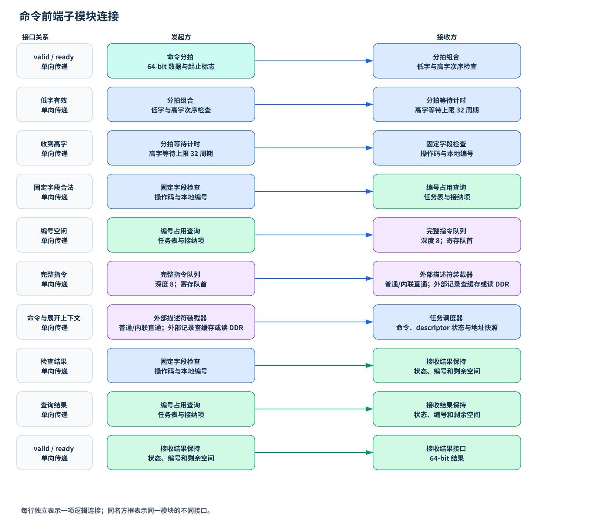


Command Front End（CFE，RTL 实例模块 `npu_cmd_frontend`）只接收 AXI Slave Frontend 已经提交到内部命令入口的 64-bit beat，不直接连接外部 CPU，也不拥有 AXI AW、W、B、AR 或 R 通道。CFE 的完整命令输出接到外部描述符装载器；后者再把命令与 descriptor context 一起交给 TaskScheduler。

CFE 执行以下动作：

1. 接收低 64 bit 和高 64 bit 两个 beat，并检查内部 `first/last` 标志；
2. 在高 beat 到达后组合出完整指令 `{high_word,low_word}`；
3. 检查第 6 章定义的 6-bit opcode 是否有效；
4. 检查 `command_id[9:0]` 是否与 CFE FIFO、TaskScheduler 任务表或 TaskScheduler 命令接纳寄存级中的未释放任务重复；
5. 把通过检查的完整指令写入深度为 `FIFO_DEPTH` 的 128-bit FIFO，基准深度为 8，并用 128-bit 队首输出寄存器隔离 FIFO 存储与 TS 接口；
6. 完整命令写入 CFE FIFO 后，向 AXI Slave Frontend 返回一项 64-bit CFE 接收结果；
7. 通过 128-bit ready/valid 接口把 FIFO 队首命令交给外部描述符装载器。

CFE 不读取全局内存，不发起 MIF 请求，也不读取软件提供的任务参数块。其成功响应只表示命令已进入 CFE 的完整命令 FIFO；该响应不表示外部 descriptor 已读取或校验，也不表示 TaskScheduler 已接纳、任务已发射或任务已完成。操作参数来自指令和 descriptor ABI；TaskScheduler 保存完整指令、descriptor 展开结果和提交时的基地址快照，READY 任务经过逐槽扫描并通过结束时复查后，再为对应执行单元生成内部 Task Context。

### 7.2 模块级信号

下表方向以 命令前端 为参照。

| 信号 | 方向 | 位宽 | 功能 | 有效条件 | 暂停 / 错误 / 复位 |
| --- | --- | ---: | --- | --- | --- |
| `clk_i` | Input | 1 | Core 时钟。 | 每个 Core 时钟沿采样。 | 复位不改变时钟。 |
| `reset_n` | Input | 1 | 低有效异步复位。 | 低电平立即复位控制状态。 | 清除 beat、FIFO valid、指针、响应和错误控制；RAM payload 不作为有效命令。 |
| `quiesce_i` | Input | 1 | 暂停接收新的低 / 高 CMD beat。 | 为 0 才允许 CFE 在 IDLE/WAIT_HIGH 接收。 | 不清空已有完整命令；复位优先。 |
| `axi_cmd_valid_i` | Input | 1 | Slave Frontend 内部命令 beat 有效。 | 与 `axi_cmd_ready_o` 同为 1 时握手。 | ready 为 0 时来源保持 beat 与 first/last；错误 framing 产生响应。 |
| `axi_cmd_ready_o` | Output | 1 | CFE 可接收当前 beat。 | 状态允许且未 quiesce 时拉高。 | RESPOND / CHECK / LOOKUP / ENQUEUE 时暂停；复位后无未完成 beat。 |
| `axi_cmd_data_i` | Input | 64 | 当前命令低字或高字。 | 仅在输入握手时采样。 | 未握手时来源保持；复位清除保存的半条命令。 |
| `axi_cmd_first_i` | Input | 1 | 标记命令低 64-bit beat。 | 仅在输入握手时检查。 | 低 beat 必须 first=1,last=0；不匹配返回 BAD_DESC。 |
| `axi_cmd_last_i` | Input | 1 | 标记命令高 64-bit beat。 | 仅在输入握手时检查。 | 高 beat 必须 first=0,last=1；超时返回 TIMEOUT。 |
| `axi_cmd_rsp_valid_o` | Output | 1 | CFE 命令接收结果有效。 | 进入 CFE_RESPOND 后保持。 | ready 低时保持完整响应；复位清除。 |
| `axi_cmd_rsp_ready_i` | Input | 1 | Slave Frontend 可接收结果。 | 与 valid 同为 1 时响应握手。 | 低电平暂停 CFE 下一条 beat 接收，但 FIFO 可独立出队。 |
| `axi_cmd_rsp_data_o` | Output | 64 | 命令 ID、CFE 状态和快照的 FIFO 空闲项数。 | valid 为 1 时有效。 | 响应形成时锁存，暂停期间不被 FIFO 后续变化改写；复位清零。 |
| `ts_cmd_valid_o` | Output | 1 | 完整 128-bit 命令可交给 descriptor loader。 | FIFO 非空且输出队首有效时拉高。 | 下游 ready 低时队首及命令稳定；复位清除 valid。 |
| `ts_cmd_ready_i` | Input | 1 | Descriptor loader 可接收完整命令。 | 与 `ts_cmd_valid_o` 同为 1 时出队。 | 低电平保留队首，不阻止已完成 CFE 接收响应。 |
| `ts_cmd_o` | Output | 128 | 输出寄存器中的 `{high_word,low_word}`。 | `ts_cmd_valid_o=1` 时有效。 | 下游停顿时保持；复位时清零。 |
| `cmd_id_lookup_valid_o` | Output | 1 | 请求 TS 检查 command_id 是否仍被占用。 | 候选命令通过 opcode 和本地 FIFO 重复检查后发起。 | 查询暂停时保持 lookup 请求；复位取消未完成查询。 |
| `cmd_id_lookup_ready_i` | Input | 1 | TS 接受编号查询。 | valid 与 ready 握手。 | ready 低时 CFE 保持查询。 |
| `cmd_id_lookup_id_o` | Output | 10 | 候选命令 `CMD[121:112]`。 | lookup valid 为 1 时有效。 | 查询握手前保持；高两位在返回格式中补零。 |
| `cmd_id_lookup_rsp_valid_i` | Input | 1 | TaskScheduler 编号查询结果有效。 | 查询完成时单周期有效。 | 未返回时 CFE 保持等待；复位清除等待状态。 |
| `cmd_id_busy_i` | Input | 1 | 编号仍在 TS 接纳级或任一非 FREE 任务中。 | 与查询结果 valid 同周期采样。 | 为 1 则返回重复编号 BAD_DESC；编号只有 ACK/free 后可复用。 |
| `cfe_idle_o` | Output | 1 | 无半条命令、检查、响应且完整命令 FIFO 为空。 | 状态为 CFE_IDLE 且 FIFO count 为 0。 | 复位时为 idle；不代表 descriptor loader 或 TS 空闲。 |
| `cfe_error_o` | Output | 1 | 本周期产生 CFE framing、timeout、opcode 或重复 ID 错误。 | 错误响应建立的事件周期。 | 脉冲由 LSC 捕获为粘滞状态；复位清 CFE 脉冲状态。 |
| `cmd_accepted_o` | Output | 1 | 完整命令成功写入 CFE FIFO。 | CFE_ENQUEUE 周期单拍有效。 | 不表示 descriptor 校验、TS 接纳或执行成功；复位清除。 |

`axi_cmd_*` 前缀表示 CFE 与 AXI Slave Frontend 之间的内部接口，不是 NPU 顶层 AXI 端口。外部主控只驱动 `s_axi_*`；`first/last` 由 AXI Slave Frontend按照每两个 W beat 自动产生。

### 7.3 命令组合与检查

CFE 只在 `CFE_IDLE` 接受 `first=1,last=0` 的低 beat。低 beat 握手后保存到 `low_word_q` 并进入 `CFE_WAIT_HIGH`。该状态只接受 `first=0,last=1` 的高 beat；高 beat 握手后保存到 `high_word_q`，候选命令固定为 `{high_word_q,low_word_q}`。

高 beat 等待上限由 `WAIT_HIGH_TIMEOUT` 给出，基准值为 32。每个没有完成高 beat 握手的周期把计数加 1；最后允许周期内若高 beat 完成握手，则握手优先。达到上限仍未收到高 beat 时，CFE 丢弃低 beat 并返回 `TIMEOUT`。错误的 `first/last` 组合返回 `BAD_DESC`。

固定字段检查使用第 6 章的指令定义：

- CFE 使用 `npu_cmd_opcode_valid()` 的硬件有效集合：`0～52`、`54`、`55`、`56`；
- field 53 是 Program Sequencer 专用静态记录标记，不作为普通 CFE 算术指令接收；
- field 57～63 返回 `ILLEGAL_OPCODE`；有效 opcode 的 payload / engine 组合仍由后续接收解码器检查。
- `command_id` 只取 CMD bit `[121:112]`，范围为 0～1023；
- CFE 先检查本地 FIFO 中的相同编号，再通过查询接口检查 TS 中所有未 ACK 的任务以及已经离开 CFE、尚未写入任务表的命令接纳项。该接纳项也占用 `command_id`，因此 FIFO 出队与任务表写入之间不会出现重复编号检查空档。

CFE 不在本章重复检查每个 opcode 的 80-bit payload。payload、事件资源、地址引用、shape、dtype 和保留位由 TaskScheduler 内的 发射展开单元与事件检查逻辑处理。这样 CFE 固定字段检查和执行参数检查各自只有一个负责模块。

### 7.4 状态机

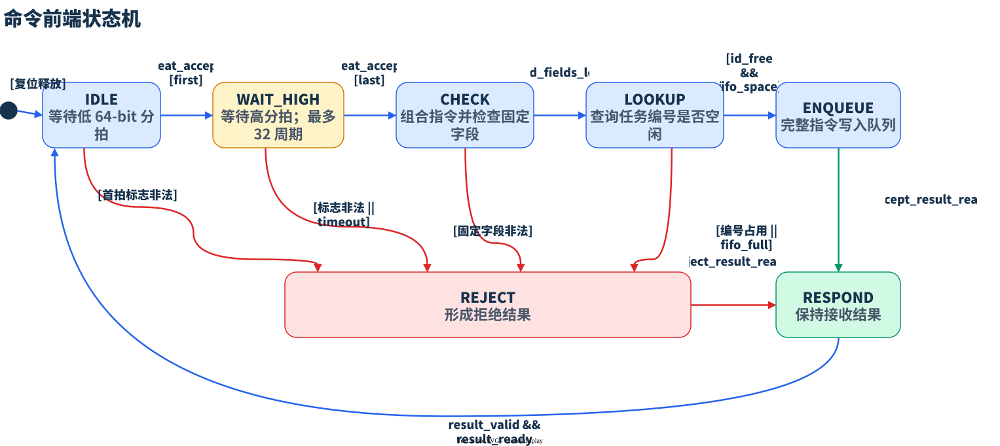

| 状态 | 主要动作 | 离开条件 |
| --- | --- | --- |
| `CFE_IDLE` | 等待低 beat | 正确低 beat 握手后进入 `CFE_WAIT_HIGH`；标志错误进入 `CFE_RESPOND` |
| `CFE_WAIT_HIGH` | 等待高 beat 并计数 | 正确高 beat 握手后进入 `CFE_CHECK`；标志错误或超时进入 `CFE_RESPOND` |
| `CFE_CHECK` | 组合完整指令，检查 opcode 和 CFE FIFO 内重复编号 | 合法时进入 `CFE_LOOKUP`，失败时进入 `CFE_RESPOND` |
| `CFE_LOOKUP` | 向 TS 发出 10-bit 编号查询并等待结果 | 编号空闲且 FIFO 有空间时进入 `CFE_ENQUEUE`，否则进入 `CFE_RESPOND` |
| `CFE_ENQUEUE` | 把完整指令写入 FIFO，产生 `cmd_accepted_o` | 下一周期进入 `CFE_RESPOND` |
| `CFE_RESPOND` | 保持 64-bit 命令结果 | 与 AXI Slave Frontend 完成响应握手后回到 `CFE_IDLE` |

CFE 使用 `output_cmd_q[127:0]` 保存当前队首指令。FIFO 从空变为非空时，新写入指令同时装入该寄存器；队首完成握手且 FIFO 仍有后续项时，下一项在时钟沿装入该寄存器。descriptor loader 接口因而只读取寄存后的队首值，不从 FIFO 数组经过组合选择直接到达 `ts_cmd_o`。

`FIFO_DEPTH=8` 表示最多保存 8 条完整指令，`output_cmd_q` 是队首项的寄存副本，不把容量增加到 9。CFE FIFO 的写入和向 TS 的读出可以在同一周期发生；此时占用数不变。FIFO 原本已满时，只要该周期队首同时完成输出握手，编号查询阶段仍可接受候选命令，释放出的槽供随后写入。FIFO 只有一项且同周期发生出队与入队时，输出寄存器直接装入新命令，既不产生空拍，也不会重复发送旧命令。

`ts_cmd_valid_o=1` 且 `ts_cmd_ready_i=0` 时，`output_cmd_q` 不更新，所以 `ts_cmd_o` 保持不变。只有完整的 128-bit FIFO 项能够出现在 TS 接口，低 beat 单独存在时 `ts_cmd_valid_o` 必须为 0。

### 7.5 命令结果与 AXI 可见寄存器

`axi_cmd_rsp_data_o` 固定使用以下格式：

| Bit | 字段 | 说明 |
| ---: | --- | --- |
| `[11:0]` | `command_id` | `{2'b00,CMD[121:112]}` |
| `[19:12]` | `status` | `SUCCESS`、`ILLEGAL_OPCODE`、`BAD_DESC` 或 `TIMEOUT` |
| `[27:20]` | `fifo_free_entries` | 产生响应时 CFE FIFO 的剩余项数 |
| `[63:28]` | 保留 | 固定为 0 |

AXI Slave Frontend 把每项 CFE 结果写入自己的响应 FIFO。软件从相对 NPU Slave 基地址的 `0x0002_0008` 读取一项结果；响应 FIFO 暂时为空时，该 AXI 读事务等待下一项结果。`0x0002_0010` 返回命令入口和响应 FIFO 状态：

| Bit | 字段 |
| ---: | --- |
| `[7:0]` | 内部命令入口剩余 beat 数 |
| `[15:8]` | 命令响应 FIFO 占用数 |
| `[16]` | 当前 CMD burst 已收到奇数个 beat |
| `[17]` | 内部命令入口已满 |
| `[18]` | 命令响应 FIFO 已满 |
| `[19]` | AXI Slave Frontend 已保存协议错误 |
| `[63:20]` | 固定为 0 |

CMD burst 的 AXI `BRESP` 只报告地址、burst 属性、beat 数、`WSTRB` 和 `WLAST` 等传输检查结果。Slave Frontend 在完整 burst检查通过后一次性把全部 beat 写入内部入口并返回 `OKAY`；检查失败时不提交任何 beat 并返回 `SLVERR`。CFE 对每条指令的检查结果通过 `0x0002_0008` 单独读取，因此命令接收失败不会追溯修改已经返回的 burst级 `BRESP`。

进入 `CFE_RESPOND` 前，CFE 把 status、`command_id` 和当时的 FIFO 空闲项数保存到响应寄存器。若 AXI Slave Frontend 的命令响应 FIFO 已满，`axi_cmd_rsp_ready_i=0`，CFE 将保持 `axi_cmd_rsp_valid_o=1` 以及全部 64-bit 响应字段，直到完成握手；暂停期间不会用后续 FIFO 出队造成的新剩余项数改写该响应。CFE 在此期间不接收下一条低 beat，但完整指令 FIFO 仍可继续向 TS 输出，因此响应暂停不会破坏已经排队命令的次序。

### 7.6 功能时序

图中的 `BEAT_LO`、`BEAT_HI` 分别表示指令低分拍和高分拍；`WAIT_HI`、`ENQ`、`RESP` 分别表示等待高分拍、写入完整指令和保持接收结果。

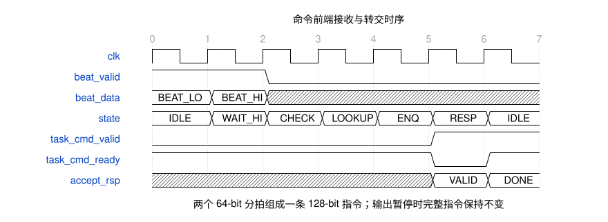

无暂停时，CFE 在接收高 beat 后依次执行固定字段检查、编号查询、FIFO 写入和接收结果返回；descriptor loader 的读取与校验发生在此响应之后。任一 ready/valid 接口暂停时，发送方必须保持 valid、data 及相关控制字段不变。TS 暂停时，队首输出寄存器保存完整指令；命令响应暂停时，响应寄存器保存 status、编号和剩余项数。CFE 产生 `cmd_accepted_o` 的时刻是完整指令写入本地 FIFO 的周期，不是 AXI W beat 进入 Slave Frontend 的周期，也不是任务开始执行的周期。

### 7.7 复位、停止与错误要求

- 复位清空低、高 beat 寄存器、CFE FIFO、指针、占用数和待返回状态；
- `quiesce_i=1` 时停止接收新的内部 CMD beat，已经进入 CFE FIFO 的完整指令继续送往 TS；
- 正常 stop 时，LSC 先禁止 AXI Slave 接受新的 CMD burst，等 `cmd_ingress_idle_i=1` 后才置 CFE quiesce，因此已进入命令入口的完整 beat 对会先送完；软复位则立即置 quiesce，尚未送完的 beat 与 `CFE_WAIT_HIGH` 中的低 beat 由随后的功能复位清除；
- 错误命令不得进入 CFE FIFO，不得产生 `cmd_accepted_o`，也不得出现在 descriptor loader 的完整命令接口；
- CFE 只产生片上控制访问，不得因为任何命令检查动作发起 NPU `m_axi_*` 请求。

---

### 7.8 Program Sequencer：静态程序取指与运行期调度

`npu_program_sequencer` 位于 CFE 之前，读取编译期生成的 cmd128 程序，并把普通命令拆成两个 64-bit beat送入同一 CFE。它不会复制 opcode 执行器，也不绕过 CFE 的 framing、opcode 与 command ID 检查。程序记录中的 Guard、Patch、LoopBegin、LoopEnd 使用 field 53，在 Sequencer 内部消费，不占 TaskScheduler 槽位；普通执行命令才进入 CFE。

| 参数 | 默认值 | 合法范围 | 作用 |
| --- | ---: | --- | --- |
| `MAX_OUTSTANDING` | 8 | 1～32 | 同时跟踪的普通命令任务数；任务终态后还需握手 ACK 才释放 ID。 |
| `CMD_FIFO_DEPTH` | 8 | 1～255 | 检查 CFE 接收响应中的 free-entry 字段上界。 |
| `PREFETCH_COMMANDS` | 8 | 1～8 | 每个预取批次最大 cmd128 数；内部两批环形缓冲共 `2×PREFETCH_COMMANDS` 条。 |

模块接口方向以 Program Sequencer 为参照。`mif_req_*` 是内部 MIF 请求，非顶层 AXI；`cmd_*` 是送往 CFE 的双拍命令流。

| 信号 | 方向 | 位宽 | 功能 | 有效条件 | 暂停 / 错误 / 复位 |
| --- | --- | ---: | --- | --- | --- |
| `clk_i` | Input | 1 | Core 时钟。 | 每个 Core 时钟沿采样。 | 复位不改变时钟。 |
| `reset_n` | Input | 1 | 低有效异步复位。 | 控制与环指针复位。 | 外部已发 AXI/MIF 事务不能由本地复位撤销。 |
| `abort_i` | Input | 1 | 停止取新命令并进入受控排空。 | busy 时采样。 | 已接受的 MIF 返回、任务完成与 ACK 排空后结束。 |
| `start_i` | Input | 1 | 启动静态程序。 | 仅 idle 接受；参数在启动沿采样/建立。 | busy 时不接受；非法 count/address 设置 sticky error。 |
| `clear_i` | Input | 1 | 清除终态 done/error。 | 仅非 busy 时有效。 | 忙碌期间忽略清除。 |
| `program_addr_i` | Input | 48 | 静态 cmd128 程序的物理首地址。 | start 时按 16-byte 对齐并检查跨度。 | 未对齐或 48-bit 地址跨度溢出返回地址错误。 |
| `command_count_i` | Input | 32 | 静态程序记录数，metadata 记录也计入。 | start 时要求非零。 | 零计数设置 BAD_DESC 并直接完成。 |
| `runtime_position_i` | Input | 32 | 运行时位置标量，供 Guard/Patch 使用。 | 程序运行期间实时读取。 | 软件需在 busy 期间保持稳定；无内部 start 快照。 |
| `runtime_valid_tokens_i` | Input | 32 | 本轮有效历史 token 数，供长度保护与循环块控制。 | 程序运行期间实时读取。 | 软件需保持稳定；零长度按 guard 语义跳过块体。 |
| `busy_o` | Output | 1 | 程序 fetch、dispatch、completion 或 ACK 尚未排空。 | 任一程序状态活动时为 1。 | abort 只在排空完成后清 busy。 |
| `done_o` | Output | 1 | 当前程序结束或被 abort 排空。 | 成功末条任务 ACK 或 abort 排空后置位。 | sticky 到 clear_i / 新 start / reset。 |
| `error_o` | Output | 1 | 程序取指、响应、控制记录或任务失败。 | 首次错误记录时置位。 | sticky；新 start/reset 清除。 |
| `error_status_o` | Output | 8 | 首个程序错误的状态码。 | error_o=1 时有效。 | 后续错误不覆盖首错；清除/新 start/reset 复位。 |
| `submitted_count_o` | Output | 32 | 成功从程序提交到 CFE 的普通命令数。 | 程序运行期间累计。 | metadata 控制记录不计入任务提交数；新 start/reset 清零。 |
| `completed_count_o` | Output | 32 | 成功接收并退休的任务 completion 数。 | 匹配当前 outstanding ID 的完成握手时累计。 | ACK 是独立握手；新 start/reset 清零。 |
| `mif_req_valid_o` | Output | 1 | 程序 burst 读请求有效。 | 取指 FSM 处于请求发射状态。 | ready 低时地址和长度保持；abort 禁止新请求。 |
| `mif_req_ready_i` | Input | 1 | MIF 接受取指请求。 | 与 valid 握手。 | 低电平保持请求；不影响已发 burst 返回。 |
| `mif_req_write_o` | Output | 1 | 取指固定为读。 | valid 为 1 时为 0。 | Sequencer 不通过 MIF 写程序。 |
| `mif_req_addr_o` | Output | 48 | 当前静态程序物理地址。 | request valid 时有效。 | 受 16-byte cmd 对齐、48-bit 溢出和 4-KiB 边界分段约束。 |
| `mif_req_wdata_o` | Output | 64 | 未使用写数据，固定为零。 | 取指请求期间。 | write=0。 |
| `mif_req_wstrb_o` | Output | 8 | 未使用写 strobe，固定为零。 | 取指请求期间。 | write=0。 |
| `mif_req_burst_len_o` | Output | 8 | AXI LEN 编码；取回命令数乘 2 个 64-bit beat 再减一。 | 取指请求 valid 时有效。 | 每 burst 最多 min(PREFETCH_COMMANDS,剩余记录,4-KiB余量) 条。 |
| `mif_rsp_valid_i` | Input | 1 | 取指 MIF 返回 beat 有效。 | 与 rsp_ready 握手。 | beat status 错误使程序进入错误排空。 |
| `mif_rsp_ready_o` | Output | 1 | Sequencer 可消费取指返回 beat。 | fetch 状态可接收时为 1。 | 未接受的 beat 由 MIF 保持；abort drain 仍接收已发响应。 |
| `mif_rsp_rdata_i` | Input | 64 | 静态程序的一个 64-bit beat。 | response valid 且 ready。 | 相邻两 beat 组成一条 cmd128。 |
| `mif_rsp_status_i` | Input | 3 | MIF 返回状态。 | response handshake 时采样。 | 非 OK 状态锁存程序错误并停止新取指。 |
| `cmd_valid_o` | Output | 1 | 当前低/高 64-bit 命令 beat 有效。 | dispatch 状态发往 CFE。 | CFE ready 低时保持 data/first/last。 |
| `cmd_ready_i` | Input | 1 | CFE 接受程序命令 beat。 | 与 cmd_valid 握手。 | 低电平暂停 dispatch，不丢弃已预取命令。 |
| `cmd_data_o` | Output | 64 | 当前命令低字或高字。 | cmd_valid=1 时有效。 | 暂停时稳定；metadata records 被消费，不作为普通 beat 发出。 |
| `cmd_first_o` | Output | 1 | 低 64-bit 命令 beat 标志。 | 与 cmd_valid 一起发出。 | 标准命令对为 first=1,last=0 后接 first=0,last=1。 |
| `cmd_last_o` | Output | 1 | 高 64-bit 命令 beat 标志。 | 与 cmd_valid 一起发出。 | 暂停时与 data 保持。 |
| `cmd_rsp_valid_i` | Input | 1 | CFE 的逐命令接收结果有效。 | 与 rsp_ready 握手。 | 不是 AXI burst BRESP，也不表示任务完成。 |
| `cmd_rsp_ready_o` | Output | 1 | 可消费 CFE 命令结果。 | 对应命令仍等待响应时接收。 | 命令 ID/status 不匹配设置 BAD_DESC。 |
| `cmd_rsp_data_i` | Input | 64 | CFE 响应记录。 | rsp_valid 握手时采样。 | 检查 status、command_id 与 CFE free-entry 上界。 |
| `completion_valid_i` | Input | 1 | TaskScheduler 终态 completion 有效。 | busy 且返回/ACK槽可用时接受。 | ID 不属于 outstanding 集合会报告程序协议错误。 |
| `completion_ready_o` | Output | 1 | Sequencer 可接受任务终态。 | 非 busy 无关返回可丢弃；忙时受单项 ACK 暂存限制。 | ACK 阻塞且暂存占用时反压。 |
| `completion_command_id_i` | Input | 12 | 完成任务 ID；其中有效低 10 bit 与程序分配 ID 对应。 | completion valid 握手时采样。 | 与 outstanding 记录不匹配视为错误。 |
| `completion_status_i` | Input | 8 | 任务终态状态。 | completion valid 握手时采样。 | 非 SUCCESS 首错并转入排空。 |
| `task_ack_valid_o` | Output | 1 | 向 TaskScheduler 释放终态任务槽 / command_id。 | 有一项待 ACK 时保持。 | ready 低时保持 ID；未 ACK 不得重用 ID。 |
| `task_ack_command_id_o` | Output | 12 | 待释放的 command_id。 | ack valid 为 1 时有效。 | ACK 握手后释放 outstanding 项。 |
| `task_ack_ready_i` | Input | 1 | TaskScheduler 接受 ACK。 | 与 ack valid 握手。 | ready 低时保留 pending ACK。 |

#### 7.8.1 程序 ABI 与预取地址

命令数统计完整 cmd128 记录，metadata 记录也占一个程序位置。每条记录 16 byte，对应两项 64-bit MIF 返回。`program_addr_i` 必须按 16 byte 对齐；启动时以 49-bit 运算检查 `program_addr + command_count×16`，禁止地址空间回绕。每次预取的命令数为：

$$
N_{fetch}=\min(PREFETCH\_COMMANDS,\;N_{remaining},\;N_{4KiB}),
\qquad LEN_{MIF}=2N_{fetch}-1,
$$

其中 $N_{4KiB}$ 是首地址所在 4 KiB 页内可完整容纳的 cmd128 数。程序地址始终是绝对物理地址；取指路径不加输入、权重、工作区或 parameter base。请求和返回按命令低字、高字次序写入双批环形 RAM，并并行保存原始程序索引，供控制记录计算 skip/patch 目标。只有两拍都返回且状态成功的命令才被标记为可分发。

默认每批最多预取 8 条，双批环可容纳 16 条。取指端在已有批次尚未消费完时可继续填充另一批；Dispatcher 因 CFE ready、Event、barrier 或任务槽满而暂停，不会覆盖有效缓冲。单次 burst 最多受批次深度、剩余记录数和 4 KiB 边界三者共同限制；固定深度不等于实际总程序只能存 16 条。

#### 7.8.2 接收、终态与 command ID 生命周期

普通命令经 CFE 的两个 beat 握手后等待逐命令 CFE response。Sequencer 检查 status、返回 ID 和 free-entry 值；成功响应才把命令记入 outstanding 表并增加 submitted count。CFE 接收成功只确认进入其命令 FIFO，任务是否真正接纳及其终态由 TaskScheduler 之后的 completion 接口给出。Sequencer 区分 submitted、completed 与 ACK：completion 握手增加完成计数，生成一项待 ACK 记录；只有 `task_ack_valid_o && task_ack_ready_i` 才释放对应槽和编号。因此 ID 不会在任务已终止但尚未释放 Scheduler 槽时提前重用。

若 response ID/status 与待处理命令不符、MIF 返回错误、completion ID 不在 outstanding 集合内或任务 status 非成功，Sequencer 锁存首个 error status，停止新的取指/发射，并排空已接受的 AXI beat、CFE 响应、任务完成和 ACK。`submitted_count_o` 统计成功送入 CFE 的普通命令，`completed_count_o` 统计接受的任务终态，两者都不包括 metadata 记录，也不包括仍未 ACK 的任务。

#### 7.8.3 运行时上下文与并发

`runtime_position_i` 和 `runtime_valid_tokens_i` 在程序运行期间直接参与 Guard、Patch 和 Loop 的判断，不是 `start_i` 时复制的参数。软件启动程序后必须保持两者稳定，直至 `busy_o` 清零；若需要不同上下文，应在程序间隔更新并重新启动。位置程序/分块执行不需要把整段模型命令按每个 token 复制到 DDR：普通静态指令从程序 RAM 预取，运行时标量通过已编译的 AREF / metadata patch约定进入相应操作字段。

Matrix、Complex、DMA 可在命令已发射后并行执行；Sequencer 只负责有序取指、发射、事件/屏障约束和任务回收。它不是通用 CPU 分支执行器，不支持任意条件跳转或嵌套循环。Loop 控制的是一段有界静态块体，并按有效 token 数计算所需分块次数；每轮重新取指块体，前一轮任务可以继续排空，但下一轮块体的发射受 loop drain 规则约束。该程序调度能力不改变 NPU 的最大位置字段和 KV 容量，也不自动保证模型在任意上下文长度上的数值精度。

#### 7.8.4 状态、停止与错误恢复

取指 FSM 将空闲、批次规划、MIF 请求、burst 数据接收和 abort 排空分开推进；Dispatcher 独立处理命令读取/发送、响应等待、资源等待、屏障、跳过、patch 与有限 loop。命令 RAM 的同步读由 WAIT_COMMAND / LOAD_COMMAND 两阶段完成，不能按组合读 RAM 描述。`start_i` 仅在 idle 接受；非零 count、16-byte 地址对齐及 48-bit 地址范围校验在启动边界执行。`done_o/error_o` 为终态保持信号，由 `clear_i`、新 start 或 reset 清除。

`abort_i` 立即禁止新的 MIF 取指及命令发射，但不丢弃已接受的 MIF 返回或已被 Scheduler 接纳的任务。Sequencer 等待已发 burst 完成、接收在途任务的 completion、完成 ACK，再置 done 并清 busy。此规则要求外部 DDR/MIF 在运行中持续提供已接受事务的最终响应；本地 abort 不会撤回 AXI 协议中的事务。

### 7.9 External Descriptor Loader：外部参数记录装载与缓存

`npu_external_desc_loader` 位于 CFE 与 TaskScheduler 之间。它把需要外部记录的命令转换为“原始命令 + 2048-bit descriptor context”的 Scheduler 握手；inline、continue 和普通命令可直通或按静态模板生成 context。它没有独立的软件请求队列：需要展开时会把 CFE 队首保持到最终下游握手，确保命令、descriptor 与 command ID 始终绑定。

| 参数 | 默认值 | SoC 集成值 | 作用 |
| --- | ---: | ---: | --- |
| `DESC_CACHE_ENTRIES` | 512 | 由 Core 参数覆盖 | 直接映射 descriptor cache 项数；要求为 2 的幂，以地址索引和完整 tag/opcode 判定命中。 |
| `DESC_CONTEXT_W` | 2048 | 1728 | 内部 descriptor 有效上下文位宽；输出接口仍固定 2048 bit，高位补零。 |

模块端口按 loader 边界逐项定义：

| 信号 | 方向 | 位宽 | 功能 | 有效条件 | 暂停 / 错误 / 复位 |
| --- | --- | ---: | --- | --- | --- |
| `clk_i` | Input | 1 | Core 时钟。 | 每个 Core 时钟沿采样。 | 复位不改变时钟。 |
| `reset_n` | Input | 1 | 低有效异步复位。 | 立即清除状态与 cache valid。 | payload RAM 不清零；valid 清除使陈旧内容不可见。 |
| `abort_i` | Input | 1 | 取消当前 descriptor 组装并安全排空已接受 MIF read。 | 加载中采样。 | 已接受返回仍在 ABORT_DRAIN 被消费；缓存有效位和 inline 模板失效。 |
| `cmd_valid_i` | Input | 1 | CFE 完整 128-bit 命令有效。 | 与 cmd_ready_o 握手；materialize期间CFE保持队首。 | 未握手时 CFE 保持指令。 |
| `cmd_ready_o` | Output | 1 | CFE 命令可被下游接收。 | 直通命令时跟随 cmd_ready_i；需加载时仅最终输出握手后完成。 | descriptor miss / assembly期间拉低。 |
| `cmd_i` | Input | 128 | 当前静态命令；外部地址来自 `[39:0]` 绝对物理指针。 | cmd_valid_i 为 1 时有效。 | 命令来源在完成握手前保持；无 parameter_base 加法。 |
| `cmd_valid_o` | Output | 1 | 命令及配套 descriptor context 可交给 Scheduler。 | 直通或 LOAD_OUTPUT 状态按 cmd_ready_i 握手。 | 下游停顿时保持。 |
| `cmd_ready_i` | Input | 1 | Scheduler 接收命令和展开的 descriptor context。 | 与 cmd_valid_o 同时有效。 | 低电平延长输出状态并推迟 cache valid commit。 |
| `cmd_o` | Output | 128 | 原始命令或续接命令的内联动态补丁结果。 | cmd_valid_o 为 1 时有效。 | 不重写 DDR 程序；输出停顿时保持。 |
| `desc_present_o` | Output | 1 | 本次输出命令带有 descriptor context。 | LOAD_OUTPUT 时为 1，包括失败记录。 | 无描述符直通命令为 0；输出停顿期间稳定。 |
| `desc_valid_o` | Output | 1 | descriptor ABI、地址和记录校验通过。 | desc_present_o 为 1 时有效。 | 失败时为 0，Scheduler 必须把任务置为 BAD_DESC 而不发射引擎。 |
| `desc_flat_o` | Output | 2048 | 按配置展宽并补零的片上 descriptor context。 | desc_present_o 为 1 时有效。 | 有效字段宽度 DESC_CONTEXT_W；输出受阻时稳定。 |
| `mif_req_valid_o` | Output | 1 | 外部 descriptor burst 读请求。 | LOAD_REQUEST 且未 abort。 | MIF ready 低时保持；cache hit / inline不请求DDR。 |
| `mif_req_ready_i` | Input | 1 | MIF 接受 descriptor 请求。 | 与 valid 握手。 | 未握手保持请求字段。 |
| `mif_req_write_o` | Output | 1 | descriptor access 固定为读。 | valid 时为 0。 | 本单元不写 descriptor。 |
| `mif_req_addr_o` | Output | 48 | descriptor绝对物理读地址。 | request valid 时有效。 | 40-bit命令指针零扩展；分段请求遵守 4 KiB。 |
| `mif_req_wdata_o` | Output | 64 | 未使用写数据，固定为零。 | descriptor读期间。 | write=0。 |
| `mif_req_wstrb_o` | Output | 8 | 未使用写 strobe，固定为零。 | descriptor读期间。 | write=0。 |
| `mif_req_burst_len_o` | Output | 8 | 每段 1～32 个 64-bit beat 的 AXI LEN。 | 请求有效时。 | 256-byte记录共32 beat，地址边界可分段。 |
| `mif_rsp_valid_i` | Input | 1 | MIF 返回 descriptor beat。 | 与 rsp_ready 握手。 | 错误 status 使记录失败并阻止输出 valid。 |
| `mif_rsp_ready_o` | Output | 1 | 可接收 descriptor 返回。 | LOAD_RESPONSE 或 LOAD_ABORT_DRAIN。 | 其他状态反压；abort drain仍接收已发响应。 |
| `mif_rsp_rdata_i` | Input | 64 | descriptor 数据 word。 | 返回握手时采样。 | 按 byte/word偏移流式写payload RAM并校验保留尾部。 |
| `mif_rsp_status_i` | Input | 3 | MIF 返回状态。 | 返回握手时采样。 | MEM_ADDR 可结束异常短响应；错误使 descriptor invalid。 |
| `idle_o` | Output | 1 | loader FSM 处于 LOAD_IDLE。 | 仅 LOAD_IDLE。 | 直通命令当拍可能有效，故 idle 不代表系统无外部待返事务。 |

#### 7.9.1 命令类别与地址约定

普通不需要 descriptor 的命令以原 128-bit 内容直通；descriptor presence 为 0。field 48（`GROUP_REQUANT_GEMM`）和 field 50（`COMPLEX_DYNAMIC_A8`）的外部记录地址使用 `CMD[39:0]` 的绝对物理字节地址，要求 64-byte 对齐且 `[79:40]` 保留为零。loader 将地址零扩展到内部 48-bit MIF 请求；不会与 `PARAM_L1_BASE`、权重基址或其他全局基址相加。故这 40-bit 字段可覆盖配置的 40-bit AXI 地址范围，但不能表达超出该 AXI 端口范围的物理地址。

field 49（在线 Softmax PV）是命令内联操作，不是外部记录。field 54 的 GROUP_REQUANT inline base、field 55 的 inline columns template、field 56 的 dynamic A8 参数均由指令字段构造 descriptor context，不发起 DDR descriptor 读取。GROUP_REQUANT continue 使用先前已建立的静态模板和当前命令的动态 base/phase 生成本次 context；命令本身仍由 Sequencer 从静态程序取指，不需要 CPU 实时改写指令。模板缓存只保存所需 GROUP_REQUANT 静态 descriptor 字段，不缓存权重、profile、激活或完整模型张量。

#### 7.9.2 256-byte 记录、分段读取与 context 展开

外部 ABI 记录固定为 256 byte / 32 个 64-bit word。内部 context 宽度可小于 2048 bit，但 miss 仍读取并检查完整外部记录；1728-bit SoC context覆盖当前 MQR v2/v3 定义字段，剩余记录尾部按 ABI 保留位规则流式检查。一个 burst 最多 32 beat，并在 4 KiB 地址边界切分；若 256-byte 记录跨页，拆为两个 MIF 请求。每个返回 word 写入 64-bit SDP BRAM payload，避免将整张 descriptor cache 合成为大规模 LUT RAM。

外部 descriptor 的定义单位是 byte offset，不由 SystemVerilog packed struct 的拼接顺序决定。内存中保存的是 compiler 生成的静态记录；输出到 Scheduler 的 context 是片上组合/寄存格式。缓存 tag 保存完整绝对地址和 opcode，直接索引低地址位只决定候选 set，不能代替完整 tag 比较。cache payload 由同步 RAM 按 word 读出；命中后的 context 组装需要多个 Core 周期，不是 2048-bit 单拍异步读。

#### 7.9.3 Cache 有效性、错误与停止

cache valid 仅在完整记录通过字段/保留字节检查并成功与下游命令一起握手后置位。读取中途失败、下游长时间 backpressure 或 abort 不会提交有效 tag；miss 开始时先使对应 index 的 valid 失效，避免部分写入覆盖旧记录后仍被误判为命中。直接命令及 inline command 没有 cache miss 延迟。当前硬件未发现 CPU 写 descriptor 后的 cache coherence / snoop 或独立软件失效 CSR；部署 ABI 应把有效 descriptor 当作只读静态数据，在模型包更新或复位后重新装载。

loader 的 FSM 包含直通/接收、cache lookup、同步 RAM context 读取、GROUP_REQUANT inline/continue 的分段计算、MIF 请求/响应、最终输出和 abort drain。地址错误或 descriptor 内容错误会令 `desc_present_o=1, desc_valid_o=0`；TaskScheduler 需要接收这条错误记录并将命令终结为 BAD_DESC，不能发射 Matrix/Complex。`idle_o` 只表示 loader FSM 在 LOAD_IDLE；旁路命令同拍仍可能通过，系统停机还需检查 CFE、Scheduler、MIF 与各自 FIFO。

CFE 的接收响应发生在 CFE FIFO enqueue；descriptor loader 的读取和合法性检查更晚。因此软件不能把 `CFE SUCCESS` 当作 descriptor 已校验或任务已接纳的证明，最终执行状态必须查 TaskScheduler completion。对不需要外部记录的指令，增加这一级不会产生额外 MIF 访问。

---

## 8. TaskScheduler 与内联解码

### 8.1 组成与职责


任务调度器 接收 CFE 提供的完整指令，在同一 Core 时钟域完成字段检查、事件处理、任务保存、发射解码、完成记录和软件查询。模块由以下部分组成：

- 完整 128-bit 指令输入接口；
- 一项命令接纳寄存级，保存接收检查结果、事件引用、前序任务位图、目标槽号、完整指令和提交时基地址；
- 任务表，顶层配置为 8 项；
- Event Table，包含 255 个可用 Event ID；
- 一组接收检查解码器；
- 一组 WAIT_EVENT 逐槽检查寄存器和一项检查结果寄存器；
- 一组逐槽发射扫描寄存器；
- 一组发射窄快照寄存器和一组共享发射解码器；
- DMA、Matrix、Vector、Complex 各自使用的一组 2048 bit 发射暂存；
- DMA、Matrix、Vector、Complex 四组任务发射与完成接口；
- Matrix、DMA、Vector、Complex 各一项 active 记录；
- 一组由 Control 操作、普通 signal Event 和完成通知共用的逐槽选择寄存器；
- 一项 Control 执行快照，保存轮末获胜的任务槽号和 `submit_seq`；
- 普通 signal Event 发布暂存和完成通知持有槽寄存器；
- AXI Slave Frontend 控制请求接口；
- 任务查询和 ACK 接口。

接收检查解码器读取 CFE 提供的完整指令和 LSC 当前基地址，用 `valid_o`、`engine_o` 与 `opcode_o` 完成接收阶段检查，但它的 `desc_flat_o` 在该实例中没有接入任务表。CFE 与 TS 完成握手时，TS 先把检查结果、当前 Event generation、前序任务位图、目标 FREE 槽、完整指令、五个 48 bit 基地址和 21 bit L1 参数区基址保存到一项命令接纳寄存级；下一时钟周期只读取这些寄存值写任务表。任务表不保存 2048 bit 展开结果。

WAIT_EVENT 任务使用独立的逐槽检查器。检查器每周期只读取一个任务槽的 `wait0`、`wait1`，并以两个索引读取 Event Table；普通任务与 `EVENT_JOIN(join_mode=0)` 对两个结果执行 AND 条件，`EVENT_JOIN(join_mode=1)` 执行 OR 条件。事件检查结果、槽号和该槽的 `submit_seq` 在时钟沿写入结果寄存器，下一周期只有在任务仍为 WAIT_EVENT 且 `submit_seq` 未变时，才把任务改为 READY 或 `DEPENDENCY_FAILED`。前序任务仍未结束时，即使事件条件已经满足，任务也继续处于 WAIT_EVENT，扫描器在下一轮再次检查。Event 发布暂存即将在同一时钟沿写入的 SUCCESS 或 ERROR 会直接转发给本周期的两个 Event Table 读取，避免等待任务因读到旧状态而多等一整轮。8 项任务表从某个事件可见到对应任务更新，最迟经过 8 个时钟周期。

等待事件成功并且 `predecessor_mask & task_live_mask` 为 0 时，任务才从 WAIT_EVENT 进入 READY。DMA、Matrix、Vector 和 Complex 的 READY 任务共同参加发射扫描。发射扫描器每周期读取一个任务槽；候选必须仍为 READY、上述按位与结果仍为 0、对应发射暂存的 `valid` 为 0，并且目标执行单元仍有接收容量。DMA、Matrix、Vector 和 Complex 都要求其 active 位为 0；Matrix/Vector Engine 在任一时刻只接受一项 Matrix 任务。扫描器每周期只进行一次 64-bit `submit_seq` 比较，用于保留当前最早候选。检查完 `TASK_SLOTS` 个槽后，组合逻辑重新检查已保存候选和最后一个槽，只在获胜任务仍满足条件时写入发射窄快照；顶层配置为 8 个槽。如果没有候选，本轮结束且不写快照，扫描器在下一轮从槽 0 开始。

Control 执行、普通 signal Event 发布和完成通知使用另一组逐槽选择寄存器。三类选择共用一个连续递增的任务槽计数器，并在同一周期检查同一个槽；每一类分别保存本轮候选位图、变化标志、最早候选槽号和 64-bit `submit_seq`。一轮开始时保存三类候选位图，随后用 `TASK_SLOTS` 个周期逐项检查；顶层配置一轮为 8 个周期。最后一个槽检查结束时，各类分别复查本轮位图是否保持不变、获胜项是否仍符合要求以及 `submit_seq` 是否一致。某一类的候选位图在本轮发生变化时，只取消该类本轮的选择脉冲，下一轮从槽 0 重新检查；另外两类不受影响。三类选择可在同一轮末尾各产生一个脉冲。

Control 获胜脉冲不直接修改 Event Table 或任务表。时钟沿先把获胜槽号和 `submit_seq` 写入 `control_exec_slot_q`、`control_exec_seq_q`，下一周期重新检查该槽仍为 READY Control 任务、提交序号一致且没有前序任务阻塞，检查通过后才执行 EVENT_REARM、EVENT_JOIN 或 GLOBAL_FENCE。正在执行的 Control 槽不再参加同轮候选集合。TS 在 `control_exec_valid_q=1` 时拉低 `cfe_cmd_ready_o`，防止 EVENT_REARM 修改 generation 的周期同时接收一条等待该 Event 的新命令。若执行快照形成前一个周期已经保存了一项命令接纳记录，EVENT_REARM 还会检查该接纳项的 `wait0` 和 `wait1`；任一引用等于待重置事件时，EVENT_REARM 返回 `BAD_DESC` 并保持 Event Table 不变。Control 任务不使用发射扫描器和共享发射解码器。

被选任务先在时钟沿写入 `decode_pending_*`：其中保存目标执行单元、任务表项编号、操作码、命令编号、128 bit 指令、五个 48 bit 基地址快照和 21 bit L1 参数区基址。下一周期，共享发射解码器根据这组稳定快照组合产生 `decode_pending_desc_flat[2047:0]`；再下一个时钟沿把展开结果和任务信息写入目标执行单元的发射暂存。本文把发射接口上的 2048 bit 片上数据称为 Task Context。它不是软件数组，不位于 DDR，也不会引起 MIF 访问。

共享解码器每次处理一个待展开任务。`decode_pending_valid_q=1` 时，TS 先处理已有窄快照并停止扫描；没有待处理快照时，扫描器从槽 0 到槽 `TASK_SLOTS-1` 每周期检查一项，共用 `TASK_SLOTS` 个周期完成一轮，顶层配置为 8 个周期。已有快照在写入任务发射暂存前，会再次检查任务仍为 READY、任务表中的执行类别字段未变且前序任务条件仍满足。目标任务接口暂时不可接收新任务时，快照保持有效；任务本身不再满足条件时，快照被丢弃。任务通常持续多个周期，这一级按次序展开不会阻止已经取得任务的 DMA、Matrix、Vector 和 Complex 同时运行。Matrix 与 Vector 同处于 Matrix-Vector Engine，运行时仍要经过该模块内部的 PE 与 L1 仲裁。四组发射暂存彼此独立，可分别保持 `valid` 并承受不同长度的反压。

### 8.2 CFE 输入与编号查询接口

TS 的时钟、运行控制、配置和状态信号如下：

| 信号 | TS 方向 | 位宽 | 说明 |
| --- | --- | ---: | --- |
| `clk_i` | Input | 1 | Core 时钟 |
| `reset_n` | Input | 1 | 低有效异步置位复位；系统在 Core 时钟域同步释放 |
| `enable_i` | Input | 1 | 允许接收 CFE 已保存的完整指令；顶层在停止接收新 AXI 命令后仍可用该信号排空 CFE |
| `quiesce_i` | Input | 1 | 停止接收新指令，已保存任务继续推进 |
| `abort_i` | Input | 1 | 把非终态任务置为 `ABORTED` |
| `input_base_i` | Input | 48 | `INPUT_BASE` |
| `weight_base_i` | Input | 48 | `WEIGHT_BASE` |
| `work_base_i` | Input | 48 | `WORK_BASE` |
| `output_base_i` | Input | 48 | `OUTPUT_BASE` |
| `kv_base_i` | Input | 48 | `KV_BASE` |
| `param_l1_base_i` | Input | 20 | L1 参数区起始地址 |
| `scheduler_idle_o` | Output | 1 | 没有命令接纳项、任务表占用项和活动执行单元 |
| `scheduler_quiescent_o` | Output | 1 | 没有接纳、WAIT_EVENT 任务、解码、发射、活动执行、Control、Event 发布、完成持有或 AXI 控制请求；不要求终态任务表项已经 ACK |
| `task_occupancy_o` | Output | 16 | 当前非 FREE 任务表项数加命令接纳项数 |

| 信号 | TS 方向 | 位宽 | 说明 |
| --- | --- | ---: | --- |
| `cfe_cmd_valid_i` | Input | 1 | CFE 队首完整指令有效 |
| `cfe_cmd_ready_o` | Output | 1 | TS 可以把一条完整指令保存到命令接纳寄存级 |
| `cfe_cmd_i` | Input | 128 | 完整 128-bit 指令 |
| `cmd_id_lookup_valid_i` | Input | 1 | CFE 请求查询命令编号 |
| `cmd_id_lookup_ready_o` | Output | 1 | TS 接受查询，现有 硬件 固定为 1 |
| `cmd_id_lookup_id_i` | Input | 10 | `command_id[9:0]` |
| `cmd_id_lookup_rsp_valid_o` | Output | 1 | 查询握手后的下一周期产生一个周期脉冲 |
| `cmd_id_busy_o` | Output | 1 | 任一非 FREE 任务表项或有效命令接纳项使用该编号 |

`cfe_cmd_ready_o` 只在 `enable_i=1`、`quiesce_i=0`、`abort_i=0`、任务表存在 FREE 项、命令接纳寄存级为空并且没有待执行 Control 快照时为 1。完整命令握手后，TS 在第一个时钟沿保存以下接纳字段：

| 接纳字段 | 作用 |
| --- | --- |
| `cmd_admit_slot_q` | 本次选中的 FREE 任务槽 |
| `cmd_admit_command_id_q`、`cmd_admit_engine_q`、`cmd_admit_opcode_q`、`cmd_admit_header_flags_q` | 编号、目标执行单元、操作码和公共选项 |
| `cmd_admit_wait0_q`、`cmd_admit_wait1_q` | 使用握手周期 Event generation 得到的内部等待事件引用 |
| `cmd_admit_signal_q` | 使用握手周期 Event generation 得到的 signal 引用；无论整条命令的接收检查是否通过，都保存已经处理的引用 |
| `cmd_admit_static_valid_q`、`cmd_admit_is_inline_rearm_q` | 接收检查结果和 EVENT_REARM 标志 |
| `cmd_admit_predecessor_mask_q` | 握手周期看到的较早活动任务集合 |
| `cmd_admit_cmd_q` | 完整 128-bit 指令 |
| 六项基地址寄存器 | 五个 48 bit 物理基地址和 21 bit L1 参数区基址 |

下一个时钟沿把该接纳项写入任务表，并在此时分配 64 bit `submit_seq`、更新 Event PENDING 状态以及增加全局提交序号。命令接纳寄存级有效时，TS 暂停接收下一条 CFE 命令，因此当前接收速率上限为每两个 TS 时钟周期一条完整指令。CFE 组合一条指令本身需要两个 64-bit beat，执行单元任务持续时间通常更长；软件仍须按 ready/valid 处理，不能假定每周期都能提交一条完整指令。任务表满时，TS 同样对 CFE施加反压。

顶层把 `enable_i` 连接为 `accept_new_cmd_o || !cfe_idle`。正常运行时，`accept_new_cmd_o=1` 允许 CFE 队首进入 TS；软件请求停止后，AXI 命令入口先停止接收新的 CMD burst，但只要 CFE 仍有完整指令，`!cfe_idle` 便继续保持 TS 接纳能力。这样，已经到达 CFE 的命令不会因为 start 清零而滞留。等命令入口和 CFE 依次排空后，LSC 才令 `ts_quiesce_o=1`，此后 TS 不再接收新的 CFE 队首，任务表内已有任务仍可继续发射和完成。

保留接纳握手时的基地址是必要的：一条任务可能在命令接纳寄存级、WAIT_EVENT 或 READY 状态停留多个周期，软件也可能在此期间改写 LSC 基地址寄存器。任务表写入和发射解码器必须继续使用握手时保存的五个基地址和 L1 参数区基址，使已经接收的任务不受后续寄存器写入影响。

signal 引用的保存与整条命令的接收检查结果分开处理。Event ID 为 `8'hff` 时保存 `NPU_EVENT_NONE`；其他 Event ID 与握手周期读出的 generation 组合成 12-bit 引用，并直接写入 `cmd_admit_signal_q`。因此，`cmd_admit_signal_q` 的输入不需要再经过由 `cmd_static_valid` 控制的 12-bit 选择器。接收检查失败的命令仍把该引用写入任务表，便于查询任务记录；但该任务建立时把 `event_published` 置 1，也不会把 Event Table 表项写为 PENDING，所以它既不占用 signal Event，也不会在终态发布 Event。

CFE 的编号查询覆盖命令接纳项以及等待、就绪、运行和等待 ACK 的终态任务。查询握手发生时，组合检查同时比较 `cmd_admit_command_id_q` 和全部非 FREE 任务表项，查询结果在下一周期由 `cmd_id_lookup_rsp_valid_o` 给出。终态项只有在 ACK 完成后才变为 FREE，因此相同 `command_id` 在 ACK 前始终返回 busy。内部任务编号和完成端口为 12 bit，指令中的 10-bit 编号按 `{2'b00,command_id[9:0]}` 零扩展。

> [!important] 编号查询与任务表写入
> 若命令 A 已经从 CFE 出队并位于命令接纳寄存级，而命令 B 随后查询相同 `command_id`，查询必须返回 busy。命令 A 写入任务表的时钟沿会清除接纳 valid，同时把相同编号写入非 FREE 任务槽，所以编号在两个存储位置之间转移时始终被占用。

### 8.3 内联解码接口与规则

发射展开单元是组合模块，接口如下：

| 信号 | 方向 | 位宽 | 说明 |
| --- | --- | ---: | --- |
| `cmd_i` | Input | 128 | 当前完整 128-bit 指令 |
| `input_base_i` | Input | 48 | `INPUT_BASE` |
| `weight_base_i` | Input | 48 | `WEIGHT_BASE` |
| `work_base_i` | Input | 48 | `WORK_BASE` |
| `output_base_i` | Input | 48 | `OUTPUT_BASE` |
| `kv_base_i` | Input | 48 | `KV_BASE` |
| `param_l1_base_i` | Input | 20 | L1 参数区起始地址 |
| `valid_o` | Output | 1 | opcode、payload、地址引用和固定字段组合合法 |
| `engine_o` | Output | 4 | Control、DMA、Matrix、Vector 或 Complex |
| `opcode_o` | Output | 8 | 执行单元使用的展开 opcode |
| `desc_flat_o` | Output | 2048 | 组合展开的内部 Task Context；接收检查实例不保存该输出，共享发射实例把当前结果写入目标发射暂存 |

解码器直接解释第 6.7 节的 80-bit payload。DMA 的 `AREF28` 根据 `space`、`base_select` 和 offset 形成 L1 地址或 48-bit 全局地址；Matrix、IVE 和 CME 的 `LREF` 按第 6.5 节的固定单位形成 L1 字节地址。加法溢出、非法基址选择、保留位非零、不接受的操作组合、零长度和不接受的 dtype 组合使 `valid_o=0`。

`engine_o` 和 `opcode_o` 由指令 bit `[127:122]` 得到。发射时生成的 Task Context 包含执行单元所需的地址、尺寸、dtype、内部控制字段和检查结果，其中实际地址使用任务表保存的提交时基地址快照计算。Task Context 中不包含需要从系统存储补读的地址指针；DMA 只有在实际搬运任务执行时才通过 MIF访问全局数据。

事件 generation 不依赖 2048 bit 展开结果。TS 在命令接收阶段把 Event ID 与 Event Table 当前 generation 组合，并分别保存到任务表的 `wait0`、`wait1` 和 `signal` 字段。`EVENT_REARM` 执行时读取任务表中保存的 `signal` 引用，再把该事件的 generation 加 1。

### 8.4 任务表

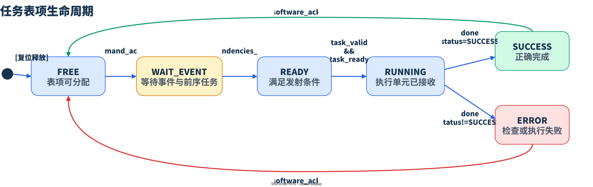

每个任务表项至少保存：

| 字段 | 位宽 | 说明 |
| --- | ---: | --- |
| `state` | 4 | FREE、WAIT_EVENT、READY、RUNNING、SUCCESS 或 ERROR |
| `command_id` | 12 | `{2'b00,CMD[121:112]}` |
| `engine` | 4 | 目标执行单元 |
| `opcode` | 8 | 展开后的执行单元 opcode |
| `header_flags` | 12 | IRQ、严格数值检查、顺序标志和超时类别 |
| `wait0`、`wait1` | 各 12 | `{generation,event_id}` 或 `12'hfff` |
| `signal` | 12 | `{generation,event_id}` 或 `12'hfff`；接收检查失败的任务也保留握手周期已经处理的引用，但不会修改或发布对应 Event |
| `submit_seq` | 64 | 全局提交顺序号 |
| `predecessor_mask` | `TASK_SLOTS`，顶层默认 8 | `task_predecessor_mask_q`；每个 bit 对应一个任务槽，1 表示本任务仍需等待该槽中的较早任务 |
| `cmd` | 128 | 接收的完整指令，硬件中保存为 `task_cmd_q` |
| `input_base`、`weight_base`、`work_base`、`output_base`、`kv_base` | 各 48 | 命令提交时五个 LSC 基地址寄存器的快照，分别对应 `task_input_base_q`、`task_weight_base_q`、`task_work_base_q`、`task_output_base_q` 和 `task_kv_base_q` |
| `param_l1_base` | 20 | 命令提交时 L1 参数区基址的快照，对应 `task_param_l1_base_q` |
| `status` | 8 | 当前或终态状态码 |
| `fault_addr` | 48 | 第一个任务错误地址 |
| `progress` | 64 | 执行单元报告的进度 |
| `error_info` | 32 | 错误阶段、状态和 opcode |
| `done_flags` | 16 | 完成附加标志 |
| `notify` | 1 | 终态通知尚未被下游接收 |
| `event_published` | 1 | 本任务所需的普通 signal Event 已写入 Event Table；无 signal、接收检查失败或 `EVENT_REARM` 任务在建立任务表项时直接置 1 |

`error_info[31:0]` 的现有格式为：`[31:28]` 保存阶段，`[27:24]` 固定为 0，`[23:16]` 保存任务 status，`[15:8]` 固定为 `8'hff`，`[7:0]` 保存展开 opcode。阶段 4 表示执行或 Control 处理，阶段 5 表示 abort，阶段 6 表示调度器检查。

命令接纳寄存级位于 CFE 接口和任务表之间，不是新的软件可见任务状态。它有效时，`task_occupancy_o` 已把该命令计为一项，但 AXI QUERY 尚不能从任务表读取它；CFE 的重复编号查询则必须把它视为 busy。接纳项在下一周期写入任务表后，任务状态按以下次序变化：

任务表不保存 `desc_flat[2047:0]`。Control 任务不经过外部执行单元，满足等待和顺序条件后由 TS 内部完成。静态字段或事件资源检查失败时，命令仍建立一项 ERROR 终态记录，`status=BAD_DESC`，并产生完成通知；它不会发给任何执行单元。该记录可以保留接收时形成的 signal 引用，但 `event_published=1`，Event Table 保持不变。

TS 在接收一条合法任务时生成 `predecessor_mask`，不再为每个等待任务反复比较两项 64-bit `submit_seq`。若新任务设置 `ordered=1`，掩码记录当时全部非 FREE 且未进入终态的较早任务。每条后续合法任务也记录当时仍未进入终态的较早 ordered 任务，因此不能越过这些任务。`GLOBAL_FENCE` 还会按照第 6.7.1 节的 `engine_mask`，记录被选执行单元中仍未进入终态的较早任务；它和其他合法任务一样，也要等待较早的 ordered 任务。

`task_live_mask` 的每个 bit 表示对应槽当前为非 FREE 且非终态。`order_blocked` 直接由 `predecessor_mask & task_live_mask` 的结果是否非零得到。较早任务进入 SUCCESS 或 ERROR 后，其 bit 立即不再产生阻塞。软件直接 ACK 或通过 AXI ACK 释放槽时，`released_slots_d` 在释放当拍生效，`released_slots_q` 在下一拍继续保留该信息；两者共同从全部任务保存的 `predecessor_mask` 中删除被释放槽的 bit，并在新任务写入时做相同过滤，避免槽号立即复用后恢复旧等待关系。WAIT_EVENT 检查结果除保存槽号外还保存检查时的 `submit_seq`；应用结果前同时复查状态和提交序号，因此旧槽已经 ACK 并被新任务复用时，先前保存的检查结果不能修改新任务。静态检查失败的任务仍保存接纳时取得的掩码，但任务直接进入 ERROR，因此不参加调度。abort 会清除全部前序任务掩码和待应用的 WAIT_EVENT 检查结果。GLOBAL_FENCE 在等待条件满足后返回 `SUCCESS`，不复制较早任务的失败状态。软件经 AXI 控制端口发出的 FENCE 不同：它保存请求开始时所选任务的快照，并返回其中提交顺序最早的失败状态。

### 8.5 Event Table

每个 Event Table 表项保存：

| 字段 | 位宽 | 说明 |
| --- | ---: | --- |
| `state` | 3 | FREE、PENDING、SUCCESS 或 ERROR |
| `generation` | 4 | 当前代次，按模 16 增加 |
| `producer_command_id` | 12 | 产生该事件的内部任务编号 |

CMD 中的 Event ID 为 8 bit，0～254有效，`8'hff` 表示不用。TS 接收命令时读取表项当前 generation，并形成内部 12-bit 引用 `{generation,event_id}`；命令进入任务表后，Event Table generation 的改变不会修改已经保存的引用。

事件处理规则如下：

1. `wait0` 或 `wait1` 为 `8'hff` 时，该输入已经满足；
2. 等待事件必须不是 FREE，否则命令以 `BAD_DESC` 结束；
3. 普通任务和 `EVENT_JOIN(join_mode=0)` 在两个有效等待事件都为 SUCCESS 后满足事件依赖条件；此时前序任务位图按位与结果为 0 才进入 READY，否则继续处于 WAIT_EVENT。任一有效等待事件为 ERROR 时以 `DEPENDENCY_FAILED` 结束；
4. `EVENT_JOIN(join_mode=1)` 在任一等待事件为 SUCCESS 后满足事件依赖条件；此时前序任务位图按位与结果为 0 才进入 READY。两个有效等待事件都为 ERROR 时以 `DEPENDENCY_FAILED` 结束；一个失败而另一个仍为 PENDING 时继续等待；
5. 通过接收检查的普通任务，其 `signal` 必须指向 FREE 表项，任务表提交时将其置为 PENDING并保存发信任务编号；接收检查失败的任务不修改 Event Table，即使其任务记录中的 `signal` 不是 `12'hfff` 也不例外；
6. 普通任务形成完整终态记录后先置位 `notify`。带有效 signal、尚未发布并且不在发布暂存中的任务进入 Event 发布候选位图；`EVENT_REARM` 和 `EVENT_REARM_RANGE` 不进入该位图；
7. Event 发布选择与 Control、完成通知共用任务槽计数器。扫描轮开始时保存 Event 发布候选位图，之后每周期检查一个槽，并单独保存 `submit_seq` 最小的 Event 候选；
8. 最后一个槽检查结束时，如果当前 Event 候选位图与本轮保存值不同，则本轮不产生 Event 选择脉冲，下一轮重新检查。如果位图未变，则再次检查获胜任务仍符合要求且 `submit_seq` 未变，检查通过后把任务表项编号写入 `event_publish_pending_slot_q`；
9. `event_publish_pending_valid_q=1` 的周期，TS 根据该任务的 status 把 signal Event 写为 SUCCESS 或 ERROR，并置位对应的 `task_event_published_q`。同一周期若得到新的 Event 选择脉冲，可用新槽号继续保持发布暂存有效；
10. 多个任务等待发布时，Event 按 `submit_seq` 从小到大依次可见。每个扫描轮最多选择一个普通任务的终态 Event；候选变化引起重试时，该轮不选择 Event；
11. 每个普通任务的 signal Event 只写入一次。已经位于发布暂存中的任务不会再次成为候选，`task_event_published_q=1` 的任务也不会再次写入；
12. `EVENT_REARM` 只接受已经终止且没有活动等待者的事件，把 generation 加 1 并把状态恢复为 FREE。该操作由 Control 处理逻辑直接修改 Event Table，不经过普通任务的发布暂存；
13. 逐槽选择器只把 EVENT_REARM 候选的槽号和 `submit_seq` 保存到 Control 执行快照。下一周期复查通过后才修改 Event Table；该周期 `cfe_cmd_ready_o=0`，因此新命令不能在 generation 改变的同一时钟沿取得旧事件引用。已经位于命令接纳寄存级的有效命令若等待该事件，本次 EVENT_REARM 返回 `BAD_DESC`，事件保持原代次。修改成功后的下一周期恢复 CFE 接纳，新命令将读取新的 generation。
14. `EVENT_REARM_RANGE` 只用于从 0 开始稠密分配的静态事件池。同步读端口连续读取 0～末 ID，窄响应流水逐项检查终态和活动等待者，共用写口逐项写回下一 generation；读写流水稳定后每周期回收一个事件。任一表项不满足条件时任务报错，Sequencer 屏障阻止后继命令观察部分更新后的池。

TS 通过扫描非 FREE 且未终止的任务表项判断一个事件是否仍有活动等待者，不设置独立 waiter 计数器。

WAIT_EVENT 检查与 Event 发布选择使用不同的逐槽计数器。前者每周期对当前任务槽的两个事件引用各读取一个 Event Table 表项，并把分类结果寄存；后者负责从待发布任务中选择最早项。若发布暂存在当前周期给某个事件写入终态，前者对相同事件引用优先使用待写入状态。这样既保留同周期可见性，也把 Event Table 读取、事件分类与任务状态写控制分到相邻时钟周期。

> [!note] Event 可见时间
> 执行单元的 done 握手只表示 TS 已经取得终态数据。带普通 signal Event 的任务还要等待逐槽选择轮结束，再经过发布暂存写入 Event Table。任务在扫描轮中途成为候选时，候选位图变化会使该轮重试，因此不能把 done 到 Event 可见之间的时间假定为固定两拍。若较早提交的多个任务同时等待发布，后提交任务还要等待前面的 Event 逐项写入。依赖该 Event 的任务和 AXI `CTL WAIT` 都以 Event Table 中实际可见的状态为准。

### 8.6 任务类别与完成接口

TaskScheduler 使用 DMA、Matrix、Vector 和 Complex 四类任务接口。它们不对应四个物理执行模块：DMA 连接 DMA / Layout Engine，Complex 连接 CME，Matrix 与 Vector 都连接 矩阵向量执行单元。Matrix 与 Vector 仍使用不同的接口前缀、发射暂存、active 记录和完成握手。下表中的前缀分别替换为 `dma`、`matrix`、`vector` 或 `complex`。

| 信号 | TS 方向 | 位宽 | 说明 |
| --- | --- | ---: | --- |
| `<eng>_task_valid_o` | Output | 1 | TS 提供一项任务 |
| `<eng>_task_ready_i` | Input | 1 | 执行单元可以接收 |
| `<eng>_task_opcode_o` | Output | 8 | 展开后的执行单元 opcode |
| `<eng>_task_command_id_o` | Output | 12 | 零扩展后的命令编号 |
| `<eng>_task_desc_flat_o` | Output | 2048 | 对应执行单元发射暂存中的 Task Context |
| `<eng>_done_valid_i` | Input | 1 | 执行单元完成结果有效 |
| `<eng>_done_ready_o` | Output | 1 | TS 可以接收完成结果 |
| `<eng>_done_command_id_i` | Input | 12 | 完成任务编号；Matrix 由 矩阵任务控制器返回当前任务保存的编号，其他执行单元由其活动任务记录提供 |
| `<eng>_done_status_i` | Input | 8 | 第 4.3 节状态 |
| `<eng>_done_fault_addr_i` | Input | 48 | 第一个错误地址，无错误时为 0 |
| `<eng>_done_progress_i` | Input | 64 | 已完成字节数或元素数 |

DMA、Matrix、Vector 和 Complex 同时最多各有一个 RUNNING 任务。TS 为四类任务分别设置 `*_dispatch_valid_q`、`*_dispatch_slot_q`、`*_dispatch_opcode_q`、`*_dispatch_command_id_q` 和 `*_dispatch_desc_q`，并为 Matrix 设置一项活动任务记录。READY 任务经过 8 周期逐槽扫描；最后一个槽完成检查时，`submit_seq` 最小且仍可发射的候选写入 `decode_pending_*` 窄快照。下一拍共享解码器产生 Task Context；若目标任务接口仍可发射，则在拍末写入对应发射暂存，随后 `<eng>_task_valid_o` 才为 1。任务 valid 等待 ready 时，对应暂存保持 opcode、command ID和 Task Context 不变。

四组发射暂存相互独立。某个执行单元令 `task_ready=0` 时，只会使该单元的暂存保持有效并阻止新的同类任务取得选择条件；其他暂存仍可保持或完成握手，其他执行单元也可继续运行。共享解码器每次只能向一组暂存写入新的 Task Context，因此“暂存可独立握手”和“任务展开按次序进行”是两个不同的控制层次。

TS 接受 done 时检查 command ID 和 status。DMA、Matrix、Vector 和 Complex 的编号必须与各自唯一活动任务相同。编号不匹配时，TS 接收完成消息以免阻塞执行单元，同时置起协议错误，但不释放活动任务记录，也不修改无关任务。合法 `SUCCESS` 进入 SUCCESS，其余合法状态进入 ERROR。TS 同时保存 fault address 和 progress，清除匹配的活动状态并置位终态通知。

Matrix 完成与新 Matrix 任务接收可以发生在同一周期。只有完成编号与唯一活动任务正确匹配时，活动记录才可在同周期释放并接受下一项 Matrix 任务。

### 8.7 完成通知、查询和 ACK

TS 通过以下接口向 LSC 发送完整终态通知：

| 信号 | TS 方向 | 位宽 | 说明 |
| --- | --- | ---: | --- |
| `completion_valid_o` | Output | 1 | 当前终态通知有效 |
| `completion_ready_i` | Input | 1 | LSC 可以接收 |
| `completion_command_id_o` | Output | 12 | 内部任务编号 |
| `completion_engine_o` | Output | 4 | 任务执行单元 |
| `completion_opcode_o` | Output | 8 | 展开 opcode |
| `completion_status_o` | Output | 8 | 终态状态 |
| `completion_fault_addr_o` | Output | 48 | 第一个错误地址 |
| `completion_progress_o` | Output | 64 | 执行进度 |
| `completion_irq_success_o` | Output | 1 | CMD 请求成功中断且任务成功 |
| `completion_irq_error_o` | Output | 1 | CMD 请求失败中断且任务失败 |

完成通知使用 `completion_hold_valid_q` 和 `completion_hold_slot_q` 保存当前通知的任务表项编号。所有 `notify=1` 的任务组成完成候选位图。完成选择与 Event 发布、Control 共用任务槽计数器，但拥有自己的候选位图快照、变化标志、最早候选槽号和 `submit_seq`。最后一个槽检查结束时，只有本轮完成候选位图未变化、获胜任务仍为候选并且 `submit_seq` 一致，才产生完成选择脉冲。候选位图发生变化时，本轮不产生该脉冲，下一轮重新检查。

持有槽为空且完成选择脉冲有效时，只有最早候选任务的 `task_event_published_q=1`，TS 才把其编号装入持有槽。这样，带普通 signal Event 的任务一定先让 Event Table 状态可见，随后才可以向 LSC 发送完成通知。无 signal、接收检查失败和 `EVENT_REARM` 任务不需要等待普通 Event 发布步骤。

`completion_valid_o` 直接取自持有槽 valid，所有完成字段都用持有槽中的任务表项编号读取。`completion_valid_o=1` 且 `completion_ready_i=0` 时，持有槽编号和全部完成字段保持不变，即使这段时间出现了更早或更晚的其他终态任务，也不能替换当前通知。握手时，TS 清除持有槽 valid 和对应表项的 `notify`；握手不释放任务编号，软件 ACK 后表项才回到 FREE。

如果多个任务同时形成终态，普通 Event 发布选择和完成通知选择都按 `submit_seq` 从小到大处理。完成选择先考察最早的 `notify` 项；该项的 Event 尚未发布时，不会绕过它发送后提交任务的完成通知。扫描期间新增或移除候选时，对应类别等待下一轮重新选择，避免扫描起始阶段遗漏刚出现的更早任务。

TS 还提供组合查询和 ACK 端口：

| 信号组 | 说明 |
| --- | --- |
| `event_query_valid_i`、`event_query_ref_i[11:0]` | 查询一个内部 Event 引用 |
| `event_query_found_o`、`event_query_state_o[2:0]`、`event_query_producer_command_id_o[11:0]` | Event 查询结果 |
| `task_query_valid_i`、`task_query_command_id_i[11:0]` | 查询一个任务编号 |
| `task_query_found_o`、`task_query_state_o[3:0]`、`task_query_status_o[7:0]` | 任务存在、软件可见状态和状态码 |
| `task_query_fault_addr_o[47:0]`、`task_query_progress_o[63:0]` | 错误地址和进度 |
| `task_query_user_tag_o[31:0]` | 现有 硬件 名称；指令没有独立 user tag，该字段返回 `task_cmd_q[121:112]` 的零扩展值 |
| `task_query_signal_event_o[11:0]`、`task_query_error_info_o[31:0]`、`task_query_done_flags_o[15:0]` | 事件引用和诊断信息 |
| `task_ack_valid_i`、`task_ack_command_id_i[11:0]`、`task_ack_ready_o` | ACK 一个已经终止且通知已送出的任务 |

顶层把直接 `task_query_*` 和 `task_ack_*` 请求输入固定为 0，软件查询由下一节的 AXI控制寄存器完成。

### 8.8 AXI Slave控制请求

AXI Slave Frontend 通过 `axi_ctl_*` 向 TS 发出同步管理请求。该接口只属于 NPU AXI Slave寄存器访问，不属于处理器内部端口。

| 信号 | TS 方向 | 位宽 | 说明 |
| --- | --- | ---: | --- |
| `axi_ctl_valid_i` | Input | 1 | 控制请求有效 |
| `axi_ctl_ready_o` | Output | 1 | TS 可以接收一项控制请求 |
| `axi_ctl_op_i` | Input | 2 | `1=WAIT`、`2=QUERY`、`3=FENCE` |
| `axi_ctl_arg0_i` | Input | 64 | 第一参数 |
| `axi_ctl_arg1_i` | Input | 64 | 第二参数 |
| `axi_ctl_cancel_i` | Input | 1 | 取消已经接受的 WAIT 或 FENCE |
| `axi_ctl_rsp_valid_o` | Output | 1 | 控制结果有效 |
| `axi_ctl_rsp_ready_i` | Input | 1 | AXI Slave Frontend 可以接收结果 |
| `axi_ctl_rsp_data_o` | Output | 64 | 控制结果 |

`axi_ctl_ready_o` 只在没有活动控制请求、没有等待接收的控制响应并且命令接纳寄存级为空时为 1。命令已经位于接纳寄存级时，WAIT、QUERY 和 FENCE 都要等该命令写入任务表后再握手。这样，控制请求读取的任务状态与 FENCE 保存的目标集合都来自已经完成任务表写入的项目。

AXI Slave寄存器地址如下：

| 相对地址 | 名称 | 访问 | 作用 |
| ---: | --- | --- | --- |
| `0x0002_0020` | `CTL_ARG0` | RW | 保存 `arg0` |
| `0x0002_0028` | `CTL_ARG1` | RW | 保存 `arg1` |
| `0x0002_0030` | `CTL_START` | WO | bit `[1:0]` 写入非零操作码并启动请求 |
| `0x0002_0038` | `CTL_STAT` | RO | bit 0 为 busy，bit 1 为 done，bit `[15:8]` 为前端状态 |
| `0x0002_0040` | `CTL_RESULT` | RO | 最近一项控制结果 |
| `0x0002_0048` | `CTL_CANCEL` | WO | 写 1 取消 WAIT 或 FENCE |

同一时刻最多有一项控制请求。WAIT 的 `arg0[7:0]` 是 Event ID，`arg0[63:8]` 必须为 0，`arg1[31:0]` 是最大等待周期；TS 在接受 WAIT 时读取该 Event 的当前 generation，并把 `{generation,event_id}` 保存到控制请求状态中，因此事件随后经过 REARM 后不会被一次较早的 WAIT 错认。WAIT 只读取 Event Table，任务 done 到 Event 发布之间的暂存周期以及前面其他 Event 的排队周期都计入最大等待周期；设置超时值时必须包含这段时间。QUERY 的 `arg0[9:0]` 是命令编号，`arg0[63:10]` 必须为 0，`arg1[2:0]` 是 selector；FENCE 的 `arg0[3:0]` 是 Engine mask，`arg1[31:0]` 是最大等待周期。异步任务顺序控制使用第 6 章的 `GLOBAL_FENCE` 指令，AXI FENCE 用于软件发起一次同步管理等待。

TS 接受 FENCE 时按 Engine mask 保存每个已占用目标槽的有效 bit、`submit_seq`、是否已经终止以及已终止任务的 status。扫描器从槽 0 开始，每周期读取一个槽：

1. 请求开始时已经终止的目标使用保存的 status，不再依赖任务表中的当前内容；
2. 请求开始时尚未终止的目标同时比较槽状态和保存的 `submit_seq`，任务进入终态后读取当前 status；
3. 目标尚未终止时保留其有效 bit，下一轮再次检查；目标在本轮已经检查过以后才完成时，将在下一轮检查到；
4. 目标终止后清除其有效 bit；所有 bit 清零时返回已保存结果；
5. 多个目标失败时，每周期只比较当前目标与已保存失败任务的 `submit_seq`，最终返回提交时间最早的失败 status。

FENCE 扫描期间，直接任务 ACK 对尚未检查完成的目标槽返回未就绪，防止任务完成后被释放并由新任务复用。扫描器读取终态结果并清除该目标 bit 后，直接 ACK 才能继续。若 FENCE 接收与一个终态任务的直接 ACK 发生在同一时钟沿，请求接收阶段保存的终态标志、status 和 `submit_seq` 仍可供后续扫描使用，因此不会漏掉该任务。AXI QUERY selector 4 与 AXI FENCE 不能同时被接受，因为控制端一次只保存一项请求，并且上一项响应被接收以前 `axi_ctl_ready_o` 保持为 0。

命令接纳和控制请求在同一时钟沿出现时遵循以下规则：

1. 若上一周期命令接纳寄存级已经有效，`axi_ctl_ready_o=0`，因此 FENCE 或 QUERY 不能与任务表提交发生在同一时钟沿；
2. 若命令接纳寄存级原本为空，CFE 完整命令和 AXI 控制请求可以在同一时钟沿分别完成握手。该控制请求读取的是该时钟沿到来前的任务表；同一时钟沿刚由 CFE 保存到命令接纳寄存级的命令不属于本次 FENCE 目标，QUERY 也不会把它当成已经建立的任务；
3. 时钟沿之后，接纳项立即计入 `task_occupancy_o`，其 `command_id` 立即参与 CFE 编号查询。下一周期控制请求暂停，接纳项写入任务表后才允许后续控制请求；
4. CFE 本地 FIFO 在出队时钟沿到来前仍保存即将被 TS 接纳的命令。若 CFE 同时检查另一条相同编号的命令，本地 FIFO 检查会报告重复；若查询发生在接纳项已经有效的周期，TS 的编号查询会报告 busy。两项检查共同覆盖同一时钟沿的 FIFO 出队和后续接纳周期。

> [!example] FENCE 与新命令同时到达
> 设任务表中已有 DMA 任务 A，CFE 队首为 DMA 任务 B，软件同一时刻启动选择 DMA 的 AXI FENCE。若 B 与 FENCE 在时钟沿 \(t_0\) 同时握手，FENCE 只保存 A；B 在 \(t_0\) 后位于命令接纳寄存级，在 \(t_1\) 写入任务表。该 FENCE 等待 A，不等待 B。若软件希望等待 B，必须先确认 B 的命令接收结果，再发起新的 FENCE。

FENCE 的等待计数包含逐槽检查周期。只要仍有未终止目标，硬件每周期比较等待计数和 `arg1[31:0]`；`arg1=0` 时在第一次检查发现未终止目标便返回 `TIMEOUT`。若当前检查确认最后一个目标已经终止，任务结果优先于 `TIMEOUT`。所有目标终止后不再触发超时，扫描器最多再用 `TASK_SLOTS-1` 个周期读取其余保存结果。`abort_i` 把尚未终止的目标任务改为 `ABORTED`，FENCE 继续扫描并按提交先后选择返回状态。`axi_ctl_cancel_i` 结束扫描并清除目标记录，不修改任务。复位清除扫描槽号、目标 bit、保存的终态标志和失败记录。

控制响应有效且 `axi_ctl_rsp_ready_i=0` 时，TS 保持 `axi_ctl_rsp_valid_o` 与 `axi_ctl_rsp_data_o` 不变，同时拉低 `axi_ctl_ready_o`。因此等待软件接收的 QUERY 结果不会被后来的 FENCE 请求改写。

QUERY selector 定义如下：

| Selector | `CTL_RESULT` |
| ---: | --- |
| 0 | bit `[3:0]` 为软件任务状态，`[11:4]` 为 status，`[23:12]` 为命令编号 |
| 1 | bit `[31:0]` 为任务表中完整指令的零扩展命令编号，`[43:32]` 为 signal Event 引用 |
| 2 | bit `[47:0]` 为第一个错误地址 |
| 3 | bit `[63:0]` 为 progress |
| 4 | ACK 结果：0 表示释放成功，1 表示任务未终止或通知未送出，2 表示没有该任务 |
| 5 | bit `[31:0]` 为 `error_info` |
| 6 | bit `[15:0]` 为 `done_flags` |
| 7 | 保留，返回 `BAD_DESC` |

QUERY selector 4 只有在任务已经终止且 `notify=0` 时释放任务表项。读取状态、中断清除和其他 selector 均不释放任务编号。WAIT 或 FENCE 取消只结束本次控制请求，不修改任务表、Event Table 或任务执行状态。

### 8.9 调度与完成时序

图中的 `DONE` 表示任务以 `SUCCESS` 状态完成并等待软件确认，不表示任务表项已经释放；收到 `ACK` 后，任务才进入 `FREE`。

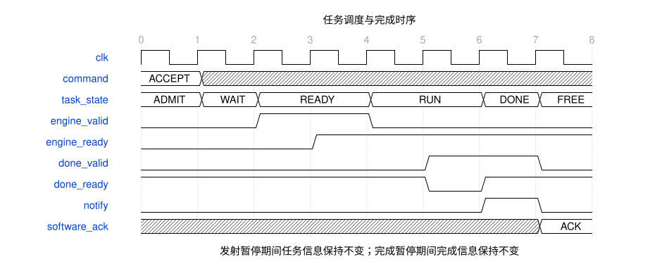

命令握手周期内，接收检查解码器组合产生 engine、opcode 和 `valid`，Event 逻辑形成内部事件引用与 `predecessor_mask`。第一个时钟沿只把这些结果、目标 FREE 槽、完整指令和基地址保存到命令接纳寄存级；第二个时钟沿才用保存值写任务表并分配 `submit_seq`。保存值写入任务表前会删除 `released_slots_q | released_slots_d` 指出的槽 bit。静态检查失败的任务直接建立 ERROR 终态，仍可保存接纳时取得的掩码，但终态任务不参加调度；合法任务先进入 WAIT_EVENT。独立检查器每周期读取一个槽和两个 Event Table 表项，时钟沿保存检查结果、槽号与 `submit_seq`；下一周期复查任务身份后，依赖失败的任务进入 ERROR，依赖成功且 `predecessor_mask & task_live_mask` 为 0 的任务进入 READY。该阶段不把 2048 bit 展开结果写入任务表。

没有待展开快照时，TS 启动或继续逐槽扫描。任务表包含 `TASK_SLOTS` 项，顶层配置为 8；扫描器每周期检查一项。候选必须为非 Control 的 READY 任务、前序任务条件已满足、发射暂存为空，并且目标执行单元存在接收容量。每个执行单元均只有一项 active 容量。扫描保存 `submit_seq` 最小的候选，并在最后一个槽完成检查时复查获胜项。复查通过后，时钟沿保存窄快照；没有候选时不写快照。

共享发射解码器在窄快照有效的周期组合产生 Task Context。TS 写入发射暂存前再次检查任务仍为 READY、执行单元字段一致且前序任务条件仍满足；检查失败时清除该快照，目标执行单元暂时不可接收新任务时则保持快照。写入暂存后任务接口置 `valid`。ready/valid 握手后，TS 记录暂存中的任务表项编号并把任务置为 RUNNING。某一发射暂存因 `ready=0` 保持时，不妨碍其他执行单元继续运行或完成已有暂存的任务握手，但新的 Task Context 仍由共享解码器依次生成。

Control 执行、普通 signal Event 发布和完成通知共用一组连续逐槽选择寄存器。每轮开始分别保存三类候选位图，在 `TASK_SLOTS` 个周期内对同一槽并行完成三类候选比较，并分别保留最小 `submit_seq`；顶层配置一轮为 8 个周期。轮末分别复查候选位图、获胜项和提交序号；某一类位图发生变化时只取消该类选择脉冲，下一轮重新检查。三类选择因此保持相互独立，但不再各自形成一次覆盖全部任务槽的组合比较。Control 获胜项还要先写入由槽号和 `submit_seq` 组成的执行快照，下一周期复查 READY 状态、执行单元类型、提交序号与前序任务条件后才更新 Control 任务和 Event 状态。快照有效周期暂停 CFE 命令接纳，避免 EVENT_REARM 和新等待者同时读取、修改同一 Event generation。

执行单元完成接口握手后，TS 保存 status、fault address和 progress，并把匹配任务记录为终态。Matrix 按返回的 `command_id` 匹配唯一活动任务。普通 signal Event 在共享扫描轮末获得选择脉冲后先写入发布暂存，下一周期才更新 Event Table；每轮最多选择一个待发布 Event。对应 `event_published` 置位后，最早的完成候选才可以进入完成持有槽。持有槽等待 LSC ready 时保持全部完成字段不变。软件读取需要的信息并完成 ACK 后，任务表项和 `command_id` 才能复用。

### 8.10 停止、复位与错误处理

- `quiesce_i=1` 阻止 TS 接收新的完整指令，不取消已保存任务；
- `abort_i=1` 丢弃尚未写入任务表的命令接纳项，把所有非终态任务改为 `ABORTED`，清零错误地址和 progress，并设置 `done_flags[2]`；同时清除 WAIT_EVENT 检查结果、Control 执行快照、四组发射暂存的 valid、待展开快照、发射扫描状态、Control/Event/完成共用扫描器、完成持有槽、Event 发布暂存、AXI 控制请求及其待接收响应，以及全部 `predecessor_mask`。这些终态记录随后由功能复位直接清除，不要求先发送完成通知或由软件 ACK。该输入不直接清除各执行单元的活动任务记录；已有执行任务返回 done 时清除对应记录，功能复位则清除全部活动记录；
- `reset_n` 低电平异步使复位状态生效，系统在 Core 时钟域同步释放复位；
- 复位把任务表全部置为 FREE，把每项 `predecessor_mask` 清零，把 Event Table 置为 `FREE,generation=0`，并把提交序号清零；
- 复位清除命令接纳 valid、WAIT_EVENT 检查结果 valid、Control 执行快照 valid、四类活动任务记录和发射暂存 valid，清除 `decode_pending_valid_q`、`decode_scan_active_q`、`decode_scan_best_valid_q`、`completion_hold_valid_q`、`event_publish_pending_valid_q`、查询响应与控制请求；WAIT_EVENT 检查槽号、发射扫描槽号、Control/Event/完成共用扫描槽号、三类候选位图、变化标志、候选槽号和候选提交序号恢复为 0；AXI FENCE 的扫描槽号、目标 bit、任务序号副本、终态副本和失败记录同时清零；
- 任一执行单元返回错误编号或未定义 status 时，TS 使用 `BAD_DESC` 形成稳定终态，不用错误字段访问其他任务表项；
- `scheduler_idle_o` 只有在命令接纳项无效、任务表占用数为 0 且四类任务均无 active记录时为 1；等待 ACK 的终态任务会使其保持为 0；
- `scheduler_quiescent_o` 检查命令接纳、WAIT_EVENT 任务、待解码快照、逐槽发射、四组发射暂存、四类活动任务、Control 执行快照、Event 发布暂存、完成持有槽以及 AXI 控制请求和响应。任一任务仍为 WAIT_EVENT 时该信号保持 0；它不检查任务表占用数，因此只留下等待 ACK 的终态项时可以为 1；
- 内联解码不得访问 NPU `m_axi_*`；只有实际 DMA任务可通过 MIF访问全局数据。

复位会清零任务状态、任务编号、执行单元、操作码、事件引用、`submit_seq`、`predecessor_mask`、状态记录和通知控制字段。命令接纳项和 Control 执行快照的数据字段不要求清零，只需清除对应 valid；任务表中的 128 bit 指令和基地址快照、`decode_pending_*` 数据字段、四组 2048 bit 发射数据、完成持有槽编号或 Event 发布暂存编号也不要求清零。任务状态以及各级 valid 已经把这些内容标为无效；重新使用前，硬件 会由新任务完整覆盖。这样可以减少宽数据寄存器的复位开销，同时保持复位后的所有任务请求 valid 为 0。

---

## 9. DMA / Layout Engine

### 9.1 模块组成与功能

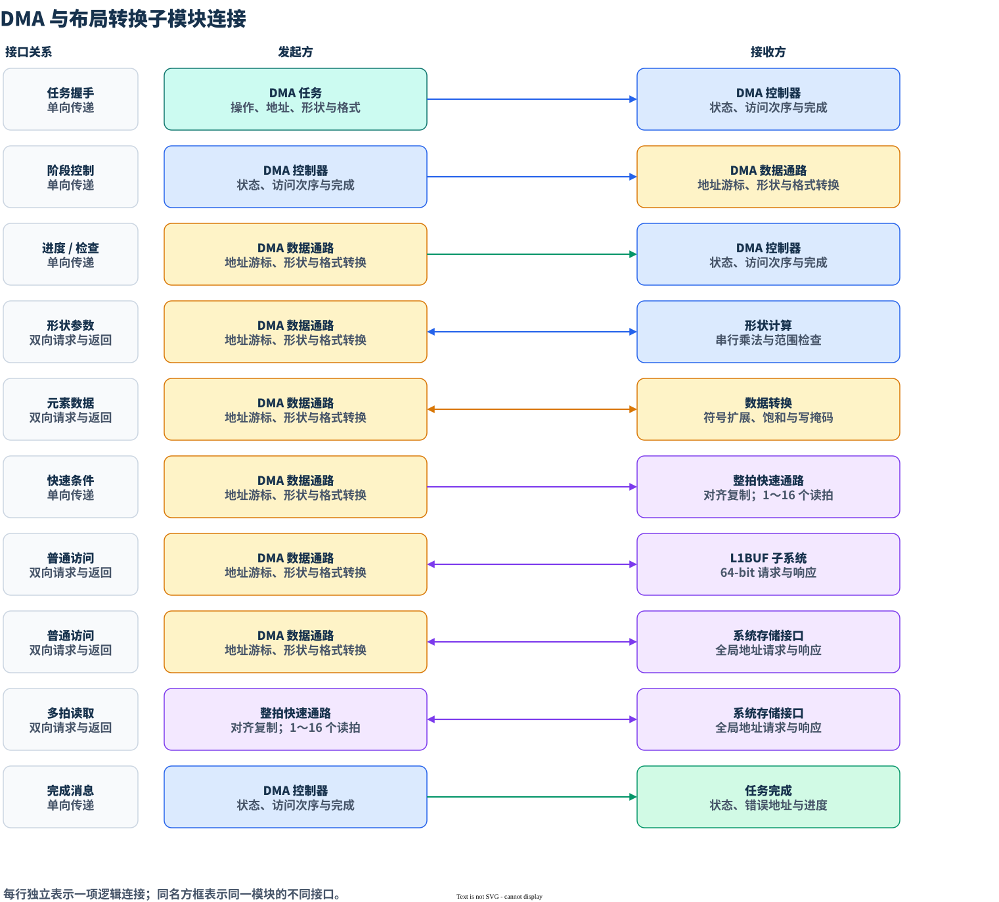

DMA 与布局转换单元是 DMA 的顶层集成模块，外部端口保持 TaskScheduler、L1BUF 和 MIF 的既有定义。DMA 控制器保存任务状态，检查 Task Context，并发射或接收 L1BUF、MIF 事务；DMA 数据通路保存形状计算寄存器、地址游标、快速传输计数、类型转换数据、RMW beat 和进度计数。顶层在两者之间传递状态、操作脉冲、当前地址、检查结果和写数据。

DMA / Layout Engine 在 L1BUF 与全局存储之间搬运数据，也可以在 L1BUF 内或全局存储内复制数据。模块包含 Task Context 锁存器、字段检查器、元素地址生成器、整数格式转换器、二维转置地址生成器、PACK/SPLIT 地址生成器、对齐整 beat 快速复制单元、L1BUF 请求端口、MIF 请求端口、错误记录和进度计数器。

DMA 一次执行一条任务。普通路径一次处理一个元素，完成“源读取、可选格式转换、目的写入”后才处理下一个元素。对齐整 beat 快速路径一次处理一个或多个 64-bit beat，省去逐元素选择与合并。多 beat AXI 读只用于 GADDR→L1BUF；L1BUF→GADDR、L1BUF→L1BUF 和 GADDR→GADDR 的快速复制每次仍处理一个 beat。MIF 同时保留一个 AXI 事务，DMA 用 `fast_beats_remaining_q` 跟踪已经发出的多 beat 读。

快速路径必须同时满足：

- 操作为 `DMA_COPY_1D` 或 `DMA_COPY_ND`；
- `convert_mode=0`，且源、目的 dtype 相同；
- 源、目的当前地址均按 8B 对齐；
- 当前内层至少剩余一个完整 beat 的元素；
- 源、目的当前区域都至少剩余 8B。

一个 64-bit beat 可保存 8 个 INT8、4 个 INT16 或 2 个 INT32 元素。GADDR→L1BUF 的本次读 beat 数取以下四者的最小值：当前内层剩余的完整 beat 数、源和目的区域剩余的完整 beat 数、`burst_beats_minus1+1`，以及从当前 AXI 地址到本 4KiB 段末尾可容纳的完整 beat 数。

地址生成使用递增游标，不在每个元素上重新求多维线性编号。DMA 保存五个维度的 `index_q`、源和目的外层累计偏移、内层起点、当前源地址和当前目的地址。连续内层元素按数据格式对应的元素字节数递增。外层维度通过 stride 增加起点，在某一维结束时减去该维已经累计的偏移，再继续处理更外层维度。

任务开始时，DMA 还要检查 shape 各维乘积。该检查采用 128×32 bit 串行乘法：每个维度先装入 32-bit shape，随后每周期根据乘数最低位选择是否执行一次 128-bit 加法，并把乘数右移、被乘数左移。一个维度固定处理 32 个乘法位，因此不会在组合数据通路中串接多个宽乘法器。PACK 和 SPLIT 使用段计数，不进入 shape 乘法状态。

DMA 不执行带 scale 的数值调整。若两个张量的实数单位不同，编译器应安排 Integer Vector Engine 或 Complex Math Engine 处理。DMA 的格式转换规则只有以下几类：

- 位宽相同：保持整数值；
- 目的位宽更大：执行符号扩展；
- 目的位宽更小：执行饱和处理。

> [!note] “搬运”不等于简单复制字节
> 例如 INT8 数值 `-3` 的存储字节是 `0xfd`。把它搬到 INT16 时，DMA 先按 INT8 解释为有符号整数 `-3`，再写成 INT16 二进制补码 `0xfffd`，低地址保存 `0xfd`，下一地址保存 `0xff`。只有源、目的 dtype 相同时，搬运结果才与逐字节复制相同。

### 9.2 模块级信号

下表规定 DMA 与布局转换单元的端口。TaskScheduler 把内联解码得到的 Task Context 连同内部操作码交给 DMA；DMA 的完成信息由 TaskScheduler 补上 `command_id` 后写入任务表。

| 信号 | DMA 方向 | 位宽 | 说明 |
| --- | --- | ---: | --- |
| `clk_i` | Input | 1 | 计算域时钟 |
| `reset_n` | Input | 1 | 低有效异步进入复位；系统在计算时钟域同步释放 |
| `task_valid_i` | Input | 1 | 当前任务有效 |
| `task_ready_o` | Output | 1 | DMA 处于 `ST_IDLE`，可接收任务 |
| `opcode_i` | Input | 8 | 内部 DMA 操作码 `0x20～0x25` |
| `command_id_i` | Input | 12 | 低 10 bit 来自指令，高 2 bit 为 0 |
| `desc_i` | Input | 2048 | 片上生成的 Task Context，不是软件提供的内存对象 |
| `done_valid_o` | Output | 1 | 完成状态有效 |
| `done_ready_i` | Input | 1 | TaskScheduler 可接收完成状态 |
| `done_status_o` | Output | 8 | 统一任务状态 |
| `done_fault_addr_o` | Output | 48 | 第一个失败地址；无地址错误时为 0 |
| `done_progress_o` | Output | 64 | 已得到目的端写完成响应的数据量 |

L1BUF 请求与响应端口如下：

| 信号 | DMA 方向 | 位宽 | 说明 |
| --- | --- | ---: | --- |
| `l1_req_valid_o` | Output | 1 | L1BUF 请求有效 |
| `l1_req_ready_i` | Input | 1 | L1BUF Controller 可接收请求 |
| `l1_req_write_o` | Output | 1 | 0 为读，1 为写 |
| `l1_req_addr_o` | Output | 20 | 8B 对齐的 L1BUF 字节地址 |
| `l1_req_wdata_o` | Output | 64 | 写数据 |
| `l1_req_wstrb_o` | Output | 8 | 每个字节一个写使能位 |
| `l1_rsp_valid_i` | Input | 1 | 读返回或写完成有效 |
| `l1_rsp_ready_o` | Output | 1 | DMA 可接收响应 |
| `l1_rsp_rdata_i` | Input | 64 | 读返回数据 |
| `l1_rsp_status_i` | Input | 3 | L1BUF 访问状态 |

MIF 请求与响应端口如下：

| 信号 | DMA 方向 | 位宽 | 说明 |
| --- | --- | ---: | --- |
| `mif_req_valid_o` | Output | 1 | 全局存储请求有效 |
| `mif_req_ready_i` | Input | 1 | MIF 可接收请求 |
| `mif_req_write_o` | Output | 1 | 0 为读，1 为写 |
| `mif_req_addr_o` | Output | 48 | 8B 对齐的全局物理字节地址；高于 `PA_W-1` 的 bit 为 0 |
| `mif_req_wdata_o` | Output | 64 | 写数据 |
| `mif_req_wstrb_o` | Output | 8 | 每个字节一个写使能位 |
| `mif_req_burst_len_o` | Output | 8 | 读请求的 beat 数减 1；普通请求和全部写请求为 0 |
| `mif_rsp_valid_i` | Input | 1 | 读返回或写完成有效 |
| `mif_rsp_ready_o` | Output | 1 | DMA 可接收响应 |
| `mif_rsp_rdata_i` | Input | 64 | 读返回数据 |
| `mif_rsp_status_i` | Input | 3 | MIF 返回的存储状态 |

所有请求端口都遵守 ready/valid 规则。请求握手后，DMA 必须等待对应响应；响应暂停时，接收方必须保持 `valid`、数据和状态不变。接口没有 tag，因为 DMA 和 MIF 都只保留一个活动事务。多 beat 读的每个返回 beat 都形成一次内部响应，DMA 与 MIF 分别保存剩余 beat 数。

### 9.3 指令展开得到的 DMA Task Context

软件只填写第 6.7.2 节定义的指令位域。TaskScheduler 接收任务时保存指令与提交时基地址快照；DMA READY 任务在逐槽扫描中获胜并通过结束时复查后，共享发射解码器根据操作码、地址引用、该任务的基地址快照和数据格式生成下表中的 Task Context，并写入 DMA 发射暂存。下表规定 DMA 任务接口的内部字段合同；这些字段不属于任务表，也不是软件需要分配的参数结构。

| Byte Offset | 字段 | 位宽 | 说明 |
| ---: | --- | ---: | --- |
| `0x40` | `rank` | 8 | COPY、FILL、PACK、SPLIT 为 1；TRANSPOSE 为 2 |
| `0x41` | `src_space` | 8 | L1BUF 或 GADDR |
| `0x42` | `dst_space` | 8 | L1BUF 或 GADDR |
| `0x43` | `convert_mode` | 8 | 不转换、符号扩展或饱和处理 |
| `0x44` | `burst_beats_minus1` | 8 | 内联解码器固定写 127；GADDR→L1BUF 对齐 COPY 用它限制一次 AXI 读的长度 |
| `0x45` | `max_outstanding` | 8 | 内联解码器固定写 1；允许值为 1～16，数据通路不使用它增加活动事务数 |
| `0x46` | `reserved0` | 8 | 内联解码器写 0；执行单元收到非零值时返回 `BAD_DESC` |
| `0x47` | `reserved1` | 8 | 内联解码器写 0；执行单元收到非零值时返回 `BAD_DESC` |
| `0x48` | `shape[0]` | 32 | 第 0 维元素数 |
| `0x4C` | `shape[1]` | 32 | 第 1 维元素数 |
| `0x50` | `shape[2]` | 32 | 第 2 维元素数 |
| `0x54` | `shape[3]` | 32 | 第 3 维元素数 |
| `0x58` | `shape[4]` | 32 | 第 4 维元素数 |
| `0x60` | `src_stride_bytes[0..4]` | 5×32 | 源张量外层步长 |
| `0x78` | `dst_stride_bytes[0..4]` | 5×32 | 目的张量外层步长 |
| `0x90` | `fill_value` | 32 | `DMA_FILL` 使用 |
| `0x98` | `src_region_bytes` | 64 | 从 `src0_addr` 起允许读取的字节数 |
| `0xA0` | `dst_region_bytes` | 64 | 从 `dst_addr` 起允许写入的字节数 |
| `0xA8` | `segment_count` | 16 | PACK/SPLIT 的段数 |
| `0xAA` | `segment_bytes` | 16 | 每段连续字节数 |
| `0xAC` | `segment_stride` | 32 | 相邻段起点间隔 |
| `0xB0～0xFF` | `reserved` | — | 内联解码器写 0 |

`0x5C～0x5F`、`0x74～0x77` 和 `0x8C～0x8F` 是内部对齐填充字节，内联解码器写 0。

`src_space` 和 `dst_space` 使用 `0=L1BUF`、`1=GADDR`，其他编码非法。`convert_mode` 使用：

| 编码 | 名称 | 行为 |
| ---: | --- | --- |
| 0 | `NONE` | 按原始位模式搬运，src/dst dtype 必须相同 |
| 1 | `SIGN_EXTEND` | INT8→INT16/INT32 或 INT16→INT32 |
| 2 | `SATURATE_NARROW` | INT32→INT16/INT8 或 INT16→INT8，超出目的格式范围时裁剪 |
| 3～255 | `RESERVED` | 返回 `BAD_DESC` |

各 DMA 指令展开后的内部值如下：

| Opcode | rank 与 shape | `convert_mode` | 专有字段 |
| --- | --- | --- | --- |
| `DMA_COPY_1D` | `rank=1`，`shape[0]` 是元素数 | 允许 0～2 | stride、fill 和 segment 字段写 0 |
| `DMA_COPY_ND` | `rank=1`，`shape[0]` 是元素数 | 允许 0～2 | 指令表示连续存储区；带步长操作由编译器拆分 |
| `DMA_FILL` | `rank=1`，`shape[0]` 是元素数 | 必须为 NONE | 使用 `fill_value`；源地址和 `src_region_bytes` 为 0 |
| `DMA_TRANSPOSE_2D` | `rank=2`，`shape[0]=rows`、`shape[1]=cols` | 必须为 NONE | 源、目的 dtype 必须相同；只使用第 0 个行 stride |
| `DMA_PACK` | `rank=1`，`shape[0]=segment_count` | 必须为 NONE | 使用 segment 三字段，全部多维 stride 写 0 |
| `DMA_SPLIT` | `rank=1`，`shape[0]=segment_count` | 必须为 NONE | 使用 segment 三字段，全部多维 stride 写 0 |

`DMA_PACK` 和 `DMA_SPLIT` 要求 `segment_count>0`、`segment_bytes>0` 且 `segment_stride>=segment_bytes`。该限制保证相邻的间隔段不互相覆盖；一个段结束后可以紧接下一个段，也可以留出空隙。它们按字节原样复制，不执行数值格式转换。`shape[0]` 等于 `segment_count`；段计数或段字节数为 0、stride 小于段字节数等字段错误返回 `BAD_DESC`。

COPY 指令处理连续的一维元素序列。INT8、INT16 和 INT32 按元素字节数递增。TRANSPOSE 的行间隔由解码器依据行长度和数据格式计算，PACK/SPLIT 的段间隔直接来自指令中的 `segment_stride`。

指令中的 stride 是无符号字节数，不接受负值。反向序列读取由软件把起始地址设为最后一个时间步，并拆成多条正向 DMA 任务。

`DMA_FILL` 把 `fill_value` 解释为一个整数标量并重复写到全部有效元素：INT8 取低 8 bit，INT16 取低 16 bit，INT32 取低 32 bit。该标量按目的 dtype 的二进制补码解释。

指令展开必须把内部 `burst_beats_minus1` 固定为 255，把 `max_outstanding` 固定为 1。GADDR→L1BUF 对齐 COPY 使用该字段限制 AXI 读长度，因此公开指令最多发出 256 beat 读。内部 beat 计数使用 9 bit，ARLEN 仍使用 AXI4 规定的 8-bit `beats-1` 编码；`max_outstanding` 只参加合法性检查，不改变一次仅保留一个存储请求的规则。

### 9.4 地址计算

对 COPY 指令，令当前元素编号为 $t$，满足 $0\le t<\text{count}$。INT8、INT16 或 INT32 的源、目的元素字节数分别记作 $e_s$ 和 $e_d$，则：

$$
\operatorname{src\_addr}(t)=s_0+t e_s,
$$

$$
\operatorname{dst\_addr}(t)=d_0+t e_d.
$$

其中 $s_0$ 和 $d_0$ 是内联解码后得到的实际字节地址。格式转换分别按照源和目的元素大小前进，因此第 $t$ 个源元素与第 $t$ 个目的元素保持对应，但源、目的字节偏移可以不同。

每次访问前，DMA 检查当前元素的起始地址和结束地址均位于 `src_region_bytes` 或 `dst_region_bytes` 所限定的范围内。地址加法回绕或超出范围时返回 `ADDR_FAULT`，`done_fault_addr_o` 保存本次失败的当前元素字节地址。

上述公式定义每个元素应访问的位置，不表示 硬件 每次都执行宽乘法。普通 COPY/FILL 数据通路保存 `current_src_addr_q` 和 `current_dst_addr_q`；最内层直接递增，外层使用 `src_stride_at()`、`dst_stride_at()` 和每维累计偏移推进。TRANSPOSE 另外保存行、列、源行起点和目的内层起点；PACK/SPLIT 保存段编号、段内字节编号和源、目的段起点。逐元素地址推进只使用比较和加减。

DMA 内部任务信息可以表示 rank 1～5，但公开 COPY 指令只展开为连续的一维任务，TRANSPOSE 只展开为二维任务。rank 3～5 和对应 stride 字段属于内部保留能力，编译器与驱动不得据此生成任意多维 COPY。

COPY、TRANSPOSE、PACK 和 SPLIT 不允许源、目的存储范围重叠。两者处于相同地址空间且范围相交时，DMA 在写入目的数据前返回 `ADDR_OVERLAP`。软件需要处理重叠区域时，应先复制到临时 L1BUF 区域。

`DMA_PACK` 和 `DMA_SPLIT` 只处理“连续段与等距段”之间的整理。第 $i$ 段满足 $0\le i<\operatorname{segment\_count}$：

$$
\begin{aligned}
\text{PACK:}\quad
&s_i=s_0+i\cdot\operatorname{segment\_stride},&
&d_i=d_0+i\cdot\operatorname{segment\_bytes},\\
\text{SPLIT:}\quad
&s_i=s_0+i\cdot\operatorname{segment\_bytes},&
&d_i=d_0+i\cdot\operatorname{segment\_stride}.
\end{aligned}
$$

每段内部连续复制 `segment_bytes` 字节。任意长度或任意地址的数据段列表不能由一条指令表示，软件应拆成多条 `DMA_COPY_1D`。这三个字段也不能在一次任务中把逐行交错的 Q、K、V 整理为三个完整连续张量；该情况使用三条连续复制指令，或者先转置再复制。

对 `DMA_TRANSPOSE_2D`，内联解码器令 `shape[0]=rows`、`shape[1]=columns`，并根据连续行优先存储计算源行字节数和目的行字节数。源、目的 dtype 必须相同。设元素字节数为 $e$：

$$
\operatorname{src}(i,j)=s_0+i\,s_{\mathrm{row}}+j\,e,
$$

$$
\operatorname{dst}(j,i)=d_0+j\,d_{\mathrm{row}}+i\,e,
$$

其中 $0\le i<rows$，$0\le j<columns$，$s_{\mathrm{row}}=columns\times e$，$d_{\mathrm{row}}=rows\times e$。

> [!example] 2×3 INT8 转置
> 输入连续保存为 `[1,2,3,4,5,6]`，形状为 `[2][3]`，也就是第一行 `[1,2,3]`、第二行 `[4,5,6]`。转置输出形状为 `[3][2]`，连续字节次序是 `[1,4,2,5,3,6]`。当处理输入位置 $(i=1,j=2)$ 时，源偏移为 $1\times3+2=5$，读到数值 6；目的位置是 $(j=2,i=1)$，目的偏移为 $2\times2+1=5$，仍写到输出第 5 个元素。

### 9.5 DMA 状态机

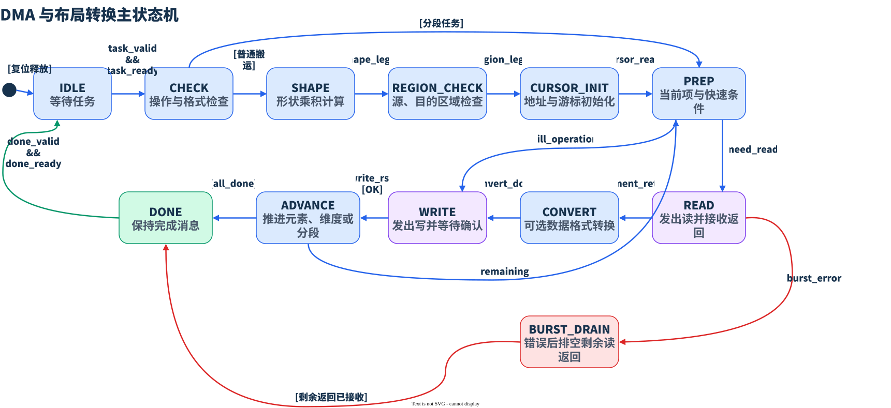

| 状态 | 动作 |
| --- | --- |
| `ST_IDLE` | `task_ready_o=1`；握手后锁存操作码和 Task Context |
| `ST_CHECK` | 检查操作码、内部固定值、dtype 组合、rank、地址空间、转换方式以及操作专有字段 |
| `ST_SHAPE_LOAD` | 把当前累计 shape 乘积和一个维度的 32-bit shape 装入串行乘法寄存器 |
| `ST_SHAPE_MUL` | 每周期处理一个乘数 bit；完成当前维后处理下一维，最后检查零维和 64-bit 元素总数溢出 |
| `ST_REGION_CHECK` | 检查源、目的区域字节数以及同地址空间的区域重叠；FILL 不检查源区域 |
| `ST_CURSOR_INIT` | 清零多维索引与累计偏移，装入当前地址、段游标和转置行列游标 |
| `ST_PREP` | 检查源、目的元素范围和跨 beat 条件，同时判断是否满足整 beat 快速复制要求并计算本次 beat 数 |
| `ST_READ_REQ` | 向 L1BUF 或 MIF 发送读请求；GADDR 快速读把 `fast_beats_remaining_q-1` 送给 MIF |
| `ST_READ_RSP` | 普通路径选择一个元素；快速同空间复制保存完整 beat；GADDR→L1BUF 直接以本次 MIF 返回数据形成 L1 满 strobe 写请求；L1BUF→GADDR 直接以 L1 返回数据形成 MIF 写请求 |
| `ST_CONVERT` | 执行符号扩展或饱和处理 |
| `ST_WRITE_REQ` | 形成 64-bit 写数据和 8-bit `WSTRB`，向 L1BUF 或 MIF 发请求 |
| `ST_WRITE_RSP` | 接收写完成状态；普通路径按实际目的字节数增加进度，快速路径增加 8B，并推进地址、索引和 burst 计数 |
| `ST_BURST_DRAIN` | GADDR 多 beat 读中途发生 MIF 或 L1 错误时保存首次错误，接收并丢弃剩余 MIF 返回，然后进入完成状态 |
| `ST_ADVANCE` | 推进连续元素、外层维度、转置行列或 PACK/SPLIT 段游标；全部元素结束时完成任务 |
| `ST_DONE` | 保持完成状态，直到与 TaskScheduler 握手，然后回到 `ST_IDLE` |

非 PACK/SPLIT 任务在 `ST_CHECK` 后进入 shape 乘法。任一有效维度为 0 时，乘法检查完成后直接返回成功且不访问存储。shape 乘积高 64 bit 非零，或低 64 bit 为 `64'hffff_ffff_ffff_ffff` 时返回 `BAD_SHAPE`。正常任务经 `ST_REGION_CHECK` 和 `ST_CURSOR_INIT` 后进入处理循环。符合快速要求的 COPY 每次推进一个或多个完整 beat；其他任务进入普通元素数据通路。

DMA 的异步复位只把 `state_q` 置为 `ST_IDLE`。因此复位后 `l1_req_valid_o`、`mif_req_valid_o` 和 `done_valid_o` 均为 0，模块可以在复位释放后接收新任务。Task Context、地址、数据、shape 乘法和进度相关寄存器不依赖复位清零：`ST_IDLE` 接收任务时装入新的 Task Context，`ST_CURSOR_INIT` 初始化地址与游标，其他寄存器在进入使用它们的状态前赋值。

`done_progress_o` 统计已经获得目的端写完成响应的数据量。INT8、INT16 和 INT32 分别按每个元素 1B、2B 和 4B 增加；PACK/SPLIT 成功时等于 `segment_count×segment_bytes`。错误发生后，进度保留此前已经完成的目的写入量。

### 9.6 兼容 DDR 到 L1BUF 时序

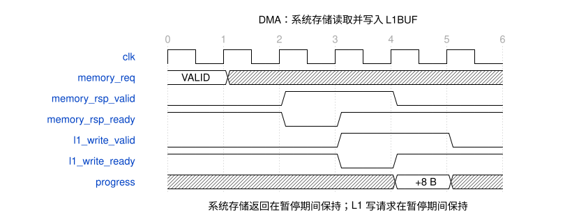

成功条件必须同时满足：

1. 每个 MIF 读请求都收到成功响应；
2. 每个目的元素都完成 L1BUF 写请求握手；
3. 最后一个 L1BUF 写请求收到成功响应；
4. `done_progress_o` 等于目的张量实际占用的字节数；
5. TaskScheduler 接收完成状态。

MIF 的 AXI 事务在 DMA 与 MIF 的内部接口之后完成。DMA 只依据 `mif_rsp_status_i` 判断本次全局访问是否成功，不直接观察 AXI 的 `AR/R` 信号。快速读只发出一次 MIF 请求；每个 R beat 形成一次内部响应，该响应与 L1 满 beat 写请求握手后，DMA 等待对应 L1 写响应，再接收下一个 MIF 返回。MIF 在内部响应等待期间令 `RREADY=0`，所以 AXI R 数据不会连续无停顿地写入 L1BUF。MIF 对每个 beat 检查 `RID=0`、期望的 `RLAST` 和 `RRESP=OKAY`，再形成 3-bit 内部状态。

### 9.7 兼容 L1BUF 到 DDR 时序

1. DMA 向 L1BUF 发出 8B 对齐读请求。
2. L1BUF 返回完整 64-bit beat。普通路径根据元素地址低位和 dtype 取得一个元素；满足快速要求时保留全部 64 bit。
3. 普通数据通路执行可选的符号扩展或饱和处理；快速数据通路不改变数据。
4. DMA 向 MIF 发出 8B 对齐写请求。普通数据通路使用 `WSTRB` 选择目的字节；快速数据通路使用完整数据和 `WSTRB=8'hff`。
5. MIF 的 AXI 写固定为一个 beat，因此快速路径也为每个 L1 beat 分别发出一次 AXI 写。
6. MIF 检查物理地址并完成 AXI 写事务，只有在 `BID=0` 且 `BRESP=OKAY` 时返回成功。
7. DMA 收到写完成响应后增加 `progress`。处理完最后一个元素后向 TaskScheduler 报告成功。

DMA 一次只保留一个请求，所以响应必须与该请求一一对应，不需要额外的返回次序标识。

### 9.8 原生宽 DMA 与控制侧 MIF 的区别

第 9.6～9.7 节描述兼容元素访问，不是 256-bit 原生 COPY 的持续带宽模型。
原生宽路接受满足连续内层、同类型、不转换及物理拍对齐等条件的 COPY_1D/COPY_ND，
其余任务使用兼容控制器。路径选择先登记几何、跨度和范围检查，再接受任务，不在搬运
期间重新解释不稳定的 descriptor。

| 环节 | 原生宽路 | 兼容路 |
| --- | --- | --- |
| 数据拍 | 64/128/256 bit，随 Master 参数 | 64-bit word 或逐元素操作 |
| 全局读取 | burst、独立返回缓存及在途计数 | 控制 MIF 请求与返回 |
| L1 读写 | 宽拍拆成相同数量的 64-bit bank lane | 普通客户端或专用本地复制流 |
| 写回 | AW、W、B 分别推进，尾部 byte strobe | 兼容 master 单 beat 写 |
| 指令/描述符 | 不经过 bulk 数据队列 | 控制 MIF 独立服务 |

原生读地址和长度共同进入两项标准 FIFO，地址被接受时保存相同长度标签并占用信用。
DMA 游标不得因下游未真正接收而跳到下一 burst。多个 burst 可以在途，读写可以重叠；
异常时停止新发射，排空已接受的 R/W/B 后保持终态。原生数据返回不能重新压成单个
64-bit/拍写口，否则外端扩宽不能形成内部吞吐提升。

整个 token 的 DDR 利用率以 `npu_axi_*` 或系统 DDR 计数为准；控制 MIF 在原生 DMA
工作时可以空闲，不能用 `mif_no_request_idle` 代表全部外存空闲。

---

## 10. L1BUF 与 L1BUF Controller

### 10.1 L1BUF 的职责

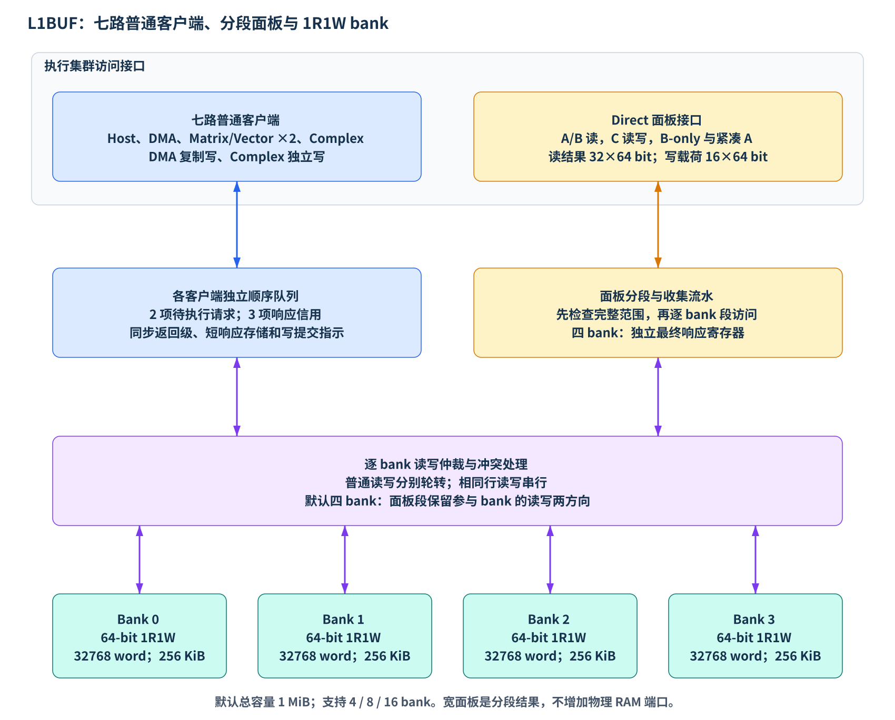

图示基础端口和可配置 bank 的关系，不表示 SoC 仍为四 bank；十七路普通客户端、64 bank
与 Matrix 原生宽读的实际连接见第 10.4、10.12 节。

L1BUF 是执行集群共享的片上字节地址空间，存放输入、权重面板、整数部分和、浮点位型、函数参数与动态统计状态。当前容量为 2 MiB，独立 L1 模块默认四 bank、通用 NPU 默认十六 bank、SoC 默认 64 bank。每个 bank 使用伪双端 RAM：一个同步读口、一个逐字节写使能口，共用一份存储内容。普通请求在不同 bank 间并行；同 bank 的一读一写只有在行地址不同且没有面板保留时才能并行，不以复制整份 SRAM 提供第二个读口。

控制器包含普通请求队列、读写轮转仲裁、同步返回级、响应信用、面板分段收集与写入状态。普通接口每次访问一个 64-bit word。面板接口接收一个逻辑 A/B 或 C 请求，再按物理 bank 数分成若干 RAM 访问；2048-bit 面板响应表示完整收集结果，不代表存在三十二个物理同步读口。执行单元可以在自己的操作数队列内同时送出 A/B，但 L1BUF 内部的 bank 服务顺序仍按本章规则执行。

共享 L1BUF 不解析模型、层号或 KV 的数学含义，也不根据 M、N、K 自动划分固定区域。缓冲容量、数据驻留、bank 起点、输入与部分和寿命由编译器通过指令地址和依赖安排。硬件负责访问合法性、已接收请求的顺序、响应保持以及必要的存储冲突处理。

### 10.2 参数、容量与基本存储单位

| 参数或常量 | 默认值 | 说明 |
| --- | ---: | --- |
| `CLIENTS` | 独立模块为 6；基础集成为 7；SoC 为 17 | 宽 DMA 与 PV 展开为额外普通 lane，Matrix 原生宽口另计 |
| `L1_BYTES` | $2^{21}$ B | 总容量 2 MiB，21-bit byte 地址 |
| `BANKS` | 独立模块为 4 | 允许 4、8、16、32、64；通用集成为 16，SoC 为 64 |
| `PANEL_LANES` | 32 | 完整逻辑读面板的 64-bit 槽数，当前只接受 32 |
| `PANEL_BC_64B_ALIGNED` | 独立模块为 0 | 集成时等于 Matrix 的 W4A8-only 配置；置 1 后检查 B/C 的 64B 对齐，紧凑 A 不受此附加限制 |
| 普通请求地址 | 21 bit | 末 word、长度和有效 lane 的范围按实际容量检查 |
| 面板基址 | 21 bit | A、B、C 的 L1 字节基址 |
| 原生读宽度 | 参数化；SoC 为 4096 bit | 21-bit 基址及 64-bit lane mask，共享有序返回 |
| 一个 word | 8 B | 与每个 bank 的数据端口及普通请求宽度一致 |
| `WORDS` | `L1_BYTES / 8` | 2 MiB 时共 262144 word |
| `ROWS` | `WORDS / BANKS` | 每个 bank 的 word 数 |

配置须满足 `CLIENTS>=1`、`128<=L1_BYTES<=2097152`，且 `L1_BYTES` 能被 `8×BANKS` 整除。固定容量下 bank 越多，每个 bank 深度越小：

| bank 数 | 每个 bank 行数 | 每个 bank 容量 | 总容量 |
| ---: | ---: | ---: | ---: |
| 4 | 65536 | 512 KiB | 2 MiB |
| 8 | 32768 | 256 KiB | 2 MiB |
| 16 | 16384 | 128 KiB | 2 MiB |
| 32 | 8192 | 64 KiB | 2 MiB |
| 64 | 4096 | 32 KiB | 2 MiB |

每个 bank 的 RAM 内容不带复位，读数据仅在同步读使能后更新，写数据由八个 byte enable 独立控制。该组织允许综合工具推断单份 1R1W 块存储器；控制器中的短请求和返回队列不改变主存储容量。具体 FPGA 的 BRAM 级联数量取决于器件块容量与综合结果，不能只按 bank 数推断面积。

一个 64-bit word 可容纳的数值如下。浮点格式由指令声明，L1BUF 只保存对应位型。

| 数据格式 | 每个元素占用 | 一个 word 的元素数 |
| --- | ---: | ---: |
| packed INT4 | 4 bit | 16 |
| INT8 | 1 B | 8 |
| INT16 / binary16 位型 | 2 B | 4 |
| INT32 / binary32 位型 | 4 B | 2 |

字节次序为小端，例如 `16'h1234` 保存为低地址 `8'h34`、高地址 `8'h12`。半字节选择属于计算或 DMA 的打包规则，普通 L1BUF 地址仍以字节计；普通请求不支持半字节地址。

### 10.3 bank 和 row 的选择

对普通请求的字节地址 $A$，定义：

$$
w=\left\lfloor\frac A8\right\rfloor,\qquad
\mathrm{bank}=w\bmod\mathrm{BANKS},\qquad
\mathrm{row}=\left\lfloor\frac w{\mathrm{BANKS}}\right\rfloor.
$$

以下用独立模块的四 bank 配置演示地址公式；SoC 的 64 bank 在第 64 个 word 后才进入下一行：

| 字节地址 | word 编号 | bank | row |
| ---: | ---: | ---: | ---: |
| `0x00000` | 0 | 0 | 0 |
| `0x00008` | 1 | 1 | 0 |
| `0x00010` | 2 | 2 | 0 |
| `0x00018` | 3 | 3 | 0 |
| `0x00020` | 4 | 0 | 1 |
| `0x00028` | 5 | 1 | 1 |
| `0x00040` | 8 | 0 | 2 |

word 内第 $j$ 个字节对应数据 bit `[8j +: 8]`。请求地址已按 8 B 对齐，`wstrb[j]=1` 只更新 $A+j$ 对应字节，其余字节保持。无论 strobe 是否为零，都对完整 word 地址范围作检查；写 strobe 不能使原本越界的请求变成合法请求。

对固定字节步长 $s$ 且 $s$ 是 8 的整数倍的连续访问，bank 序列的重复周期为 $\mathrm{BANKS}/\gcd(s/8,\mathrm{BANKS})$。因此仅错开首地址不能保证任意跨行访问始终没有冲突。编译器在决定数据布局时同时考虑步长、对齐、发起相位以及任务寿命，不能只查看首地址低位。

### 10.4 顶层客户端编号

执行集群的七路基础普通客户端按下表拼接，原生 DMA 与 PV 在其后扩展。两个 Matrix/Vector 普通通道由包装模块内部选择，不能将其固定解释为一个 Scalar 端口和一个 Vector 端口。

| 编号 | 来源 | 地址宽度及用途 |
| ---: | --- | --- |
| 0 | AXI Slave Frontend | 21-bit 地址；Host L1 窗口访问 |
| 1 | DMA 主普通端口 | 21 bit；系统存储搬运、本地读取与通用布局操作 |
| 2 | Matrix/Vector 普通端口 0 | 21 bit；操作数、profile、部分和及结果访问 |
| 3 | Matrix/Vector 普通端口 1 | 21 bit；与端口 0 独立接受和返回 |
| 4 | Complex 主普通端口 | 21 bit；输入、参数、统计状态和普通写入 |
| 5 | DMA 本地复制独立写端口 | 21 bit；方向固定为写，返回只使用 status |
| 6 | Complex 独立写端口 | 21 bit；流水结果写回，返回只使用 status |

SoC 的 256-bit DMA 读、写各展开四个 64-bit lane，在线 PV 另展开两个 64-bit 读 lane，
故普通客户端数为 `7+4+4+2=17`。Matrix 原生读使用一个共享端口，不增加六十四份
普通请求队列。以下容量与时序均须区分基础接口和扩展后的实际参数。

独立写通道使 DMA 本地读取与目的写入、Complex 输入读取与输出写回可以分别排队。它们仍共享 bank 仲裁和每 bank 的一个写口，不是增加物理 RAM 端口。某项写的成功响应到达以前，上层不能认为目的数据已经提交。Direct Matrix 的专用面板接口独立于以上七路，但与它们访问同一组 bank。

### 10.5 模块级信号

方向以 L1BUF 模块为参照；打包总线中客户端 $i$ 的地址、数据与状态分别取 `[21i +: 21]`、`[64i +: 64]`、`[3i +: 3]`。表中的“复位无效”表示 valid/占用位复位，数据位不作为清零保证。

| 信号 | 方向 | 位宽 | 功能 | 有效条件 | 暂停、错误与复位行为 |
| --- | --- | ---: | --- | --- | --- |
| `clk_i` | Input | 1 | bank 与控制逻辑工作时钟 | 上升沿 | 所有普通与面板接口在此时钟域 |
| `reset_n` | Input | 1 | 低有效控制复位 | 低电平有效 | 清队列有效位、计数与控制；不清 RAM |
| `req_valid_i` | Input | `CLIENTS` | 各路普通请求有效 | 对应 valid/ready 同时为 1 接收 | 等待时发起方保持全部请求字段 |
| `req_ready_o` | Output | `CLIENTS` | 对应两项请求队列未满 | 由已寄存的占用决定 | 队列为两项时为 0；不组合借用本拍出队空间 |
| `req_write_i` | Input | `CLIENTS` | 1 写、0 读 | 对应请求有效 | 队列接收后保持其方向；复位前未接收项由上层处理 |
| `req_addr_i` | Input | `CLIENTS×21` | 各路字节地址 | 请求握手采样 | 检查 8 B 对齐及容量；不合法项也按序返回 |
| `req_wdata_i` | Input | `CLIENTS×64` | 写数据 | 写请求有效 | 请求暂停时稳定；读请求忽略 |
| `req_wstrb_i` | Input | `CLIENTS×8` | 逐字节写使能 | 写请求有效 | 未使能字节不改变；读请求忽略 |
| `rsp_valid_o` | Output | `CLIENTS` | 普通响应有效 | 响应队列非空 | 等待接收时保持最早响应；复位清有效性 |
| `rsp_ready_i` | Input | `CLIENTS` | 客户端可接收响应 | 对应 valid/ready 同时为 1 取走 | 不直接组合决定本拍 bank 授权 |
| `rsp_rdata_o` | Output | `CLIENTS×64` | 读数据 | 对应响应有效 | 写响应或错误响应数据为 0；暂停保持 |
| `rsp_status_o` | Output | `CLIENTS×3` | 每次访问的内部状态 | 对应响应有效 | 与数据保持同一顺序，错误不访问 RAM |
| `panel_req_valid_i` | Input | 1 | 一项逻辑面板请求有效 | 与面板 ready 同时为 1 接收 | 发起方在暂停期间保持整项字段 |
| `panel_req_ready_o` | Output | 1 | 面板请求级可接收或当前项最后一段可执行 | 请求握手 | 不保证该项所有 RAM 访问在本拍完成 |
| `panel_req_write_i` | Input | 1 | 1 为 C 写；0 为读 | 面板请求有效 | 接收后保存；错误项禁止 RAM 写使能 |
| `panel_req_b_only_i` | Input | 1 | 跳过 A，仅取 B | 面板读请求有效 | 减少收集段数；不会生成新的 A 数据 |
| `panel_req_compact_a_i` | Input | 1 | A 基址已由发起方指向当前紧凑组 | A/B 面板读有效 | 置 1 时控制器不额外加 `group×128` |
| `panel_req_dtype_i` | Input | 2 | B 打包与 C 读模式选择 | 面板请求有效 | INT4 是 packed B 格式，不表示开启 W4A4 计算 |
| `panel_req_a_base_i` | Input | 21 | A 字节基址 | 含 A 的面板读有效 | 先检查完整 A 范围，错误整项返回 |
| `panel_req_b_base_i` | Input | 21 | B 字节基址 | B 或 A/B 面板读有效 | 可启用附加 64 B 对齐检查 |
| `panel_req_c_base_i` | Input | 21 | C 字节基址 | 面板写或 INT32 模式读有效 | 按列对偏移检查 128 B 范围 |
| `panel_req_group_i` | Input | 15 | 输入面板组号 | 面板请求有效 | 扩展到 23 bit 后计算，避免截断掩盖越界 |
| `panel_req_pair_i` | Input | 3 | C 列对号 | C 读写有效 | 每个列对在该面板格式中占 128 B |
| `panel_req_wdata_i` | Input | `16×64` | C 面板写数据 | 面板写有效 | 在请求接收时保存，分段逐 bank 写入 |
| `panel_rsp_valid_o` | Output | 1 | 完整面板结果有效 | 最后一段返回后 | 直到响应握手保持有效；复位清有效性 |
| `panel_rsp_ready_i` | Input | 1 | Matrix 可接收面板结果 | 响应握手 | 四 bank 使用独立末级寄存器；其他配置保持 RAM 返回 |
| `panel_rsp_rdata_o` | Output | `PANEL_LANES×64` | A/C 与 B 的完整逻辑读面板 | 成功读响应有效 | 按 lane 顺序收集；写响应不得作为读面板使用 |
| `panel_rsp_status_o` | Output | 3 | 整项面板状态 | 面板响应有效 | 任一前置范围检查失败时整项报错 |
| `l1_idle_o` | Output | 1 | 请求、返回与响应均已排空 | 所有已接收项均退休 | 未握手的外部 valid 由上层另行检查 |
| `write_pending_o` | Output | `CLIENTS` | 普通请求队列或提交返回级中仍有写 | 已接收写尚未越过返回级 | 不包含已经排队的写完成响应；不是所有写响应已消费的等价信号 |
| `panel_write_pending_o` | Output | 1 | 面板输入、请求或返回级仍有写 | 包括未握手的有效面板写 | 数据提交相关指示；不替代面板响应完成确认 |

普通响应不带 tag，同一客户端严格按请求接收顺序返回；不同客户端没有全局 FIFO 顺序。普通写的 `write_pending_o` 用于防止读路径在写提交前误用旧旁路项，而完整排空使用 `l1_idle_o` 与上层发起状态共同判断。

### 10.6 bank 仲裁与响应容量

普通客户端的端到端返回额度为八，包含请求队列、bank/返回流水及响应 FIFO。下面的仲裁
顺序不增加 RAM 物理端口，响应 ready 为零时不能丢弃已接受请求。

每个客户端有两个待执行请求槽。接收时同时保存地址、方向、数据、strobe、检查状态与目标 bank 选择。控制器只考察每路队首，队尾不能越过受阻的队首，即使队尾落在空闲 bank。这一顺序使无 tag 响应与写后读行为可确定，但也存在队首阻塞；编译器不能将“两项队列”等同于任意乱序访问。

每个 bank 分别维护读轮转指针与写轮转指针。合法队首具有响应信用时参与对应方向选择；非法队首不争用 bank，而是进入本客户端错误返回流水。轮转指针只随真正执行的普通访问推进。普通访问间的关系如下：

| 同拍访问组合 | 物理服务规则 |
| --- | --- |
| 不同 bank | 各 bank 独立选择；客户端自身仍最多执行一个队首 |
| 同 bank 两读 | 本拍只选择一路读 |
| 同 bank 两写 | 本拍只选择一路写 |
| 同 bank 一读一写、不同 row | 没有面板保留时，可同时使用两个方向 |
| 同 bank 一读一写、相同 row | 串行执行；读写冲突优先位交替，避免持续一方独占 |

每路普通客户端有八项端到端返回信用，在请求被接受时预约，直到对应响应被消费才释放。
请求 FIFO、bank 与返回流水、响应 FIFO 共同占用额度；响应数不超过预约数，预约数不超过八。
同拍已有已登记的响应被接受时允许使用其归还信用，响应 ready 不直接改变同一请求的 valid。
两项入口队列的请求已包含在预约额度中，不能再相加成十项返回容量。

返回级保存 bank、读写方向和 status，成功读取得相应 RAM 输出，写和错误返回零数据。
八项寄存响应存储保持先入先出，消费者阻塞时最早项稳定。请求数据与同步返回分级登记，
不会因为一个客户端停顿而要求所有其他 bank 停顿。复杂的仲裁等待仍须单独统计。

面板段具有优先权。在默认四 bank 配置下，当前段参与的 bank 同时保留读写两方向，普通请求不能利用该 bank 的反方向口。八或十六 bank 配置则按面板实际方向占用；反方向普通访问若 row 不冲突可以执行。最后一段面板读仍依赖 RAM 输出时，普通读还受到返回保持条件约束。轮转公平性只约束普通候选之间，不提供抢占连续面板段的保证。

### 10.7 地址检查、状态与复位

普通请求检查整个 word：

$$
A[2:0]=0,\qquad 0\le A\le\mathrm{L1\_BYTES}-8.
$$

| 条件 | 内部状态 | RAM 行为 |
| --- | --- | --- |
| 对齐且完整 word 在容量内 | `NPU_L1_OK=0` | 按读写方向执行 |
| 地址未按 8 B 对齐 | `NPU_L1_PROTOCOL_ERROR=3` | 不访问 RAM |
| 完整 word 越界 | `NPU_L1_ADDR_FAULT=4` | 不访问 RAM |

未对齐优先于越界。保留的 ECC 状态编码不表示当前 L1BUF 具有 ECC 校验。普通请求接收时已完成状态分类，错误与先前成功响应保持顺序。21-bit 地址覆盖 2 MiB，末端加法用额外进位位检查；不能把最高地址 bit 当作错误位而拒绝全部高半区，也不能截掉进位后回绕。

面板先以 23-bit 中间地址检查全部范围，然后才进入 bank 分段访问。地址正确以前不进行任何部分写入。该检查只保证“接纳时非法的项没有部分访问”，不表示复位可以回滚已经执行的合法面板写；复位期间 RAM 内容保持，软件不能使用复位清除旧数据。

复位清请求占用、头尾指针、响应信用、返回有效、响应计数、轮转状态和面板有效状态。普通写数据等载荷寄存器及 RAM 不要求清零，只有相应 valid 有效时才允许解释其内容。`l1_idle_o` 要求普通请求队列、同步返回级、各路响应队列、面板请求级、面板捕获级及最终响应均为空。外部尚未握手的请求不在该条件中，上层执行集群必须结合自身 valid 和活动记录判断受控复位是否安全。

### 10.8 读功能时序


无 bank 冲突、没有面板保留且响应信用充足时，一次普通读经历以下时钟沿：

| 时钟沿 | 动作 |
| --- | --- |
| T1 | 请求握手，写入本客户端请求队列；该沿不旁路执行新请求 |
| T2 | 读仲裁授权队首；RAM 同步读取并更新输出，同时记录 bank 与状态 |
| T3 | 返回级将 RAM 数据与 status 插入响应存储，更新响应计数 |
| T4 或以后 | 客户端在 `rsp_valid && rsp_ready` 的时钟沿消费响应 |

若请求 T2 执行时原队列只有一项，仍可同时在空槽接收下一项；若请求队列在本拍开始时已满，则本拍不接纳第三项，即使队首将执行。连续请求可在队列和信用允许时每拍执行一个，不需要等待前一项已经被客户端消费。单个客户端仍只有每拍一个 word 的顺序服务能力。

bank 冲突、队首阻塞和信用耗尽会延迟服务，响应暂停会延迟消费。T0～T4 表示逻辑步骤，不等于五个连续物理时钟；当前普通读配置至少五拍，另计排队和仲裁。不同客户端在不同 bank 上获选时，共用相同 T2/T3 时间，但读写同一地址的先后必须另由任务事件或写提交追踪保证。

### 10.9 写功能时序

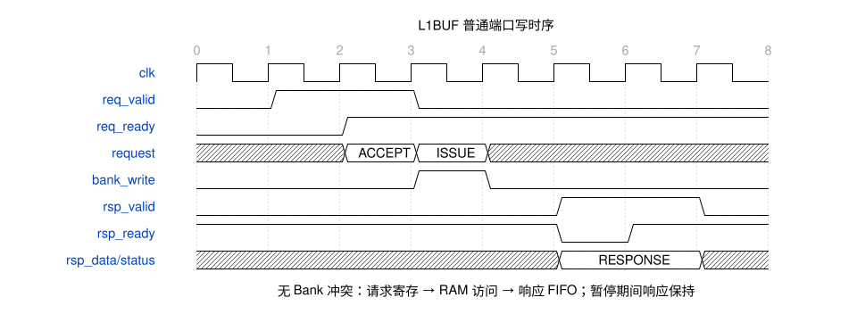

| 时钟沿 | 动作 |
| --- | --- |
| T1 | 保存地址、写数据、strobe 与检查状态 |
| T2 | 写仲裁授权；按 strobe 修改 bank 字节，并记录写完成状态 |
| T3 | 写成功或错误状态进入响应存储，响应数据为零 |
| T4 或以后 | 写请求方消费完成响应 |

写请求接收只说明队列拥有该项，不能作为目的数据已更新的依据。写 RAM 提交发生于 T2，写完成响应随后可见。依赖该数据的其他客户端若没有写提交追踪，只能等待任务完成或明确事件后再读。未被 strobe 选中的字节保持原值；零 strobe 仍形成有序的成功写响应，不修改 RAM。

普通客户端之间的一读一写访问相同 bank 不同行可并行；相同行则轮流执行。这个规则避免依赖器件未定义的 RAM 同行读写输出，但它不提供跨客户端原子读改写，也不处理两个任务对同一张量的算法竞争。访问别名必须在编译器的生命周期与事件依赖中消除。

### 10.10 执行单元与编译器约束

编译器使用实际 bank 数计算 `bank=(address/8) mod BANKS`。在四 bank 的兼容示例中，32 B、64 B、128 B 或 256 B 对齐的基址都从 bank 0 开始；不能沿用十六 bank 配置中“64 B 对齐还可选择起始 bank 8”的策略。需要错开普通操作数时，只能在指令允许的地址单位和布局范围内选取偏移，并评估后续访问步长；若格式强制更粗对齐，应优先使用内部预取、不同周期服务和寿命分离。

A/B 指向同一 bank 时不能保证同拍从 L1 取出两个 word；计算阵列通过配对输入队列与面板收集将存储等待和计算步分开。该缓冲能消除已经备齐数据后的握手扰动，却不能使长期供给不足的 bank 获得额外带宽。面板响应载荷、bank 每拍 word 数和物理 PE 的计算步是三个不同统计量，利用率必须分别测量。

Host、DMA、Complex、Direct 结果及 Matrix/Vector 普通写都可能改变共享区域。旁路缓存应使用有效写地址及提交状态使旧条目失效，不能只检查本引擎发出的写。独立写端口可以降低输入和输出互相阻塞，但没有绕过同一 bank 的写仲裁。两个引擎重叠执行时，编译器必须同时满足读后写、写后读、写后写依赖与缓冲复用时点，不能只依据“两个执行单元均空闲”安排并发。

### 10.11 面板地址、收集段数与暂停

令 $g$ 为 `panel_req_group_i`，$p$ 为 `panel_req_pair_i`，则面板起始字节地址为：

$$
A_g=A_0+(\mathrm{compact\_a}?0:128g),\qquad C_p=C_0+128p,
$$

$$
B_g=B_0+g\times
\begin{cases}
128,&\mathrm{INT4}\text{ packed B},\\
64,&\mathrm{INT8}\text{ B},\\
32,&\mathrm{INT16}\text{ B}.
\end{cases}
$$

A 或 C 一次收集 16 个 word；B 分别收集 16、8、4 个 word，放在完整读响应的 lane 16～31 的相应位置，其余非活动 B 槽为零。`dtype=INT32` 的面板读用于 C 结果读取，此时不再读取 A/B。写请求同样使用 C 地址和 1024-bit 写载荷。`compact_a=1` 表示发起方已给出当前 A 组位置，并不由 L1BUF 自动展开紧凑张量维度。

下表只计算一项无暂停请求实际需要的 RAM 服务段数，不含请求登记、同步返回与最终握手延迟。

| 面板操作 | 四 bank | 八 bank | 十六 bank |
| --- | ---: | ---: | ---: |
| A+B，B 为 INT4 | 8 | 4 | 2 |
| A+B，B 为 INT8 | 6 | 3 | 2 |
| A+B，B 为 INT16 | 5 | 3 | 2 |
| 仅 B，INT4 | 4 | 2 | 1 |
| 仅 B，INT8 | 2 | 1 | 1 |
| 仅 B，INT16 | 1 | 1 | 1 |
| C 读或写 | 4 | 2 | 1 |

四 bank 的中间收集级可以在上一段数据被保存的同时推进下一段，末段进入独立 2048-bit 响应寄存器。末级有效时不能被新结果覆盖；若旧响应本拍刚被取走，新末段仍要按已寄存的空位条件等待。八或十六 bank 采用保持 RAM 返回的组织，捕获有效期间暂停新的相应段，因此实际段间隔可能大于一拍。表中的段数不是全部配置都能达到的“每项面板周期数”。

当当前段完成但整项面板尚未结束时，控制器把数据旋转回逻辑 lane 顺序并保留已收集部分。最后一段和状态同时形成完整响应。面板响应受阻时，已经收集的 A/B/C 不能被随后请求或普通 RAM 读覆盖；相关 bank 读授权按返回保持条件停止。面板写完成响应只代表该项所有分段写均已执行，不能用它推断后续另一客户端请求也已完成。

---

### 10.12 原生连续宽读端口

`npu_l1_bank_read_port` 在 SoC 中使用 4096-bit 返回、64-bit word mask 和 21-bit byte 基址。
接口字段如下，均按 ready/valid 接受，未接受时保持：

| 字段 | 方向 | SoC 位宽 | 定义 |
| --- | --- | ---: | --- |
| `matrix_read_valid/ready` | 请求 | 各 1 | 整份连续读请求的接受条件 |
| `matrix_read_addr` | 请求 | 21 | 至少 8 B 对齐的第一个 word 地址 |
| `matrix_read_mask` | 请求 | 64 | 各连续 word 是否读取；无效 lane 不访问 SRAM |
| `matrix_read_rsp_valid/ready` | 返回 | 各 1 | 整份数据与状态按序返回 |
| `matrix_read_rsp_data` | 返回 | 4096 | 按逻辑连续 word 顺序排列，无效 lane 为零 |
| `matrix_read_rsp_status` | 返回 | 3 | 任一有效 lane 越界则整份失败，不产生部分成功 |

给定起始 bank $b_0=(a/8)\bmod B$，物理 bank $b$ 使用
$\lfloor(a/8)/B\rfloor+[b<b_0]$ 行。mask 循环移动到物理 bank 顺序后预约相应读口，
返回经两段旋转恢复逻辑顺序。地址、mask、状态与标签穿过相同寄存阶段，不能只延迟 valid。

入口两项 FIFO 与八项返回信用分别管理未发射、已发射请求。RAM、旋转流水及返回 FIFO
都占用后者，消费者接受返回才释放信用；允许使用同拍真正归还的信用。错误也按序返回。
全零 mask 不读 SRAM，非对齐地址仍报错；尾部无效 word 不用于扩大访问范围。

原生宽读与面板/普通口共享 bank。全 mask 时普通读等待，普通不同行写仍可前进；有窄读
竞争时采用有限次连续宽读后的让拍，稳定无竞争时不人为插空拍。64 bank 的理想读带宽
为 512 byte/拍，即 200 MHz 下 102.4 GB/s；这不是模型已经持续获得的带宽。

详细互连与存储成本见 [L1 单级多 bank 宽读设计](L1单级多bank低成本宽读设计.md)。

## 11. Matrix-Vector Engine：Matrix 子系统

### 11.1 执行结构

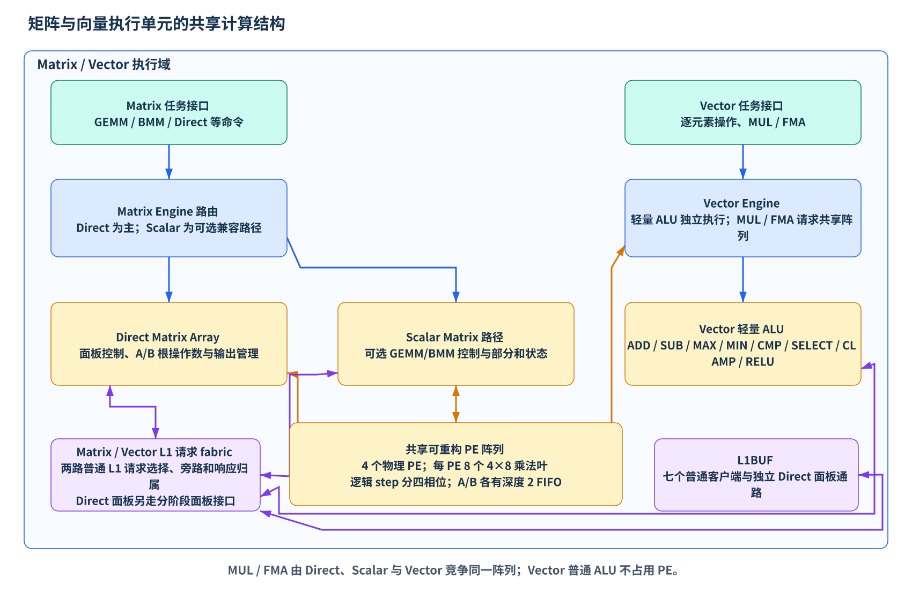

图中小阵列的 phase 组织是兼容实现；SoC 的 128 PE 并行入口、部分和旁路及组缩放按
本章接口和第 11.2.5 节定义，不能用图内旧物理数量覆盖实际配置。

Matrix 和 Integer Vector 由 `npu_matrix_vector_engine` 统一包装，Matrix Direct、Matrix Scalar 与 Vector MUL/FMA 共享 `npu_reconfigurable_matrix_vector_array` 中的同一组 PE。Matrix 引擎一次只接收一条 Matrix 任务，并由 `active_path_q` 选择 Direct、Scalar 或 group-requant 路径；Vector 的轻量 ALU 有独立执行通路，Vector 乘法请求则通过 `shared_pe_req_*` 注入 Matrix 引擎。PE 正由 Direct/Scalar Matrix 占用时，共享 Vector 乘法入口等待，不能把 Vector 任务并发接收等同于乘法阵列并行执行。

执行路径的分工如下：

- `DIRECT_GEMM` 进入直接矩阵控制通路，接受 W4A8（A=INT8、B=packed INT4）、W6A8（A=INT8、B=Q6）、同类型 INT8 和同类型 INT16。INT4×INT4（W4A4）不是有效执行模式；INT4 只作为 W4A8 的权重存储格式。M/N 范围、K 上限、紧凑 A、分块和累积条件由 inline/descriptor 几何检查统一判定，W4A8 的 K 范围为 256～4864 且按 128 对齐，W6A8 受其 M=1 专用约束。Direct 不处理 bias；可以从零开始或读入已有 C/partial sum，并由 Matrix epilogue 执行配置的量化输出。SoC 阵列为 128 PE、每 PE 八个共享 4×8 叶：W4A8/W8A8/W16A16 峰值分别为 1024/512/128 MAC/拍，掩码和兼容模式可能只使用部分 PE。通用模式继续提供 48-bit 累加上下文；W4A8 专用综合配置可用更窄的内部累加状态，外部 C/结果 ABI 不因此改变。
- 公开 `GEMM`、`BMM`、`GEMM_ZERO`、`GEMM_ACCUM`、`GEMM_ZERO_LOCAL` 与 `GEMM_ACCUM_HOLD` 进入 标量矩阵通路。Scalar 逐个输出元素推进，支持局部部分和、旧 C、bias、整数重缩放、ReLU 和多种输出格式。
- Vector 的 ADD、SUB、MAX、MIN、比较、选择和 ReLU 使用轻量整数数据通路。Vector 的 MUL/FMA 不再有独立乘法阵列，而是将 packed 操作数转成共享 PE 请求；Scalar Matrix 也把单点乘法送入同一 PE 阵列。Direct Matrix、Scalar Matrix 和 Vector MUL/FMA 在这组乘法 PE 上互斥发射。


| 正式模块 | 职责 |
| --- | --- |
| `npu_matrix_vector_engine` | Matrix/Vector 任务接口、共享 PE 请求与响应、普通 L1 和 Direct 面板接口、内部旁路 |
| `npu_matrix_engine` | 保存一条 Matrix 任务，选择 Direct、Scalar、group-requant 或拒绝路径；仲裁 Vector 的共享 PE 请求 |
| 直接矩阵阵列通路| 直接阵列的控制器、操作数缓存、PE 阵列和结果写回接口 |
| 直接矩阵阵列控制器| 已检查描述符的 A/B/C 地址流、A/B 装载、K 步发射和 C 写回 |
| `npu_matrix_direct_array_datapath` | A/B 根操作数缓冲、16 个逻辑累加上下文、兼容 4/8/16 PE 分相或 128 PE 并行入口及结果格式化 |
| `npu_reconfigurable_matrix_vector_array` | 4/8/16 PE 兼容组织或 128 PE 共用 bank；A/B 弹性缓冲、plane/列掩码与 context |
| 标量矩阵通路| 通用 Matrix 控制器和局部部分和控制 |
| 标量矩阵数据通路 | 标量 signed64 累加、局部部分和 RAM、整数重缩放和写数据格式化 |
| Matrix `array_uop` 桥接 | 把 Scalar 单点操作数映射到共享 Matrix PE 的 `(row0,col0)` 并返回 signed32 乘积 |
| `npu_vector_engine` / `npu_vector_datapath` | Vector 控制与轻量整数 ALU；乘法类操作转入共享 Matrix PE 接口 |
| 整数向量通路| Vector 控制器及其整数数据通路 |
| 内部存储通路 | Matrix、Vector 请求选择、L1 返回分发、写后旁路和写入风险处理 |
| L1 请求队列 | 两项、94-bit、非直通的 L1 请求 FIFO |

矩阵任务控制器检查操作码和 Direct Matrix Array 的 shape、数据格式及限制条件后，只向已选的一个子模块给出 `task_valid`。它保存原始 `command_id`，并在对应子模块与上游完成握手时返回该编号。Direct 分支的实际模块为 直接矩阵阵列通路；公开 Matrix 指令不经 Direct 分支。

每个物理 PE 内有 8 个共用的 4-bit×8-bit 乘法单元。W4A8 将 8 个单元组织为 8 个独立 INT8×INT4 乘积；同类型 INT8/W6A8 用两个叶单元组成一个完整权重乘积，每 PE 完成四个独立 MAC；INT16 把 8 个叶乘积拼成一个 16×16 乘积，因此每 PE 每周期执行一个 INT16 MAC。INT4×INT4 不进入 PE 运算路径。各乘法模式通过同一输入根总线、乘积寄存级和累加输出组织复用；兼容小阵列保存分相上下文；128 PE 的 plane 0 有十六个 context，其余 plane 各有四个并行 context。Direct 数据路径将有效 phase 写入对应逻辑 lane，结果读取后按当前 dtype 合并、符号扩展并应用所选输出量化。W4A8 专用配置将单个逻辑累加状态压缩到 33 bit、把旧 INT32 seed 并入状态；通用配置保留 48-bit 结果约定。不可把 PE 物理周期、16 个逻辑结果 lane 或 L1 面板 beat 数混称为相同吞吐量。

Scalar Matrix 控制器用 `array_uop` 接口复用上述 Matrix PE，只有阵列未运行 Direct/group-requant 任务时才能发射。Vector 的 MUL/FMA 也经 `shared_pe_req_*` 使用这组 PE；Matrix Scalar 与 Vector 乘法可以在各自请求侧排队，但同一拍只有被共享阵列 ready 接收的一路能够发射。两类操作都不存在独立于 Matrix PE 的 Vector 乘法硬件。

Scalar 和 Vector 的 L1 请求进入 内部存储通路，再经 L1 请求队列 交给 L1BUF。FIFO 深度为 2，保存 write、21-bit 地址、64-bit 写数据和 8-bit strobe；它不是直通结构。L1 返回按请求接收次序回到内部存储通道，再由来源 FIFO 送给 Scalar 或 Vector。兼容 Direct 使用面板接口；128 PE 路径还可使用原生宽读和私有结果旁路，均不经过 Scalar/Vector 的普通来源 FIFO。

Scalar 的 `batch_q`、`row_q`、`col_q`、`k_q` 逐个输出元素推进。`MATRIX_MT=8`、`MATRIX_KT=16`、`MATRIX_NT=8` 只用于检查末尾 tile 和确定 B 的存储排列，不代表 Scalar 在一个时钟周期计算 8×8 个结果。Scalar 在 `ST_MAC_MUL` 发出一个逐元素请求，收到 signed32 乘积后把它符号扩展并加入 signed64 累加值。

整数重缩放的 signed64 输入记为 \(x\)，32-bit 非负乘数记为 \(m\)。硬件把输入拆为 signed 高 32 bit 和 unsigned 低 32 bit：

$$
h=\operatorname{signed}(x[63:32]),\qquad
\ell=\operatorname{unsigned}(x[31:0]).
$$

`ST_EP_MUL` 的第一个周期并行计算：

$$
H=h\times \operatorname{zero\_extend}_{33}(m),\qquad
L=\ell\times m,
$$

其中 \(H\) 是 signed32 与零扩展后 33-bit 非负乘数的乘积，保存为 signed65；\(L\) 是两个 unsigned32 数的乘积，保存为 unsigned64。第二个周期计算：

$$
U=H+\operatorname{zero\_extend}_{65}(L[63:32]),
$$

再形成完整乘积：

$$
P=\operatorname{sign\_extend}_{128}\left(\{U,L[31:0]\}\right)=x\times m.
$$

式中，`x[63:32]` 和 `x[31:0]` 分别表示 \(x\) 的高、低 32 个 bit；\(\operatorname{signed}(\cdot)\) 按二进制补码解释，\(\operatorname{unsigned}(\cdot)\) 按非负整数解释；\(\operatorname{zero\_extend}_{65}(\cdot)\) 在高位补 0 直到 65 bit；花括号表示把左侧 bit 放在高位、右侧 bit 放在低位进行拼接；\(\operatorname{sign\_extend}_{128}(\cdot)\) 复制最高符号 bit 直到 128 bit。上述拆分没有改变数学结果，只改变计算在时钟周期中的安排。

因此第二个周期的主要加法宽度为 65 bit，不在一个周期内完成 signed64×unsigned32 的全部计算。随后，`ST_EP_ABS` 保存正负号、绝对值、移位量和舍入方式，`ST_EP_SHIFT` 完成可变移位，正右移再依次经过舍入决定、加一和符号恢复，最后执行 signed64 限制、zero point 相加以及目标格式检查。乘法高低两段、128-bit 移位、128-bit 加法、符号处理、signed64 限制和目标格式检查分布在相邻寄存阶段。

支持的输入组合为：

| A 数据格式 | B 数据格式 | 说明 |
| --- | --- | --- |
| INT8 | INT8 | 常规整数矩阵乘法 |
| INT16 | INT16 | 两路都按 16-bit 有符号数读取 |

A 为 INT32、编码 0，或者 A 与 B 使用不同数据格式时，任务返回 `DTYPE_UNSUPPORTED`。最终 GEMM/BMM 输出可选择 INT8、INT16 或 INT32；`GEMM_ACCUM` 和 `GEMM_ZERO` 的 C 必须是 INT32。

### 11.2 模块级信号

矩阵向量执行单元的构建参数如下：

| 参数 | 顶层值 | 作用 |
| --- | ---: | --- |
| `RESPONSE_TAG_DEPTH` | 2 | Matrix/Vector 到外部 L1 客户端端口的响应目标 FIFO 深度 |
| `BYPASS_ENTRIES` | 2 | Matrix 到 Vector 内部旁路缓存项数 |
| `PE_ISSUE_INTERVAL` | 1 | 兼容性参数；当前顶层不使用该参数限制阵列发射间隔，Matrix 与 Vector MUL/FMA 的接收由共享阵列 ready/valid 和 busy 状态决定 |
| L1 请求 FIFO 深度 | 2 | 本设计的固定值；该 FIFO 不增加响应存储 |

| 信号 | 方向 | 位宽 | 作用 |
| --- | --- | ---: | --- |
| `clk_i` | Input | 1 | 合并执行单元工作时钟 |
| `reset_n` | Input | 1 | 低有效异步复位 |
| `matrix_task_valid_i` | Input | 1 | TaskScheduler 提交 Matrix 任务 |
| `matrix_task_ready_o` | Output | 1 | 矩阵任务控制器空闲，可以接收一条新的 Matrix 任务 |
| `matrix_opcode_i` | Input | 8 | 片上展开后的 Matrix 操作码 |
| `matrix_command_id_i` | Input | 12 | 调度器提供的任务编号 |
| `matrix_desc_i` | Input | 2048 | 发射展开单元生成的片上 Task Context |
| `matrix_done_valid_o` | Output | 1 | Matrix 完成信息有效 |
| `matrix_done_ready_i` | Input | 1 | TaskScheduler 可以接收 Matrix 完成信息 |
| `matrix_done_command_id_o` | Output | 12 | 完成消息所属任务的编号 |
| `matrix_done_status_o` | Output | 8 | 成功或错误状态 |
| `matrix_done_fault_addr_o` | Output | 48 | 运行阶段访问错误对应的地址；启动检查发现基地址高位非零时返回 0 |
| `matrix_done_progress_o` | Output | 64 | 已成功写回的输出元素数量 |
| `vector_task_valid_i` | Input | 1 | TaskScheduler 提交 Vector 任务 |
| `vector_task_ready_o` | Output | 1 | Vector 控制器可以接收任务 |
| `vector_opcode_i` | Input | 8 | 片上展开后的 Vector 操作码 |
| `vector_command_id_i` | Input | 12 | 调度器提供的 Vector 任务编号 |
| `vector_desc_i` | Input | 2048 | Vector Task Context |
| `vector_done_valid_o` | Output | 1 | Vector 完成信息有效 |
| `vector_done_ready_i` | Input | 1 | TaskScheduler 可以接收 Vector 完成信息 |
| `vector_done_status_o` | Output | 8 | Vector 成功或错误状态 |
| `vector_done_fault_addr_o` | Output | 48 | Vector 运行阶段的第一个错误地址 |
| `vector_done_progress_o` | Output | 64 | Vector 已成功写回的元素数量 |
| `l1_req_valid_o` | Output | 1 | 单 beat L1 请求有效 |
| `l1_req_ready_i` | Input | 1 | L1BUF 接受请求 |
| `l1_req_write_o` | Output | 1 | 1 为写，0 为读；该端口承载 Matrix 与 Vector 请求 |
| `l1_req_addr_o` | Output | 21 | 8B 对齐的 L1 字节地址 |
| `l1_req_wdata_o` | Output | 64 | Matrix 或 Vector 写数据 |
| `l1_req_wstrb_o` | Output | 8 | 逐字节写使能 |
| `l1_rsp_valid_i` | Input | 1 | L1 响应有效 |
| `l1_rsp_ready_o` | Output | 1 | 响应目标 FIFO 指定的内部接收方可以接收响应 |
| `l1_rsp_rdata_i` | Input | 64 | L1 读数据 |
| `l1_rsp_status_i` | Input | 3 | L1 访问状态 |
| `panel_req_valid_o` | Output | 1 | Direct Matrix Array 面板请求有效 |
| `panel_req_ready_i` | Input | 1 | L1BUF 接受面板请求 |
| `panel_req_write_o` / `panel_req_dtype_o` | Output | 1 / 2 | 面板读写方向和输入格式 |
| `panel_req_a_base_o` / `panel_req_b_base_o` / `panel_req_c_base_o` | Output | 各 20 | A、B、C 面板基址 |
| `panel_req_group_o` / `panel_req_pair_o` | Output | 15 / 3 | K 组编号或 C 输出列对编号 |
| `panel_req_wdata_o` | Output | `16 × 64` | C 面板一个列对的 16 行写数据 |
| `panel_rsp_valid_i` | Input | 1 | L1BUF 面板响应有效 |
| `panel_rsp_ready_o` | Output | 1 | Direct Matrix Array 可接收面板响应 |
| `panel_rsp_rdata_i` | Input | `32 × 64` | 面板读数据；packed INT4 为 A 16 word 加 B 16 word |
| `panel_rsp_status_i` | Input | 3 | 整个面板请求的访问状态 |
| `protocol_error_clear_i` | Input | 1 | 清除内部存储通道和旁路缓存的保持型协议错误 |
| `bypass_clear_i` | Input | 1 | 清除 2 项旁路缓存的全部有效状态 |
| `external_write_valid_i` | Input | 1 | DMA、CME 或 L1 外部窗口已经接受一次写请求 |
| `external_write_addr_i` | Input | 20 | 外部写请求的 L1 字节地址 |
| `external_write_byte_mask_i` | Input | 8 | 外部写请求修改的字节位置 |
| `external_write_hazard_valid_i` | Input | 1 | 顶层当前存在可能与 Vector 读冲突的外部写 |
| `external_write_hazard_addr_i` | Input | 20 | 外部写风险对应的 L1 beat 地址 |
| `bypass_hit_count_o` | Output | 32 | Vector 读由内部旁路直接返回的次数 |
| `vector_l1_count_o` | Output | 32 | Vector 请求实际送往 L1BUF 的次数 |
| `l1_outstanding_o` | Output | 4 | 已由内部存储通道送入请求 FIFO、但响应尚未完成的请求数，范围 0～8 |
| `bypass_occupancy_o` | Output | 2 | 2 项旁路缓存中当前有效项数，范围 0～2 |
| `matrix_pe_grant_count_o` | Output | 32 | Direct、分组缩放或 Scalar Matrix 发射共享阵列 `array_uop` 的周期数 |
| `vector_pe_grant_count_o` | Output | 32 | Vector 请求经共享 PE ready/valid 握手被阵列接收的次数 |
| `matrix_pe_wait_cycle_count_o` | Output | 32 | 兼容计数器；当前只在复位时清零，RTL 未实现等待周期递增 |
| `vector_pe_wait_cycle_count_o` | Output | 32 | Vector 乘法请求有效但共享 PE 接口未 ready 的周期数；不区分阵列忙、任务优先或内部发射条件 |
| `pe_conflict_cycle_count_o` | Output | 32 | 兼容计数器，RTL 固定为 0；不能用于估计 Matrix/Vector 共享 PE 冲突 |
| `pe_idle_cycle_count_o` | Output | 32 | 本周期未计入 Matrix PE issue 且未接受 Vector PE 请求的周期数；Direct K 步计为活动，仍不是每个物理 PE 的逐拍利用率 |
| `protocol_error_o` | Output | 1 | L1 返回次序或内部旁路状态错误 |

当 `matrix_task_valid_i && matrix_task_ready_o` 为 1 时，矩阵任务控制器在同一时钟沿锁存操作码、任务编号和 2048-bit Task Context。该单元只保留一项正在执行的 Matrix 任务，因此 `matrix_task_ready_o` 仅在空闲状态为 1。Inline Decode 已在任务进入调度器前完成描述符、地址和数据格式检查；锁存后的 `PATH_CLASSIFY` 依据已检查的操作码选择路径：`DIRECT_GEMM` 进入 Direct Array，其余已支持的 Matrix 指令进入 Scalar Matrix。解码或发射检查失败时，任务不访问 L1，并直接返回错误完成信息。

`reset_n=0` 时，当前任务状态、完成保持寄存器、Matrix `array_uop`/Vector 乘法流水有效位、L1 请求 FIFO 计数和旁路缓存有效位均清零。L1 RAM 本身的内容不要求清零，但复位后不存在可引用的 Matrix 局部部分和状态。复位期间 L1 请求 valid 和 done valid 均为 0。


#### 11.2.1 Matrix 路径选择与完成时序

| 任务类别 | 选择的执行部分 | 说明 |
| --- | --- | --- |
| `DIRECT_GEMM`，同类型 INT8/INT16、W4A8 或 W6A8 输入，INT32 或 Matrix profile 量化输出 | Direct Array | 4/8/16 PE 配置按 phase 执行，128 PE 由统一 bank 执行多行或 split-K；W4A8、W6A8、INT8、INT16 每步分别消费 8/4/4/1 个 K 元素；编译器默认使用紧凑 A；W4A8/W6A8 K 分别不超过 4864/2048；W6A8 固定 M=1 并按 16-K 输出部分和；非零 profile 使用 Matrix epilogue。W4A4 不在有效模式内 |
| `GEMM`、`BMM` 以及带 bias、部分和或整数后处理的 Matrix 指令 | Scalar Matrix | 通过共享阵列的单点 `array_uop` 逐元素计算并写回；当前只接受 INT8/INT16 |
| `GEMM_ZERO`、`GEMM_ACCUM`、`GEMM_ZERO_LOCAL`、`GEMM_ACCUM_HOLD` | Scalar Matrix | 使用 Scalar Matrix 的部分和与写回流程 |
| 描述符、地址或数据格式检查失败 | 不启动计算 | `matrix_done_valid_o` 返回对应错误状态 |

在 `PATH_DIRECT` 或 `PATH_SCALAR` 中，任务仅将选定执行部分的 L1 接口和 done 信息转发到模块输出。Direct Array 使用面板接口；Scalar 使用普通 64-bit 接口。done valid 保持到 `matrix_done_ready_i=1`；握手完成后清除当前任务并回到空闲状态。Direct 与 Scalar 控制通路互斥使用共享 Matrix PE；Vector MUL/FMA 也由同一阵列执行，并由阵列入口仲裁。

#### 11.2.2 Matrix 与 Vector 共享 PE 阵列

共享阵列保留兼容十六列接口，SoC 配置使用八 plane、每 plane 十六列的统一 PE bank。每个物理 PE 复用 8 个 4×8 乘法叶；W4A8 将其组织为 8 个 INT8×INT4 乘积，W6A8/同类型 INT8 以叶组合实现 4 个完整乘积，INT16 组合全部叶实现 1 个完整乘积。每 PE 每物理周期分别完成 8、4、4、1 个 W4A8、W6A8、INT8、INT16 MAC；实际阵列总量按有效 PE 数计算；W4A4 不受支持。累加上下文和 C seed 的宽度按当前配置及数据类型定义，不能套用已删除的四条 signed16/两条 signed32 子累加通路模型。M=1 量化输出使用 Matrix epilogue；非量化 INT32 紧凑 C 通过 64-bit L1 接口写回。Scalar 控制路径以行列掩码 `16'h0001` 发出单点 `array_uop`，从相同阵列取回 `(row0,col0)` 的结果。

面板读响应到达时，Direct 控制器在该周期无条件给出 `panel_rsp_ready=1`，并把响应写入下一组 A/B 操作数寄存器。PE 阵列在同一时钟沿使用前一组寄存器内容完成当前计算步，因此两个动作不会相互覆盖。L1BUF 看到响应已经被接收后，可以在同一时钟沿接受下一面板请求。`panel_rsp_ready` 不依赖 `panel_req_ready`，避免控制器与 L1BUF 的 ready 信号形成组合环路。L1BUF 按 A、B 两个读阶段生成完整响应；控制器在当前计算步结束后若未取得下一组响应，返回面板等待状态。请求暂停期间必须保持完整面板字段。

Scalar Matrix `array_uop` 包含输入格式、行列使能和两组阵列操作数。当前 Scalar 只启用 row0/col0，单个 A/B 标量位于对应操作数低 16 bit；返回的低 32 bit 符号扩展后进入 signed64 `accum_q`。Vector MUL/FMA 保留自己的 tag、逐元素标志、输入格式、group 使能和两组 256-bit 请求载荷，但请求经 Matrix engine 共享阵列 ready/valid 入口。当前 `PE_ISSUE_INTERVAL` 仅为兼容性参数并未参与发射控制；Vector 接收条件要求 `PATH_IDLE`、共享阵列非 busy、无 Matrix task 同周期占用且底层 array ready。阵列完成前 Vector 请求保持有效、载荷稳定。

#### 11.2.3 合并单元内部存储通道

内部存储通路为 Matrix 与 Vector 分别保留独立的请求、响应和在途计数，每路最多 2 项在途请求。请求进入各自的后级 FIFO 时，记录本路返回所需的元数据；两路响应直接按固定归属返回。每个后级请求 FIFO 只保存请求位域：

$$
1\text{ bit write}+20\text{ bit addr}+64\text{ bit wdata}+8\text{ bit wstrb}=93\text{ bit}.
$$

该 FIFO 深度为 2，使用寄存的 head、tail 和 count，按输入握手次序向 L1BUF 提交。`s_ready_o` 只由寄存占用数决定，`m_valid_o` 只在 FIFO 已有项目时为 1，因此它不是直通结构。FIFO 满时，即使同周期 `m_valid_o && m_ready_i` 弹出队首，输入侧也要到下一周期才恢复 ready。输出暂停时，队首 write、addr、wdata 和 wstrb保持不变。

L1 响应不进入请求 FIFO，而是直接送回内部存储通路。L1 在各客户端内部按请求接受顺序返回响应，两路之间无需通过来源 FIFO 恢复全局顺序。内部存储通路还保存 Matrix 写请求的地址、数据与 strobe，只有对应 L1 写响应握手且 status 为成功时才更新内部旁路缓存。请求只是进入 FIFO、等待 L1 接受或等待写响应时，均不得提前填充旁路。顶层把 `BYPASS_ENTRIES` 设置为 2，因此缓存包含 2 项，每项保存一个对齐 64-bit beat 的地址标签、数据和 8-bit 逐字节有效状态。

请求 FIFO 的内部信号如下。`s_*` 位于内部存储通道一侧，`m_*` 位于 L1BUF 客户端一侧：

| 信号 | 方向 | 位宽 | 作用 |
| --- | --- | ---: | --- |
| `s_valid_i` | Input | 1 | 内部存储通道给出的请求有效 |
| `s_ready_o` | Output | 1 | FIFO 占用数小于 2，可以在当前时钟沿保存请求 |
| `s_write_i` | Input | 1 | 1 表示写请求，0 表示读请求 |
| `s_addr_i` | Input | 20 | 8B 对齐的 L1 字节地址 |
| `s_wdata_i` | Input | 64 | 写数据；读请求中该字段不参与存储操作 |
| `s_wstrb_i` | Input | 8 | 逐字节写使能；读请求中该字段不参与存储操作 |
| `m_valid_o` | Output | 1 | 队首请求有效 |
| `m_ready_i` | Input | 1 | L1BUF 可以接受队首请求 |
| `m_write_o` | Output | 1 | 队首读写标志 |
| `m_addr_o` | Output | 20 | 队首地址 |
| `m_wdata_o` | Output | 64 | 队首写数据 |
| `m_wstrb_o` | Output | 8 | 队首逐字节写使能 |

从空 FIFO 开始的一次请求时序为：

1. T0 组合阶段，内部存储通道给出 `s_valid_i=1` 及 93-bit 请求数据，FIFO 给出 `s_ready_o=1`。本路在途计数与 Matrix 写回控制字段在这次输入握手对应的时钟沿记录。
2. T0 时钟沿，请求写入 tail，计数从 0 变为 1。由于输出只读取已寄存项目，T0 组合阶段不会把该请求直接送到 `m_*`。
3. T1 组合阶段，`m_valid_o=1`，输出 head对应的完整 payload。若 `m_ready_i=0`，这些输出逐周期保持。
4. 某一时钟沿出现 `m_valid_o && m_ready_i` 后，队首从请求 FIFO 弹出；后续响应不回到该 FIFO。
5. L1 响应到达时直接与内部存储通路握手。固定的客户端连线决定响应目标；成功且未被外部写取消填充资格的 Matrix 写响应还触发旁路填充，失败响应只报告状态并禁止填充。

Vector 读只有在该 beat 的八个字节全部有效时才由内部寄存响应返回，未命中时进入 L1 仲裁。存在较早已送往 L1 但尚未返回的 Vector 请求、Matrix 对同一 beat 的请求保持、FIFO 排队或等待完成响应的写请求，或顶层报告同地址外部写风险时，Vector 读不能采用旁路。Matrix 较新写请求、Vector 写和顶层报告的 DMA、CME、外部 L1 窗口写会使同 beat 中相应字节失效。

#### 11.2.4 Matrix 与 Vector 的并行条件

Matrix 单元每次只保存一条 Matrix 任务；Vector 控制器可同时保存独立的 Vector 任务。Direct、Scalar Matrix 和 Vector MUL/FMA 最终进入同一组物理 PE，Matrix engine 的共享入口按当前活动路径和底层阵列 ready 状态发射，Matrix PE 活动时 Vector 乘法请求不能同拍接收。Vector 轻量整数 ALU不占共享 PE，因此在满足数据依赖时可与 Matrix 计算重叠。Scalar Matrix 与 Vector 仍拥有独立的普通 L1 请求 FIFO，可同拍向内部存储包装提交；之后由 L1BUF 按 bank 和读写方向仲裁，队列独立不代表访存必然并行。任一路 FIFO 满时，该路上游继续保持请求。

#### 11.2.5 分组重量化流水与参数双缓冲

分组重量化不是另一套 GEMM。控制器调用现有 Direct 形成每组的十六列 INT32 部分和，
然后按原生 W4 affine code 与 zero point 校正。令 $P_{g,j}=\sum_k q^A_k q^W_{k,j}$，
$S^A_g=\sum_k q^A_k$，权重 zero point 为 $z^W_{g,j}$，则缩放输入为

$$
\widehat P_{g,j}=P_{g,j}-z^W_{g,j}S^A_g.
$$

每组静态权重 scale 由非负 Q31 multiplier $M_{g,j}$ 和 shift $N_{g,j}$ 表示。
已经加载的每列宽状态 $(V_j,E_j)$ 表示 $V_j2^{-E_j}$。合入新组时选择

$$
E'_j=\max(E_j,N_{g,j}),\qquad
V'_j=(V_j\ll(E'_j-E_j))+
       (\widehat P_{g,j}M_{g,j}\ll(E'_j-N_{g,j})).
$$

公共指数对齐为精确左移，组间不执行独立 RNE。实际 RTL 保存 signed64 宽状态，
乘法结果为 signed95、对齐临时值为 signed80；profile 必须证明值域可表示，不能因为
数学公式可任意扩展就假设硬件有 128-bit accumulator。指数差超过 15、乘积高位不满足
符号扩展或宽加法溢出均形成数值错误，不截断后继续生成 token。

`npu_matrix_group_requant_parallel_accum` 使用四路 II=1 流水，列按 `column % 4` 分配。
每路依次捕获部分和、activation sum、zero point、multiplier/shift、旧宽状态；准备、
乘法、指数对齐与宽加法分级。第零路复用 REDUCE/FINAL 乘法器，其余三路只补 ACCUM
缩放，不复制最终归一化和舍入硬件。

Q31 profile 的有效形式为最高位 1、低七位 0，即 $M=M_{24}\ll7$。
`npu_matrix_group_requant_scale_mul` 用两个 32×24 limb 乘积重建 64×31 的精确结果，
最后补回七个零；输入不满足形式时返回错误。该形式不是任意整数 multiplier 的通用假设。

| 阶段/模块 | 保存的数据 | 接受与释放条件 |
| --- | --- | --- |
| Direct / 私有结果旁路 | 十六列 INT32 和分组 activation sum | Direct 终态成功且所需 sum 已有效 |
| `npu_matrix_group_profile_buffer` | 两 bank，各十六列×47 bit | 当前 bank 只读，下一 bank 按 capture mask 写入 |
| ACCUM 捕获流水 | 每列完整缩放操作数和旧状态 | 每个外部操作数都已捕获后 `released_o=1` |
| 缩放乘法与 tag FIFO | 精确乘积及列/shift/error | 对应乘法请求和 tag 共同被接受 |
| 宽加法退休 | 新 signed64 状态和公共指数 | 所有有效 lane 完成且无错误才换组 |
| REDUCE/FINAL | 行统计、一次 token scale 及最终 code | 一路 II=1 数据流水，仍有加载、归约和写回成本 |

`released_o` 不等于 DONE：它只表示之后不再读取父模块的参数和 partial 输入。
乘法被反压时，已捕获值和 tag 继续保留。父控制器在 `ACC_PREP` 启动下一组 profile，
读 bank 为当前 group 奇偶，写 bank 在发起读取时锁存为另一份；不能在换组时重新组合
反相，否则晚到响应可能改写正在读取的参数。两 bank 共 1504 个数据 bit，较单份增加
752 bit，不保存 activation/权重张量，也不复制乘法网络。

ACCUM 结束只生成未最终量化的宽状态。REDUCE 跨所有 N tile 求整行 absmax 与共同输出
指数，FINAL 应用一次 token scale 和最终 RNE/饱和，保持整行尺度一致。当前 GROUP_REQUANT
描述符没有 bias 字段；含 bias 的 Linear 由编译器另排 DMA 预载和 Complex FP32_MAC 后处理，
其周期和流量必须计入模型，不能把 bias 写成 Matrix FINAL 内的现成功能。
不能在每个 tile 各取 absmax，也不能改为每 group 独立重量化后相加。

Direct 和 profile 在错误时分别排空：已接受的 Direct DONE、L1 响应、乘法 tag 和结果均须
消费后，父任务才能返回保持型错误终态。发生数值错误不允许直接复用旧 context 生成下一项。

### 11.3 从指令到片上 Task Context

主控提交 128-bit 指令后，TaskScheduler 先保存完整指令、提交时基地址快照以及任务状态。任务进入 READY 后参加逐槽扫描；扫描结束时仍满足前序任务条件、Matrix active 记录存在空项或本周期可释放一项，并且 Matrix 发射暂存为空的最早候选，才会写入发射窄快照。共享发射解码器随后组合生成 Task Context，并把结果写入 Matrix 发射暂存。Matrix 任务的数据处理过程是：

指令依次经过任务表、发射候选暂存、发射展开单元和矩阵任务暂存，随后交由矩阵执行通路。

`GEMM`、`GEMM_ACCUM`、`GEMM_ZERO`、`GEMM_ZERO_LOCAL` 和 `GEMM_ACCUM_HOLD` 使用同一组指令字段：

| 指令中的字段 | 位宽 | Matrix 用途 |
| --- | ---: | --- |
| A 的 `LREF14` | 14 | A 基地址，实际地址为字段值左移 6 bit |
| B 的 `LREF14` | 14 | B 基地址，实际地址为字段值左移 6 bit |
| C 的 `LREF14` | 14 | C 基地址，实际地址为字段值左移 6 bit |
| bias 的 `LREF12` | 12 | GEMM 的 INT32 bias 基地址；0 表示不使用 |
| `M-1`、`N-1`、`K-1` | 各 6 | 解码后得到 1～64 的 M、N、K |
| 保留位 | 1 | 必须为 0；非零时拒绝指令 |
| `C_dtype` | 2 | C 的数据格式 |
| `requant_shift` | 5 | 非 INT32 输出的整数右移位数 |

`GEMM_ZERO_LOCAL` 采用 `GEMM_ZERO` 的字段限制，在 Scalar Matrix 中建立本地部分和状态但不清零 L1 中的 C。`GEMM_ACCUM_HOLD` 采用 `GEMM_ACCUM` 的字段限制，把本次结果保存到 Scalar Matrix 的本地部分和 RAM 中但不写最终 C。

`BMM` 使用 A、B、C 三个 `LREF14`，并直接携带 `batch-1`、`M-1`、`N-1`、`K-1`、1-bit 保留位、`C_dtype` 和 `requant_shift`。BMM 指令没有 bias 字段，保留位必须为 0。

解码器根据这些直接字段生成 Matrix 所需的派生信息：

| Task Context 内容 | 生成方法 |
| --- | --- |
| `a_base`、`b_base`、`c_base` | `LREF14 << 6` |
| `bias_base` | `LREF12 << 6` |
| `src2_base` | `GEMM_ACCUM` 或 `GEMM_ACCUM_HOLD` 时取 C 地址，其他 Matrix 指令为 0 |
| A/B/C 数据格式 | A 与 B 使用指令头数据格式，C 使用 `C_dtype`；Matrix 输入只接受 INT8 或 INT16 |
| `batch_count` | GEMM 类操作为 1；BMM 为指令中的 batch |
| `last_valid_m/n/k` | 分别由 M 对 8、N 对 8、K 对 16 的余数得到，整除时取 tile 大小 |
| `lda_bytes` | 一行 K 个 A 元素占用的字节数 |
| `ldb_bytes` | 一行 N 个 B 元素占用的字节数；tile B 的地址函数不使用该值 |
| `ldc_bytes` | 一行 N 个 C 元素占用的字节数 |
| A/B/C batch stride | 由形状、数据格式和 B tile 补齐尺寸计算 |
| A/B/C 存储格式编号 | 根据数据格式自动选择 |
| bias 数量与步长 | GEMM 启用 bias 时为 N 和 4B |
| inline integer shift | 非 INT32 输出使用乘数 1 和指令中的 `requant_shift` |

任务表不保存 2048 bit Task Context。发射暂存从写入后的下一周期置 `task_valid`，Task Context 在 Matrix 接收任务时整体锁存到 `desc_q`。状态机随后直接进入 `ST_CHECK`，不会先访问任何参数存储。

> [!note] bias 地址为 0 的特殊含义
> GEMM 中 bias 的 `LREF12=0` 表示关闭 bias。因此，需要 bias 时不能把 bias 数组放在 L1 地址 `0x00000`；应选择另一个 64B 对齐地址。

### 11.4 指令限制与启动检查

Matrix 在任何 A、B 或 C 访问之前完成以下检查：

1. 操作码必须是 `GEMM`、`BMM`、`GEMM_ACCUM`、`GEMM_ZERO`、`GEMM_ZERO_LOCAL` 或 `GEMM_ACCUM_HOLD`。
2. Task Context 的内部类型标记和字节数必须由 Matrix 解码路径产生。
3. A、B、C 及启用的旧部分和、bias 完整地址必须在 21-bit L1 范围，`[63:21]` 为零；紧凑指令引用另按字段的实际编码范围检查。
4. `batch_count` 必须非零；GEMM 为 1，BMM 可以大于 1。
5. M、N、K 的末尾 tile 有效尺寸必须与固定的 8、8、16 配置一致。
6. A/B 数据格式组合必须属于第 11.1 节的支持表。
7. A、B、C 的存储格式编号必须与各自数据格式一致。
8. tile 格式的 B 不允许再启用逻辑转置；公开指令解码固定不启用 A 或 B 转置。
9. 输出整数 zero point 固定为 0。
10. `GEMM_ACCUM` 必须处理 INT32 部分和并写 INT32 C；Scalar Matrix 的本地部分和有效时从本地 RAM 读取并完成最终提交，否则从 L1 读取旧 INT32 C；不能启用 bias、ReLU 或整数右移。
11. `GEMM_ZERO` 必须写 INT32，不能读取 A、B、旧 C 或 bias。
12. 非 INT32 最终输出必须启用解码器生成的整数右移配置；INT32 输出不能启用该步骤。
13. 启用 bias 时，bias 元素数量必须为 N，步长必须是大于或等于 4 的 4B 整数倍；指令解码固定生成 4B。
14. `GEMM_ZERO_LOCAL`、`GEMM_ACCUM_HOLD` 与 `GEMM_ACCUM` 由 Scalar Matrix 执行，并在匹配形状、C 地址和 C 行步长时使用 Scalar Matrix 的本地部分和 RAM。
15. `GEMM`、`BMM`、`GEMM_ZERO`、带 bias 的 GEMM、INT16 GEMM、非 INT32 输出 GEMM 以及全部部分和指令均由 Scalar Matrix 执行；只有满足 Direct Array 限制的专用 `DIRECT_GEMM` 由 Direct Array 执行。

字段或组合不合法时返回 `BAD_DESC` 或 `BAD_SHAPE`；数据格式组合不支持时返回 `DTYPE_UNSUPPORTED`；基地址高位非零时返回 `ADDR_FAULT`。检查失败后不写 C。

> [!important] 最终元素地址在发请求前检查
> 两个分支都会在启动时检查各基地址的 `[63:21]`。Direct 还在每次面板请求前检查面板地址与写回游标。Scalar 不把未经检查的地址截成 21 bit 后发往 L1：C、旧部分和、bias 和外部整数重缩放项使用三拍输出地址生成，A/B 使用三拍操作数地址生成；最后一拍保存完整地址和对应 valid。完整地址高于 `0x1fffff`、INT16 或 INT32 元素跨越 8B beat，或外部整数重缩放项没有按 8B 对齐时，valid 为 0。各请求状态先检查 valid，组合输出的 `l1_req_valid_o` 也受同一 valid 控制，因此无效地址只形成 `ADDR_FAULT`，不会产生 L1 请求握手。模型编译器仍应检查整个数组的地址范围，以便在提交前报告模型配置错误。

### 11.5 A、B、C 与 bias 的存储排列

#### 11.5.1 格式编号

| 编号 | 名称 | 物理保存方式 |
| ---: | --- | --- |
| 0 | `ROW_MAJOR_INT8` | 行优先，每个元素 1B |
| 1 | `RESERVED` | 保留编号，收到时返回 `BAD_DESC` |
| 2 | `B_KN_TILE_INT8` | B 按 `KT=16`、`NT=8` 分块，每个元素 1B |
| 3 | `RESERVED` | 保留编号，收到时返回 `BAD_DESC` |
| 4 | `C_ROW_INT32` | C 行优先，每个元素 4B |
| 5 | `ROW_MAJOR_INT16` | 行优先，每个元素 2B |
| 6 | `B_KN_TILE_INT16` | B 按相同 tile 次序保存，每个元素 2B |

A 使用编号 0、5 分别表示 INT8、INT16。B 使用编号 2、6 分别表示 tile INT8、INT16。C 使用编号 0、5、4 分别表示 INT8、INT16、INT32。编号 1 和 3 不参与任何有效任务。

#### 11.5.2 A 的行优先地址

逻辑 A 的形状为 `[M,K]`。第 $(m,k)$ 个元素相对 A 基地址的字节偏移为：

$$
\operatorname{A\_offset}(m,k)
=
m\cdot\operatorname{lda\_bytes}
+
\begin{cases}
k,&\text{A 为 INT8},\\
2k,&\text{A 为 INT16}.
\end{cases}
$$

读取后统一执行有符号扩展，再送入乘法器。

#### 11.5.3 B 的 `16×8` tile 地址

逻辑 B 的形状为 `[K,N]`。定义：

$$
k_o=\left\lfloor\frac{k}{16}\right\rfloor,\quad
n_o=\left\lfloor\frac{n}{8}\right\rfloor,\quad
k_i=k\bmod16,\quad
n_i=n\bmod8,
$$

$$
N_T=\left\lceil\frac{N}{8}\right\rceil.
$$

元素在线性 tile 数组中的编号为：

$$
e_B=
\left(
\left(k_oN_T+n_o\right)\cdot16+k_i
\right)\cdot8+n_i.
$$

因此，INT8、INT16 的字节偏移分别为：

$$
\operatorname{B\_offset}_{\mathrm{INT8}}=e_B,
\qquad
\operatorname{B\_offset}_{\mathrm{INT16}}=2e_B.
$$

tile 中超出 K 或 N 的位置由模型编译器填 0。一个完整 `16×8` tile 含 128 个逻辑位置，因此 INT8、INT16 分别占 128B、256B。

标量分支在 `ST_CHECK` 计算一次

$$
\texttt{b\_n\_tiles\_q}=\left\lceil\frac{N}{8}\right\rceil
=\frac{N+7}{8}
$$

的整数结果。处理每个 K 项之前，`ST_ADDR_PREP` 根据当前 `batch_q`、`row_q`、`col_q`、`k_q` 和保存的 tile 数分三拍生成 A/B 地址：先保存元素偏移和 Batch 偏移，再形成相对地址，最后加入基地址并保存 `a_addr_q`、`b_addr_q` 及对应 valid。后续 `ST_A_REQ/RSP` 与 `ST_B_REQ/RSP` 只使用这些寄存值。即使 A 请求在 L1BUF 仲裁中等待，B 的 tile 地址也不会随着组合乘除运算或计数器状态变化。

> [!example] \(N=9,K=2\) 时跨两个 N tile
> 取 INT8 B，基地址为 `0x0520`，\(N_T=\lceil9/8\rceil=2\)。输出列 \(n=0\ldots7\) 位于第 0 个 N tile：\(B[0,n]\) 的相对偏移为 \(0\ldots7\)，\(B[1,n]\) 的相对偏移为 \(8\ldots15\)。输出列 \(n=8\) 位于第 1 个 N tile：\(B[0,8]\) 的 \(e_B=128\)，地址为 `0x05a0`；\(B[1,8]\) 的 \(e_B=136\)，地址为 `0x05a8`。令 A 的一行是 `[2,-3]`，令 \(B[0,n]=n+1\)、\(B[1,n]=2n-4\)，则
> $$
> C[0,n]=2(n+1)-3(2n-4)=14-4n,
> $$
> 9 个输出依次为 `[14,10,6,2,-2,-6,-10,-14,-18]`。该任务的形状不满足 `DIRECT_GEMM` 的完整 16×16 tile 要求，因此由 Scalar Matrix 执行，并同时检查列 8 的两个 B 地址确实来自第 1 个 N tile。

#### 11.5.4 C 的行优先地址

逻辑 C 的形状为 `[M,N]`。第 $(m,n)$ 个元素的字节偏移为：

$$
\operatorname{C\_offset}(m,n)
=
m\cdot\operatorname{ldc\_bytes}
+
\begin{cases}
n,&\text{C 为 INT8},\\
2n,&\text{C 为 INT16},\\
4n,&\text{C 为 INT32}.
\end{cases}
$$

处理每个输出元素前，`ST_START_OUTPUT` 用 `output_addr_phase_q` 分三拍生成地址。第 1 拍保存 C、旧部分和、bias、整数重缩放项的元素偏移与 Batch 偏移；第 2 拍分别形成“Batch 偏移加元素偏移”的相对地址；第 3 拍把相对地址与基地址相加，保存 `c_addr_q`、`src2_addr_q`、`bias_addr_q`、`requant_addr_q` 以及各自的 valid。随后 `ST_OUTPUT_CHECK` 先检查 C valid，并根据操作码、K、旧部分和、bias 与整数重缩放配置选择后续状态。A/B、src2、bias、整数重缩放参数和 C 的 L1 请求都在该检查之后发出，等待请求或响应时继续使用保存的地址。

每个 K 位置的 A/B 地址也分三拍生成。第 1 拍保存元素偏移和 Batch 偏移；第 2 拍形成相对地址；第 3 拍加入基地址并保存完整 A/B 地址与 valid。地址检查和 L1 请求不在同一拍组合贯通，L1 暂停时完整地址和 valid 均保持不变。

#### 11.5.5 bias 的形状和地址

GEMM 的 bias 是一个 INT32 一维数组：

$$
\mathbf b\in\mathbb Z^{N}.
$$

它在 L1 中占用 $4N$ 字节，第 $n$ 个元素的地址为：

$$
\operatorname{bias\_addr}(n)=B_{\mathrm{bias}}+4n.
$$

`b[0]` 只用于输出列 0，`b[1]` 只用于输出列 1，依此类推。对固定列 $n$，同一个 `b[n]` 会加到所有 M 个输出行，即位置 `(0,n)`、`(1,n)`、…、`(M-1,n)`。它不会加到其他列，也不是一个 `[M,N]` 数组。BMM 指令没有 bias。

#### 11.5.6 一个 `2×3` 乘 `3×2` 的地址例子

设 A、B、C 和 bias 都为 INT8 输入、INT32 输出，基地址分别为 `0x1000`、`0x2000`、`0x3000`、`0x4000`：

$$
A=
\begin{bmatrix}
1&2&3\\
4&5&6
\end{bmatrix},
\qquad
B=
\begin{bmatrix}
7&8\\
9&10\\
11&12
\end{bmatrix}.
$$

A 是连续行优先数据，`0x1000`～`0x1005` 依次保存 `1,2,3,4,5,6`。B 使用 `16×8` tile：`B[0,0]`、`B[0,1]` 位于线性编号 0、1；`B[1,0]`、`B[1,1]` 位于编号 8、9；`B[2,0]`、`B[2,1]` 位于编号 16、17。因此相对 `0x2000` 的偏移 `0,1,8,9,16,17` 分别保存 `7,8,9,10,11,12`，其余 tile 位置填 0。

C 为 INT32 行优先数据，四个元素的地址依次是 `0x3000`、`0x3004`、`0x3008`、`0x300c`。bias 的两个 INT32 元素位于 `0x4000` 和 `0x4004`。Matrix 每次向 L1BUF 发出对齐后的 8B 地址，再用地址低 3 bit 从返回 beat 中选出所需元素。

#### 11.5.7 `DIRECT_GEMM` 的面板排布

`DIRECT_GEMM` 不使用第 11.5.2 与第 11.5.3 节的 Scalar 行优先 A 和 `16×8` B tile 格式。它把一个不超过 (16\times16) 的逻辑输出 tile 拆成 K 方向的若干组，并把每组数据排成可由 L1BUF bank 并行收集的面板。以下令本条命令的逻辑行数为 $M_t$。编译器生成的命令统一设置 `compact_a=1`；编码 0 的 128B A 组只为既有程序兼容保留。

对于 packed INT4，令

$$
g=0,1,\ldots,\left\lceil\frac{K}{16}\right\rceil-1.
$$

每组 B 占 128B。紧凑 A 每个有效输出行保存一个 64-bit root，组宽为 $S_A=8M_t$ B；B 的 16 个 word 分别对应 16 个输出列，每个 word 保存该列连续 16 个 K 元素：

$$
\begin{aligned}
\operatorname{Aword}(g,r) &= A_{\mathrm{tile}} + 8M_tg + 8r, &&0\le r<M_t,\\
\operatorname{Bword}(g,c) &= B_{\mathrm{tile}} + 128g + 8c, &&0\le c<16.
\end{aligned}
$$

word 中第 $i$ 个 INT4 元素位于 bit $4i+[3:0]$。偶数逻辑元素位于对应字节的低半字节，奇数逻辑元素位于高半字节；末组越过 K 的位置全部填零，因此 K 为奇数时最后一个有效字节的高半字节也必须为零。面板响应 lane 0～15 放 A，lane 16～31 放 B。

对于 W4A8，命令头为 INT8 且 `b_int4=1`，令

$$
g=0,1,\ldots,\left\lceil\frac{K}{8}\right\rceil-1.
$$

紧凑 A 的每个有效输出行保存 8 个连续 INT8，组宽为 $S_A=8M_t$ B。B 每组占 64B，8 个 word 分别对应 8 个 K 位置；每个 word 用低、高半字节交替保存相邻两个输出列：

$$
\begin{aligned}
\operatorname{Aword}(g,r)[8i+:8] &= A[r,8g+i],\\
\operatorname{Bword}(g,i)[4c+:4] &= B[8g+i,c],
\end{aligned}
\qquad 0\le i<8,\;0\le c<16.
$$

每个物理 PE 具有八个共享 4×8 乘法叶，每个叶的接口为 4-bit 操作数和 8-bit 操作数。W4A8 时，一个叶直接接收一个 signed INT4 权重 $w$ 和一个 signed INT8 激活 $a$，计算 $aw$；八个叶处理八个相邻 K 项并形成对应点积贡献。这里不需要把 INT8 激活拆成两个半字节，也不以两个 4×4 乘法叶拼成一个 W4A8 乘积。128 PE 配置因而在满使能时每拍完成 1024 个 W4A8 MAC；四 PE 兼容配置为 32 个。W8A8/W6A8 与 W16A16 通过复用相同叶端口并在后级组合部分积实现；具体符号位与位权见 PE 数据通路小节。K 或 N 尾部对应的操作数按各自面板 ABI 补零。

对于 W6A8，命令头为 INT8 且 `b_q6=1`，令

$$
g=0,1,\ldots,\left\lceil\frac{K}{4}\right\rceil-1.
$$

紧凑 A 与同类型 INT8 相同，每个组保存 4 个连续 INT8，M=1 时每组仍占一个 64-bit word。B 每组占 64B，4 个 K 位置分别占 16B，且每个权重独占一个 byte：

$$
\begin{aligned}
\operatorname{Aroot}(g)[8i+:8] &= A[4g+i],\\
\operatorname{Bbyte}(g,i,c)[5:0] &= B[4g+i,c]_{Q6},
\end{aligned}
\qquad 0\le i<4,\;0\le c<16.
$$

`Bbyte[7:6]` 是填充位，硬件只读取低 6 bit，并把 bit 5 作为符号位。令 $b_l=Bbyte[3:0]$、$b_h=\operatorname{signed}(Bbyte[5:4])$，则 $b=b_l+16b_h$。PE 将 Q6 权重分成低四位和带符号高两位，分别用共享 4×8 叶与完整 INT8 激活相乘后按位权合并，因此每个 PE 每拍完成 4 个 W6A8 MAC，四 PE 兼容配置合计 16 MAC/cycle，128 PE 满使能上限为 512 MAC/cycle。控制器每四拍覆盖 16 个 K，随后把该原生 scale group 的 16-lane INT32 部分和写成一行 64B。

对于 INT8，令

$$
g=0,1,\ldots,\left\lceil\frac{K}{4}\right\rceil-1.
$$

第 $g$ 个面板包含 $M_t$ 个 32-bit A root 和 8 个 B word。紧凑 A 把两个相邻输出行的 root 放入一个 64-bit word，组宽为 $S_A=8\lceil M_t/2\rceil$ B；A、B 分别存放在独立基址区域：

$$
\begin{aligned}
\operatorname{Aroot}(g,r) &= A_{\mathrm{tile}} + 8\left\lceil M_t/2\right\rceil g + 4r, &&0\le r<M_t,\\
\operatorname{Bword}(g,w) &= B_{\mathrm{tile}} + 64g + 8w, &&0\le w<8.
\end{aligned}
$$

`Aword` 的低 4 个字节依次为 (A[r,4g+0]\) 到 (A[r,4g+3]\)，不足 K 的位置填 0。8 个 `Bword` 按 (k_i=0\ldots3)、每行两个 8B word 保存该 K 位置的 16 个输出列：

$$
\operatorname{Bword}(g,2k_i+q)[8j+:8]
=B[4g+k_i,8q+j],
\quad q\in\{0,1\},\quad 0\le j<8.
$$

一次 INT8 面板读由 L1BUF 收集紧凑 A word 和 B word，数据通路再把每个 A word 拆回两个独立 row root。旧 `compact_a=0` 模式仍按 128B 组距和每行一个 word 读取。B 的 8 个 word 在独立读阶段访问其地址对应的 bank；每个 bank 每拍最多读取一个 word，A/B 结果合并后才返回。

对于 INT16，一个 K 位置为一组。紧凑 A 把四个相邻输出行的 16-bit root 放入一个 64-bit word，组宽为 $S_A=8\lceil M_t/4\rceil$ B，root 地址为 $A_{\mathrm{tile}}+S_Ag+2r$；B 使用 4 个 word，每个 word 保存连续 4 个 INT16 输出列：

$$
\operatorname{Bword}(g,q)[16j+:16]=B[g,4q+j],
\quad 0\le q<4,\quad 0\le j<4.
$$

对应的紧凑 A、B 组间距分别为 $8\lceil M_t/4\rceil$ B、32B。旧 `compact_a=0` 模式的 A 组距仍为 128B。数据通路把紧凑 A word 拆回四个 row root；lane 20～31 在 INT16 面板中无效。

一条 `DIRECT_GEMM` 命令处理一个不超过 (16\times16) 的逻辑输出 tile。A、B 基址直接指向该 tile 当前 K 段的面板。兼容 C 布局使用 1024B 物理面板，输出以两个连续列为一组：第 $p$ 组的 16 个 64-bit 写 word 地址为

$$
\operatorname{Cword}(p,r)=C_{\mathrm{tile}}+128p+8r,
\quad 0\le p<8,\quad 0\le r<16.
$$

每个 word 的低、高 32 bit 分别是 $C[r,2p]$、$C[r,2p+1]$。兼容 C 物理面板写八个列对和 16 个物理行，软件只读取编码 M/N 覆盖的逻辑范围。

`M=1` 时可设置 `compact_c=1`。第 $p$ 个列对直接写入普通 64-bit L1 端口：

$$
\operatorname{Cword}_{\mathrm{compact}}(p)=C_{\mathrm{tile}}+8p,
\quad 0\le p<8.
$$

word 的低、高 32 bit 分别为 $C[0,2p]$、$C[0,2p+1]$；八个 word 构成连续 64B，N 尾部对应的 lane 固定写 0。`accumulate_c=1` 时也通过普通 L1 端口读取同一八个 word，并装入 row 0 的累加 seed，不使用 1,024-bit 面板端口。

W4A8、W6A8 和同类型 INT8 的 K 末组不足 8、4、4 个元素时，面板生成器把无效位置补零；紧凑 A 不存储无效 M 行，常量 B 则把 N 尾列补零。逻辑 K 超过单条命令上限时，普通 Direct 计划拆为多条命令：第一条设置 `accumulate_c=0`，后续命令设置 `accumulate_c=1` 并复用同一 C 区域。非首段起点根据 $S_A$ 调整，保证紧凑 A 与 B 的命令地址都保持 64B 对齐。W6A8 的 K 段在后继 `FP32_REDUCE_MAC` 中累计，不设置 Matrix `accumulate_c`。

模型编译器对所有符合 Direct 条件的前端模型启用紧凑 A，并按上述公式分配面板。常量 B 在模型编译和部署包导出阶段完成补零、K-group-major 排列和 N tile 重排，目标 Runtime 直接搬运已经排好的连续权重区间。普通外部输入仍由 Runtime 从行主序转换到紧凑 A；自然 packed INT4 的 `M=1` 行在存储字节数与紧凑 A 一致时可直接别名，不执行转换。此类计划同时启用紧凑 C：W4A8 最终结果由 Matrix `MQR1`/`MQR2` epilogue 原地重量化并直接 packed 写回；profile 0 的 INT32 中间结果可由 NPU DMA 复制逻辑 `4N` byte 到连续目的张量。两种方式均不生成 Runtime 的 Direct 面板记录，也不执行 CPU C 还原。其他 M 或布局仍采用兼容 1024B C 面板。

Direct 路径适用于静态二维 `MatMul` 或 `Linear`：B 为编译期常量，C 为 INT32 或 Matrix profile 量化输出；当前 Direct geometry 接受 W4A8、W6A8、同类型 INT8 和同类型 INT16，拒绝 W4A4。每条命令的 M、N 为 1～16；W4A8 K 最大为 4864，AWQ group-requant 合同要求 K 为 256～4864 且按 128 对齐；W6A8 K 最大为 2048 并固定 M=1；同类型 INT8/INT16 的范围见具体字段与 geometry 检查。逻辑 M、N 大于 16 时按输出 tile 生成多条命令；逻辑 K 超过相应上限时按量化格式选择 Matrix 续算或 Complex 浮点归约。编译器必须将常量 B 保存为 Direct 面板格式，并为紧凑 A、部分和与输出面板分配工作区。当前普通 Scalar Matrix 路径不接受 INT4 或混合输入。

### 11.6 四条 Matrix 指令的计算公式

下面使用 $t$ 表示 Batch 编号，$m$ 表示输出行，$n$ 表示输出列，$k$ 表示公共维度位置。所有输入元素先按其整数格式读取并扩展到 signed16。乘法得到 signed32 结果并保存一拍，随后符号扩展到 signed64 并加入累加寄存器。因此，下列公式与普通整数矩阵乘法一致，但硬件中乘法和累加位于两个相邻状态。

#### 11.6.1 GEMM

不带 bias 时：

$$
P_{m,n}
=
\sum_{k=0}^{K-1}A_{m,k}B_{k,n}.
$$

带 bias 时：

$$
S_{m,n}
=
\sum_{k=0}^{K-1}A_{m,k}B_{k,n}
+
b_n.
$$

注意 $b_n$ 的下标只有 $n$，没有 $m$。因此同一个 $b_n$ 用于同一输出列的所有行：

$$
C_{0,n},C_{1,n},\ldots,C_{M-1,n}.
$$

#### 11.6.2 BMM

BMM 对每个 Batch 独立计算：

$$
P_{t,m,n}
=
\sum_{k=0}^{K-1}A_{t,m,k}B_{t,k,n},
\qquad
t=0,\ldots,\mathrm{batch}-1.
$$

各 Batch 的 A、B、C 起点分别使用自动生成的 batch stride 前进。BMM 不读取 bias，也不会在 Batch 之间共享累加值。

#### 11.6.3 GEMM_ACCUM

`GEMM_ACCUM` 把 C 所在区域同时作为旧部分和输入与新部分和输出：

$$
C^{\mathrm{new}}_{m,n}
=
C^{\mathrm{old}}_{m,n}
+
\sum_{k=0}^{K-1}A_{m,k}B_{k,n}.
$$

旧 C 和新 C 都是 INT32。该操作不加 bias，不执行整数右移，也不改变数据格式。状态机先完成当前 $(m,n)$ 的 K 次乘加，再读取旧 `C[m,n]`，相加后写回同一位置。

#### 11.6.4 GEMM_ZERO

`GEMM_ZERO` 不读取 A 或 B。对指定的 `[M,N]` INT32 C 区域执行：

$$
C_{m,n}=0,
\qquad
0\le m<M,\quad0\le n<N.
$$

该操作常用于在多条 `GEMM_ACCUM` 之前建立全零初值。清零任务仍然逐元素写回，并且每个成功写回的元素都会使 `done_progress_o` 增加 1。

#### 11.6.5 GEMM_ZERO_LOCAL

`GEMM_ZERO_LOCAL` 不逐项清零 RAM，也不访问 L1 中的 C。它保存 M、N、C 基地址和 C 行步长等控制字段，把本地状态标记为有效，并把 `has_data` 清为 0。计算按逻辑零值开始：

$$
P^{\mathrm{local}}_{m,n}=0.
$$

RAM 中复位前或较早任务留下的 bit 可以保持不变，因为 `has_data=0` 时 `GEMM_ACCUM_HOLD` 不读取这些 bit。只有 M、N、C 地址和行步长与保存控制字段一致的任务才能使用该状态。

#### 11.6.6 GEMM_ACCUM_HOLD 与最终提交

第一个 `GEMM_ACCUM_HOLD` 在 `has_data=0` 时计算：

$$
P^{\mathrm{local,new}}_{m,n}
=
\sum_{k=0}^{K-1}A_{m,k}B_{k,n}.
$$

后续 `GEMM_ACCUM_HOLD` 先读本地 INT32 值，再计算：

$$
P^{\mathrm{local,new}}_{m,n}
=
P^{\mathrm{local,old}}_{m,n}
+
\sum_{k=0}^{K-1}A_{m,k}B_{k,n}.
$$

结果限制到 INT32 后写回 Scalar Matrix 的本地部分和 RAM，不写 L1 中的 C。最后一条 `GEMM_ACCUM` 读取匹配的本地值并加入最后一段矩阵乘法结果：

$$
C_{m,n}
=
P^{\mathrm{local}}_{m,n}
+
\sum_{k=0}^{K-1}A_{m,k}B_{k,n}.
$$

最终 C 写响应全部成功后，本地有效状态和 `has_data` 清除。上述本地部分和任务由 Scalar Matrix 执行；Direct Matrix Array 不访问这份本地 RAM。

### 11.7 具体数值例子

#### 11.7.1 GEMM 与 bias

继续使用第 11.5.6 节的 A 和 B，并令：

$$
b=
\begin{bmatrix}
100&-50
\end{bmatrix}.
$$

先计算矩阵乘法：

$$
AB=
\begin{bmatrix}
1\cdot7+2\cdot9+3\cdot11&
1\cdot8+2\cdot10+3\cdot12\\
4\cdot7+5\cdot9+6\cdot11&
4\cdot8+5\cdot10+6\cdot12
\end{bmatrix}
=
\begin{bmatrix}
58&64\\
139&154
\end{bmatrix}.
$$

然后按列加 bias：

$$
C=
\begin{bmatrix}
58+100&64-50\\
139+100&154-50
\end{bmatrix}
=
\begin{bmatrix}
158&14\\
239&104
\end{bmatrix}.
$$

这里 `b[0]=100` 加到 `(0,0)` 和 `(1,0)`；`b[1]=-50` 加到 `(0,1)` 和 `(1,1)`。bias 数组只有两个 INT32 元素，不需要保存四个值。

#### 11.7.2 BMM

设 batch 为 2，每组计算一个 `[1,2]` 乘 `[2,1]`：

$$
A_0=\begin{bmatrix}1&2\end{bmatrix},
\quad
B_0=\begin{bmatrix}3\\4\end{bmatrix},
$$

$$
A_1=\begin{bmatrix}-1&5\end{bmatrix},
\quad
B_1=\begin{bmatrix}2\\3\end{bmatrix}.
$$

则：

$$
C_0=1\cdot3+2\cdot4=11,
\qquad
C_1=(-1)\cdot2+5\cdot3=13.
$$

若数据格式为 INT8 且 C 为 INT32，A 的 batch stride 是 2B，C 的 batch stride 是 4B。B 仍按完整 `16×8` tile 保存，所以每组 B 占 128B；只有 tile 中对应的两个位置保存 3、4 或 2、3，其余位置填 0。

#### 11.7.3 GEMM_ACCUM

设：

$$
A=
\begin{bmatrix}
1&2\\
3&4
\end{bmatrix},
\qquad
B=
\begin{bmatrix}
5&6\\
7&8
\end{bmatrix},
$$

$$
C^{\mathrm{old}}=
\begin{bmatrix}
10&20\\
30&40
\end{bmatrix}.
$$

乘法结果为：

$$
AB=
\begin{bmatrix}
19&22\\
43&50
\end{bmatrix}.
$$

`GEMM_ACCUM` 写回：

$$
C^{\mathrm{new}}=
\begin{bmatrix}
10+19&20+22\\
30+43&40+50
\end{bmatrix}
=
\begin{bmatrix}
29&42\\
73&90
\end{bmatrix}.
$$

#### 11.7.4 GEMM_ZERO

若 C 原来是：

$$
C=
\begin{bmatrix}
29&42\\
73&90
\end{bmatrix},
$$

执行 `GEMM_ZERO` 后得到：

$$
C=
\begin{bmatrix}
0&0\\
0&0
\end{bmatrix}.
$$

该例产生四次成功写响应，因此完成时 `done_progress_o=4`。

### 11.8 整数右移、饱和与写回

Matrix 的量化边界统一采用仿射量化公式：

\[
r = s(q-z)
\]

其中 `q` 是存储整数，`s` 是严格为正的 scale，`z` 是与 `q` 同一整数域的
zero point。编译器必须同时保存 storage dtype、expressed dtype、scale dtype、
channel axis、group axis 和 group size；不得只用一个“INT4”标志隐含对称量化。
外部无符号 UINT4 权重进入有符号 INT4 Matrix 数据通路时，统一执行
`q_s=q_u-8`、`z_s=z_u-8`，因此 `q_s-z_s=q_u-z_u`，不会改变模型数值。

`DIRECT_GEMM` 的最终输出重量化属于 Matrix 子系统。命令选择不重量化时写出
INT32 accumulator；选择重量化时，Matrix epilogue 在结果仍位于阵列输出通路时完成
zero-point correction、定点缩放、round-to-nearest-even、output zero point、激活范围
clamp 和饱和窄化，并直接写 packed INT4/INT8 或 INT16。常规 GEMM lowering 不允许把
该步骤拆成一条 Complex `REQUANTIZE`；Complex 的重量化仅服务 Complex 自身算子或
显式图算子。

非对称矩阵点积按下式修正，避免在每个物理乘法器前复制减法器：

\[
\sum_k(a_k-z_a)(b_k-z_b)=
\sum_k a_kb_k-z_b\sum_k a_k-z_a\sum_k b_k+Kz_az_b
\]

`sum(a)` 由 Matrix A ingress 在加载 panel 时计算，`sum(b)` 由模型编译期计算并随
每个输出通道的参数记录保存。AWQ 的 K-group 必须与一条 Direct 计算段边界一致；
各 group 的 scale/zero point 通过 Matrix 参数记录选择，不能丢弃 zero point 后重新
近似为对称权重。

Matrix epilogue 的一般 affine 参数 ABI 使用 64-byte `MQR1` header，后接一个或 16 个 8-byte
per-output entry。Header 保存输出 dtype、per-output 标志、输入/输出 zero point、
clamp、K-group size、entry count 和 entry offset；entry 保存 signed Q31 multiplier、
右移量、signed INT4 weight zero point 与编译期 weight sum。硬件执行
`RNE(corrected_accumulator * multiplier / 2^shift)`。`DIRECT_GEMM` 从
`[37:36]`、`[31:30]` 和 `[11:6]` 拼接 10-bit、64-byte 粒度的 profile：0 明确表示保留 INT32，1～1023 的参数地址为
`PARAM_L1_BASE + (profile << 6)`。完整 16-channel 记录占 192 bytes，因此编译器的
profile 分配器必须为相邻记录预留三个 profile slot，并确保记录不越过
`PARAM_L1_LIMIT`。`PARAM_L1_BASE` 在核心空闲时一次配置，推理命令只选择编译期记录，
不依赖 Complex 状态或软件运行时计算。

对称 W4A8 可设置 `compact_requant_profile=1` 使用 128-byte `MQR2`。MQR2 直接排列 16 个
8-byte entry：shift byte 的 `[5:0]` 保存右移量、`[7:6]` 保存输出 dtype；weight-zero-point
byte 的 `[3:0]` 保存 signed INT4 zero point，`[7:4]` 固定为格式标志 `4'ha`。输入和输出
zero point 固定为 0，clamp 采用输出 dtype 的完整范围，group size 由命令 K 推导。MQR2
占两个相邻 64-byte slot，并由一次 128-byte panel 读取完成。无法满足这些约束的量化必须
使用 MQR1。

当前 Direct 实现按固定 192-byte 记录读取两个 128-byte panel，记录始终为
`64-byte header + 16×8-byte entry`。Header 的 shared-entry 模式只表示 16 个输出
通道复用 entry 0，其余 entry 仍作为记录内 padding 保留。因此命令字段表达的是
**64-byte slot index**，不是紧密排列的记录序号；多个记录的合法起始 slot 必须至少
相差 3。配置软件先在 NPU idle 时写 `PARAM_L1_BASE`/`PARAM_L1_LIMIT`。10-bit 字段不用于
让整模型的全部参数同时常驻 L1：完整 `MQR1` 表常驻 DDR，编译器生成 NPU DMA，把下一
条或下一组记录预取到少量 ping-pong slot，并用 Event 表达 DMA producer、Matrix
consumer 和 slot 覆盖依赖。token 推理循环不修改配置寄存器，也不由 CPU 计算或搬运
量化参数。现阶段硬件化路径限定为 W4A8、M=1、紧凑 C；其他形状保持 profile 0 的
INT32 输出，直到对应吞吐路径完成。

#### 11.8.1 INT32 输出

INT32 输出不使用 `requant_shift`。Matrix 将 signed 64-bit 临时结果限制到 INT32 可表示区间：

$$
-2^{31}\le C_{m,n}\le2^{31}-1.
$$

指令解码生成的溢出处理方式是饱和：过大的正数写为 $2^{31}-1$，过小的负数写为 $-2^{31}$。

#### 11.8.2 旧 Scalar INT8 和 INT16 输出

公开 Scalar Matrix 的非 INT32 输出使用指令中的 `requant_shift=r`，内部乘数固定为 1，整数 zero point 固定为 0；该规则不适用于上文 Direct `MQR1` epilogue：

$$
Q_{m,n}
=
\operatorname{clip}_{D}
\left(
\operatorname{round\_shift}(S_{m,n},r)
\right),
$$

其中 $D$ 是目标 INT8 或 INT16 格式。当前解码数据通路使用最接近且中点取偶数的舍入方式。例如，$13/2=6.5$ 写为 6，$15/2=7.5$ 写为 8。舍入完成后再按目标格式的最小值和最大值进行饱和。

### 11.9 控制器状态

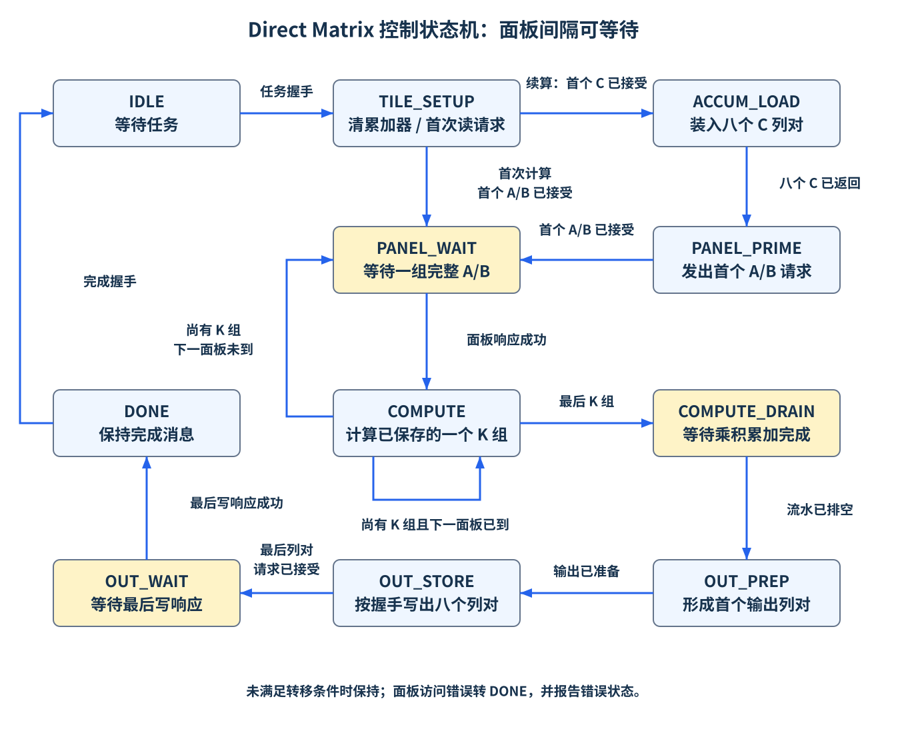

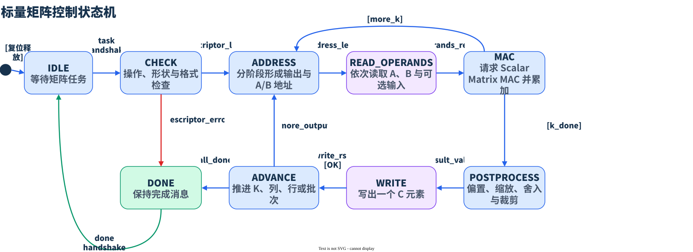

矩阵任务控制器在 `PATH_CLASSIFY` 后把任务交给 Direct Matrix Array 或 Scalar Matrix。两个子模块各自保持完成信息，顶层只转发当前选中子模块的完成信息及 `command_id`。

Direct Matrix Array 控制器的状态及功能如下：

| 状态 | 功能 |
| --- | --- |
| `ST_IDLE` | 接收专用 `DIRECT_GEMM` Task Context。Inline Decode 已经检查操作码、形状、数据格式、地址和面板排布要求；此处只确认已解码的 Direct 操作码并锁存任务字段。 |
| `ST_PARAM_REQ0`～`ST_PARAM_WAIT1` | profile 非零时读取参数记录。MQR1 顺序读取两个 128-byte panel；MQR2 用第一个 128-byte panel 取得全部 16 个 entry 并直接进入检查。请求或响应错误保存参数地址并结束。 |
| `ST_PARAM_CHECK` | 校验 header、entry、dtype 范围、K-group 和保留位；通过后才进入 A 缓存或计算准备。 |
| `ST_TILE_SETUP` | 清零 16×16 逻辑输出的累加上下文并复位 K 组读写游标；物理执行由兼容配置分 phase，128 PE 使用统一并行入口。`accumulate_c=0` 时在同一周期发出第一个 A/B 面板读；`accumulate_c=1` 时发出第一个 C 列对读。 |
| `ST_ACCUM_LOAD` | 连续读取 C 的其余七个列对，并把八个列对装入 4 个物理 PE 所保存的全部逻辑输出累加上下文。 |
| `ST_PANEL_PRIME` | C 载入完成后发出第一个 A/B 面板读。 |
| `ST_PANEL_WAIT` | 等待首组或后续一组面板响应；响应正确时把面板送入操作数寄存器并进入计算。 |
| `ST_COMPUTE` | 将已保存的一个 K 组发射到 PE 阵列，并接收下一组面板。未到最后一组且下一响应尚未到达时返回 `ST_PANEL_WAIT`，避免重复计算旧面板。 |
| `ST_COMPUTE_DRAIN` | 等待最后一个产品寄存器内容完成累加。 |
| `ST_OUT_PREP` | 选择第 0 个输出列对，把 16 个 INT32 行结果组装到输出寄存器。 |
| `ST_OUT_STORE` | 每拍从输出寄存器发出一个列对的 16 个 64-bit 写数据；发送当前列对时，PE 结果选择器切换到下一列对，下一拍装入输出寄存器。 |
| `ST_OUT_WAIT` | 等待最后一个 C 面板写响应；响应成功后结束本条任务。 |
| `ST_QUANT_ISSUE`～`ST_QUANT_DRAIN` | 每拍向 32 路 epilogue 提交一个列对，完成非对称修正、Q31 RNE、旧 C 累加、output zero point 和 clamp。 |
| `ST_QUANT_STORE`～`ST_QUANT_WAIT` | 按目标 dtype 打包并写回 64-bit L1 beat；最后一个成功响应把 progress 设为实际输出元素数。 |
| `ST_DONE` | 保持状态、错误地址和写回元素数，直到 TaskScheduler 接收完成信息。 |

Direct Matrix Array 的主要状态次序为：

直接矩阵阵列按图示状态完成面板准备、计算、排空和输出写回。

标量执行分支的状态及功能如下：

| 状态 | 功能 |
| --- | --- |
| `ST_IDLE` | `task_ready_o=1`；接收操作码与片上 Task Context |
| `ST_CHECK` | 检查操作、形状、数据格式、存储格式和地址 |
| `ST_START_OUTPUT` | 用 `output_addr_phase_q` 分三拍生成当前 `(batch,row,col)` 的 C、src2、bias 和整数重缩放参数完整地址：依次保存各类偏移、形成相对地址、加入基地址并保存 valid；第 1 拍同时清零 K 计数与累加值 |
| `ST_OUTPUT_CHECK` | 使用保存的 C 地址检查元素是否跨越 64-bit beat，并根据操作码、K 和后处理配置选择 A/B 读取、src2、bias、整数重缩放或后处理阶段 |
| `ST_ADDR_PREP` | 用 `operand_addr_phase_q` 分三拍生成 A/B 完整字节地址：依次保存元素与 Batch 偏移、形成相对地址、加入基地址并保存 valid |
| `ST_A_REQ` | 发出当前 `A[m,k]` 所在 8B beat 的读请求 |
| `ST_A_RSP` | 等待 A 读响应并提取、符号扩展一个元素 |
| `ST_B_REQ` | 发出当前 `B[k,n]` 所在 8B beat 的读请求 |
| `ST_B_RSP` | 等待 B 读响应并提取、符号扩展一个元素 |
| `ST_MAC_MUL` | 把当前 A/B 标量打包为共享 Matrix PE 的单点 `array_uop` 并等待接收，同时保存本次请求的数据类型 |
| `ST_MAC_ACC` | 等待 `array_uop` 返回并检查有效性；把 `(row0,col0)` 的 signed32 乘积符号扩展到 signed64 并加入 `accum_q` |
| `ST_SRC2_REQ` | `GEMM_ACCUM` 读取旧 C；内部 residual 功能也共用此状态 |
| `ST_SRC2_RSP` | 接收旧 C 并加入累加值 |
| `ST_BIAS_REQ` | 读取当前输出列的一个 INT32 bias |
| `ST_BIAS_RSP` | 接收 bias 并加入累加值 |
| `ST_REQUANT_REQ` | 当前指令使用片上 shift，直接装入乘数 1 和移位量 |
| `ST_REQUANT_RSP` | 保留给通过 L1 读取整数缩放项的内部路径；当前指令不会进入 |
| `ST_EPILOGUE` | 选择零值或累加值，按配置执行 ReLU，并保存后处理输入 |
| `ST_EP_MUL` | 持续两个周期。第一个周期并行保存 signed32 与 33-bit 非负乘数的 signed65 高半乘积，以及 unsigned32×unsigned32 的 unsigned64 低半乘积；第二个周期用 65-bit 加法合并高部，拼接低 32 bit 并符号扩展为 signed128 完整乘积 |
| `ST_EP_ABS` | 保存乘积正负号、signed128 绝对值、signed 8-bit shift 和舍入方式 |
| `ST_EP_SHIFT` | 执行 signed128 可变移位；正 shift 产生商、余数和中点，零 shift 保留乘积，负 shift 执行左移 |
| `ST_EP_ROUND` | 正右移时根据舍入方式、余数、中点、商最低位和正负号决定是否加一 |
| `ST_EP_INCREMENT` | 把舍入加一标志加入 128-bit 商 |
| `ST_EP_SIGN` | 按保存的正负号恢复 signed128 结果 |
| `ST_EP_NARROW` | 检查高 64 bit 是否等于 bit 63 的符号扩展；超出 signed64 范围时限制到最小值或最大值 |
| `ST_EP_ZERO_POINT` | 将 signed32 `output_zero_point` 符号扩展后加入 signed64 结果 |
| `ST_EP_CLIP` | 检查目标数据格式范围；按配置报告数值错误、保留低位或执行饱和 |
| `ST_WRITE_REQ` | 发送一个 C 元素对应的单 beat 写请求 |
| `ST_WRITE_RSP` | 等待写响应，增加进度并推进 col、row、batch |
| `ST_DONE` | 保持完成状态，直到 TaskScheduler 接收 |

主要状态次序为：

标量矩阵通路按地址形成、操作数读取、共享 Matrix `array_uop` 乘法、signed64 累加、可选后处理、写回和索引推进的次序执行；各阶段只有在前一阶段完成握手后才能前进。

两个控制器都不存在从片外读取任务参数的状态。任务接收后，检查直接使用已经锁存的片上 Task Context。Direct 与 Scalar 控制路径共用同一套 16×16 逻辑阵列，兼容模式按物理 PE 配置分 phase，并行模式使用八个 plane；Scalar 仍通过单点 `array_uop` 完成逐元素乘法。

### 11.10 功能时序

#### 11.10.1 `DIRECT_GEMM` 的面板预取与计算

以 INT8 的一个 (16\times16\) 输出 tile 为例，处理次序如下：

1. 矩阵任务控制器把已经通过 Inline Decode 检查的 `DIRECT_GEMM` 交给 Direct Matrix Array。Direct 控制器锁存任务字段，不重复比较整条 Task Context。
2. `ST_TILE_SETUP` 清零 4 个物理 PE 中覆盖 16×16 逻辑输出的累加上下文，并保存 A、B、C 面板基址。若 `accumulate_c=1`，控制器通过 `ST_ACCUM_LOAD` 连续读取八个 C 列对并装入 PE；兼容 C 使用面板端口，`compact_c=1` 使用普通 64-bit L1 端口。随后由 `ST_PANEL_PRIME` 发出第一个 A/B 面板读。若 `accumulate_c=0`，`ST_TILE_SETUP` 直接发出第一个 A/B 面板读。
3. A、B 面板读地址按当前 L1 bank 配置选择物理 bank 端口；通用顶层为十六 bank，SoC 为 64 bank，独立 L1 模块仍可显式使用四 bank。逻辑面板 lane 数不代表同时存在同数量的物理 SRAM bank，面板数据按控制器分阶段收集。
4. 第一个响应到达后，`ST_PANEL_WAIT` 把面板写入寄存器阵列。`ST_COMPUTE` 用该面板发出第一个 K=4 计算步。
5. 后续每个计算周期，PE 阵列使用已装入的面板进行一次 K=4 计算，同时控制器在接收下一面板响应时发起再下一面板请求。产品寄存器把乘法和局部累加分为相邻两拍；最后一组经过 `ST_COMPUTE_DRAIN` 排空。
6. `ST_OUT_PREP` 选择第 0 个输出列对。兼容 C 把 16 个 INT32 行结果组装到 1,024-bit 输出寄存器并连续执行 8 次面板写；`compact_c=1` 只取 row 0 的低、高 INT32，经普通 L1 端口连续写 8 个 64-bit word。第 0～6 个列对发送时，PE 结果选择器同时转到下一列对并在拍末装入下一组数据，因此两种模式的 8 次写请求之间都没有控制空拍。
7. `ST_OUT_WAIT` 收到最后一次写响应后报告本条命令完成。其他 M/N 输出块和 K 续算段由独立命令处理。

INT16 每个面板对应一个 K 位置：16 个 A word 与 4 个 B word 同时读取，每个 PE 在一个计算步处理一个 INT16 乘积。INT8 的 K 末组不足 4 个元素时，编译器把无效位置写为 0；M、N 尾部通过逻辑尺寸和面板补零处理。

#### 11.10.2 标量 GEMM 的一个输出元素

以 `C[m,n]` 为例，在没有 L1 仲裁等待时：

| 阶段 | 动作 |
| --- | --- |
| 1 | `ST_START_OUTPUT` 第 1 拍把 `accum_q` 和 `k_q` 清零，保存 C、src2、bias、整数重缩放项的各类偏移 |
| 2 | `ST_START_OUTPUT` 第 2 拍把 Batch 偏移与元素偏移相加，保存四类相对地址 |
| 3 | `ST_START_OUTPUT` 第 3 拍加入各自基地址，保存四类完整地址与 valid |
| 4 | `ST_OUTPUT_CHECK` 检查 C valid 并选择后续阶段 |
| 5 | `ST_ADDR_PREP` 用三拍依次保存 `A[m,0]`、`B[0,n]` 的各类偏移，形成相对地址，再加入基地址并保存完整地址和 valid |
| 6 | `ST_A_REQ/RSP` 使用保存且有效的 A 地址读取 `A[m,0]` |
| 7 | `ST_B_REQ/RSP` 使用保存且有效的 B 地址读取 `B[0,n]` |
| 8 | `ST_MAC_MUL` 把 A/B 标量打包后向共享 Matrix PE 发出单点 `array_uop` |
| 9 | `ST_MAC_ACC` 等待 `array_uop` 返回，并把 signed32 结果加入 signed64 `accum_q` |
| 10 | 对 `k=1` 到 `K-1` 重复三拍地址生成、A 读、B 读、共享阵列请求和累加 |
| 11 | 若启用 bias，先检查保存的 `bias_addr_valid_q`，再读取 `b[n]` 并加入累加值 |
| 12 | 若 C 不是 INT32，装入指令给出的右移位数 |
| 13 | `ST_EPILOGUE` 选择累加值并完成 ReLU，保存 signed64 后处理输入 |
| 14a | `ST_EP_MUL` 第一个周期把 signed64 后处理输入拆成高、低 32 bit，并行保存 signed65 高半乘积与 unsigned64 低半乘积 |
| 14b | `ST_EP_MUL` 第二个周期完成 65-bit 高部加法，拼接低 32 bit 并保存 signed128 完整乘积 |
| 15 | `ST_EP_ABS` 保存乘积正负号、绝对值、shift 和舍入方式 |
| 16 | `ST_EP_SHIFT` 执行可变移位；正右移保存商、余数和中点，零 shift 或负 shift 直接形成 signed128 移位结果 |
| 17 | 正右移时，`ST_EP_ROUND` 决定是否加一 |
| 18 | 正右移时，`ST_EP_INCREMENT` 把加一标志加入 128-bit 商 |
| 19 | 正右移时，`ST_EP_SIGN` 恢复结果正负号 |
| 20 | `ST_EP_NARROW` 把超出 signed64 范围的结果限制到 signed64 最小值或最大值 |
| 21 | `ST_EP_ZERO_POINT` 加入符号扩展后的输出 zero point |
| 22 | `ST_EP_CLIP` 检查目标格式范围，并按 `overflow_mode` 形成写回整数或报告错误 |
| 23 | 使用保存且有效的 C 地址写回并等待写响应 |
| 24 | `done_progress_o` 增加 1，状态机推进到下一个输出位置 |

A 和 B 不能并行读取。即使多个相邻元素位于同一个 64-bit beat，Matrix 也会为每个元素重新发送一次读请求。

正 shift 表示右移，其完整后处理次序为：

后处理依次完成乘数处理、幅值提取、移位、舍入、符号恢复、位宽限制、零点相加和目标格式裁剪。

shift 为 0 或负数时，`ST_EP_SHIFT` 已经得到带符号结果，因此跳过 `ST_EP_ROUND`、`ST_EP_INCREMENT` 和 `ST_EP_SIGN`，直接进入 `ST_EP_NARROW`。负 shift 的绝对值表示左移位数。无论采用哪条分支，zero point 都在 signed64 限制之后加入，目标 INT8、INT16 或 INT32 范围只在 `ST_EP_CLIP` 检查。

> [!example] 正右移的逐拍计算
> 设后处理输入为 \(-13\)，乘数为 1，shift 为 1，舍入方式为最接近且中点取偶数，输出 zero point 为 3，目标格式为 INT8。`ST_EP_MUL` 第一个周期分别保存高半乘积 \((-1)\times1=-1\) 和低半乘积 \(4294967283\times1\)，第二个周期把低半乘积的高 32 bit 加到高半乘积，再拼接低 32 bit，所得 signed128 完整乘积仍为 \(-13\)。`ST_EP_ABS` 保存负号和绝对值 13；`ST_EP_SHIFT` 得到商 6、余数 1、中点 1；`ST_EP_ROUND` 发现结果位于中点且商为偶数，因此加一标志为 0；`ST_EP_INCREMENT` 仍得到 6；`ST_EP_SIGN` 恢复为 \(-6\)；`ST_EP_NARROW` 得到 signed64 的 \(-6\)；`ST_EP_ZERO_POINT` 得到 \(-3\)；`ST_EP_CLIP` 确认 \(-3\) 可由 INT8 表示，最终写回 `0xfd`。

#### 11.10.3 GEMM_ACCUM

`GEMM_ACCUM` 完成 K 次乘加后增加一次旧 C 读取：

完成 K 次 A/B 读取和乘加后，读取旧的 C 元素，与新贡献相加并写回同一 C 元素。

写响应返回之前，状态机不会开始下一个输出元素。旧 C 与新 C 使用同一 L1 地址，但读和写由状态先后分开。

`GEMM_ACCUM` 与 `GEMM_ACCUM_HOLD` 均由 Scalar Matrix 执行。匹配的本地部分和状态有效时，`GEMM_ACCUM` 从 Scalar 的本地部分和 RAM 读取旧值；否则从 L1 读取旧 INT32 C。当前 K 段完成后，Scalar 将新贡献加入旧值并写回 C，完成后清除本地有效状态。

`GEMM_ACCUM_HOLD` 的处理次序为：

该操作可先读取本地部分和，再完成 A/B 读取、共享 Matrix PE 单点 `array_uop` 和 signed64 累加，随后写入本地部分和存储并推进到下一个输出元素。

它不把中间 C 写到 L1BUF。第一次 HOLD 在 `has_data=0` 时把本地旧值视为 0，后续 HOLD 先读取 RAM再累加。Matrix 顶层一次只接收一项 Matrix 任务，因此这些任务不与 Direct Matrix Array 并行执行。

#### 11.10.4 GEMM_ZERO

`GEMM_ZERO` 在 `ST_START_OUTPUT` 的三拍中保存各类偏移、形成相对地址，再加入 C 基地址并保存完整输出地址与 valid。经过 `ST_OUTPUT_CHECK` 完成 C 元素检查后进入 `ST_EPILOGUE`，保存固定值 0，再由 `ST_EP_CLIP` 生成 INT32 写回值。它不进入 A、B、旧 C、bias、重缩放乘法或移位状态。

#### 11.10.5 BMM

BMM 先完成当前 Batch 的全部 M×N 个输出，再把 `batch_q` 加 1，并使用 A/B/C batch stride 计算下一组起点。最后一个 Batch 的最后一个写响应返回后进入 `ST_DONE`。

### 11.11 访问次数、完成条件与错误处理

标量分支的一个普通 GEMM 输出元素需要：

$$
N_{\mathrm{read}}
=
2K
+
\begin{cases}
1,&\text{启用 bias},\\
0,&\text{未启用 bias},
\end{cases}
$$

以及一次 C 写请求。`GEMM_ACCUM` 每个输出再增加一次旧 C 读取。非 INT32 输出的右移参数由 Task Context 直接提供，不增加 L1 读取。

Direct Matrix Array 按当前输出 tile 和 K 组装载 A/B 面板。INT8 每个面板含 16 个 A word 与 8 个 B word，INT16 每个面板含 16 个 A word 与 4 个 B word；K 末组的无效操作数填 0。16×16 是兼容逻辑输出拓扑，不决定物理 PE 数；小配置按 phase、128 PE 按实际并行 packet 覆盖；各计算步共用已装入的 A 行值和 B 列值，因此同一 A 值参与 16 个输出列计算，同一 B 值参与 16 个输出行计算。具体面板格式见第 11.5.7 节。

Matrix 只在以下条件都满足后报告成功：

1. 最后一个 Batch、最后一行、最后一列已经完成写请求；
2. L1BUF 已返回该写请求的成功响应；
3. `done_progress_o` 已等于成功写回的输出元素总数。

任一 L1 响应非零时，Matrix 将其转换成任务错误并进入 `ST_DONE`。元素跨越单个 8B beat 或输出按配置处理失败时，`done_fault_addr_o` 保存对应地址；启动检查发现基地址高位非零时，该信号为 0。已经完成的输出不会回退，`done_progress_o` 保留错误发生前的成功写回数量。

> [!important] 吞吐特征
> Matrix Direct、Scalar Matrix 与 Vector MUL/FMA 共用 4 个物理 PE；Vector 的 ADD、比较、选择等轻量 ALU 不占这些 PE。Vector 乘法端口可能接受并排队任务请求，但只有阵列空闲时才能获得共享 PE 发射。Direct 任务可使下一 A/B 面板请求与当前 K 组计算重叠；Scalar/Vector 使用普通 64-bit L1 请求通路。性能统计应分别观察 Direct 面板等待、共享 PE 发射等待、普通 L1 等待以及任务接收和完成周期。

---

## 12. Matrix-Vector Engine：Integer Vector 子系统

### 12.1 定位与片上任务展开

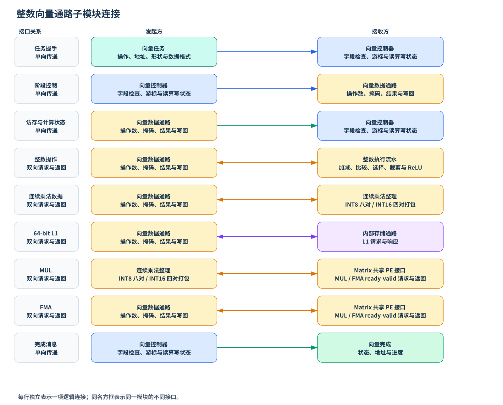

Integer Vector 子系统执行有符号整数逐元素运算。它包含连续 MUL 快速分支和通用标量分支：符合连续访问条件的 MUL 每次各读取一个 64-bit src0 beat 和一个 64-bit src1 beat，再将整拍分组请求送入 Matrix 引擎的共享 PE；广播、mask、FMA、非乘法操作、未对齐地址和其他步长组合继续逐元素执行。通用分支中的 MUL 和 FMA 也提交单元素共享 PE 请求，ADD、SUB、MAX、MIN、CMP、SELECT、CLAMP 和 ReLU 则由 Vector 控制器内的轻量整数 ALU 计算。乘法请求可能与 Direct/Scalar Matrix 竞争同一阵列，ready 低时 Vector 必须保持完整请求载荷。


Vector MUL/FMA 的乘法资源由 `npu_reconfigurable_matrix_vector_array` 提供。Vector 数据通路按 dtype 对输入 beat 分组并转换为共享 PE 请求/响应；它没有独立的 Vector Multiply Unit 或乘法器阵列。当前执行检查拒绝 INT4、INT32 乘数及异类型乘数，MUL/FMA 只接受同类型 INT8 或 INT16；INT4 可以用于轻量逐元素 ALU和存储，但不能通过共享乘法 PE。MUL/FMA 的具体组合由 Vector 描述符检查和共享 PE dtype 合同决定：

| Vector 乘数格式 | 每个共享 PE 请求中的输入 | 返回的乘积元素数 | 限制 |
| --- | --- | ---: | --- |
| INT8×INT8 | A、B 各打包 8 个有符号 byte，按相同索引配对 | 8 个 signed32 乘积 | 仅 elementwise 且 `group_enable=0001`；无独立 Vector 乘法器。 |
| INT16×INT16 | A、B 各打包 4 个有符号 halfword，按相同索引配对 | 4 个 signed32 乘积 | 仅 elementwise 且 `group_enable=0001`；无独立 Vector 乘法器。 |
| INT4、INT32 或异类型乘数 | 不提交共享阵列 | — | Vector MUL/FMA 任务检查返回 `DTYPE_UNSUPPORTED`。 |

共享 PE 返回逐元素 signed32 乘积与原始 tag、dtype、group 使能和结果数；Vector 控制器依次取回并格式化写回。`elementwise=1` 令 PE 根操作数按相同 lane 索引配对，而矩阵拓扑则按 K group 和输出 lane 选择操作数。不同 dtype 的每拍有效乘积数量取决于共享 4×8 cell 的组合方式，不能再按独立 Vector 乘法阵列的旧表估算。Direct/Scalar Matrix 占用阵列时，Vector 的乘法等待计入共享 PE wait，而非专用 Vector PE wait。

连续 MUL 快速分支的有效数据格式为 INT8 或 INT16。虽然 beat 分组器保留 INT4 格式计算代码，但当前 `NPU_VECTOR_MUL` 任务检查在进入快速分支前拒绝 INT4 乘数，因此这段 INT4 分组不代表可执行能力。快速分支的使用条件如下：

- 操作为 `VECTOR_MUL`，src0 与 src1 的格式相同且为 INT8 或 INT16，目的格式为 INT32；
- 不启用 mask、广播、立即数输入或其他 vector flag；
- src0、src1、dst 基地址均按 8B 对齐，输入元素步长分别为 0、1 或 2B，目的元素步长为 4B；
- 多行任务的输入行距等于该行实际字节数，目的行距等于 `length×4`，并且三组行距均满足 8B 请求要求。

快速 MUL 不在 IVE 内计算 src0、src1 与 dst 的完整存储区域是否相交。上层编译器必须根据 rows、length、各行步长和元素字节数计算三组占用区域，并把 src0、src1、dst 安排为两两不相交的 L1 区域；不满足该条件时不得生成快速 MUL 可接受的 Task Context。特别是 dst 为 INT32，写入字节数大于 INT8 输入，把 dst 放在任一输入起点附近可能在后续输入 beat 读取前覆盖源数据。

> [!example] 为什么快速 MUL 的目的区要避开输入区
> 一行 16 个 INT8 输入只占 16B，而 16 个 INT32 输出占 64B。若 src0 从 `0x100` 开始，dst 也从 `0x100` 开始，首个结果 beat 会改写 src0 的前 8B，后续结果还会覆盖 src0 的第二个输入 beat。快速分支不检查这类重叠，也不会为此返回 `ADDR_OVERLAP`，所以编译器必须在提交前改用另一段 L1 空间。

每对输入 beat 只读取一次。INT16 和 INT8 在已保存的 beat 上依次切换 4 组或 2 组；结果缓存随后每次取相邻两个 INT32 元素组成一个 64-bit 写请求。地址使用行基址和当前 beat 游标递增，L1 请求不经过 `row×stride+col×stride` 的当拍宽乘法。末拍不足完整输入 beat 时只写 `valid_length` 指定的有效结果。

外部主控处理器是 SoC 主控 CPU，不属于 NPU 硬件，也不直接连接 IVE。它通过 NPU 的 64-bit AXI Slave 提交指令；Command Front End 把完整指令交给 TaskScheduler。TaskScheduler 任务表保存指令、提交时基地址快照、事件和状态字段，不为每个等待任务保存 2048-bit Task Context。IVE READY 任务在逐槽扫描中获胜并通过结束时复查后，TS 保存发射窄快照，共享发射解码器随后产生展开数据并写入 IVE 发射暂存；下一周期 IVE 接收到 `opcode_i`、`command_id_i` 和 `desc_i[2047:0]`。Vector MUL/FMA 最终通过 Matrix 引擎的 shared PE 接口执行。


IVE 不读取外部任务参数，不经过 MIF 取得执行字段，也没有任务开始阶段的参数装载状态。地址、shape、广播方式、立即数和内部控制值都由共享发射解码器产生，并在发射暂存与 IVE 完成 ready/valid 握手后由 IVE 锁存。

### 12.2 模块级信号

整数向量通路的端口如下。所有 ready/valid payload 在 `valid=1` 且 `ready=0` 时保持不变。

| 信号 | 方向 | 位宽 | 作用 |
| --- | --- | ---: | --- |
| `clk_i` | Input | 1 | Core 时钟 |
| `reset_n` | Input | 1 | 低有效异步复位 |
| `task_valid_i` | Input | 1 | TaskScheduler 给出任务 |
| `task_ready_o` | Output | 1 | 仅 `ST_IDLE` 为 1 |
| `opcode_i` | Input | 8 | 展开后的内部操作码 `0x60～0x69` |
| `command_id_i` | Input | 12 | 内部任务编号；任务关联由 TaskScheduler 保存 |
| `desc_i` | Input | 2048 | IVE 发射暂存提供的当前任务 Task Context |
| `done_valid_o` | Output | 1 | 仅 `ST_DONE` 为 1，并保持到握手 |
| `done_ready_i` | Input | 1 | TaskScheduler 接收完成状态 |
| `done_status_o` | Output | 8 | `SUCCESS` 或首个失败状态 |
| `done_fault_addr_o` | Output | 48 | 发生字段、地址、L1 或数值错误时的相关地址 |
| `done_progress_o` | Output | 64 | 已收到成功写响应的目的元素数 |
| `l1_req_valid_o` | Output | 1 | L1 请求有效 |
| `l1_req_ready_i` | Input | 1 | L1 接收请求 |
| `l1_req_write_o` | Output | 1 | 0 为读，1 为写 |
| `l1_req_addr_o` | Output | 21 | 向下对齐到 8B 的 L1 字节地址 |
| `l1_req_wdata_o` | Output | 64 | 写数据 |
| `l1_req_wstrb_o` | Output | 8 | 每字节写使能 |
| `l1_rsp_valid_i` | Input | 1 | L1 返回有效 |
| `l1_rsp_ready_o` | Output | 1 | IVE 正在等待返回 |
| `l1_rsp_rdata_i` | Input | 64 | 读数据 |
| `l1_rsp_status_i` | Input | 3 | L1 返回状态 |
| `pe_req_valid_o` / `pe_req_ready_i` | Output / Input | 1 | MUL/FMA 乘法请求握手 |
| `pe_req_local_tag_o` | Output | 11 | Vector 控制器内部请求编号 |
| `pe_req_elementwise_o` | Output | 1 | Vector 固定为 1，要求逐元素结果 |
| `pe_req_dtype_a_o` / `pe_req_dtype_b_o` | Output | 各 2 | 两个乘数的数据类型 |
| `pe_req_group_enable_o` | Output | 4 | 本次使用的 PE group |
| `pe_req_operand_a_o` / `pe_req_operand_b_o` | Output | 各 256 | 四组 64-bit 打包操作数 |
| `pe_rsp_valid_i` | Input | 1 | Matrix engine 共享 PE 返回 Vector 请求结果有效 |
| `pe_rsp_local_tag_i` | Input | 11 | 返回的 Vector 内部请求编号 |
| `pe_rsp_element_count_i` | Input | 5 | 返回的 signed32 结果数量 |
| `pe_rsp_elements_i` | Input | 512 | 逐元素乘积返回接口；INT8 请求最多 8 个、INT16 请求最多 4 个 signed32 有效结果位于低位 |

Vector 控制器只有这一组内部 L1 请求和响应信号。src0、src1、src2、mask、目的旧值和目的写入在时间上共用它，不存在四组同时工作的源读端口。该内部端口先进入 内部存储通路。未命中旁路的 Vector 请求进入本路深度为 2 的 L1 请求队列；Matrix 使用另一队列，两路独立提交给 L1BUF。L1 响应不经过请求 FIFO，而是直接返回 内部存储通路，再送给 Vector 或 Matrix 请求方。Matrix 写回后的完整 64-bit beat 命中内部旁路时，Vector 读响应可由合并单元内部产生。

`reset_n=0` 时，IVE 把 `state_q` 置为 `ST_IDLE`，并清除 status、fault address、progress、快速分支活动标志和乘法未完成记录；共享 PE 的 Vector 请求响应寄存器由 Matrix engine 复位，不存在 Vector 私有乘法器或独立发射间隔计数。Task Context、地址、循环计数器、输入 beat、乘积数组、结果及写回数据属于 payload 寄存器，不使用复位清零；新任务在进入相应状态前覆盖将要使用的字段。状态回到 `ST_IDLE` 后，L1 请求 valid、共享 PE 请求 valid 和 done valid 均为 0，因此复位后的无效 payload 不会被使用。


### 12.3 指令展开得到的 IVE Task Context

软件只填写第 6.7.4 节中的指令位域。IVE READY 任务在逐槽扫描中获胜并通过结束时复查后，TaskScheduler 保存发射窄快照；共享发射解码器根据该任务保存的指令、提交时基地址快照、操作码和公共 dtype 组合出下表字段，并在解码周期末写入 IVE 发射暂存。下表规定 IVE 任务接口的内部字段合同；这些字段不属于任务表，也不是软件表。

| Byte Offset | 内部字段 | 位宽 | 指令展开值或作用 |
| ---: | --- | ---: | --- |
| `0x00` | 结构编号 | 8 | `1` |
| `0x01` | 执行单元类型 | 8 | `3`，表示 IVE |
| `0x02` | 有效字节数 | 16 | `192` |
| `0x08` | `src0_base` | 64 | `src0 LREF16 << 4` |
| `0x10` | `src1_base` | 64 | `src1 LREF16 << 4`；CLAMP、RELU 不使用 |
| `0x18` | `src2_base` | 64 | FMA 的 INT32 输入；其他普通操作不使用 |
| `0x20` | `dst_base` | 64 | `dst LREF16 << 4` |
| `0x28` | `mask_base` | 64 | SELECT 时由指令中的 `src2` 产生 |
| `0x38` | `numeric_cfg` | 32 | `[1:0] src0 dtype`、`[3:2] src1 dtype`、`[5:4] src2 dtype`、`[7:6] dst dtype` |
| `0x40` | `rows` | 32 | 指令中的 `rows_minus1 + 1`，范围 1～32 |
| `0x44` | `length` | 32 | 指令中的 `length_minus1 + 1`，范围 1～32 |
| `0x48` | `valid_length` | 32 | 公开指令固定等于 `length` |
| `0x4C` | `vector_flags` | 32 | SELECT 时 bit 0 为 1；其他公开指令写 0 |
| `0x50/0x54` | `src0_elem_stride/row_stride` | 各 32 | 连续元素大小与按广播方式得到的行字节数 |
| `0x58/0x5C` | `src1_elem_stride/row_stride` | 各 32 | 同上 |
| `0x60/0x64` | `src2_elem_stride/row_stride` | 各 32 | 同上 |
| `0x68/0x6C` | `dst_elem_stride/row_stride` | 各 32 | 连续输出元素大小与一行占用字节数 |
| `0x70` | `scalar0` | 32 | CLAMP 的 signed16 下限经符号扩展得到 |
| `0x74` | `scalar1` | 32 | CLAMP 的 signed16 上限经符号扩展得到 |
| `0x78` | `broadcast_mode` | 8 | `[1:0] src0`、`[3:2] src1`、`[5:4] src2` |
| `0x79` | `compare_mode` | 8 | CMP 的 EQ、NE、LT、LE、GT、GE 编码 |
| `0x7A` | `overflow_mode` | 8 | 公开指令展开固定为 0，即饱和 |
| `0x7B` | `mask_mode` | 8 | SELECT 为 1，其他公开指令为 0 |
| `0x7C～0x7F` | 保留字节 | 各 8 | 公开指令展开均为 0；非零时返回 `BAD_DESC` |
| `0x90` | `mask_elem_stride` | 32 | SELECT 固定为 1B |
| `0x94` | `mask_row_stride` | 32 | SELECT 固定为 `length` |

`vector_flags` 的内部任务信息还包含 bit 1 `mask_false_keep_dst`、bit 2 `src1_from_scalar0` 和 bit 3 `src2_from_scalar1`。公开指令不得产生这三种设置。SELECT 只使用 bit 0，其他操作的四个 bit 必须全部为 0。

公开指令展开后的数据格式组合如下。

| 指令 | src0 | src1 | src2 或 mask | dst |
| --- | --- | --- | --- | --- |
| ADD、SUB、MAX、MIN | 公共 dtype | 与 src0 相同 | 不使用 | 与 src0 相同 |
| MUL | INT8 或 INT16 | 与 src0 相同 | 不使用 | INT32 |
| FMA | INT8 或 INT16 | 与 src0 相同 | INT32 | INT32 |
| CMP | 公共 dtype | 与 src0 相同 | 指令中保存比较类型 | INT8，元素只能为 0 或 1 |
| SELECT | 公共 dtype | 与 src0 相同 | 同 shape INT8 mask | 与 src0 相同 |
| CLAMP | 公共 dtype | signed16 下限立即数 | signed16 上限立即数 | 与 src0 相同 |
| RELU | 公共 dtype | 不使用 | 不使用 | 与 src0 相同 |

Vector 的普通逐元素指令可按各自规则处理 INT4、INT8、INT16 或 INT32；MUL/FMA 只接受同类型 INT8 或 INT16 乘数，乘积和 FMA 结果写 INT32。INT4 乘法当前返回 `DTYPE_UNSUPPORTED`，不能因通用格式字段可编码 INT4 就认为乘法硬件支持该类型。

### 12.4 Shape、整数格式与广播

公开指令不能编码零尺寸，也不编码尾行缩短，因此有效元素数固定为

$$
E=R\,N,
$$

其中 $R=\texttt{rows}$，$N=\texttt{length}$。内部任务信息保留 `valid_length`，但公开指令展开必须令其等于 $N$；软件不得利用该内部字段表达缩短的尾行。

IVE 从 64 bit L1 返回中按 little-endian 次序取元素，并把全部输入符号扩展为 signed 64 bit。INT4 的地址和半字节选择按 [Packed INT4 存储 ABI](./INT4存储ABI.md) 解释。

| dtype | 编码 | 数值范围 | 连续存储 |
| --- | ---: | ---: | --- |
| INT4 | 0 | `[-8,7]` | 每字节两个元素，每行独立补齐 |
| INT8 | 1 | `[-128,127]` | 1B/元素 |
| INT32 | 2 | `[-2147483648,2147483647]` | 4B/元素 |
| INT16 | 3 | `[-32768,32767]` | 2B/元素 |

INT16 或 INT32 元素不得跨越一个 64 bit beat。元素首字节在 beat 内的位置分别不能大于 6 或 4；否则返回 `ADDR_FAULT`。公开指令给出的 LREF16 基地址按 16B 对齐，连续步长也与元素大小一致，因而连续张量满足该条件。

对任一输入 $x$，设基地址为 $a_0$，输出坐标为 $(r,c)$，元素步长为 $s_e$，行步长为 $s_r$，则四种广播方式的字节地址为

$$
\begin{aligned}
B=0:\quad &a(r,c)=a_0+r\,s_r+c\,s_e,\\
B=1:\quad &a(r,c)=a_0,\\
B=2:\quad &a(r,c)=a_0+r\,s_r,\\
B=3:\quad &a(r,c)=a_0+c\,s_e.
\end{aligned}
$$

其中 $B=0,1,2,3$ 分别表示输入 shape 为 `[R][N]`、`[1][1]`、`[R][1]`、`[1][N]`。目的张量不使用广播。对 INT4，式中的列项改为 $\lfloor c/2\rfloor s_e$，再由 $c\bmod2$ 选择低或高半字节；普通张量的 $s_e=1$ B、$s_r=\lceil N/2\rceil$ B。公开指令不能表达从高半字节开始的子区域。

### 12.5 运算、CMP mask 与 SELECT

设当前位置符号扩展后的输入为 $a$、$b$、$c$，CLAMP 下限和上限为 $l$、$h$，输出写入前的 signed 64 bit 数学结果为 $t$。IVE 计算

$$
\begin{aligned}
\operatorname{ADD}:&\quad t=a+b,\\
\operatorname{SUB}:&\quad t=a-b,\\
\operatorname{MUL}:&\quad t=a\,b,\\
\operatorname{FMA}:&\quad t=a\,b+c,\\
\operatorname{MAX}:&\quad t=\max(a,b),\\
\operatorname{MIN}:&\quad t=\min(a,b),\\
\operatorname{CLAMP}:&\quad t=\min(\max(a,l),h),\\
\operatorname{RELU}:&\quad t=\max(a,0).
\end{aligned}
$$

这里的 FMA 是整数乘法后加法，不是 FP32 fused multiply-add。FMA 与未进入快速分支的 MUL 在 `ST_MUL` 向共享 Matrix PE 提交一个逐元素请求；FMA 的第三输入为 signed32。硬件在 `ST_MUL_POST` 等待返回，检查 tag、数据类型、group 使能、错误标志和结果数量，再把 signed32 乘积扩展到 signed64、执行可选加法并处理输出范围。连续 MUL 快速分支不改变数学公式：Vector 数据通路把输入 beat 转为共享阵列支持的有符号乘积请求，按返回的 lane 和 tag 恢复结果顺序。CLAMP 要求 $l\le h$。

CMP 根据 `compare_mode` 计算

$$
m=
\begin{cases}
1,&a\ \mathcal{C}\ b,\\
0,&\text{其他情况},
\end{cases}
$$

其中 $\mathcal{C}$ 依次可选 `==`、`!=`、`<`、`<=`、`>`、`>=`。$m$ 作为 INT8 字节写到目的张量，它可以直接供后续 SELECT 使用。

SELECT 从单独的 INT8 mask 地址读取字节 $m$，并执行

$$
y=
\begin{cases}
b,&m\ne0,\\
a,&m=0.
\end{cases}
$$

因此，mask 非零时选择 src1，mask 为 0 时选择 src0。指令中的 `src2` 在片上展开为 `mask_base`，不作为第三个算术输入。

> [!example] CMP 产生 mask，再由 SELECT 使用
> 令 src0 为 `[1,2,-3,4]`，src1 为 `[5,-2,7,8]`。CMP 选择 LT 后写出 `[1,0,1,1]`，因为 `1<5`、`-3<7` 和 `4<8` 成立。若另一个 SELECT mask 为 `[0,1,0,1]`，SELECT 输出 `[1,-2,-3,8]`：第 0、2 项取 src0，第 1、3 项取 src1。

> [!example] 整数 FMA
> 令 $a=[1,2,-3,4]$，$b=[5,-2,7,8]$，$c=[10,20,30,40]$，则 $a\,b+c=[15,16,9,72]$，输出为 INT32。

引擎计算 $t$ 后与目的 dtype 的最小值和最大值比较。`VECTOR_ADD` 由 `overflow_mode` 选择范围处理：0 表示饱和，2 表示保留目的位宽低位后按二进制补码解释。其他公开 IVE 指令固定选择饱和。内部 Task Context 还保留编码 1 的数值异常处理能力，但公开指令不得生成该编码。普通 IVE 指令不携带 scale 或 zero point，IVE 也不比较 FP32 scale。两个张量代表的实数单位不同时，应使用 CME 的 `COMPLEX_ADD_RESCALE`。

> [!example] ADD 的饱和与低位保留
> INT8 输入 $a=127$、$b=1$ 时，`overflow_mode=0` 写出 127，`overflow_mode=2` 写出二进制编码 `0x80`，按 INT8 解释为 -128。未显式指定范围处理方式的编译入口必须选择编码 0。

### 12.6 控制状态与功能时序

IVE 的主控制状态与 硬件 枚举一致：

| 状态 | 动作 |
| --- | --- |
| `ST_IDLE` | `task_ready_o=1`；与 IVE 发射暂存握手后锁存操作码和完整 Task Context |
| `ST_CHECK` | 检查结构编号、执行单元类型、有效字节数、dtype、shape、mask、地址和操作组合；初始化行列游标以及快速分支的行基址、当前行元素数和末行标志 |
| `ST_ADDR_PREP` | 通用分支保存当前元素的五组行偏移 |
| `ST_ADDR_ROW_ADD` | 分别计算 src0、src1、src2、mask、dst 的基址加行偏移，同时保存五组列偏移 |
| `ST_ADDR_FINAL` | 在前一拍结果上加入列偏移，形成五组完整字节地址 |
| `ST_ADDR_CHECK` | 检查五组地址是否位于 21-bit L1 地址范围，并检查各数据元素是否跨越 8B beat；检查结果写入专用 valid 寄存器 |
| `ST_MASK_REQ/RSP` | SELECT 读取一个 INT8 mask 字节 |
| `ST_SRC0_REQ/RSP` | 读取并符号扩展 src0 |
| `ST_SRC1_REQ/RSP` | 需要时读取并符号扩展 src1 |
| `ST_SRC2_REQ/RSP` | FMA 读取 INT32 src2 |
| `ST_KEEP_REQ/RSP` | 内部 mask-false 保持模式读取旧目的值；公开指令不进入该状态 |
| `ST_EXEC` | 执行 ADD、SUB、MAX、MIN、CMP、SELECT、CLAMP 或 RELU，并完成范围处理 |
| `ST_MUL` | 把一个元素的两个乘数打包，向 Matrix 引擎共享 PE 端口发出请求，并保存 tag、数据类型、group 使能和预期结果数 |
| `ST_MUL_POST` | 等待共享 PE 返回并检查保存的请求信息；把 signed32 乘积扩展到 signed64，执行可选 FMA 加法、范围处理和写回状态选择 |
| `ST_FAST_ADDR_CHECK` | 快速分支检查当前 src0、src1 地址是否位于 21-bit L1 地址范围且按 8B 对齐 |
| `ST_FAST_SRC0_REQ/RSP` | 快速分支读取并保存一个 64-bit src0 beat |
| `ST_FAST_SRC1_REQ/RSP` | 快速分支读取并保存一个 64-bit src1 beat |
| `ST_FAST_MUL_REQ` | 向 Matrix 引擎共享 PE 提交当前输入格式、group 使能和整拍操作数 |
| `ST_FAST_MUL_WAIT` | 等待共享 PE 返回，检查 tag 和结果数，按请求 lane 顺序保存 signed32 结果 |
| `ST_FAST_WRITE_PREP` | 保存当前输出对的 48-bit 地址、64-bit 写数据和 8-bit strobe；末尾剩一个结果时高 32 bit 写 0，并把 strobe 设为 `8'h0f` |
| `ST_FAST_WRITE_CHECK` | 检查 `ST_FAST_WRITE_PREP` 保存的目的地址是否位于 21-bit L1 地址范围且按 8B 对齐 |
| `ST_FAST_WRITE_REQ` | 只用快速写寄存器和地址检查寄存器发出请求；请求握手时保存本次进度增量和写响应后的动作 |
| `ST_FAST_WRITE_RSP` | 等待写响应；成功时使用保存的进度和动作进入下一输出对、下一输入 beat、下一行或完成状态 |
| `ST_WRITE_REQ/RSP` | 发出带 `WSTRB` 的目的写，并等待写完成状态 |
| `ST_DONE` | 保持完成 payload，直到 `done_ready_i=1` |

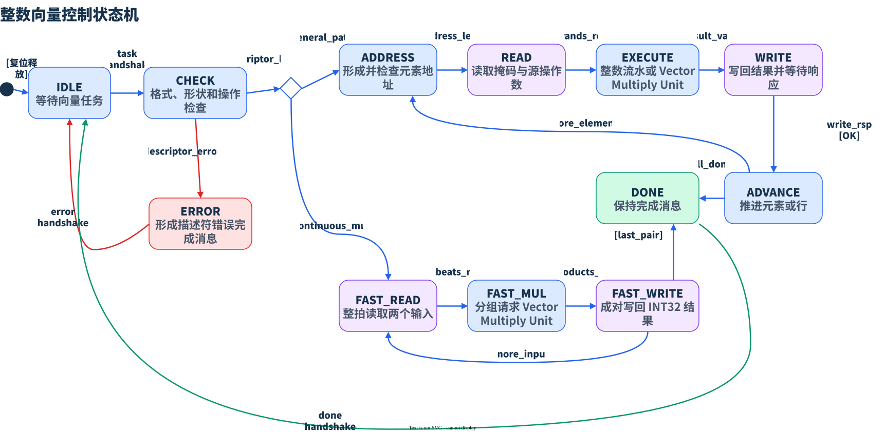

通用标量分支中，每个元素依次经过 `ST_ADDR_PREP → ST_ADDR_ROW_ADD → ST_ADDR_FINAL → ST_ADDR_CHECK`。第一拍保存行偏移，第二拍执行基址加行偏移并保存列偏移，第三拍加入列偏移，第四拍检查完整地址和跨 beat 条件。后续请求、响应、计算与写回状态都读取 `element_src0_addr_q`、`element_src1_addr_q`、`element_src2_addr_q`、`element_mask_addr_q`、`element_dst_addr_q` 和地址 valid 寄存器。写响应成功后先更新行列游标，再返回 `ST_ADDR_PREP`，因此下一元素的行步长、列步长与广播地址运算不会串接到当前写响应的状态选择中。

一个没有 mask 的双输入非乘法元素至少包含四个地址处理周期、两次读请求/响应、一个 `ST_EXEC` 周期和一次写请求/响应。未进入快速分支的 MUL 在两次输入读取后还经过 `ST_MUL` 和 `ST_MUL_POST`；FMA 额外读取一次 src2，再经过相同的两个计算状态。SELECT 额外读取一次 mask。实际周期数还包含 L1 的 `ready` 等待和响应延迟。

连续 MUL 快速分支按输入 beat 工作：每个 beat 有两次 L1 读请求，INT8 每 beat 处理 8 对输入、INT16 每 beat 处理 4 对输入；每个 beat 只向 Matrix engine 的共享 PE 提交一次打包请求，然后发出 4 或 2 次 INT32 写请求。INT4 虽有遗留的 16 元素分组逻辑，但当前 MUL 任务检查拒绝 INT4，不会进入该执行流程。每个 64-bit 写 beat 携带两个 INT32，末尾只剩一个有效元素时仅使用低 4B。全部乘法结果保存后，首个输出对先进入 `ST_FAST_WRITE_PREP`；后续每个 `NEXT_PAIR` 也先返回该状态。该状态把 `fast_dst_write_addr`、当前两个结果组成的 64-bit 数据和 strobe 分别保存到 `fast_write_addr_q`、`fast_write_data_q` 与 `fast_write_strb_q`。`ST_FAST_WRITE_REQ` 的 L1 地址、数据和 strobe 只读取这些寄存值，因此请求暂停时三项保持不变。`ST_CHECK` 保存首行元素数和是否为末行；每次进入新行时，`ST_FAST_WRITE_RSP` 提前保存下一行的元素数和末行标志，最后一行使用 `valid_length`，其他行使用 `length`。

在 `ST_FAST_WRITE_REQ` 与 L1 完成请求握手时，IVE 根据当前写下标、当前输入 beat 有效元素数、当前列位置、当前行元素数和末行标志，把以下两项写入寄存器：

| 寄存值 | 可能值 | 作用 |
| --- | --- | --- |
| `fast_write_progress_q` | 1 或 2 | 本次成功写回的 INT32 元素数 |
| `fast_write_action_q` | `NEXT_PAIR`、`NEXT_BEAT`、`NEXT_ROW`、`DONE` | 写响应成功后要执行的游标更新 |

`ST_FAST_WRITE_RSP` 收到成功响应后只增加保存的进度，并按保存的动作更新游标。`NEXT_PAIR` 把写下标增加 2；`NEXT_BEAT` 把输入地址各增加 8B并把目的地址增加一个输入 beat 对应的 INT32 字节数；`NEXT_ROW` 装入下一行基址并更新当前行元素数；`DONE` 进入完成状态。响应周期不再重新计算“是否末对、末 beat、末行”，L1 返回状态和后续控制选择之间只经过窄寄存字段。该分支在完成当前输入 beat 的全部结果写入后才读取下一 beat，尚未把 L1 访问与共享 PE 请求或写回交叠。周期估算必须依据数据格式、乘法请求数、输出写 beat 数和 L1 等待时间计算。

> [!example] 快速写后动作
> 对一行 9 个 INT8 元素，首个输入 beat 包含 8 个有效元素，快速分支产生 4 个 64-bit 目的写请求。每个输出对都先在 `ST_FAST_WRITE_PREP` 保存地址、两个 INT32 结果和 `8'hff` strobe，再进入请求状态。前三次请求分别保存 `NEXT_PAIR`，第 4 次保存 `NEXT_BEAT`；对应写响应成功后才把输入地址各增加 8B并开始读取最后 1 个元素。末拍的准备状态把最后一个结果放在低 32 bit、高 32 bit 写 0，并保存 `8'h0f` strobe；请求握手时 `fast_write_progress_q=1`。若这是最后一行，动作保存为 `DONE`；若后面还有一行，则保存为 `NEXT_ROW`。因此完成进度最终增加 \(8+1=9\)。

标量分支每个目的写响应成功后，`done_progress_o` 增加 1。连续 MUL 分支按本次写 beat 中的有效 INT32 元素数增加 2 或 1。若第 $k$ 个元素失败，进度保留此前已经成功写完的元素数，`done_fault_addr_o` 保存当前相关地址。L1 status 1、2 分别转换成 `BUS_SLVERR`、`BUS_DECERR`，其他非零编码转换成 `ADDR_FAULT`。

Vector 不再有独立乘法单元；`ST_MUL` 与 `ST_FAST_MUL_REQ` 通过 Matrix 引擎的共享 PE 请求接口参与阵列 ready/valid 仲裁。等待期间操作数、tag、数据类型、elementwise 标志和 group 使能必须保持不变。Direct/Scalar Matrix 使用阵列时，Vector 乘法无法同周期发射；ADD、SUB、MAX、MIN、CMP、SELECT、CLAMP 和 ReLU 走轻量 ALU，但仍可能因普通 L1 共享端口而等待。

Matrix 成功写回的 64-bit beat 会在 Matrix-Vector 存储路径中保存写控制字段，并在 L1 成功响应后更新 2 项内部旁路缓存。Vector 读命中且该 beat 的八个字节全部有效时，合并单元直接产生 Vector 响应；未命中、部分字节无效、存在同地址待写请求或早先 Vector L1 读尚未返回时，仍通过 L1BUF 读取。Vector、DMA、CME 或外部 L1 窗口写同一 beat 时，对应缓存字节失效。

---

## 13. Complex Math Engine

### 13.1 定位与内部结构

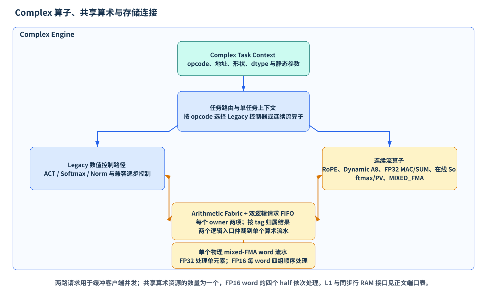

单物理流水是资源对照配置；当前公共后端为两条物理流水，在线 PV 可选八条，详见本节。

Complex Math Engine（CME）接收整数张量，也接收由 INT32/INT16 dtype 分别承载的 binary32/binary16 位型。激活函数、Softmax、Norm 和幂指数 ADD_RESCALE 使用内部浮点算术；定点 ADD_RESCALE、MUL_RESCALE 和 REQUANTIZE 使用 offset、Q31 multiplier/shift。I2F/F2I 可显式转换，MIXED_FMA 接收混合整数/浮点操作数。软件传送位型和静态参数，不在 CPU 上执行这些浮点算子。

公共 `npu_complex_fma_pair_pipeline` 保留两条物理混合精度 FMA，各自有两项响应 FIFO。
每条输入 word 为 64 bit，FP32 使用低 32 bit，`FP16_ELEMENTS=4` 可并行处理四个 half。
两条物理流水的饱和上限为两个 FP32 或八个 FP16/拍，实际仍受输入和写回限制。
单物理流水是可配置的资源对照方式，不能用旧单流水描述当前默认后端。

ADD 使用 `A×1+C`，MUL 使用 `A×B+0`，MAC 使用三操作数 FMA，共用乘加组件。
公共 lane 0 还处理 scalar math，`shared_alu_flight_q` 在此期间保护返回归属并阻止冲突请求。
因此该标量接口不具备独立的每拍吞吐能力；函数内部的顺序依赖也不会因 FMA 复制而消失。

在线 Softmax/PV 的 `ONLINE_LANES=8` 配置复用公共两路并补六路 FP32 流水，按整组原子发射、
保留每 lane tag、对应返回一同退休。PV value 读取为 128 bit，内部 numerator bank 保存
每 lane 的统计状态；Q、V、权重广播和反馈依赖共同决定实际使用率。四路兼容配置应同时
检查逻辑 lane 数和物理流水数，不能用逻辑端口数量推导算力。

物理 FMA 包含分类、可选 I2F、指数对齐、部分积、加减、LZC、规格化和末端 RNE，反压时
保持数据及 tag。packed FP16 计算与最终定点写回宽度不同：定点出口每拍转换一个 64-bit
word，含四个 FP16 或两个 FP32；八个 FP16 的块用两拍输出，不增加虚拟写带宽。

RoPE、ADD/SUM/MAC 和 MIXED_FMA 使用各自的槽、读 tag 和写队列以重叠读、算、写。
普通请求口和独立写口分别接到 L1 客户端；在线 PV 另有 128-bit 读口。Complex 一次只保存
一项活动任务，各流复用共享算术，不能把 Matrix/Complex 跨引擎并行等同于多个 Complex
算子可任意同时运行。归约、供数、返回等待及同 bank 竞争均计入任务周期。

### 13.2 模块级信号

复杂数学执行单元与 IVE 使用相同形态的任务、完成和单拍 L1 接口：

| 信号 | 方向 | 位宽 | 作用 |
| --- | --- | ---: | --- |
| `clk_i`、`reset_n` | Input | 各 1 | Core 时钟与低有效异步复位 |
| `external_write_hazard_i` | Input | 1 | 指示外部共享 L1 客户端存在同址写冲突；相关流式引擎据此保持写回或推迟危险访问 |
| `write_intent_o`、`write_intent_addr_o` | Output | 1 / 21 | 提前声明当前任务的写意图及 L1 字节地址，供顶层共享写冲突检查；不代表写事务已握手 |
| `task_valid_i`、`task_ready_o` | Input/Output | 各 1 | 任务握手；ready 仅在 `ST_IDLE` 为 1 |
| `opcode_i` | Input | 8 | 第 6 章列出的 Complex opcode；具体接受集合受 legacy/stream 参数裁剪影响 |
| `command_id_i` | Input | 12 | 内部任务编号 |
| `desc_i` | Input | 2048 | CME 发射暂存提供的当前任务 Task Context |
| `done_valid_o`、`done_ready_i` | Output/Input | 各 1 | 完成握手 |
| `done_status_o` | Output | 8 | 任务状态 |
| `done_fault_addr_o` | Output | 48 | 首个失败相关地址 |
| `done_progress_o` | Output | 64 | 已成功写完的输出元素数 |
| `l1_req_valid_o`、`l1_req_ready_i` | Output/Input | 各 1 | L1 请求握手 |
| `l1_req_write_o` | Output | 1 | 读写方向 |
| `l1_req_addr_o` | Output | 21 | 8B 对齐的 L1 地址 |
| `l1_req_wdata_o` | Output | 64 | 写数据 |
| `l1_req_wstrb_o` | Output | 8 | 字节写使能 |
| `l1_rsp_valid_i`、`l1_rsp_ready_o` | Input/Output | 各 1 | L1 响应握手 |
| `l1_rsp_rdata_i` | Input | 64 | L1 读数据 |
| `l1_rsp_status_i` | Input | 3 | L1 状态 |

Complex 另有一组只写方向的独立 L1 端口。它在 `npu_single_core_top` 中接到第七个普通客户端，不与普通 Complex 请求口在引擎内部仲裁；当前主要用于支持读旧数据、计算新数据和写回同时推进的流式操作。没有独立读数据字段，因为该端口不发起读请求。

| 信号 | 方向 | 位宽 | 作用 |
| --- | --- | ---: | --- |
| `l1_write_req_valid_o`、`l1_write_req_ready_i` | Output/Input | 各 1 | 独立写请求握手；ready/valid 同时为 1 时接受一次写入 |
| `l1_write_req_addr_o` | Output | 21 | 8-byte 对齐的 L1 字节地址 |
| `l1_write_req_wdata_o` | Output | 64 | 写入数据 |
| `l1_write_req_wstrb_o` | Output | 8 | 每字节写使能 |
| `l1_write_rsp_valid_i`、`l1_write_rsp_ready_o` | Input/Output | 各 1 | 独立写响应握手 |
| `l1_write_rsp_status_i` | Input | 3 | L1 写状态；失败按当前任务首错规则形成错误完成 |

独立端口表示引擎可同时提出一笔普通端口请求和一笔专用写请求，不表示 L1 每 bank 有两个读口或任意地址上的双写能力。实际接受率仍受 L1 bank 仲裁、bank/row 冲突、写队列空间及返回背压限制；同一拍的两个引擎请求也不保证落在不同 bank。

模块没有独立的 `busy`、I2F active、FP active、F2I active 或 numeric flag 输出。接口接收任务后至完成握手前视为忙，内部数学阶段不构成软件可见状态。

复杂数学执行单元的复位清除主状态、phase、status、fault address 和 progress。Task Context、行列计数、输入值、统计值、FP32 工作值、数学请求 payload 和写回数据寄存器不依赖复位清零。新任务在 `ST_IDLE` 锁存 Task Context，每行在 `ST_ROW_INIT` 初始化该行所需统计寄存器，数学状态在发出请求前装入操作数。主状态回到 `ST_IDLE` 后，L1 请求 valid 和 done valid 均为 0。

在线 PV 另有 `pv_read_valid_o/ready_i`、21-bit `pv_read_addr_o`、
`pv_read_rsp_valid_i/ready_o`、128-bit `pv_read_rsp_data_i` 和 3-bit status。
此口在 fabric 展开为两个有序 64-bit bank lane，错误与数据一同返回，不能仅接低 word。

### 13.3 指令展开得到的 CME Task Context

CME READY 任务在逐槽扫描中获胜并通过结束时复查后，TaskScheduler 保存发射窄快照；共享发射解码器读取该任务保存的指令和提交时基地址快照，把第 6.7.5 节的指令位域展开为以下内部字段，并在解码周期末写入 CME 发射暂存。任务表不保存这些 2048 bit 展开字段。正常指令的 `rows` 范围为 1～32，`length` 范围为 1～256，`valid_length` 固定等于 `length`；分片指令固定 `rows=1`。

| Byte Offset | 内部字段 | 位宽 | 作用 |
| ---: | --- | ---: | --- |
| `0x00` | 结构编号 | 8 | `1` |
| `0x01` | 执行单元类型 | 8 | `4`，表示 CME |
| `0x02` | 有效字节数 | 16 | `256` |
| `0x08` | `src0_base` | 64 | 主输入 L1 地址 |
| `0x10` | `src1_base` | 64 | ADD_RESCALE、MUL_RESCALE 第二输入或 Norm gamma |
| `0x18` | `src2_base` | 64 | LayerNorm beta；其他公开操作为 0 |
| `0x20` | `dst_base` | 64 | 输出地址 |
| `0x38` | `numeric_cfg` | 32 | 四路 dtype、RNE、范围处理、scale 模式、zero point 参数使能和内部 FP32 使能；ARGMAX 用 bit 16 区分 raw binary32 与整数比较 |
| `0x40` | `rows` | 32 | 行数 |
| `0x44` | `length` | 32 | 每行元素数 |
| `0x48` | `valid_length` | 32 | 公开指令固定等于 `length` |
| `0x4C` | `function_mode` | 32 | 0～3 激活、4 Softmax、5 LayerNorm、6 RMSNorm、7～9 统计、12 不同 scale 加法、13 定点重量化乘法、14 整数定点重量化、16 FP32_ADD、17 FP32_SUM、18 FP32_MAC、19 FP32_REQUANTIZE、20 ARGMAX |
| `0x50` | `src0_row_stride` | 32 | 主输入连续一行的字节数 |
| `0x54` | `src1_row_stride` | 32 | ADD_RESCALE、MUL_RESCALE 为连续一行字节数；Norm 参数为 0 |
| `0x58` | `src2_row_stride` | 32 | 公开指令固定为 0 |
| `0x5C` | `dst_row_stride` | 32 | 普通输出为连续一行字节数；统计为 4 |
| `0x60` | `mask_base` | 64 | Softmax boolean mask |
| `0x68` | `mask_row_stride` | 32 | boolean mask 固定为 `length` |
| `0x6C` | `mask_mode` | 32 | 0 none、1 boolean、3 每行有效长度 |
| `0x70` | `src0_scale_bits` | 32 | 主输入 scale 的 FP32 位模式 |
| `0x74` | `src1_scale_bits` | 32 | 第二输入或 gamma scale |
| `0x78` | `src2_scale_bits` | 32 | beta scale；Norm 中与 gamma scale 相同 |
| `0x7C` | `dst_scale_bits` | 32 | 输出 scale |
| `0x80～0x8C` | 四个 zero point | 各 32 | 指令展开固定全部为 0；ACT 和 SOFTMAX 数值参数模式在执行前取得输入与输出 zero point，NORM 数值参数模式取得主输入、gamma、beta 与输出 zero point |
| `0x90` | `epsilon_bits` | 32 | Norm 使用的正 FP32 $\epsilon$ |
| `0x94/0x98` | 输入限制最小值/最大值 | 各 32 | ACT 的 profile 范围；Softmax 固定 `[-16,16]` |
| `0x9C` | `approx_mode` | 8 | 公开指令固定为 0 |
| `0x9D` | `overflow_mode` | 8 | 普通 CME 指令与统计指令均固定为 0 |
| `0x9E` | `all_mask_mode` | 8 | Softmax 全无效行写 0 或报数值错误 |
| `0x9F` | `stats_mode` | 8 | 公开指令固定为 0，即 LayerNorm 两次统计扫描 |
| `0xA0` | `qparams_base` | 64 | ACT、SOFTMAX、NORM 数值参数模式，整数定点 ADD_RESCALE、MUL_RESCALE、REQUANTIZE，或 FP32_REQUANTIZE 的 64-byte L1BUF 参数记录首地址；其他指令固定为 0 |
| `0xAC` | `stream_mode` | 8 | FP32_SUM 和 ARGMAX 使用低 3 bit 保存第 6.7.5 节的 `slice_role`；FP32_MAC 使用 bit 0 `src0_i32`、bit 1 `row_scale_enable`、bit 2 `src1_feature_broadcast`；其他位按操作固定为 0 |
| `0xAD` | `src1_broadcast` | 8 | 整数定点 ADD_RESCALE、MUL_RESCALE 的第二输入广播方式；其他指令固定为 0 |
| `0xB0` | `scratch_request_elems` | 32 | Softmax 和 Norm 为 `length`；其他为 0 |
| `0xB4` | `query_position_base` | 32 | 引擎内部 causal Softmax 的首行 query 位置；正常指令入口不启用 causal |
| `0xB8` | `key_position_base` | 32 | 引擎内部 causal Softmax 的第 0 列 key 位置；正常指令入口不启用 causal |
| `0xBC` | `query_position_step` | 32 | 引擎内部 causal Softmax 每增加一行时 query 位置的增量；正常指令入口不启用 causal |
| `0xC0` | `valid_length_base` | 64 | Softmax 每行有效长度数组地址 |
| `0xC8` | `valid_length_stride` | 32 | 该模式固定为 4B |

公共 dtype 和各操作专有字段展开如下：

| 指令 | src0 | 辅助输入 | dst | scale 与参数 |
| --- | --- | --- | --- | --- |
| ACT 幂指数模式 | 公共 dtype | 无 | 指令选择 INT8、INT16 或 INT32 | src、dst 各一个 signed4 指数；函数与 clip profile 来自指令 |
| ACT 数值参数模式 | INT8 或 INT16 | 无 | 与 src0 相同 | 64-byte L1BUF 激活数值参数记录 |
| SOFTMAX 幂指数模式 | 公共 dtype | boolean mask 或逐行 INT32 长度 | 指令选择 INT8、INT16 或 INT32 | src、dst 各一个 signed4 指数 |
| SOFTMAX 数值参数模式 | INT8 或 INT16 | 无 | 与 src0 相同 | 64-byte L1BUF Softmax 数值参数记录 |
| NORM 幂指数模式 | 公共 dtype | gamma 与可选 beta 都使用公共 dtype | 指令选择 INT8、INT16 或 INT32 | src、参数、dst 各一个 signed4 指数；epsilon 使用 profile |
| NORM 数值参数模式 | INT8 或 INT16 | gamma 与可选 beta 都使用 src0 dtype | 与 src0 相同 | 64-byte L1BUF Norm 数值参数记录 |
| STAT | 公共 dtype | 无 | INT32，每行一个 | 不使用 FP32 scale |
| ARGMAX | INT8、INT16、INT32，或以 INT32 为容器的 raw binary32 | 无 | INT32，每行一个首个最大值索引 | `fp32_input=1` 选择 binary32 比较；不使用 FP32 scale；分片时索引基址在 CME 内累计 |
| ADD_RESCALE 幂指数模式 | 公共 dtype | 第二输入也使用公共 dtype | 指令选择 INT8、INT16 或 INT32 | src0、src1、dst 各一个 signed4 指数 |
| ADD_RESCALE 整数定点模式 | INT8 或 INT16 | 与 src0 相同，可广播 | 与 src0 相同 | 64-byte L1BUF 定点数值参数记录 |
| MUL_RESCALE | INT8 或 INT16 | 与 src0 相同，可广播 | 与 src0 相同 | 64-byte L1BUF 乘法定点数值参数记录 |
| REQUANTIZE | INT8、INT16 或 INT32 | 无 | INT4、INT8 或 INT16 | 64-byte L1BUF 重量化定点参数记录 |

ARGMAX 的 `matrix_tiled_c=1`（cmd128 payload bit12）选择单行 Matrix compact-C 布局，支持
INT8 或 INT16：每 64-byte tile 的前 16 或 32 byte 存放 16 个有效列，其余空间不参与比较。
元素 $i$ 的地址为 `base + (i/16)*64 + (i%16)*element_bytes`。该模式与 raw binary32 输入互斥；
PARTIAL/FINAL 链的 dtype 必须一致，索引相对有效元素的拼接序列累计，不包含 tile padding。
连续读取每拍分别比较八个 INT8 或四个 INT16 候选，输出均为一个 INT32 全局索引。

signed4 指数 $e\in[-8,7]$ 展开成精确 FP32 幂

$$
s=2^e.
$$

因此 ACT、SOFTMAX、NORM 和 ADD_RESCALE 的幂指数模式只产生有限且大于 0 的 per-tensor scale。这些路径的 zero point 固定为 0，并固定使用 round-to-nearest-even、饱和写回和内部 FP32。ACT 数值参数模式从 L1BUF 参数记录取得任意有限正 per-tensor scale、输入和输出 zero point 及输入限制区间；SOFTMAX 数值参数模式取得任意有限正 per-tensor scale 及输入和输出 zero point；NORM 数值参数模式取得主输入、gamma、beta 和输出的任意有限正 per-tensor scale、相应 zero point 及任意有限正 epsilon。三种模式仍固定使用内部 FP32、round-to-nearest-even 和饱和写回。ADD_RESCALE、MUL_RESCALE 和 REQUANTIZE 的整数定点模式不使用 Task Context 中的 FP32 scale 和 zero point 字段，具体值及舍入顺序由各自的 L1BUF 参数记录定义。命令头中的 `strict_numeric` 不进入复杂数学执行单元的任务端口或 Task Context，CME 不依据该 bit 改变数学单元结果。

Norm 的 `aux` 指向 gamma。设 $H=\texttt{length}$，参数 dtype 为 $D_p$，gamma 占用字节数为 $B_\gamma=\operatorname{storage\_bytes}(H,D_p)$，则 LayerNorm beta 起点为

$$
a_\beta=a_\gamma+\operatorname{align\_up}(B_\gamma,64).
$$

gamma 和 beta 都作为 `[H]` 数组供全部行重复使用。RMSNorm 不读取 beta。

### 13.4 整数与 FP32 转换及共享顺序数据通路

对使用内部 FP32 的任一整数输入 $q$，输入实际值为

$$
x=\operatorname{FP32}(q-z_x)\otimes s,
$$

其中 $s$ 是该输入的 FP32 scale，$z_x$ 是输入 zero point，$\operatorname{FP32}(q-z_x)$ 表示带最近偶数舍入的整数到 binary32 转换，$\otimes$ 表示经共享 FP32 乘法器并在该次乘法后舍入。幂指数模式固定 $z_x=0$；ACT 和 SOFTMAX 数值参数模式从各自参数记录取得 $z_x$。

数学函数得到 FP32 值 $y$ 后，输出转换为

$$
\widehat{q}=\operatorname{RNE}\!\left(y\otimes\operatorname{Reciprocal}(s_y)\right)+z_y,
\qquad
q_y=\operatorname{clip}_{D_y}(\widehat{q}),
$$

其中 $s_y$ 是输出 scale，$z_y$ 是输出 zero point，$D_y$ 是输出 dtype，$\operatorname{RNE}$ 是最近偶数整数舍入，$\operatorname{clip}_{D_y}$ 把结果限制到目标整数范围。幂指数模式固定 $z_y=0$；ACT 和 SOFTMAX 数值参数模式从各自参数记录取得 $z_y$。这里的除法由三轮 Newton Reciprocal 后乘法实现，不是单周期硬件除法。

顺序数学单元支持以下请求：

| operation | 动作 |
| ---: | --- |
| 0～3 | Sigmoid、Tanh、GELU、SiLU |
| 4 | Exp |
| 5 | ReciprocalSqrt |
| 6 | 乘 |
| 7、12 | 先求分母 Reciprocal，再与分子相乘 |
| 8、9 | 加、减 |
| 10 | Reciprocal |
| 11 | signed32 转 FP32 后乘 scale |

数学单元有一个 4 项返回栈，使 GELU→Tanh→Exp/Reciprocal、SiLU→Sigmoid→Exp/Reciprocal 等调用能复用同一套微状态。所有基础加、减、乘都经同一个 FP32 ALU，运算之间没有 FMA 合并。

FP32 ALU 对正常结果使用最近偶数舍入，支持正规数和次正规数，NaN 输入产生 canonical quiet NaN；有限结果溢出时产生带符号 Inf。加减流程是准备、指数对齐、尾数合并、逐 bit 规格化和舍入；乘法流程是两个尾数逐 bit 规格化、24×24 乘积和舍入。响应在调用方接收前保持有效。

### 13.5 激活函数

ACT 先把 $x$ 限制到指令所选 profile：`[-16,16]`、`[-8,8]`、`[-4,4]` 或 `[-2,2]`，然后计算

$$
\sigma(x)=\frac{1}{1+e^{-x}},
$$

$$
\tanh(x)=\frac{e^x-e^{-x}}{e^x+e^{-x}},
$$

$$
\operatorname{SiLU}(x)=x\,\sigma(x),
$$

$$
\operatorname{GELU}(x)=\frac{x}{2}\left[1+\tanh\!\left(\sqrt{\frac{2}{\pi}}\left(x+0.044715x^3\right)\right)\right].
$$

式中 $x$ 按第 13.4 节由输入整数、输入 zero point 和输入 scale 得到，函数输出再按输出 scale 与输出 zero point 写成整数。

ACT 数值参数模式从 L1BUF 读取一条 64-byte 小端记录。该记录是激活计算所需的只读常量，不是任务描述符。其 16 个 32-bit word 必须按下表排列：

| Word | 字段 | 要求 |
| ---: | --- | --- |
| 0 | `magic` | 固定为 `0x31544151` |
| 1～2 | `input_scale`、`output_scale` | IEEE 754 binary32 比特模式，必须有限且大于 0 |
| 3～4 | `input_zero_point`、`output_zero_point` | signed32，必须位于公共 INT8 或 INT16 数据格式的范围内 |
| 5～6 | `input_clip_min`、`input_clip_max` | 有限 binary32 比特模式，最小值必须小于最大值 |
| 7～15 | 保留 | 必须为 0 |

参数记录必须在首个元素读取前完整装入并检查。标识、scale、zero point、限制区间、保留 word、L1BUF 读取状态或对齐不符合要求时，任务不得写任何输出元素。

近似运算通路必须使用以下固定步骤：

- Exp 把小于 -16 的输入置 0，把大于 16 的输入限制为 16，经 $\ln2$ 范围缩小和六次 Horner 乘加步骤得到结果，每一步乘和加都单独舍入。
- Sigmoid 计算 $a=\exp(-|x|)$，$x\ge0$ 时返回 $1/(1+a)$，$x<0$ 时返回 $a/(1+a)$；超过正负 16 时直接返回 1 或 0。
- Tanh 在 $|x|<0.25$ 时使用 $x(1-x^2/3+2x^4/15-17x^6/315)$，其他输入使用带符号的 $(1-e^{-2|x|})/(1+e^{-2|x|})$；$|x|>8$ 时直接返回带符号的 1。
- GELU 在 $x>8$ 时返回 $x$，在 $x<-8$ 时返回 0；SiLU 在 $x>16$ 时返回 $x$，在 $x<-16$ 时返回 0。

Exp 的范围缩小先计算

$$
t=x\log_2 e,\qquad
k=\operatorname{roundEven}(t),
$$

再计算

$$
r=x-k\ln2_{\mathrm{hi}}-k\ln2_{\mathrm{lo}},
\qquad
e^x\approx2^kP(r),
$$

其中 `roundEven` 表示舍入到最近整数，正好位于两个整数中间时选择偶数；\(P(r)\) 是后续 Horner 状态计算的多项式。输入已限制到 \([-16,16]\)，所以 \(|t|<24\)，可达的 \(k\) 只有 \(-23\ldots23\)。硬件不需要通用 64-bit FP32 转整数电路，而是使用 7-bit 幅值和下列五个寄存状态：

| 状态 | 保存或计算的内容 |
| --- | --- |
| `ST_EXP_RANGE_ROUND` | 从 FP32 \(t\) 保存正负号、8-bit 偏置指数和带隐藏位的 24-bit 有效数字 |
| `ST_EXP_RANGE_SHIFT` | 根据偏置指数 126～131 提取 7-bit 整数部分、24-bit 余数和中点值；较小数值的整数部分为 0 |
| `ST_EXP_RANGE_INCREMENT` | 当余数大于中点，或余数等于中点且整数部分为奇数时，把幅值增加 1 |
| `ST_EXP_RANGE_COMMIT` | 恢复正负号并把 \(-23\ldots23\) 保存到 `exponent_q` |
| `ST_EXP_RANGE_FROM_INT` | 从小整数 FP32 表取得 \(k\) 的精确 FP32 编码，供后续两次 \(k\ln2\) 乘法使用 |

五个状态各自只完成字段保存、移位、7-bit 加一、符号恢复或查表中的一项。偏置指数选择、舍入进位和符号处理不会与 FP32 乘法串在一个周期。

`fp32_from_exp_integer(sign,magnitude)` 保存 \(0\ldots23\) 的精确 FP32 编码。下表给出非负值；负数 \(1\ldots23\) 只需把 bit 31 置 1，幅值为 0 时固定返回 `+0`：

| 十进制整数 | FP32 十六进制 | 十进制整数 | FP32 十六进制 | 十进制整数 | FP32 十六进制 |
| ---: | ---: | ---: | ---: | ---: | ---: |
| 0 | `00000000` | 8 | `41000000` | 16 | `41800000` |
| 1 | `3f800000` | 9 | `41100000` | 17 | `41880000` |
| 2 | `40000000` | 10 | `41200000` | 18 | `41900000` |
| 3 | `40400000` | 11 | `41300000` | 19 | `41980000` |
| 4 | `40800000` | 12 | `41400000` | 20 | `41a00000` |
| 5 | `40a00000` | 13 | `41500000` | 21 | `41a80000` |
| 6 | `40c00000` | 14 | `41600000` | 22 | `41b00000` |
| 7 | `40e00000` | 15 | `41700000` | 23 | `41b80000` |

> [!example] Exp 范围整数的最近偶数舍入
> 若 \(t=6.5\)，`ST_EXP_RANGE_SHIFT` 得到整数部分 6，余数等于中点；6 为偶数，所以 `ST_EXP_RANGE_INCREMENT` 不增加幅值，最终 \(k=6\)，查表得到 `FP32 0x40c00000`。若 \(t=7.5\)，整数部分 7 为奇数，幅值增加到 8，查表得到 `0x41000000`。负数使用同一幅值规则，最后在 `ST_EXP_RANGE_COMMIT` 恢复负号。

> [!example] INT8 Sigmoid
> 输入整数为 `[-2,0,2]`，$s_x=1$，$s_y=0.25$。Sigmoid 约为 `[0.1192,0.5,0.8808]`，除以 0.25 并最近偶数舍入后写成 `[0,2,4]`。

### 13.6 Softmax

对一行中有效位置集合 $\mathcal{V}$，CME 计算

$$
m=\max_{i\in\mathcal{V}}x_i,
$$

$$
e_i=\exp\!\left(\max(x_i-m,-16)\right),
\qquad
S=\sum_{i\in\mathcal{V}}e_i,
$$

$$
y_i=
\begin{cases}
e_i/S,&i\in\mathcal{V},\\
0,&i\notin\mathcal{V}.
\end{cases}
$$

其中幂指数模式使用 $x_i=q_i s_x$，数值参数模式使用 $x_i=(q_i-z_x)s_x$；输出 $y_i$ 再按第 13.4 节转换成目标整数。减去行最大值后，Exp 输入上限固定为 0，下限固定为 -16。

SOFTMAX 数值参数模式从 L1BUF 读取一条 64-byte 小端记录。该记录是数值计算所需的只读常量，不是任务描述符。其 16 个 32-bit word 必须按下表排列：

| Word | 字段 | 要求 |
| ---: | --- | --- |
| 0 | `magic` | 固定为 `0x314D5351` |
| 1～2 | `input_scale`、`output_scale` | IEEE 754 binary32 比特模式，必须有限且大于 0 |
| 3～4 | `input_zero_point`、`output_zero_point` | signed32，必须位于公共 INT8 或 INT16 数据格式的范围内 |
| 5～15 | 保留 | 必须为 0 |

参数记录必须在本任务首个张量元素读取前完整装入并检查。标识、scale、zero point、保留 word、L1BUF 读取状态或对齐不符合要求时，任务不得写任何输出元素。

有效位置由 `mask_mode` 决定：

| 模式 | $\mathcal{V}$ |
| --- | --- |
| 0，none | 全部 $0\le i<H$ |
| 1，boolean | mask 字节非 0 的位置 |
| 3，每行有效长度 | $0\le i<L_r$，$L_r$ 从该行的 INT32 长度项读取并检查 `0≤L_r≤H` |

引擎内部支持 causal 位置比较。第 \(r\) 行开始时，`ST_ROW_INIT` 先把该行 query 位置寄存为

$$
q_r=\texttt{query\_position\_base}
    +r\cdot\texttt{query\_position\_step}.
$$

第 \(c\) 列的 key 位置为

$$
k_c=\texttt{key\_position\_base}+c.
$$

当 `mask_mode=2` 时，只有 \(k_c\le q_r\) 的位置有效。行内每次检查都读取已经保存的 `causal_query_position_q`，不会把行号乘法放到列级有效条件中。

公开指令入口不提供 causal 模式。`COMPLEX_SOFTMAX` 的 `mask_mode=2` 会在发射展开单元中使任务无效，TaskScheduler 建立 `BAD_DESC` 终态，并且不会把任务发给 CME。上述三个位置字段没有对应的公开指令位域；软件只能使用模式 0、1 和 3。

Softmax 每行使用三个阶段：

1. `PH_SOFT_MAX` 逐元素转换为 FP32并求 $m$。
2. `PH_SOFT_SUM` 重新读取有效元素，计算 $e_i$，按列号低 2 bit 分配到四个 FP32 部分和寄存器，行末两两相加后求 $1/S$。
3. `PH_SOFT_OUT` 第三次读取有效元素，重新计算 $e_i$，乘 $1/S$，转换成整数并写回；无效位置直接写整数 0。

当 `slice_role!=SINGLE` 时，每条指令只执行角色指定的一个阶段和一个不超过 256 元素的片段。CME 跨任务只保存全局最大值、四个 FP32 部分和、倒数、阶段与累计计数，不保存整行元素。每个归约片段的 `done_progress=0`；OUTPUT 片段的进度等于本片成功写入的元素数。编译器必须为三个阶段重放相同的逻辑输入分片，并在每阶段的最后一片使用对应 FINAL 角色。

四个部分和寄存器只是降低串行相加依赖，不表示四个元素并行。Softmax 的 FP32 数学路径每一时刻仍只有一个元素向共享数学单元发请求；RoPE 使用第 13.8 节的独立弹性流水，不经过该顺序数学单元。

若一行没有有效元素，`all_mask_mode=0` 时该行全部写 0；`all_mask_mode=1` 时在写该行之前返回 `NUMERIC_EXCEPTION`。boolean mask 在三个阶段中都逐元素重读；每行有效长度只在该行开始时读取一次。

> [!example] 两元素 Softmax
> 输入 `[0,0]`、$s_x=1$ 时，$m=0$、$S=2$、输出为 `[0.5,0.5]`。若 $s_y=0.25$，整数结果为 `[2,2]`。

### 13.7 LayerNorm 与 RMSNorm

令一行长度为 $H$，主输入为 $x_j=(q_{x,j}-z_x)s_x$，gamma 为 $g_j=(q_{g,j}-z_g)s_g$，beta 为 $b_j=(q_{b,j}-z_b)s_b$。幂指数模式的 $z_x,z_g,z_b,z_y$ 固定为 0，$\epsilon$ 由指令 profile 展开；数值参数模式从 L1BUF 参数记录取得这些 scale、zero point 和 $\epsilon$。

LayerNorm 计算

$$
\mu=\frac{1}{H}\sum_{j=0}^{H-1}x_j,
\qquad
v=\frac{1}{H}\sum_{j=0}^{H-1}(x_j-\mu)^2,
$$

$$
y_j=g_j(x_j-\mu)\frac{1}{\sqrt{v+\epsilon}}+b_j.
$$

公开指令固定使用两次统计扫描：`PH_NORM_ACC` 求和并得到 $\mu$，`PH_NORM_VAR` 重读主输入并累计中心化平方，随后计算 ReciprocalSqrt，`PH_NORM_OUT` 再读主输入、gamma 和 beta 并写输出。内部任务信息保留 `stats_mode=1` 的 Welford 状态序列，但指令展开不得产生该选择。

RMSNorm 计算

$$
u=\frac{1}{H}\sum_{j=0}^{H-1}x_j^2,
$$

$$
y_j=g_jx_j\frac{1}{\sqrt{u+\epsilon}}.
$$

它在 `PH_NORM_ACC` 扫描平方和，在 `PH_NORM_OUT` 重读主输入和 gamma；不读取 beta。LayerNorm 和 RMSNorm 都使用四个按 `j mod 4` 交错的 FP32 部分和寄存器，行末通过三次 FP32 加法合成总和。最终实数结果按 $q_y=\operatorname{roundEven}(y/s_y)+z_y$ 转换并饱和写回目标整数格式。

分片 Norm 沿用这些 phase，但 phase 边界由多条指令显式给出。部分和的 lane 选择使用“本阶段已处理元素数加当前片内列号”的低 2 bit，因而分片边界不要求 4 元素对齐。`REDUCE0_FINAL` 后，RMSNorm 已得到全局倒平方根并等待 OUTPUT；LayerNorm 得到均值并等待 `REDUCE1_*`，第二阶段 FINAL 后再等待 OUTPUT。gamma、beta 和目标地址可以随输出分片递增，数值参数记录地址必须保持不变。

NORM 数值参数模式从 L1BUF 读取一条 64-byte 小端记录。该记录是归一化计算所需的只读常量，不是任务描述符。其 16 个 32-bit word 必须按下表排列：

| Word | 字段 | 要求 |
| ---: | --- | --- |
| 0 | `magic` | 固定为 `0x314D4E51` |
| 1～5 | `input_scale`、`gamma_scale`、`beta_scale`、`output_scale`、`epsilon` | IEEE 754 binary32 比特模式；使用的 scale 和 epsilon 必须有限且大于 0 |
| 6～9 | `input_zero_point`、`gamma_zero_point`、`beta_zero_point`、`output_zero_point` | signed32；使用的 zero point 必须位于公共 INT8 或 INT16 数据格式的范围内 |
| 10～15 | 保留 | 必须为 0 |

LayerNorm 必须使用正 `beta_scale` 和有效 `beta_zero_point`。RMSNorm 不读取 beta，必须把 `beta_scale` 和 `beta_zero_point` 都写为 0。参数记录必须在首个元素读取前完整装入并检查；标识、数值范围、保留 word、L1BUF 读取状态或对齐不符合要求时，任务不得写任何输出元素。

> [!example] 两元素 LayerNorm
> 令输入为 `[-1,1]`，$s_x=1$，gamma 为 `[1,1]` 且 $s_g=1$，beta 为 `[0,0]`，$s_b=1$，$\epsilon=10^{-4}$，输出 scale 为 1。此时 $\mu=0$、$v=1$，整数写回为 `[-1,1]`。

### 13.8 RoPE 弹性流水

`COMPLEX_ROPE` 不复用逐元素 FP32 微状态机。对 64-bit 对齐、长度为 8 的倍数、行跨度等于 `length*2` 的编译器常用布局，引擎每次把四个旋转对作为一块：分别读取 x 上半区、x 下半区、cos 半区和 sin 半区的四个 64-bit beat。两个 ping-pong 输入槽允许下一块读取与当前块计算重叠；四对结果分别合并为上下半区的两个 64-bit beat 后整拍写回，不再为每个 INT16 元素发起一次写握手。短向量、非 64-bit 对齐和其他合法布局仍走兼容的逐元素通路。

每个被 L1 接受的 beat 请求都向四深度顺序 tag FIFO 写入请求类型、输入槽、数据流编号和地址。L1 返回时根据队首 tag 更新对应 ping-pong 槽或写回进度，因此请求端可以在前一请求尚未响应时继续发出后续请求。错误响应停止新请求并排空已接受事务，`fault_addr` 来自与错误响应同序的 tag，不会因后续地址生成而漂移。

输入槽就绪后送入两级 ready/valid 算术流水：第一级并行形成 `x0*cos`、`x1*sin`、`x1*cos` 和 `x0*sin` 四个 signed 16×16 乘积，第二级完成蝶形加减、Q1.15 最近偶数舍入和 INT16 饱和。目标地址随数据穿过流水，因此下一块预取继续推进时不会覆盖当前块的结果归属。

两级均为弹性寄存级。写回受阻时，结果级保持数值和两个目标地址；结果级满后，乘积级还能保存一对数据并向读取控制器传播反压。无反压的独立流水测试要求连续八拍输入全部被接受，并从流水填满后每拍输出一对。beat-stream 门禁使用两行、每行 16 元素和两拍响应延迟，实际观测到最长 12 拍连续 L1 请求以及每块 4 拍连续计算；全部 32 个输出逐项正确。

单个 64-bit L1 客户端每四对需要四拍读取和两拍写入，故长期上限为每 6 拍处理 4 对，即平均 `2/3 pair/cycle`；ping-pong 消除了响应等待和逐元素写入造成的额外气泡，但不能突破该端口带宽上限。达到跨块每拍一对需要给 Complex stream 增加第二个 L1 客户端，并在两个端口间并行安排读取与写回。

### 13.9 统计与不同 scale 加法

STAT 不进入 FP32 数学单元。对每行 signed 整数 $q_j$，三种模式为

$$
\operatorname{SUM}=\sum_{j=0}^{H-1}q_j,
$$

$$
\operatorname{MAX}=\max_{0\le j<H}q_j,
$$

$$
\operatorname{SUMSQ}=\sum_{j=0}^{H-1}q_j^2.
$$

sum、max 和 sumsq 状态寄存器均为 signed 64 bit。行结束后结果写一个 INT32；正常指令固定饱和到 INT32 范围。引擎内部还实现错误和低位保留两种 `overflow_mode`，但统计指令不提供该选项。

STAT 每行产生一个 INT32 结果。第 $r$ 行的目的地址仍满足

$$
\operatorname{stat\_dst\_addr}(r)
=
B_{\mathrm{dst}}+r\cdot\operatorname{dst\_row\_stride}.
$$

硬件不在每行的 `ST_ROW_INIT` 重新计算上式。任务通过 `ST_CHECK` 后先把 `dst_base[47:0]` 保存到 `stat_dst_addr_q`，第 0 行直接使用该基址；一行的统计结果写响应成功后，若还有下一行，就执行

$$
\texttt{stat\_dst\_addr\_q}
\leftarrow
\texttt{stat\_dst\_addr\_q}
+\texttt{dst\_row\_stride}.
$$

因此行地址通过“基址寄存后逐行增加 stride”得到。本行结束后的 SUM、MAX 和 SUMSQ 范围检查、L1 写请求及错误地址都使用 `stat_dst_addr_q`，不再依赖随后变化的行列游标。

SUM 和 MAX 在 `ST_COMPUTE` 更新 signed64 统计值。SUMSQ 把乘法与累加分开：`ST_STAT_SQUARE` 将当前 `src0_value_q[31:0]` 作为 signed32，计算 signed64 平方并保存行末标志和溢出方式；`ST_STAT_ACCUM` 在下一拍把平方加入 signed64 `stat_sumsq_q`，再决定推进到下一元素或形成该行的 INT32 输出。这样避免 signed32 平方后在同一周期继续经过 signed64 加法和输出范围处理。

> [!example] 行统计
> 输入 `[-2,3]` 的 SUM、MAX、SUMSQ 分别为 1、3、13。每种任务只写一个 INT32，因此该行完成后 `done_progress_o` 增加 1。

ADD_RESCALE 用于两个输入 scale 不同的逐元素加法。幂指数模式设输入整数为 $q_0,q_1$，scale 为 $s_0,s_1$，输出 scale 为 $s_y$，则

$$
x_0=q_0s_0,
\qquad
x_1=q_1s_1,
$$

$$
q_y=\operatorname{clip}_{D_y}\!\left(\operatorname{RNE}\!\left((x_0+x_1)\operatorname{Reciprocal}(s_y)\right)\right).
$$

幂指数模式令两个输入使用相同 dtype，但允许 $s_0\ne s_1$，目标 dtype 可独立选择。例如 $q_0=1$、$s_0=1$、$q_1=2$、$s_1=1$、$s_y=1$ 时写出 3；若 $s_0=0.5$、$s_1=0.25$、$s_y=0.25$，则实数和为 1，写出整数 4。

整数定点模式从 L1BUF 读取一条 64-byte 小端数值参数记录。该记录是数值计算所需的常量数据，不是任务描述符。其 16 个 32-bit word 必须按下表排列：

| Word | 字段 | 要求 |
| ---: | --- | --- |
| 0 | `magic` | 固定为 `0x31444151` |
| 1 | `input0_offset` | signed32，必须等于第一输入 zero point 的相反数 |
| 2 | `input1_offset` | signed32，必须等于第二输入 zero point 的相反数 |
| 4～6 | `input0_multiplier`、`input1_multiplier`、`output_multiplier` | 非负 signed Q31 乘数 |
| 7～9 | `input0_shift`、`input1_shift`、`output_shift` | signed32，范围 -31～0 |
| 10 | `left_shift` | INT8 固定为 20，INT16 固定为 15 |
| 11～12 | `activation_min`、`activation_max` | 按输出整数编码限幅，且最小值不得大于最大值 |
| 13～15 | 保留 | 必须为 0 |

设记录中两个输入 offset 为 $O_0,O_1$，输出 offset 为 $O_y$，左移位数为 $L$，三组 Q31 乘数和二进制移位为 $(M_0,r_0)$、$(M_1,r_1)$ 和 $(M_y,r_y)$。定义

$$
\operatorname{MulQ31}(v,M,r)=
\operatorname{RoundDivPOT}\left(
\operatorname{SatRoundHighMul}(v,M),-r
\right),
$$

其中 `SatRoundHighMul` 对 signed32 乘积执行饱和加倍取高位与对称舍入，`RoundDivPOT` 对 $2^{-r}$ 除法执行与整数参考路径一致的带符号舍入。每个输出元素必须按以下次序计算：

$$
a_0=\operatorname{MulQ31}((q_0+O_0)2^L,M_0,r_0),
$$

$$
a_1=\operatorname{MulQ31}((q_1+O_1)2^L,M_1,r_1),
$$

$$
q_y=\operatorname{clip}_{[A_{\min},A_{\max}]}\left(
\operatorname{MulQ31}(a_0+a_1,M_y,r_y)+O_y
\right).
$$

乘数准备必须使三组实数乘数都落在 $[0,1)$；无法满足该条件的组合不得生成此模式。参数记录必须在首个元素读取前完整装入并检查；参数字段、L1BUF 读取状态或对齐不符合要求时，任务不得写任何输出元素。

MUL_RESCALE 使用独立的 64-byte 小端数值参数记录。其 16 个 32-bit word 必须按下表排列：

| Word | 字段 | 要求 |
| ---: | --- | --- |
| 0 | `magic` | 固定为 `0x314C4D51` |
| 1～2 | `input0_offset`、`input1_offset` | signed32，分别等于两个输入 zero point 的相反数 |
| 3 | `output_offset` | signed32，等于输出 zero point |
| 4 | `output_multiplier` | 非负 signed Q31 乘数 |
| 5 | `output_shift` | signed32；INT8 为 -31～15，INT16 为 -31～0 |
| 6～7 | `activation_min`、`activation_max` | 按输出整数编码限幅，且最小值不得大于最大值 |
| 8～15 | 保留 | 必须为 0 |

INT8 模式允许两个输入和输出使用各自的有效 zero point。INT16 模式必须使用对称量化，三个 zero point 均为 0。设记录中的输入 offset 为 $O_0,O_1$，输出 offset 为 $O_y$，Q31 乘数和移位为 $M,s$，则实数乘数必须由编译器按

$$
m=\frac{s_0s_1}{s_y}
$$

量化成 $(M,s)$。定义

$$
\operatorname{MulQ31General}(v,M,s)=
\operatorname{RoundDivPOT}\left(
\operatorname{SatRoundHighMul}\left(v2^{\max(s,0)},M\right),
\max(-s,0)
\right).
$$

每个输出元素必须按以下次序计算：

$$
p=(q_0+O_0)(q_1+O_1),
$$

$$
q_y=\operatorname{clip}_{[A_{\min},A_{\max}]}\left(
\operatorname{MulQ31General}(p,M,s)+O_y
\right).
$$

左移后的 $p$ 必须可由 signed32 表示；编译器不得为可能超过该范围的量化参数生成 MUL_RESCALE。参数记录必须在首个元素读取前完整装入并检查；记录、地址或 L1BUF 读取状态不合法时，任务不得写任何输出元素。

REQUANTIZE 把 INT8、INT16 或 Matrix 产生的 INT32 累加张量转换到目标整数张量。目标可为 INT4、INT8 或 INT16；INT4 采用每字节两个元素的紧凑布局，奇数行尾的高半字节写零。`rows=1` 且目标为 INT8 时，命令可设置 `matrix_compact_a`，使第 $i$ 个结果写到 `dst + 8 floor(i/4) + (i mod 4)`，直接形成 M=1 Direct Matrix A Panel；每组后四个 byte 是填充空间，Complex 不写入。FP32_REQUANTIZE 使用相同的目标布局规则。该标志占用 metadata bit 3，量化参数引用仍按 64 byte 对齐解码。它使用独立的 64-byte 小端数值参数记录；16 个 32-bit word 必须按下表排列：

| Word | 字段 | 要求 |
| ---: | --- | --- |
| 0 | `magic` | 固定为 `0x31515251` |
| 1 | `output_offset` | signed32，等于输出 zero point，且必须落在目标 dtype 范围内 |
| 2 | `output_multiplier` | 非负 signed Q31 乘数 |
| 3 | `output_shift` | signed32，范围 -31～0 |
| 4～5 | `activation_min`、`activation_max` | 按输出整数编码限幅，且最小值不得大于最大值 |
| 6～15 | 保留 | 必须为 0 |

设 INT32 累加值为 $a$，其 scale 为 $s_a=s_0s_1$，输出 scale 为 $s_y$，输出 offset、Q31 乘数和移位分别为 $O_y,M,r$。编译器必须按

$$
m=\frac{s_a}{s_y}
$$

量化成 $(M,r)$，且 $0<m<1$。每个输出元素必须按以下次序计算：

$$
q_y=\operatorname{clip}_{[A_{\min},A_{\max}]}\left(
\operatorname{MulQ31}(a,M,r)+O_y
\right).
$$

该计算次序必须与整数 Add 和 Multiply 的 Q31 舍入规则一致。若 scale 比例无法由非正移位表示，编译器不得生成 REQUANTIZE。参数记录必须在首个元素读取前完整装入并检查；记录、地址或 L1BUF 读取状态不合法时，任务不得写任何输出元素。

### 13.10 CME 主状态、数学微状态与时序

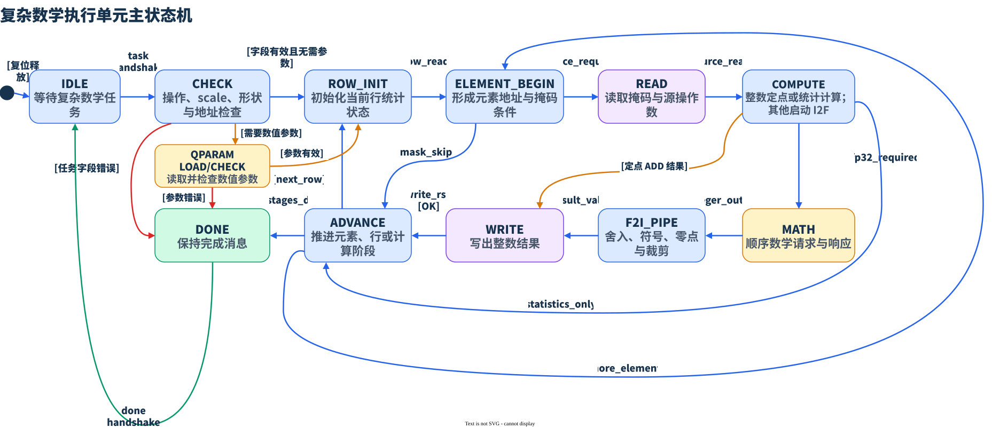

CME 外层状态机如下：

| 状态 | 动作 |
| --- | --- |
| `ST_IDLE` | 等待任务，与 CME 发射暂存握手后锁存操作码与 Task Context |
| `ST_CHECK` | 检查操作、内部字段、dtype、shape、scale、mask、地址和函数组合；分片任务还检查事务配置、阶段顺序和累计元素数 |
| `ST_QPARAM_REQ/RSP` | ACT、SOFTMAX、NORM 数值参数模式或整数定点 ADD_RESCALE、MUL_RESCALE、REQUANTIZE 按 32-bit word 顺序读取 64-byte 参数记录 |
| `ST_QPARAM_CHECK` | 按操作检查记录标识、scale、zero point、限制区间，或 offset、Q31 乘数、移位、数据格式限幅范围；同时检查保留 word |
| `ST_ROW_INIT` | 普通任务清零当前行统计寄存器；分片任务只在新归约阶段清零对应累加器，其余状态跨任务保留；随后选择角色对应的 phase |
| `ST_VLEN_CHECK` | 每行有效长度模式下，检查当前 INT32 长度元素是否跨越 8B beat；通过后才能发出读取请求 |
| `ST_VLEN_REQ/RSP` | Softmax 读取当前行有效长度 |
| `ST_ELEMENT_BEGIN` | 保存当前 src0、src1、src2、dst、mask 地址和派生 mask 结果 |
| `ST_ADDR_PREP` | 根据 mask 模式和派生 mask 决定读取 boolean mask、跳过当前项、写零或读取 src0；同时检查 src0 元素是否跨越 8B beat |
| `ST_MASK_REQ/RSP` | 读取 boolean mask |
| `ST_SRC0_REQ/RSP` | 读取主输入 |
| `ST_SRC1_REQ/RSP` | 读取第二输入或 gamma |
| `ST_SRC2_REQ/RSP` | LayerNorm 读取 beta |
| `ST_ROPE_CAPTURE` | 依次收集一个 split-half 旋转对的 x0、x1、cos 和 sin |
| `ST_ROPE_ENQUEUE` | 在弹性乘法级有空间时提交旋转对；流水已满时转去写回最早结果 |
| `ST_ROPE_RESULT` | 接收按序完成的两个 INT16 结果及其目标地址 |
| `ST_COMPUTE` | 整数定点 ADD_RESCALE 执行 offset、左移、Q31 乘法、加法和限幅；MUL_RESCALE 执行 offset、整数乘法、Q31 重量化、输出 offset 和限幅；REQUANTIZE 对 INT8/INT16/INT32 输入执行 Q31 重量化、输出 offset 和限幅；STAT SUM/MAX 更新 signed64 统计值；SUMSQ 转到平方状态；其他操作发起 I2F 请求 |
| `ST_STAT_SQUARE` | 对当前 signed32 输入执行平方，保存 signed64 乘积、行末标志和溢出方式 |
| `ST_STAT_ACCUM` | 把平方加入 signed64 平方和，推进元素或形成当前行的 INT32 统计输出 |
| `ST_MATH_REQ/RSP` | 与共享数学单元完成一次请求和响应握手；`MA_F2I` 响应在此拆解 FP32，并保存商、余数、中点、正负号、特殊值标志和输出控制字段 |
| `ST_F2I_ROUND` | 根据保存的舍入方式、余数、中点、商最低位和正负号，寄存是否加一 |
| `ST_F2I_MAG` | 把加一标志加入 64-bit 商；Inf 或指数过大时选择 signed64 限制值对应的幅值 |
| `ST_F2I_SIGN` | 恢复正负号，并把超出 signed64 范围的结果限制到 signed64 最小值或最大值 |
| `ST_F2I_OFFSET` | 把保存的 signed32 目标 zero point 符号扩展并加入 signed64 整数 |
| `ST_F2I_FINISH` | 检查目标数据格式范围，形成裁剪后的写回值和对应字节写使能 |
| `ST_ADVANCE` | 推进列、合成行统计量或切换 phase |
| `ST_WRITE_REQ/RSP` | 写一个输出元素并等待完成状态 |
| `ST_DONE` | 保持完成状态直到 TaskScheduler 接收；失败任务同时清除未完成的分片事务 |

外层 phase 的用途如下：

| phase | 用途 |
| --- | --- |
| `PH_ELEMENT` | ACT、ADD_RESCALE、MUL_RESCALE 或 REQUANTIZE 单遍逐元素输出 |
| `PH_SOFT_MAX` | Softmax 行最大值 |
| `PH_SOFT_SUM` | Softmax 指数和 |
| `PH_SOFT_OUT` | Softmax 最终输出 |
| `PH_NORM_ACC` | LayerNorm 求和或 RMSNorm 平方和 |
| `PH_NORM_VAR` | LayerNorm 中心化平方和 |
| `PH_NORM_OUT` | Norm 最终输出 |
| `PH_STAT_ACC` | 整数行统计 |
| `PH_STAT_OUT` | 每行一个 INT32 统计结果 |

顺序数学单元的控制可分为以下状态组：

| 状态组 | 作用 |
| --- | --- |
| `ST_IDLE`、`ST_RESPONSE` | 接受一个请求；保持一个响应 |
| `ST_ALU_REQ`、`ST_ALU_RSP` | 调用共享 FP32 ADD/SUB/MUL，并返回保存的继续状态 |
| `ST_I2F_*` | signed32 转 FP32 后乘 scale |
| `ST_EXP_ENTRY`、`ST_EXP_RANGE_MUL_START` | 限制输入到 `[-16,16]`，计算 \(t=x\log_2e\) |
| `ST_EXP_RANGE_ROUND/SHIFT/INCREMENT/COMMIT/FROM_INT` | 用五个寄存状态完成最近偶数整数舍入、保存 \(k\) 并取得精确的小整数 FP32 值 |
| 其他 `ST_EXP_*` | 用高低两项 \(\ln2\) 形成余数，执行 Horner 多项式并乘 \(2^k\) |
| `ST_RECIP_*` | 尾数规格化、线性初值、三轮 Newton 和指数恢复 |
| `ST_RSQRT_*` | 尾数与奇偶指数处理、位级初值、三轮 Newton 和指数恢复 |
| `ST_SIG_*`、`ST_TANH_*`、`ST_GELU_*`、`ST_SILU_*` | 复合激活函数 |
| `ST_SCALE_*` | 用一个或多个 $2^k$ 乘法处理较大指数调整 |

数学序列的 `ST_ALU_REQ` 和 `ST_ALU_RSP` 是共享流水的请求与响应状态。ADD/SUB 固定经过五个算术寄存级，MUL 固定经过八个算术寄存级；复合函数总周期由依次发出的基础运算数量和微状态周期决定。共享流水复位或新任务接受时只清 valid 链，数据寄存器在对应 valid 为 0 时无语义。输出反压时每一级都保持数据和 tag，直至下游恢复接收。

输出 F2I 不再把 FP32 拆解、舍入、符号恢复、zero point 相加和目标格式裁剪放在一个周期。`MA_F2I` 的数学响应握手先保存本次输出所需的中间值和控制字段，然后依次执行五个寄存状态：

数学响应被接收后，输出转换依次完成舍入判定、幅值处理、符号恢复、零点相加和范围限制，最后进入写请求阶段。

从数学响应握手到写请求状态之间固定经过上述五个状态，因此每个产生输出的 F2I 操作包含额外 5 个时钟周期。舍入方式、目标数据格式、异常标志、溢出处理方式、phase 和目标地址都在数学响应时保存，后续状态只读取这些寄存值。这样，即使目标 L1 端口暂停或完成接口暂停，本次输出的控制信息也不会被下一元素改写。

> [!example] F2I 的五个寄存周期
> 假设数学单元返回 FP32 的 \(1.5\)，舍入方式为最接近且中点取偶数，目标 zero point 为 0，目标格式为 INT8。数学响应周期保存商 1、余数、中点和正号；`ST_F2I_ROUND` 得到加一标志 1；`ST_F2I_MAG` 得到幅值 2；`ST_F2I_SIGN` 得到 signed64 整数 2；`ST_F2I_OFFSET` 加入 0 后仍为 2；`ST_F2I_FINISH` 确认结果位于 INT8 范围内，随后写出 `0x02`。当前公开指令和 CME 启动检查要求目标 zero point 为 0，但保留独立加法阶段可以避免该加法与舍入、符号恢复和格式检查串接。

图中的 `NORM` 表示结果规格化或整数转换整理阶段，`NEXT` 表示推进到下一元素、下一行或下一计算阶段。

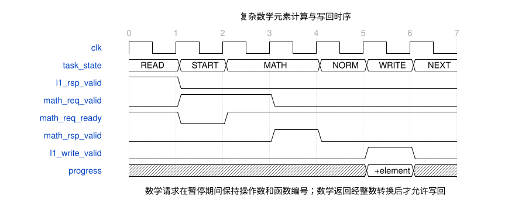

该图对通用多遍 FP32 操作按 phase 重复读取。ACT、Softmax、Norm 和幂指数缩放路径在等待数学响应时不发起下一元素读取，在等待 L1 返回时也不推进数学微状态，所以这些路径的 L1、I2F、函数运算和 F2I 尚未构成跨元素重叠流水。对齐 RoPE、FP32_ADD、FP32_SUM 和 FP32_MAC 采用 beat-stream 输入槽和独立弹性算术流水，能够跨块重叠读取、计算和写回；它们由 Complex 顶层直接选择，不经过本节所列的通用逐元素状态序列。

无 mask 时，各操作每个输出位置的主数据读取次数为：

| 操作 | 主输入与参数读取 | 输出写入 |
| --- | --- | --- |
| ACT | src0 一次 | 每元素一次 |
| ADD_RESCALE | src0、src1 各一次 | 每元素一次 |
| MUL_RESCALE | src0、src1 各一次 | 每元素一次 |
| REQUANTIZE | src0 一次 | 每元素一次 |
| SOFTMAX | 每个有效 src0 在 MAX、SUM、OUT 各一次 | 每元素一次，包括 mask 无效位置写 0 |
| LayerNorm | src0 在 ACC、VAR、OUT 各一次；OUT 再读 gamma、beta | 每元素一次 |
| RMSNorm | src0 在 ACC、OUT 各一次；OUT 再读 gamma | 每元素一次 |
| STAT | src0 每元素一次 | 每行一次 |

含有至少一个有效位置的 boolean Softmax 还会在三个 phase 各读取一次 mask 字节；全无效行跳过 SUM，因此只在 MAX 和 OUT 读取。有效长度模式每行额外读取一个 INT32。

普通逐元素、Softmax 和 Norm 每次成功目的写响应使 `done_progress_o` 增加 1，成功任务最终为 $R\,H$；STAT 每行只写一个值，成功任务最终为 $R$。出现字段、地址、L1 或数值错误时立即转到 `ST_DONE`，已成功写完的进度不回退。完成响应在 `done_ready_i=0` 时保持不变。

公开指令固定使用正的 2 的整数次幂 scale，因此输出除 scale 不会遇到零分母。数学单元对 NaN、Inf、Reciprocal 零输入和 ReciprocalSqrt 非正输入规定确定的位级结果，但 CME 不接收命令头 `strict_numeric`；指令路径依靠字段检查、输入限制、正 $\epsilon$ 和饱和写回来约束输出。

### 13.11 数学函数的适用范围与误差要求

指令解码固定生成 `approx_mode=0`。该模式使用第 13.4～13.10 节所述的顺序 FP32 运算，函数适用范围和结果要求如下：

| 函数 | 规定输入范围 | 结果要求 |
| --- | --- | --- |
| Exp | 独立调用为 `[-16,16]`；Softmax 内部为 `[-16,0]` | 与高精度参考值相比，最大相对误差不超过 \(2^{-10}\) |
| Reciprocal | 非零有限值；指数至少覆盖 `-12～12` | 最大相对误差不超过 \(2^{-10}\) |
| ReciprocalSqrt | 正有限值；指数至少覆盖 `-12～12` | 最大相对误差不超过 \(2^{-10}\) |
| Sigmoid | `[-16,16]` | 最大绝对误差不超过 \(2^{-12}\) |
| Tanh | `[-8,8]` | 最大绝对误差不超过 \(2^{-12}\) |
| GELU | `[-8,8]` | 最大绝对误差不超过 \(2^{-10}\) |
| SiLU | `[-16,16]` | 最大绝对误差不超过 \(2^{-10}\) |

表中的误差针对 CME 内部 FP32 函数结果。完整张量任务的最终整数输出还必须遵守 scale、最近偶数舍入和目的格式裁剪规则。NaN、Inf、0、负数输入 ReciprocalSqrt 以及除数为 0 时，返回状态或 IEEE 754 特殊值必须符合第 13.4 节的数值异常规定。

函数延迟不是固定常数。输入含次正规数、加减结果需要多次左移规格化，或复合函数调用多个基础运算时，周期数都会增加。请求方和响应方必须以 ready/valid 握手为准，不得按固定拍数取得结果。

> [!note] `approx_mode` 编码约束
> `approx_mode=0` 是唯一有效编码。指令展开必须生成 0，其他编码必须返回 `BAD_DESC`，不得选择未定义的系数或运算次序。

---

## 14. MIF 与 AXI Master

本章的 64-bit `npu_axi_mif_master` 接口和单 beat 写描述适用于控制/兼容子通路。
SoC 外部 Master 是该子通路与原生宽 DMA 的仲裁结果，其参数化端口以第 5.2 节为准。
不能用本章局部 `RID=0`、`AWLEN=0` 要求覆盖原生 bulk burst 或系统来源 ID。


### 14.1 数据通路与地址规定

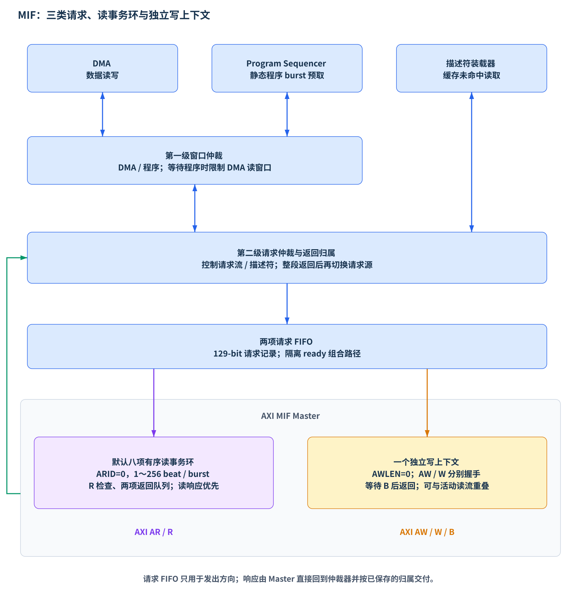

系统存储通路接收 DMA、Program Sequencer 和外部描述符装载器三类请求，经两级仲裁与两项请求 FIFO 后交给 AXI MIF Master。Matrix 与 Complex 的普通张量访问通过 L1BUF，不直接占用 AXI Master；其外存数据由 DMA 搬运。程序与描述符读取使用同一个 Master，不是独立 DDR 通道，也不能省略它们对有效带宽的消耗。

NPU 使用物理字节地址，不包含页表翻译。指令基址、程序起始地址及内部请求使用 48-bit 地址容器；Master 的外部地址宽度由 `AXI_ADDR_W` 指定，默认 40 bit。MIF 在检查通过后发送原物理地址的低 `AXI_ADDR_W` 位，不为其增加隐含 DDR 基址。默认配置要求首地址与末 beat 起始地址的 bit `[47:40]` 全零。64-bit CPU 指针只有落在 NPU 可表示的物理范围内才可直接使用，不能通过简单截断获得合法地址。

Master 的参数 `READ_OUTSTANDING` 默认为 8，表示读事务环可保存的读 burst 数；每项保存物理起始地址与 9-bit beat 数。所有读使用 AXI ID 0，因此读返回按发出顺序处理。另有一个独立写上下文，保存地址、一个 64-bit 数据、strobe、AW/W 完成位与 B 结果。活动读流可以与此写上下文重叠，但不提供多个并发写事务或多 beat 写 burst。

读请求长度为 1～256 个 64-bit beat，`ARLEN=beat_count-1`。写请求固定 `AWLEN=0`、`WLAST=1`。两方向均使用 INCR burst、`SIZE=3`、ID 0、`LOCK=0`、`CACHE=4'b0011`、`PROT=0`、`QOS=0`。是否能达到连续每拍一个读 beat 取决于外部 R 通道、内部响应消费和请求供给，不能由配置八项环直接推定。

### 14.2 Master 模块级接口

以下方向以 AXI MIF Master 为参照。系统请求仲裁器的三路接口具有相同单路字段；两项请求 FIFO 保存 `{write,addr,wdata,wstrb,burst_len}`，总宽为 $1+48+64+8+8=129$ bit。响应不穿过该请求 FIFO，而直接从 Master 返回仲裁器。

| 信号 | 方向 | 位宽 | 功能 | 有效条件 | 暂停、错误与复位行为 |
| --- | --- | ---: | --- | --- | --- |
| `clk_i` | Input | 1 | 请求、AXI 通道与返回队列工作时钟 | 上升沿 | 当前集成在 Core 时钟域工作 |
| `reset_n` | Input | 1 | 低有效控制复位 | 低电平有效 | 清读环、写上下文、返回有效及首错状态 |
| `req_valid_i` | Input | 1 | 当前内部请求有效 | 与 ready 同时为 1 接收 | 发起方等待期间保持整项请求 |
| `req_ready_o` | Output | 1 | Master 可接收当前请求 | 空闲或允许扩展的读窗口 | 活动窗口还检查地址、读环容量及写上下文状态 |
| `req_write_i` | Input | 1 | 0 读、1 写 | 请求有效 | 写必须使用单 beat 编码 |
| `req_addr_i` | Input | 48 | 第一个 beat 的物理字节地址 | 请求握手采样 | 未对齐、越界或不能表示时不发 AXI |
| `req_wdata_i` | Input | 64 | 单 beat 写数据 | 写请求有效 | 请求暂停时保持；读请求忽略 |
| `req_wstrb_i` | Input | 8 | 写字节使能 | 写请求有效 | 与写数据保存；不改变地址检查范围 |
| `req_burst_len_i` | Input | 8 | 读 beat 数减一；写固定为 0 | 请求有效 | 读允许 0～255，仍须满足 4 KiB 检查 |
| `rsp_valid_o` | Output | 1 | 当前内部返回存在 | 返回选择有效 | 读数据优先，其次挂起写响应，再次内部检查响应 |
| `rsp_ready_i` | Input | 1 | 当前请求源可消费返回 | 与 valid 同时为 1 消费 | R 队列与写完成记录各自保存待消费结果 |
| `rsp_rdata_o` | Output | 64 | 读 beat 数据 | 成功或错误读返回 | 写或地址检查返回为零；读错误数据不得用于计算 |
| `rsp_status_o` | Output | 3 | `NPU_MEM_*` 状态 | 内部返回有效 | 每个读 beat 单独检查；写为对应 B 状态 |
| `addr_base_i` | Input | 48 | 第一个允许的 beat 起始地址 | 每项请求地址检查 | 活动事务期间软件保持配置，检查通过后不重写地址 |
| `addr_limit_i` | Input | 48 | 最后允许的 beat 起始地址 | 每项请求地址检查 | 不是最后一个有效字节地址；小于 base 时拒绝 |
| `error_clear_i` | Input | 1 | 清除 Master 首错有效位 | 工作时钟沿 | 同拍有新错误时新错误保留 |
| `error_valid_o` | Output | 1 | 已保存首次接口错误 | 保持到明确清除或复位 | 不是单拍脉冲；不随后续成功事务自动清除 |
| `error_addr_o` | Output | 48 | 首错物理地址 | error valid 时解释 | 读错误为 burst 起始地址，写错误为写请求地址 |
| `error_status_o` | Output | 3 | 首错内部状态 | error valid 时解释 | 后续错误不覆盖未清除的首错 |
| `mif_idle_o` | Output | 1 | Master 处于空闲且无独立写或挂起写响应 | 受控排空检查 | 不包括上游仲裁器、请求 FIFO 和外部尚未握手请求 |

内部响应不带 tag、读写方向或 `last` 信号。接收方根据已经接收的读长度与写请求数跟踪返回，仲裁器保存当前响应归属，读 burst 不能在中途交给另一个客户端。该接口不等价于可按任意事务编号乱序返回的 AXI 网络。AXI 各通道单独列于下表，名称与 Master 端口一致。

| 信号 | 方向 | 位宽 | 功能 | 有效条件 | 暂停、错误与复位行为 |
| --- | --- | ---: | --- | --- | --- |
| `m_axi_awid_o` | Output | AXI_M_ID_W，默认8 | 写事务 ID | `m_axi_awvalid_o`有效时 | 发送方在valid且ready为0时保持；valid为0时载荷无效 |
| `m_axi_awaddr_o` | Output | AXI_M_ADDR_W，默认40 | MIF 检查后的物理字节地址 | `m_axi_awvalid_o`有效时 | 发送方在valid且ready为0时保持；valid为0时载荷无效 |
| `m_axi_awlen_o` | Output | 8 | 固定为 0，每次写一个 64-bit beat | `m_axi_awvalid_o`有效时 | 发送方在valid且ready为0时保持；valid为0时载荷无效 |
| `m_axi_awsize_o` | Output | 3 | 每个 beat 的字节数；64-bit 满 beat 时为 3 | `m_axi_awvalid_o`有效时 | 发送方在valid且ready为0时保持；valid为0时载荷无效 |
| `m_axi_awburst_o` | Output | 2 | 固定使用 INCR | `m_axi_awvalid_o`有效时 | 发送方在valid且ready为0时保持；valid为0时载荷无效 |
| `m_axi_awlock_o` | Output | 1 | 固定为 0，不产生独占访问 | `m_axi_awvalid_o`有效时 | 发送方在valid且ready为0时保持；valid为0时载荷无效 |
| `m_axi_awcache_o` | Output | 4 | 写事务存储属性，默认值见下文 | `m_axi_awvalid_o`有效时 | 发送方在valid且ready为0时保持；valid为0时载荷无效 |
| `m_axi_awprot_o` | Output | 3 | 权限和指令/数据属性 | `m_axi_awvalid_o`有效时 | 发送方在valid且ready为0时保持；valid为0时载荷无效 |
| `m_axi_awqos_o` | Output | 4 | 服务质量值固定为 0 | `m_axi_awvalid_o`有效时 | 发送方在valid且ready为0时保持；valid为0时载荷无效 |
| `m_axi_awvalid_o` | Output | 1 | 写地址有效 | 本通道载荷有效 | 发送方保持有效和载荷至ready；复位清除发送有效状态 |
| `m_axi_awready_i` | Input | 1 | 接收方可接收写地址 | 本通道valid与本信号同时为1时接受 | 由接收容量决定，可反压；不表示其他通道同时就绪 |
| `m_axi_wdata_o` | Output | 64 | 写数据 | `m_axi_wvalid_o`有效时 | 发送方在valid且ready为0时保持；valid为0时载荷无效 |
| `m_axi_wstrb_o` | Output | 8 | 每个字节一个有效位 | `m_axi_wvalid_o`有效时 | 发送方在valid且ready为0时保持；valid为0时载荷无效 |
| `m_axi_wlast_o` | Output | 1 | 当前 burst 的最后一个 beat | `m_axi_wvalid_o`有效时 | 发送方在valid且ready为0时保持；valid为0时载荷无效 |
| `m_axi_wvalid_o` | Output | 1 | 写数据有效 | 本通道载荷有效 | 发送方保持有效和载荷至ready；复位清除发送有效状态 |
| `m_axi_wready_i` | Input | 1 | 接收方可接收写数据 | 本通道valid与本信号同时为1时接受 | 由接收容量决定，可反压；不表示其他通道同时就绪 |
| `m_axi_bid_i` | Input | AXI_M_ID_W，默认8 | 写响应 ID | `m_axi_bvalid_i`有效时 | 发送方在valid且ready为0时保持；valid为0时载荷无效 |
| `m_axi_bresp_i` | Input | 2 | `OKAY`、`SLVERR` 或 `DECERR` | `m_axi_bvalid_i`有效时 | 发送方在valid且ready为0时保持；valid为0时载荷无效 |
| `m_axi_bvalid_i` | Input | 1 | 写响应有效 | 本通道载荷有效 | 发送方保持有效和载荷至ready；复位清除发送有效状态 |
| `m_axi_bready_o` | Output | 1 | NPU 可接收写响应 | 本通道valid与本信号同时为1时接受 | 由接收容量决定，可反压；不表示其他通道同时就绪 |
| `m_axi_arid_o` | Output | AXI_M_ID_W，默认8 | 读事务 ID | `m_axi_arvalid_o`有效时 | 发送方在valid且ready为0时保持；valid为0时载荷无效 |
| `m_axi_araddr_o` | Output | AXI_M_ADDR_W，默认40 | MIF 检查后的物理字节地址 | `m_axi_arvalid_o`有效时 | 发送方在valid且ready为0时保持；valid为0时载荷无效 |
| `m_axi_arlen_o` | Output | 8 | 读burst的beat数减1；0..255对应1..256个beat | `m_axi_arvalid_o`有效时 | 发送方在valid且ready为0时保持；valid为0时载荷无效 |
| `m_axi_arsize_o` | Output | 3 | 每个 beat 的字节数 | `m_axi_arvalid_o`有效时 | 发送方在valid且ready为0时保持；valid为0时载荷无效 |
| `m_axi_arburst_o` | Output | 2 | 固定使用 INCR | `m_axi_arvalid_o`有效时 | 发送方在valid且ready为0时保持；valid为0时载荷无效 |
| `m_axi_arlock_o` | Output | 1 | 固定为 0，不产生独占访问 | `m_axi_arvalid_o`有效时 | 发送方在valid且ready为0时保持；valid为0时载荷无效 |
| `m_axi_arcache_o` | Output | 4 | 读事务存储属性，默认值见下文 | `m_axi_arvalid_o`有效时 | 发送方在valid且ready为0时保持；valid为0时载荷无效 |
| `m_axi_arprot_o` | Output | 3 | 权限和指令/数据属性 | `m_axi_arvalid_o`有效时 | 发送方在valid且ready为0时保持；valid为0时载荷无效 |
| `m_axi_arqos_o` | Output | 4 | 服务质量值固定为 0 | `m_axi_arvalid_o`有效时 | 发送方在valid且ready为0时保持；valid为0时载荷无效 |
| `m_axi_arvalid_o` | Output | 1 | 读地址有效 | 本通道载荷有效 | 发送方保持有效和载荷至ready；复位清除发送有效状态 |
| `m_axi_arready_i` | Input | 1 | 接收方可接收读地址 | 本通道valid与本信号同时为1时接受 | 由接收容量决定，可反压；不表示其他通道同时就绪 |
| `m_axi_rid_i` | Input | AXI_M_ID_W，默认8 | 读返回 ID | `m_axi_rvalid_i`有效时 | 发送方在valid且ready为0时保持；valid为0时载荷无效 |
| `m_axi_rdata_i` | Input | 64 | 读返回数据 | `m_axi_rvalid_i`有效时 | 发送方在valid且ready为0时保持；valid为0时载荷无效 |
| `m_axi_rresp_i` | Input | 2 | 读返回状态 | `m_axi_rvalid_i`有效时 | 发送方在valid且ready为0时保持；valid为0时载荷无效 |
| `m_axi_rlast_i` | Input | 1 | 当前 burst 的最后一个 beat | `m_axi_rvalid_i`有效时 | 发送方在valid且ready为0时保持；valid为0时载荷无效 |
| `m_axi_rvalid_i` | Input | 1 | 读返回有效 | 本通道载荷有效 | 发送方保持有效和载荷至ready；复位清除发送有效状态 |
| `m_axi_rready_o` | Output | 1 | NPU 可接收读返回 | 本通道valid与本信号同时为1时接受 | 由接收容量决定，可反压；不表示其他通道同时就绪 |

### 14.3 物理地址检查

令首地址为 $p_0$，长度字段为 $L$，则实际 beat 数为 $L+1$，末 beat 起始地址和末字节地址分别为：

$$
p_{\mathrm{last}}=p_0+8L,\qquad p_{\mathrm{end}}=p_0+8L+7.
$$

发出 AXI 前检查：

1. $p_0$ 按 8 B 对齐；
2. 用 49-bit 中间和计算 $p_{\mathrm{last}}$，不允许 48-bit 回绕；
3. $p_0$ 与 $p_{\mathrm{last}}$ 都可以由外部 `AXI_ADDR_W` 表示；
4. `addr_limit_i>=addr_base_i`，且 $p_0\ge\mathrm{base}$、$p_{\mathrm{last}}\le\mathrm{limit}$；
5. 读的 $p_{\mathrm{end}}$ 不越过首地址所在的 4 KiB 段；
6. 写的长度字段等于零。

在 `MIF_IDLE` 接收检查失败的请求后，Master 不发 AR/AW/W，进入内部响应状态，以 `NPU_MEM_ADDR` 返回一项错误并保存原始请求地址。活动读窗口中的追加请求还在 `req_ready_o` 条件中检查合法性；非法请求不能在该窗口被接收，要等待状态允许空闲检查路径处理。不能假定任何错误请求都可与既有 burst 同拍入环。

例如 base=`0x1000`、limit=`0x1018` 时，四个允许的 beat 起始地址是 `0x1000/1008/1010/1018`。从 `0x1000` 读取四 beat 合法；从 `0x1008` 读取四 beat 超限；从 `0x1004` 读取一个 beat 因未对齐而失败。从 `0x1ff8` 读取一个 beat 合法，两 beat 则跨越 4 KiB 段。长度字段虽然可以编码 256 beat，也不能绕过地址段检查。

允许范围以 beat 起始地址定义，软件配置若来自字节区间 `[B,E]`，应确保最后一个允许 word 的八个字节均属于该区间，再求得相应 limit。全局地址的检查发生在具体存储请求执行时，命令被 CFE 接收或任务被 Scheduler 接纳不证明后续全部地址访问都会成功。

### 14.4 主状态与并行控制

Master 主状态负责读事务生命周期及从空闲开始的写事务；独立写活动位在读状态之外保存 AW/W/B 进展。因此只画六个主状态而不解释写上下文，会错误地把当前设计理解为纯串行控制。

| 主状态 | 主要动作 | 离开条件 |
| --- | --- | --- |
| `MIF_IDLE` | 接收一项请求并检查；读请求初始化读环，写请求初始化写上下文 | 读进入 `MIF_READ_ADDR`；写进入 `MIF_WRITE_ISSUE`；错误进入 `MIF_INTERNAL_RESP` |
| `MIF_READ_ADDR` | 发出首个 AR，可接收同窗口追加读或允许的独立写 | 首个 AR 握手后装入当前 burst 剩余 beat 数，进入 `MIF_READ_DATA` |
| `MIF_READ_DATA` | 发后续 AR，接 R、排队并返回；独立写上下文可同时推进 | 所有读与返回、独立写及其响应均排空后回空闲 |
| `MIF_WRITE_ISSUE` | 从空闲启动的写分别保持 AW 与 W | 两通道均完成握手后进入 `MIF_WRITE_RESP` |
| `MIF_WRITE_RESP` | 接收 B，检查 ID 与响应并形成内部结果 | B 握手后进入 `MIF_INTERNAL_RESP` |
| `MIF_INTERNAL_RESP` | 返回地址检查错误或独占写结果 | 返回握手后回空闲 |

读环分别记录已接收请求位置、尚待 AR 发出位置与当前返回位置。读 burst 的最后一个 AXI R beat 被接收时释放该 burst 的环占用，并前进当前返回指针；这与该 beat 已经被内部客户端消费不同，后者可能仍位于两项响应队列中。环空并不意味着所有 R 返回都已经退休。

在读窗口中，`req_ready_o` 要求读环占用小于 `READ_OUTSTANDING`，因此满环也会暂时阻止追加写。追加读还要求地址及 4 KiB 检查通过；追加写要求长度为零、没有活动写且没有等待交付的写结果。独立写有效期间，合法读仍可继续填充有空位的读环，不因等待 B 而关闭全部读请求。

### 14.5 读请求功能时序

一次读窗口可按下表运行；周期间隔由 AXI ready/valid 决定，不把各行假定为相邻周期。

| 阶段 | 行为 | 允许的重叠 |
| --- | --- | --- |
| 请求入环 | 保存地址与 $L+1$ | 先前 AR 或 R 仍可能活动 |
| AR 发出 | 从尚未发出项生成 ARADDR/ARLEN，ID 固定 0 | 在接收当前 burst 的 R 时可以发下一个 AR |
| R 接收 | 检查 RID、RLAST、RRESP；写入两项返回队列 | 客户端取走旧队首时可接收新 beat |
| burst 结束 | 期望最后一拍 R 握手后前进返回指针 | 可装入已发下一个 burst 的剩余 beat 数 |
| 内部消费 | 按顺序交付每个读 beat 的数据与 status | 与后续 R 接收和独立 AXI 写活动重叠 |

R 检查要求 `RID=0`，且 `RLAST == (当前burst剩余beat数==1)`。不满足时该 beat 状态为 `NPU_MEM_PROTOCOL`。RRESP 的 `00/10/11` 分别转成 OK/SLVERR/DECERR，`01` 返回协议错误。接收的 R 数据和状态存入同一项，不能把另一拍错误标志配给当前数据。

返回队列最多两项。未满时可接 R；满但本拍将消费队首时也可接新 R，从而在持续供给与消费条件下维持每拍一个 beat。客户端暂停且两项已满时 `RREADY=0`，外部 AXI Slave 必须保持 R 字段。AR 被暂停时，当前发出指针不推进，地址、长度与属性保持。

读错误不会由 Master 提前撤销已经发出的后续 burst。上层必须继续接收预定返回并处理错误，不能在错误后立即换请求源或复位通道。内部没有 `rsp_last`，归属仲裁按请求长度累计返回数，并将地址检查的一项错误作为特殊终止情况处理。错误响应的数据即使非零也不能作为有效张量值使用。

### 14.6 写请求功能时序

独占写与读窗口中的写都只保存一个 beat。AW 与 W 的握手独立，分别由完成位防止重复发送。AWREADY 暂停时保持 AW 字段；WREADY 暂停时保持 WDATA、WSTRB 与 WLAST。两个通道都完成后才接受对应 B 返回。

写要求 `BID=0`，BRESP 按读响应相同规则转成内部状态。B 成功握手表示此事务的 AXI 写完成，而内部写结果可能仍需等待仲裁器和客户端接收。任务成功必须晚于此结果被相应 DMA 控制逻辑确认，不能把 AW/W 握手或 `write_active` 清零单独作为任务完成依据。

读窗口中的写在 B 到达后进入挂起写响应记录。共享内部返回选择优先交付读队列的队首，再交付该写结果，因此读数据与写结果可能不按它们的请求接收先后交替。仲裁器在整个窗口内保持同一请求源，不能将该共享返回当成跨不同客户端的无 tag 乱序网络。写结果未消费以前不接收下一项追加写。

从空闲开始的写走 `MIF_WRITE_ISSUE/RESP/INTERNAL_RESP`，该主状态期间不会建立新的读窗口。因此“支持读写重叠”准确指活动读窗口能够容纳独立写，不表示任何请求排列都能达到全双工。若上游两项 FIFO 的队首写受阻，队尾读也不能越过该写；编译器与 DMA 发射需要利用已建立的读窗口安排写回。

### 14.7 错误保存、空闲与复位

`error_valid_o` 保持首次错误，直到 `error_clear_i` 或复位。清旧错误与记录新错误同拍时，新错误优先；错误仍有效时后续故障不覆盖其地址和状态。该信号送 LSC 汇总，但不直接等同于外部 CPU 中断线；中断保持与清除规则由 LSC 决定。

读错误保存当前返回 burst 的起始地址，而非逐 beat 精确地址。读环只保存起点和长度，没有为首错形成 `burst_base+beat_offset`。写错误保存其请求地址，内部地址检查错误保存原始 48-bit 请求地址。软件可用此地址定位 burst 和缓冲区，但不能据此宣称已经定位到某一个错误字节。

`mif_idle_o` 的条件是主状态为 `MIF_IDLE`，且独立写和挂起写结果均无效。系统存储通路还包含两级仲裁状态与请求 FIFO，上层在受控停止时先禁止新来源继续提交，再等待这些来源的请求、响应计数和 Master 一并排空。Master 的 idle 不能单独证明上游 FIFO 已经为空。

异步复位把主状态、环指针/计数、当前读剩余数、AW/W 完成位、写活动位、返回队列与首错状态清零。已发到外部 AXI 的事务不能依靠本地复位取消。受控软复位必须在排空后实施；若外部系统同时强制复位整个 AXI fabric，属于系统级复位流程，不与普通任务 abort 混同。

### 14.8 吞吐容量与限制

64-bit AXI R 通道在 100 MHz 下的理想载荷速度为 $8\times100\,\mathrm{MHz}=800\,\mathrm{MB/s}$。该值不扣除 DDR 初始延迟、bank 冲突、刷新、读写切换、AR 空隙和内部反压，也不等于模型权重有效速度。W 通道具有同样的单拍数据宽度，但当前写请求是单 beat，AW/B 往返和单上下文限制使其不能直接按此上限估计。

| 结构 | 当前容量或节拍 | 性能含义 |
| --- | --- | --- |
| 请求 FIFO | 2 项，129 bit/项 | 隔离 ready，不允许队尾越过队首 |
| 有序读事务环 | 默认 8 burst | 用预发 AR 隐藏部分读取延迟，不改变单 R 通道位宽 |
| 单 burst 长度 | 1～256 beat | 每项仍要满足 4 KiB 和允许地址范围 |
| R 返回队列 | 2 beat | 同拍进出维持连续流，满后反压 AXI |
| 写上下文 | 1 beat，1 项 | 读窗口可重叠写；下一写需等旧写结果消费 |
| 内部返回 | 每拍最多一项 | 读优先，写结果可能等待；无 tag/last |

连续读达到每拍一个 beat 需要环中有已发请求、DDR 持续给 R、返回客户端持续 ready。若程序或描述符切换引起窗口排空、DMA 尚未形成下一请求或 L1 写反压，读环即使有八项容量也会空闲。系统应区分有效权重字节、指令/描述符字节、重复数据、DDR 活动周期和整 token 周期，不能用 AXI 某个局部读窗口的满速替代整个模型的带宽利用率。

### 14.9 三类请求的仲裁与公平性

第一级仲裁把 DMA 放在 client0、程序取指放在 client1；第二级把前一级结果放在 client0、外部描述符请求放在 client1。空闲且双方均请求时，按上次服务方向轮转选择。一个来源开始取得响应后，归属保持到其累计返回数排空，不把一个读 burst 分给两个来源。

client0 可以在活动窗口追加读，连续窗口大小受 `READ_OUTSTANDING` 限制；client1 正在等待时使用更小的窗口限制。集成的第一级 `DMA_WINDOW_WHILE_PROGRAM_WAITS` 默认为 4，第二级使用仲裁模块的默认等待窗口 2。这里限制的是窗口内的读请求计数，不是保证程序恰好等待四个时钟，也不是 descriptor 具有恒定延迟。

活动 client0 还可向下游提出写请求，由 Master 的单写上下文和 FIFO 空间决定实际接收。写占累计响应数，但不消耗读窗口计数。归属计数按读的 beat 数、写的一项结果进行累计，同拍接收新请求与消费返回时统一计算剩余量。来源切换需要整个返回窗口结束；描述符 Cache 命中和程序预取有助于减少切换次数，但不能省略必要的数据和指令一致性处理。

---

## 15. LSC、CRG 与 WDT

### 15.1 LSC 功能

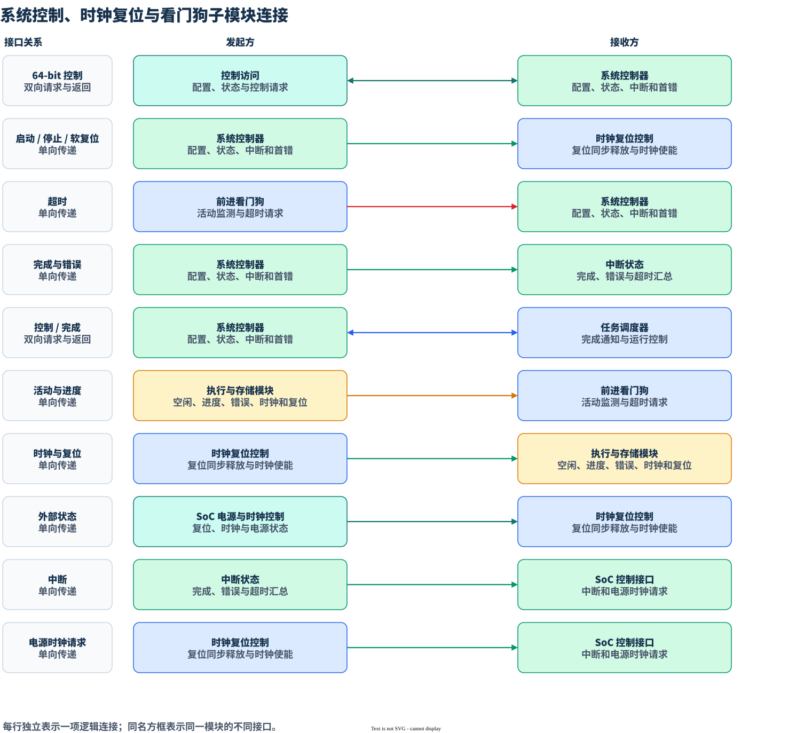

LSC 保存：

- 版本和功能寄存器；
- NPU 启停与软复位控制；
- DDR、输入、权重、工作区、输出和 KV Cache 基地址；
- MIF 物理地址允许范围；
- 命令、任务和执行单元状态；
- 中断状态、mask 和清除位；
- 第一个错误命令、地址和错误码；
- AXI Slave 前端、CFE 和 MIF 汇总后的接口错误；
- L1BUF 只读参数区的起点、末地址和锁定状态；
- 性能计数器；
- 时钟门控与断电准备状态。

### 15.2 LSC 内部寄存器接口

| 信号 | LSC 方向 | 位宽 | 说明 |
| --- | --- | ---: | --- |
| `reg_req_valid_i` | Input | 1 | 寄存器请求有效 |
| `reg_req_ready_o` | Output | 1 | LSC 可接收 |
| `reg_req_write_i` | Input | 1 | 0 读、1 写 |
| `reg_req_space_i` | Input | 1 | `0=LSC CSR`，`1=Debug / Performance` |
| `reg_req_addr_i` | Input | 16 | LSC 内字节地址，必须 8B 对齐 |
| `reg_req_wdata_i` | Input | 64 | 写数据；窄写保持 AXI lane 位置 |
| `reg_req_wstrb_i` | Input | 8 | 每个字节一个写使能 |
| `reg_rsp_valid_o` | Output | 1 | 读返回或写完成有效 |
| `reg_rsp_ready_i` | Input | 1 | 总线适配器可接收 |
| `reg_rsp_rdata_o` | Output | 64 | 读数据 |
| `reg_rsp_status_o` | Output | 2 | OKAY 或 SLVERR |

LSC 最多保存一个未完成寄存器请求。T0 周期 `reg_req_valid_i && reg_req_ready_o` 时锁存全部请求字段；最早在 T1 周期拉高 `reg_rsp_valid_o`。响应等待 `reg_rsp_ready_i` 时，`reg_rsp_valid_o`、`reg_rsp_rdata_o` 和 `reg_rsp_status_o` 必须保持不变，同时 `reg_req_ready_o=0`。只读寄存器写入返回 `SLVERR`；保留地址读 0、写入返回 OKAY 且不改变状态。

#### 15.2.1 运行状态、停止与参数保护接口

下表方向以 LSC 为参照：

| 信号 | 方向 | 位宽 | 说明 |
| --- | --- | ---: | --- |
| `cmd_ingress_idle_i` | Input | 1 | AXI Slave 命令入口没有未完成的双 beat 指令或待送命令 |
| `cfe_quiesce_o` | Output | 1 | 停止 CFE 接收新的内部 CMD beat；正常 stop 在命令入口排空后置 1，软复位排空阶段立即置 1 |
| `cfe_idle_i` | Input | 1 | 当前命令寄存器和 FIFO 均为空 |
| `ts_quiesce_o` | Output | 1 | 停止 TS 接收新的 CFE 队首；正常 stop 在命令入口和 CFE 排空后置 1，任务表内已有任务仍继续推进 |
| `ts_idle_i` | Input | 1 | TS 没有命令接纳项、任务表占用项或活动执行单元；等待 ACK 的终态表项会使其为 0 |
| `ts_quiescent_i` | Input | 1 | 必须连接 `scheduler_quiescent_o`；TS 没有接纳、解码、发射、活动执行、Control、Event 发布、完成持有或 AXI 控制请求时为 1，不要求终态表项已经 ACK |
| `eng_abort_o` | Output | 4 | 软复位排空阶段四位同时为 1；顶层必须取或后连接 TS 的 `abort_i` |
| `eng_quiescent_i` | Input | 4 | DMA、Matrix、Vector、Complex 四类任务接口已回到可接收状态；Matrix 与 Vector 两位来自同一物理模块的两组 `task_ready_o` |
| `l1_idle_i` | Input | 1 | L1BUF Controller 请求寄存级、读等待和逐客户端响应槽均为空 |
| `l1_write_idle_i` | Input | 1 | L1BUF 不存在待处理写请求；设置参数锁和内部复位时使用 |
| `mif_idle_i` | Input | 1 | MIF 没有未完成的请求或 AXI 事务 |
| `s_axi_idle_i` | Input | 1 | AXI Slave 的读写事务状态均为空，且 B/R valid 均为 0；不检查内部 CMD 入口、命令响应 FIFO 或控制端 busy |
| `soft_reset_req_i` | Input | 1 | 外部受控软复位请求 |
| `internal_soft_reset_done_i` | Input | 1 | 计算域内部复位和 MIF 控制复位均已完成 |
| `soft_reset_done_o` | Output | 1 | 排空和内部复位完成；保持到请求撤销 |
| `power_down_req_i` | Input | 1 | PMU 请求进入断电准备 |
| `power_down_ack_o` | Output | 1 | 断电条件满足；保持到请求撤销 |
| `accept_new_cmd_o` | Output | 1 | start 有效、stop 无效且没有复位或断电请求时允许接收新命令 |
| `single_step_pulse_o` | Output | 1 | 软件写 `SINGLE_STEP=1` 后产生一个周期脉冲 |
| `internal_soft_reset_pulse_o` | Output | 1 | 排空完成后产生一个周期的内部同步复位脉冲 |
| `core_idle_o` | Output | 1 | 下式给出的顶层空闲状态 |
| `param_l1_base_o` | Output | 20 | 参数区起始 LADDR |
| `param_l1_limit_o` | Output | 20 | 参数区末地址，不包含该地址 |
| `param_lock_o` | Output | 1 | 参数区写保护已经启用 |
| `l1_host_access_enable_o` | Output | 1 | 允许外部主控访问 L1BUF 窗口 |
| `module_clk_enable_o` | Output | 8 | CFE、TS、DMA、ME、IVE、CME、L1 和 MIF 的软件时钟使能 |

顶层空闲信号必须按下式产生：

```text
core_idle_o =
    cmd_ingress_idle_i
  & cfe_idle_i
  & ts_idle_i
  & (&eng_quiescent_i)
  & l1_idle_i
  & mif_idle_i
  & s_axi_idle_i;
```

每个 idle 输出只代表其明确定义的状态集合。特别是，`s_axi_idle_i` 不能替代 `cmd_ingress_idle_i`，`ts_quiescent_i` 也不能替代 `ts_idle_i`：前者允许终态任务表项继续等待 ACK，后者要求任务表全部 FREE。

正常 stop 与断电准备采用分阶段停止接收。请求生效后，LSC 先令 `accept_new_cmd_o=0`，AXI Slave 不再接受新的 CMD burst；已保存的命令入口继续向 CFE 送 beat。`cmd_ingress_idle_i=1` 后，LSC 才令 `cfe_quiesce_o=1`；CFE FIFO 继续向 TS 输出。等 `cmd_ingress_idle_i=1` 且 `cfe_idle_i=1` 后，LSC 再令 `ts_quiesce_o=1`。顶层还把 TS 的 `enable_i` 接为 `accept_new_cmd_o || !cfe_idle`，所以 start 清零后，只要 CFE 尚未排空，TS 仍能接收其队首。TS 已保存的任务继续发射、执行、发布完成状态并等待软件 ACK。

软复位进入 `RESET_DRAIN` 后立即令 CFE 与 TS quiesce，并向 TS 发出 abort。该流程有意不等待 `cmd_ingress_idle_i`、`cfe_idle_i` 或终态任务表项 ACK；它等待 `ts_quiescent_i`、四类任务接口、三个物理执行模块、L1BUF、MIF 和 `s_axi_idle_i`，随后用内部功能复位清除 AXI Slave 的命令入口与命令响应 FIFO、CFE FIFO、任务表和 Event Table。因而软复位请求前尚未取得命令接收结果或任务查询结果的软件请求可能被丢弃，软件必须把对应提交视为未完成。

#### 15.2.2 任务终态、中断与配置输出接口

TaskScheduler 只有在完整终态记录和普通 signal Event 都已发布后，才把任务表项编号装入完成持有槽并向 LSC 置位 `task_terminal_valid_i`。该 valid 保持到 LSC 完成 ready/valid 握手，不限定为一个周期。下表方向以 LSC 为参照：

| 信号 | 方向 | 位宽 | 说明 |
| --- | --- | ---: | --- |
| `task_terminal_valid_i` | Input | 1 | 一条任务的终态通知 |
| `task_terminal_ready_o` | Output | 1 | LSC 可接收终态；固定为 1 |
| `task_command_id_i` | Input | 12 | 软件命令编号 |
| `task_status_i` | Input | 8 | 第 4.3 节定义的终态 status |
| `task_engine_i` | Input | 4 | 产生终态的执行单元 |
| `task_opcode_i` | Input | 8 | CMD 直接携带的完整 opcode |
| `task_fault_addr_i` | Input | 48 | 第一个错误地址；无地址时为 0 |
| `task_irq_on_success_i` | Input | 1 | 任务 CMD 的 `IRQ_ON_SUCCESS` |
| `task_irq_on_error_i` | Input | 1 | 任务 CMD 的 `IRQ_ON_ERROR` |
| `wdt_timeout_i` | Input | 1 | WDT 超时脉冲 |
| `irq_done_o` | Output | 1 | 未屏蔽的成功中断 |
| `irq_exception_o` | Output | 1 | 未屏蔽的数值异常或任务超时中断 |
| `irq_error_o` | Output | 1 | 未屏蔽的指令字段、地址、总线、ECC 或 WDT 错误中断 |

配置寄存器通过以下持续有效信号送往使用模块：

| 信号组 | 位宽 | 使用模块 |
| --- | ---: | --- |
| `input_base_o`、`weight_base_o`、`work_base_o`、`output_base_o`、`kv_base_o` | 各 48 | TaskScheduler 发射解码和执行单元地址生成 |
| `m_axi_addr_base_o`、`m_axi_addr_limit_o` | 各 48 | MIF 物理地址允许范围检查 |
| `wdt_enable_o`、`wdt_timeout_cycles_o`、`wdt_kick_o` | 1、32、1 | WDT 配置与喂狗 |

任务终态在 `task_terminal_valid_i && task_terminal_ready_o` 时采样。任务失败且
首错寄存器为空时，LSC 保存命令编号、执行单元、opcode、status 和 48-bit
错误地址。任务成功或失败是否设置中断状态，由对应的 CMD 中断选项决定。

#### 15.2.3 非任务错误输入与清除接口

顶层先把 AXI Slave 协议错误、MIF 错误和 CFE 错误按固定次序合成一组接口错误，再送入 LSC。模块级信号如下：

| 信号 | LSC 方向 | 位宽 | 说明 |
| --- | --- | ---: | --- |
| `interface_error_valid_i` | Input | 1 | 汇总接口错误有效 |
| `interface_error_status_i` | Input | 8 | 第 4.3 节定义的非成功 status |
| `interface_error_addr_i` | Input | 48 | 第一个相关地址；没有可用地址时为 0 |
| `interface_error_clear_o` | Output | 1 | 软件写 `FAULT_CLEAR.bit0=1` 后产生一个周期脉冲 |

顶层的接口错误选择次序为 AXI Slave 协议错误、MIF 错误、CFE 错误。AXI
Slave 协议错误和 CFE 错误使用 `BAD_DESC`；MIF 错误按统一存储状态转换规则变换为任务 status，并保留 MIF 提供的 48-bit 地址。`interface_error_clear_o` 同时送到 AXI Slave 前端和 MIF，用于清除它们保存的错误状态。

LSC 只保存复位或上次 `FAULT_CLEAR` 之后的第一条错误。优先处理次序固定为：

1. 本周期握手的任务终态；
2. 汇总接口错误；
3. WDT timeout。

任务终态分支被选中后，本周期不再采样接口错误或 WDT；如果该终态为
`SUCCESS`，它不会写入 `FAULT_*`。因此，需要可靠保留的接口错误必须让
`interface_error_valid_i` 持续有效，直到 `interface_error_clear_o`，避免只出现
一个周期而恰好与任务终态同时发生。

接口错误写入 `FAULT_*` 时固定使用 `command_id=0xFFF`、`engine=0` 和
`opcode=0`，并保存输入的 status 与 48-bit 地址；WDT 错误同样使用
`command_id=0xFFF`，status 为 `TIMEOUT`，地址为 0。接口错误与 WDT 都会设置
`IRQ_STATUS.ERROR`，不检查任务 CMD 的中断选项。已有首错不会被后续错误覆盖。

软件写 `FAULT_CLEAR.bit0=1` 时，LSC 清除 `FAULT_*`，并拉高一个周期的
`interface_error_clear_o`。产生模块应在清除后撤销旧错误；若清除期间发现新错误，
应继续保持错误有效，使 LSC 在后续周期保存新记录。

### 15.3 CSR 表

| Offset | 名称 | 属性 | 主要字段 |
| ---: | --- | --- | --- |
| `0x0000` | `NPU_VERSION` | RO | 主版本、次版本、硬件 build |
| `0x0008` | `ISA_FEATURE` | RO | 固定读 `0x1fe7`；含外部描述符、GROUP_REQUANT、Dynamic A8、Program Context Guard、GROUP_REQUANT_INLINE 和 DYNAMIC_A8_INLINE |
| `0x0010` | `BUS_CONFIG` | RO | `BUS_DATA_W=64`、地址宽度、AXI ID 位宽 |
| `0x0018` | `L1_CONFIG` | RO | 容量、bank 数、读延迟 |
| `0x0020` | `MATRIX_CONFIG` | RO | `MT`、`KT`、`NT`、可接受的整数格式 |
| `0x0028` | `VECTOR_CONFIG` | RO | 标量处理数、连续 MUL 每次 PE 请求的乘积数和整数操作功能位 |
| `0x0030` | `CME_CONFIG` | RO | 同时接受的数学请求数、函数和 `approx_mode` |
| `0x0040` | `CORE_CONTROL` | RW | start、stop、soft reset、single step |
| `0x0048` | `CORE_STATUS` | RO | idle、busy、accept new command、error、power ready、soft reset busy |
| `0x0050` | `RESERVED_PC_BASE` | — | 读取返回 0；写入返回 OKAY 且不改变状态；NPU 不包含 外部主控处理器 取指单元 |
| `0x0058` | `INPUT_BASE` | RW idle-only | 输入区基地址 |
| `0x0060` | `WEIGHT_BASE` | RW idle-only | 权重区基地址 |
| `0x0068` | `WORK_BASE` | RW idle-only | 中间数据区基地址 |
| `0x0070` | `OUTPUT_BASE` | RW idle-only | 输出区基地址 |
| `0x0078` | `KV_BASE` | RW idle-only | KV Cache 区基地址 |
| `0x0080` | `M_AXI_ADDR_BASE` | RW idle-only | AXI Master 允许访问的第一个物理 beat 起始地址 |
| `0x0088` | `M_AXI_ADDR_LIMIT` | RW idle-only | AXI Master 允许访问的最后一个物理 beat 起始地址 |
| `0x0090` | `RESERVED` | — | 读取返回 0；写入返回 OKAY 且不改变状态 |
| `0x00A0` | `IRQ_STATUS` | W1C | done、exception、error |
| `0x00A8` | `IRQ_MASK` | RW | 中断屏蔽 |
| `0x00B0` | `FAULT_CMD` | RO | 已知任务身份时保存真实 `command_id`，否则为 `0xFFF` |
| `0x00B8` | `FAULT_ADDR` | RO | 第一个错误地址 |
| `0x00C0` | `FAULT_INFO` | RO | status、engine 和 opcode |
| `0x00C8` | `FAULT_CLEAR` | WO | 写 1 清除错误记录 |
| `0x00D0` | `PARAM_L1_BASE` | RW idle-only | L1BUF 参数区起始地址，8B 对齐 |
| `0x00D8` | `PARAM_L1_LIMIT` | RW idle-only | L1BUF 参数区末地址，8B 对齐且不包含该地址 |
| `0x00E0` | `PARAM_LOCK` | RW1S | bit 0 写 1 后锁定参数区，复位清 0 |
| `0x00E8` | `RESET_REASON` | RO | 外部、软件或 WDT 复位原因 |
| `0x00F0` | `L1_HOST_ACCESS_ENABLE` | RW | bit 0 允许外部主控访问 L1BUF 窗口 |
| `0x00F8～0x02B8` | `RESERVED` | — | 读取返回 0；写入返回 OKAY 且不改变状态 |
| `0x02C0` | `WDT_CONTROL` | RW | bit 0 使能 WDT，bit 1 写 1 产生喂狗脉冲 |
| `0x02C8` | `WDT_TIMEOUT_CYCLES` | RW | WDT 的 32-bit 超时周期数 |
| `0x02D0` | `MODULE_CLK_ENABLE` | RW | 低 8 bit 控制八个模块的时钟使能 |
| `0x0300` | `PROGRAM_ADDR` | RW idle-only | 静态 cmd128 程序物理首地址，16B 对齐 |
| `0x0308` | `PROGRAM_COMMAND_COUNT` | RW idle-only | 静态程序的 cmd128 数量 |
| `0x0310` | `PROGRAM_CONTROL` | WO | bit 0 启动，bit 1 清除粘滞完成状态 |
| `0x0318` | `PROGRAM_STATUS` | R/W1C | busy；done/error 为保持型标志，向 bit 1/2 写 1 由 CPU 清除；首个程序错误 status 位于 `[15:8]` |
| `0x0320` | `PROGRAM_SUBMITTED` | RO | 已被 CFE 接受的命令数 |
| `0x0328` | `PROGRAM_COMPLETED` | RO | 已完成并由 sequencer ACK 的任务数 |
| `0x0330` | `PROGRAM_CONTEXT` | RW idle-only | `[31:0]` 为绝对 position，`[63:32]` 为有效上下文 token 数；有效长度为 1～262144，且 position 不小于 `valid_tokens-1` |

> [!warning] 当前配置 CSR 与物理实例的差异
`L1_CONFIG` 的容量与 bank 字段由 `L1_BYTES`、`L1_BANKS` 参数生成，读延迟字段为 5。
这两个参数从顶层传入 LSC，SoC 因而报告 2 MiB、64 bank，而不是旧固定十六 bank。
其他部分能力寄存器仍包含固定编码，不能代替构建清单中的精度和裁剪配置。
尤其 `BUS_CONFIG` 的旧 8-bit 数据宽字段不能直接表示 256，应从实际 Master 参数确认宽度，
不能把其旧 64-bit 编码当作当前 SoC 的真实外存拍宽。

同样，通用 `ISA_FEATURE=0x1fe7` 不能说明 SoC 实例保留了 Vector、FP16 mixed FMA、通用 SUM 或通用 Softmax/STAT。SoC 默认 `NPU_VECTOR_ENABLE=0`、`NPU_COMPLEX_FP16_MIXED_PIPELINE=0`、`NPU_COMPLEX_GENERIC_SUM_STREAMS=0`、`NPU_COMPLEX_GENERIC_SOFTMAX_STAT=0`，而 `NPU_COMPLEX_QWEN_NORM_ONLY_CONTROLLER=1`。因此参数 manifest 与静态 CSR 的组合才是该镜像的有效能力合同；若命令通过 CFE 但执行单元已裁剪，结果应依 opcode/engine 检查返回 `ILLEGAL_OPCODE` 或对应错误，不得把常量 feature 位当作运行成功保证。

`idle-only` 寄存器在命令入口、CFE、TS、执行单元、L1BUF 或 MIF 忙时写入必须返回 `SLVERR`，原值保持不变。检查该属性时不计入正在处理本次寄存器访问的 AXI Slave 事务，否则每次配置写入都会被自身造成的 `s_axi_idle_i=0` 拒绝。用于复位、断电和状态查询的 `core_idle_o` 仍包含 `s_axi_idle_i`，必须等 AXI Slave 的外部读写事务以及 B/R response 处理完毕后才能置 1；命令响应 FIFO 是否为空要由软件另外确认。
复位后 `M_AXI_ADDR_BASE=0`，`M_AXI_ADDR_LIMIT=0x00FF_FFFF_FFF8`，对应 40-bit 物理地址空间中最后一个 8B 对齐的 beat 起始地址。软件可在启动 NPU 前缩小该允许访问范围。

`PROGRAM_CONTROL.START` 只在 Core 已启动且命令入口、CFE、TaskScheduler、执行单元、
L1BUF、MIF 和 program sequencer 全部空闲时接受。LSC 在产生启动脉冲前检查命令数
非零、`PROGRAM_ADDR` 为 16B 对齐，以及程序最后一个 64-bit beat 位于
`M_AXI_ADDR_BASE/LIMIT` 内；失败的控制写返回 `SLVERR`。程序运行期间普通 CMD
入口暂停接收，任务终态仍进入既有 LSC fault/IRQ 通路。整个程序成功时设置
`IRQ_STATUS.DONE`，程序取指、接收或任务错误时设置 `IRQ_STATUS.ERROR`，PLIC 仍只需
接收 SoC 顶层合并后的一路 NPU 中断。

`PROGRAM_COMMAND_COUNT` 是 32-bit 数量。cmd128 中的 10-bit command ID 可在旧任务
完成并 ACK 后回绕；Sequencer 保证同一时刻最多只有 `MAX_OUTSTANDING` 个 ID 在途。
静态程序中的 `EVENT_REARM`、`SET_WEIGHT_WINDOW` 和 `SET_KV_WINDOW` 自动形成全窗口屏障，屏障命令
前后的任务不会同时驻留 TaskScheduler。

`NPU_VERSION` 位域固定如下：

| Bit | 字段 | 含义 |
| ---: | --- | --- |
| 15:0 | `VERSION_MAJOR` | 不兼容接口修改时增加 |
| 31:16 | `VERSION_MINOR` | 向后兼容功能增加时更新 |
| 63:32 | `BUILD_ID` | 硬件构建编号 |

`VERSION_MAJOR` 标识整套设备接口版本。软件先识别 `VERSION_MAJOR`，再按
第 6 章生成对应的指令字段；指令没有独立的命令头版本字段。不接受的设备
主版本必须在提交任务前由软件报错。

`ISA_FEATURE` 固定读 `0x1fe7`，表示 `DMA_GATHER_ND=1`、`VROPE_I=1`、
`I2F_I=1`、`DMA_SCATTER_ND=1`、`SET_KV_WINDOW=1`、256-byte 外部描述符、
GROUP_REQUANT v2、Dynamic A8、Program Context Guard、GROUP_REQUANT_INLINE 和 DYNAMIC_A8_INLINE 均可用。其余可选功能位保持 0：

| Bit | 名称 | 为 1 时的能力 |
| ---: | --- | --- |
| 0 | `DMA_GATHER_ND` | 接受 DMA opcode `0x28` |
| 1 | `VROPE_I` | 接受 Complex opcode `0x83` |
| 2 | `I2F_I` | 接受 Complex opcode `0x85` |
| 3 | `CAUSAL_SOFTMAX` | 接受 `VSOFTMAX_I` 的 `mask_mode=CAUSAL` |
| 4 | `DESCRIPTOR_CRC` | 接受外部描述符 CRC 校验；当前为 0 |
| 5 | `DMA_SCATTER_ND` | 接受 DMA opcode `0x29` |
| 6 | `SET_KV_WINDOW` | 接受 Control opcode `0x06` 和软件命令字段 46 |
| 7 | `EXTERNAL_DESC_256` | 支持 256-byte 外部描述符 |
| 8 | `GROUP_REQUANT_V2` | 支持 Matrix GROUP_REQUANT v2/v3 描述符 |
| 9 | `DYNAMIC_A8` | 支持 per-token Dynamic A8 描述符 |
| 10 | `PROGRAM_CONTEXT_GUARD` | 支持 `PROGRAM_CONTEXT` 和 Sequencer 字段 53 |
| 11 | `GROUP_REQUANT_INLINE` | 支持复用 ACCUM/tile0 模板的 GROUP_REQUANT REDUCE/FINAL tile0 命令字段 55 |
| 12 | `DYNAMIC_A8_INLINE` | 支持使用 M4TS 状态和三个 L1 地址的紧凑 Dynamic-A8 命令字段 56 |
| 63:13 | `RESERVED` | 固定读 0 |

软件可以在 `VROPE_I=1` 时发射 `COMPLEX_ROPE`。功能位为 0 的保留 opcode 返回 `ILLEGAL_OPCODE`。不得用未说明的低 16 bit 全 1 值代替功能表。指令没有外部任务参数 CRC 开关。

`BUS_CONFIG` 位域固定如下：

| Bit | 字段 | V1.1 值 | 含义 |
| ---: | --- | ---: | --- |
| 7:0 | `BUS_DATA_BITS` | 64 | AXI 与内部数据端口的单 beat 位宽 |
| 15:8 | `GADDR_CONTAINER_BITS` | 48 | 指令和内部接口的物理地址容器宽度 |
| 23:16 | `PA_BITS` | 40 | AXI 物理地址位数 |
| 31:24 | `AXI_ID_BITS` | 8 | AXI ID 位数 |
| 63:32 | `RESERVED` | 0 | 固定读 0 |

`L1_CONFIG` 位域固定如下：

| Bit | 字段 | V1.1 值 | 含义 |
| ---: | --- | ---: | --- |
| 31:0 | `L1_BYTES` | `L1_BYTES` 参数 | 字节容量；当前顶层为 2097152 |
| 39:32 | `L1_BANKS` | `L1_BANKS` 参数 | 通用顶层为 16，SoC 为 64 |
| 47:40 | `L1_READ_LATENCY` | 5 | 普通通路的延迟配置；仲裁、队列和消费者反压另计 |
| 63:48 | `RESERVED` | 0 | 固定读 0 |

`MATRIX_CONFIG` 位域固定如下：

| Bit | 字段 | V1.1 值 | 含义 |
| ---: | --- | ---: | --- |
| 7:0 | `MT` | 8 | M 方向 tile 大小 |
| 15:8 | `KT` | 16 | K 方向 tile 大小 |
| 23:16 | `NT` | 8 | N 方向 tile 大小 |
| 27:24 | `DTYPE_MASK` | `0b1011` | Legacy capability mask：bit 0、1、3 表示编码层可见的 INT4、INT8、INT16；bit 0 不表示支持 W4A4。Direct 实际模式由几何检查限定为 W4A8、W6A8、同类型 INT8/INT16；bit 2 的 INT32 输入未开启 |
| 63:28 | `RESERVED` | 0 | 固定读 0 |

`VECTOR_CONFIG` 位域固定如下：

| Bit | 字段 | V1.1 值 | 含义 |
| ---: | --- | ---: | --- |
| 7:0 | `ELEMENTS_PER_STEP` | 8 | 软件分块粒度提示值；不表示每周期处理 8 个元素 |
| 17:8 | `OPCODE_MASK` | `0x3FF` | bit 0～9 依次对应 opcode `0x60～0x69` |
| 63:18 | `RESERVED` | 0 | 固定读 0 |

`CME_CONFIG` 位域固定如下：

| Bit | 字段 | V1.1 值 | 含义 |
| ---: | --- | ---: | --- |
| 7:0 | `MATH_REQUESTS` | 4 | 软件分解复合函数时使用的任务粒度提示值；不表示四路并行请求 |
| 20:8 | `FUNCTION_MASK` | `0x1FFF` | bit 0～12 依次对应 `function_mode=0～12` |
| 24:21 | `APPROX_MODE_MASK` | `0x1` | bit n 表示支持 `approx_mode=n` |
| 31:25 | `RESERVED0` | 0 | 固定读 0 |
| 47:32 | `SCRATCH_ELEMS` | 4096 | CME 可接受的内部临时元素请求上限；不表示存在软件可寻址的 FP32 数组 |
| 63:48 | `RESERVED1` | 0 | 固定读 0 |

> [!note] 能力字段的解释规则
> `ELEMENTS_PER_STEP`、`MATH_REQUESTS` 和 `SCRATCH_ELEMS` 是软件分块提示值，不是执行单元的逐周期并行度。IVE 每次处理 1 个元素；CME 每次只接受 1 个数学请求，且不向软件提供可寻址的 FP32 临时数组。软件必须按第 12 章和第 13 章规定的握手与执行次序生成任务，不得从能力字段推断额外并行接口。

软件必须先读取功能字段，再生成 tile、函数选择和工作区需求，并拒绝与已知硬件构建不一致的能力组合。保留位固定读 0；读到非零保留位表示设备接口版本不匹配，软件不得自行解释。

`CORE_CONTROL` 位定义如下。复位值为 `0x2`，即 start 为 0、stop 为 1。

| Bit | 名称 | 属性 | 行为 |
| ---: | --- | --- | --- |
| 0 | `START` | RW | 写 1 设置 start 并清 stop；软复位或断电请求有效时 `accept_new_cmd_o` 仍保持 0 |
| 1 | `STOP` | RW | 写 1 清 start 并设置 stop |
| 2 | `SOFT_RESET` | WO pulse | 写 1启动第 15.8 节时序，读回为 0 |
| 3 | `SINGLE_STEP` | WO pulse | stop=1 且 core idle 时写 1，产生一个周期脉冲；条件不满足时不产生脉冲 |
| 63:4 | `RESERVED` | — | 写 1 返回 `SLVERR`，读 0 |

同一次写入不能同时设置 `START` 和 `STOP`。只写 0 不改变 start/stop 状态。

`CORE_STATUS` 使用以下功能空闲条件：

```text
functional_idle_status =
    cmd_ingress_idle_i
  & cfe_idle_i
  & ts_idle_i
  & (&eng_quiescent_i)
  & l1_idle_i
  & mif_idle_i;
```

该条件不包含 `s_axi_idle_i`，因此读取 `CORE_STATUS` 的 AXI 事务不得清除自身观察到的 `IDLE`。外部 `core_idle_o` 仍按第 15.2.1 节定义，必须同时要求 `s_axi_idle_i=1`。`CORE_STATUS` 位定义如下：

| Bit | 名称 | 为 1 的条件 |
| ---: | --- | --- |
| 0 | `IDLE` | `functional_idle_status=1` |
| 1 | `BUSY` | `functional_idle_status=0` |
| 2 | `ACCEPT_NEW_CMD` | `accept_new_cmd_o=1` |
| 3 | `ERROR` | `FAULT_*` 中存在有效记录 |
| 4 | `POWER_READY` | `functional_idle_status=1` 且 stop=1 |
| 5 | `SOFT_RESET_BUSY` | 受控软复位处于排空或完成保持阶段 |
| 63:6 | `RESERVED` | 恒为 0 |

`IRQ_STATUS` 与 `IRQ_MASK` 使用相同的三个位：

| Bit | 名称 | 对应输出 |
| ---: | --- | --- |
| 0 | `DONE` | `irq_done_o` |
| 1 | `EXCEPTION` | `irq_exception_o` |
| 2 | `ERROR` | `irq_error_o` |

`IRQ_STATUS` 为 W1C，复位值为 0。`IRQ_MASK` 中 1 表示屏蔽、0 表示允许输出，复位值为 `0x7`；屏蔽只影响中断引脚，不阻止 `IRQ_STATUS` 置位。bit 63:3 必须写 0。

`FAULT_INFO` 编码如下：

| Bit | 字段 | 说明 |
| ---: | --- | --- |
| 7:0 | `status` | 第 4.3 节 status |
| 11:8 | `engine` | 已知任务身份时保存 CMD engine 的零扩展值，否则写 0 |
| 19:12 | `opcode` | 已知任务身份时保存任务内部 opcode，否则写 0 |
| 63:20 | `RESERVED` | 读 0 |

没有有效错误记录时，`FAULT_CMD`、`FAULT_ADDR` 和 `FAULT_INFO` 全部读 0。
`FAULT_CMD[11:0]` 保存 `command_id`，其余位读 0；接口错误和 WDT 错误读回
`0xFFF`。`FAULT_CLEAR` 清除首错记录，同时按第 15.2.3 节产生
`interface_error_clear_o`。

`RESET_REASON` 为粘滞状态：bit 0 为外部复位，bit 1 为受控软复位，bit 2 为 WDT；一次受控软复位只增加 bit 1，不清除较早原因。外部复位后该寄存器为 `0x1`。

`L1_HOST_ACCESS_ENABLE.bit0` 控制 AXI Slave 前端是否接受 L1BUF 窗口访问。
bit 63:1 必须写 0；外部复位和受控软复位均清 0。

`WDT_CONTROL.bit0` 是 WDT 使能，bit 1 写 1 产生一个周期的喂狗脉冲；
`WDT_TIMEOUT_CYCLES` 使用低 32 bit。`MODULE_CLK_ENABLE` 使用低 8 bit，依次
对应 CFE、TS、DMA、ME、IVE、CME、L1 和 MIF。

`0x00F8～0x02B8` 为保留地址。软件不得在该地址段保存任务事件或选项；读取返回 0，写入返回 OKAY 且不改变状态。LSC 不提供性能计数器或按任务超时类别寄存器。

`INPUT_BASE`、`WEIGHT_BASE`、`WORK_BASE`、`OUTPUT_BASE` 和 `KV_BASE` 使用
低 48 bit，bit 63:48 必须为 0，并要求 8B 对齐。这些寄存器保存物理字节
地址；在当前 `PA_BITS=40` 的配置中，bit 47:40 也必须为 0。

`M_AXI_ADDR_BASE` 与 `M_AXI_ADDR_LIMIT` 使用低 48 bit 并要求 8B 对齐，在当前
配置中 bit 47:40 必须为 0。MIF 把 limit 解释为最后一个允许的 64-bit beat
物理起始地址：

$$
\texttt{M\_AXI\_ADDR\_BASE}
\le p
\le \texttt{M\_AXI\_ADDR\_LIMIT}.
$$

两者在每次写入后都必须满足 base 不大于 limit，否则写入返回 `SLVERR` 且原值不变。复位值分别为 0 和 `0x00FF_FFFF_FFF8`；配置较小范围时，软件先写新 base，再写不小于该 base 的新 limit。若修改后的 base 或 limit 会暂时破坏二者关系，软件必须先更新另一项。兼容 64-bit word 起始地址必须位于该范围；原生宽拍则以 `limit | 7` 检查完整物理拍的末 byte，不得因为起始地址合法而忽略最后 32-byte 拍越界。

`PARAM_L1_BASE` 使用 21 bit，`PARAM_L1_LIMIT` 使用 22 bit 并表示排他上限，两者均要求 8 B 对齐。LSC 保证
`base <= limit <= L1_BYTES`，因此上限可等于 `0x200000`；从复位值 0 配置非空范围时，应先写 limit，再写 base。
`PARAM_LOCK` 是写 1 置位寄存器，只有 `l1_write_idle_i=1` 时才能设置，受控
软复位或外部复位清 0。

> [!warning] 参数锁的有效范围
> `PARAM_L1_BASE` 参与 `DIRECT_GEMM` Matrix requant profile 的读地址形成；`PARAM_L1_LIMIT` 与 `PARAM_LOCK` 保存参数区边界与锁定位。现有锁定机制仍不会凭空阻止任意 L1BUF 写访问，软件必须用 Event、任务终态和地址分配保证参数在所有消费者完成前不被改写。

### 15.4 中断接口与时序

执行单元不直接产生软件中断。TaskScheduler 先完成以下动作：

1. 在执行单元的 done ready/valid 接口上接收 command ID、status、48-bit 错误地址和 64-bit progress；
2. 检查 command ID 与 status，并更新任务表中的终态记录；
3. Control、普通 signal Event 和完成通知共用一个连续递增的任务槽计数器；三类分别保存扫描轮开始时的候选位图，并在 `TASK_SLOTS` 个周期内各自保留 `submit_seq` 最小的候选，8 槽配置一轮为 8 个周期；
4. 扫描轮末分别复查三类候选位图、获胜项和提交序号。某一类位图发生变化时，该类等待下一轮重新选择；
5. Event 选择脉冲把任务表项编号写入发布暂存；下一周期把该 Event 写为 SUCCESS 或 ERROR，并置位对应任务的 `event_published`；
6. 完成选择脉冲有效、完成持有槽为空且获胜任务的 Event 已发布时，把该任务表项编号装入完成持有槽；
7. 通过 `completion_*` ready/valid 接口向 LSC 发送持有槽对应的终态；
8. LSC 根据 status 和 CMD 中断选项更新 `IRQ_STATUS`，并在任务失败且首错寄存器为空时保存 `FAULT_*`。

执行单元 done 和 TS 到 LSC 的终态通知都是一次 ready/valid 事务，没有固定拍数。
`completion_valid_o` 等待 `completion_ready_i` 时，TS 必须保持全部终态字段不变。
Event Table 的 SUCCESS 或 ERROR 不得早于任务表终态记录完成；完成通知又不得
早于该任务的普通 signal Event 发布。这样软件观察到事件终态后，可以继续查询
对应任务的错误地址和 progress。多个任务同时结束时，普通 Event 每个扫描轮最多
选择一个，并按提交次序可见；完成持有槽也不允许绕过 Event 尚未发布的较早任务。

随后 LSC 根据 `IRQ_MASK` 产生 `irq_done_o`、`irq_exception_o` 或 `irq_error_o`。软件通过 W1C 清除中断位；清除中断不自动清除 `FAULT_*`。

中断分类固定如下：

| 任务或模块状态 | 中断类别 |
| --- | --- |
| `SUCCESS` 且任务 CMD 设置 `IRQ_ON_SUCCESS` | `irq_done_o` |
| `NUMERIC_EXCEPTION`、任务 `TIMEOUT`，且任务 CMD 设置 `IRQ_ON_ERROR` | `irq_exception_o` |
| `ILLEGAL_OPCODE`、`BAD_DESC`、`BAD_SHAPE`、`ADDR_FAULT`、`ADDR_OVERLAP`、`DTYPE_UNSUPPORTED`、AXI 错误、不可修正 ECC、`DEPENDENCY_FAILED`、`ABORTED`，且任务 CMD 设置 `IRQ_ON_ERROR` | `irq_error_o` |
| AXI Slave 协议错误、MIF 错误或 CFE 错误 | `irq_error_o`，不检查任务 CMD 中的选项 |
| WDT timeout | `irq_error_o`，并按 WDT 配置产生 `wdt_reset_req_o` |

任务失败时，无论 `IRQ_ON_ERROR` 是否设置，LSC 都要按先到先保存规则更新 `FAULT_*`；该标志只决定是否设置 `IRQ_STATUS.EXCEPTION/ERROR`。WDT 不属于 CMD，因此不受 `IRQ_ON_ERROR` 控制。
第 15.2.3 节的汇总接口错误同样不受任务 CMD 中的选项控制。

`IRQ_STATUS` 的设置优先于同周期 W1C 清除。某位在同一周期既有新事件又被软件写 1 清除时，该位在周期结束后保持 1。

`FAULT_*` 只保存复位或上次 `FAULT_CLEAR` 之后的第一条错误；寄存器有效期间的
其余错误不覆盖旧记录，LSC 也没有对应的错误次数计数器。同周期多个来源按
第 15.2.3 节的固定次序选择。

`FAULT_CLEAR` 使用周期开始处的 `fault_valid_q` 判断是否
能保存新错误。如果原来已有首错，清除请求与一个周期的任务错误或 WDT 脉冲同时
发生时，新错误不会写入 `FAULT_*`；保持型接口错误可以在下一周期再次被采样。
软件应避免在错误源仍可能产生单周期事件时清除首错。清除中断位不修改
`FAULT_*`，清除 `FAULT_*` 也不修改已经置位的中断状态。

### 15.5 CRG 模块级信号

| 信号 | CRG 方向 | 位宽 | 说明 |
| --- | --- | ---: | --- |
| `core_clk_i` | Input | 1 | SoC 已选择频点的计算域原始时钟 |
| `noc_clk_i` | Input | 1 | SoC 提供的 NoC 原始时钟 |
| `reset_n` | Input | 1 | CRG 的低有效异步复位输入 |
| `dvfs_prepare_req_i` | Input | 1 | SoC 请求 NPU 为改变输入频率做准备 |
| `dvfs_prepare_ack_o` | Output | 1 | NPU 空闲，可由 SoC 改变 `core_clk_i` 频率 |
| `core_idle_i` | Input | 1 | 顶层当前空闲状态 |
| `axi_idle_i` | Input | 1 | NPU AXI Slave 与 MIF 均无未完成事务 |
| `module_clk_en_i` | Input | 8 | CFE、TS、DMA、ME、IVE、CME、L1、MIF 时钟开关 |
| `module_idle_i` | Input | 8 | 与八个模块一一对应的空闲指示 |
| `module_clk_active_o` | Output | 8 | 忙模块强制开启后实际采用的时钟使能 |
| `core_clk_gated_o` | Output | 1 | 送往计算模块的门控时钟 |
| `noc_clk_gated_o` | Output | 1 | NoC 域门控时钟输出 |
| `core_reset_n_o` | Output | 1 | 同步释放后的计算域低有效复位 |
| `noc_reset_n_o` | Output | 1 | 同步释放后的 NoC 域低有效复位 |

外部 `reset_n` 置 0 时，两个两级同步寄存器异步清零；`reset_n` 置 1 后，
`core_reset_n_o` 在 `core_clk_i` 域同步释放，`noc_reset_n_o` 在 `noc_clk_i`
域同步释放。计算模块使用同步后的低有效复位。

改变频点前，SoC 拉高 `dvfs_prepare_req_i`。只有 `core_idle_o=1` 且 AXI outstanding 为 0 时，CRG 才拉高 `dvfs_prepare_ack_o`。SoC 随后暂停并改变 `core_clk_i`，待新频率稳定后撤销请求。频点只能在 NPU 空闲时改变。

CRG 根据 `dvfs_prepare_req_i && core_idle_i && axi_idle_i` 产生
`dvfs_prepare_ack_o`，并不直接阻止命令入口。软件或 SoC 控制程序必须先设置
stop，等待 NPU 和两个 AXI 接口空闲，再发出 DVFS 准备请求。

`module_clk_en_i[7:0]` 依次对应 CFE、TS、DMA、ME、IVE、CME、L1 和 MIF。
CRG 对每一位计算
`module_clk_active_o = module_clk_en_i | ~module_idle_i`，因此模块忙时不会
因软件清除 enable bit 而在 `module_clk_active_o` 中显示为关闭。

Core 域门控请求由 bit 0～6 的或值产生，NoC 域门控请求由 bit 7 产生。两个
门控使能都在相应输入时钟的下降沿更新，使 enable 在时钟高电平期间保持不变。
NPU 功能模块直接连接 `core_clk_i`；`core_clk_gated_o`、`noc_clk_gated_o` 和 `module_clk_active_o` 作为顶层输出提供给 SoC 时钟控制。模块内部不把门控时钟回接到功能模块时钟端。SoC 使用这些输出控制外部时钟门控时，必须保证门控无毛刺，并按本节次序同步释放复位。

### 15.6 WDT 模块级信号

| 信号 | WDT 方向 | 位宽 | 说明 |
| --- | --- | ---: | --- |
| `reset_n` | Input | 1 | Core 域低有效同步复位 |
| `wdt_enable_i` | Input | 1 | 看门狗使能 |
| `wdt_timeout_cycles_i` | Input | 32 | 超时周期数 |
| `wdt_kick_i` | Input | 1 | 软件或调度器喂狗 |
| `wdt_core_progress_i` | Input | 1 | 命令完成、AXI 返回或有效计算产生进展 |
| `wdt_timeout_o` | Output | 1 | 看门狗超时保持电平；超时后保持为 1，直到喂狗、关闭 WDT 或复位 |
| `wdt_reset_req_o` | Output | 1 | 请求复位 NPU Core；保持条件与 `wdt_timeout_o` 相同 |

`wdt_core_progress_i` 只能在可观察到任务推进时置 1，不能简单地在 `core_busy=1` 时持续置 1。以下任一事件在本周期出现时都属于有效推进：

- AXI Slave 前端接受一条完整指令；
- TS 与 LSC 完成一条终态通知握手；
- DMA 与 MIF 完成请求或返回握手；
- 任一执行单元与 L1BUF 完成请求握手。

valid 保持但没有 ready 的等待周期不属于有效推进；同样，单纯处于 busy 状态也不能清除 WDT 计数。

顶层必须把 WDT 的保持电平 `wdt_timeout_o` 直接接到 LSC 的 `wdt_timeout_i`，不增加上升沿检测。LSC 在 `wdt_timeout_i=1` 且首错寄存器为空时记录 WDT 错误。软件清除 `FAULT_*` 后，如果 WDT 超时电平仍为 1，LSC 会在后续周期再次记录该错误；软件若要结束本次超时状态，应先喂狗、关闭 WDT 或复位，使 `wdt_timeout_o` 回到 0。

### 15.7 上电与初始化时序

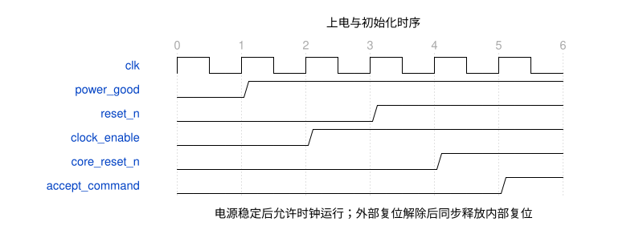

外部主控处理器 的取指和运行状态由 SoC CPU 子系统管理，不受 NPU LSC 控制。
NPU 配置完成前，LSC 的 stop 复位值为 1，`accept_new_cmd_o=0`。软件写完物理
基地址、MIF 允许范围、WDT 和中断寄存器后，可以执行寄存器读回检查，再设置 start。
事件和任务选项由模型编译器直接写入每条 128-bit 指令。

### 15.8 受控软复位时序

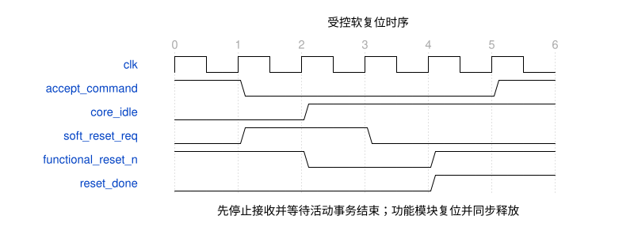

`soft_reset_req_i` 与 `soft_reset_done_o` 使用四阶段电平握手：请求方保持 `soft_reset_req_i=1`，直到看到 `soft_reset_done_o=1`；随后请求方撤销请求，NPU 再撤销完成信号。

受控软复位按以下次序执行：

1. LSC 清除 start、设置 stop，使 `accept_new_cmd_o=0`，状态从 `RESET_IDLE` 进入 `RESET_DRAIN`。
2. `cfe_quiesce_o`、`ts_quiesce_o` 和四位 `eng_abort_o` 立即有效。四位分别对应 DMA、Matrix、Vector、Complex 任务类别；顶层必须把它们取或后送到 TS 的 `abort_i`，不直接连接三个物理执行模块。
3. TS 丢弃命令接纳项，清除待解码快照、四组发射暂存、Control 执行快照、Event 发布暂存、完成持有槽以及 AXI 控制请求状态，并把全部非终态任务记录为 `ABORTED`。等待 ACK 的原有终态项和新形成的 `ABORTED` 项都不阻止 `scheduler_quiescent_o`。
4. 已经取得任务的执行单元继续运行到 done 并回到 `task_ready_o=1`；L1BUF 和 MIF 完成各自已经接受的请求。TS 的 active 标志在对应 done 到达后清除。AXI Slave 完成当前读写事务，使 `wr_state_q`、`rd_state_q`、B valid 和 R valid 回到空闲状态。
5. CFE quiesce 会阻止命令入口继续向 CFE 送 beat，TS quiesce也会阻止 CFE 队首进入任务表。LSC 的软复位等待条件不包含 `cmd_ingress_idle_i` 和 `cfe_idle_i`，所以命令入口中的 beat、CFE 中的半条或完整指令以及尚未读取的命令响应都可以保留到内部复位脉冲，再由复位清除。
6. 当 `ts_quiescent_i`、四位 `eng_quiescent_i`、`l1_idle_i`、`mif_idle_i` 和 `s_axi_idle_i` 全部为 1 时，LSC 产生一个周期的 `internal_soft_reset_pulse_o`。这里使用 `scheduler_quiescent_o`，不使用要求任务表为空的 `scheduler_idle_o`，所以不等待软件 ACK 终态表项。
7. 内部复位脉冲清除 AXI Slave 命令入口和命令响应 FIFO、CFE 半命令与完整指令 FIFO、任务表、Event Table、发射暂存以及 DMA、Matrix-Vector Engine、CME 的控制状态。LSC 同时清除 `IRQ_STATUS`、`PARAM_LOCK` 和 `L1_HOST_ACCESS_ENABLE`，并记录软件复位原因。
8. 顶层在内部复位执行完成后拉高 `internal_soft_reset_done_i`。LSC 进入 `RESET_DONE`，拉高 `soft_reset_done_o` 并保持到外部请求撤销。
9. 请求撤销后，LSC 返回 `RESET_IDLE`，撤销 abort、quiesce 和完成信号；start 仍为 0、stop 仍为 1，软件重新配置或确认状态后再启动。

> [!warning] 软复位会放弃前端待处理命令
> 软件发出软复位请求后，不能再假定已经得到 AXI `BRESP=OKAY`、但尚未读取 CFE 接收响应的命令会进入任务表。命令入口、CFE FIFO、命令响应 FIFO 和等待 ACK 的终态记录都可能在内部复位时清除。软件应在请求前读取仍需保存的终态信息；请求发出后，把没有获得最终查询结果的任务视为已取消。

> [!warning] 外部 AXI 事务必须能够结束
> LSC 虽然不等待命令入口和 CFE 为空，但仍等待 `s_axi_idle_i=1`。主控必须接收已经置位的 B/R response，也不应在发出软复位请求的同时保留一项等待空命令响应 FIFO 的读事务；这类读事务可能因 CFE 已被 quiesce而得不到新数据，使复位停留在 `RESET_DRAIN`。驱动应先结束当前 MMIO 访问，再发起软复位电平握手。

复位发生时，部分目的数据可能已经写入。软件在复位后必须重新加载受影响的输入、权重 tile 和状态。内部复位清除任务表后，软件不能再用 `NPU_QUERY` 读取这些任务；查询旧 `command_id` 返回 NOT_FOUND。

受控软复位保留只读功能寄存器、五组任务物理基地址、`M_AXI_ADDR_BASE/LIMIT`、
参数区 base/limit、WDT 配置、模块时钟使能、`FAULT_*` 和已有
`RESET_REASON`；随后在 `RESET_REASON` 中设置 software bit。保留参数区地址
但清除 `PARAM_LOCK`，使软件可以重新加载参数。
外部 Core 复位使用第 15.10 节的上电复位值，不采用这组保留规则。

顶层在产生 `internal_soft_reset_pulse_o` 前必须等待 `mif_idle_i=1`，因此不会
在 MIF 仍有 AXI 请求时清除其状态。如果 SoC 使用外部 `reset_n` 突然复位 NPU，
系统集成必须同时处理仍在总线上的旧事务，不能让复位后的 NPU 把旧 R/B 返回当成
新请求的响应。

### 15.9 断电准备时序

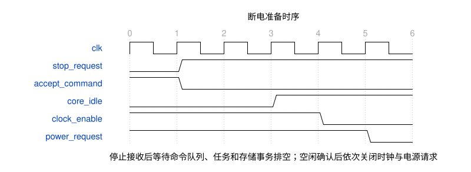

`power_down_req_i` 与 `power_down_ack_o` 使用四阶段电平握手。断电准备不主动终止任务，而是停止接收新 CMD，并让全部已接受任务进入终态。若软件不希望等待长任务，应先执行受控软复位。

请求有效时，LSC 使 `accept_new_cmd_o=0`，并拉高 CFE 与 TS 的 quiesce。
AXI Slave 前端仍要完成已经握手的总线请求；命令入口中尚未送完的 beat 会使
`cmd_ingress_idle_i` 保持为 0，活动读写事务或未接收的 B/R response 会使
`s_axi_idle_i` 保持为 0，从而阻止 `core_idle_o` 置 1。
`s_axi_idle_i` 不检查命令响应 FIFO；软件在断电前仍应读完全部命令接收
结果，因为硬件的断电确认不会等待该 FIFO 变空。

LSC 只有在以下条件全部满足时才能拉高 `power_down_ack_o`：

1. 软件已经设置 stop；
2. `core_idle_o=1`，即命令入口、CFE、TS、四类任务接口、三个物理执行模块、L1BUF、MIF 和 AXI Slave 前端全部空闲；
3. `power_down_req_i=1` 仍保持有效。

PMU 看到 `power_down_ack_o=1` 后，依次执行输出隔离、内部复位置位、时钟停止和电源关闭。断电后的 L1BUF、任务表和 Event Table 内容全部无效。重新上电后必须从第 15.7 节的初始化流程开始。

PMU 撤销 `power_down_req_i` 后，LSC 立即撤销 `power_down_ack_o`，同时解除由该
请求产生的 CFE 与 TS quiesce。若请求在 ack 产生前撤销，NPU 可以继续接收和
调度任务，但仍受 start、stop 和软复位状态控制。

终态任务表项在软件 ACK 前仍使 `ts_idle_i=0`。因此正常断电前，软件必须读取需要的终态信息，并对所有已完成任务执行 `NPU_QUERY(selector=ACK)`；受控软复位可以直接清除这些记录。

### 15.10 各模块复位状态

| 模块 | 复位后的状态 |
| --- | --- |
| CFE | 低 beat 保存寄存器无效，128-bit CMD FIFO 空，`ready=0` 直到复位释放 |
| TaskScheduler | 命令接纳 valid、WAIT_EVENT 检查结果 valid 和 Control 执行快照 valid 为 0；`wait_scan_slot_q` 为 0，任务表和 Event Table 为 FREE，全部 `predecessor_mask` 为 0，发射与选择扫描候选无效，`decode_pending_valid_q=0`，四组发射暂存 valid 为 0，`completion_hold_valid_q=0`，`event_publish_pending_valid_q=0`，四类任务请求 valid 为 0 |
| DMA | `state_q=ST_IDLE`，MIF、L1 请求 valid 和 done valid 为 0；Task Context、游标、shape 乘法和数据寄存器的旧值无效 |
| Matrix-Vector Engine | Direct、Scalar 与 Vector 控制器回到 `ST_IDLE`，Matrix 任务无效、Scalar/Vector 乘法流水 valid、PE/L1 请求来源 FIFO、普通 L1 请求 FIFO 计数、内部旁路有效位、普通和面板 L1 请求 valid 以及两组 done valid 均为 0；Scalar 本地部分和 RAM不清零，但控制字段和有效状态清零 |
| CME | 主状态为 `ST_IDLE`，数学单元状态为 `ST_IDLE`，L1 请求 valid、数学响应 valid 和 done valid 为 0；行统计与 FP32 工作寄存器在新任务中重新赋值 |
| L1BUF Controller | 请求寄存级、读等待和逐客户端响应 valid 均清零；SRAM 数据内容不保证为 0 |
| MIF | 回到 `MIF_IDLE`，AXI 各通道 valid 为 0；没有内部 tag 表 |
| LSC | 版本和功能寄存器可读，start=0，stop=1，`PARAM_LOCK=0`，中断状态清零，复位原因有效 |
| WDT | 默认关闭，计数器清零 |

L1BUF 在复位后不自动全区清零。任何任务读取一个 L1 地址前，软件必须保证已有 DMA、Matrix、IVE 或 CME 任务写入该区域。

计算模块的低有效复位用于使状态、valid 和控制记录立即失效，不要求清零宽 Task Context、地址、运算数据或 SRAM 内容。复位期间不得产生 L1、MIF 或执行单元请求；复位释放后，模块只有在接收新任务并完成对应初始化状态后才可使用相关寄存器，新任务不得读取复位前遗留的无效 payload。

---

## 16. 完整任务功能时序

### 16.1 一条任务从提交到完成

| 阶段 | 模块 | 开始条件 | 完成条件 |
| --- | --- | --- | --- |
| 1. 提交指令 | 外部主控处理器 / AXI Slave | 指令低 64 bit 与高 64 bit 准备完成 | 固定地址 FIXED burst 的两个 beat 被前端接收 |
| 2. CFE 排队 | CFE | 两个 beat 已组成完整指令 | 操作码和命令编号检查通过，128 bit 指令进入 CFE FIFO |
| 3. TS 命令接纳 | TS / 接收检查解码器 / Event Table | CFE 队首有效、任务表存在 FREE 项且接纳寄存级为空 | 保存目标槽、检查结果、指令、五个 48 bit 基地址、21 bit L1 参数区基址、事件引用和 `predecessor_mask`；暂停下一条 CFE 命令与 AXI 控制请求 |
| 4. 写入任务表 | TS / 命令接纳寄存级 | 命令接纳 valid 为 1 且 `abort_i=0` | 只使用接纳寄存值建立任务表项、分配 `submit_seq`、更新合法 signal Event并清除接纳 valid |
| 5. 等待事件与前序任务 | TS / Event Table | 合法任务进入 WAIT_EVENT | WAIT_EVENT 检查器每周期读取一个槽的两个事件引用并寄存检查结果、槽号和 `submit_seq`；下一周期复查任务身份，依赖失败时形成错误终态，依赖成功且 `predecessor_mask & task_live_mask` 为 0 时进入 READY，其余情况继续等待 |
| 6. 逐槽扫描 | TS / 扫描寄存器 | `abort_i=0` 且没有待展开快照 | 从槽 0 到槽 `TASK_SLOTS-1` 每周期检查一项；非 Control 任务必须为 READY、前序条件满足、目标执行单元没有 RUNNING 任务且对应发射暂存 valid 为 0，扫描器用一次 64-bit 比较保留 `submit_seq` 最小的候选 |
| 7. 保存窄快照 | TS | 最后一个槽完成检查且复查后的候选仍有效 | 时钟沿保存目标执行单元、任务编号、操作码、完整指令和提交时基地址；没有候选时结束本轮但不写快照 |
| 8. 共享展开 | TS / 共享发射解码器 | `decode_pending_valid_q=1` | 复查任务状态、执行单元字段和前序条件；任务失效时丢弃快照，目标执行单元暂时不可接收时保持快照，否则组合产生 2048 bit Task Context 并在时钟沿写入目标发射暂存 |
| 9. 任务握手 | TS / Engine | 发射暂存置 `task_valid` | `task_valid && task_ready`，任务转为 RUNNING |
| 10. 执行与排空 | Engine / L1BUF / MIF | 执行单元取得任务 | 结果全部产生，所有相关写响应返回 |
| 11. 保存终态 | TS | 完成一次 done ready/valid 握手 | 保存状态、错误地址和进度，任务进入终态并置位 `notify` |
| 12. 发布普通 Event | TS / 共用逐槽选择寄存器 / Event Table | 终态任务带有尚未发布的普通 signal Event | 扫描轮开始时保存 Event 候选位图，每周期检查一个槽并保留最小 `submit_seq`；轮末位图未变化且获胜项复查通过时写入发布暂存，下一周期写 Event Table 并置位 `event_published` |
| 13. 装入完成持有槽 | TS / 共用逐槽选择寄存器 | 任务已经置位 `notify` | 扫描轮开始时保存完成候选位图，每周期检查一个槽并保留最小 `submit_seq`；轮末位图未变化、获胜项复查通过、完成持有槽为空且该任务 Event 已发布时，保存表项编号并置位 `completion_hold_valid_q` |
| 14. 通知与释放 | TS / LSC / 软件 | 完成持有槽有效 | 完成通知握手后清除 `notify`；软件查询后 ACK，任务表项回到 FREE |

阶段 3 保存的是接纳握手时的基地址，阶段 4 只把这些寄存值复制到任务表；两个阶段都不保存每任务一份 2048 bit 展开结果。这样，已经进入命令接纳、WAIT_EVENT 或 READY 的任务不会因软件后续改写基地址寄存器而改变实际访问地址。新任务设置 ordered 时，`predecessor_mask` 记录全部仍未进入终态的较早任务；每条合法新任务记录仍未进入终态的较早 ordered 任务；GLOBAL_FENCE 还按照 `engine_mask` 记录所选执行单元中的较早任务。较早任务进入终态后，`task_live_mask` 使对应 bit 立即停止阻塞；槽经直接 ACK 或 AXI ACK 释放时，`released_slots_d` 和 `released_slots_q` 从全部保存值中删除该槽 bit，并过滤释放同拍及下一拍写入的新任务。

阶段 5 的 WAIT_EVENT 检查器在槽 `TASK_SLOTS-1` 后回到槽 0；8 槽配置从事件可见到对应任务状态更新最多需要 8 个周期。阶段 6 的一轮发射扫描检查 `TASK_SLOTS` 个槽。扫描结束时没有候选，则下一轮从槽 0 开始。Control 任务不经过阶段 6～9；它在依赖与前序任务条件满足后进入 Control 候选位图，由 Control、Event 和完成共用的连续逐槽扫描器选择，轮末复查通过后先保存槽号和 `submit_seq`，下一周期再次复查并由 TS 内部完成。阶段 7 的窄快照和阶段 8 的发射解码器由四类任务共享；阶段 8 的输出写入四组独立发射暂存中的一组。某类任务接口暂停接收时，其他任务接口仍可继续运行或完成已有暂存的握手，但新的 Task Context 按最早任务次序逐项展开。

阶段 12 的 Event 发布、阶段 13 的完成通知以及 Control 执行共用一个任务槽计数器，同一周期对同一个槽并行检查三类条件；三类各自保存候选位图、变化标志和最早候选记录。某一类候选位图在扫描期间发生变化时，只取消该类本轮选择，下一轮从槽 0 重新检查。每轮最多选择一个待发布 Event 和一个待发送完成通知。完成持有槽一旦有效，在 LSC 接收前不会换成其他任务。AXI `CTL WAIT` 的周期计数不会暂停，配置的最大等待周期必须覆盖逐槽选择、候选变化后的重试、Event 发布暂存和前面候选等待所用的周期。

> [!important] 结果可见点
> 执行单元内部得到最后一个计算结果不等于任务完成。只有最后一个目的写请求收到完成响应，任务才可以进入成功终态。

### 16.2 GEMM 后接复杂激活

下面的 E0～E4 是 NPU Event Table 中的事件引用：

| 命令 | 等待 | 产生 | 动作 |
| --- | --- | --- | --- |
| C0 | 无 | E0 | DMA 把输入 X 搬到 L1BUF |
| C1 | 无 | E1 | DMA 把权重 W、INT32 bias、Matrix 整数重缩放表和 CME scale 参数搬到 L1BUF |
| C2 | E0、E1 | E2 | Matrix 执行 GEMM，输出整数张量 |
| C3 | E2 | E3 | CME 执行 GELU 或 SiLU，内部使用 FP32 |
| C4 | E3 | E4 | DMA 把整数输出写回 DDR |

C0 与 C1 可以同时执行。C2 只有在 E0、E1 都成功后才发射。若 C1 失败，C2 进入 `DEPENDENCY_FAILED`，E2 也进入失败终态；C3、C4 依次退出，不会读取无效结果。

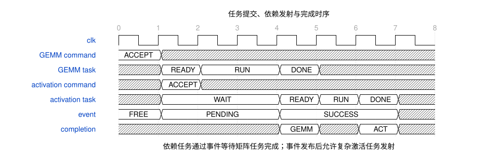

### 16.3 Transformer Attention

以整数 Q、K、V 为例：

1. DMA 把输入和 QKV 权重搬入 L1BUF。
2. Matrix 执行融合 QKV GEMM。
3. 软件为 Q、K、V 生成独立的连续 DMA 任务；需要改变维度次序时使用多条 `DMA_TRANSPOSE_2D`、`DMA_PACK` 或 `DMA_SPLIT`。`DMA_COPY_ND` 与 `DMA_COPY_1D` 都只复制连续元素范围。
4. 若模型使用 RoPE，编译器生成当前位置对应的 signed Q1.15 cos/sin 常量表和静态 `COMPLEX_ROPE` 指令；CPU/Runtime 只提交命令，不计算角度或浮点函数。
5. Matrix 执行 $QK^{\mathsf T}$，得到整数分数。
6. CME 执行缩放和无因果模式的 `COMPLEX_SOFTMAX`；因果掩码由 CPU/Runtime 预处理。
7. Matrix 执行整数 Softmax 权重与 V 的 BMM。
8. Matrix 执行输出投影，IVE 或 CME 完成 residual add。

`COMPLEX_SOFTMAX` 的输出 scale 必须与后续 BMM 的左输入 scale 一致。Softmax 结果通常使用 INT8；需要更细数值间隔时可以使用 INT16，并检查它与后续 BMM 输入格式和 scale 是否一致。

### 16.4 LSTM 单时间步

设输入为 $x_t\in\mathbb Z^{B\times I}$，上一步隐藏状态为 $h_{t-1}\in\mathbb Z^{B\times H}$。编译器先把二者按 Feature 方向拼成 `[B,I+H]`，Matrix 计算四门：

$$
G_t=
[x_t,h_{t-1}]W+b,
$$

其中：

$$
W\in\mathbb Z^{(I+H)\times4H},
\qquad
b\in\mathbb Z^{4H}.
$$

同一组 $4H$ 个 bias 加到全部 $B$ 行；每一行依次包含输入门、遗忘门、候选值和输出门四段，每段长度为 $H$。

内部所表示的实数公式为：

$$
i_t=\operatorname{sigmoid}(G_i),
\quad
f_t=\operatorname{sigmoid}(G_f),
\quad
g_t=\operatorname{tanh}(G_g),
\quad
o_t=\operatorname{sigmoid}(G_o),
$$

$$
c_t=f_t\odot c_{t-1}+i_t\odot g_t,
$$

$$
h_t=o_t\odot\operatorname{tanh}(c_t).
$$

硬件任务次序：

| 步骤 | 单元 | 整数与内部 FP 处理 |
| ---: | --- | --- |
| 1 | DMA / IVE | 准备 `[x_t,h_{t-1}]` |
| 2 | Matrix | INT8 或 INT16 GEMM，INT32 累加，产生四门整数仿射结果 |
| 3 | CME | 三段 Sigmoid、一段 Tanh；每段执行 INT→FP32→INT |
| 4 | IVE | 分别计算 $f_t\odot c_{t-1}$ 与 $i_t\odot g_t$ 的 INT32 乘法结果 |
| 5 | CME | 使用 `VADD_RESCALE_I` 合成 $c_t$，写成指定 INT8 或 INT32 scale |
| 6 | CME | 对 $c_t$ 执行 Tanh |
| 7 | IVE / CME | 计算 $o_t$ 与 Tanh 结果的乘法，并转换为 $h_t$ scale |
| 8 | L1BUF | 将 $h_t,c_t$ 写入下一状态槽 |

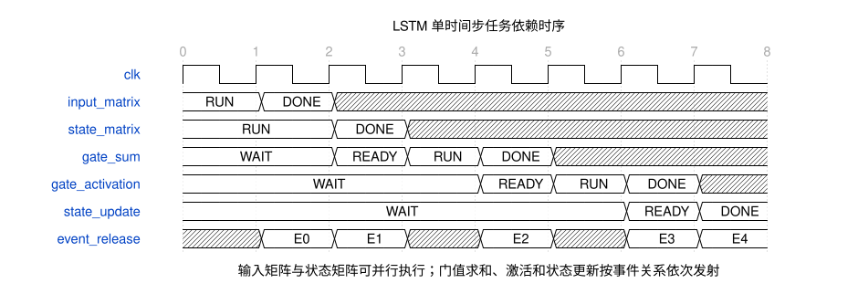

时间步 $t+1$ 只能在 $h_t$ 和 $c_t$ 的最后一个写响应返回后开始。为减少等待，DMA 可以提前把 $x_{t+1}$ 和下一组权重 tile 搬到另一组 L1BUF 区域，但不得覆盖当前时间步仍在读取的数据。

### 16.5 GRU 与普通 RNN

GRU 保存一个 $h_t$ 状态。设输入 $x_t\in\mathbb Z^{B\times I}$，上一步隐藏状态 $h_{t-1}\in\mathbb Z^{B\times H}$。$B$ 是 Batch Size，$I$ 是输入 Feature 数，$H$ 是隐藏 Feature 数。

本设计支持常见的 reset-after 次序：

$$
r_t=
\operatorname{sigmoid}
\left(
x_tW_{ir}+b_{ir}
+h_{t-1}W_{hr}+b_{hr}
\right),
$$

$$
z_t=
\operatorname{sigmoid}
\left(
x_tW_{iz}+b_{iz}
+h_{t-1}W_{hz}+b_{hz}
\right),
$$

$$
n_t=
\operatorname{tanh}
\left(
x_tW_{in}+b_{in}
+r_t\odot
\left(h_{t-1}W_{hn}+b_{hn}\right)
\right),
$$

$$
h_t=(1-z_t)\odot n_t+z_t\odot h_{t-1}.
$$

$r_t$ 是 reset gate，$z_t$ 是 update gate，$n_t$ 是候选隐藏状态，$\odot$ 表示相同位置元素相乘。输入权重可以拼成：

$$
W_i=[W_{ir},W_{iz},W_{in}]
\in\mathbb Z^{I\times3H},
$$

状态权重可以拼成：

$$
W_h=[W_{hr},W_{hz},W_{hn}]
\in\mathbb Z^{H\times3H}.
$$

输入侧 bias $b_i=[b_{ir},b_{iz},b_{in}]$ 和状态侧 bias $b_h=[b_{hr},b_{hz},b_{hn}]$ 的 shape 都是 `[3H]`。Matrix 读取每组 bias 时，三个长度为 $H$ 的片段分别加到三段输出；同一组 `[3H]` bias 对全部 $B$ 行重复使用。

PyTorch 的两组 GRU bias 可以分别保留为上述 $b_i,b_h$。Keras `reset_after=True` 常把两组 bias 保存为逻辑 shape `[2,3H]`，编译器拆成两个连续 `[3H]` 数组。门的实际存储次序可能是 R/Z/N 或 Z/R/N，编译器必须按模型框架的定义整理成生成指令和权重数组时使用的次序。

若模型使用 reset-before 公式：

$$
n_t=
\operatorname{tanh}
\left(
x_tW_{in}+b_{in}
+(r_t\odot h_{t-1})W_{hn}+b_{hn}
\right),
$$

编译器先由 IVE 计算 $r_t\odot h_{t-1}$，再发射候选状态的 Matrix 任务。两种次序不能只靠交换参数得到相同结果，必须生成不同任务序列。

GRU 单时间步的硬件任务如下：

| 步骤 | 单元 | 动作 |
| ---: | --- | --- |
| 1 | Matrix | 计算输入侧 `[B,I]×[I,3H]`，加 `[3H]` INT32 bias |
| 2 | Matrix | 计算状态侧 `[B,H]×[H,3H]`，加 `[3H]` INT32 bias |
| 3 | CME | 对 reset/update 两段执行不同 scale 加法与 Sigmoid |
| 4 | IVE / CME | 按 reset-after 或 reset-before 次序计算候选状态输入 |
| 5 | CME | 对候选状态执行 Tanh |
| 6 | IVE | 计算 $(1-z_t)\odot n_t$ 和 $z_t\odot h_{t-1}$ 的 INT32 乘积 |
| 7 | CME | 用 `VADD_RESCALE_I` 合成并转换为 $h_t$ 的整数 scale |
| 8 | L1BUF | 最后一个 $h_t$ 写响应返回后，允许时间步 $t+1$ 开始 |

Matrix 子系统一次只保存一项活动任务。步骤 1 和步骤 2 必须由 Event 或前序任务关系确定先后；Scalar 与 Direct Matrix 控制路径二选一并共享同一批物理 PE。Vector 任务可拥有独立控制状态和普通 L1 客户端，但其 MUL/FMA 请求与 Matrix 请求争用同一阵列入口；两类乘法不能同拍接收。轻量 Vector ALU可与 Matrix 计算重叠，L1 bank 仲裁仍可能使数据访问等待。

普通 RNN 每个时间步执行：

$$
h_t=
\phi
\left(
x_tW_x+h_{t-1}W_h+b
\right),
$$

其中：

$$
W_x\in\mathbb Z^{I\times H},
\qquad
W_h\in\mathbb Z^{H\times H},
\qquad
b\in\mathbb Z^H.
$$

同一组 $H$ 个 bias 加到全部 $B$ 行；第 $j$ 个 bias 只加到每行第 $j$ 个隐藏 Feature。$\phi$ 为 Tanh 或 ReLU。Matrix 分别计算输入项和状态项；相同 scale 时由 IVE 相加，不同 scale 时由 CME `VADD_RESCALE_I` 相加。Tanh 由 CME 执行 `INT→FP32→INT`；ReLU 可由 IVE 直接执行整数比较和选择。

### 16.6 错误传播时序

图中的 `SRC_ERR` 表示源任务错误通知，`DEP_ERR` 表示依赖任务因所等待事件失败而形成的错误通知。

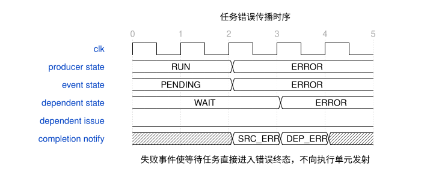

发生执行错误后：

1. 执行单元停止产生新请求；
2. 已发出的 AXI 和 L1BUF 请求必须排空；
3. 若已经写入部分目的数据，软件根据非成功 status 和 progress 把整个目的张量视为无效；
4. 目的张量整体视为无效；
5. 依赖任务进入失败终态并继续传播；
6. 事件等待者不能永久停住。

AXI Slave 协议错误、MIF 错误和 CFE 错误由顶层按固定次序合成
`interface_error_*`，再送入 LSC。LSC 设置 `IRQ_STATUS.ERROR`，并在首错寄存器
为空时保存 status 与 48-bit 地址。接口错误没有任务身份，因此 `FAULT_CMD`
固定记录 `0xFFF`。软件读取 `FAULT_*` 后写 `FAULT_CLEAR`，LSC 产生
`interface_error_clear_o`，清除 AXI Slave 前端和 MIF 保存的错误状态。

---

## 17. 存储顺序与张量布局

### 17.1 字节顺序

所有多字节整数和 FP32 参数使用 little-endian。对 64-bit 总线：

- `data[7:0]` 对应最低字节地址；
- `data[63:56]` 对应最高字节地址；
- `strb[i]` 控制 `data[8i+7:8i]`。

### 17.2 二维行优先张量

对 INT8、INT16 或 INT32 的 `[R,C]`：

$$
\operatorname{addr}(r,c)
=
\operatorname{base}
+r\cdot\operatorname{row\_stride}
+c\cdot\operatorname{elem\_bytes}.
$$

其中 `elem_bytes` 对 INT8、INT16、INT32 分别为 1、2、4。`row_stride` 以字节为单位，可以等于一行的连续字节数，也可以包含行末填充。

对 packed INT4，`row_stride` 至少为 $\lceil C/2\rceil$ B，逻辑元素 `(r,c)` 的 byte 地址为

$$
\operatorname{base}+r\cdot\operatorname{row\_stride}+\lfloor c/2\rfloor,
$$

并由 `c mod 2` 选择低或高半字节。每行独立补齐，奇数 `C` 的末 byte 高半字节为 0。

### 17.3 GEMM 输入、Kernel 与输出

逻辑 shape：

| 对象 | 逻辑 shape | 连续方向 |
| --- | --- | --- |
| 输入 A | `[M,K]` | K |
| Kernel B | `[K,N]` | N 或硬件规定的 `KT×NT` tile 内层 |
| 输出 C | `[M,N]` | N |
| Bias | `[N]` | N |

Kernel 在 DDR 中可以先保存为普通 `[K,N]` 行优先格式。编译器或离线工具根据 `b_pack_format` 把它整理成 Matrix tile 格式，再由 DMA 原样搬入 L1BUF。Matrix 不在运行时猜测 Kernel 的排列。

> [!note] Bias 加到哪些位置
> Bias 只有 $N$ 个元素。$b_n$ 加到输出第 $n$ 列的全部 $M$ 行，即 $C_{0,n}$ 到 $C_{M-1,n}$。它不会加到其他输出列。BMM 指令不读取 bias；需要 bias 时，编译器在 BMM 后安排 Vector 或 CME 任务。

> [!note] Matrix 内部参数表
> 标量 Matrix 的内部任务信息可以提供形状为 `[1]` 或 `[N]` 的整数参数表，每项含 INT32 multiplier 和 signed 8-bit shift。公开指令没有该参数表的地址字段，只能使用乘数 1 和 0～31 的右移位数；编译器与驱动不得生成依赖内部参数表的公开命令。

### 17.4 Transformer 布局

软件可将输入整理为以下两种逻辑布局：

| 名称 | shape | 最内层连续维度 |
| --- | --- | --- |
| BSH | `[Batch,Sequence,Hidden]` | Hidden |
| BHSD | `[Batch,Head,Sequence,HeadFeature]` | HeadFeature |

QKV 融合 GEMM 输出 BSH `[B,S,3H]`。软件为 Q、K、V 分别提供独立的连续 DMA 任务；`DMA_COPY_ND` 与 `DMA_COPY_1D` 均只复制连续元素范围。需要改变维度次序时，软件使用多条 `DMA_TRANSPOSE_2D`、`DMA_PACK` 或 `DMA_SPLIT` 任务整理为 `[B,h,S,D]`。其中 $H=hD$。`DMA_SPLIT` 只适用于第 9.4 节定义的“连续源段写到等距目的位置”，不能用一个目的基地址表示三个独立输出张量。

所有 stride 都由指令字段展开到片上 Task Context。硬件不假设 Batch Size、
序列长度或 Head 数为固定值。

### 17.5 循环层布局

| 对象 | shape | 说明 |
| --- | --- | --- |
| 时间步输入 | `[B,I]` | I 连续 |
| 隐藏状态 | `[B,H]` | H 连续 |
| LSTM 记忆状态 | `[B,H]` | H 连续 |
| LSTM 四门结果 | `[B,4H]` | 四段连续，每段 H |
| GRU 三门结果 | `[B,3H]` | 三段连续，每段 H |

LSTM/GRU 状态使用两个 L1BUF 区域轮换：

| 时间步 | 读取状态区 | 写入状态区 |
| --- | --- | --- |
| $t$ | 状态区 A | 状态区 B |
| $t+1$ | 状态区 B | 状态区 A |

事件必须保证写入完成后再交换两个区域的用途。

### 17.6 Scale 与函数参数区

FP32 scale、$\epsilon$ 和函数系数是 CME 的只读参数，不是模型张量。公开 Matrix 指令直接携带 0～31 的右移位数，不从 L1BUF 读取整数参数表。CME 参数区要求：

- 起始地址至少 4B 对齐；
- CME 每 Feature scale 表的 shape 为 `[length]`；
- Norm 的 $\gamma,\beta$ 是 INT8、INT16 或 INT32 模型参数，各自具有 scale；
- 参数区在所有读取它的任务进入终态前不得修改；
- DMA 可以搬运参数区的原始字节，但不得把 FP32 选作模型张量 dtype。

DMA 搬运 FP32 参数表时使用“raw 32-bit copy”模式，数据通路按 INT32 宽度原样复制位模式，不执行整数算术或 scale 处理。

量化参数按“LSC 定义窗口、L1BUF 保存记录、指令选择记录”三级传递。LSC 只保存
`PARAM_L1_BASE`、`PARAM_L1_LIMIT` 和 `PARAM_LOCK`，不得为每层或每通道展开 scale、zero
point 寄存器。Matrix 的 MQR1/MQR2/MQR3 分别以 192/128/64-byte 记录保存 16 个输出 lane
所需的 multiplier、shift、weight zero point 和输出格式；编译器把静态记录放入 DDR，DMA
在使用前预取到参数窗口，`DIRECT_GEMM.matrix_requant_profile` 只传 10-bit slot。需要在相邻
token 或 tile 间更新大量参数时，软件使用两个或多个 L1 profile slot 做 ping-pong，并以 Event
保证“DMA 写完后消费、消费结束后覆盖”，不通过 MMIO 逐项改写 LSC。

当前 RTL 的 Matrix profile 支持静态 per-output-channel 重量化，但没有实现任意 per-channel
activation scale 的在线标定。CPU 量化参考中的 decode per-token A8 是量化方案验证能力，不得
解释为现有硬件 ABI 已经支持。后续硬件化应由 Norm/激活量化流水对当前 row 求最大值并产生
一个 row scale，通过执行单元内部旁路或 L1BUF 小型动态 profile 交给 Matrix；LSC 至多增加
动态 profile 环形区的基址、容量和生产/消费索引。M=1 时为每个输入元素单独生成 scale 会退化
成逐乘积反缩放，禁止把这种所谓“动态 per-channel A8”作为高吞吐 GEMM 路径。

W4A8 的规划合同采用 W4 group-128 与 A8 per-token dynamic。一个 token row 共享激活 scale，
因此 Matrix 应先按 W4 group 的静态 multiplier/shift 对未舍入部分和做宽定点累加，再于最后
一个 group 后应用一次 row activation scale、bias、输出归一化和最近偶数舍入。输出动态范围
优先采用 row absmax 与 LZC 可生成的 2 的幂 INT16 scale。该合同已在 CPU golden 中通过短程
事实门禁，但当前 RTL、公开指令编码和 CModel 尚未实现；在 ABI 分配前不得由编译器发射。
宽累加器暂按 72 bit 候选上界开展范围统计，最终宽度由真实模型 profile 的极值证明确定。

`PARAM_L1_BASE`、`PARAM_L1_LIMIT` 和 `PARAM_LOCK` 只保存参数区配置，不参与执行单元或 L1BUF 的写检查。软件应按以下方式避免参数被覆盖：

1. 设置参数区地址并用 DMA 写入所需参数；
2. 等待 DMA 完成；
3. 在所有读取参数的任务结束前，不向该地址范围提交任何写任务；
4. 用事件约束参数装载与使用任务的先后次序。

`PARAM_LOCK=1` 仅保留软件设置的锁定状态；写保护由任务依赖和地址分配保证，不以该寄存器的值决定 L1BUF 响应。

`PARAM_L1_LIMIT` 是末地址的下一个字节，因此参数区为：

$$
[\operatorname{PARAM\_L1\_BASE},\operatorname{PARAM\_L1\_LIMIT}).
$$

`PARAM_L1_BASE=PARAM_L1_LIMIT` 表示记录的参数区为空；设置 `PARAM_LOCK=1`
在 LSC 寄存器层仍合法。

---

## 18. 软件与硬件分工

| 工作 | 编译器 / Runtime / 固件 | NPU 硬件 |
| --- | --- | --- |
| 模型解析 | 读取模型并生成整数张量、scale 和 zero point | 不解析模型文件 |
| 指令选择 | 选择已定义 opcode，把完整 opcode、事件和选项写入 128-bit CMD | 检查两个 beat、保存完整 CMD 并执行任务 |
| tile 选择 | 读取功能寄存器，选择 Matrix 和 Vector tile | 按指令展开得到的 Task Context 执行 |
| Kernel 整理 | 生成指定 `pack_format` | 按该格式读取 |
| L1BUF 分配 | 为输入、权重、临时值和输出分配不冲突区域；连续 Vector MUL 的 src0、src1、dst 两两不相交 | 按 LADDR 访问；IVE 不检查快速 MUL 的三组区域是否相交 |
| Scale 管理 | 为 CME 生成 FP32 参数；为 Matrix 选择乘数 1、0～31 右移可表示的张量 scale，其他情况安排 Vector/CME 任务 | CME 执行 I2F/F2I；Matrix 执行整数右移、最近偶数舍入和裁剪 |
| 激活函数 | 选择函数和输入输出 scale | CME 执行 INT→FP32→INT |
| Softmax / Norm | 生成行数、行长度、mask 和参数 | CME 多遍读取并写整数输出 |
| 任务依赖 | 为写入任务和读取任务分配事件，把引用直接写入 CMD | Event Table 检查成功或失败终态 |
| Matrix 执行 | 安排 `DIRECT_GEMM`、GEMM、GEMM_ACCUM、GEMM_ACCUM_HOLD 和清零任务的次序与 L1 区域 | Direct 使用面板端口，公开 GEMM、本地部分和序列与不规则形状使用 Scalar 控制/存储/后处理；所有矩阵乘法复用配置选定的 PE；SoC 为 128 PE，兼容十六列接口与并行 plane 接口按任务互斥使用 |
| 系统内存地址配置 | 模型编译器分配存储区编号和 24-bit 区内偏移；超过 16 MiB 的权重镜像由静态 `SET_WEIGHT_WINDOW` 分段；部署配置给出各存储区物理基址和允许访问范围，驱动写入 LSC | 非权重区使用提交时保存的基址加区内偏移；权重区使用 `WEIGHT_BASE + (weight_window << 24) + byte_offset`；MIF 检查范围并发起 AXI 访问 |
| 错误处理 | 读取错误状态，决定重试、复位或停止 | 停止新请求、排空并报告 |

> [!important] 软件地址要求
> 模型编译器不得决定 SoC 物理基址。它把 `base_select` 和 24-bit `byte_offset` 写入数据指令；权重镜像超过 16 MiB 时还要插入静态 `SET_WEIGHT_WINDOW`，并保证任一访问不跨 16 MiB 边界。清单给出各存储区的已用字节数和权重窗口数。部署配置必须提供 `INPUT_BASE`、`WEIGHT_BASE`、`WORK_BASE`、`OUTPUT_BASE`、`KV_BASE`、`M_AXI_ADDR_BASE` 和 `M_AXI_ADDR_LIMIT`。驱动必须检查 8B 对齐、40-bit 地址范围、区间容量和允许访问范围，再写入 LSC；不得把 CPU 普通指针值直接写入 NPU 地址寄存器。

### 18.1 上层模型编译器与低层汇编器

软件工具分为两个独立的阶段，即编译和汇编：

| 阶段 | 工具模块 | 输入 | 主要工作 |
| --- | --- | --- | --- |
| 上层编译 | 模型编译器 | 已支持的模型格式或高层中间表示 | 前端导入、图检查、稳定拓扑排序、shape 推导、常量处理、算子拆分、张量布局、存储分配、任务依赖生成和部署包生成 |
| 低层汇编 | 指令汇编器 | 规范化的低层中间表示 | 指令字段检查、事件字段检查、128-bit 指令编码、命令镜像和摘要生成 |

高层模型图只描述下列内容：

- 模型名称、输入、输出和常量；
- 张量名称、逻辑 shape 和整数 dtype；
- 常量数值或常量文件；
- `MatMul`、`Add`、`Softmax`、`LayerNorm`、`GELU`、`Reshape`、
  `Transpose`、`Concat`、`MultiHeadAttention` 和 `Conv2D` 等模型层级算子；
- 头数、轴、$\epsilon$、stride、dilation 和 padding 等算子属性。

高层模型图不得填写 L1/DDR 地址、`command_id`、Event ID、执行单元、硬件
opcode、burst 参数、字节步长或显式 DMA/PACK/SPLIT。`MT/KT/NT`、L1 容量
及 DDR 可用范围属于编译目标配置，不属于模型计算
定义。Keras、PyTorch、TFLite 和 ONNX 前端先把框架张量和节点转换成同一种
高层图，再进入后续步骤；前端遇到不属于支持集的层、动态 shape 或属性组合时必须
明确报错，不能猜测执行方式。

上层编译阶段依次完成：

1. 检查重复名称、未知张量、重复写入来源和不支持的算子；
2. 从节点输入输出关系建立有向图，执行稳定拓扑排序并拒绝有环图；
3. 推导所有中间张量的 shape 和 dtype，检查矩阵维度、轴、排列、广播方式及
   Reshape 元素数；
4. 把复合算子拆成 Matrix、Vector、Complex 和 DMA 任务；
5. 把普通行主序权重整理成 Matrix 单元要求的 tile 存储形式；
6. 依据张量使用区间分配 L1 地址，并在 input、weight、work、output、kv 五类系统存储区内分别分配 24-bit 字节偏移，保证同时有效的数据区域不会互相覆盖；若 Vector MUL 可能进入连续快速分支，还要强制 src0、src1 和 INT32 dst 三组区域两两不相交；
7. 自动加入输入 DDR→L1、常量 DDR→L1 和输出 L1→DDR 任务；
8. 根据实际数据关系生成任务依赖；三个以上前置任务使用 `EVENT_JOIN` 树，
   不能简单地把互不相关的分支全部串行化；
9. 生成规范化的低层中间表示并交给低层汇编器；
10. 生成模型接口说明、模型指令包、模型清单、命令镜像、常量镜像和运行清单；
11. 对全部工件执行内容一致性检查，确保指令数组、镜像、地址分配和摘要信息一致。

`MultiHeadAttention` 在高层图中是一个节点。编译器负责生成 Q/K/V 投影、
按 Head 整理数据、K 转置、$QK^T$、Softmax、注意力乘 V、Head 合并和输出
投影。模型作者不应手工填写这些任务的地址、事件或 DMA 参数。

NPU 不设置卷积执行单元，也不定义卷积 opcode。高层 `Conv2D` 采用
`im2col + GEMM`：

1. 输入采用 NHWC，kernel 采用 $[KH,KW,C_{in},C_{out}]$；
2. 根据 stride、dilation 和 padding 推导输出高、宽；
3. 需要补零时先用 DMA FILL 建立补零输入；
4. 对每个 kernel 位置生成规则的 DMA COPY_ND，把输入窗口写入
   $[N H_o W_o,\;KH KW C_{in}]$ 的 `im2col` 张量；
5. 编译期把 kernel 整理成
   $[KH KW C_{in},\;C_{out}]$ 的 Matrix B tile 格式；
6. Matrix GEMM 产生按 NHWC 线性次序保存的输出。

`Conv2D` 只接受 `groups=1`。不支持的 groups、dtype、padding 组合或
内存需求必须在编译期报错，不能生成不存在的硬件指令。

编译结果必须包含以下部署工件：

| 生成工件 | 内容 | 使用方 |
| --- | --- | --- |
| 模型接口说明 | 数据类型、模型配置、存储区编号与大小以及平台物理基址参数 | 固件、Runtime、应用程序 |
| 模型指令包 | 128-bit 指令数组、权重与常量、存储区编号加区内偏移、提交批次和设备地址配置 | 固件、Runtime、应用程序 |
| 模型清单 | 输入摘要、高层算子、低层任务、提交批次、目标信息和内容摘要 | 构建工具、部署工具 |

编译器还应提供便于独立装载和诊断的原始工件：

| 生成工件 | 内容 | 使用方 |
| --- | --- | --- |
| 低层任务描述 | 自动生成的低层中间表示，可单独交给汇编器处理 | 汇编器、调试工具 |
| 命令镜像 | 连续的 128-bit 指令，每项 16B，低 64 bit 在前 | 调试工具、二进制装载程序 |
| 常量镜像 | 已按设备存储形式整理的权重和常量 | 调试工具、二进制装载程序 |
| 运行清单 | 输入输出信息、常量地址、提交批次和内存分配 | Runtime、部署工具 |

指令已经包含执行参数，编译器不生成外部描述符镜像，也不生成外部任务参数数组。上层编译器通过低层汇编器生成命令镜像；独立工件中的命令镜像必须与模型指令包逐字节一致。应用程序应从生成配置读取命令数、任务编号、存储区编号、区内偏移、输入输出大小、权重位置和提交批次，不允许再次手工排列权重或填写内部张量地址。系统内存位置变化时，只更新平台内存配置并重新生成部署工件，不改变模型的低层任务序列。

### 18.2 软件驱动的职责与接口分层

软件驱动必须与具体操作系统解耦。寄存器访问、命令提交、运行控制、缓存维护和中断处理应通过平台适配接口连接到裸机固件、内核态驱动或用户态运行环境。上层应用只访问稳定的设备控制和模型执行接口，不直接拼接 AXI 事务，也不依赖驱动内部数据结构。

驱动按下表划分职责：

| 接口层次 | 必须承担的工作 | 不得承担的工作 |
| --- | --- | --- |
| 设备控制 | 建立设备上下文，配置基址与允许访问范围，执行启动、停止、软复位和故障恢复 | 不解析模型计算图，不生成算子任务 |
| 命令提交 | 检查 128-bit 指令两拍顺序，以 FIXED burst 提交命令，读取命令前端接收结果 | 不修改编译器已生成的指令字段 |
| 任务控制 | 执行 WAIT、QUERY、FENCE 和 ACK，维护软件侧任务状态 | 不提前释放尚未确认的任务编号或事件编号 |
| 存储一致性 | 在设备读取前完成缓存清理和写屏障，在处理器读取结果前完成缓存失效和读屏障 | 不改变张量布局或权重排列 |
| 中断与异常 | 读取中断原因和首个错误记录，通知运行时并执行规定的恢复次序 | 不在存在未完成总线事务时直接关闭时钟或电源 |
| 平台适配 | 提供 MMIO、缓存维护、屏障、等待和中断原语 | 不向上层暴露平台相关句柄或地址转换细节 |

平台访问发生错误时，驱动必须停止当前提交，不得把后续指令的低分拍当作未完成指令的高分拍。若命令前端已经接收低分拍，驱动必须等待命令前端超时并读取拒绝结果，或者按照第 15.8 节执行受控软复位。

驱动必须保存下列软件状态：设备运行状态、已配置物理地址区间、待确认任务编号、待确认事件编号、最后一次命令接收结果和首个未处理错误。上述状态的修改必须与对应 MMIO 操作保持顺序一致。

### 18.3 从编译结果到任务完成的软件时序

一组模型任务的软件次序如下：

1. 读取模型清单，核对指令数量、常量大小、输入输出大小、提交批次和所需存储区容量；
2. 分配满足对齐和范围要求的设备可访问内存，写入输入、权重和只读参数；
3. 对非一致缓存执行清理，并在提交首条读取这些数据的任务前执行设备写屏障；
4. 按低 64 bit、再高 64 bit 的固定次序提交每条指令；
5. 读取命令前端接收结果；只有收到 `ACCEPTED` 才能把该指令计入已提交任务；
6. 按清单中的批次边界继续提交，或使用 WAIT、QUERY、FENCE 和中断等待所需终态；
7. 确认输出写任务成功后，对非一致缓存执行失效，再由主控处理器读取结果；
8. 软件保存终态信息后执行 ACK，释放任务槽、命令编号和相关事件资源。

一条 128-bit 指令的两个 beat 不能与另一条指令交错。若低 word 已经发送，而高
word 因平台错误无法发送，平台需要按第 7.4 节等待 CFE 超时或执行受控复位，
不能直接把下一条 CMD 的低 word 当作当前命令的高 word。

### 18.4 Transformer 部署任务划分

Transformer 模型必须由编译器拆分为矩阵计算、张量整理、逐元素运算、复杂数学运算和数据搬运任务。硬件不识别 Encoder、Attention 或前馈网络等模型层名称，只执行本规格定义的指令。

典型 Encoder 的任务划分如下：

| 模型阶段 | 编译器生成的任务 | 主要约束 |
| --- | --- | --- |
| Q、K、V 投影 | GEMM 或 `DIRECT_GEMM`，必要时附加数据整理任务 | 权重排列、tile 大小和输出格式必须满足第 11 章要求 |
| Head 拆分与 K 转置 | DMA COPY、PACK、SPLIT 或 TRANSPOSE | 每条任务必须使用可由指令字段表示的连续范围和步长 |
| 注意力分数 | BMM | 输出为 INT32 或可由整数右移直接表示的目标格式 |
| 掩码与 Softmax | Vector 掩码任务和 CME Softmax | Mask 必须在 Softmax 读取前完成；CME 内部保持 FP32 中间值 |
| 注意力乘 V | BMM | 读取 Softmax 整数输出和 V 张量 |
| Head 合并与输出投影 | DMA 整理及 GEMM | 合并后的 Hidden 维必须连续或显式给出行步长 |
| 残差加法与归一化 | Vector Add 及 CME LayerNorm/RMSNorm | 不同 scale 的加法必须由 CME 完成 |
| 前馈网络 | GEMM、激活、GEMM | GELU 或 SiLU 由 CME 执行，软件可见中间张量仍为整数 |

每个阶段的写任务必须向其直接读取者提供事件依赖。存在三个以上前序分支时，编译器必须生成 `EVENT_JOIN` 树。为限制任务槽占用，运行时应按不超过 8 个活动任务的批次提交；批次边界只用于资源管理，不得改变模型中的数据先后关系。

当中间张量跨批次保留时，软件不得在最后一个读取任务进入终态前复用其 L1BUF 区域。KV Cache、循环状态和长期参数区必须具有独立的生命周期；其地址分配不得与临时工作区冲突。


## 19. 模型程序、参考一致性与对话验收

### 19.1 静态程序与运行状态

权重、W4 code/zero point、group multiplier/shift、算子参数和程序依赖在编译期确定。
运行时 token、位置、有效历史、动态 A8 scale 与缓存有效状态分别存放在指令明确指定的
数据区和程序状态寄存器中。完整 descriptor 中的静态地址可以被内联或缓存；指向动态数据
的地址不要求 CPU 每个 token 重写整条指令。字段编码范围不足时使用合法的完整描述符，
不得截掉高地址位。

Q25FUL2 以一份可复用程序和有界上下文循环执行不同 position，32K 表示 KV 容量 32768，
不是复制 32768 份模型代码。真实 prefill 从空 KV 处理完整 ChatML 前缀，按因果顺序写入
各层缓存；不得用固定前缀 KV、预计算 token 或共享错误历史替代此过程。

### 19.2 硬件与参考配置

CPU 量化参考验证量化运算顺序，CModel 执行器验证编译指令与数值，RTL SoC 验证真实调度、
总线、CPU 中断和 UART。三者分别记录模型包、输入历史、采样参数与硬件配置。
`NPU_CMODEL_MATRIX_PES=128`、`NPU_CMODEL_ONLINE_PV_LANES=8`、
`NPU_CMODEL_L1_BANKS=64` 显式对应当前 SoC，检查器用 `--describe-hardware` 输出实际值。

CModel 仍包含 64-bit 事务和旧周期近似，标记 `cycle_estimate_only=1`；它的推算不能直接
作为当前 256-bit、4096-bit L1 的 RTL 速度，也不能只除以四得到宽总线性能。
短前缀 token 一致只是对应数值测试通过，不证明开放三轮和实际 32K 历史均正确。

### 19.3 正式采样与诊断程序

现有原生尾部提供分片 ARGMAX，INT8/INT16 compact-C 各 tile 的有效十六列参与比较，
相同值保留更早 token，跨 slice 保存最大值和累计索引。FINAL 才写 token ID；该功能不等于
Top-K 候选归约、重复惩罚及正式 sampling。

正式 sampling 程序必须由 NPU 生成有相同 score 单位的候选表，再由 CPU 整数采样器选择。
重复惩罚须在候选截断前应用，候选表、采样状态和实际写入 KV 的 token 保持一致。
仅链接 `qwen25_fixed_sampler.c` 不等于固件调用了该采样器，不能把 argmax 图的
`release_sampling_executable` 手工改成 true 来通过启动检查。

当前原生图尚未完成这一候选生成与消费功能，ARGMAX 运行只用于数值、协议和吞吐诊断。
导出清单应分别声明 `whole_token_capability`、`structural_compile_only` 和
`release_sampling_executable`，保留实际未完成能力。程序能加载、短问候正确或单项算子
通过，均不自动允许发布正式对话版本。

### 19.4 计时、并行与验收条件

200 MHz 下，10 token/s 对应每个输出 token 平均不超过 20,000,000 cycles。
分别记录真实 prefill、首字延迟、持续 decode 及整轮最后 UART 字节完成周期；不能用
宿主机仿真的 wall time、首个 token 的程序周期或局部流水 II 替代用户可见速度。
UTF-8 字节未构成完整文字时，不提前记为完整文本输出。

性能验收使用 DDR 时序模型、空初始 KV、32K 容量、三轮中文输入和约 1024 个生成 token。
同时核对事实约定、干扰后的记忆、历史承接、阐述内容、重复输出和停止条件，与同历史的
Python 浮点及 CPU 量化参考比较，不要求量化采样逐 token 与浮点完全相同。
32K 容量配置与实际已填满 32K 的推理分别验证。

DMA、Matrix 和 Complex 的计数可以重叠，不能把各自 busy 相加当作互斥时间占比。
Matrix 空间/窗口/全时间 PE 利用率分别统计；DDR 统计完整 token 中的 payload 与物理拍，
包含 prefill 的平均速度和持续 decode 速度分别给出。短窗口估计只能指导下一项优化。

仿真宿主的 UART 控制行先按完整行保存，再与进度统计分别输出；token 文本采用长度帧立即
传输，不等待整轮结束。非交互输入保留实际问题，`.stdout` 展示用户对话，`.sim.log` 保存
周期和硬件诊断，避免进度行插入 TURN_END 字段后破坏三轮协议。

功能检查、资源综合、单模块布线及整 SoC 布线各自记录。最新实测和失败定位存放在
[SoC 三轮对话与吞吐优化记录](logs/SoC三轮对话修复与吞吐优化_20261103.md)，
规格正文不保存逐次运行过程，也不把未完成的 200 MHz 目标当作部署结果。
最近运行状态及对应正文核对项见 [SoC 状态与总规格核对记录](logs/SoC仿真状态与总规格核对_20261104.md)。
