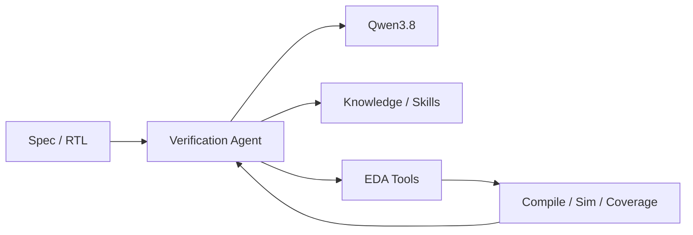
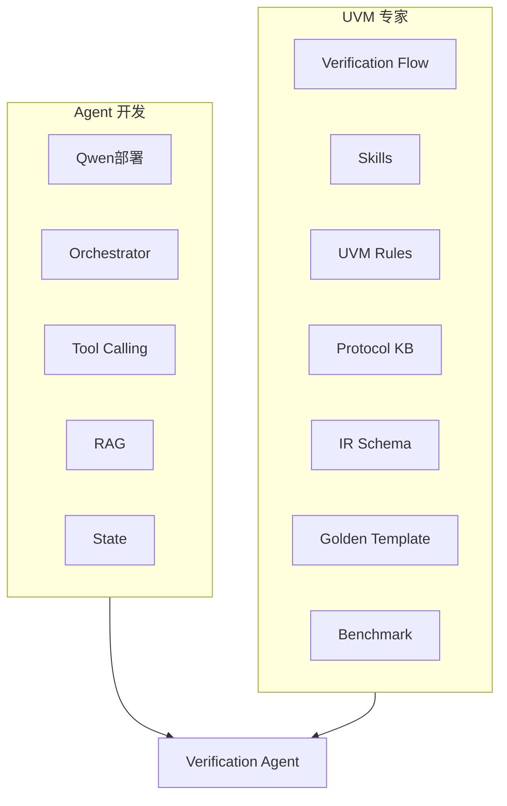
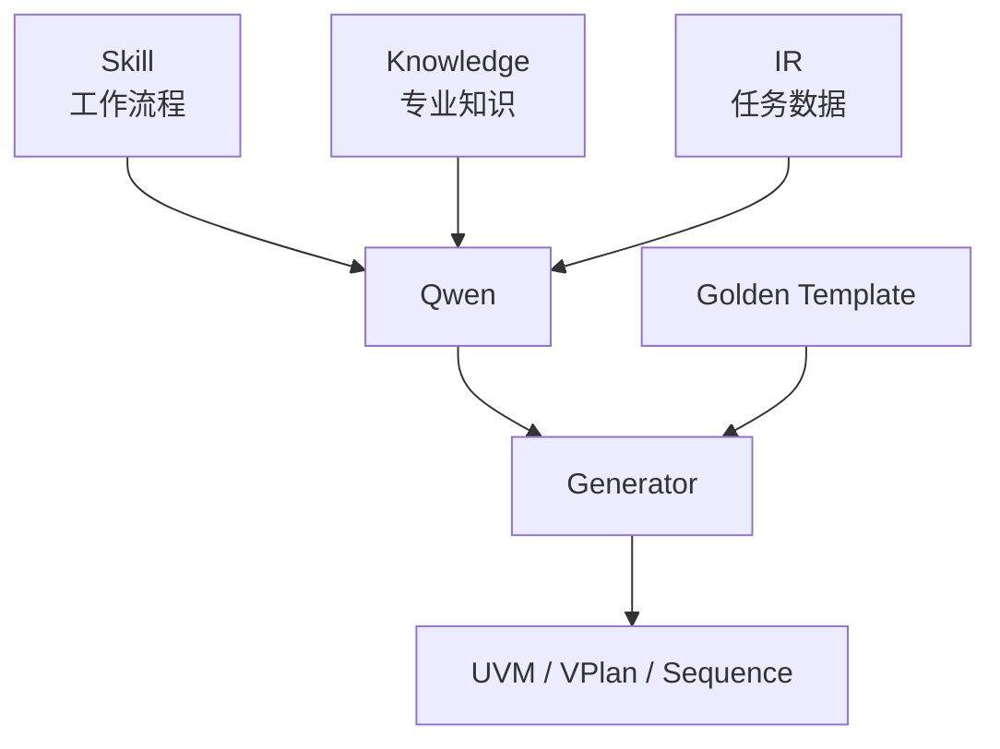
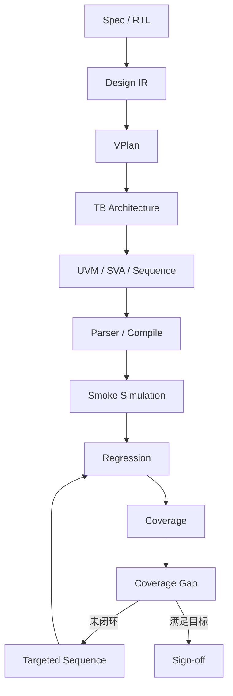
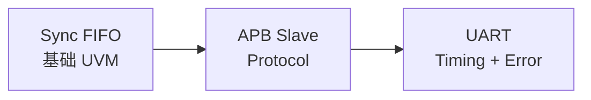

# 基于本地 Qwen3.8 的 UVM Verification Agent 调研

> [!summary]
> **结论：可行。**  
> 但目标不应该是“让 Qwen 一次性生成一套 UVM”，而应该是构建：
>
> **Qwen3.8 + UVM Skills + IR + Golden Template + Knowledge Base + EDA Tool Feedback + Coverage Closure**
>
> 形成从 **Spec/RTL → VPlan → UVM → Compile/Sim → Regression → Coverage → Targeted Test → Sign-off** 的闭环 Verification Agent。

---

## 1. 为什么考虑 UVM Agent？

传统 UVM 验证包含大量重复工作：

```text
读 Spec
→ 写 VPlan
→ 搭 UVM TB
→ 写 Sequence / Checker / Coverage
→ Compile
→ Debug
→ Regression
→ 看 Coverage
→ 补 Test
→ 再 Regression
```

LLM 的价值不只是“帮忙写几段 SystemVerilog”，而是尝试把这些步骤组织成一个能持续调用工具、根据反馈继续工作的 Agent。



核心思想：

> **LLM 做理解、规划、Debug 和决策；Compiler / Simulator / Coverage / Formal 做客观判定。**

---

## 2. 目前别人已经做到什么程度？

### UVM² — ICCAD 2025

*From Concept to Practice: an Automated LLM-aided UVM Machine for RTL Verification*

特点：

```text
LLM 生成 UVM
→ Compile / Simulation
→ Error Feedback
→ 自动修改
→ Coverage
→ 补 testcase
```

报告结果：

- 平均 code coverage：**87.44%**
- 平均 functional coverage：**89.58%**
- 已经开始做 coverage-driven feedback

**启发：必须 Simulator-in-the-loop，而不是代码生成后结束。**

---

### HAVEN — 2026

*Hybrid Automated Verification ENgine for UVM Testbench Synthesis with LLMs*

它进一步认为：

> 对必须严格正确的协议代码，不应全部让 LLM 自由生成。

采用：

```text
Spec
→ LLM 生成结构化计划
→ Protocol-specific Jinja2 Template
→ UVM
```

Sequence 使用 Protocol-aware DSL。

报告：

- 19 个开源 IP
- Direct / Wishbone / AXI4-Lite
- Compilation success：**100%**
- Code coverage：**90.6%**
- Functional coverage：**87.9%**

**启发：LLM 负责“聪明的部分”，Template / Rule 负责“必须正确的部分”。**

---

### UVMarvel — 2026

开始做 **Subsystem-level UVM**。

核心：

```text
IR
+
Bus Protocol Library
+
Signal Tracker
+
Patch Library
+
LLM
```

报告平均 code coverage：**95.65%**。

**启发：IR 和 Protocol Library 很重要。**

---

### Verilab — DVCon Europe 2025

使用 Aider + LLM 自动构建 **APB3 UVM VIP**。

发现：

- Coding convention 能明显改善结构；
- 但过度规范可能导致功能被简化；
- 多个模型会在 APB3 中错误加入 APB4 的 `PSTRB/PPROT`；
- reset / timing / clocking block 是常见弱点。

**启发：Protocol version、timing、reset 必须写成显式规则，而不能依靠模型常识。**

---

### NYU 2026 UVM Benchmark

建立 14 个 Golden UVM TB：

```text
MUX / ALU / FSM / FIFO
APB3 / AHB-Lite / AXI4
...
```

不仅看生成结构，还评价：

```text
Structural
+
Compile / Runtime
+
Functional Coverage
+
Assertion Coverage
```

一个重要结论：

> “会生成 UVM 结构”与“会做正确验证”仍有明显差距。

---

## 3. 工业界也正在向 Agentic Verification 演进

2026 年主流 EDA 厂商的方向已经非常明确：

| 团队 | 方向 |
|---|---|
| Cadence ChipStack AI Super Agent | TB、testplan、regression、debug 的 agentic orchestration |
| Cadence Verisium | coverage、regression、triage、debug |
| Synopsys AgentEngineer | multi-agent design/verification workflow |
| Siemens Questa One | Smart Creation、Verification IQ、Agentic Toolkit |
| ChipAgents | UVM generation、coverage closure、RCA、formal |

说明：

> **Verification Agent 已经从学术 demo 开始进入 EDA 产品竞争。**

---

# 4. Qwen3.8 为什么适合做本地底座？

Qwen3.8-27B 官方定位包含：

- Coding；
- long-horizon agent task；
- tool use；
- autonomous planning。

并原生支持：

```text
Qwen3.8-27B
    ↓
vLLM / SGLang
    ↓
OpenAI-compatible API
    ↓
qwen3 reasoning parser
+
qwen3_coder tool-call parser
```

官方模型卡报告：

| Benchmark | Qwen3.8-27B |
|---|---:|
| Terminal Bench 2.1 | 73.0 |
| SWE-bench Pro | 61.7 |
| QwenSWEBench | 79.0 |

这些不能证明模型天然会 UVM，但证明其具有比较好的：

```text
Coding
+
Tool Feedback
+
Multi-step Agent Execution
```

基础。

本地部署还适合处理：

- 内部 RTL；
- Spec；
- register document；
- bug history；
- regression log；

避免敏感验证数据离开本地环境。

---

# 5. AI Agent 开发与 UVM 专家应该怎么分工？



### Agent 人员

负责：

```text
Qwen / vLLM
Agent Framework
RAG Engine
MCP / Tool Calling
File / Shell
State / Memory
Sandbox
```

### UVM 人员

负责：

```text
验证流程
UVM方法学
Protocol规则
Skill
IR
Golden Template
Golden Testbench
Coverage Model
Assertions
Bug Injection
评价指标
```

所以 UVM 人员的角色更接近：

> **Verification Methodology Architect**

而不只是“给 AI 提供 UVM 文档”。

---

# 6. 四个最重要的概念

| 项目 | 含义 |
|---|---|
| Skill | 告诉 Agent **怎么做** |
| Knowledge Base | 告诉 Agent **应该知道什么** |
| IR | 描述 **当前设计/任务到底是什么** |
| Golden Template | 规定 **代码可靠骨架怎么写** |



---

# 7. Golden Template 是不是只“学习一次”？

不是。

Golden Template 不应该训练进模型，而应该是外部工程文件：

```text
templates/
├── common/
│   ├── driver.sv.j2
│   ├── monitor.sv.j2
│   ├── agent.sv.j2
│   └── env.sv.j2
└── protocol/
    ├── fifo/
    ├── apb/
    └── uart/
```

每一次生成：

```text
IR
+
当前 Skill
+
Template
→ 生成代码
```

也就是说：

> **每次使用，但不是每次重新“学习”。**

关键知识不能依赖模型记忆。

---

# 8. 什么是 IR？

IR = Intermediate Representation，中间表示。

例如：

```text
Spec
 ↓
Design IR
 ↓
VPlan IR
 ↓
TB IR
 ↓
Sequence IR
 ↓
UVM
```

为什么需要？

因为直接：

```text
Spec → 5000行 UVM
```

出错以后很难知道到底哪里理解错。

有 IR 后可以逐级检查。

例如 FIFO：

```yaml
design:
  name: sync_fifo

parameters:
  WIDTH: 8
  DEPTH: 16

reset:
  signal: rst_n
  active_level: 0

features:
  write: true
  read: true
  simultaneous_rw: true
  write_when_full:
    content_must_not_change: true
```

---

# 9. 知识库怎么做？

建议至少四层：

```text
knowledge_base/
├── methodology/
│   ├── driver.md
│   ├── monitor.md
│   ├── scoreboard.md
│   └── coverage.md
│
├── protocols/
│   ├── apb/
│   ├── fifo/
│   └── uart/
│
├── project/
│   ├── spec/
│   ├── rtl_summary/
│   └── register/
│
└── experience/
    ├── compile_errors/
    ├── sim_errors/
    └── coverage_closure/
```

重点：

> 不要只是把 UVM/APB PDF 全部丢进向量库。

最好整理成：

```text
Rule
+
Metadata
+
Source Reference
```

例如：

```yaml
protocol: APB
version: APB3
topic: wait_state

rule:
  stable:
    - PADDR
    - PWRITE
    - PSEL
    - PENABLE
```

检索时：

```text
Keyword + Embedding + Metadata Filter
```

避免 APB3 任务召回 APB4/5 规则。

---

# 10. Skill 怎么写？

Skill ≠ Prompt。

错误：

```text
“你是资深 UVM 工程师，请生成高质量 driver。”
```

正确的 Skill 应该包含：

```text
Input
Precondition
Knowledge
Steps
Output
Validation
Forbidden Actions
Recovery
Stop Condition
```

例如：

```yaml
name: generate_uvm_driver

preconditions:
  - interface resolved
  - reset resolved
  - protocol version resolved

rules:
  - only drive master-owned signals
  - must handle reset
  - timing must come from protocol KB
  - must complete item_done
  - no scoreboard behavior in driver

validation:
  - parser
  - compile
  - reset smoke
  - legal transfer smoke
```

第一版建议写 12 个 Skill：

```text
spec_analysis
rtl_analysis
vplan_generation
tb_architecture
uvm_component_generation
sequence_generation
assertion_generation
compile_debug
simulation_debug
regression
coverage_analysis
signoff
```

---

# 11. 如何约束 LLM？

几个关键 Guardrail：

### 不允许虚构设计事实

所有信息分：

```text
FACT
INFERENCE
UNKNOWN
```

### Requirement 必须带 source

```text
spec section / RTL location
```

### Protocol version 必须锁定

例如 APB3 任务禁止召回 APB4-only 内容。

### LLM 不能自己说 PASS

PASS 必须来源于：

```text
Simulator
Scoreboard
Assertion
Exit Status
```

### 禁止 Coverage Gaming

Agent 不能为了 closure：

```text
删除 bin
删 assertion
把 illegal 改 ignore
降低 checker
```

只能生成 waiver proposal，人工批准。

### Debug 使用最小 Patch

禁止 compile 出一个错就重写整个 TB。

---

# 12. Agent 如何调用 EDA？

不建议给 LLM 一个无限制 shell。

应该封装 Tool：

```text
parse_rtl()
compile()
elaborate()
simulate()
run_regression()
coverage_report()
query_waveform()
```

例如：

```yaml
simulate:

input:
  test:
  seed:
  plusargs:
  timeout:
  compile_artifact:

output:
  status:
  uvm_status:
  scoreboard_mismatches:
  assertion_failures:
  timeout:
  log_path:
  waveform_path:
  coverage_db:
```

上层 Agent 永远只处理统一 schema。

Simulator 差异放在 adapter：

```text
Agent
 ↓
Simulation Tool API
 ↓
├─ VCS Adapter
├─ Xcelium Adapter
└─ Questa Adapter
```

这样 Agent 不需要自己记不同 EDA 命令行。

---

# 13. 端到端完整闭环



每一级都有 Gate：

```text
Design IR：事实是否正确？
VPlan：需求是否完整？
Compile：0 error？
Smoke：无 fatal / hang / mismatch？
Regression：结果稳定？
Coverage：是否达标？
Signoff：需求是否都有 evidence？
```

---

# 14. 最危险的问题不是 Compile Fail，而是 False PASS

最危险情况：

```text
DUT 有 Bug
+
Testbench PASS
```

因此评价 Agent 必须加入：

> **False PASS Rate**

并准备 bug-injected DUT。

---

# 15. Benchmark：FIFO → APB → UART



### FIFO

测试：

```text
reference model
scoreboard
full/empty
simultaneous R/W
wrap-around
overflow/underflow
```

### APB Slave

测试：

```text
protocol-aware driver/monitor
wait state
PSLVERR
back-to-back
register
reset
```

特别适合验证：

> 加 APB Knowledge Base 前后效果差多少。

### UART

测试：

```text
baud
serial timing
parity
stop
sampling
framing error
error injection
```

---

# 16. 建议做 Ablation

```text
A：Qwen only

B：Qwen + UVM Skill

C：+ Golden Template

D：+ Protocol KB

E：+ Compile / Sim Feedback

F：+ Coverage Feedback
```

比较：

```text
Compile Pass@1
Repair Iterations
Coverage
Bug Detection
False PASS
Human Intervention
```

这样项目的研究价值比单纯 demo 高很多。

---

# 17. 第一阶段不要急着 Fine-tune

建议：

```text
Qwen
 ↓
Skill
 ↓
Template
 ↓
RAG
 ↓
Tool Feedback
 ↓
评估
```

如果仍有稳定瓶颈，再考虑：

```text
LoRA / SFT
```

因为 APB timing、UVM architecture 等大部分知识其实是：

> **显式规则**

更适合写进 Skill / KB / Template，而不是训练进模型。

---

# 18. UVM 侧近期需要真正交付什么？

如果 Agent 由别人开发，UVM 侧第一批工作建议是：

```text
UVM Verification Flow
Design IR Schema
VPlan Schema
TB IR Schema
Sequence IR Schema

UVM Coding Rules
Clock / Reset Rules
Driver Rules
Monitor Rules
Scoreboard Rules
Coverage Rules

12 个核心 Skills

FIFO Golden Project
APB Protocol KB
Bug Injection Set
Evaluation Metrics
```

这是 UVM 专家对 Agent 最关键的贡献。

---

# 19. 项目最终定位

建议不要叫：

> “Qwen 自动生成 UVM”。

更推荐：

> **基于本地 Qwen3.8 的 Domain-Knowledge-Guided Closed-loop UVM Verification Agent**

核心创新点：

```text
Domain Skill Library
+
Structured Verification IR
+
Protocol Knowledge Base
+
Golden UVM Template
+
EDA Tool Feedback
+
Coverage-driven Closure
```

---

# 20. 汇报结论

> **1. UVM Agent 当前已经从“代码生成”进入“闭环验证”阶段。**

> **2. 论文和工业界都在证明：单纯依赖 LLM 不够，必须结合 Template、Protocol Knowledge、IR 和真实 EDA Feedback。**

> **3. Qwen3.8-27B 具有本地部署、coding、tool use 和 long-horizon agent 能力，适合作为实验底座。**

> **4. UVM 专家的核心任务不是训练模型，而是把 DV 方法学变成机器可执行的 Skill、Rule、IR、Template、Knowledge 和 Benchmark。**

> **5. 第一阶段建议以 FIFO → APB Slave → UART 逐级验证，并以 Bug Detection / False PASS / Coverage Closure 而不是单纯 Compile PASS 评价 Agent。**

---

# 参考工作

1. **UVM²** — *From Concept to Practice: an Automated LLM-aided UVM Machine for RTL Verification*, ICCAD 2025, arXiv:2504.19959.
2. **HAVEN** — *Hybrid Automated Verification ENgine for UVM Testbench Synthesis with LLMs*, arXiv:2604.27643.
3. **UVMarvel** — *an Automated LLM-aided UVM Machine for Subsystem-level RTL Verification*, arXiv:2605.04704.
4. **Verilab** — *AI Pair or Despair Programming: Using Aider to build a VIP with UVM-SV and PyUVM*, DVCon Europe 2025.
5. **NYU** — `ag10276/LLMs4_UVM_TB_Generation`.
6. **verification_ai_skills** — `Mohsannaeem/verification_ai_skills`.
7. **RTL2UVM** — `rpjayaraman/RTL2UVM`.
8. **UVMForge** — `tusharpathaknyu/UVMForge`.
9. **Cadence** — ChipStack AI Super Agent / Verisium.
10. **Synopsys** — AgentEngineer / autonomous DV workflow.
11. **Siemens EDA** — Questa One Smart Creation / Agentic Toolkit.
12. **ChipAgents** — Agentic AI for UVM / coverage / RCA.
13. **Qwen3.8-27B official model card**.
14. **CHIPS Alliance Surelog** — SystemVerilog parser/elaborator/UHDM.
