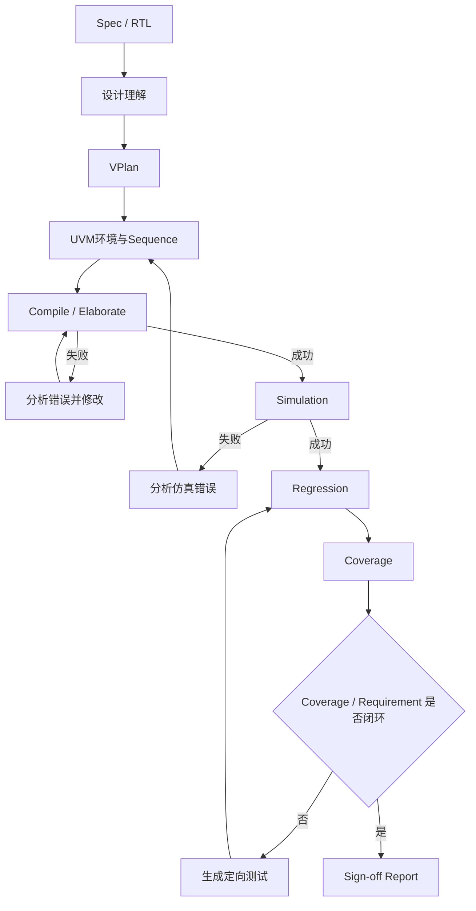
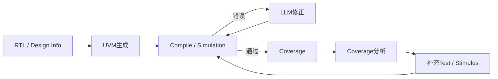
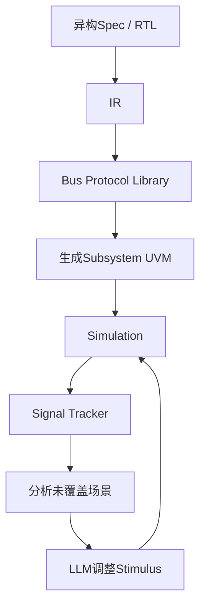
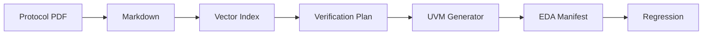
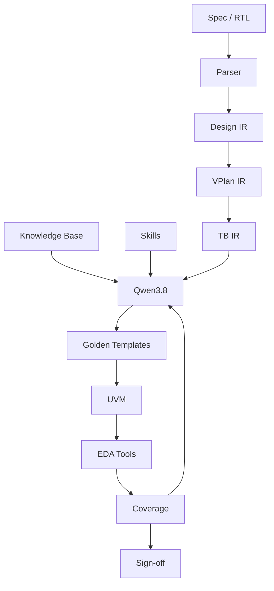

# 基于本地 Qwen3.8 的 UVM Verification Agent 调研

## 1. 调研目的

这次调研主要想确认两件事。

第一，基于本地大模型做 UVM 验证 Agent 这件事现在处在什么阶段，已有工作到底做到什么程度，哪些思路已经被证明比较有效，哪些问题仍然没有解决。

第二，如果后续项目中 Agent 框架和大模型部署由其他同学负责，我这边主要负责 UVM 验证方法学，那么需要提前准备什么。这里不只是“提供几份 UVM 文档”，而是要把平时验证工程师做验证时的流程、规则和判断方式整理成 Agent 能直接使用的东西，包括 Skill、知识库、IR、模板、EDA 工具调用规则以及最终的评测方法。

本项目暂时考虑使用本地部署的 Qwen3.8 作为模型底座，先选几个规模较小、验证目标比较明确的数字 IP 做实验，例如：

- Sync FIFO
- APB Slave
- UART

这三个模块的复杂度逐级增加，比较适合观察 Agent 从简单状态机验证到总线协议验证，再到串行时序协议验证时会遇到什么问题。

---

# 2. 先区分两个概念：代码生成和 Verification Agent

目前很多工作都可以让大模型生成 SystemVerilog，甚至能生成一套形式上完整的 UVM 环境，但“会生成 UVM 代码”和“能完成一个验证任务”其实是两件事。

单次代码生成的流程大概是：

```text
Spec / RTL
    ↓
Prompt
    ↓
LLM
    ↓
SystemVerilog / UVM
```

这种方式最大的问题是没有闭环。模型生成的代码可能：

- 语法错误；
- UVM 连接关系错误；
- 协议时序错误；
- 能运行但 scoreboard 没有真正检查；
- coverage 看起来很高，但关键功能点没覆盖；
- DUT 中有 bug，testbench 却仍然 PASS。

更完整的 Verification Agent 应该是：



也就是说，LLM 只是整个系统中的“分析和决策模块”，真正的正确性仍然要由编译器、仿真器、scoreboard、assertion 和 coverage 工具来判定。

从我查到的工作看，近两年的方向也基本都是从“一次生成 testbench”向这种闭环方式发展。

---

# 3. 现有工作的分类

目前相关工作大致可以分成四类：

| 类型 | 代表工作 | 主要解决的问题 |
|---|---|---|
| UVM 自动生成 | UVM²、HAVEN、UVMarvel | 从 Spec/RTL 自动构建 UVM 环境 |
| Coverage Closure | Spec2Cov、CovAgent | 根据 coverage 自动补 stimulus |
| 工程化 Agent / Skill | verification_ai_skills、UCAgent | 把验证过程拆成阶段、工具和 Skill |
| Debug / Repair Agent | R3A、HWE-Bench | RTL bug 定位、修复和 Agent 评测 |

这几类工作虽然目标不完全相同，但对我们做 UVM Agent 都有参考价值。

---

# 4. UVM²：比较典型的“LLM + UVM + Coverage Feedback”方案

## 4.1 工作内容

论文：

**From Concept to Practice: an Automated LLM-aided UVM Machine for RTL Verification**

ICCAD 2025，作者包括 Junhao Ye、Yuchen Hu、Ke Xu 等。

UVM² 的目标比较直接：让 LLM 自动生成 UVM testbench，并且根据仿真和 coverage 反馈继续修正，而不是生成一次以后就结束。

它的基本流程可以理解为：



论文给出的实验对象规模最高约 1.6K RTL 行，平均 code coverage 87.44%，平均 functional coverage 89.58%。

## 4.2 我认为它比较有价值的地方

第一，它证明了 UVM 自动生成不能只看第一次输出。**compile error、simulation result 和 coverage 都应该重新进入 LLM 的上下文。**

第二，它已经开始考虑功能覆盖率，而不是只看 Verilog testbench 是否跑通。

第三，它的实验对象包含 UART、SPI 等模块，比单纯的组合逻辑或小 FSM 更接近我们后面要测的 IP。

## 4.3 局限

UVM² 的主要问题是它仍然比较依赖 LLM 直接生成 UVM 代码。对于 UVM 来说，很多代码其实不是“创造性代码”，而是具有明确规则的工程代码，例如：

- driver/monitor 的 clocking；
- transaction lifecycle；
- protocol handshake；
- reset；
- config_db；
- analysis port 连接。

这些地方一旦模型自由发挥，就容易产生很隐蔽的问题。

另外，它的 benchmark 规模仍然以 IP 级、小中型 RTL 为主，因此不能直接说明大 subsystem 也能稳定使用。

## 4.4 对我们项目的借鉴

UVM² 最值得直接借鉴的是：

```text
Generate
→ Compile
→ Simulate
→ Coverage
→ Feedback
→ Regenerate
```

这应该成为我们 Agent 最基本的执行循环。

---

# 5. HAVEN：核心思路是“尽量不要让 LLM 直接写 HDL”

## 5.1 工作内容

论文：

**HAVEN: Hybrid Automated Verification ENgine for UVM Testbench Synthesis with LLMs**

2026 年工作。

HAVEN 和 UVM² 的一个明显区别是：它不再认为“LLM 直接生成所有 SystemVerilog”是最好的方案。

它把任务拆成两类。

### 第一类：需要理解和规划的部分

交给 LLM，例如：

- 读 specification；
- 判断需要哪些 UVM component；
- 生成结构化 architecture plan；
- 分析 coverage hole。

### 第二类：规则很固定、必须严格正确的部分

交给模板和代码生成器，例如：

- UVM component skeleton；
- bus handshake；
- protocol timing；
- sequence 的具体 SystemVerilog 代码。

总体流程大概是：

```text
Specification
      ↓
LLM 分析
      ↓
Structured Plan
      ↓
Protocol-specific Jinja2 Template
      ↓
UVM Components
```

Sequence 也不是让模型直接输出一段任意 SV，而是先让模型输出一个 Protocol-Aware DSL：

```text
LLM
 ↓
Sequence DSL
 ↓
Rule-based Generator
 ↓
UVM Sequence
```

实验覆盖 19 个开源 IP，接口包括 Direct、Wishbone 和 AXI4-Lite，论文报告 compilation success 100%，平均 code coverage 90.6%，functional coverage 87.9%。

## 5.2 优点

我认为 HAVEN 是目前最值得我们参考的工作之一。

它解决了一个很现实的问题：

> LLM 最擅长的是理解和推理，不一定最适合重复写那些格式固定、时序要求严格的 UVM 代码。

如果已经知道一个 AXI4-Lite transfer 应该怎么 drive，那么没有必要每次让 LLM 重新“想一遍”。

模板的好处是：

- 结果稳定；
- 容易 review；
- protocol timing 可以人工保证；
- 换模型后模板仍然能用；
- 大幅减少 hallucination。

## 5.3 缺点

模板方法的代价也很明显：

- 每支持一种新 protocol，都需要准备对应模板；
- protocol 特殊扩展较多时，模板会越来越复杂；
- 如果 DUT 接口不是标准协议，仍需要 LLM 或人工补充逻辑；
- Template 本身需要验证工程师长期维护。

换句话说，HAVEN 把部分“模型问题”转化为了“Verification Domain Engineering 问题”。

但对于我们这个项目来说，这反而是好事，因为 UVM 侧本来就应该负责这些规则。

## 5.4 对我们的借鉴

我们的生成策略也应该尽量采用：

```text
LLM：
理解、分析、选择、debug

Template / Rule：
固定结构、固定协议时序

EDA：
最终判定正确性
```

---

# 6. UVMarvel：从 IP 自动验证进一步扩展到 subsystem

## 6.1 工作内容

论文：

**UVMarvel: an Automated LLM-aided UVM Machine for Subsystem-level RTL Verification**

2026 年工作，与 UVM² 有部分相同作者。

UVMarvel 主要解决一个比单 IP 更困难的问题：subsystem 中通常不只有一个简单接口，而是多个模块、多种 bus 和大量内部信号。

它引入了几个比较重要的组件：

- Intermediate Representation（IR）
- Bus Protocol Library
- Signal Tracker
- Verilog Patching Library
- LLM-assisted stimulus refinement

基本思路是：



论文报告平均 code coverage 95.65%，并给出了从几个人工工作日缩短到约 4.5 小时自动执行的案例。

## 6.2 优点

UVMarvel 对我们的最大启发不是它的 coverage 数字，而是 **IR 和 Protocol Library**。

随着设计变复杂，不可能把所有信息直接塞给 LLM。需要一个中间层把：

- module；
- interface；
- signal；
- bus；
- connection；
- requirement；

组织成结构化数据。

否则 LLM 每一轮都要重新读几十个 RTL 文件，很容易理解不一致。

## 6.3 缺点

UVMarvel 的系统明显比普通 UVM Agent 更复杂，实现成本也更高。

它所需要的不只是 prompt，还包括：

- IR 设计；
- protocol library；
- signal tracking；
- patch system；
- subsystem context management。

因此不适合我们第一版直接照搬。

## 6.4 对我们的借鉴

第一版只做 IP 时，也应该从一开始就设计简单 IR，例如：

```text
Design IR
VPlan IR
TB IR
Sequence IR
```

这样以后向 subsystem 扩展时，不需要推翻整个架构。

---

# 7. Spec2Cov：重点不是搭 UVM，而是自动做 coverage closure

## 7.1 工作内容

论文：

**Spec2Cov: An Agentic Framework for Code Coverage Closure of Digital Hardware Designs**

Arizona State University 团队，2026。

Spec2Cov 与 UVM²/HAVEN 的关注点不同，它主要研究：

> LLM 能不能像验证工程师一样，根据 coverage hole 不断补测试。

它先从 spec 出发生成测试，运行仿真以后读取 coverage，再让模型根据未覆盖代码生成针对性 stimulus。

一个有意思的设计是：

- 一开始主要给 specification 和 top-level interface；
- 在 coverage closure 阶段才逐渐向模型暴露内部 RTL。

这么做是为了避免测试逻辑过度依赖当前 RTL 实现，否则可能出现：

> RTL 本身写错了，模型却照着错误 RTL 写出同样的 checker。

流程可以理解为：

```text
Spec
 ↓
Initial Test
 ↓
Compile + Multi-seed Simulation
 ↓
Coverage Report
 ↓
Uncovered Lines
 ↓
Directed Stimulus
 ↓
Simulation
```

实验覆盖 26 个设计。简单设计可以达到 100% code coverage，而复杂设计上仍会出现明显 coverage ceiling。

## 7.2 优点

它真正把 coverage closure 当作一个迭代任务，而不是测试结束后输出一个百分比。

另外，spec-first 的做法比较符合验证原则：

> 验证应该依据设计意图，而不是依据 DUT 当前实现。

## 7.3 缺点

Spec2Cov 的核心目标是 code coverage，而不是完整 UVM methodology。

Code coverage 高并不代表功能验证完整。例如一段错误逻辑也可能被执行过，所以如果要用于 UVM sign-off，还必须补：

- functional coverage；
- assertion；
- scoreboard；
- requirement traceability。

## 7.4 对我们的借鉴

我们的 Coverage Agent 可以借鉴它的做法，但不能只以 line coverage 为目标。

应该优先：

```text
Requirement
→ Functional Coverage
→ Assertion / Checker
→ Code Coverage
```

Code coverage 更适合发现“还有哪里没跑到”，不能单独决定 sign-off。

---

# 8. CovAgent：在 Spec2Cov 基础上进一步研究 Agent 的 coverage 上限

CovAgent 是 Spec2Cov 后续发展出来的一个开源研究框架，重点开始从“能不能补 coverage”转向：

> 为什么有些 coverage hole，Agent 怎么跑都补不上？

它把剩余 coverage hole 分成两大类。

### Methodology-bound ceiling

这些并不是模型推理不够好，例如：

- top-level 根本不可控的逻辑；
- tied-off 逻辑；
- dead code；
- defensive code；
- 从当前验证边界不可到达的状态。

这种情况继续让 LLM 写测试没有意义。

### Reasoning frontier

这些理论上可以覆盖，但比较难，例如：

- 复杂 protocol sequence；
- pipeline warm-up；
- 很窄的 timing window；
- 极少出现的输入组合。

CovAgent 还专门统计 Agent 的 token 都花在什么地方。其公开结果显示，真正用于“输出 testbench code”的 token 只占一小部分，大量 token 花在理解设计、分析反馈和 Agent orchestration 上。

## 优点

它提醒我们一个很重要的问题：

> Coverage 没涨，不一定是模型不够聪明，有可能这个 hole 根本就不应该靠 stimulus 去解决。

这对于自动 coverage closure 非常重要，否则 Agent 很容易无限循环。

## 缺点

它仍然更偏 stimulus / code coverage，而不是完整 UVM verification flow。

## 对我们的借鉴

Coverage Skill 必须能把 hole 分类，例如：

```text
Reachable & controllable
Unreachable
Dead code
Configuration excluded
Need assertion/formal
Need different abstraction level
```

然后决定下一步，而不是统一执行“再生成一个 test”。

---

# 9. verification_ai_skills：目前最接近“把验证专家经验写成 Skill”的开源项目

## 9.1 项目内容

GitHub：

**Mohsannaeem/verification_ai_skills**

这个项目对我们非常有参考价值，因为它不是只提供一个 prompt，而是把从 specification 到 UVM regression 的过程拆成了多个 Skill。

目前公开结构包括：

```text
pdf_to_markdown
vector_index
uvc_planning
uvc_generator
eda_yaml_generator
uvc_orchestrator
```

它的目标流程是：



项目中还包含：

- protocol cheat sheet；
- RAG；
- verification plan YAML；
- Mermaid UVM architecture；
- MCP server；
- self-grading；
- EDA manifest；
- regression execution。

项目 README 给出的 AXI5-Stream demo 中，Agent 自动生成 48 个 directed tests 和 17 个 UVM 文件，并给出了 48/48 regression PASS 的结果。

这里需要说明：这个数字属于项目作者自己公开的工程结果，目前不能等同于独立 benchmark。

## 9.2 优点

这个项目最值得看的地方不是“它生成了多少代码”，而是它已经意识到：

> Agent 需要多个专门 Skill，而不是一个超长 Prompt。

例如它的 VPlan 会强制要求：

- requirement 必须绑定 `spec_ref`；
- requirement 至少映射到一个 test；
- requirement 至少映射到一个 functional coverage group；
- testcase 必须能反向追溯 requirement。

这和真实验证流程非常接近。

## 9.3 缺点

它比较依赖 Claude Code / `.agent` 生态和自身 EDA Buddy 流程，直接搬到本地 Qwen 环境需要重构。

另外，它公开 demo 主要集中在接口 VIP，和“针对任意 RTL module 做完整验证”仍有区别。

## 9.4 对我们的借鉴

这是后面写 Skill 时可以重点参考的工程。

尤其要借鉴：

```text
Skill = 输入 + 步骤 + 规则 + 输出 + Validator
```

而不是：

```text
Skill = 一段角色 Prompt
```

---

# 10. RTL2UVM：用 Parser 负责结构信息，LLM 只补高级逻辑

## 10.1 项目内容

GitHub：

**rpjayaraman/RTL2UVM**

它使用 `pyslang` 解析 Verilog/SystemVerilog，从 RTL 中提取端口，然后自动生成：

- interface
- seq_item
- sequencer
- driver
- monitor
- agent
- scoreboard
- coverage
- env
- test
- top

LLM 是可选项，主要用于补 driver / monitor / scoreboard 的复杂逻辑。

## 10.2 优点

它的工程思想比较合理：

> 端口、位宽、direction 这种确定信息应该由 parser 得到，而不是让 LLM 猜。

这是我们后面很应该采用的原则。

例如：

```text
RTL
 ↓
pyslang / Surelog
 ↓
AST
 ↓
port / parameter / module hierarchy
```

再把结构化结果交给模型。

## 10.3 缺点

RTL2UVM 更像“UVM skeleton generator”，离完整 Verification Agent 还有距离。

它没有重点解决：

- Spec requirement；
- VPlan；
- protocol knowledge；
- regression planning；
- coverage closure；
- sign-off。

## 10.4 对我们的借鉴

Agent 做 RTL Analysis 时应优先调用 parser，而不是读取源代码后自己正则匹配。

---

# 11. UCAgent / 万众一芯：国内目前很值得看的开源验证 Agent

我在继续查国内项目时重点看了 **万众一芯开放验证（UnityChip Verification）的 UCAgent**。

项目仓库是：

**XS-MLVP/UCAgent**

它与前面那些“UVM 自动生成”工作有一个很大的区别：UCAgent 当前主要走的是 **Python 单元验证** 路线，而不是传统 SystemVerilog UVM。

它建立在：

- Picker
- Toffee
- toffee-test

这一套工具链上。

Picker 负责把 RTL/DUT 暴露成软件可以调用的接口，Toffee 是一个受 UVM 方法学启发的 Python hardware verification framework，然后 UCAgent 在上面负责需求理解、测试生成、执行和报告。

## 11.1 UCAgent 的结构

它当前的核心结构已经比较工程化：

```text
Workflow
   ↓
Stage Manager
   ↓
Tools
   ↓
Checkers
   ↓
Templates
```

它支持：

- 阶段化 verification workflow；
- tool calling；
- checker；
- template；
- human check；
- task state；
- OpenAI-compatible model；
- MCP server；
- 与 Qwen Code / Claude Code / Gemini CLI 等 Code Agent 协同。

官方说明中，它把验证过程看成一个可以阶段化执行的 workflow，而不是一次模型调用。

## 11.2 比较有意思的地方

### Human Check 是显式机制

某些阶段可以强制：

```text
Agent完成
 ↓
Human Check
 ↓
人工确认
 ↓
继续
```

这一点比追求“一上来完全无人验证”更现实。

### MCP

UCAgent 可以把自己的验证工具作为 MCP server 暴露给 Qwen Code 等通用 Code Agent。

这很适合参考我们以后：

```text
Qwen3.8 Agent
    ↓
MCP / Tool API
    ↓
Compile / Sim / Coverage
```

### 验证状态是持久化的

它会记录历史 state，使 Agent 中断后可以继续任务。

这也是长期 regression / debug 必须具备的能力。

## 11.3 优点

- 国内开源，可直接看代码；
- Tool / Stage / Checker / Template 架构比较完整；
- 已经考虑 Human-in-the-loop；
- 和 Qwen Code 能直接通过 MCP 协同；
- 在香山相关开放验证生态中有真实实践场景。

## 11.4 缺点

它当前主要使用 Picker + Toffee + Python UT。

因此和我们的目标有明显差异：

```text
UCAgent：
Python-based Unit Test Verification

我们的目标：
SystemVerilog UVM + 商业EDA + Regression + Functional Coverage
```

所以它不能直接当成“UVM Agent 成品”使用。

但它的 Agent 基础设施非常值得参考：

- stage；
- tool；
- checker；
- human gate；
- MCP；
- state management。

换句话说，我们完全可以参考它的 Agent 架构，但把验证执行层换成 UVM/VCS/Questa/Xcelium。

---

# 12. 北大相关工作：值得补充的是 Agent Debug / SoC 生成这条线

公众号里提到的北大方向，我又单独查了一下。北大近两年在“LLM + EDA / Hardware Agent”方面其实有几条不同的工作线，它们不一定直接生成 UVM，但对我们设计 Verification Agent 很有参考价值。

---

## 12.1 GenSoC：多 Agent 协作做 SoC 设计与验证

论文：

**GenSoC: A Multi-Agent-Assisted SoC Generation Methodology Leveraging Open-Source Hardware**

北京大学集成电路学院相关团队，ISLPED 2025 EDA Track Best Paper。

它的目标不是 UVM，而是：

```text
需求
 ↓
IP选择 Agent
 ↓
SoC Integration Agent
 ↓
Verification Agent
 ↓
完整 SoC
```

它建立了包含 90 多类 open-source IP 的 library，不同 Agent 有不同 guideline 和 toolset。

### 特点

这是一个比较典型的 **multi-agent specialization** 思路：

```text
不是让一个 LLM 什么都干，
而是不同 Agent 负责不同工程环节。
```

### 对我们的启发

UVM Agent 后面也没必要做成一个超级 Agent。

可以拆成：

```text
Spec Agent
VPlan Agent
UVM Generation Agent
Compile Debug Agent
Simulation Debug Agent
Coverage Agent
```

各自调用不同 Skill 和 Tool。

### 局限

GenSoC 的重点是 SoC 生成，不是 verification methodology 本身，所以不能直接解决：

- UVM architecture；
- coverage model；
- scoreboard；
- verification sign-off。

它主要提供的是 Agent 系统设计上的参考。

---

# 13. 北大 HWE-Bench：特别适合作为“硬件 Agent 怎么评测”的参考

## 13.1 工作内容

论文：

**HWE-Bench: Benchmarking LLM Agents on Real-World Hardware Bug Repair Tasks**

北京大学相关团队，2026。

这个项目本身不是 UVM 生成器，而是一个 **硬件 Coding Agent Benchmark**。

它收集了 417 个真实 bug-fix case，来自：

- Ibex
- CVA6
- Caliptra
- Rocket-Chip
- XiangShan
- OpenTitan

覆盖：

- Verilog
- SystemVerilog
- Chisel

最关键的是：每个 case 都带真实 repository 和 native verification flow。

评价方式是：

```text
Buggy Commit
    ↓
已有 Test FAIL
    ↓
Agent 修改 RTL
    ↓
运行真实 Project Simulation / Regression
    ↓
Test PASS
```

所以它不是靠“LLM Judge”评价代码，而是靠真实 EDA / regression 判断。

## 13.2 优点

我觉得它对我们最大的价值在“评测方法”。

UVM Agent 以后也应该尽量构造这种真实闭环 benchmark，而不是人工看几份代码觉得“写得不错”。

例如：

```text
Golden DUT
Bug-injected DUT
Spec
Golden VPlan
Regression
Coverage
```

然后观察：

- Agent 能否找到 bug；
- 是否 false pass；
- 需要多少轮 debug；
- 是否需要人工介入。

## 13.3 HWE-Bench 发现的问题

论文将 Agent 失败归因到几个典型环节：

- fault localization；
- hardware semantic reasoning；
- RTL / config / verification artifact 之间的跨文件协调。

这和我们后面做 UVM Debug Agent 会遇到的问题高度一致。

## 13.4 局限

它测试的是“修 RTL bug 的 coding agent”，不是“构建 UVM 环境的 verification agent”。

但作为 benchmark 设计思路，非常值得借鉴。

---

# 14. R3A：北大/北航团队的 RTL 自动 Debug Agent

论文：

**R3A: Reliable RTL Repair Framework with Multi-Agent Fault Localization and Stochastic Tree-of-Thoughts Patch Generation**

2025。

这个工作专门研究：

> LLM 修 RTL 为什么不稳定，以及如何提高一次自动修 bug 的可靠性。

它不是让模型直接：

```text
看到 Error
→ 输出一个 Patch
```

而是先做：

```text
Multi-Agent Fault Localization
```

由多个 Agent 从不同角度寻找可能出错的位置。

然后采用 stochastic Tree-of-Thoughts：

```text
候选Patch A
候选Patch B
候选Patch C
...
   ↓
真实验证
   ↓
继续搜索
```

也就是说，它把 Debug 看成一个“有验证反馈的搜索问题”。

论文报告在 RTL-repair dataset 上可以修复 90.6% 的 bug，并给出 86.7% pass@5。

## 优点

它解决的是 LLM 一个很现实的问题：

> 第一次 Patch 不可靠。

与其不断让同一个 Agent“再想一遍”，不如：

- 做 fault localization；
- 建立多个候选；
- 用 simulation 验证；
- 保留有效路径。

## 缺点

R3A 的任务边界比较窄，只做 RTL repair。

它没有处理：

- VPlan；
- UVM；
- coverage；
- verification environment generation。

## 对我们的借鉴

后面 Simulation Debug Skill 也可以采用类似思想：

```text
Failure
 ↓
Root Cause Candidates
 ↓
Ranking
 ↓
Minimal Patch Candidates
 ↓
Compile / Simulation
 ↓
选择真正有效的 Patch
```

而不是 LLM 一次大改很多文件。

---

# 15. 这些项目放到一起看，区别其实很明显

| 工作 | 核心目标 | 是否UVM | 是否EDA闭环 | 是否Coverage闭环 | 是否开源 | 最值得借鉴 |
|---|---|---:|---:|---:|---:|---|
| UVM² | 自动生成并迭代UVM | 是 | 是 | 是 | 部分/研究 | UVM+feedback |
| HAVEN | 可靠生成UVM | 是 | 是 | 是 | 研究 | Template + DSL |
| UVMarvel | Subsystem UVM | 是 | 是 | 是 | 研究 | IR + Protocol Library |
| Spec2Cov | Coverage closure | 否/通用TB | 是 | 是 | 是 | Coverage loop |
| CovAgent | 分析Coverage上限 | 否/通用TB | 是 | 是 | 是 | Hole taxonomy |
| verification_ai_skills | PDF→UVM→Regression | 是 | 是 | 有 | 是 | Skill拆分 |
| RTL2UVM | RTL→UVM skeleton | 是 | 有限 | 有限 | 是 | Parser first |
| UCAgent | 单元验证Agent | 否，Python UT | 是 | 是 | 是 | Stage/Tool/Checker/MCP |
| GenSoC | SoC多Agent生成 | 部分验证 | 是 | 非核心 | 论文 | Multi-Agent分工 |
| HWE-Bench | Agent真实硬件Debug评测 | 否 | 是 | 否 | 是 | Benchmark设计 |
| R3A | RTL自动修Bug | 否 | 是 | 否 | 研究 | Fault localization + patch search |

---

# 16. 各方案的优劣再做一个横向比较

## 16.1 完全让 LLM 生成 UVM

优点：

- 开发最简单；
- 新协议不需要提前写模板；
- 灵活。

缺点：

- 不稳定；
- timing 很容易错；
- protocol version 容易混；
- 重复生成结果差异大；
- debug 成本高。

适合：

- 快速 prototype；
- 小模块；
- skeleton。

不适合直接作为生产方案。

---

## 16.2 Template + LLM

代表：HAVEN。

优点：

- compile success 高；
- 结构稳定；
- protocol timing 可以人工保证；
- 易 review。

缺点：

- 新协议需要维护模板；
- 特殊设计需要扩展模板。

我认为这是我们最应该采用的生成方案。

---

## 16.3 RAG / Knowledge Base + LLM

代表：verification_ai_skills，部分 UCAgent。

优点：

- 不需要 fine-tune；
- 能更新 protocol / project information；
- 知识来源可追溯；
- 适合公司内部规范。

缺点：

- RAG 命中错误时可能把错误信息送给模型；
- PDF 原样入库效果通常不好；
- metadata 和 chunk 设计需要人工维护。

适合存：

- UVM methodology；
- protocol；
- project spec；
- debug experience。

---

## 16.4 Agent + EDA Feedback

代表：UVM²、Spec2Cov、R3A。

优点：

- 真正形成闭环；
- 不需要模型自己判断代码对不对；
- error / coverage 都有客观结果。

缺点：

- EDA runtime 成本高；
- 如果没有停止规则容易死循环；
- log 很长，需要先结构化。

这个是整个项目必须做的基础能力。

---

# 17. 从这些工作看，我们应该怎么做

我目前比较倾向下面这条路线：



原则可以概括成：

### 能由 parser 得到的事实，不让 LLM 猜

例如：

- port；
- width；
- parameter；
- hierarchy。

### 能由模板确定的代码，不让 LLM 每次重新写

例如：

- UVM component skeleton；
- config_db；
- analysis port；
- standard protocol timing。

### 协议规则放知识库

例如：

- APB3/4/5 区别；
- UART frame；
- FIFO full/empty behavior。

### 需要理解和判断的任务交给 LLM

例如：

- Spec 分析；
- VPlan；
- corner case；
- error diagnosis；
- coverage hole 分析。

### 正确与否交给 EDA

而不是交给 LLM 自己判断。

---

# 18. UVM 人员和 Agent 开发人员怎么分工

## Agent 开发人员

主要负责通用 Agent 基础：

- Qwen3.8 部署；
- vLLM / SGLang；
- agent orchestrator；
- tool calling；
- MCP；
- file system；
- state management；
- RAG engine；
- vector DB；
- sandbox；
- retry / timeout；
- logging。

## UVM / DV 人员

主要负责 Domain Engineering：

- verification workflow；
- UVM rules；
- protocol rules；
- Skill；
- IR schema；
- Golden Template；
- Golden VPlan；
- Golden TB；
- coverage model；
- assertion；
- EDA tool contract；
- debug rule；
- benchmark；
- bug injection；
- sign-off criteria。

这个分工下，UVM 侧并不是“给 Agent 写几个 prompt”，而是在定义一个自动验证工程师应该怎么工作。

---

# 19. Knowledge Base 具体怎么做

知识库不建议理解成“把几本 PDF 丢进向量数据库”。

我认为至少应该拆成四类。

```text
knowledge_base/
├── methodology/
├── protocol/
├── project/
└── experience/
```

## Methodology

存 UVM 方法学和团队规范：

```text
driver
monitor
scoreboard
sequence
coverage
RAL
reset
clocking
config_db
factory
objection
```

## Protocol

例如 APB：

```text
APB3/
├── signals.yaml
├── timing.yaml
├── driver_rules.md
├── monitor_rules.md
├── assertions.yaml
├── coverage.yaml
└── corner_cases.md
```

这里应该显式写：

```yaml
protocol: APB
version: APB3

forbidden_signals:
  - PSTRB
  - PPROT
```

这样就能避免 Verilab 实验中出现的 APB3 / APB4 混用问题。

## Project

只存当前 DUT 的东西：

```text
spec
register spec
rtl summary
known limitation
vplan
```

## Experience

积累真实 debug case：

```text
compile_errors
simulation_hang
scoreboard_mismatch
race
reset
coverage_closure
```

---

# 20. IR 为什么必须有

IR 主要解决一个问题：

> 不让 Spec 理解结果只存在 LLM 上下文里。

例如 FIFO：

```yaml
design:
  name: sync_fifo

parameters:
  WIDTH: 8
  DEPTH: 16

clock:
  signal: clk
  edge: posedge

reset:
  signal: rst_n
  active_level: 0

features:
  write: true
  read: true
  simultaneous_rw: true
  overflow_protection: true
  underflow_protection: true
```

之后：

```text
Spec
→ Design IR
→ VPlan IR
→ TB IR
→ Sequence IR
→ UVM
```

每层都可以 check。

这点和 UVMarvel 的方向是一致的。

---

# 21. 第一版建议写哪些 Skill

我认为第一阶段 12 个 Skill 足够。

| Skill | 作用 |
|---|---|
| spec_analysis | 从 Spec 提取事实和 requirement |
| rtl_analysis | Parser + RTL 分析 |
| vplan_generation | Requirement → Test/Checker/Coverage |
| tb_architecture | 确定 UVM 架构 |
| uvm_generation | 生成 component |
| sequence_generation | 生成 sequence |
| assertion_generation | 生成 SVA |
| compile_debug | 编译错误分析与最小修改 |
| simulation_debug | hang/mismatch/timing 等分析 |
| regression | 组织 testcase/seed |
| coverage_analysis | 分析 coverage hole |
| signoff | 汇总最终验证证据 |

---

# 22. Skill 不能只是一段 Prompt

例如 driver Skill 应该明确：

```yaml
name: uvm_driver_generation

input:
  - design_ir
  - tb_ir
  - protocol

preconditions:
  - protocol_version_resolved
  - reset_resolved
  - interface_resolved

rules:
  - only_drive_owned_signals
  - handle_reset
  - follow_protocol_timing
  - always_complete_transaction_lifecycle

forbidden:
  - infer_unspecified_signal
  - modify_monitor
  - modify_scoreboard
  - change_protocol_version

validation:
  - syntax_check
  - compile
  - reset_smoke
  - legal_transfer_smoke

output:
  - driver.sv
```

也就是说：

> Skill 本质上是一份机器可执行的验证 SOP。

---

# 23. EDA 工具不能直接给 LLM 一个无限制 Shell

建议封装成统一 Tool：

```text
parse_rtl()
compile()
elaborate()
simulate()
run_regression()
coverage_report()
query_waveform()
```

例如 `simulate()` 返回：

```yaml
status:
exit_code:
uvm_status:
scoreboard_mismatch:
assertion_failure:
timeout:
log:
waveform:
coverage_db:
```

VCS、Xcelium、Questa 的命令区别放在 Adapter 层：

```text
Agent
  ↓
EDA Tool API
  ↓
├── VCS Adapter
├── Xcelium Adapter
└── Questa Adapter
```

这样 Agent 只需要理解统一的 tool schema。

---

# 24. 最终端到端闭环应该做到什么程度

一个完整模块的自动验证，至少要走完：

```text
1. Spec / RTL Ingest
2. Design Understanding
3. Design IR
4. Requirement Extraction
5. VPlan
6. TB Architecture
7. UVM Generation
8. Assertion Generation
9. Compile / Elaborate
10. Smoke Test
11. Regression
12. Coverage Merge
13. Coverage Gap Analysis
14. Targeted Test Generation
15. Re-regression
16. Sign-off Report
```

其中最关键的是：

```text
Requirement
 ↕
Test
 ↕
Checker
 ↕
Coverage
```

最终不是回答“coverage 是多少”，而是回答：

> 每一个 requirement 是否都已经被刺激、检查并产生验证证据。

---

# 25. Benchmark 选择

## 第一阶段：Sync FIFO

主要验证：

- UVM 基础结构；
- queue reference model；
- scoreboard；
- full/empty；
- pointer wrap；
- simultaneous read/write；
- reset；
- coverage closure。

建议人为注入：

```text
full off-by-one
empty error
pointer wrap error
full时错误写入
simultaneous R/W error
```

观察 Agent 能抓出几个。

---

## 第二阶段：APB Slave

主要验证：

- protocol-aware driver；
- protocol-aware monitor；
- wait state；
- PSLVERR；
- back-to-back；
- register behavior；
- reset。

这里非常适合做消融实验：

```text
Qwen
Qwen + UVM Skill
Qwen + Template
Qwen + APB KB
Qwen + EDA Feedback
Qwen + Coverage Feedback
```

---

## 第三阶段：UART

主要验证：

- serial timing；
- baud；
- parity；
- stop bit；
- framing error；
- sampling；
- error injection。

UART 能进一步检验 LLM 对时序和配置组合的理解能力。

---

# 26. 我认为最重要的评价指标

不能只看：

```text
Compile PASS
```

建议至少统计：

| 指标 | 意义 |
|---|---|
| Requirement Recall | Spec 功能点提取完整度 |
| VPlan Traceability | Requirement/Test/Coverage 映射 |
| Compile Pass@1 | 第一次代码质量 |
| Repair Iterations | 自动 debug 效率 |
| Regression Pass | 稳定性 |
| Functional Coverage | 功能覆盖 |
| Code Coverage | RTL 代码覆盖 |
| Assertion Coverage | 时序/协议覆盖 |
| Bug Detection Rate | 真正找到多少 DUT bug |
| False PASS Rate | DUT 有 bug 但 TB PASS 的比例 |
| Human Intervention | 需要人工几次 |
| EDA Runs / Time | 自动验证成本 |

其中我认为最重要的是：

**Bug Detection Rate 和 False PASS Rate。**

因为验证环境 compile fail 只是不好用，但 false pass 会直接让 bug 漏过去。

---

# 27. 当前判断

从现有工作看，基于本地 Qwen3.8 做一个 IP-level UVM Verification Agent 是可行的，但项目目标需要控制好。

不建议第一阶段追求：

```text
任意 RTL
→ 全自动 UVM
→ 完全无人 Sign-off
```

比较现实的是：

```text
有限类型 IP
+
固定验证流程
+
Human Gate
+
EDA闭环
```

先把 FIFO、APB、UART 做稳。

目前我比较认同 HAVEN、UVMarvel、verification_ai_skills、UCAgent 这几类工作的组合思路：

```text
HAVEN：
Template / DSL 限制 LLM

UVMarvel：
IR + Protocol Library

verification_ai_skills：
把 Verification Flow 拆成 Skills

UCAgent：
Stage + Tool + Checker + Human Gate + MCP

Spec2Cov：
Coverage Feedback

R3A：
Debug 时做 Root Cause + Patch Search
```

把这些思路组合起来，比直接追求“更强的模型”更适合 UVM 验证。

---

# 28. 下一步需要做的工作

UVM 侧可以马上开始准备：

```text
01. Verification Flow
02. Design IR Schema
03. VPlan Schema
04. TB IR Schema
05. Sequence IR Schema
06. UVM Coding Rules
07. Driver / Monitor Rules
08. Reset / Clocking Rules
09. Scoreboard Rules
10. Coverage Rules
11. 第一批 Skill
12. FIFO Golden Project
13. APB Knowledge Pack
14. Bug Injection Benchmark
15. EDA Tool Contract
```

第一阶段最好先完成 FIFO，从：

```text
Spec
→ IR
→ VPlan
→ TB
→ Compile
→ Sim
→ Coverage
```

完整跑通一次，再扩 APB。

---

# 参考资料

1. Junhao Ye et al., **From Concept to Practice: an Automated LLM-aided UVM Machine for RTL Verification (UVM²)**, ICCAD 2025, arXiv:2504.19959.
2. Chang-Chih Meng et al., **HAVEN: Hybrid Automated Verification ENgine for UVM Testbench Synthesis with LLMs**, arXiv:2604.27643.
3. Junhao Ye et al., **UVMarvel: an Automated LLM-aided UVM Machine for Subsystem-level RTL Verification**, arXiv:2605.04704.
4. Sean Lowe et al., **Spec2Cov: An Agentic Framework for Code Coverage Closure of Digital Hardware Designs**, arXiv:2604.15606.
5. `advent-lab/CovAgent`, **Agentic Stimulus Generation for Hardware Verification**.
6. `Mohsannaeem/verification_ai_skills`, PDF → VPlan → UVM → Regression 的 Skill 化开源项目。
7. `rpjayaraman/RTL2UVM`, 基于 pyslang 的 UVM 自动生成项目。
8. `XS-MLVP/UCAgent`, 万众一芯开放验证的硬件验证 Agent。
9. 万众一芯开放验证平台：Picker、Toffee、UCAgent 相关文档。
10. Peiran Yan et al., **GenSoC: A Multi-Agent-Assisted SoC Generation Methodology Leveraging Open-Source Hardware**, ISLPED 2025.
11. Fan Cui et al., **HWE-Bench: Benchmarking LLM Agents on Real-World Hardware Bug Repair Tasks**, arXiv:2604.14709.
12. Zizhang Luo et al., **R3A: Reliable RTL Repair Framework with Multi-Agent Fault Localization and Stochastic Tree-of-Thoughts Patch Generation**, arXiv:2511.20090.
13. André Winkelmann, Damir Ahmetovic Ignjic, **AI Pair or Despair Programming — Using Aider to build a VIP with UVM-SV and PyUVM**, DVCon Europe 2025.
14. `chipsalliance/Surelog`, SystemVerilog parser / elaborator / UHDM.
15. Qwen Team, **Qwen3.8-27B** official repository and model card.

