# 基于本地 Qwen3.8 的 UVM Verification Agent 调研与技术方案

> [!abstract] 一句话结论
> **可行，但不能把目标定义成“让 LLM 一次性生成一套 UVM”。**  
> 更现实、也更有研究价值的方向是：**本地 Qwen3.8 + UVM Domain Skills + 结构化 IR + Golden Template + Protocol/Project Knowledge Base + EDA Tool Feedback，构成一个从 Spec/RTL 到 VPlan、UVM、Regression、Coverage Closure 和 Sign-off 的闭环 Verification Agent。**
>
> 当前学术界、开源社区和主流 EDA 厂商的发展方向已经明显从“代码生成”转向“Agent + Tool + Feedback + Domain Knowledge”的闭环验证。

---

## 0. 本次汇报希望回答的问题

本次调研围绕以下几个问题展开：

1. **UVM / Design Verification Agent 发展到什么程度了？**
2. **现有论文、开源项目和工业团队分别做到了什么？**
3. **基于本地 Qwen3.8 做一个 UVM Agent 是否可行？**
4. **如果 AI Agent 框架由其他人开发，UVM 验证人员应该负责什么？**
5. **知识库、IR、Golden Template、Skill 分别是什么，如何配合？**
6. **怎样约束 LLM，避免“会写代码但不会验证”？**
7. **如何规范 LLM 调用 VCS / Xcelium / Questa 等 EDA 工具？**
8. **怎样真正完成一个模块从 Spec 到 Coverage Closure 的端到端闭环？**
9. **第一阶段应该选择哪些数字 IP 验证 Agent 能力？**

---

# 1. 什么叫 UVM Verification Agent？

传统 LLM 用法通常是：

```text
用户
  ↓
Prompt
  ↓
LLM
  ↓
SystemVerilog / UVM 代码
```

这本质上还是一个“代码生成器”。

真正的 Verification Agent 更像一个能够：

- 阅读 Spec / RTL；
- 理解当前工程状态；
- 制定验证计划；
- 创建和修改文件；
- 调用 SystemVerilog Parser；
- 调用 Simulator；
- 解析 compile / simulation log；
- 运行 regression；
- 读取 coverage；
- 判断 coverage hole；
- 新增 targeted sequence/test；
- 根据结果继续迭代；
- 最终输出验证结论；

的**验证工程自动执行系统**。

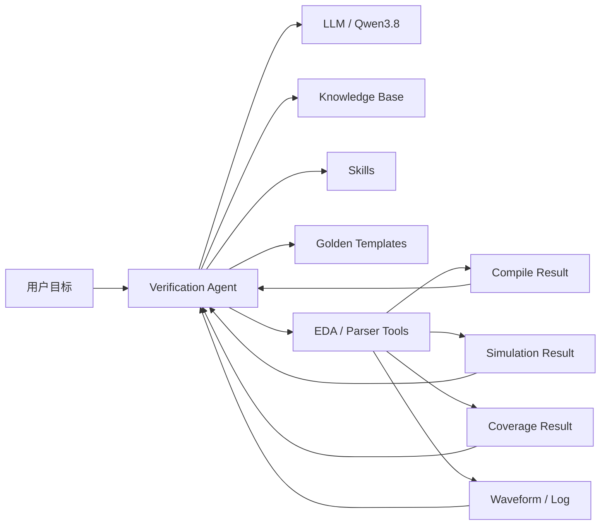

因此核心思想不是：

> **LLM 替代 EDA。**

而是：

> **LLM 负责理解、规划、判断和调度；真正的“事实判定”由 Compiler / Simulator / Coverage / Formal / Parser 等确定性工具完成。**

---

# 2. 当前研究现状：从“生成 Testbench”向“自动验证闭环”演进

## 2.1 第一阶段：LLM 作为代码生成器

早期方向主要是：

```text
RTL / Spec
   ↓
LLM
   ↓
Testbench / Assertion / Sequence
```

这种方式证明了 LLM 可以生成大量结构化代码，但也暴露出几个问题：

- SystemVerilog/UVM 训练数据相对软件代码少；
- UVM 文件之间存在复杂依赖；
- 协议时序稍有错误就会产生 race / hang / false pass；
- “编译成功”不等于“验证正确”；
- coverage 很容易形式上存在、实际上毫无价值；
- LLM 容易混淆不同 protocol version；
- 最危险的是 **DUT 有 bug，但生成的 testbench 没检查出来**。

因此研究重点逐渐从“能不能生成代码”转为：

> **能不能自动形成 verification closure。**

---

# 3. 代表性论文、项目和团队

## 3.1 UVM²：LLM + Coverage Feedback 的自动化 UVM 验证

**论文：** *From Concept to Practice: an Automated LLM-aided UVM Machine for RTL Verification*  
**团队：** 东南大学 / 深圳大学 / 中山大学 / City University of Hong Kong / University of York 等  
**发表：** ICCAD 2025，后续版本持续更新  
**参考：** [R1]

UVM² 是当前非常值得关注的工作，因为它已经不满足于“一次生成 UVM”，而是形成：

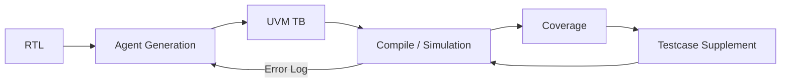

论文报告的代表性结果：

| 指标 | UVM² |
|---|---:|
| 平均 code coverage | 87.44% |
| 平均 functional coverage | 89.58% |
| 平均 UVM 组件生成成功率 | 89.70% |
| Coverage-driven 补测试后的收益 | code / function coverage 均进一步提升 |

其 benchmark 包含 AES、SHA256、SPI、UART、SDRAM 等多个 RTL。

### 对本项目最重要的启发

> **必须把 compile / simulation / coverage 的反馈重新送回 Agent。**

也就是说：

```text
LLM 写完代码
```

绝对不是任务结束点。

---

## 3.2 HAVEN：尽量不让 LLM 直接写 HDL

**论文：** *HAVEN: Hybrid Automated Verification ENgine for UVM Testbench Synthesis with LLMs*  
**时间：** 2026  
**参考：** [R2]

HAVEN 提出了一个非常关键的观点：

> LLM 擅长理解和规划，但对必须严格正确的协议时序代码，不一定应该直接自由生成。

HAVEN 的方式是：

```text
Specification
    ↓
LLM Agent
    ↓
Structured Architecture Plan
    ↓
Protocol-specific Jinja2 Template
    ↓
UVM Components
```

Sequence 也不是直接让 LLM 自由写 SystemVerilog，而是：

```text
LLM
 ↓
Protocol-Aware Sequence DSL
 ↓
Rule-based Generator
 ↓
UVM Sequence
```

实验覆盖 19 个开源 IP，接口包括：

- Direct；
- Wishbone；
- AXI4-Lite。

论文报告：

| 指标 | HAVEN |
|---|---:|
| Compilation success | 100% |
| Average code coverage | 90.6% |
| Average functional coverage | 87.9% |

### 对本项目最重要的启发

这是非常适合我们采用的一条原则：

> **能模板化、规则化的代码，不让 LLM 自由发挥。**

即：

```text
理解 / 分析 / Debug
        → LLM

代码骨架 / Protocol invariant
        → Template + Rule

真实正确性
        → EDA Tool
```

---

## 3.3 UVMarvel：进一步走向 Subsystem-level

**论文：** *UVMarvel: an Automated LLM-aided UVM Machine for Subsystem-level RTL Verification*  
**时间：** 2026  
**参考：** [R3]

UVMarvel 的价值在于它把方向继续扩展到了 subsystem。

核心机制包括：

- Intermediate Representation（IR）；
- Bus Protocol Library；
- Signal Tracker；
- Verilog Patching Library；
- LLM-assisted stimuli refinement。

论文报告平均 code coverage 为 **95.65%**，并给出了从数个人工工作日缩短到约 **4.5 小时自动运行**的实验结果。

### 最值得关注的变化

可以看到研究路线正在从：

```text
Prompt → UVM
```

变成：

```text
Spec
 ↓
IR
 ↓
Protocol Library
 ↓
Structured Generation
 ↓
Simulator
 ↓
Feedback
 ↓
Refinement
```

这正是本项目应该参考的体系。

---

## 3.4 Verilab：AI Pair Programming 生成 APB3 UVM VIP 的真实案例

**论文：** *AI Pair or Despair Programming — Using Aider to build a VIP with UVM-SV and PyUVM*  
**团队：** Verilab  
**会议：** DVCon Europe 2025  
**参考：** [R4]

这项工作特别有意义，因为它不是只测试“简单 RTL testbench”，而是要求 AI 构建 **APB3 VIP + self-checking testbench**。

实验采用 Aider 驱动多个主流 LLM，并实际进行 compile / simulation 修复。

论文发现：

### Coding convention 有用

加入编码规范以后：

- 文件组织更合理；
- 命名更一致；
- modularity 更好。

说明：

> **给 Agent 明确的 UVM coding convention 确实能够显著改善结果。**

### 但“规范越多”不一定越好

过度规范有时导致 LLM：

- 删除 reset handling；
- 简化 useful protocol logic；
- 丢失 PREADY delay 相关功能。

说明：

> Skill 不能只规定“代码风格”，还必须同时规定**功能性要求**和**不可删除项**。

### Protocol version 是非常典型的坑

实验明确发现：

> 在清楚要求 APB3 的情况下，多个模型仍然生成了 APB4 的 `PSTRB` / `PPROT`。

这正是为什么需要：

```text
Protocol Knowledge Base
+
Version-scoped Rules
```

而不能依靠模型“记忆中的 APB”。

### Reset / Timing 是弱项

论文也观察到：

- clocking block 使用错误；
- delayed input 处理不稳定；
- reset 处理不完整。

这对 UVM Agent 极其关键：

> **Protocol timing、clocking block、reset policy 必须写成显式 Skill / Rule。**

---

## 3.5 NYU：LLM 生成 UVM Testbench Benchmark

**项目：** `LLMs4_UVM_TB_Generation`  
**团队：** NYU Tandon，导师 Ramesh Karri  
**时间：** 2026  
**参考：** [R5]

项目建立了 **14 个 hand-written Golden UVM testbench**，包括：

- combinational；
- sequential；
- FIFO；
- APB3；
- AHB-Lite；
- AXI4。

评价维度不是“代码看起来像不像 UVM”，而是：

```text
Structural Conformance
      +
Compile / Runtime
      +
Functional Coverage
      +
Assertion Coverage
```

其中一个非常值得警惕的结果是：

> 项目报告中，测试的三个模型没有一个可以在完全不人工干预的情况下，使生成 TB 干净地完成 elaboration + simulation。

同时，简单设计的 UVM 结构生成已经比较成熟，但一到：

- APB；
- AHB；
- AXI；
- arbiter 等协议/状态相关设计，

hand-written golden 仍明显更强。

### 对我们评价 Agent 的启发

不能只统计：

```text
生成成功？
Compile PASS？
```

还必须统计：

- Bug Detection Rate；
- False PASS；
- Functional Coverage；
- Assertion Coverage；
- Protocol correctness。

---

## 3.6 verification_ai_skills：非常值得参考的开源 Agent Skill 工程

**项目：** `Mohsannaeem/verification_ai_skills`  
**参考：** [R6]

这是当前与我们“怎么拆 Skill”最接近的开源工程之一。

其 Pipeline：

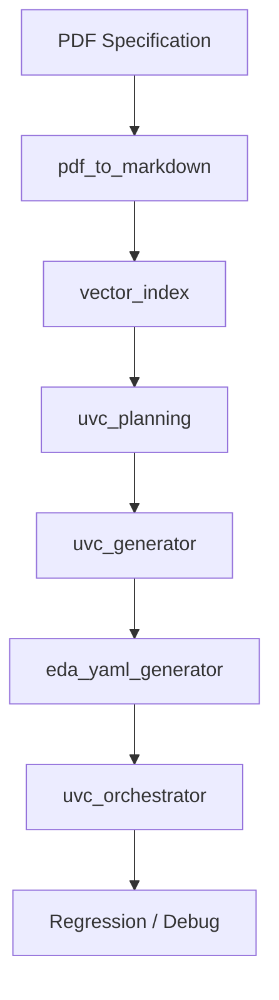

项目内部已经出现：

- Protocol Cheat Sheet；
- RAG；
- Verification Plan YAML；
- Mermaid UVM architecture；
- MCP Tools；
- EDA manifest；
- Regression；
- Grading engine。

项目 README 自述曾在 AXI5-Stream 上完成：

- 48 个 directed tests；
- 17-file UVM TB；
- 48/48 regression pass；
- 无人工编写 SystemVerilog。

> [!warning]
> 这是开源项目自身给出的工程结果，并非等价于经过独立同行评审的 benchmark。因此更适合作为“架构参考”，而不是作为学术结论。

### 对我们的启发

我们应该把验证流程拆成专门 Skill，而不是做一个“大 Prompt”。

---

## 3.7 RTL2UVM / UVMForge：社区工程实现

### RTL2UVM

**项目：** `rpjayaraman/RTL2UVM`  
**参考：** [R7]

特点：

- 使用 `pyslang` 解析 RTL；
- 自动抽取 port；
- 生成 interface / item / driver / monitor / scoreboard / coverage / env / test；
- 可选 LLM 补充复杂逻辑；
- 支持 Verilator。

这说明：

> **RTL 端最好先用 Parser 得到真实结构，再让 LLM 理解；不要让 LLM 靠文本搜索猜 port。**

### UVMForge

**项目：** `tusharpathaknyu/UVMForge`  
**参考：** [R8]

采用：

```text
Natural Language
      ↓
Structured Config
      ↓
Protocol Templates
      ↓
Generated UVM
```

支持 APB、AXI4-Lite、UART、SPI、I2C 等方向。

虽然这些社区工程并不等于生产级工具，但验证了：

> **Structured Config + Template 是可行且容易维护的工程路径。**

---

# 4. 工业界现状：Agentic Verification 已经成为主流方向

## 4.1 Cadence

2026 年 Cadence 发布 **ChipStack AI Super Agent**，官方描述其可以覆盖：

- RTL / testbench generation；
- test plan；
- regression orchestration；
- debug；
- issue fixing。

Cadence 公开声称在部分工作流上可达到最高约 10× productivity improvement。[R9]

Cadence 既有的 **Verisium AI-Driven Verification Platform** 则覆盖：

- regression；
- coverage；
- auto triage；
- debug；
- root cause analysis；
- test-suite optimization。[R10]

### 意义

这说明工业界目标已经不是单纯的“AI 写代码”，而是：

```text
Agent
  ↓
可信 EDA Engine
  ↓
Result
  ↓
Agent 决策
```

---

## 4.2 Synopsys

2026 年 Synopsys 对外展示 **AgentEngineer** multi-agent design / verification flow。

其公开的 Agentic Verification 方向覆盖：

```text
Specification
 → Test Plan
 → Verification
 → Coverage Closure
 → Debug
```

Synopsys 在 2026 DAC 相关官方发布中声称其 fully autonomous design verification workflow 在部分案例上实现：

- up to 50× faster time-to-validated RTL；
- additional 20% coverage improvement。[R11]

> [!note]
> 这些数字属于厂商公开结果，应作为工业趋势证据，而不是直接作为我们实验的 baseline。

---

## 4.3 Siemens EDA

Siemens Questa One 已经明确提供：

- **Smart Creation**：生成 RTL、testbench、test plan、assertion；
- **Verification IQ**：verification planning、regression、coverage、analytics；
- **Questa One Agentic Toolkit**：Agentic AI 驱动 autonomous RTL signoff workflow。[R12][R13]

其中很值得我们借鉴的一点是：

> Agent 可以自动执行，但在关键决策节点保留 engineer approval。

这非常适合本项目早期阶段。

---

## 4.4 ChipAgents

ChipAgents 是目前专门做 semiconductor agentic AI 的团队之一。

其公开方向包括：

- UVM generation；
- regression triage；
- waveform RCA；
- coverage closure；
- formal；
- end-to-end verification。

2026 年 DVCon Taiwan 的公开议题已经出现：

> “Slashing BIU Verification Loops via Autonomous UVM Generation”。

说明“Autonomous UVM”已经从学术研究进入工业产品竞争阶段。[R14]

---

# 5. 当前 UVM Agent 的发展阶段判断

综合论文、开源项目和工业方案，我认为当前技术大致可以分成四级：

| Level | 能力 | 当前成熟度 |
|---|---|---|
| L1 | 生成 UVM skeleton / component | 较成熟 |
| L2 | Compile / simulation 自动修错 | 可行 |
| L3 | Protocol-aware TB + regression + coverage loop | 正在成熟 |
| L4 | Subsystem / full autonomous sign-off | 前沿探索 |

因此本项目最合理的目标不是直接做：

> “自动验证任意 SoC”。

而是：

> **先构建一个数字 IP 级、可解释、可重复、可评测的 UVM Closed-loop Agent。**

---

# 6. 为什么选择 Qwen3.8

## 6.1 Qwen3.8-27B 的特性

Qwen 官方将 Qwen3.8-27B 定位为适合：

- coding；
- agentic workflow；
- long-horizon task；
- tool use；

的 27B dense open-weight model。[R15]

官方提供：

- native 262K context；
- Transformers；
- SGLang；
- vLLM；
- OpenAI-compatible API；
- `qwen3` reasoning parser；
- `qwen3_coder` tool-call parser。

因此可以直接形成：

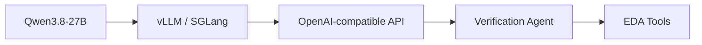

官方模型卡报告的 agent/coding benchmark 包括：

| Benchmark | Qwen3.8-27B |
|---|---:|
| Terminal Bench 2.1 | 73.0 |
| SWE-bench Pro | 61.7 |
| QwenSWEBench | 79.0 |

这些 benchmark 不能直接证明它“会 UVM”，但说明：

> 它具备比较强的 **代码工程 + Tool feedback + 多步骤 Agent execution** 基础能力。[R16]

---

## 6.2 本地部署为什么适合 Verification Agent

验证项目往往包含：

- 未公开 RTL；
- 内部 spec；
- proprietary protocol extension；
- register spec；
- bug history；
- regression log。

因此本地模型的优势是：

- 数据不离开内网；
- 可以接公司/实验室内部工具；
- 可以访问完整工程；
- 可以建立长期内部 KB；
- 推理成本可控；
- 模型、Prompt、Skill 可以固定版本，便于 benchmark。

---

## 6.3 需要注意实际显存和 Context

Qwen3.8-27B 官方 Hugging Face 权重约 55GB 量级。

因此实际部署不能因为“支持 262K context”就真的每次塞 262K。

验证 Agent 更应该采用：

```text
Parser / RAG
   ↓
只提供当前任务需要的 Context
   ↓
Qwen
```

推荐第一阶段：

```text
32K / 64K active context
+
RAG
+
Project State
```

而不是：

```text
整个项目所有文件全部放进 Context。
```

---

# 7. 本项目建议的核心定位

建议项目名称可以表述为：

> **基于本地部署 Qwen3.8 的 Domain-Knowledge-Guided UVM Verification Agent**

核心不是“LLM 写 UVM”，而是：

```text
Domain Skills
     +
Structured IR
     +
Golden Templates
     +
Verification Knowledge Base
     +
EDA Tool Feedback
     +
Coverage-driven Closed Loop
```

---

# 8. Agent 开发人员与 UVM 验证人员如何分工

这是项目能不能做好的关键。

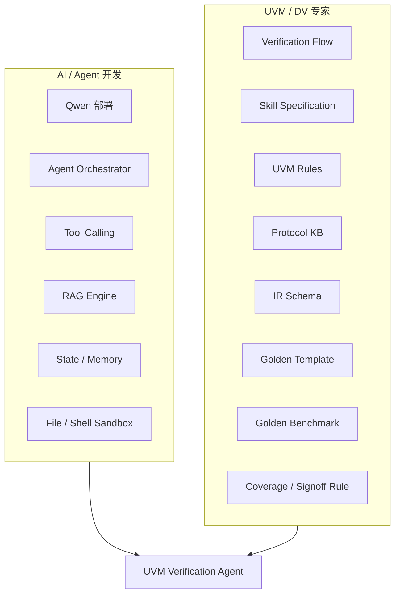

## 8.1 AI / Agent 人员负责

- Qwen3.8 inference server；
- vLLM / SGLang；
- Agent orchestration；
- Planner / Executor；
- Tool calling；
- RAG；
- Vector DB；
- Project state；
- MCP / function calling；
- file read/write；
- sandbox；
- retry / timeout；
- logging；
- UI / API。

---

## 8.2 UVM 验证人员负责

UVM 人员不能只给 AI 开发人员：

> “一本 UVM User Guide”。

真正应该交付的是：

### Verification Methodology

- 验证完整流程；
- 每一步的输入；
- 每一步的输出；
- 每一步的 pass/fail 判据；
- 哪些步骤允许 Agent 自动继续；
- 哪些步骤必须人工确认。

### UVM Coding Rules

- component architecture；
- phase 使用规范；
- config_db；
- factory；
- objection；
- TLM；
- driver / monitor 分工；
- scoreboard；
- reference model；
- coverage；
- RAL；
- clocking block；
- reset。

### Protocol Knowledge

例如 APB：

- signal owner；
- APB2 / 3 / 4 / 5 version difference；
- SETUP / ACCESS；
- wait state；
- completion；
- PSLVERR；
- stability；
- legal / illegal behavior；
- protocol SVA；
- coverage model；
- corner cases。

### Skills

把“资深 DV 工程师怎么工作”拆成 Agent 可以执行的 SOP。

### Golden Assets

- Golden VPlan；
- Golden TB；
- Golden Sequence；
- Golden Coverage；
- Golden Assertions；
- Bug-injected DUT；
- Golden Result。

### Evaluation

定义：

- Agent 到底算不算成功；
- 怎样比较版本；
- 怎样避免“假 PASS”。

---

# 9. 四个必须区分的概念：Skill / Knowledge / IR / Template

这是整个项目的核心。

| 概念 | 本质 | 回答的问题 |
|---|---|---|
| Skill | SOP / 工作流程 | **怎么做？** |
| Knowledge Base | Domain Knowledge | **应该知道什么？** |
| IR | Structured Task State | **当前 DUT / 验证目标是什么？** |
| Golden Template | 可靠代码骨架 | **代码固定部分怎么写？** |

可以画成：

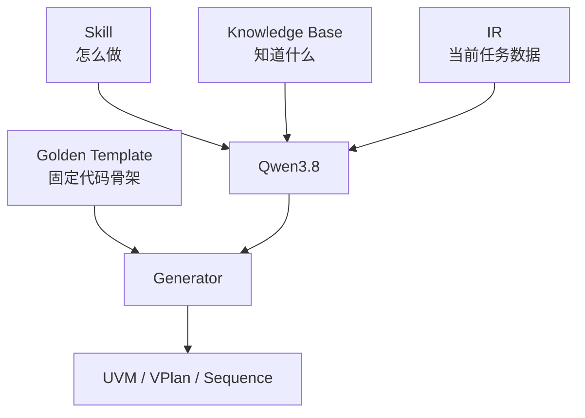

---

# 10. Golden Template 到底是什么？

Golden Template 不等于“让模型学习一次”。

它应该是**工程文件**。

例如：

```text
templates/
├── common/
│   ├── driver.sv.j2
│   ├── monitor.sv.j2
│   ├── sequencer.sv.j2
│   ├── agent.sv.j2
│   ├── env.sv.j2
│   └── test.sv.j2
└── protocol/
    ├── fifo/
    ├── apb/
    └── uart/
```

每次生成时：

```text
当前任务
   ↓
选择 Golden Template
   ↓
读取 IR
   ↓
填入结构化内容
   ↓
生成代码
```

不是：

```text
第一天把 Golden Code 给 Qwen 看一遍
        ↓
希望模型以后一直记住
```

### 为什么每次都应该读模板？

因为 Agent 应该默认：

> **LLM 是 stateless 的。**

关键工程知识不能依赖“模型记忆”。

---

# 11. 什么是 IR？

IR = **Intermediate Representation，中间表示**。

它位于：

```text
Spec / RTL
    ↓
IR
    ↓
UVM / VPlan / Sequence
```

例如 Spec 写：

> FIFO depth 为 16；full 时写操作不应改变 FIFO 内容；支持 simultaneous read/write。

转成：

```yaml
design:
  name: sync_fifo

parameters:
  WIDTH: 8
  DEPTH: 16

clock:
  signal: clk
  edge: posedge

reset:
  signal: rst_n
  active_level: 0

features:
  write:
    supported: true

  read:
    supported: true

  simultaneous_read_write:
    supported: true

  write_when_full:
    content_must_not_change: true
```

这就是 Design IR。

---

## 11.1 为什么 IR 非常重要？

如果直接：

```text
Spec
 ↓
Qwen
 ↓
5000 行 UVM
```

出现问题时我们不知道：

- Spec 理解错了？
- VPlan 漏了？
- Architecture 错了？
- 代码写错了？

有 IR 以后：

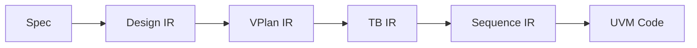

每一层都可以人工或程序检查。

---

# 12. 建议至少设计四种 IR

## 12.1 Design IR

描述：

> DUT 是什么。

包括：

- clocks；
- resets；
- parameter；
- ports；
- register；
- interface；
- feature；
- constraints；
- error behavior。

---

## 12.2 VPlan IR

描述：

> 要验证什么。

建议形成强制 traceability：

```text
Requirement
   ↓
Test / Stimulus
   ↓
Checker
   ↓
Coverage
   ↓
Assertion
```

示例：

```yaml
id: FIFO_FULL_001

requirement:
  write_when_full_does_not_modify_fifo

stimulus:
  precondition:
    fifo_full: true
  action:
    wr_en: 1

checker:
  scoreboard: true
  assertion: true

coverage:
  coverpoint: full_write_attempt

tests:
  - fifo_full_write_test
```

---

## 12.3 TB IR

描述：

> UVM 环境怎么搭。

例如：

```yaml
agents:
  fifo_agent:
    active: true
    driver: true
    monitor: true
    sequencer: true

scoreboard:
  model: reference_queue

coverage:
  collector: fifo_coverage

interface:
  name: fifo_if
```

---

## 12.4 Sequence IR

描述：

> 一条 testcase 的“测试意图”。

例如：

```yaml
sequence:
  name: fifo_full_write_seq

steps:
  - reset

  - repeat:
      count: DEPTH
      action: write_random

  - action: write
    expect:
      fifo_content_changed: false
```

最终再由 generator 转换成 SystemVerilog。

---

# 13. 什么是知识库？

知识库不是：

> “把一堆 PDF 给 LLM”。

知识库应该是 Agent 可以**按需检索的专业知识集合**。

对于 UVM Agent，建议至少分四层：

```text
knowledge_base/
├── methodology/
├── protocols/
├── project/
└── experience/
```

---

# 14. UVM Knowledge Base 应该放什么？

## 14.1 Methodology KB

描述：

> UVM 应该怎么做。

例如：

```text
methodology/
├── uvm_component.md
├── uvm_phase.md
├── uvm_driver.md
├── uvm_monitor.md
├── uvm_scoreboard.md
├── uvm_sequence.md
├── uvm_config_db.md
├── uvm_factory.md
├── uvm_objection.md
├── uvm_ral.md
├── clocking_block.md
└── reset_policy.md
```

---

## 14.2 Protocol KB

例如：

```text
protocols/
├── apb/
│   ├── versions.yaml
│   ├── signals.yaml
│   ├── transfer.yaml
│   ├── timing_rules.yaml
│   ├── driver_rules.md
│   ├── monitor_rules.md
│   ├── assertion_rules.yaml
│   ├── coverage_model.yaml
│   └── corner_cases.md
│
├── fifo/
│   ├── behavior.md
│   ├── scoreboard.md
│   ├── coverage.yaml
│   └── corner_cases.md
│
└── uart/
    ├── frame.yaml
    ├── baud.yaml
    ├── parity.yaml
    ├── rx_sampling.md
    ├── error_injection.md
    └── coverage.yaml
```

例如 APB3：

```yaml
protocol: APB3

signals:
  PSEL:
    owner: master
  PENABLE:
    owner: master
  PREADY:
    owner: slave
  PSLVERR:
    owner: slave

transfer:
  setup:
    PSEL: 1
    PENABLE: 0

  access:
    PSEL: 1
    PENABLE: 1

completion:
  condition:
    - PSEL == 1
    - PENABLE == 1
    - PREADY == 1

wait_state:
  when:
    PREADY: 0

  stable:
    - PADDR
    - PWRITE
    - PSEL
    - PENABLE
```

同时显式规定：

```yaml
version_forbidden_signals:
  APB3:
    - PSTRB
    - PPROT
```

这样就可以直接防止论文 [R4] 中观察到的 APB3/APB4 混淆。

---

## 14.3 Project KB

只描述当前 DUT：

```text
project/
├── spec/
├── register_spec/
├── rtl_summary/
├── architecture/
├── known_limitations/
└── vplan/
```

它与 Protocol KB 的区别：

```text
Protocol KB：
APB3 本身是什么？

Project KB：
当前这个 APB Slave 实现了哪些寄存器、哪些 wait state、哪些 feature？
```

---

## 14.4 Experience KB

非常值得长期积累。

例如：

```text
experience/
├── compile_errors/
├── elaboration_errors/
├── simulation_hang/
├── uvm_common_bugs/
├── race_condition/
├── protocol_bugs/
├── scoreboard_bugs/
└── coverage_closure/
```

可以把实际遇到的问题整理成：

```yaml
symptom:
  simulation hangs after sequence starts

possible_causes:
  - driver did not call item_done
  - objection never dropped
  - protocol handshake never completes
  - reset remains asserted
  - watchdog missing

diagnosis:
  - inspect UVM phase log
  - inspect sequence item count
  - inspect driver handshake log
```

这类知识对 debug Agent 的价值非常大。

---

# 15. 知识库具体应该怎么构建？

建议不要第一天就做“复杂知识图谱”。

第一版完全可以：

```text
Markdown + YAML + JSON
        ↓
Chunking
        ↓
Metadata
        ↓
Embedding
        ↓
Vector DB
        +
Keyword Search
```

---

## 15.1 Step 1：整理 Source

优先级建议：

```text
内部确定规范
   >
官方标准 / Spec
   >
审核过的 Golden Code
   >
团队经验
   >
互联网资料
```

> [!important]
> 对协议等关键规则，尽量不要以博客作为最高权威。

---

## 15.2 Step 2：不要把整本 PDF 原样当 KB

PDF 可以作为原始证据，但最好进一步整理。

例如一份 APB Spec 应该变成：

- signal table；
- protocol version table；
- timing rule；
- legal condition；
- error behavior；
- assertion rule；
- coverage point；
- spec reference。

---

## 15.3 Step 3：每个 Knowledge Chunk 带 Metadata

例如：

```yaml
id: APB3_WAIT_001

domain: protocol
protocol: APB
version: APB3

topic: wait_state

source:
  type: specification
  section: "transfer timing"

rule:
  control_and_address_must_remain_stable: true

applicable_to:
  - driver
  - monitor
  - assertion
```

这样可以实现：

```text
生成 APB3 monitor
        ↓
只检索 protocol=APB / version=APB3 / monitor
```

避免把 APB5 内容错误召回。

---

## 15.4 Step 4：Hybrid Retrieval

建议：

```text
BM25 / keyword
      +
embedding similarity
      +
metadata filter
      +
rerank
```

因为 EDA/UVM 中大量关键 token：

```text
uvm_config_db
PENABLE
PREADY
uvm_analysis_port
PSLVERR
```

关键词非常有价值，不能只做向量搜索。

---

# 16. 怎么“规范 LLM”？

LLM 最大的问题不是不会写代码，而是：

> **它在不确定的时候仍然可能给出一个看起来很确定的答案。**

所以必须构建 Guardrail。

---

## 16.1 Rule 1：禁止补全不存在的设计事实

Agent 必须区分：

```text
FACT
INFERENCE
UNKNOWN
```

例如：

```yaml
PREADY:
  status: FACT
  source: RTL port

wait_state_support:
  status: UNKNOWN
```

不能因为 APB 通常支持 wait state，就自动认定 DUT 实现了 programmable wait state。

---

## 16.2 Rule 2：所有 Requirement 必须有 Source

建议 VPlan 强制：

```yaml
requirement_id: APB_REQ_001

source:
  file: apb_slave_spec.md
  section: 3.2

description:
  ...
```

如果没有 source：

```text
Agent 不允许将其标为“设计要求”。
```

最多只能标：

```text
recommended_test
```

---

## 16.3 Rule 3：Protocol Version 必须锁定

例如：

```yaml
protocol:
  family: APB
  version: APB3
```

随后所有 Skill 和 RAG 都必须 metadata filter 到 APB3。

---

## 16.4 Rule 4：代码生成后必须经过确定性工具

```text
LLM:
“这个代码应该没问题”
```

没有意义。

必须：

```text
Parser
Compile
Elaborate
Simulation
Coverage
```

逐层判定。

---

## 16.5 Rule 5：LLM 不允许直接判定 Test PASS

唯一允许的 PASS 来源应该是：

```text
scoreboard result
+
assertion result
+
simulation exit status
+
test completion condition
```

LLM 只负责解释结果。

---

## 16.6 Rule 6：限制修改范围

debug 时禁止：

> “compile 出错，所以把整个 testbench 重写一遍”。

应使用 patch policy：

```yaml
max_files_per_patch: 3
max_change_scope: local

must_preserve:
  - verified components
  - vplan traceability
  - public interfaces
```

---

## 16.7 Rule 7：禁止为了 Coverage 而“作弊”

Agent 不允许：

- 删除难覆盖的 bin；
- 把 illegal bin 改成 ignore；
- 修改 coverage goal；
- 删除 assertion；
- 降低 checker 严格度；

除非：

```text
生成 waiver proposal
+
给出理由
+
等待人工 approval
```

这条极其重要。

---

# 17. Skill 是什么？

Skill 可以理解成：

> **给 Agent 的“专业岗位 SOP”。**

一个好的 Skill 不应该只是：

```text
你是一个资深 UVM 工程师，请生成高质量 driver。
```

而应该明确：

```text
Input
Precondition
Knowledge
Procedure
Output
Validation
Forbidden actions
Recovery
Stop condition
```

---

# 18. 推荐第一版 Skill Library

建议第一版不要拆到几十个。

先实现 12 个主 Skill：

| Skill | 功能 |
|---|---|
| `spec_analysis` | Spec → Requirement / Design IR |
| `rtl_analysis` | RTL → Port / parameter / hierarchy / design facts |
| `vplan_generation` | Requirement → Test / checker / coverage |
| `tb_architecture` | 生成 UVM architecture |
| `uvm_component_generation` | 生成 component |
| `sequence_generation` | 生成 test intent / sequence |
| `assertion_generation` | 生成协议与功能 SVA |
| `compile_debug` | compile/elab 修复 |
| `simulation_debug` | hang/mismatch/runtime debug |
| `regression` | testcase/seed/regression |
| `coverage_analysis` | 解析 coverage hole |
| `signoff` | 汇总 traceability / waiver / result |

---

# 19. 一个 Skill 应该怎么写？

推荐目录：

```text
skills/
└── spec_analysis/
    ├── SKILL.md
    ├── input.schema.json
    ├── output.schema.json
    ├── examples/
    └── validators/
```

---

## 19.1 `spec_analysis` 示例

```yaml
name: spec_analysis

goal:
  Extract design facts and verification requirements
  without inventing unspecified behavior.

inputs:
  - spec_documents
  - rtl_summary_optional

knowledge:
  - methodology/spec_interpretation
  - protocol/<detected_protocol>

steps:
  - identify clock/reset
  - identify interfaces
  - identify parameters
  - identify functional features
  - identify error behavior
  - identify configuration/registers
  - attach source reference
  - mark ambiguous items as UNKNOWN

outputs:
  - design_ir.yaml
  - requirement_list.yaml
  - ambiguity_report.md

validation:
  - every FACT has source
  - no duplicated requirement IDs
  - schema validation passes

forbidden:
  - invent missing register behavior
  - infer protocol version without evidence
  - silently resolve conflicting spec statements

stop_conditions:
  - unresolved clock/reset ambiguity
  - conflicting interface definition
```

---

# 20. UVM Component Skill 需要规定什么？

例如 `driver_generation`：

```yaml
goal:
  Generate a protocol-correct UVM driver.

preconditions:
  - TB IR valid
  - interface signals resolved
  - protocol version resolved
  - reset policy resolved

rules:
  - only drive driver-owned signals
  - must handle reset
  - must complete UVM transaction lifecycle
  - must use approved clocking/sampling policy
  - protocol timing must come from Protocol KB
  - no scoreboard behavior in driver

validation:
  - syntax check
  - compile
  - vif acquisition check
  - reset smoke test
  - one legal transaction smoke test
```

这里最关键的一点：

> Skill 不只是“告诉 LLM 怎么写”，还要定义 **生成以后怎样验证这段代码是对的**。

---

# 21. EDA Tool 应该怎么给 Agent 调？

这是 Agent 工程化最关键的部分之一。

**不要直接给 LLM 一个无限制 shell：**

```text
shell("随便执行什么都可以")
```

更推荐把 EDA 能力封成明确 Tool。

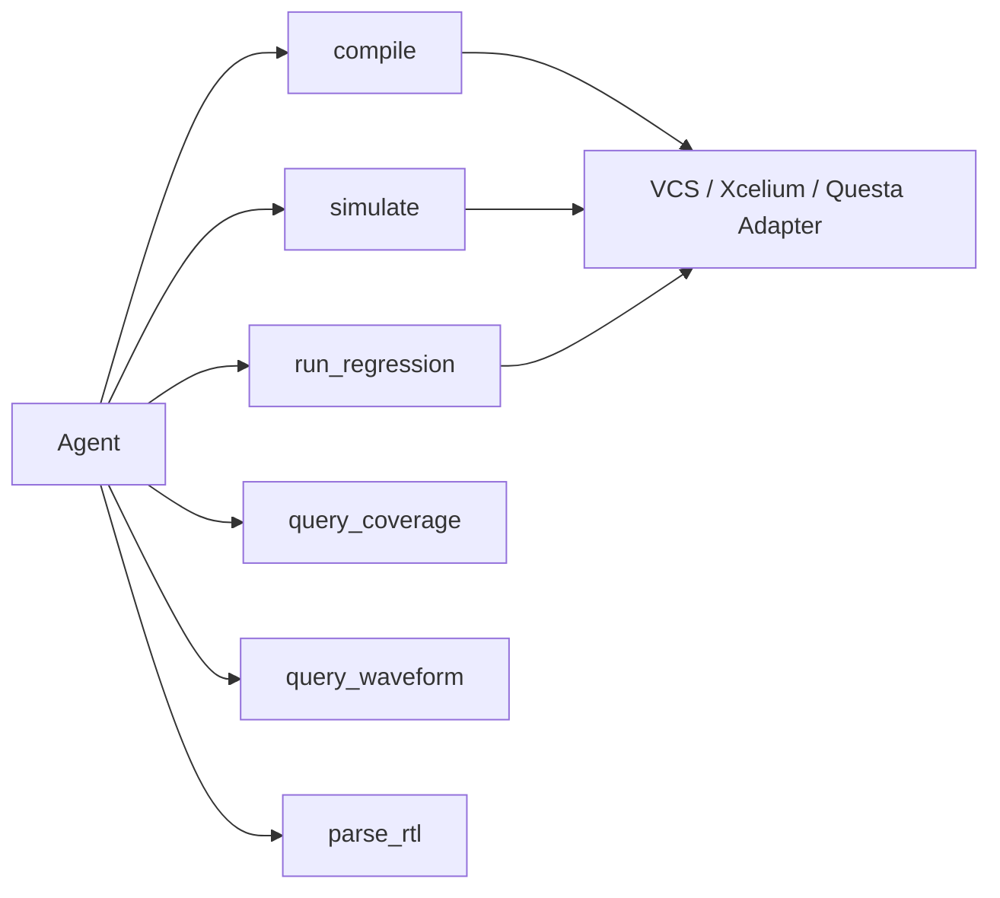

---

# 22. 建议提供的 EDA Tools

## `parse_rtl`

输入：

```yaml
files:
top:
include_dirs:
defines:
```

输出：

```yaml
modules:
ports:
parameters:
instances:
errors:
```

可采用：

- pyslang；
- Surelog / UHDM。

Surelog 本身提供 SystemVerilog 2017 preprocess / parser / elaboration 以及 Python AST/UHDM API。[R17]

---

## `compile`

输入：

```yaml
compile_signature:
filelist:
include_dirs:
defines:
compile_options:
tool:
```

输出：

```yaml
status: PASS | FAIL
exit_code:
error_count:
warning_count:
errors:
log_path:
artifact_id:
```

---

## `elaborate`

单独区分 elaboration，避免把 syntax 和 connectivity error 混在一起。

---

## `simulate`

输入：

```yaml
test:
seed:
plusargs:
timeout:
sim_options:
compile_artifact:
```

输出：

```yaml
status:
uvm_status:
assertion_failures:
scoreboard_mismatches:
timeout:
log_path:
waveform_path:
coverage_db:
```

---

## `run_regression`

输入：

```yaml
tests:
  - name:
    seeds:
repeat:
parallel:
```

输出：

```yaml
total:
pass:
fail:
timeout:
unique_failure_signatures:
coverage_db_list:
```

---

## `coverage_report`

输出统一格式：

```yaml
code:
  line:
  branch:
  toggle:
  fsm:

functional:
  total_bins:
  hit_bins:
  uncovered_bins:

assertion:
  pass:
  fail:
  vacuous:
  uncovered:
```

Agent 永远只处理统一 schema。

不要让上层 Agent 到处解析：

```text
VCS log format
Xcelium log format
Questa log format
```

这些应该由 adapter 解决。

---

# 23. 如何规范 Agent 调用 EDA 工具？

建议采用 **Tool Contract**。

例如 compile tool：

```yaml
tool: compile

allowed_action:
  - compile project

forbidden:
  - edit source
  - delete source
  - modify simulator installation

timeout:
  20min

output:
  structured_json: true

on_failure:
  return:
    - first_error
    - related_errors
    - log_path

retry:
  automatic: false
```

---

## 23.1 Agent 不应该直接修改原始 Spec / RTL

默认权限建议：

| 资源 | Agent 权限 |
|---|---|
| Spec | Read-only |
| RTL | Read-only |
| Generated TB | Read/Write |
| VPlan | Read/Write |
| Regression config | Read/Write |
| Coverage DB | Read-only |
| Golden Template | Read-only |
| Skill | Read-only |

如果需要修改 RTL 来验证 bug hypothesis：

```text
生成 patch proposal
    ↓
sandbox copy
    ↓
simulation
```

不能直接修改 source-of-truth。

---

# 24. EDA Feedback 如何进入 Agent？

不要把几十 MB log 全部塞给 Qwen。

应该：

```text
Raw Log
   ↓
Parser
   ↓
Failure Signature
   ↓
Minimal Context
   ↓
LLM
```

例如：

```yaml
failure_type:
  UVM_CONFIG_DB

primary_error:
  "virtual interface must be set"

location:
  apb_driver.sv:32

related_component:
  apb_agent.driver

possible_context:
  - tb_top config_db set
  - driver build_phase get
```

这会比直接把完整 `sim.log` 输入模型稳定很多。

---

# 25. Compile Debug Agent 应该遵循什么原则？

建议：

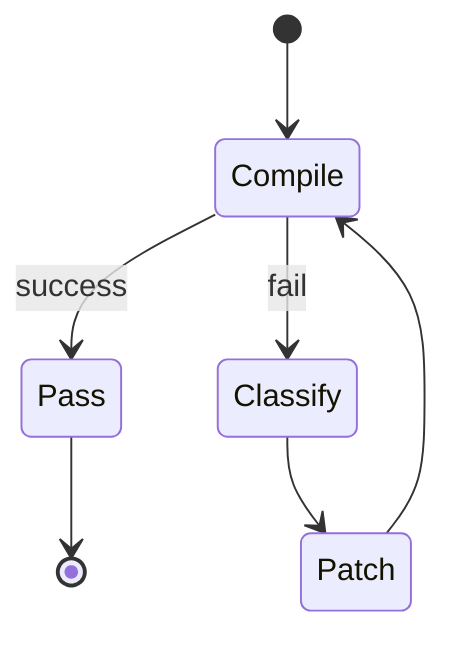

每轮：

1. 找第一个 root error；
2. 分类；
3. 找相关 dependency；
4. 做最小 patch；
5. 重新 compile；
6. 不允许一次修 20 个猜测性问题；
7. 超过 N 轮自动停止并请求人工。

---

# 26. Simulation Debug Agent 应该怎么做？

典型分类：

```text
TIMEOUT
UVM_FATAL
SCOREBOARD_MISMATCH
ASSERTION_FAILURE
PROTOCOL_TIMEOUT
X_PROPAGATION
OBJECTION_HANG
RESET_ERROR
RACE_CONDITION
```

不同错误调用不同子策略。

例如 scoreboard mismatch：

```text
transaction expected / actual
       ↓
先判断 monitor sampling 是否可靠
       ↓
再判断 reference model
       ↓
最后判断 DUT
```

不能看到 mismatch 就立刻认为 DUT 有 bug。

---

# 27. 真正完整的端到端 Verification Closed Loop

建议本项目最终实现如下流程。

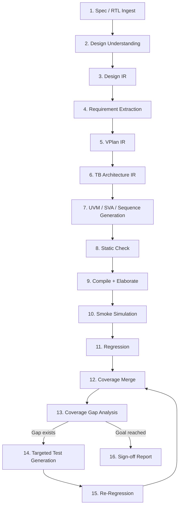

---

# 28. 每个阶段必须有 Artifact 和 Gate

| Stage | Artifact | Gate |
|---|---|---|
| Spec Analysis | `design_ir.yaml` | schema + source trace |
| VPlan | `vplan.yaml` | req/test/cov completeness |
| TB Architecture | `tb_ir.yaml` | architecture rule check |
| Generation | `tb/*.sv` | lint/parser |
| Compile | compile artifact | 0 errors |
| Smoke | sim log | no fatal/hang/mismatch |
| Regression | regression DB | expected pass |
| Coverage | coverage report | metrics available |
| Closure | targeted tests | hole reduced |
| Sign-off | report | goals + waivers |

这使 Agent 不会“跳步骤”。

---

# 29. 为什么 Verification Plan 是核心？

如果没有 VPlan：

```text
Agent 随机写一些 Sequence
```

最后 coverage 高，也未必代表需求被验证。

应该强制：

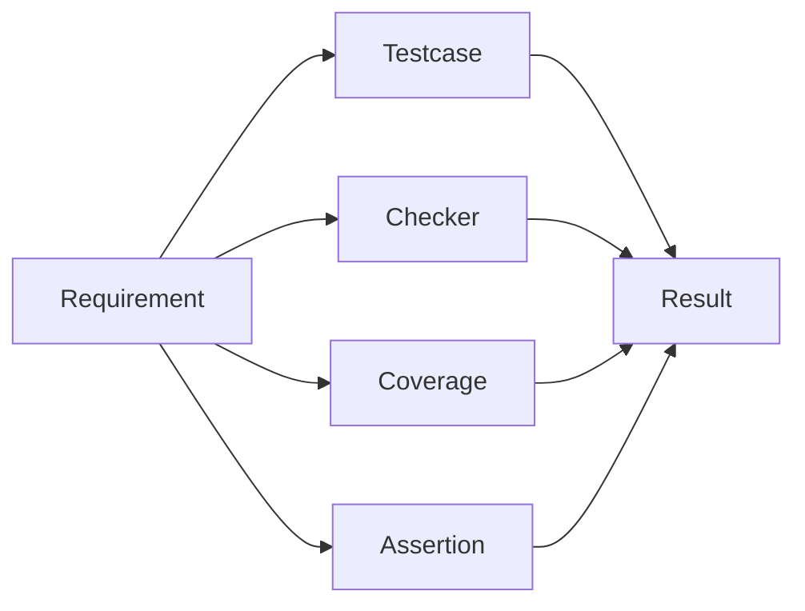

Sign-off 的本质不是：

> code coverage = 95%。

而是：

> **每一个需求都有 stimulus + checking + observability + coverage evidence。**

---

# 30. Scoreboard / Coverage / Assertion 三者不能混为一谈

### Scoreboard

验证：

> 数据结果是否正确。

### Assertion

验证：

> 时序 / 协议 / invariant 是否被违反。

### Functional Coverage

验证：

> 我们是否真的访问过目标场景。

因此一项 feature 应尽量形成：

```text
Stimulus
+
Checker
+
Coverage
```

关键协议场景再加：

```text
SVA
```

---

# 31. 最大风险：False PASS

对于 Verification Agent：

```text
Compile FAIL
```

其实不算最危险。

最危险的是：

```text
DUT 有 Bug
+
TB PASS
```

因此本项目的一级评价指标应该包括：

> **False PASS Rate**

而不能只统计 compile success。

---

# 32. Benchmark 设计：FIFO → APB Slave → UART

建议采用三级难度。

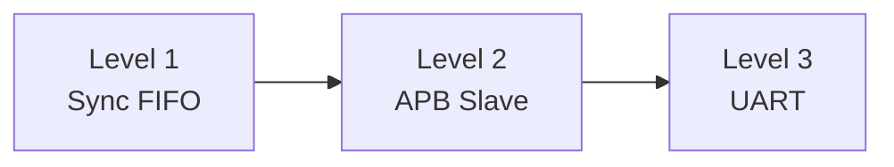

---

# 33. Level 1：Sync FIFO

FIFO 非常适合第一阶段，因为它不依赖复杂总线协议，但足以测试：

- stateful behavior；
- scoreboard；
- reference model；
- coverage；
- corner case。

建议 Feature：

```text
write
read
full
empty
simultaneous R/W
overflow attempt
underflow attempt
pointer wrap-around
reset
fill → drain
random traffic
```

Golden reference model：

```text
SystemVerilog Queue
```

---

## 33.1 FIFO Bug Injection

人为插入：

```text
BUG1: full off-by-one
BUG2: empty 判断错误
BUG3: pointer wrap 错
BUG4: full 时仍写 memory
BUG5: simultaneous read/write 错
```

最后统计：

```text
Agent 生成的环境发现了几个？
```

---

# 34. Level 2：APB Slave

APB 用来测试：

> **Protocol Knowledge + Driver/Monitor Timing + RAL/Registers。**

建议 Feature：

```text
single write
single read
back-to-back
wait state
PSLVERR
invalid address
reset
RO
RW
W1C
reserved address
random address/data
```

---

## 34.1 APB 特别适合做 Ablation Experiment

例如：

| Experiment | 配置 |
|---|---|
| A | Qwen only |
| B | Qwen + UVM Skill |
| C | + Golden Template |
| D | + APB KB |
| E | + Compile feedback |
| F | + Coverage feedback |

观察：

```text
APB3/APB4 混淆是否下降？
Timing Error 是否下降？
Compile pass@1 是否提高？
Bug Detection 是否提高？
Coverage 是否提高？
```

非常适合写论文 / 项目总结。

---

# 35. Level 3：UART

UART 用来进一步测试：

- timing；
- serialization；
- configuration；
- error injection；
- sampling point。

可以逐级加入：

```text
TX / RX
baud divisor
5/6/7/8 data bit
parity
stop bits
framing error
parity error
overrun
break
FIFO
```

UART 对 Agent 的要求明显高于 FIFO/APB：

```text
Spec understanding
      +
cycle / bit timing
      +
configuration dependency
      +
serial sampling
      +
error injection
```

如果 Agent 最终能够：

```text
Spec
 → VPlan
 → UVM
 → Regression
 → Coverage Hole
 → 新增 parity/framing testcase
 → Closure
```

这个 demo 已经非常有说服力。

---

# 36. Golden Benchmark 应该准备什么？

每个 IP 都准备：

```text
benchmark/
└── fifo/
    ├── spec/
    ├── rtl/
    ├── golden/
    │   ├── design_ir.yaml
    │   ├── vplan.yaml
    │   ├── tb_ir.yaml
    │   ├── tb/
    │   ├── seq/
    │   ├── sva/
    │   └── coverage/
    └── bugs/
```

Golden 不是为了让 Agent 全部照抄。

Golden 的用途有两个：

### 作为 Template / Example

提供可靠结构。

### 作为 Judge

比较 Agent 输出质量。

---

# 37. 建议评价指标

## 37.1 Planning

```text
Requirement Recall
Requirement Precision
Traceability Completeness
```

---

## 37.2 Code

```text
Compile Pass@1
Elaboration Pass@1
Repair Iterations
```

---

## 37.3 Verification Quality

```text
Simulation Pass
Functional Coverage
Code Coverage
Assertion Coverage
Bug Detection Rate
False PASS Rate
```

---

## 37.4 Agent Efficiency

```text
Human Intervention Count
LLM Calls
Token Usage
EDA Runs
Wall-clock Time
```

---

# 38. 不建议第一版就 Fine-tune

推荐技术路线：

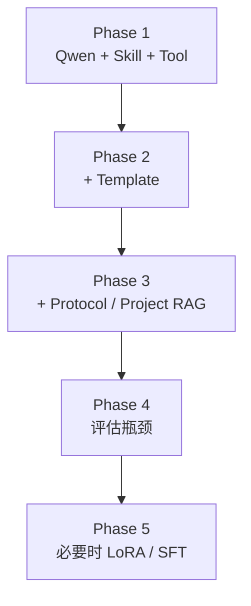

为什么？

因为 UVM 中很多知识是：

```text
显式规则
```

例如：

- APB timing；
- driver ownership；
- coverage policy；
- UVM structure。

这种知识放在：

```text
Rule / Skill / Template / KB
```

通常比训练进模型更：

- 可解释；
- 可维护；
- 可升级；
- 可 review。

---

# 39. 一个建议的项目目录

```text
uvm_agent/
│
├── agent/
│   ├── orchestrator/
│   ├── planner/
│   ├── state/
│   └── policy/
│
├── tools/
│   ├── rtl_parser/
│   ├── compile/
│   ├── simulate/
│   ├── regression/
│   ├── coverage/
│   └── waveform/
│
├── skills/
│   ├── spec_analysis/
│   ├── rtl_analysis/
│   ├── vplan/
│   ├── tb_architecture/
│   ├── uvm_generation/
│   ├── sequence_generation/
│   ├── assertion_generation/
│   ├── compile_debug/
│   ├── simulation_debug/
│   ├── regression/
│   ├── coverage_analysis/
│   └── signoff/
│
├── schemas/
│   ├── design_ir.schema.json
│   ├── vplan.schema.json
│   ├── tb_ir.schema.json
│   ├── sequence_ir.schema.json
│   └── eda_result.schema.json
│
├── templates/
│   ├── common/
│   ├── fifo/
│   ├── apb/
│   └── uart/
│
├── knowledge_base/
│   ├── methodology/
│   ├── protocols/
│   ├── project/
│   └── experience/
│
├── benchmark/
│   ├── fifo/
│   ├── apb/
│   └── uart/
│
└── reports/
```

---

# 40. 建议设置 Human-in-the-loop Gate

第一版不要追求“完全无人”。

建议：

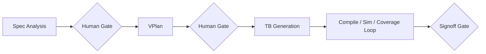

人工主要确认：

### Gate 1

> Design IR 是否正确？

### Gate 2

> VPlan 是否漏需求？

### Gate 3

> 是否满足 sign-off？

中间 compile/debug/regression 可以尽量自动化。

---

# 41. 推荐的 Agent 基础架构

一个最小 Agent 系统通常需要：

```text
LLM Server
   +
Orchestrator
   +
State
   +
Skills
   +
Tools
   +
Knowledge Retrieval
   +
Policy / Guardrail
```

---

## 41.1 Orchestrator

职责：

```text
我现在处于哪个状态？
下一步应该执行哪个 Skill？
需要调用什么 Tool？
结果 PASS 还是 FAIL？
是否继续？
```

---

## 41.2 State

不要让“当前做到哪一步”只存在上下文里。

建议显式保存：

```yaml
project_state:

  spec_analysis:
    status: done
    artifact: design_ir_v3.yaml

  vplan:
    status: approved
    artifact: vplan_v2.yaml

  generation:
    status: done

  compile:
    status: pass
    artifact: compile_0008

  regression:
    status: running
```

这样 Agent session 断掉以后也能恢复。

---

# 42. 不建议做一个超级 Agent

更合理的是：

```text
Orchestrator
   |
   +-- Spec Agent
   +-- Planning Agent
   +-- UVM Generation Agent
   +-- Compile Debug Agent
   +-- Simulation Debug Agent
   +-- Coverage Agent
```

并且所有 Agent 共用：

```text
IR
+
Knowledge
+
Tools
```

而不是让多个 Agent 互相靠自然语言传递模糊信息。

---

# 43. Tool 是“手”，Skill 是“工作方法”

这是一个很好理解的对应关系：

```text
LLM
=
大脑

Skill
=
SOP

Knowledge Base
=
专业资料

IR
=
工程图纸 / 当前任务数据

Tool
=
手和仪器

EDA
=
实验设备

Coverage / Assertion / Scoreboard
=
客观测量结果
```

---

# 44. 我们真正要研究的问题

如果把项目做好，最终可以回答的不只是：

> “Qwen3.8 会不会写 UVM？”

而是下面几个更有研究价值的问题。

### Q1

Domain Skill 对 UVM 自动生成有多大提升？

### Q2

Protocol RAG 能否降低协议版本混淆和 timing error？

### Q3

Golden Template 能否提高 compile pass@1？

### Q4

Simulator-in-the-loop 能否稳定实现自动 debug？

### Q5

Coverage feedback 能否真正提高 verification completeness？

### Q6

Agent 生成环境对 injected bug 的 detection rate 如何？

### Q7

模型能力和 Domain Engineering 哪一个贡献更大？

---

# 45. 风险与对策

| 风险 | 后果 | 对策 |
|---|---|---|
| Hallucination | 虚构 DUT feature | FACT/UNKNOWN + source trace |
| Protocol version 混淆 | driver/monitor 错 | version-scoped KB |
| Timing / race 错 | false fail / false pass | Golden timing rule + simulation |
| Coverage gaming | 假 closure | 禁止自动删除 bin |
| Weak scoreboard | DUT bug 漏检 | Golden checker + bug injection |
| Context 污染 | 使用过期信息 | Project state + metadata |
| 无限 debug loop | EDA 时间爆炸 | max retry + stop condition |
| LLM 乱执行 shell | 工程风险 | Tool allowlist + sandbox |
| 改坏正确代码 | regression | minimal patch + git diff |
| Proprietary data | 信息泄露 | Local Qwen + local KB |

---

# 46. 建议近期实施路线

## Phase 0：基础框架

AI 人员：

```text
Qwen3.8
+
OpenAI-compatible API
+
Agent Orchestrator
+
Tool Calling
```

UVM 人员：

```text
Skill format
IR schema
UVM rules
```

---

## Phase 1：FIFO

实现：

```text
Spec
→ Design IR
→ VPlan
→ TB
→ Compile
→ Smoke
→ Regression
→ Coverage
```

暂时允许人工确认 IR / VPlan。

---

## Phase 2：自动 Debug

增加：

```text
compile_debug
simulation_debug
```

目标：

> Agent 自己修到 compile + smoke PASS。

---

## Phase 3：APB

加入：

```text
APB Protocol KB
Protocol Skill
Version Rule
```

重点做 Ablation。

---

## Phase 4：Coverage Closure

加入：

```text
Coverage Gap
→ Requirement
→ Targeted Sequence
→ Regression
```

---

## Phase 5：UART

验证更复杂：

```text
timing
+
configuration
+
serial protocol
+
error injection
```

---

# 47. UVM 人员接下来最具体应该做什么？

如果 AI Agent 开发由别人负责，那么 UVM 侧近期最重要的输出不是代码数量，而是**Domain Package**。

建议第一批交付：

```text
1. UVM Verification Flow
2. Design IR Schema
3. VPlan Schema
4. TB IR Schema
5. Sequence IR Schema
6. UVM Coding Rules
7. Driver Rules
8. Monitor Rules
9. Scoreboard Rules
10. Coverage Rules
11. Reset / Clocking Rules
12. 12 个核心 Skills
13. FIFO Golden Project
14. APB Protocol KB
15. Bug Injection Set
16. Agent Evaluation Metrics
```

这些东西完成后，AI 开发人员才真正有东西可以“装进 Agent”。

---

# 48. 第一阶段最值得先写的 5 个 Skill

如果时间有限，优先：

```text
spec_analysis
        ↓
vplan_generation
        ↓
tb_architecture
        ↓
uvm_generation
        ↓
compile_debug
```

再加入：

```text
coverage_analysis
```

就已经可以形成第一版有意义的闭环。

---

# 49. 本项目与普通“代码生成”的最大差异

普通代码生成：

```text
输入 Spec
   ↓
生成 UVM
   ↓
结束
```

我们的目标：

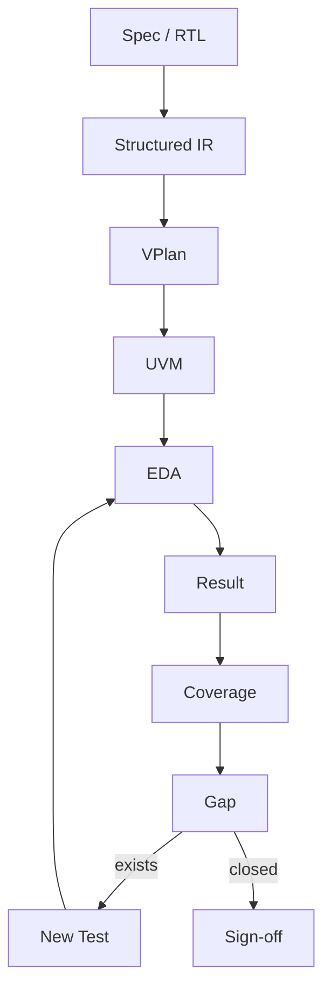

真正的关键词是：

> **Closed Loop**

---

# 50. 最终判断

> [!success] 可行性判断
> **基于本地 Qwen3.8 做 IP-level UVM Verification Agent：可行，而且当前技术时间点比较合适。**
>
> 但建议项目目标明确限定为：
>
> **“Agent 驱动的结构化验证闭环”**
>
> 而不是：
>
> **“大模型自动写 UVM”。**

当前研究已经充分说明：

1. 单纯 LLM 生成 UVM skeleton 已经不是最困难的问题；
2. 主要瓶颈是 protocol correctness、timing、verification completeness 和 false pass；
3. Template / Rule / IR / RAG / Simulator feedback 是明显的技术趋势；
4. EDA 厂商也正在向 agentic verification + trusted engines 演进；
5. 因此真正有价值的工作是把 **UVM 专家的经验工程化**。

最终可以把本项目概括为：

```text
Qwen3.8
   +
Verification Skills
   +
Structured IR
   +
Golden Template
   +
Knowledge Base
   +
EDA Tools
   +
Coverage Feedback
   =
Closed-loop UVM Verification Agent
```

---

# 51. 组会上可以重点讲的三句话

> **第一，现阶段 LLM 已经比较会“写 UVM 结构”，但还不会天然成为一个可靠的 Verification Engineer。**

> **第二，所以我们的核心不是训练它背 UVM，而是把 Verification Methodology 变成 Skill、IR、Knowledge、Template 和 Tool Contract。**

> **第三，最终评价 Agent 的标准不是“生成代码了没有”，而是“能不能发现 DUT bug、完成 requirement traceability，并闭环到 coverage/sign-off”。**

---

# 52. References

> 以下给出可直接检索的论文 / 项目名称；组会版本建议保留，后续正式报告再统一 BibTeX。

### [R1] UVM²

Junhao Ye et al.  
**From Concept to Practice: an Automated LLM-aided UVM Machine for RTL Verification**  
ICCAD 2025.  
arXiv: **2504.19959**  
DOI: **10.1109/ICCAD66269.2025.11240679**

### [R2] HAVEN

Chang-Chih Meng et al.  
**HAVEN: Hybrid Automated Verification ENgine for UVM Testbench Synthesis with LLMs**  
2026 preprint.  
arXiv: **2604.27643**

### [R3] UVMarvel

Junhao Ye et al.  
**UVMarvel: an Automated LLM-aided UVM Machine for Subsystem-level RTL Verification**  
2026 preprint.  
arXiv: **2605.04704**

### [R4] Verilab / DVCon Europe

André Winkelmann, Damir Ahmetovic Ignjic.  
**AI Pair or Despair Programming — Using Aider to build a VIP with UVM-SV and PyUVM**  
DVCon Europe 2025.

### [R5] NYU Benchmark

GitHub repository:  
**ag10276/LLMs4_UVM_TB_Generation**  
NYU Tandon ECE 9953, Spring 2026.

### [R6] Verification AI Skills

GitHub repository:  
**Mohsannaeem/verification_ai_skills**

### [R7] RTL2UVM

GitHub repository:  
**rpjayaraman/RTL2UVM**

### [R8] UVMForge

GitHub repository:  
**tusharpathaknyu/UVMForge**

### [R9] Cadence ChipStack AI Super Agent

Cadence press release, 2026-02-10.  
**Cadence Unleashes ChipStack AI Super Agent, Pioneering a New Frontier in Chip Design and Verification**

### [R10] Cadence Verisium

Cadence.  
**Verisium AI-Driven Verification Platform**

### [R11] Synopsys AgentEngineer

Synopsys, 2026.  
**Fully Autonomous Design Verification Workflow / AgentEngineer**

### [R12] Siemens Questa One Smart Creation

Siemens EDA.  
**Questa One Smart Creation Solutions**

### [R13] Siemens Questa One Agentic Toolkit

Siemens EDA / Verification Horizons, 2026.  
**From Apps to Orchestration: Agentic AI for Autonomous RTL Signoff with Questa One Agentic Toolkit**

### [R14] ChipAgents

ChipAgents, DVCon Taiwan 2026.  
**AI-Driven Handoff Acceleration: Slashing BIU Verification Loops via Autonomous UVM Generation**

### [R15] Qwen3.8

Qwen Team.  
**Qwen3.8 official repository / Qwen3.8-27B model card**, 2026.

### [R16] Qwen3.8-27B Benchmark

Qwen official model card.  
Reported results include Terminal Bench 2.1, SWE-bench Pro, QwenSWEBench.

### [R17] Surelog

CHIPS Alliance.  
GitHub repository: **chipsalliance/Surelog**  
SystemVerilog 2017 preprocessor / parser / elaborator / UHDM compiler with Python API.

---

# 53. 下一步建议

下一阶段可以直接开始写：

```text
uvm_agent/
├── schemas/
│   ├── design_ir.schema.json
│   ├── vplan.schema.json
│   ├── tb_ir.schema.json
│   └── sequence_ir.schema.json
│
└── skills/
    ├── spec_analysis/SKILL.md
    ├── vplan_generation/SKILL.md
    ├── tb_architecture/SKILL.md
    ├── uvm_generation/SKILL.md
    └── compile_debug/SKILL.md
```

并以 **Sync FIFO** 作为第一个完整 benchmark。

