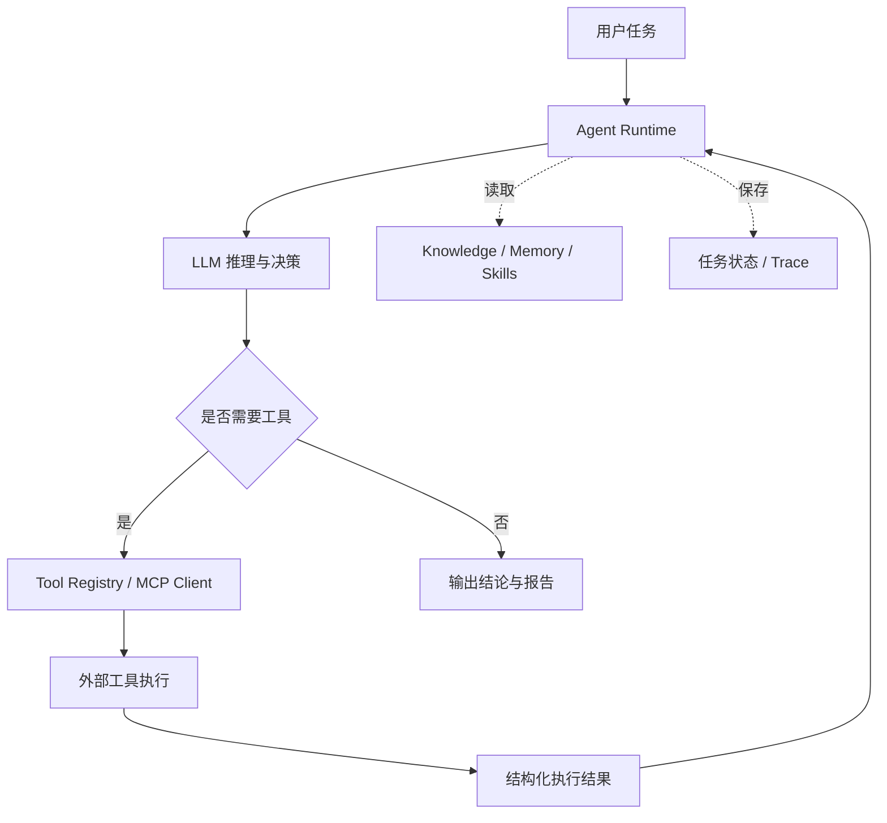
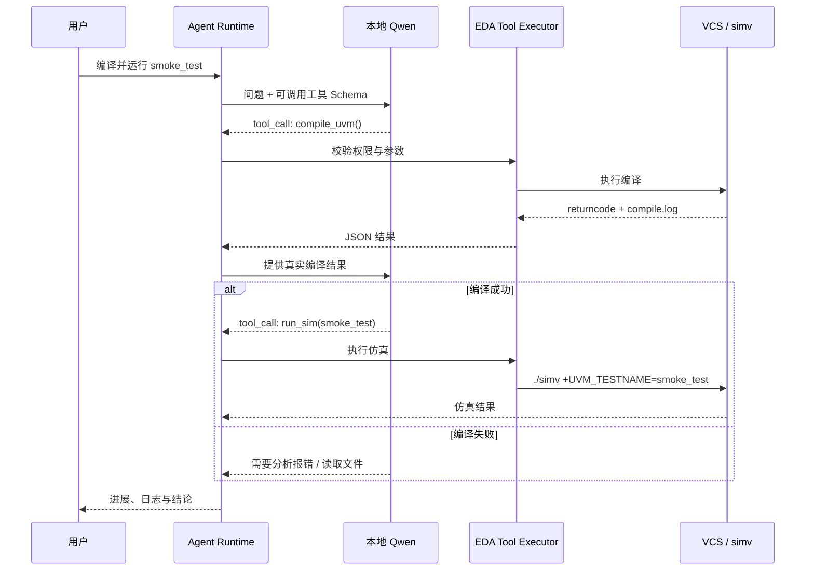
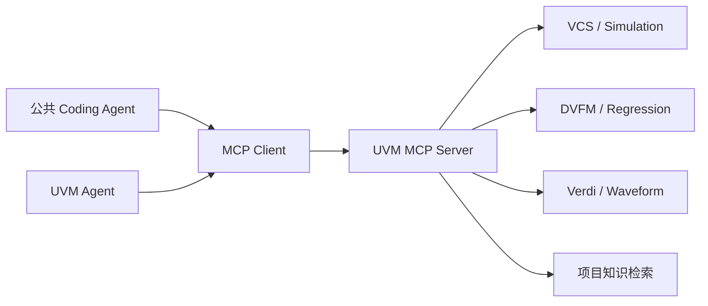
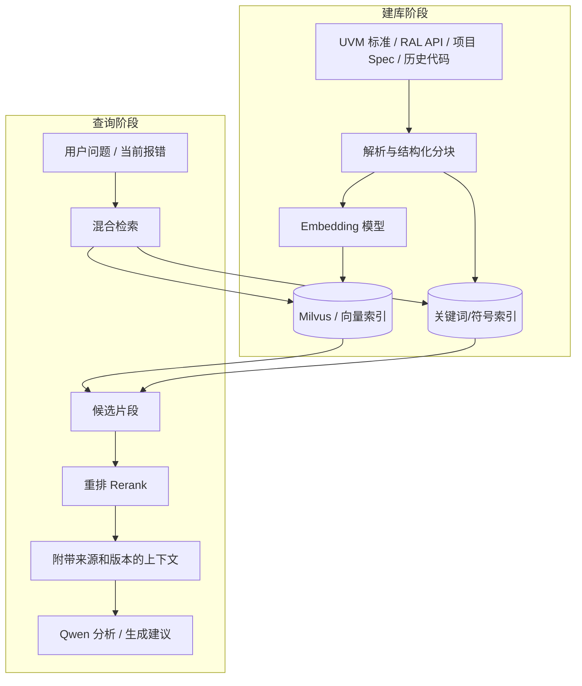
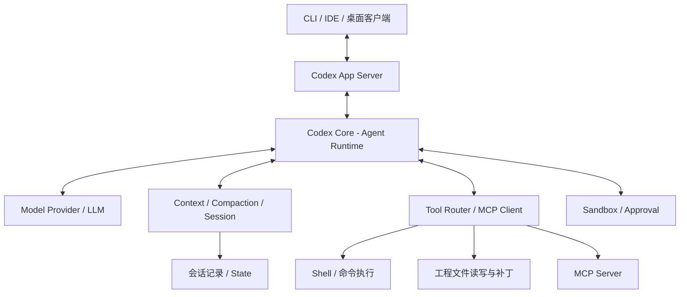
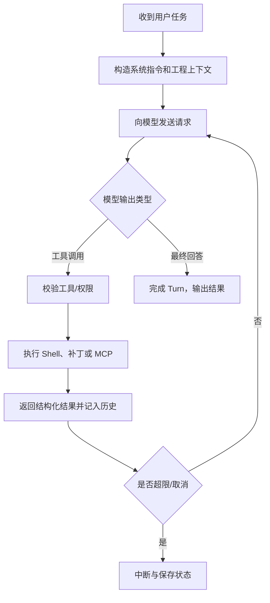
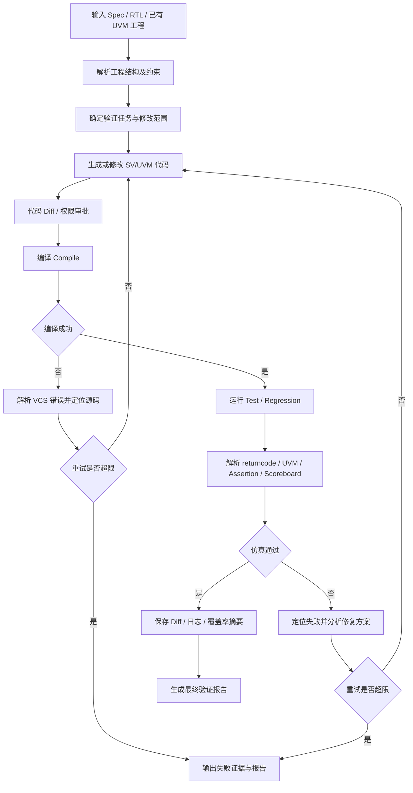
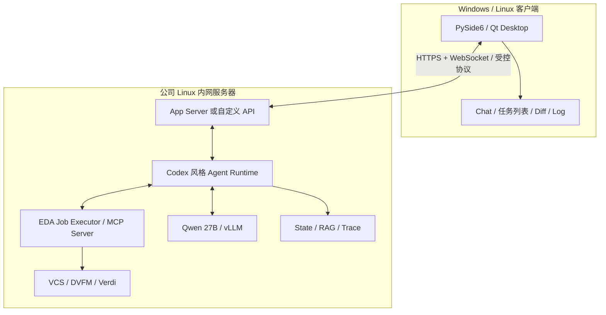

# 面向本地 Qwen 27B 的 UVM 验证 Agent 技术调研

> **汇报主题：** 通用 Agent 技术体系、Codex 开源架构及其面向 IC/UVM 验证的改造方案  
> **研究目标：** 参考 Codex 开源 Coding Agent，接入本地 Qwen 27B，构建能操作真实 EDA 工具的专用 UVM 验证 Agent。  
> **定位：** 架构调研与技术方案；本文涉及的 UVM 扩展模块为拟设计方案，不代表已在 Codex 中实现或已完成实机验证。

## 一、调研结论

通用大语言模型可以解释 SystemVerilog/UVM 概念并生成代码，但**只靠模型对话无法完成工程级验证任务**。要实现“读取工程 → 分析设计 → 生成或修改 UVM 代码 → VCS 编译 → 运行仿真 → 解析结果 → 自动修复”的闭环，需要在 LLM 外部部署一套 Agent Runtime、工具系统、工程上下文与验证结果判定机制。

初步技术路线：

1. **模型层：** 部署本地 Qwen 27B，统一通过推理服务提供模型 API。
2. **通用 Agent 层：** 参考 Codex Core 的工具循环、上下文压缩、会话管理、审批和沙箱机制。
3. **UVM 专用层：** 增加 SV/UVM 结构化上下文、UVM/RAL 知识检索、专用 Skills、EDA Tools、验证工作流。
4. **运行平台：** Agent Runtime 和 EDA 执行端部署在公司 Linux 环境；Windows/Linux 客户端仅承担交互、日志和 Diff 展示。
5. **模型增强策略：** 前期优先采用 **RAG + Skills + Tools + Workflow**，保持 Qwen 权重不变；积累客观评测与高质量样本后，再评估 LoRA/QLoRA 微调。

**核心判断：本项目的关键不在重新训练一个“懂 UVM 的大模型”，而在构建能够理解 UVM 工程、调用 EDA 工具并可靠判定验证结果的 Agent 系统。**

---

## 二、Agent 开发的基本原理与技术分层

### 2.1 LLM 与 Agent 的区别

LLM 的主要职责是生成文本、分析问题和预测下一步动作；Agent 在此基础上增加**工具调用、环境反馈、状态维护和任务调度**。

一个工程 Agent 可以概括为：

\[
\text{Agent} = \text{LLM} + \text{Runtime} + \text{Tools} + \text{Context} + \text{Workflow}
\]

知识库、Memory、Skills、评测等组件根据实际需求接入，不是所有 Agent 都必须使用全部组件。



对应到 UVM 场景，LLM 不应直接控制 Linux 内核或 EDA 程序。模型产生 `compile_uvm` 一类的工具请求，Agent Runtime 校验和分发请求，由 Python/Rust 工具代码调用 VCS，并将返回码、日志和错误摘要送回模型。

### 2.2 关键概念的角色划分

| 概念/框架 | 主要功能 | UVM Agent 对应场景 |
|---|---|---|
| **Qwen 27B** | 自然语言理解、代码生成、错误分析与动作选择 | 分析 VCS 报错、修改 SV/UVM 代码 |
| **Tool Calling** | 模型以结构化形式提出工具调用请求 | 请求运行 `compile_uvm()`、`run_test()` |
| **Tool Framework** | 工具注册、参数校验、权限、执行、日志与超时 | 管理 VCS、Verdi、DVFM 调用 |
| **MCP** | Agent 与外部工具/资源的标准协议 | 将 EDA 能力作为服务暴露给多个 Agent |
| **LangChain** | 模型/工具集成与较高层的 Agent 构建接口 | 快速实现工具型 Agent |
| **LangGraph** | 有状态、可恢复的工作流编排 Runtime | 编译—修复—仿真状态机 |
| **LlamaIndex** | 文档读取、索引、检索和 RAG 数据管线 | 组织 UVM/RAL/项目文档知识 |
| **Milvus** | 向量索引、相似度与混合检索 | 存放知识库向量索引 |
| **Memory** | 保存运行状态、会话历史和确认过的经验 | 记录当前任务、修改次数、历史修复记录 |
| **DeepEval** | 评估 Agent 行为、工具正确性和执行轨迹 | 比较不同 Prompt/模型/工具版本的表现 |
| **Codex** | 成品 Coding Agent 与可参考的开源核心实现 | 参考其 Runtime、Context、Sandbox、App Server |

需要明确三组边界：

- **Tool Calling ≠ MCP：** Tool Calling 是模型输出工具意图的机制；MCP 负责客户端与工具服务端的标准化交互。两者可组合，也可单独使用。
- **RAG ≠ Memory：** RAG 主要检索外部资料；Memory 主要管理 Agent 的任务状态和经验。长期 Memory 可以借用向量数据库，但不应全部依赖向量检索。
- **LlamaIndex ≠ Milvus：** LlamaIndex 组织文档处理与检索流程，Milvus 是可选的向量存储/检索后端。

### 2.3 LangChain 与 LangGraph 的定位

**LangChain** 提供模型、工具、Agent 等开发接口，其 `create_agent` 可以配置模型、系统提示词、工具和中间件；当前 LangChain Agent 构建在 LangGraph Runtime 之上。[1]

**LangGraph** 则偏向底层编排，重点是：

- **State：** 保存工程路径、当前验证阶段、编译状态、重试次数、工具执行记录。
- **Node：** 代表一个处理节点，例如“分析日志”“调用编译工具”“判断状态”。
- **Edge / Conditional Edge：** 根据明确条件进入下一节点。
- **Checkpoint：** 持久化任务状态，用于断线、故障后的恢复。
- **Interrupt / Human-in-the-loop：** 在需要用户审批的位置暂停工作流。

两者并不要求同时引入。若使用 Codex Core 作为通用 Runtime，就不需要再为相同任务额外叠加完整 LangGraph 调度器；可以把 LangGraph 作为**对照实现或专用工作流设计参考**，避免出现两套状态与调度体系。[2]

### 2.4 “模型决策”与“确定性代码”的分工

| 处理内容 | 建议负责方 |
|---|---|
| 识别日志可能对应什么 UVM 问题 | LLM |
| 提出 SV 修改方案 | LLM |
| 判断 `returncode == 0` | 程序 |
| 解析 `UVM_ERROR`、`UVM_FATAL`、timeout | 程序 |
| 限制最多重试次数 | Runtime |
| 检查修改是否越过工程目录 | Sandbox / 工具执行层 |
| 判断功能测试 PASS、回归通过 | 验证结果解析器 |
| 决定是否需更多上下文与调用什么工具 | LLM + Runtime 策略 |

验证场景不能完全依赖 LLM 自行判断是否成功。**LLM 负责不确定性决策，流程、安全与 PASS/FAIL 由可审计程序负责。**

---

## 三、Tool Calling 与 EDA 工具集成

### 3.1 调用过程

Tool Calling 的本质不是“让模型在 Linux 中执行命令”，而是让模型输出工具名及参数，再由受控程序执行。



示意工具请求：

```json
{
  "name": "compile_uvm",
  "arguments": {
    "compile_config": "apb_default"
  }
}
```

### 3.2 Python 封装 VCS（精简示例）

项目中应首先封装明确的业务工具，而非直接给模型无限制的 `shell=True` 执行权限。

```python
from pathlib import Path
import subprocess

WORKSPACE = Path("/eda/workspaces/task_001").resolve()


def compile_uvm() -> dict:
    build = WORKSPACE / "build"
    build.mkdir(parents=True, exist_ok=True)
    cmd = [
        "vcs", "-full64", "-sverilog",
        "-f", "filelist.f", "-top", "tb_top",
        "-l", "build/compile.log", "-o", "build/simv"
    ]
    try:
        result = subprocess.run(
            cmd, cwd=WORKSPACE,
            capture_output=True, text=True,
            timeout=600, check=False
        )
    except subprocess.TimeoutExpired:
        return {"status": "TIMEOUT", "compile_pass": False}

    log_path = build / "compile.log"
    log = log_path.read_text(errors="replace") if log_path.exists() else ""
    return {
        "status": "PASS" if result.returncode == 0 else "FAIL",
        "compile_pass": result.returncode == 0,
        "returncode": result.returncode,
        "log_path": str(log_path),
        "log_tail": log[-6000:]
    }
```

上例是原理示例；正式工程需要增加 `FileNotFoundError` 处理、进程组控制、许可证错误识别、日志结构化与资源限额。运行前还必须由 EDA 初始化脚本配置 VCS 环境、许可证和 UVM 版本。

对于实际部署，更适合在统一框架上调用：

```python
compile_project(config="apb_default")
run_test(test="smoke_test", seed=123)
run_regression(testlist="apb.sl")
query_job(job_id="...")
parse_sim_log(job_id="...")
get_coverage(job_id="...")
```

如果已有 **DVFM**，应优先复用其编译与回归入口，利用 `compile signature → CompileGroup → compile once / sim many` 机制，避免 Agent 为每个 testcase 重复编译。

### 3.3 VCS 与 Verdi 的能力边界

- **VCS：** 适合直接通过 subprocess/任务调度器执行编译和仿真，返回日志、进程状态和输出文件。
- **Verdi：** 可以通过命令行启动 GUI 或加载 FSDB/设计数据库，但“能启动 Verdi”不等于“能自动理解波形”。
- **波形智能分析：** 需要进一步封装 `query_signal()`、`get_transitions()`、`find_assertion_failures()` 等查询能力，或将 FSDB/波形数据转化为结构化事实供模型分析。
- **EDA 长任务：** 应采用 Job ID、状态查询、日志流、超时与取消机制，而不是让 UI 的一次 HTTP 请求阻塞几十分钟。

---

## 四、MCP：专用 EDA 工具的标准化接口

### 4.1 MCP 的作用

MCP（Model Context Protocol）使 Agent 可以通过统一协议访问外部 **Tools、Resources、Prompts**。[3]



**Tool Calling** 负责模型提出调用意图；**Tool Framework** 负责校验、执行及回传；**MCP** 负责不同客户端与工具服务之间的协议互通。MCP 不等同于任务调度系统，也不会自动提供 EDA 许可证排队、资源隔离或异常恢复。

### 4.2 示例：将 VCS 工具封装成 MCP Server

以下写法基于当前 MCP Python SDK v2 的 `MCPServer` 接口（旧教程中常见的 `FastMCP` 属于 v1 用法）。[4]

```python
from mcp.server import MCPServer
from eda_tools import compile_uvm, run_sim

mcp = MCPServer("uvm-eda")

@mcp.tool()
def vcs_compile() -> dict:
    """编译指定工作区中的 UVM 工程。"""
    return compile_uvm()

@mcp.tool()
def simulate(test_name: str) -> dict:
    """运行指定的 UVM testcase。"""
    return run_sim(test_name)

if __name__ == "__main__":
    mcp.run(transport="stdio")
```

MCP 通常可使用 `stdio`（本地子进程）或 Streamable HTTP（跨进程/跨机器服务）通信。对于公司环境，执行端还需负责权限认证、工作区映射和资源调度。

**设计原则：** 给 Agent 暴露 `compile`、`simulate`、`parse_log` 等语义明确的工具；不应将完整高权限 Shell 作为默认 EDA 接口。

---

## 五、RAG、LlamaIndex、Milvus 与 UVM/RAL 知识库

### 5.1 RAG 的基本原理

RAG（Retrieval-Augmented Generation，检索增强生成）在模型推理时从外部文档中检索相关信息，再将检索结果作为上下文送给 LLM，**不修改基础模型参数**。



RAG 的重点不只是部署一个向量库，更重要的是**文档切分、索引字段、检索策略与资料版本控制**。

### 5.2 LlamaIndex 与 Milvus 的分工

- **LlamaIndex：** 负责文档加载、节点切分、索引构建、检索接口、查询管线等。
- **Milvus：** 提供向量存储及相似度/混合检索能力。早期可用 Milvus Lite 或其他轻量索引方案，并非必须部署数据库集群。[5][6]
- **Embedding Model：** 将文本转换为向量，独立于用于生成回答的 Qwen 主模型。
- **Reranker：** 对候选检索结果再次排序，降低相关片段排错序的风险。

### 5.3 UVM/RAL 知识库应包含的内容

| 数据类型 | 典型内容 | 更合适的检索方式 |
|---|---|---|
| 标准文档 | SystemVerilog/UVM 标准、User Guide | 标题检索 + 向量检索 |
| API 文档 | `uvm_config_db`、`uvm_reg_predictor`、`uvm_reg_map` | **精确关键字 + 符号索引** |
| 公司规范 | 命名、目录、phase、RAL 连接规则 | 文档检索 + Skill 固化 |
| 项目 Spec | DUT 接口、时序、寄存器定义 | 版本过滤 + 结构化字段 |
| 工程代码 | driver、monitor、agent、scoreboard、sequence | 文件/类/函数索引 + grep/AST |
| 错误案例 | VCS error、UVM_FATAL、定位过程、修复记录 | 错误码 + 关键词 + 语义检索 |
| RAL 资产 | CSV/XLS/寄存器表、RAL SV、reg block/map | **结构化查询**，不宜只靠向量 |

需要特别强调：**项目 RAL 模型不是天然意义上的“知识库”**。RAL 是寄存器抽象层，包括 `uvm_reg`、`uvm_reg_field`、`uvm_reg_block`、`uvm_reg_map` 等对象。寄存器地址、字段位宽、访问属性等应优先从可信的机器可读数据源精确提取；RAG 更适合辅助理解 RAL API 与操作规范。

建议检索元数据：

```yaml
source: uvm_user_guide
uvm_version: "1.2"
project: apb
kind: api_document
symbol: uvm_config_db
chapter: configuration
source_path: docs/uvm/config_db.md
```

### 5.4 为什么不建议仅用向量检索？

SV/UVM 中大量信息依赖精确标识符：如 `seq_item_port`、`uvm_config_db::get`、宏定义、instance path、filelist 顺序等。纯语义检索可能找到“描述很像但 API 不同”的片段。

因此更合理的是：

> **符号/文件检索 + BM25 + Dense Embedding + Metadata Filter + Rerank**

对关键错误代码和工程符号，精确检索优先；对概念、规范和类似历史问题，再利用语义检索。

---

## 六、Memory、Context 与 Skills 的关系

### 6.1 Context 与 Memory

**Context** 是当前一次模型调用实际看到的消息、代码、工具结果和检索资料；受 Token 预算限制。**Memory** 是外部保存的任务状态、会话历史和可复用经验，不代表每次全部进入 Context。

| 类型 | 存储内容 | 建议存储方式 |
|---|---|---|
| Working State | 当前阶段、轮次、任务/作业 ID、修改列表 | Runtime State / SQLite |
| Conversation History | 用户目标、历史消息、确认事项 | 会话日志 / 状态数据库 |
| Long-term Experience | 已验证有效的历史故障与修复方案 | 结构化数据库 + 可检索索引 |
| Technical Knowledge | 标准、规范、项目资料 | 文件仓库 + RAG 索引 |

建议的状态示例：

```json
{
  "task_id": "uvm_001",
  "workspace": "/eda/workspaces/uvm_001",
  "phase": "compile_debug",
  "compile_attempts": 2,
  "compile_pass": false,
  "sim_pass": null,
  "last_error_type": "XMRE",
  "modified_files": ["tb/apb_driver.sv"],
  "job_id": "vcs_job_009",
  "approval_pending": false
}
```

这些字段必须由 Runtime/工具真实更新，而不是让 LLM 自报状态。

### 6.2 Context 压缩

长时间编译修复会话容易产生大量 VCS 日志、重复代码和工具消息。Codex 使用上下文压缩（Compaction）机制，在上下文压力变大时保留任务概要与必要信息。[7]

UVM 场景应进一步将不同上下文分层：

1. **必须保留：** 当前任务、工程路径、硬性约束、当前状态、下一步动作、成功条件。
2. **按需加载：** 相关类/函数、最近一次错误、相邻代码、Spec/RAL 信息。
3. **外部持久化：** 全量日志、完整修改 Diff、FSDB、coverage、回归结果。
4. **可压缩：** 已完成轮次的重复推理消息、无关 stdout、历史尝试描述。

**任务状态的可靠恢复不能仅依赖 LLM 自动摘要**；准确的 Job ID、进程状态和文件系统改动必须独立保存。

### 6.3 Prompt、Skills 与 RAG

- **System Prompt：** 固定 Agent 身份、整体规则与安全要求。
- **Skill（如 `SKILL.md`）：** 面向某类任务的操作规程；例如 `compile_debug`、`generate_uvm_agent`、`ral_regression`。
- **RAG：** 依据当前问题检索具体知识，如 `uvm_reg_predictor` 连接说明、项目 register map。
- **Tool：** 真正执行读文件、修改代码、编译和仿真等操作。

示例 Skill 结构：

```text
skills/
├── compile_debug/SKILL.md
├── uvm_env_generation/SKILL.md
├── ral_model_integration/SKILL.md
├── sequence_generation/SKILL.md
└── simulation_debug/SKILL.md
```

`compile_debug` Skill 中可规定：优先读取完整错误摘要 → 确认根因 → 修改最小必要范围 → 展示 Diff → 编译复验 → 达到最大轮次后停止并报告。Skill 是流程约束，不等于模型权重训练。

---

## 七、Codex 开源框架调研

### 7.1 Codex 的定位

Codex 是面向代码仓库的 Coding Agent，不仅可以回答编程问题，还可以读取工程、执行命令、修改文件、检验修改结果。其开源 Rust Core 提供核心业务逻辑；App Server 面向 IDE/桌面等富客户端提供会话和流式事件接口。[8][9]

**Codex 与 OpenAI Agents SDK 不同：** Agents SDK 是用于构建 Agent 的通用开发库；Codex 是具备工程文件操作、终端执行、沙箱和客户端协议的一套较完整 Coding Agent 实现。对本项目而言，Codex 更有工程系统参考价值。

### 7.2 组件总览



图为功能分层示意，并非 Codex Rust crate 之间的逐项依赖图。

| Codex 模块/目录（开源仓库） | 主要职责 | 本项目参考重点 |
|---|---|---|
| `codex-rs/core` | Agent 核心业务逻辑、执行控制与会话交互 | Runtime、工具调用、上下文 |
| `codex-rs/app-server` | 向富客户端暴露会话、Turn、工具事件和审批接口 | Qt/IDE 客户端通信 |
| `codex-rs/app-server-protocol` | App Server 的数据与事件协议 | 稳定的前后端通信格式 |
| `codex-rs/linux-sandbox` / sandbox 相关模块 | Linux 命令执行隔离 | EDA 工作目录保护 |
| 模型 Provider 配置/模块 | 选择和连接模型服务 | 本地 Qwen 兼容性 |
| Tool/MCP 相关模块 | 外部工具发现及调用 | UVM EDA 工具接入 |

仓库随版本迭代可能重构 crate；正式开发应固定一个 Codex commit/tag，并针对该版本阅读具体实现。

### 7.3 Runtime：Agent Loop 如何工作



Runtime 负责控制循环和执行边界。对于 UVM，需要在通用循环之上增加明确的验证阶段、失败处理、重试上限和退出条件，防止模型无限重复编译或修改。

### 7.4 App Server：Thread、Turn、Item

Codex App Server 对客户端暴露三个重要概念：[9]

- **Thread：** 一条可持续的 Agent 会话，例如一个 APB 验证工程的调试会话。
- **Turn：** 一次用户输入及 Agent 随后的工作过程。
- **Item：** 一个步骤或输出，例如用户消息、LLM 回复、Shell 命令、文件修改、工具调用。

示例：

```text
Thread: APB 验证工程调试
  ├── Turn 1: 修复 compile error
  │    ├── Item: read_file
  │    ├── Item: vcs_compile
  │    ├── Item: apply_patch
  │    └── Item: vcs_compile PASS
  └── Turn 2: 运行 smoke_test
       ├── Item: run_sim
       ├── Item: parse_sim_log
       └── Item: 返回仿真结论
```

App Server 提供会话创建/恢复、启动 Turn、增量流式事件、中断、审批等能力，底层通信以 JSON-RPC 风格实现。**它适合支撑类似 Codex 的桌面界面，不必让 Qt 直接调用 VCS 或嵌入模型推理逻辑。**

### 7.5 Context Manager：上下文管理与 Compaction

核心问题：工程代码和日志远大于可一次送入模型的上下文窗口。

Codex 的做法包括维护对话历史、按需读取代码/工具输出、在需要时进行 Compaction。代码配置中存在模型上下文窗口与自动压缩阈值等相关字段。[7]

对于 UVM，应完善三个方向：

1. **代码结构意识：** 不只按行读取文件，还要理解 class/module/interface/package 以及继承、连接关系。
2. **日志上下文分级：** 识别 error code、文件行号、关键上下文；完整日志保留在外部。
3. **阶段性 Checkpoint：** 保存“已改哪些文件、已编译几次、是否通过、下一步做什么”，防止压缩后丢失工作进度。

### 7.6 Session、任务中断与恢复

Codex App Server 支持 `turn/interrupt` 等请求；中断后 Turn 的终态可以标记为 `interrupted`，Thread 历史仍可保留并用于后续会话。[9]

UVM 验证比一般代码任务复杂，VCS 编译与大型回归可能运行很久，因此需要在 Codex 思路上补充：

- `task_id` / `job_id` 与服务器进程或调度作业绑定。
- 实时状态区分 `QUEUED / RUNNING / PASS / FAIL / TIMEOUT / CANCELLED`。
- 取消任务时清理进程组/作业，并正确释放临时资源。
- 客户端断线重连后重新拉取真实任务状态。
- 已执行的文件改动与外部动作不会因为中断自动回滚；需要依赖 Git patch/worktree 等机制处理。

**中断、恢复会话、恢复正在运行的 VCS 作业是三件不同的事**。不能将 Codex 的 Turn 恢复直接理解为 EDA 仿真支持从任意时间点继续运行。

### 7.7 Sandbox 与 Approval

Codex 的 Sandbox 约束工具进程对文件系统、网络等资源的访问，Approval 则负责在必要操作前请求人审。[10]

Linux 环境相关实现涉及 bubblewrap（`bwrap`）、seccomp，以及代码中的旧版 Landlock 路径/策略兼容等，具体执行路径取决于 Codex 版本和权限配置。[8][10]

UVM 场景需要更严格的边界：

| 资源 | 建议权限 |
|---|---|
| 参考 RTL / 公司基础库 | 默认只读 |
| 当前任务独立 worktree | 可读写 |
| 公共 Git 分支 | 不允许 Agent 自动推送 |
| EDA License / 并发槽位 | 限额、排队、可审计 |
| 编译产物与 FSDB | 写入隔离的 `build/` 和任务目录 |
| 任意 Shell、删除文件、大范围替换 | 拒绝或要求审批 |
| 公司内部 Spec/RTL | 不向公网模型服务和外部日志平台发送 |

对生产/共享 EDA 服务器，操作系统级隔离和 EDA 作业权限是两层不同约束，不能因为开启 Codex Sandbox 就省略许可证调度与操作审批。

### 7.8 Model Provider：替换为本地 Qwen 的关键风险

Qwen 27B 可以部署在 vLLM 等本地推理服务上，提供 OpenAI-compatible API。Qwen3.5-27B 官方模型卡给出了本地 vLLM 部署与 Tool Calling 配置示例。[11]

但**“OpenAI-compatible”不能等同于“可无修改直接替换 Codex 模型”**：

- 不同框架可能使用 **Chat Completions** 或 **Responses API**。
- Codex 模型接入部分需检查实际使用的接口及流式事件格式。[12]
- 还要单独验证模型是否能稳定输出工具名、JSON 参数、多轮工具调用和最终回答。
- 上下文窗口、模型思考输出、Tool Calling parser 及停止条件可能需要调整。

因此，本项目首个技术验证应当明确一个事实：**当前选定版本的 Codex Core 能否稳定接入本地 Qwen 服务**。如果协议不匹配，可评估服务端适配层，或按 Codex 设计使用 Python 实现轻量 Runtime；不宜直接大范围修改 Rust Core。

---

## 八、面向 UVM 的专用化改造：哪些复用，哪些扩展

### 8.1 模块级改造清单

| 模块 | Codex 已有/可参考能力 | UVM Agent 需要新增或强化 | 优先级 |
|---|---|---|---|
| **Model Adapter** | 模型服务调用 | 本地 Qwen 27B、协议与 Tool Calling 兼容 | P0 |
| **Agent Runtime** | 模型—工具循环 | 编译/仿真/修复阶段机、重试和停机条件 | P0 |
| **Tool Router / MCP** | 命令/文件/MCP | VCS、Verdi、DVFM、日志、coverage 接口 | P0 |
| **Context Manager** | 文件/对话上下文与压缩 | SV/UVM 语法结构、filelist、连接关系、报错切片 | P0 |
| **Skills / Prompt** | 项目指令与操作约束 | UVM env、RAL、scoreboard、sequence、debug 规范 | P0 |
| **Sandbox / Approval** | 文件和进程权限控制 | EDA 服务器、工作区、许可证和 Git 权限 | P0 |
| **Session / Job** | 会话、中断、事件 | 长时 EDA 作业、异步状态、断线恢复 | P1 |
| **RAG / Memory** | 通用上下文扩展思路 | 私有 UVM/RAL/项目知识、修复经验 | P1 |
| **Evaluation** | 通用任务反馈/Trace 可参考 | Compile/Simulation/Regression 客观指标 | P1 |
| **Qt 客户端** | App Server 协议可参考 | 跨平台 UI、Diff、终端日志、Coverage 视图 | P1 |

P0 表示最小可行验证闭环依赖项，P1 表示工程化增强；不涉及个人学习顺序。

### 8.2 UVM 工程解析器（专业 Context）

相较于普通软件工程，UVM 的问题经常横跨多个源文件和运行阶段：

```text
DUT RTL / Interface
        ↓
Transaction / Driver / Monitor
        ↓
Sequencer / Agent / Env
        ↓
Sequence / Test / Scoreboard
        ↓
RAL: Block / Reg / Field / Map / Adapter / Predictor
```

建议建设结构化的 **UVM Project Index**：

- RTL：module、port、parameter、interface、clock/reset。
- SV/UVM：class、extends、factory 注册、sequence、phase、TLM port 连接。
- RAL：block/reg/field/map、地址映射、访问属性、adapter/predictor 关系。
- Build：filelist、宏、include path、package 顺序、testlist、sim_opts/com_opts。
- Debug：compile error、UVM report、assertion、scoreboard mismatch 与源代码定位。

对于 `config_db::get` 失败，Agent 应优先关联 `set/get` 路径和上下文，而不是只在长日志中寻找关键词。

### 8.3 EDA Tool Server

建议按照专业能力分组暴露工具：

```text
UVM EDA Tools
├── Project
│   ├── inspect_project
│   ├── list_compile_units
│   └── query_uvm_symbols
├── Build / Simulation
│   ├── compile_project
│   ├── run_test
│   ├── run_regression
│   └── query_job_status
├── Diagnostics
│   ├── parse_compile_log
│   ├── parse_uvm_log
│   ├── find_assertion_failures
│   └── get_coverage_summary
├── RAL
│   ├── query_register
│   ├── query_address_map
│   └── check_ral_mapping
└── Waveform
    ├── open_verdi
    └── query_wave_window
```

其中 `query_register` 等工具应调用结构化 RAL 数据或工程解析器，不应仅靠 LLM 猜测寄存器地址。

### 8.4 UVM 自动闭环工作流



必须区分不同层级的 PASS：

1. **Compile Pass：** 编译/链接成功，仅代表代码可以构建。
2. **Simulation Pass：** 指定 testcase 完成，且 error/fatal、assertion、scoreboard、timeout 等指标满足要求。
3. **Regression Pass：** 指定 testlist 与种子集合按照约定完成。
4. **Coverage Closure：** 覆盖率目标及豁免有明确证据；不能由单次 `UVM_ERROR=0` 推断。

### 8.5 RAL 专项能力

RAL 是相对适合做标准化工具和 Skill 的验证子领域。

重点功能：

- 从寄存器表构建或读取 RAL 模型及地址映射。
- 检查 `uvm_reg_adapter`、`uvm_reg_predictor`、bus sequencer、`reg2bus/bus2reg` 连接关系。
- 生成/运行常见寄存器测试（reset、读写、access、mirror、位域访问等）。
- 校验寄存器地址、复位值、访问权限和 backdoor/frontdoor 行为。
- 根据失败日志定位 DUT RTL、寄存器表与 RAL Model 三方不一致处。

专业难点在于**项目寄存器定义、总线行为、RAL 模型和 DUT 实现之间的一致性**，因此需要结构化检查器与 EDA 仿真证据，而不能单独依赖知识库问答。

---

## 九、本地 Qwen 专业化：RAG、LoRA 还是重训？

| 技术路线 | 是否修改 Qwen 权重 | 适用目标 | 现阶段定位 |
|---|---|---|---|
| **Prompt / Skills** | 否 | 明确输出规范、任务流程、代码风格、工具使用 | 核心基础 |
| **RAG 私有知识库** | 否 | 接入不断更新的 UVM/RAL、项目 Spec、工程经验 | 优先建设 |
| **Tools + Workflow** | 否 | 获取真实工程状态、执行 VCS/仿真、形成闭环 | **优先级最高的工程能力** |
| **LoRA / QLoRA** | 是，训练少量适配参数 | 优化稳定重复出现的专业行为和格式 | 后期按评测决定 |
| **全参数 SFT** | 是，更新大量参数 | 大规模行为适配，训练成本高 | 暂不作为首选 |
| **从头预训练** | 是，重新训练模型 | 构建基础模型，资源与数据需求很高 | 不符合目前目标 |

**推荐组合：本地 Qwen 27B + Codex 风格 Runtime + RAG + UVM Skills + EDA Tools。**

原因：

- UVM 项目知识更新频繁，寄存器表和 Spec 不适合写死在模型参数里。
- 正确的 VCS 操作和 PASS/FAIL 判定需要真实工具，而不是模型“记住命令”。
- UVM 专业问题很多是工程上下文缺失，不一定是模型权重能力不足。
- LoRA 的收益应通过固定 benchmark 证明；没有准确的训练样本和评价体系，先微调难判断效果。

术语说明：**LoRA** 是低秩适配微调技术；**RAL** 是 UVM Register Abstraction Layer。两者与 RAG 属于不同概念。

---

## 十、部署与客户端形态

### 10.1 前后端分离

服务器承担真实模型和 EDA 工作，客户端只负责交互与展示。



若实际采用原生 Codex App Server，应优先复用其现有协议（默认以本地 stdio/JSON-RPC 形式使用，也有实验性网络传输）。如果自研 Agent 后端，则可通过 FastAPI + WebSocket 提供更符合公司内部需求的 API；二者是**两条实现方案**，不应混为一个现成的 Codex REST API。[9]

### 10.2 前端选择对比

| 前端方案 | 特点 | 项目适用性 |
|---|---|---|
| **PySide6 / Qt** | Python 技术栈，Windows/Linux 原生桌面客户端 | 适合教研室第一版独立客户端 |
| **React Web** | 统一部署，浏览器访问，便于多人使用 | 适合后续公司内网推广 |
| **Tauri + Web 前端** | 桌面封装、UI 灵活，需额外掌握 TS/Rust | 适合长期产品化 |
| **VS Code 扩展** | 自带编辑器、Diff、终端和 Remote SSH | 工程改代码效率高，但依赖 VS Code |

现阶段偏向 **PySide6 客户端 + 独立 Agent Backend**。后端不依赖 Qt，可以再接 Web 或 IDE 插件。

客户端优先展示：对话、工具调用轨迹、实时编译日志、Agent 修改 Diff、审批、任务取消与恢复、回归状态。Verdi GUI 若在 Linux 服务器运行，Windows 使用者需要额外的远程 GUI 方案；不能简单通过 HTTP 自动将 Verdi 原生窗口转移到 Windows。

---

## 十一、Agent Evaluation：如何证明系统有效

### 11.1 DeepEval 与客观 EDA 评测

DeepEval 可以对 Agent 的任务完成情况、工具选择、工具参数和执行轨迹进行评测。[13] 但 UVM 验证有大量客观结果，**不应使用 LLM Judge 替代编译和仿真判定**。

建议建立两层指标：

| 评测层 | 指标 | 判定来源 |
|---|---|---|
| **EDA 客观层** | Compile Success Rate | VCS 退出状态与构建产物 |
| | Simulation Pass Rate | test 完成条件 + UVM report + assertion + scoreboard |
| | Regression Pass Rate | testlist、seed、各子任务结果 |
| | Fix Success Rate | 独立基线任务与重新运行结果 |
| | 修改回归风险 | 修改前后其他测试是否退化 |
| **Agent 行为层** | Tool Correctness | DeepEval / trace 对比 |
| | Argument Correctness | 参数与预期/任务是否匹配 |
| | Step Efficiency | 工具调用与修复轮次 |
| | Task Completion | 是否完成原始任务 |
| | Resource Cost | Token、耗时、许可证占用、GPU/CPU 消耗 |

### 11.2 初步 Benchmark 分类

可设计独立、可重置的 UVM 工程任务集：

- SV 语法、package、include、宏和 filelist 错误。
- `uvm_config_db` 路径或类型问题。
- driver/monitor/sequencer 连接与 TLM 配置错误。
- phase、objection、sequence 启动及死锁问题。
- RAL adapter、predictor、map、mirror 与 reset/access 错误。
- scoreboard mismatch、assertion failure、timeout。
- 编译通过但功能错误的 testcase。

所有任务固定工程初始状态、工具版本、种子和期望结果，记录 Agent 完整工具轨迹，才能比较不同模型、Prompt、Skills 和 RAG 方案的真实收益。

---

## 十二、项目分工与实施边界

### 12.1 公共 Agent 与 UVM 专用 Agent 的职责

| 公共 Agent/平台侧 | UVM 专用 Agent/验证侧 |
|---|---|
| Qwen 推理服务与 Model Adapter | UVM 工程结构与项目上下文 |
| Agent Loop / Runtime | Compile-Sim-Debug 工作流 |
| Session / Checkpoint / Interrupt | EDA 长任务语义和结果判定 |
| Tool Framework / MCP Client | VCS、Verdi、DVFM 工具接口 |
| Sandbox / Approval / 权限体系 | RTL/验证目录写入和运行策略 |
| 通用 Memory / Trace | UVM/RAL 私有知识库与 Skills |
| UI / API / 流式消息 | 日志解析、coverage、RAL 检查器 |
| 通用评测基础设施 | UVM Benchmark 与回归指标 |

### 12.2 设计决策：优先外部扩展，谨慎修改 Codex Core

当前更合理的方式：

1. 固定 Codex 开源版本，优先验证本地 Qwen 的模型 API 与工具调用兼容性。
2. 尽可能通过 **MCP Tools、Skills、项目指令、外部数据检索和验证工作流** 扩展领域能力。
3. UVM 专用模块采用独立 Python 服务或进程封装，与 Codex 核心解耦。
4. 若 Codex Core 与本地模型协议或 EDA 状态管理严重不适配，再考虑添加适配层或局部修改 Rust 模块。
5. 所有新组件必须支持本地部署、可审计、可回滚、不依赖公网才能处理公司内部资料。

### 12.3 优先交付的系统能力

按工程能力划分可形成三个递进目标（**不是个人学习安排**）：

| 层次 | 验证能力 | 可验收结果 |
|---|---|---|
| **基础可用** | 读取工程、运行编译、解析失败、提出/执行受控补丁、复编译 | 自动 Compile-Fix 闭环 |
| **验证闭环** | testcase 仿真、UVM report 与 scoreboard/断言解析、回归 | 自动 Compile-Sim-Debug 闭环 |
| **专业增强** | RAL 测试生成、coverage 分析、历史案例检索、工程规范检查 | 面向不同 UVM 项目的复用能力 |

---

## 十三、当前主要技术风险及对应措施

| 风险 | 可能表现 | 对应措施 |
|---|---|---|
| **Codex 与 Qwen 接口不匹配** | 对话可用，但 Tool Calling/流式事件异常 | 固定版本；单测 Chat/Responses 协议、工具参数及多轮调用 |
| **模型错误修改 SV** | 语法通过但功能退化 | 独立工作区、Diff、审批、回归复验 |
| **上下文过长** | VCS 日志淹没有效上下文，压缩后丢失进度 | 结构化日志、按需代码检索、外部状态持久化 |
| **长任务中断** | 断线后找不到真实 VCS 作业 | Job ID、调度器状态、进程清理、幂等任务接口 |
| **EDA 许可证争抢** | Agent 频繁启动仿真占满许可证 | 资源队列、并发限额、优先复用 DVFM |
| **RAG 误检索** | UVM 版本混淆、引用错误 API | 版本元数据、符号检索、混合检索、引用来源 |
| **内部数据泄露** | Spec/RTL 出现在公网 API 或外部 Trace | 完全本地化、权限隔离、日志脱敏、最小网络授权 |
| **评测不客观** | 只统计回答质量，不统计真正验证结果 | 建立可重现 EDA Benchmark 与独立 PASS 判定 |

---

## 十四、汇报总结

1. **通用 Agent 的技术核心是 Runtime，而不只是 LLM。** LangChain 提供 Agent 开发抽象；LangGraph 强调状态化编排；Codex 提供较完整的 Coding Agent 工程实现，包括工具执行、上下文管理、会话、中断、审批和沙箱。
2. **Codex 适合作为架构基础，但其默认能力并不等于 UVM 专用验证能力。** 项目需要重点补充 UVM 工程解析、RAL 结构化处理、EDA Tool Server、验证状态机与客观结果评估。
3. **MCP 是工具连接协议，RAG 是知识获取机制，Skills 是任务规程，Memory 是状态/经验管理。** 四者分工明确，可以按需组合，并不要求强绑定某个 Agent Framework。
4. **本地 Qwen 27B 的主要任务是专业推理与代码决策。** 对经常变更的 Spec、寄存器表、历史案例，优先使用外部知识和工具；微调属于拥有足够数据与评测结果后的可选优化。
5. **系统建议采用 Linux 服务器后端 + 跨平台客户端。** 后端统一处理 Qwen、Agent Runtime、EDA 工具和知识库；Qt 前端只处理交互、Diff、日志与任务展示。
6. **项目验收必须落到真实 EDA 流程。** 最有代表性的核心指标是自动编译修复成功率、Simulation/Regression Pass、修改回归风险、执行轮次以及资源消耗，而不是单纯的问答正确率。

> **最终方向：构建以 Codex 风格 Agent Runtime 为基础、以 UVM/RAL 工程知识和 EDA 工具为核心扩展、能够在公司 Linux 验证环境中闭环运行的专用 IC 验证 Agent。**

---

## 参考资料与源码入口

以下资料主要用于核对框架定位、Codex 的公开实现与 API。实际研发应固定依赖版本，并以所使用 commit/tag 的源码为准。

1. [LangChain Overview：Agent、`create_agent` 与 LangGraph 关系](https://docs.langchain.com/oss/python/langchain/overview)
2. [LangGraph Overview：Stateful Runtime、持久化与 Human-in-the-loop](https://docs.langchain.com/oss/python/langgraph/overview)
3. [Model Context Protocol：官方规范与基本概念](https://modelcontextprotocol.io/docs/getting-started/intro)
4. [MCP Python SDK v2：`MCPServer` 与 Client](https://github.com/modelcontextprotocol/python-sdk)
5. [LlamaIndex 官方文档](https://developers.llamaindex.ai/python/framework/)
6. [Milvus 官方文档](https://milvus.io/docs)
7. [Codex Context 配置：上下文窗口与 Compaction 参数](https://github.com/openai/codex/blob/main/codex-rs/core/src/config/mod.rs)
8. [Codex 开源仓库及 `codex-rs/core`](https://github.com/openai/codex) · [Core README](https://github.com/openai/codex/blob/main/codex-rs/core/README.md)
9. [Codex App Server：Thread / Turn / Item、恢复、中断与事件](https://developers.openai.com/codex/app-server)
10. [Codex Sandbox 与 Approval 官方文档](https://developers.openai.com/codex/sandbox)
11. [Qwen3.5-27B 官方模型卡及推理服务示例](https://huggingface.co/Qwen/Qwen3.5-27B)
12. [Codex 官方模型/配置说明](https://developers.openai.com/codex/config-basic)
13. [DeepEval：Agent Evaluation 与 Tool Correctness](https://deepeval.com/docs/getting-started-agents) · [Tool Correctness](https://deepeval.com/docs/metrics-tool-correctness)
14. [OpenAI Agents SDK](https://github.com/openai/openai-agents-python)
15. [Qwen-Agent 开源项目](https://github.com/QwenLM/Qwen-Agent)
16. [OpenHands 开源 Coding Agent](https://github.com/OpenHands/OpenHands)
17. [Qt for Python / PySide6](https://doc.qt.io/qtforpython-6/)

> **备注：** 本文所有架构图均为 Mermaid，Obsidian 原生 Markdown 视图可渲染；普通 Markdown 查看器不支持 Mermaid 时仍可查看相应代码块。

开源的波形检查工具

![[3fc0cf2289e75eacce1bf4735a17c6bd.png]]

已经写好需求文档，接下来接口开发，工具调用。
使用开源的迭代训练优化agent，使用自有的dma设计以及验证环境进行测试。
![[Pasted image 20261019142504.png]]
