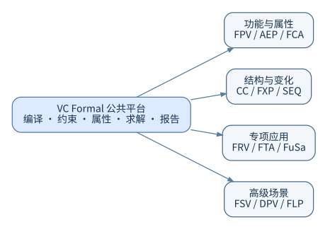

# VC Formal 中文形式验证手册｜总目录与阅读指南

> **VC Formal 形式验证原理、工程流程与专用应用中文教程**  
> **文档基线：** Synopsys VC Formal X-2025.06-SP1  
> **本手册修订：** 2026-10-17 · 1.2 分点说明与代码块版  
> **内容形式：** 分册 Markdown + PDF + 离线 HTML；分点说明与代码块，不使用表格；正文直接列出完整示例代码

## 版权及使用说明

本手册根据使用者提供的 **VC Formal User Guide**（X-2025.06-SP1，2025 年 9 月，1,168 页）及 **VC Formal Quick Reference Guide**（同版本，34 页）独立编写，供中文工程教学与实施参考，不是 Synopsys 官方译本，也不代替其产品文档、许可证约定及支持意见。保留英文命令、选项、报错与 SystemVerilog 关键字，以便与工具帮助直接比对。示意图由本手册重新绘制；参考 PDF 本身未随交付物复制。

**重要：当前制作环境未安装并授权运行 VC Formal。** 示例已按所提供的手册比对写法，并进行静态资源、路径及格式检查；**没有实际的形式证明结果，也不宣称所有示例已经通过工具编译。** 随文出现的 `Proven`、`Falsified`、`Inconclusive` 等词用于解释可能出现的结果，不代表这里生成了对应报告。

## 1. 手册结构与学习顺序

- **顺序：** 第 1 册

  **文档：** [形式验证.md](形式验证.md)

  **主要内容：** 形式验证起源、状态空间、可达性、归纳证明、抽象、反例、覆盖

  **适合读者：** 所有人

- **顺序：** 第 2 册

  **文档：** [VC_Formal_平台与环境.md](VC_Formal_平台与环境.md)

  **主要内容：** 产品应用、Tcl 模式、编译、许可证、时钟复位、求解运行

  **适合读者：** 入门与工具使用者

- **顺序：** 第 3 册

  **文档：** [验证工程与结果判读.md](验证工程与结果判读.md)

  **主要内容：** 项目目录、规格拆解、假设审计、分层证明、属性状态解读

  **适合读者：** 验证负责人

- **顺序：** 第 4 册

  **文档：** [SVA语法合集.md](SVA语法合集.md)

  **主要内容：** IEEE 1800 断言基础、时序运算符、采样函数、典型硬件规则

  **适合读者：** RTL 与验证工程师

- **顺序：** 第 5 册

  **文档：** [FPV.md](FPV.md)

  **主要内容：** 功能属性验证、断言编写、环境约束、反例分析

  **适合读者：** FPV 使用者

- **顺序：** 第 6 册

  **文档：** [AEP.md](AEP.md)

  **主要内容：** 自动提取数组、算术、FSM 等检查及其限制

  **适合读者：** RTL 开发与质量检查

- **顺序：** 第 7 册

  **文档：** [FXP.md](FXP.md)

  **主要内容：** X 来源、传播、初始化、观察点与失效分析

  **适合读者：** RTL/SoC 集成

- **顺序：** 第 8 册

  **文档：** [CC.md](CC.md)

  **主要内容：** 连通性检查、端点、条件选择、CSV 接口

  **适合读者：** SoC 集成

- **顺序：** 第 9 册

  **文档：** [FCA.md](FCA.md)

  **主要内容：** 可达性、形式覆盖分析、仿真覆盖补充

  **适合读者：** 覆盖率负责人

- **顺序：** 第 10 册

  **文档：** [SEQ.md](SEQ.md)

  **主要内容：** 顺序等价、规格实现两侧、状态关系与复位

  **适合读者：** RTL 优化与 ECO

- **顺序：** 第 11 册

  **文档：** [FRV.md](FRV.md)

  **主要内容：** 寄存器行为、总线协议、RALF/IP-XACT

  **适合读者：** CSR 设计人员

- **顺序：** 第 12 册

  **文档：** [FTA.md](FTA.md)

  **主要内容：** 故障注入、检测能力、测试环境约束

  **适合读者：** 故障分析人员

- **顺序：** 第 13 册

  **文档：** [FuSa.md](FuSa.md)

  **主要内容：** 功能安全、故障诊断、可测性与评价结果

  **适合读者：** 安全芯片设计

- **顺序：** 第 14 册

  **文档：** [FSV.md](FSV.md)

  **主要内容：** 硬件信息流安全、机密信息与观察点

  **适合读者：** 安全验证

- **顺序：** 第 15 册

  **文档：** [DPV.md](DPV.md)

  **主要内容：** 数据路径计算与 C/C++/RTL 对照

  **适合读者：** 数字信号处理、算法 RTL

- **顺序：** 第 16 册

  **文档：** [FLP_LPC.md](FLP_LPC.md)

  **主要内容：** UPF、电源域、低功耗连通性与条件

  **适合读者：** 低功耗设计

- **顺序：** 第 17 册

  **文档：** [调试与证明性能.md](调试与证明性能.md)

  **主要内容：** 反例调试、假设检查、状态爆炸、任务拆分与资源使用

  **适合读者：** 所有人

- **顺序：** 第 18 册

  **文档：** [覆盖与验证验收.md](覆盖与验证验收.md)

  **主要内容：** 覆盖计划、可达性检查、结果分类、回归验收

  **适合读者：** 技术负责人

- **顺序：** 第 19 册

  **文档：** [术语表与资料索引.md](术语表与资料索引.md)

  **主要内容：** 中英术语、资料出处、命令索引与阅读指引

  **适合读者：** 所有人

- **顺序：** 附册

  **文档：** [VC_Formal_Quick_Reference_Guide_中文整理版.md](VC_Formal_Quick_Reference_Guide_中文整理版.md)

  **主要内容：** 按命令查找、变量与版本勘误

  **适合读者：** 已有经验者

### 路线 A：第一次使用形式验证

推荐按第 1→2→3→4→5→17→18 册学习。先理解“属性成立”的条件，再建立单时钟单复位的练习环境。不要从运行一条 `check_fv` 命令直接跳到完整 SoC。

### 路线 B：已有 UVM / 仿真经验的 RTL 工程师

先阅读第 4 册中采样事件、`|->`、`|=>`、`$past`、`disable iff` 等章节，再做 FPV 和 FXP。将现有仿真检查转换为形式属性时，首先明确行为必须被保证还是由环境保证。

### 路线 C：SoC 集成、低功耗与寄存器

先阅读第 2～3 册，再选择 CC、FRV 和 FLP 专题，并在第 17 册学习如何排除错误的输入约束、黑盒或复位设置。

### 路线 D：形式验证项目负责人

重点阅读第 1、3、17、18 册，建立可追溯的规格条目、属性表、约束审查记录、回归基线及验收报告。

## 2. 如何直接阅读和复制代码

**本版不使用表格。** 每个工具、命令、语法和参数都按条目说明，代码与文字分开；含竖线的 SVA 运算符直接按源码书写，不附加表格转义字符。代码块中的语法片段用于解释单个规则；以“保存为”标明的完整源码则可以按给定路径保存。

**源码在教程文章内，不再只给文件路径。** 16 篇工具及工程章节包含 81 处完整源码框，覆盖 58 份互不重复的源码与配置文件：22 个 SystemVerilog 文件、21 个 Tcl 文件、12 个编译列表、1 个 CSV 和 2 个 C++ 文件。多个章节复用同一案例时，为保证单独阅读而重复列出必要代码。

每段完整代码先标明“保存为”，接着给出源码正文；文件列表、绑定文件、运行脚本以及执行命令也在本章。复制代码框内容时不包含显示行号，不需要打开额外附件。独立工程文件仍保留，只是方便使用编辑器修改的副本。

阅读 [合订本.md](合订本.md) 可搜索全部文字与源码；[PDF 合订本](VC_Formal_中文手册_合订本.pdf) 适合连续阅读和打印；[离线 HTML](VC_Formal_中文手册_离线阅读版.html) 内嵌插图与样式，可在浏览器直接打开，不需要网络或外部图片目录。

完整小型工程与专用流程模板分别标注。FRV、FuSa、DPV、FLP 等仍需要实际寄存器规格、故障数据、HECTOR 包装或 UPF 的流程，不会因为模板全文列出就被称为即用工程。专章新增的简化 RTL/SVA 练习也明确标为配套 FPV 示例，不冒充原生专用应用的验证结果。

15 幅插图继续提供 SVG、PNG 和可编辑 DOT。`附录_修订前笔记/` 保留原笔记的历史技术内容，也同步改为分点说明与代码块；仅供历史对照，不属于本修订版的活动教程。

## 3. 阅读本手册需要避免的四种误解

**误解一：“Proven 就是整个设计已经正确。”** 不对。只说明给定属性在给定模型与假设下被证明，无法替代遗漏的功能规格。

**误解二：“无反例就证明成功。”** 不对。超时、未知、取消、资源耗尽等结果都不能当成证明通过。

**误解三：“自动提取断言覆盖全部功能。”** 不对。AEP 擅长设计规则类问题，系统级功能意图仍需人工定义规格与属性。

**误解四：“同一份命令在所有 X-2025.06-SP1 资料中一致。”** 不完全成立。两份参考资料存在少数名称或参数不一致的情况，下文专门列出。

## 4. 版本勘误与高风险参数

- **位置：** FCA 应用

  **发现：** Quick Reference Guide 的实例写 `set_fml_appmode FCA`，而 User Guide 第 65、395、430 页的示例写 `set_fml_appmode COV`

  **本手册处理：** 中文专章优先给出 **`COV`**；同时要求查看本地帮助与 `get_fml_appmode`

- **位置：** FTA 启动

  **发现：** User Guide 第 65 页提示不能用 `vcf -fmode FTA` 直接启动

  **本手册处理：** 在会话里用 `set_fml_appmode FTA`

- **位置：** FRV 的 RALF 使用

  **发现：** User Guide 第 630 页建议在 `frv_load -ral` 中给出 `-top`，快速指南示例未列出；该版 UG 对 `-parameter(s)` 也存在写法差异

  **本手册处理：** 使用与地址块对应的 `-top`；通过本地 `frv_load -help` 确认参数拼写

- **位置：** DPV 新流程开关

  **发现：** Quick Reference Guide 与 User Guide 在 Hector 新流程变量的写法上不一致

  **本手册处理：** 同时陈列两种资料中的原写法，要求以安装版本为准

- **位置：** FLP CC

  **发现：** User Guide 第 1041 页明确表示不支持 delayed connectivity checks

  **本手册处理：** 不把普通 CC 延迟连接规则直接复制到 FLP 模式

## 5. 推荐的正式工程检查点

开始运行之前：记录工具版本、license、源代码提交、顶层、约束、属性列表和初始化状态；运行期间：记录求解时间、资源预算、属性状态；运行结束后：逐条复核反例、超时、不可达覆盖以及可疑的“全过”结果。审核者需要能够在同版本下重新执行并追溯每条结论的前提。

**首选入口：** [形式验证原理](形式验证.md) → [平台与环境](VC_Formal_平台与环境.md) → [SVA 完整教程](SVA语法合集.md) → [FPV 实战](FPV.md)；以上工具章节均内嵌完整案例源码。
