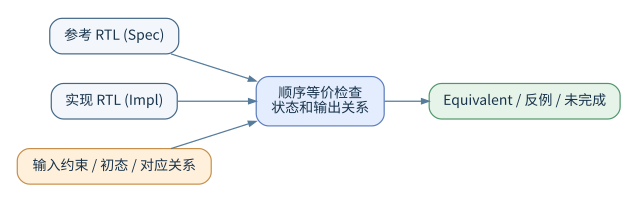

# SEQ：顺序等价检查完整指南

> **源码内嵌版。** 本章的完整案例以“保存为”标明文件路径，并在下方直接列出全文。代码框不带显示行号，可直接复制；`案例工程/` 只表示目录结构，不要求另找源码附件。包含占位符或保护性 `error` 的专用流程另行明确标为模板。

> **第 10 册 · 专用应用**　Sequential Equivalence Checking。依据 User Guide 第 14 章（第 517～611 页），Quick Reference Guide SEQ 部分。

## 1. 为什么不能只比较组合逻辑

RTL 优化常常改变状态寄存器数量、编码、流水线或时钟门控。如果参考版本和实现版本内部结构不同，但对外部可观察输入输出仍符合约定，则二者可能功能等价。SEQ 比较两个顺序系统：参考模型（Specification）和实现模型（Implementation），通过寻找状态对应关系、输入关系和输出关系来检查其等价性。

SEQ 可用于 RTL 重构、状态机重编码、寄存器重定时、时钟门控优化以及某些微架构变化。需要明确：**等价的定义离不开观测点、初始状态、输入条件与时间对应关系**。如果实现比参考多一拍输出延迟，未经处理的逐周期相等检查可能失败，而根据允许的事务延迟重写比较规则后则可能成立。



## 2. 初学者例子：两种计数器写法

两边都是四位模 16 计数器；不是 FPV 章的模 10 计数器。接口相同，代码组织不同。

### 2.1 参考实现完整源码

使能时加一，不使能时通过未赋值保持状态。

**保存为 `案例工程/rtl/counter_spec.sv`：**

<!-- source-begin: 案例工程/rtl/counter_spec.sv -->

```systemverilog
module counter_spec(input logic clk, rst_n, en, output logic [3:0] q);
  always_ff @(posedge clk or negedge rst_n)
    if (!rst_n) q <= 4'd0;
    else if (en) q <= q + 4'd1;
endmodule
```

<!-- source-end -->

### 2.2 待比较实现完整源码

将使能扩展为四位加数；为零时相当于保持，为一时相当于递增。

**保存为 `案例工程/rtl/counter_impl.sv`：**

<!-- source-begin: 案例工程/rtl/counter_impl.sv -->

```systemverilog
module counter_impl(input logic clk, rst_n, en, output logic [3:0] q);
  always_ff @(posedge clk or negedge rst_n)
    if (!rst_n) q <= 4'd0;
    else        q <= q + {3'b000,en};
endmodule
```

<!-- source-end -->

### 2.3 故意不等价版本

同样使用 `counter_impl` 作为模块名，但使能时加二。正确版与错误版只能选一个加入本次比较。

**保存为 `案例工程/rtl/counter_impl_bad.sv`：**

<!-- source-begin: 案例工程/rtl/counter_impl_bad.sv -->

```systemverilog
// 故意错误版本：模块名仍为 counter_impl；不要与正确版本同时编译。
module counter_impl(input logic clk, rst_n, en, output logic [3:0] q);
  always_ff @(posedge clk or negedge rst_n)
    if (!rst_n) q <= 4'd0;
    else        q <= q + (en ? 4'd2 : 4'd0);
endmodule
```

<!-- source-end -->

在合法初始化和对应关系下，前两种写法预期等价，第三种则可在使能后产生差异。预期结果不代替实际的工具证明。

## 3. 编译两个独立设计库并运行

### 3.1 正确实现的完整 SEQ 脚本

参考设计放入 `spec` 库，待比较设计放入 `impl` 库。此脚本直接列出 RTL 路径，没有额外未展示的文件列表。`map_by_name` 后必须查看对应结果，不能认为名字相同就完成了初始化审查。

**保存为 `案例工程/scripts/seq_counter.tcl`：**

<!-- source-begin: 案例工程/scripts/seq_counter.tcl -->

```tcl
set_fml_appmode SEQ
analyze -format sverilog -library spec -vcs {./rtl/counter_spec.sv}
analyze -format sverilog -library impl -vcs {./rtl/counter_impl.sv}
elaborate_seq -spectop counter_spec -impltop counter_impl
create_clock clk -period 100
create_reset rst_n -sense low
map_by_name
report_seq_mappings
check_fv_setup
check_fv -block
report_fv -list
```

<!-- source-end -->

### 3.2 错误实现的完整 SEQ 脚本

只替换待比较侧的源文件，参考侧和环境条件不变。

**保存为 `案例工程/scripts/seq_counter_bad.tcl`：**

<!-- source-begin: 案例工程/scripts/seq_counter_bad.tcl -->

```tcl
set_fml_appmode SEQ
analyze -format sverilog -library spec -vcs {./rtl/counter_spec.sv}
analyze -format sverilog -library impl -vcs {./rtl/counter_impl_bad.sv}
elaborate_seq -spectop counter_spec -impltop counter_impl
create_clock clk -period 100
create_reset rst_n -sense low
map_by_name
report_seq_mappings
check_fv_setup
check_fv -block
report_fv -list
```

<!-- source-end -->

**运行命令（Bash）：**

```bash
# 从包含“案例工程”目录的上一级目录开始。
cd 案例工程
mkdir -p logs
set -o pipefail
vcf -f scripts/seq_counter.tcl -batch 2>&1 | tee logs/seq_counter.log
vcf -f scripts/seq_counter_bad.tcl -batch 2>&1 | tee logs/seq_counter_bad.log
```

这些命令应在本机具备相应 VC Formal 版本和许可证时执行。日志中的属性状态才是证明结论；命令退出、脚本结束或没有打印错误都不能代替属性结果检查。

这里保留原有教学脚本的初始化框架；实际项目应检查两个设计的复位状态和初始状态关系，不能把 `create_reset` 或名称对应当作“任意初态自动一致”。如需额外复位激励，应按 SEQ 的本地运行流程补充并记录。

## 4. 对应关系是什么

匹配可基于相同名称的输入、输出和部分状态，常用 `map_by_name`，其结果可通过 `report_seq_mappings` 审查；更复杂时可用 `seqmap`、`sequnmap` 或读入人工编写的匹配文件。不能仅因为“映射出来很多对象”就认为匹配一定正确；应特别检查复位极性、寄存器位宽、符号扩展、被优化掉的状态和不同流水线阶段的关系。

### 4.1 未初始化位的影响

若参考版和实现版的寄存器初态均任意，两者不一定要求从任意**独立**初态开始都立刻一致：合理的等价证明需要定义可接受的初始状态关系。将所有未初始化位置零的 `seq_config -map_uninit -map_x zero` 是该版本示例中的一种选择，但只在硬件上电模型允许时使用，否则可能忽略真实启动差异。

## 5. 顺序优化类型与对应关系

| 改动 | 主要挑战 | 需要关注的比较条件 |
|---|---|---|
| 组合表达式重写 | 表达式结构变化 | 相同输入下输出是否同拍一致 |
| 状态机重新编码 | 状态变量命名与编码变化 | 状态关系、输出一致性 |
| 加入时钟门控 | 等效使能与采样行为 | 门控使能关闭时是否保持 |
| 寄存器重定时 | 状态位置与延迟变化 | 正确建立跨状态对应 |
| 流水线深度改变 | 输入到输出周期可能变化 | 确认规格是否允许变化 |
| 微架构重构 | 内部状态数量可能不同 | 匹配可观察事务行为 |

## 6. 主流程命令说明

| 命令 | 作用 |
|---|---|
| `set_fml_appmode SEQ` | 切换顺序等价检查 |
| `analyze -library spec/impl` | 分别编译两个版本 |
| `elaborate_seq` | 创建双设计比较环境 |
| `seq_config` | 指定检查策略和特殊匹配行为 |
| `map_by_name` | 基于名称建立候选对应 |
| `seqmap` / `sequnmap` | 人工调整比较关系 |
| `seq_read_mapping_file` | 导入外部匹配文件 |
| `report_seq_mappings` | 查看已采用的对应关系 |
| `check_fv` | 执行等价检查 |
| `report_proofs` | 汇总证明对象 |
| `set_debug` / `seq_debug_report` | 对失败证据开展专门分析 |
| `resume_seq` | 恢复可继续的等价证明过程 |

## 7. 如何解释不等价结果

首先判断是否为真实对外行为差异，然后才检查内部状态。推荐按如下顺序：确定失败的输出或检查点；核对两设计的输入在同一采样时刻是否一致；检查复位起始状态；检查 X 与未初始化值策略；检查流水线延迟或时钟门控；最后追踪内部状态分歧最早发生的位置。

**三种不同结论不能混同：**一是明确找到了两者输出行为不一致的反例；二是当前资源下无法证明；三是当前对应关系或抽象造成局部失败。若初始状态和外部协议前提建错，需要修复比较环境而不是简单修改 RTL。

## 8. 高级优化策略

对于寄存器重定时、多时钟门控和大型算术逻辑，可考虑 `seq_config -recipe orch_generic_medium`、`set_fml_var fml_effort high`、`set_seq_abstractions ...` 和分组证明。抽象可能缩小计算量，也可能引入新反例，需要再验证其可实现性。

对复杂关系建议分步骤：证明复位和普通模式的基础等价，确认输入输出映射，再处理新增加的内部状态及特殊操作模式。不要将所有复杂证明一次交给自动命名对应而忽略潜在误配。

## 9. 教学练习

1. 证明 `en ? q+1 : q` 与 `q+en` 在指定位宽下是否一致；注意表达式位宽。
2. 修改实现版，使输出晚 1 拍，观察直接逐拍比较为什么失败。
3. 在实现版增加一个无功能影响的寄存器，分析映射报告和求解结果。
4. 把初始状态改为未定义，比较是否仍成立，并说明真正的硬件上电规格。

## 10. 参考

User Guide §14（517～611 页），尤其设计编译、映射与调试部分；§18 的复杂性分析；Quick Reference Guide SEQ 章节。对比较多周期事务而非逐拍行为的需求，也可对照 [DPV.md](DPV.md)。
