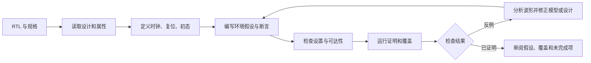

---

> 历史笔记：仅将版式改为分点说明与代码块，不代表本次重新审核了技术内容。当前教程请使用上一级目录中的对应分册。
title: 形式验证与 VC Formal 学习指南
type: tutorial
tags:
  - 形式验证
  - VC-Formal
updated: 2026-10-17
related:
  - "[[FPV]]"
  - "[[SVA语法合集]]"
  - "[[VC_Formal_Quick_Reference_Guide_中文整理版]]"
---

# 形式验证与 VC Formal 学习指南

本文面向熟悉数字逻辑、RTL（寄存器传输级）和基本仿真的读者。学习完成后，读者应能说明形式验证与仿真的区别，建立 VC Formal 的最小 FPV（Formal Property Verification，形式属性验证）任务，读懂证明状态与反例，并为后续专用应用选择合适入口。命令和应用名称以随附的 Synopsys《VC Formal User Guide》X-2025.06-SP1 为参考；实际可用命令、应用和能力还受安装版本、许可证及项目配置影响。

## 1. 形式验证解决什么问题

形式验证把设计和设计必须满足的性质转换为数学模型，再检查性质对模型允许的所有输入与状态是否成立。对有限状态硬件来说，工具会分析从初始状态出发、满足环境约束的所有可达行为，而不是只跑一组人工挑选的输入向量。

仿真回答“给定这组输入，设计会怎样运行”；形式检查回答“在当前模型和假设允许的所有行为中，是否存在违反性质的执行”。形式方法可以找到很少出现的状态序列，也可以证明性质在所建模范围内成立。结论始终受 RTL、初始状态、时钟复位设置、环境约束和属性本身限制。

### 1.1 形式检查的数学对象

一个典型任务包含以下部分：

- **对象：** 状态转移模型

  **在验证中的含义：** RTL 在时钟事件下如何更新寄存器和输出

  **设计者需要提供或确认的内容：** RTL、参数、宏定义、黑盒模型

- **对象：** 初始状态

  **在验证中的含义：** 检查从哪些状态开始

  **设计者需要提供或确认的内容：** 复位行为、初始化流程、允许未知的寄存器

- **对象：** 环境约束

  **在验证中的含义：** 外部输入必须遵守的协议规则

  **设计者需要提供或确认的内容：** 合法请求、互斥关系、复位时序等假设

- **对象：** 断言

  **在验证中的含义：** 设计必须满足的行为要求

  **设计者需要提供或确认的内容：** SVA 属性及其时钟、失效条件

- **对象：** 覆盖目标

  **在验证中的含义：** 需要证明可达或曾发生的场景

  **设计者需要提供或确认的内容：** `cover property`、覆盖数据库或应用目标

错误的环境假设会删除合法行为，导致缺陷被隐藏；不完整的断言则会留下未检查行为。因此，工具的证明能力不能替代规格审阅。

### 1.2 与仿真的关系

- **项目：** 输入探索

  **仿真：** 由测试、随机种子和激励决定

  **形式验证：** 在约束允许范围内由求解器探索

- **项目：** 结果

  **仿真：** 某次运行的波形、日志和覆盖数据

  **形式验证：** 性质状态、反例或可达见证

- **项目：** 优势

  **仿真：** 可运行复杂系统级环境，易观察长流程

  **形式验证：** 能系统搜索未枚举的输入组合和状态序列

- **项目：** 限制

  **仿真：** 未跑到的行为不会自动得到结论

  **形式验证：** 复杂度受状态量、属性、约束及抽象方法影响

两种方法互补。形式验证适合明确的协议规则、控制逻辑、寄存器行为和安全条件；仿真适合系统集成、软件参与和时序细节复现。形式覆盖分析还可帮助判断仿真覆盖项是否不可达，但不可达结论必须结合设计意图复核。

## 2. 结果如何解释

不同应用的报告字段略有差别，查看结果时先确认目标对象、检查类型、约束集和运行状态。FPV 中常见的状态含义如下：

- **状态：** Proven

  **含义：** 工具在当前模型与假设下证明了属性

  **下一步：** 审查假设、初始状态和属性是否符合规格

- **状态：** Counterexample / Failed

  **含义：** 找到违反属性的执行

  **下一步：** 查看波形，判断 RTL 缺陷、假设缺失或属性错误

- **状态：** Inconclusive / Unknown

  **含义：** 在当前资源或方法下未得到证明或反例

  **下一步：** 检查复杂度、资源、属性结构和证明进度

- **状态：** Vacuous

  **含义：** 属性前件从未触发，蕴含式因此没有实际检查后件

  **下一步：** 检查约束、前件可达性，并为场景增加 cover

- **状态：** Unreachable

  **含义：** 目标在当前模型与约束下不可达

  **下一步：** 判断目标是否本来不可达，或约束是否过强

`Proven` 只说明被证明的属性成立。它不证明规格完整、不证明环境假设正确，也不代表未启用的属性已经检查。报告中的 `Unproven`、`Disabled`、`Unused` 等状态应按本版手册的报告定义解释。

### 2.1 反例的检查顺序

1. 找到属性失败的采样周期和触发条件。
2. 检查输入是否符合真实接口协议；如果不符合，确认是否遗漏环境假设。
3. 检查复位释放、初始状态和时钟关系是否符合目标场景。
4. 对照规格判断属性是否过强、采样时刻是否偏移。
5. 若反例合法，再追踪 RTL 状态更新和组合逻辑，定位设计原因。

不要只为消除失败而放宽属性或增加假设。修改后还应检查新增假设是否排除了需要验证的行为。

## 3. VC Formal 的组成与应用

VC Formal 是 Synopsys 的形式验证环境。参考手册描述的主要组成包括前端解析器、内建仿真器、形式模型生成与求解引擎、任务编排、结果数据库以及与 Verdi 集成的交互调试界面。Tcl 是批处理和交互操作的主要接口。

### 3.1 通用 FPV 流程



图中的迭代针对工程调试；每次更改约束或属性，都应保留变更依据，并重新确认运行使用的是预期文件。

### 3.2 应用选择

手册列出的应用按要解决的问题分类。下面是入口速览；并非每个安装都包含全部许可证或相同的命令选项。

- **应用：** FPV

  **主要问题：** 用户编写的断言、假设和覆盖目标是否成立或可达

  **教程：** [[FPV]]

- **应用：** AEP

  **主要问题：** 自动从 RTL 提取的结构与功能相关属性是否成立

  **教程：** [[AEP]]

- **应用：** CC

  **主要问题：** 指定的端口、节点、常量和结构连接是否正确

  **教程：** [[VC_Formal_Quick_Reference_Guide_中文整理版#4. CC：连通性检查应用|CC 章节]]

- **应用：** FCA

  **主要问题：** 代码覆盖目标能否到达，哪些目标在约束下不可达

  **教程：** [[VC_Formal_Quick_Reference_Guide_中文整理版#5. FCA：形式覆盖率分析应用|FCA 章节]]

- **应用：** DPV

  **主要问题：** 架构级数据变换模型与流水 RTL 的事务行为是否等价

  **教程：** [[VC_Formal_Quick_Reference_Guide_中文整理版#12. DPV：数据路径验证应用|DPV 章节]]

- **应用：** FLP

  **主要问题：** 低功耗控制及电源感知连接是否符合预期

  **教程：** [[VC_Formal_Quick_Reference_Guide_中文整理版#13. LPC：低功耗连通性检查应用|FLP 章节]]

- **应用：** FRV

  **主要问题：** 寄存器及字段的读写行为是否符合寄存器规格

  **教程：** [[VC_Formal_Quick_Reference_Guide_中文整理版#8. FRV：形式寄存器验证应用|FRV 章节]]

- **应用：** FTA

  **主要问题：** 测试平台能否激活并观察到设计故障

  **教程：** [[VC_Formal_Quick_Reference_Guide_中文整理版#9. FTA：形式测试平台分析应用|FTA 章节]]

- **应用：** FXP

  **主要问题：** X 值是否从设计内部传播至指定观察点

  **教程：** [[FXP]]

- **应用：** FSV

  **主要问题：** 信息源与目的条件之间是否存在违反安全要求的传播路径

  **教程：** [[VC_Formal_Quick_Reference_Guide_中文整理版#11. FSV：形式安全验证应用|FSV 章节]]

- **应用：** FuSa

  **主要问题：** 安全机制、故障响应及安全覆盖目标是否满足分析要求

  **教程：** [[VC_Formal_Quick_Reference_Guide_中文整理版#10. FuSa：功能安全应用|FuSa 章节]]

- **应用：** SEQ

  **主要问题：** 设计两个版本在时序状态演进下是否保持等价

  **教程：** [[VC_Formal_Quick_Reference_Guide_中文整理版#7. SEQ：顺序等价检查应用|SEQ 章节]]

参考手册第 1 章将应用名作为能力入口介绍，具体操作详见各应用章节。快速参考中的工具名应以参考手册版本为准；例如低功耗应用正式名称为 VC Formal Low Power（FLP），其中包含低功耗连通性检查能力。

## 4. 最小 FPV 例子

下面的例子验证一个单请求缓冲器：请求被接收后，`valid` 在响应前保持；环境要求响应必须在一个周期内返回。它展示 SVA 与 FPV 流程，不依赖特定安装目录。示例 RTL 可放入 `req_buf.sv`，属性可放入同一文件或单独的 `req_buf_sva.sv`。

```systemverilog
module req_buf (
  input  logic clk,
  input  logic rst_n,
  input  logic req,
  input  logic gnt,
  output logic valid
);
  always_ff @(posedge clk or negedge rst_n) begin
    if (!rst_n)
      valid <= 1'b0;
    else if (req && gnt)
      valid <= 1'b1;
    else if (valid)
      valid <= 1'b0;
  end
endmodule

module req_buf_props (
  input logic clk, rst_n, req, gnt, valid
);
  default clocking cb @(posedge clk); endclocking
  default disable iff (!rst_n);

  assume property (req |-> gnt);
  assert property ((req && gnt) |=> valid);
  cover property ((req && gnt) ##1 valid);
endmodule
```

示例的屬性说明：`assume` 限定外部请求必须被授予；断言要求接收请求后的下一采样点 `valid` 为 1；覆盖目标要求工具找到请求接收及 `valid` 拉高的轨迹。实际接口若允许等待，应把环境假设改成真实握手规则，而不是沿用本例。

### 4.1 VC Formal Tcl 框架

以下是教学框架，文件名、顶层名、时钟周期、复位极性和文件路径需要按项目替换。`read_file` 的选项随输入格式和版本而异，执行前应在本机帮助中确认。

```tcl
set_fml_appmode FPV
read_file -top req_buf -format sverilog -sva req_buf.sv
create_clock clk -period 10
create_reset rst_n -sense low
check_fv
report_fv
```

`check_fv` 和 `report_fv` 是运行与报告入口；初次接入时，先通过本机 `help` 核对命令语法，再检查属性是否被读入、时钟复位是否识别、假设是否可满足以及覆盖目标是否触发。此框架没有在本机 VC Formal 环境中执行，不能视为运行结果。

## 5. SVA 在形式验证中的位置

SVA（SystemVerilog Assertions，SystemVerilog 断言）用于描述时钟周期上的行为规则。并发断言在时钟事件采样信号，再对一个或多个周期的关系进行检查；常用声明包括 `assert property`、`assume property` 和 `cover property`。它们分别表达设计必须满足的性质、环境合法性和需要到达的行为。

常见的蕴含式如下：

```systemverilog
assert property (@(posedge clk) disable iff (!rst_n)
  req |-> ##[1:4] ack);
```

含义是：每次采样到 `req` 为真后，`ack` 必须在随后 1 至 4 个采样周期内为真；`disable iff` 在复位有效时中止当前检查。`|->` 是重叠蕴含，后件序列从前件匹配结束所在采样点开始；上例后件显式延迟一个周期。详细语法、采样、局部变量和常见协议属性见 [[SVA语法合集]]。

## 6. 常见错误与诊断

- **现象：** 所有属性很快通过，但关键行为未检查

  **可能原因：** 属性未启用、前件不可达或环境约束过强

  **检查与处理：** 查看属性列表和状态；为前件增加 `cover property`；逐条审阅假设

- **现象：** 属性一直处于未决状态

  **可能原因：** 状态空间大、属性跨度长或资源有限

  **检查与处理：** 查看证明进度与复杂度；拆分属性、限制无关逻辑、使用经审查的抽象

- **现象：** 反例第一拍就失败

  **可能原因：** 复位、初态、采样时刻或输入假设不匹配

  **检查与处理：** 检查波形起始状态及 `disable iff`；与接口规格逐项对照

- **现象：** 工具无法读取设计

  **可能原因：** 顶层、文件列表、宏、语言选项或库设置不正确

  **检查与处理：** 检查编译日志和顶层对象；用相同参数在本机前端确认语法

- **现象：** 覆盖目标未命中

  **可能原因：** 目标不可达、前置条件不满足或搜索深度/资源不足

  **检查与处理：** 检查约束一致性与路径；区分不可达和未找到见证

## 7. 建议的学习顺序

1. 阅读本篇，建立状态、假设、断言和结果状态的基本概念。
2. 按 [[SVA语法合集]] 学习时钟采样、蕴含、延迟、重复和覆盖写法。
3. 从 [[FPV]] 的最小例子开始，练习读入设计、设置时钟复位和调试反例。
4. 阅读 [[AEP]] 与 [[FXP]]，再按项目目标进入快速参考中的专用应用章节。
5. 每个属性都同时记录规格来源、环境假设、适用复位阶段和预期结果。

## 8. 参考资料

- Synopsys，《VC Formal User Guide》，X-2025.06-SP1，尤其第 1 至 3 章及对应应用章节。随目录附有原始 PDF：`VC_Formal_UG.pdf`。
- [[VC_Formal_Quick_Reference_Guide_中文整理版]]：命令与应用流程速查；版本相关语法应回查本机 `help` 和安装手册。
- [[SVA语法合集]]：SVA 常用结构与属性模板。
